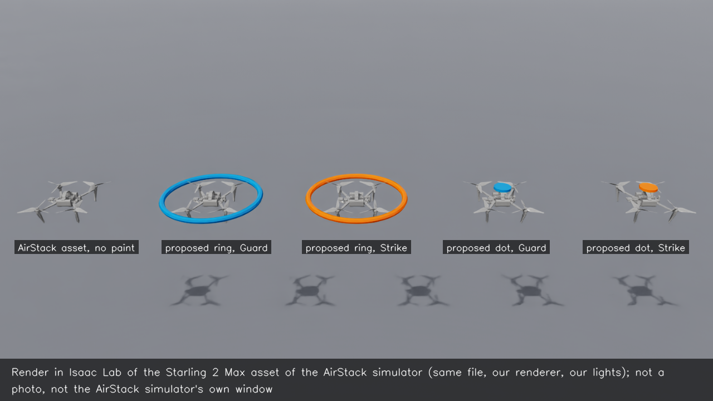
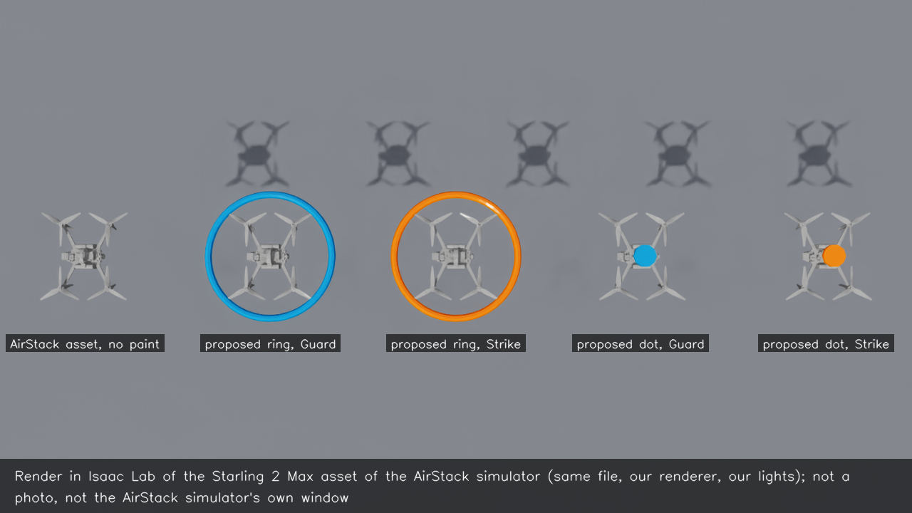
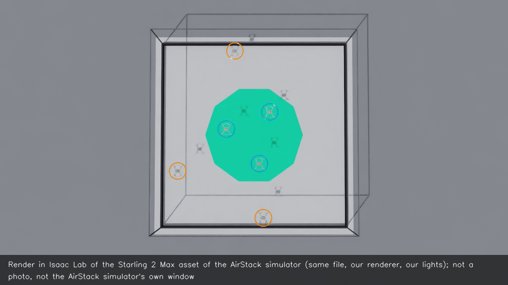
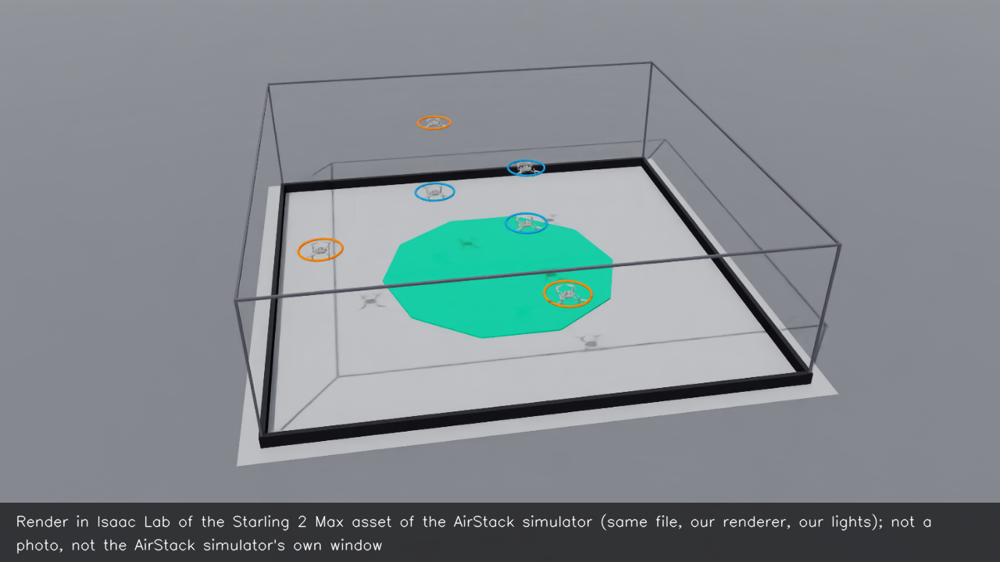
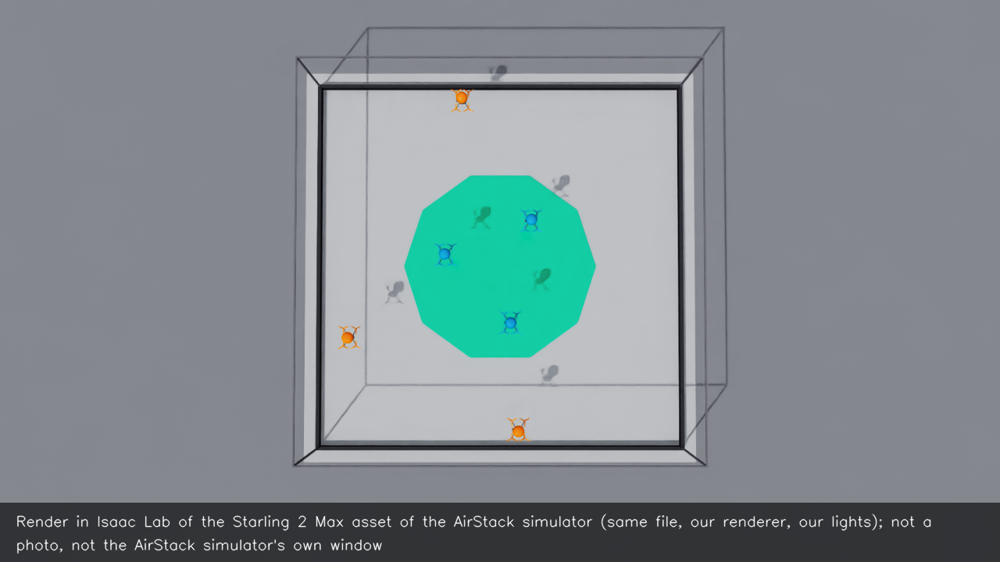
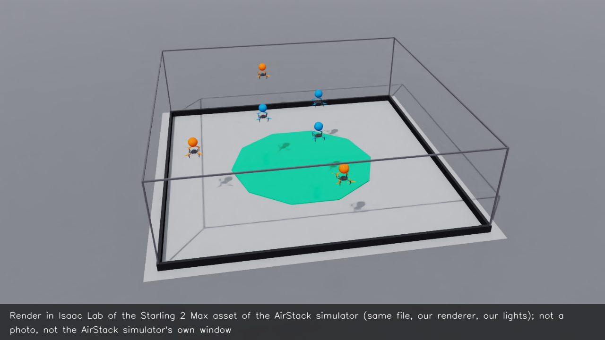
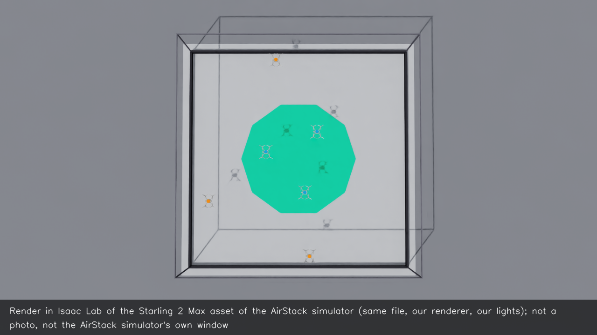
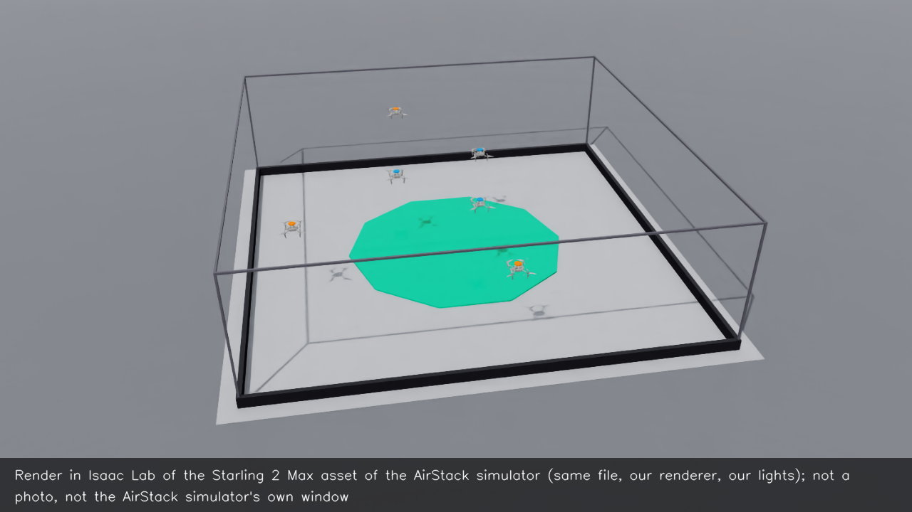

# L0.5 Starling video look fix: stills for the owner's check (D9)

Renders in Isaac Lab (Isaac Sim 5.1, the same version as the AirStack simulator) of the AirStack simulator's own Starling file, `AirStack/simulation/isaac-sim/assets/robots/starling2max.usd` (read only). The file carries no material and no colour, and the AirStack simulator adds none when it spawns it (Pegasus `vehicle.py` and `starling2max.py`, read), so the AirStack simulator should draw the renderer's default surface too (read from the files and code; not verified in its window). Not compared: the AirStack simulator's own lights, world, camera and spinning rotors (Pegasus turns the rotor joints); no AirStack window was opened (rule: the AirStack simulator is not run for this task).

**row_l05_close.** L0.5: the file's own look (left), then the two proposed team markers: a thin ring around the drone and a small dot on its top. The drone itself is not painted.

**row_l05_top.** L0.5 from above: the ring stays visible around the drone; the dot sits on the top plate.

**arena_own_ring_top.** Look `own_ring` at clip scale, top view: the six drones of a replayed L0.11 game frame (tick 19). Training simulator, drawing only.

**arena_own_ring_3d.** Look `own_ring` at clip scale, 3-D view: the six drones of a replayed L0.11 game frame (tick 19). Training simulator, drawing only.

**arena_painted_top.** Look `painted` at clip scale, top view: the six drones of a replayed L0.11 game frame (tick 19). Training simulator, drawing only.

**arena_painted_3d.** Look `painted` at clip scale, 3-D view: the six drones of a replayed L0.11 game frame (tick 19). Training simulator, drawing only.

**arena_own_dot_top.** Look `own_dot` at clip scale, top view: the six drones of a replayed L0.11 game frame (tick 19). Training simulator, drawing only.

**arena_own_dot_3d.** Look `own_dot` at clip scale, 3-D view: the six drones of a replayed L0.11 game frame (tick 19). Training simulator, drawing only.

