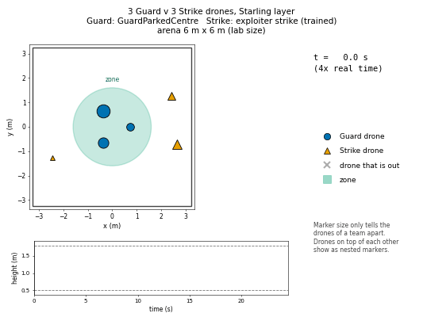
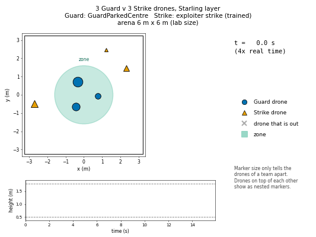
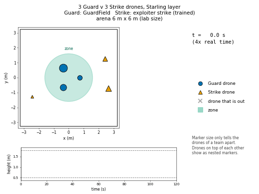
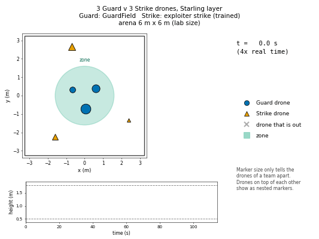
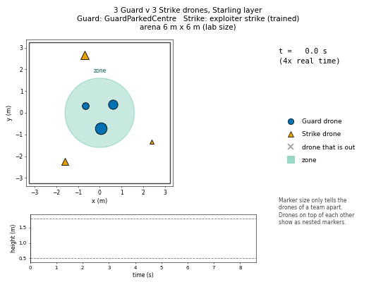

# 2-D clips of the L1 side track, L1.11 and L1.13 (records T58 and T59)

Training simulator, tier 1, 3v3; not a flight. L1.11 plays at tag 1.6 m, L1.13 at tag 1.15 m (the safety filter's 1.10 m
keep-out plus 0.05 m). The clips play the clip seed's own starts (`clip_seed` 120950 in the gate files), drawn on the
CPU, not T44's 1,000 scoring starts, so a clip's game number is not a scoring game's. Each clip is a top-down view with a
height panel under it, at 4x real time. Strike team orange triangles, Guard team blue circles, a cross where a drone was
tagged out. The title's "6 m x 6 m" is the 6.5 m arena rounded (the renderer rounds half to even). The height panel's
dashed lines are the height band, 0.5 m and 1.8 m; tier 1's vertical response is not fitted, so climbs and drops are not
the drone's. Numbers: [record T58](../../../records/2026-11-22_ste_l111_strike_record.md) (L1.11),
[record T59](../../../records/2026-11-22_ste_l113_record.md) (L1.13). L1.12 (record T57) is scoring only and has no
clips. 3-D clips of the key games are pending.

| Clip | Caption |
|---|---|
|  | **L1.11, game 0, reach.** Strike team trained against field Guards at 1.6 m. One Strike and one Guard are tagged out early; a Strike drone enters the zone at 3.2 s, all drones near 1.2 m. Over 1,000 scoring games: 277 reaches, level with the straight-Strike script's 284. Clip seed's own starts, not the scoring starts. |
|  | **L1.11, game 1, hold.** Same match: one-for-one tags take out all six drones by 2.2 s, so the Guard team holds. Games against field Guards are short (median 2.2 s). Clip seed's own starts, not the scoring starts. |
|  | **L1.11 run 0, game 0, reach.** The learner check against parked Guards (not field), 1.6 m. Two Strikes trade for two Guards; the Strikes sink slowly (one trace reaches 0.5 m; vertical response not fitted) and the last enters the zone at 24.5 s. Run 0 passed at update 10 (502 of 1,000, bar 416). Clip seed's own starts, not the scoring starts. |
|  | **L1.11 run 0, game 2, hold.** Same learner check: one-for-one tags take out all six drones, so the Guard team holds at 15.9 s. Clip seed's own starts, not the scoring starts. |
|  | **L1.13 arm A, game 0, hold.** 30 s clock, 1.15 m, field Guards. One Strike climbs to 1.8 m, two drop to 0.5 m (vertical response not fitted); all six drones are out by 28.8 s. Over 1,000 games: 199 reaches at 30 s v T52's 145; the shorter clock changes what is learned and T52 plays outside its training clock. Clip seed's starts, not the scoring starts. |
|  | **L1.13 arm A, game 1, hold.** Same split in height: one Strike climbs to 1.8 m, two drop to 0.5 m within 5 s (vertical response not fitted); all six drones are out by 17.0 s. Most of arm A's losses end with every Strike tagged (784 of 1,000), not at the clock. Clip seed's own starts, not the scoring starts. |
|  | **L1.13 arm B, game 0, hold.** Discount 0.997, 120 s clock, 1.15 m, field Guards. The Strike drones drop to 0.5 m within about 12 s (vertical response not fitted); two Strikes and two Guards are still in at 120.0 s, so the clock ends it. Over 1,000 games: 99 reaches, level with T52's 103. Clip seed's own starts, not the scoring starts. |
|  | **L1.13 arm B, game 1, hold.** The Strike drones drop to 0.5 m within about 5 s (vertical response not fitted); the last of the six drones is tagged out at 114.1 s. Arm B ends 623 of 1,000 games with every Strike tagged (T52: 126). Clip seed's own starts, not the scoring starts. |
|  | **L1.13 run 0 for arm A, game 0, reach.** Learner check against parked Guards (not field), 30 s clock, 1.15 m. No tags; one Strike climbs to 1.8 m, one drops to 0.5 m (vertical response not fitted); reach at 9.3 s. Run 0 passed at update 20 (990 of 1,000, bar 849). Clip seed's own starts, not the scoring starts. |
|  | **L1.13 run 0 for arm A, game 1, reach.** Same learner check and the same height split (1.8 m and 0.5 m; vertical response not fitted); no tags; reach at 8.6 s. Clip seed's own starts, not the scoring starts. |
|  | **L1.13 run 0 for arm B, game 0, reach.** Learner check against parked Guards (not field), discount 0.997, 120 s clock, 1.15 m. One Strike and one Guard are tagged out; the Strikes spread in height (vertical response not fitted); reach at 16.7 s. Run 0 passed at update 10 (946 of 1,000, bar 849). Clip seed's own starts, not the scoring starts. |
|  | **L1.13 run 0 for arm B, game 1, reach.** Same learner check; no tags, one Strike climbs to 1.8 m (vertical response not fitted); reach at 15.7 s. Clip seed's own starts, not the scoring starts. |
