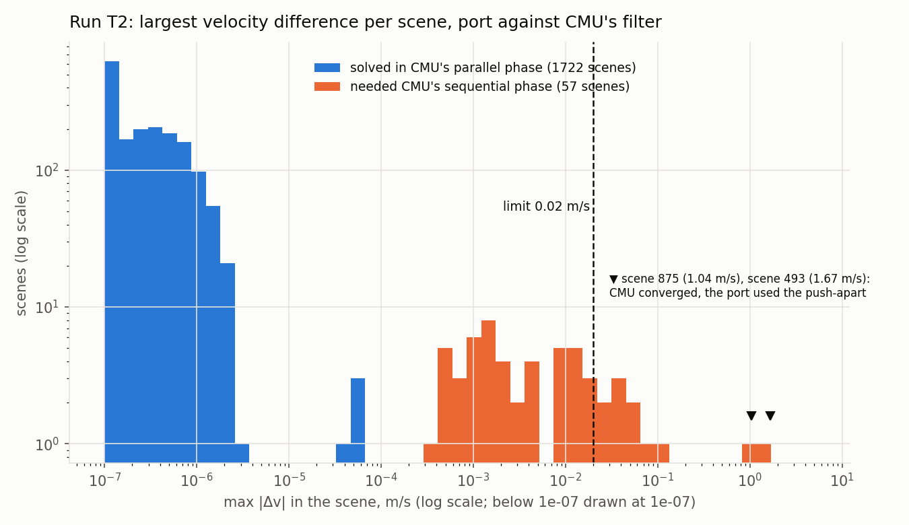
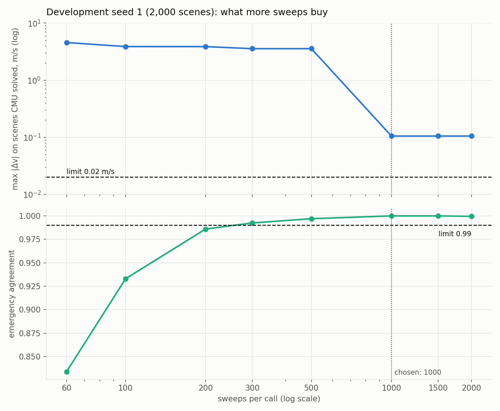

Simulator: training simulator (safety-filter port vs CMU cbf_filter.py, CPU)

# 2026-11-15T04:45:54+08:00 2026-11-15_s1_filter_parity record

## Purpose

Check that the batched safety-filter port (`source/svg_training/core/safety_filter.py`) gives the same velocities and the same emergency decisions as CMU's `cbf_filter.py`, and that Guard–Strike pairs get no correction. Overall result: **FAIL**.

## Original

`AirStack/robot/ros_ws/src/svg_ground_control/svg_ground_control/cbf_filter.py`, git blob `8d0cb2b2ea9c817488d4c50cbfdb5ec8fe795b16`, sha256 `7f5d8c5a58398a9702e79ab905e8ef371304277136700658b5234fb5a9078db9`; called one scene at a time (once per team in two-team scenes), defaults `max_iterations` 200, `tolerance` 2e-3, no `fixed` rows.

## Commit

Repository HEAD `de76c92cd0adf1db7e6c62e751b793186bdd62f3`. Port sha256 `8559e7061af9`, script sha256 `a8c9aaad93f1`.

## Config

`/home/jeremychia/AirStack-starling-max2/svg_training/configs/s1.toml`, sha256 `996714a9cf0f1b27b6595da6758c3a30d2fb76e1e716a69f032a5489949e8e94`, table `[filter_gates]`.

## Settings

Port: `iterations` 1000, `tolerance` 0.002, dtype float32, device CPU (8 threads). Both: safety radius 0.55 m, alpha 2.5, speed cap per scene. Port emergency rule: non-finite row, coincident pair, or residual after the clamp > 5 x tolerance (the original also acts when its solver did not converge; see the port's docstring).

## Seeds

Scene seed 20261115; scene k uses `numpy.random.default_rng([20261115, k])`.

## Scenes

2000 scenes: 995 one team, 1005 two teams (random split). Drones per scene: 2: 310, 3: 286, 4: 263, 5: 273, 6: 272, 7: 288, 8: 308. Scenes with a pair closer than 1.65 m: 94.8%; pairs that close: 45.0% (within a team: 44.8%). Scenes with a pair inside the 1.10 m keep-out: 1437; with coincident drones: 149. Speed cap 1.0–4.0 m/s; nominal speeds up to the cap, head-on on half of the near pairs.

Original: converged without emergency in 1779 scenes (subset S), emergency in 221, Gauss-Seidel polish needed in 278; most sweeps in one call 400. Port: emergency in 223.

## Machine

Intel(R) Core(TM) Ultra 9 275HX; torch 2.7.0+cu128, numpy 1.26.0, Python 3.11.15.

## Gates

`max_abs_dv_mps` and `constraint_residual_max` are taken over subset S (every within-team pair constraint and the speed cap, recomputed in float64 from the port's velocities). `emergency_agreement_min` is over all scenes. `cross_team_corrections` counts Guard–Strike pairs whose drones' velocities change at all when the other team is removed from the game.

| Gate | Measured | Limit (FIXED) | Result |
|---|---|---|---|
| `max_abs_dv_mps` | 1.6666 | <= 0.02 | FAIL |
| `constraint_residual_max` | 2.08973 | <= 0.002 | FAIL |
| `emergency_agreement_min` | 0.999 | >= 0.99 | PASS |
| `cross_team_corrections` | 0 | <= 0 | PASS |

Cross-team pairs checked: 5634, of which 2314 violate their constraint at the nominal velocities (they would be corrected without the team mask).

Context (informational, not gates): in 57 scenes of S the original needed its Gauss-Seidel polish, which the port does not have; largest |Δv| there 1.67 m/s, on the rest of S 6.18e-05 m/s. The original's own worst constraint residual on S is 0.00417 (94 scenes above 0.002): it tests convergence before its final speed clamp.
Scenes where both used the emergency push-apart: 221; largest velocity difference there 3.73 m/s (informational: the port evaluates every pair on the pre-push velocities, the original pair by pair).

## Worst scenes (subset S, by max |Δv|)

| Scene | Drones | Teams | Speed cap (m/s) | Original sweeps | max abs dv (m/s) | Port residual | Original residual |
|---|---|---|---|---|---|---|---|
| 493 | 7 | 1 | 1.84 | 311 | 1.67 | 2.09 | 0.00334 |
| 875 | 6 | 1 | 1.87 | 280 | 1.04 | 1.86 | 0.00382 |
| 100 | 5 | 1 | 2.42 | 233 | 0.133 | 0.00269 | 0.00285 |
| 61 | 8 | 1 | 1.29 | 234 | 0.0739 | 0.00428 | 0.00259 |
| 1003 | 7 | 1 | 1.55 | 222 | 0.0492 | 0.00287 | 0.00119 |

## Emergency disagreements

2 scenes: 493 (original no, port yes, original sweeps 311), 875 (original no, port yes, original sweeps 280).

## Timing (informational)

Original, one call at a time: 16.69 s for 2000 scenes. Port, one batch of 2000 games x 8 drones: 3.728 s.

## Figures

Drawn by `scripts/make_s1_filter_figures.py` (fix round 1, 2026-11-15). The run saved no per-scene output, so the
script recomputed it with the same code, seed and settings, and checked that the gate numbers equal this record's.

Each bar counts scenes by how far the port's velocities are from CMU's, over the 1,779 scenes CMU solved without its emergency action. Every blue scene, solved in CMU's first phase, is within 0.0001 m/s. Only orange scenes, which CMU finished in a second, sequential phase the port does not have, go past the 0.02 m/s limit; the two marked ones are where the port used the push-apart.

Development seed 1, not this record's seed. More sweeps help in steps: from 1,000 the largest difference stays at 0.105 m/s, which is how far CMU's own answer is from the exact solution (a 20,000-sweep float64 run, implementer report §3), so it never reaches the 0.02 m/s limit. Emergency agreement passes 0.99 from 300 sweeps.

## Notes added after the final S1 review (15 Nov)

Added by the implementer of the final-review fixes; no number in this record changed.

- **The port changed after this run.** "Commit" gives the port's sha256 as `8559e7061af9`. The port has since had the NaN fix (one game's NaN no longer spreads to other games); its sha256 is now `6272a19cfd6f`. The final review states that a recomputation gives identical numbers. No per-scene output of this run was saved, so this record cannot show that itself.
