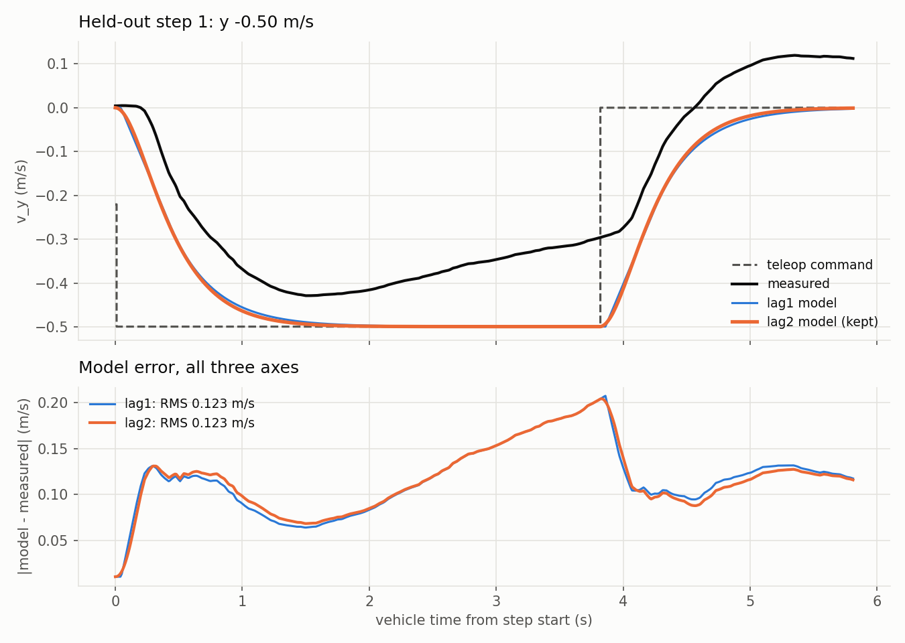
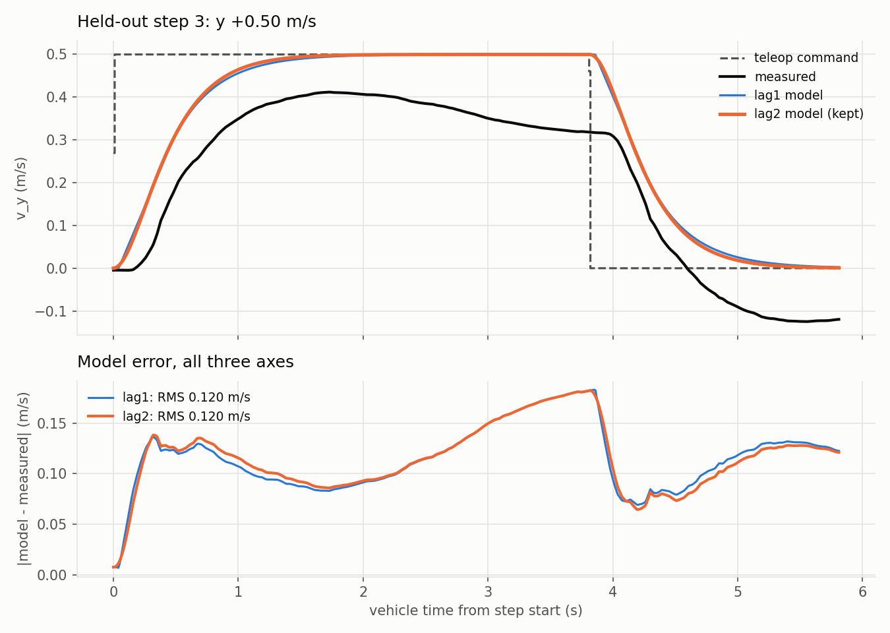
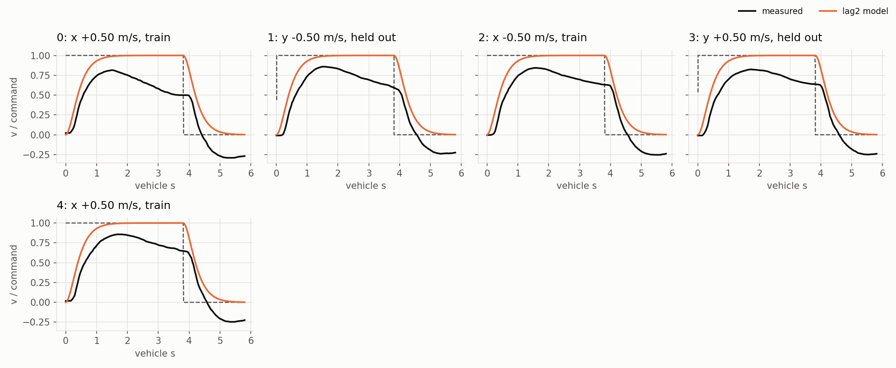

Simulator: AirStack simulator (Isaac Sim + Pegasus + PX4 SITL in lockstep), one drone; session teleop_frame_20261102_191344

# 2026-11-15T13:50:14+08:00 2026-11-15_s1_fit_v0 record

## Purpose

Fit a simple model of how the drone's speed follows the speed a policy asks for (the response model: teleop command -> measured velocity) to one session observed in the AirStack simulator. Two model shapes were fitted and the better one was judged against the fixed gates. Overall result: **FAIL**.

Failed gates: vel_rms_max_mps, t63_err_max_s, min_held_out_steps. The parameter file is written all the same: `airstack_sim_v0` is the first parameter set fitted to the AirStack simulator. It has not passed the fit gates, and it has not been compared with the placeholder model.

Run history: executed three times with the same arguments and identical parameters, metrics and verdict; the reruns only added the figures and changed one caption. Each rerun removed the previous run's ledger row before adding its own, so ledger row T3 carries the final run's time. The first run's files are in `runs/2026-11-15_s1_fit_v0/first_run/` (on this laptop; runs/ is git-ignored). Afterwards the figures were copied unchanged to `docs/figures/` and the script now writes them there. After review, this record's wording was edited by hand (no number changed): the Terms, Reading and split sentences, the optimiser wording and the "Exploratory, not used" time-scale paragraph. The script now generates the same sections for later runs.

## Terms used here

- **Time scale**: how many seconds pass on the simulated drone's own clock (vehicle time) for each second of wall-clock time. The simulator runs faster than the wall clock, and the recording is stamped in wall time.
- **lag1 and lag2** (the two model shapes, or families): lag1 is a short wait (the delay) followed by one smooth catch-up curve towards the asked-for speed (a first-order lag with time constant tau). lag2 adds a second smooth catch-up stage after the first (time constant tau2).
- **Train and held out**: train steps are the ones the fit sees. Held-out steps are kept aside and never used for fitting; the gates are judged on them only.
- **RMS** (root mean square): the typical size of the gap between the model's speed and the measured speed over a step, in m/s.
- **t63**: the time to reach 63 % of the change in speed after a step starts. The gate compares the model's t63 with the measured one.

## Code version

code_sha (first 12 hex of a sha256 over source/, scripts/, configs/): `2e166feea419`. This is the code that made the numbers. The script was edited afterwards (fix round 1), and that edit changes only where the figures are written (`docs/figures/` instead of `runs/`); the fit code is unchanged.

## Config

`configs/s1.toml` `[fit_gates]` (FIXED, approved), sha256 `996714a9cf0f1b27b6595da6758c3a30d2fb76e1e716a69f032a5489949e8e94`

## Inputs

- Bag: `/home/jeremychia/flight_logs/sim/sim_teleop_frame_run1/teleop_frame_20261102_191344` (extracted by bag_to_csv.py, sha256 `84d43208b4ca3989db747e6b18a94cd189ae3d9c6e49651932ab3e8747d31cc3`)
- CSVs: `runs/s1_extract_check`; command = `teleop_command` (what a policy sends); 0 odometry rows dropped (repeated or backward stamps)
- Ulog: `/home/jeremychia/flight_logs/sim/sim_teleop_frame_run1/drone_1_sysid2_19_13_19.ulg` (read-only), sha256 `4d27f7d2d5f49d1a2d8c28022ef67e768f216535146df53e7d812ab4d75f73f7`
- Grid: 0.010 s of vehicle time; speed cap 2.0 m/s (FIXED, not fitted)

## Time scale — MEASURED

Vehicle seconds per wall second (bag stamps are wall time).

| Method | Value | Detail |
|---|---|---|
| ulog flight span (USED) | 1.9073 | PX4 takeoff -> touchdown 118.00 s (vehicle 248.33 -> 366.32) over bag 61.87 s (wall); height threshold 0.2 m |
| ulog arm -> disarm over commander ARMING -> IDLE (coarse, not used) | 1.8546 | PX4 245.705 -> 369.963 s = 124.26 s; commander states at 5 Hz, 67.00 s wall; ARMING starts before PX4 arms |
| reader check | - | pyulog dump next to the ulog: arm 245.705427, disarm 369.963000; this reader: 245.705427, 369.963000 |
| position-derivative gain (cross-check) | 1.9195 | d(position)/d(wall t) against the rotated velocity, 714 samples moving >= 0.2 m/s |

Used / derivative gain - 1 = -0.63 % (stop limit ±5 %). Ported logic: tools/hover_step_timescale.py, tools/hover_step_analysis.py (git blobs in the parameter file); ULog read by the reader in scripts/fit_response.py (pyulog is not on the host).

Exploratory, not used: matching 15 position crossings in the ulog and the bag suggests the time scale drifts during the session, between about 1.73 and 1.97. One constant scale is therefore good to a few percent.

## Odometry frame — MEASURED

The odometry twist is in the body frame; it is rotated to world ENU with the odometry attitude before fitting. Mean cosine with d(position)/dt over moving samples: rotated 0.999, as published 0.118.

## Segments

Detected where the teleop command leaves rest (|cmd| >= 0.2 m/s); split: even train, odd held out. This put all three x steps in training and both y steps in the held-out set, so the held-out result tests the y axis only.

| # | Axis | Sign | Speed (m/s) | Start (vehicle s) | Hold (vehicle s) | Split |
|---|---|---|---|---|---|---|
| 0 | x | + | 0.50 | 16.69 | 3.81 | train |
| 1 | y | - | 0.50 | 36.71 | 3.82 | held out |
| 2 | x | - | 0.50 | 56.84 | 3.81 | train |
| 3 | y | + | 0.50 | 77.05 | 3.82 | held out |
| 4 | x | + | 0.50 | 97.37 | 3.81 | train |

## Fit, both model families — MEASURED (fitted)

| Parameter | lag1 | lag2 (kept) |
|---|---|---|
| delay_s | 0.04284 | 0.0001221 |
| tau_xy_s | 0.3428 | 0.245 |
| tau_z_s | 0.8833 (not identified) | 0.4 (not identified) |
| acc_max_xy_mps2 | 0.6931 | 1.431 |
| acc_max_z_mps2 | 1 (not identified) | 1.5 (not identified) |
| tau2_s | - (lag1) | 0.2113 |
| speed_cap_mps | 2 | 2 |
| held-out velocity RMS, worst step (m/s) | 0.123 | 0.123 |
| held-out t63 error, worst step (s) | 0.340 | 0.345 |
| held-out velocity RMS, pooled (m/s) | 0.121 | 0.121 |
| training velocity RMS (m/s) | 0.075 | 0.075 |
| optimiser | stopped at its 3,000-evaluation limit, not converged (status 0) | converged after 43 evaluations (status 3) |

Parameters: delay_s is the wait before the drone reacts; tau_xy_s and tau_z_s are the time constants of the catch-up curve, sideways and up/down; tau2_s is lag2's second stage; acc_max_* is the largest acceleration the model allows; speed_cap_mps caps the asked-for speed.

Kept: **lag2**. The two families tie on held-out RMS to 3 decimals (0.123 m/s), so the choice between them is arbitrary here. 'Not identified': raising the parameter by 25 % moves the model over the training windows by less than 0.002 m/s RMS, so the session does not determine it; its value is the optimiser's start.

## Gates — limits FIXED, observed MEASURED (lag2, held-out steps only, vehicle time)

| Gate | Limit | Observed | Result |
|---|---|---|---|
| vel_rms_max_mps: typical speed error, worst held-out step (m/s) | 0.10 | 0.123 | FAIL |
| t63_err_max_s: t63 error, worst held-out step (s) | 0.10 | 0.345 | FAIL |
| delay_range_s: fitted delay (s) | [0.00, 0.40] | 0.0001 | PASS |
| min_held_out_steps: number of held-out steps | 8 | 2 | FAIL |

## Reading

Both families fail for the same reason: the measured speed rises to 81–86 % of the command, sags during the hold and moves back the other way after the release (Figure 3), which a model that settles at the command cannot follow. The lag1 optimiser stopped at its 3,000-evaluation limit without converging, and lag2's delay went to about 0 s while its second lag (tau2 0.21 s) took that role, so the delay check passing tells us little. Why the drone sags and reverses is not claimed here: it is being investigated in `runs/sdd/s1/task-4-cause.md`, and Task 6's model depends on the answer.

## Held-out steps

| # | Axis | Step (m/s) | lag1 RMS (m/s) | lag2 RMS (m/s) | t63 measured (s) | lag1 t63 (s) | lag2 t63 (s) | Plot |
|---|---|---|---|---|---|---|---|---|
| 1 | y | -0.50 | 0.123 | 0.123 | 0.824 | 0.510 | 0.505 | [s1_t3_held_out_step_1.png](../docs/figures/s1_t3_held_out_step_1.png) |
| 3 | y | +0.50 | 0.120 | 0.120 | 0.848 | 0.508 | 0.503 | [s1_t3_held_out_step_3.png](../docs/figures/s1_t3_held_out_step_3.png) |

## Figures

Made by this run from its own data (measured odometry, rotated to world, against the fitted models on the same vehicle-time grid).

*Figure 1.* Held-out step 1: the policy commands -0.50 m/s along y. The measured speed peaks at 0.43 m/s; it reaches 63 % of the command after 0.82 s against 0.50 s for the lag2 model. The lower panel is the model error the velocity gate scores (RMS 0.123 m/s, limit 0.10).

*Figure 2.* Held-out step 3: the policy commands +0.50 m/s along y. The measured speed peaks at 0.41 m/s; it reaches 63 % of the command after 0.85 s against 0.50 s for the lag2 model. The lower panel is the model error the velocity gate scores (RMS 0.120 m/s, limit 0.10).

*Figure 3.* Every detected step, train and held out, as a fraction of the commanded speed (dashed); black is measured, colour is the kept lag2 model fitted on the train steps only. The measured speed peaks at 81% to 86% of the command and is at 50% to 65% when the command is released. After the release its lowest value is -29% to -24% of the command (below zero means it moves back the other way).

## Outputs

- Parameter file: `params/airstack_sim_v0.toml`
- Figures: `docs/figures/` (s1_t3_held_out_step_1.png, s1_t3_held_out_step_3.png, s1_t3_all_steps.png), copied unchanged from this run's `runs/2026-11-15_s1_fit_v0/` (git-ignored)

## Limits of this record

- Numbers were observed in the AirStack simulator; nothing here is a flight result. The parameters are simulator parameters and never go to the drone (repository iron rule 9).
- One time scale for the whole session; exploratory checks put its drift at about 1.73–1.97 (see Time scale). The model has no commander P term on the leashed reference and no up/down asymmetry.
- The held-out split is fixed (alternate segments), not chosen after seeing the results. In this session it puts every x step in training and both y steps in the held-out set, so the held-out result tests y only.
- Not identified by this session (lag2): tau_z_s, acc_max_z_mps2.

## Notes added after the gatekeeper check (15 Nov)

Added by the technical writer at the lead's request; no number in this record changed.

- **Machine**: this laptop (Intel Core Ultra 9 275HX; the RTX 5070 Ti Laptop GPU is not used: the fit is NumPy and SciPy on the CPU); conda `env_isaaclab`, Python 3.11.15, NumPy 1.26.0, SciPy 1.15.3 (versions read from that environment on 15 November 2026).
- **Seeds**: none. The fit is deterministic (`scipy.optimize.least_squares` from fixed starting values; `scripts/fit_response.py` and `models/fit.py` draw no random numbers). The gatekeeper's re-run gave identical parameters, metrics and verdict.
- **Model family chosen on held-out steps.** `scripts/fit_response.py` keeps the family with the lower held-out RMS. Held-out steps must not choose anything. Here the two families tie (0.123 m/s) and both FAIL, so the verdict does not change; the script must choose on training error before any later fit (`runs/sdd/s1/gatekeeper-s1.md`, must-fix 2).
