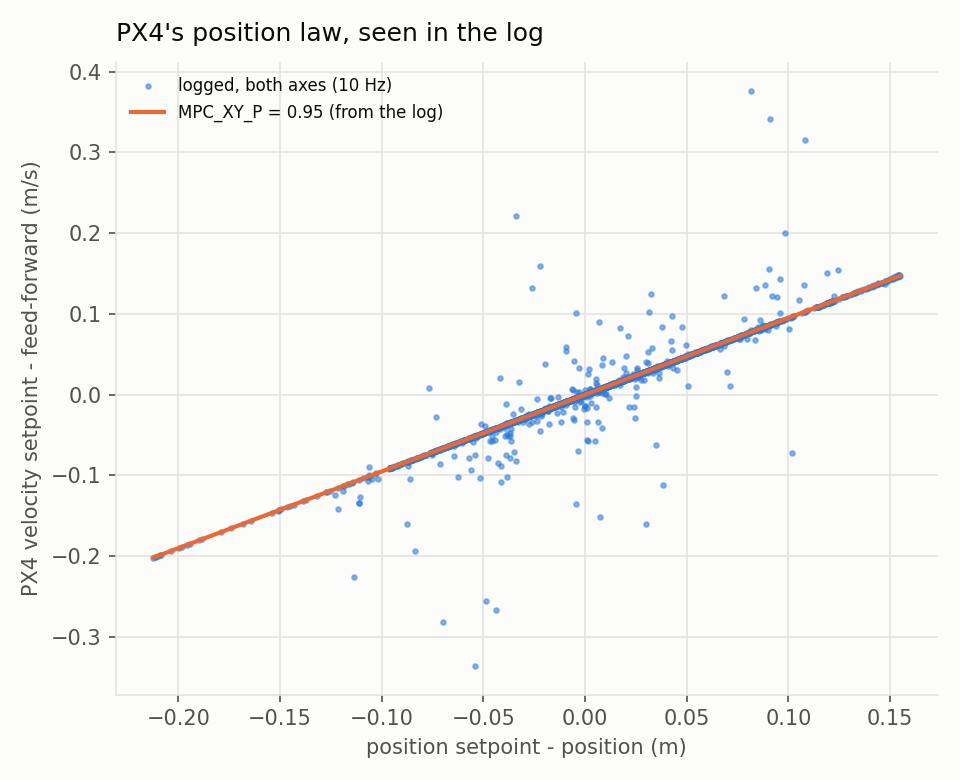
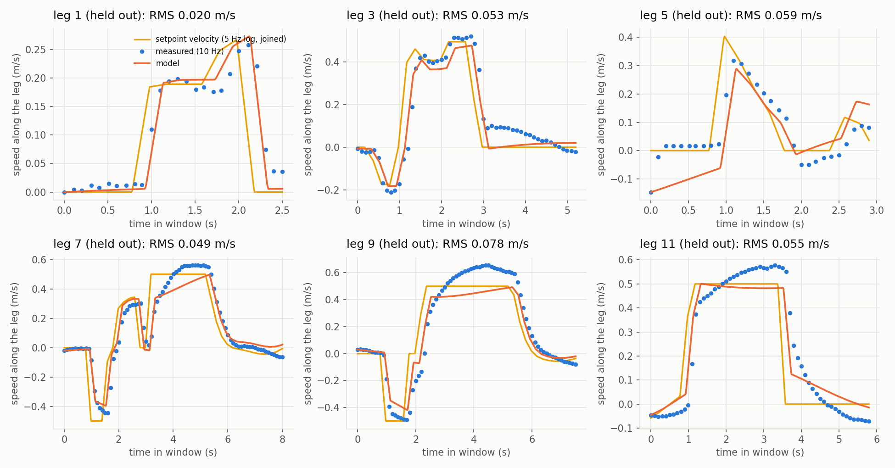
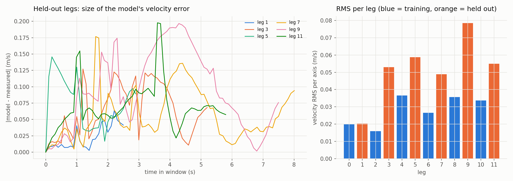
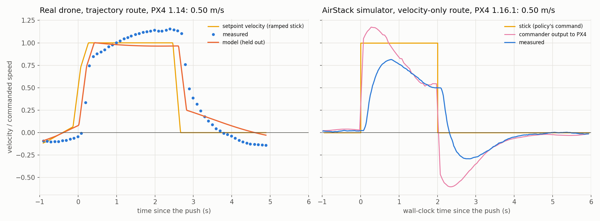

Exploratory, not a run of record: no gates applied, no ledger row.

Source: real flight (the Starling drones' own PX4 1.14 logs). No simulator was run. AirStack simulator data appear only in the comparison of section 6.

# 2026-11-15 S1: how the real drone follows the commander (exploratory)

**Revised after review (fix round 1).** The model shape and the feed-forward source are now chosen on the training legs only; the first version chose them on the held-out legs. That changed the kept shape from `pid` to `lag1` and the held-out error from 0.046 to 0.058 m/s. A naive baseline was added, and it does as well as the kept model on held-out legs. Section 9 lists what changed.

## In short

- On the real drone, a stick push does not reach PX4 as a bare speed. The ground commander sends one setpoint (an instruction for this instant) with a position, a speed and an acceleration. PX4, the flight software on the drone, then closes the position loop itself, in real time.
- A small model of PX4's law was fitted to the 13 November gamepad flight, with the drone's own gains read from its log. On the six legs kept aside from the fit (held-out legs), its typical speed error (RMS) is **0.058 m/s**. A naive guess does just as well: "the drone flies the setpoint's speed, 0.15 s later" also scores **0.058 m/s**. This data does not show the model to be better than a pure delay.
- The model misses the real drone in both directions:
  - Peaks while a push is held: measured 1.03–1.31 times the commanded speed. The model is lower on five legs and higher on one (leg 1: 1.38 against 1.31).
  - After release: the drone drifts slowly back by about 0.14 times the command. The model shows about 0.03.
- The drone reaches 63 % of a speed change about **0.2 s after its setpoint does** (median of six held-out starts and six stops).
- The AirStack simulator was compared with one real leg (section 6). In the simulator a held 0.5 m/s push sags to about half speed and swings back on release. The two cases use different command routes and different PX4 versions, so this compares routes, not drone physics.

## Terms used here

- **Commander**: CMU's ground-control program (`swarm_commander.py`). It turns a stick or a policy command into setpoints for each drone, 20 times a second.
- **Setpoint**: what the drone is told to do at this instant. Here it has three parts: a **position setpoint** (where to be), a **feed-forward speed** (how fast to move now) and a **feed-forward acceleration** (how hard to speed up now). "Feed-forward" means sent ahead, so the drone does not wait for an error to build up.
- **Reference point**: the commander's running "where the drone should be". The stick moves it; it is sent as the position setpoint.
- **PX4** and its loops:
  - The **position gain** `MPC_XY_P` turns a position error into extra speed.
  - The **velocity loop** (gains `MPC_XY_VEL_P/I/D_ACC`) turns a speed error into an acceleration.
  - The **attitude loop** tilts the drone to get that acceleration; it takes a short time, the **attitude lag**.
  - **Anti-windup** stops the velocity loop's running sum from growing while the acceleration is at its limit.
  - The **tilt limit** `MPC_TILTMAX_AIR` caps how far the drone may lean.
- **ulog**: PX4's own log file on the drone. It stores the setpoint it received (5 times a second here) and its estimate of position and speed (10 times a second). That estimate comes from PX4's **EKF**, its sensor-fusion filter, here fed with motion-capture positions.
- **uXRCE-DDS**: the link that carries messages between the laptop's ROS 2 programs and PX4, over WiFi.
- **NED and ENU**: two ways of naming axes. PX4 uses north-east-down; ROS uses east-north-up. Converting swaps x and y and flips z.
- **Delay**: a pure wait before the drone reacts. **Lag**: a smooth catch-up after it starts reacting.
- **t63**: the time from the start of a speed change until the speed has covered 63 % of it.
- **RMS**: root mean square, the typical size of the gap between the model's speed and the measured speed, in m/s per axis. **Least squares**: choosing the numbers that make that gap smallest.
- **Train and held out**: legs the fit sees, and legs kept aside to judge it. Every other leg in time order is held out, fixed before any fit.
- **Aliased**: sampled too slowly to catch a short event, so the samples hit or miss it by chance.
- **Wall clock and σ**: the wall clock is ordinary time. σ is how many seconds PX4 lives through per wall-clock second: 1 on the real drone, about 1.9 in the AirStack simulator.

## 1. The path a teleop command takes on the real drone

All paths are under `AirStack/robot/ros_ws/src/`, read at the current checkout (`a99a96a`), not at the commit flown on 13 November. Config: the 13 November flight ran `teleop_real_ours.yaml`, rendered for drone_2 by `tools/teleop/real_config.py`. The commander's own log says `drone_2(teleop/real) | real output: trajectory` (`~/flight_logs/2026-11-13/ros_log/python3_5289_1794559198231.log`, line 1).

| Step | Where | What happens |
|---|---|---|
| Real drones get the trajectory output | `svg_ground_control/config/teleop_real_ours.yaml:37` (`drone_modes: "real"`); `swarm_commander.py:467` (`real_command_mode` default `trajectory`), `:865-873`, `:887-890` | one `MultiDOFJointTrajectory` per tick on `/drone_2/fmu/trajectory_command`; the velocity-only output is not used |
| Stick in | `swarm_commander.py:1415-1421`, `:1879-1894` | stick dropped after 0.5 s without a message; capped at 0.5 m/s (`teleop_real_ours.yaml:79`) |
| Stick ramp | `swarm_commander.py:1896-1910`, `position_hold.py:116-147` | speed ramps at 5 m/s² (`teleop_real_ours.yaml:89`), so 0.5 m/s in 0.1 s; the ramp's acceleration is kept |
| No commander P term | `swarm_commander.py:1923-1924` | on the trajectory output the ramped stick is returned as is; `teleop_kp` 1.0 is unused |
| Reference point | `swarm_commander.py:2035-2037` → `:1951-1968`, `position_hold.py:85-113` | moves by the last published speed × 0.05 s per tick; leashed to 0.5 m; kept inside the teleop fence |
| Safety filter, fence, feed-forward | `swarm_commander.py:2200-2235` | one drone: only the 1.0 m/s cap; the fence can clip the speed and replace the acceleration with its braking value |
| Publish | `swarm_commander.py:2251-2297` | position = reference point (`:2260`), speed = ramped stick after filter and fence (`:2287`), acceleration = ramp, fence or filter value (`:2292`); `:2308` (applied) and `:2309` (published) make the sent speed the one the reference moves with |
| Interface | `interface/px4_interface/src/px4_interface.cpp:230-234`, callback `:333-389` | `TRAJECTORY` mode; ENU turned into NED; position, speed and acceleration all set; yaw held or yaw rate |
| Offboard mode flags | `px4_interface.cpp:620-637` | position, velocity and acceleration all on |
| PX4 1.14 | `PositionControl.cpp` at tag v1.14.0 (`~/PX4-Autopilot`, read with `git show`), `:124-138`, `:147-150`, anti-windup `:185-201` | `vel_sp = v_ff + MPC_XY_P·(p_sp − p)`, capped at `MPC_XY_VEL_MAX`; `acc_sp = a_ff + P·e + I∫e − D·a` |

**Clocks.** The commander's 20 Hz timer runs on the ROS node clock (`swarm_commander.py:986`). No real launch file sets `use_sim_time`, so this is the laptop's wall clock. PX4 on the drone runs in real time. So σ = 1. Over ten legs the log gives a median ratio of **1.01**: how far the reference point moved, divided by the integral of the feed-forward speed. The spread across legs, 0.96–1.11, is unexplained; legs 4 and 7, both 4–5 s long, give 1.11. The setpoint's timestamp is set on the laptop and shifted onto PX4's clock by the uXRCE-DDS time sync (PX4 v1.14 `uxrce_dds_client/dds_topics.h.em:103-111`).

**Config-dependent.** Stick cap 0.5 m/s and ramp 5 m/s² come from the `_ours` config. With `teleop_accel_mps2: 0` the acceleration part would be zero. With `real_command_mode: velocity` the real drone would get a bare speed and the commander's own P term, as in the simulator.

**What PX4 parameters the drone flew** (read from the ulog's parameter section, MEASURED):

| Parameter | drone_2 (log103, log105) | drone_1 (08_47_58) |
|---|---|---|
| `MPC_XY_P` (position gain) | 0.95 /s | 0.95 /s |
| `MPC_XY_VEL_P/I/D_ACC` | 1.8 / 0.4 / 0.2 | same |
| `MPC_XY_VEL_MAX` | 3.0 m/s | 3.0 m/s |
| `MPC_ACC_HOR` | 3.0 m/s² | 3.0 m/s² |
| `MPC_TILTMAX_AIR` | 45° | **30°** |

The 13 November logs show `MPC_XY_VEL_MAX` 3.0 m/s on both drones. `docs/CONFIG.md:121` lists 20 m/s for the real drone (and `MPC_ACC_HOR` 6), copied from the August backup in `~/RCC_Starling_1`. The owner may want to check which drone state is current. `MPC_ACC_HOR` is not applied in offboard flight in PX4 1.14. In `mc_pos_control` it is used only by the responsiveness setting (`MulticopterPositionControl.cpp:94`), and the logs set `SYS_VEHICLE_RESP` to −0.4, which leaves it unused. The flight tasks that also use it do not run in offboard.

## 2. The model

`source/svg_training/models/px4_trajectory.py` (NumPy reference). Input: the setpoint (position, feed-forward speed, feed-forward acceleration) in the horizontal plane, world frame. Output: the drone's speed. Two shapes:

- **pid**: PX4's law as written above, with the drone's own gains, then an attitude lag `tau_s`. Fitted: `tau_s`, `delay_s`. Fixed: everything else, the acceleration limit at `MPC_ACC_HOR`.
- **lag1**: the same position law, then one simple lag for the whole speed loop. Fitted: `tau_s`, `delay_s`, `acc_max_mps2`.

The feed-forward acceleration comes from one of three sources: rebuilt from the slope of the 5 Hz speed setpoint ("derived"), the logged samples as they are ("logged", aliased), or none. All six combinations of shape and source were fitted. The one with the lowest **training** error is kept. Naive baselines are scored beside it.

## 3. The data and the split

Main file: `~/flight_logs/2026-11-13/ulog_drone_2/log103.ulg` (flight ledger #36, one drone flown by gamepad, 156 s; sha256 `4db5b1fcf33e69c6…`). Legs are spans where the horizontal speed setpoint is above 0.1 m/s for at least 0.6 s. Gaps under 1 s are merged, and every window is airborne above 0.3 m. Each window runs from 1.0 s before to 2.5 s after its leg, cut at the midpoint to its neighbour, so windows never overlap. That gives **12 legs**. Legs 0, 2, …, 10 train; legs 1, 3, …, 11 are held out. The script writes this split to `split.json` before the first fit. The leg thresholds and the "derived" source were set before the first run and not changed; this can only be taken on trust.

## 4. Results

**PX4's position law can be seen in the log** (Figure 1). PX4 logs its own speed setpoint after the position gain. Compared with the feed-forward speed plus gain × position error, the least-squares gain is **0.98 /s** against `MPC_XY_P` 0.95. With 0.95 the gap is 0.017 m/s RMS; without the position term it is 0.052 m/s. The acceleration half of the law was not checked against the log.

*Figure 1. Each dot is one 10 Hz sample of the real flight: how far the drone was from its position setpoint, against how much PX4 added to the feed-forward speed. The line is the drone's own position gain, 0.95 per second, read from the log; a least-squares fit gives 0.98. Dots off the line come from joining 5 Hz setpoint samples during speed changes.*

**Scores** (log103; chosen on training RMS, held-out RMS only reported). "Active" counts only samples from leg start to 1 s after leg end; whole windows also include the calm 1 s before and 2.5 s after.

| What | Train RMS | Held-out RMS | Held-out, active |
|---|---|---|---|
| **lag1, derived feed-forward (kept: lowest train)** | **0.031** | **0.058** | 0.066 |
| pid, derived feed-forward (not kept) | 0.034 | 0.046 | 0.053 |
| Baseline: drone flies the setpoint speed, no delay | 0.062 | 0.095 | 0.112 |
| Baseline: drone flies the setpoint speed 0.148 s later | 0.040 | 0.058 | 0.068 |

Fitted values (fitted, exploratory; this record): **lag1** delay 0.148 s, acceleration limit 1.72 m/s², `tau_s` 1.65 s. `tau_s` is not pinned down: +25 % changes training RMS by 0.0002 m/s. **pid**: delay 0.140 s, attitude lag at its 0.01 s floor. Kept parameters: `runs/2026-11-15_s1_real_px4_exploratory/real_exploratory.toml` (git-ignored; deliberately not under `params/`).

Other combinations, train / held-out RMS in m/s:

| Shape | Logged feed-forward | No feed-forward |
|---|---|---|
| lag1 | 0.034 / 0.053 | 0.034 / 0.052 |
| pid | 0.061 / 0.083 | 0.086 / 0.086 |

lag1 with no acceleration limit, or with the limit at 3.0: 0.034 / 0.060.

Reading: the kept model is no better than a pure 0.15 s delay on the held-out legs. The PX4-shaped `pid` scores better there (0.046), but it was not chosen, because training error is the rule. Too few legs separate these shapes: training RMS differs by 0.003 m/s.

*Figure 2. The six held-out legs of log103, speed along each leg's direction. Yellow is the setpoint speed joined between its 5 Hz samples, blue dots the measured speed, orange the kept model (lag1) started from the measured state. The model was fitted on the other six legs only.*

*Figure 3. Left: size of the kept model's velocity error over time on each held-out leg; the peaks sit at the starts and stops of pushes. Right: RMS error per leg, training legs blue, held-out legs orange; held-out legs range from 0.020 to 0.079 m/s.*

**Where the model is wrong, held-out legs**, as fractions of each leg's commanded speed:

| Leg | Speed (m/s) | Peak measured / model | Lowest after release, measured / model |
|---|---|---|---|
| 1 | 0.19 | 1.31 / 1.38 | +0.19 / +0.03 (next push already starting) |
| 3 | 0.43 | 1.21 / 1.11 | −0.05 / −0.01 |
| 5 | 0.31 | 1.03 / 0.88 | −0.16 / −0.02 |
| 7 | 0.50 | 1.12 / 0.99 | −0.13 / +0.01 |
| 9 | 0.50 | 1.31 / 0.98 | −0.16 / −0.06 |
| 11 | 0.50 | 1.16 / 1.00 | −0.14 / −0.03 |

The real drone runs above the commanded speed while it catches up with its reference point. The model misses this on the 0.5 m/s legs and over-predicts it on leg 1. After release the drone drifts slowly back, by 0.05–0.16 times the command. The model shows almost none of that drift.

**Time to 63 % of each change**, held-out legs. Times count from the moment the setpoint starts to change. That moment is known only to about ±0.1 s, because the setpoint is logged every 0.2 s:

| Leg | Change | From → to (m/s) | Setpoint (s) | Measured (s) | Model (s) |
|---|---|---|---|---|---|
| 1 | start | +0.01 → 0.19 | 0.13 | 0.24 | 0.28 |
| 1 | stop | +0.20 → 0 | 0.08 | 0.27 | 0.24 |
| 3 | start | −0.21 → 0.43 | 0.09 | 0.32 | 0.26 |
| 3 | stop | +0.51 → 0 | 0.18 | 0.35 | 0.32 |
| 5 | start | +0.02 → 0.31 | 0.09 | 0.22 | 0.30 |
| 5 | stop | +0.17 → 0 | 0.46 | 0.63 | 0.57 |
| 7 | start | −0.27 → 0.50 | 0.15 | 0.38 | 0.28 |
| 7 | stop | +0.56 → 0 | 0.34 | 0.56 | 0.52 |
| 9 | start | −0.40 → 0.50 | 0.11 | 0.40 | 0.31 |
| 9 | stop | +0.62 → 0 | 0.34 | 0.58 | 0.50 |
| 11 | start | −0.04 → 0.50 | 0.23 | 0.46 | 0.38 |
| 11 | stop | +0.57 → 0 | 0.11 | 0.49 | 0.30 |

Medians: start 0.35 s measured and 0.29 s model; stop 0.52 s measured and 0.41 s model. The drone trails its own setpoint by a median 0.23 s at a start and 0.20 s at a stop. The `px4_interface.cpp:327-331` comment says "about 0.1 s lag" with feed-forward. The logs show about 0.2 s. At 5 Hz and 10 Hz logging the difference is about one sample, so neither number is pinned down.

**Delay.** Across both shapes and three logs the fitted delay is 0.065–0.15 s, and the lag usually sits at its lower bound or is not pinned down. 10 Hz logs cannot separate delay from lag. The fitted delay also absorbs everything else that is unmodelled: the join of 5 Hz samples, EKF smoothing and any time-sync error.

## 5. Cross-check on the 13 November two-drone flight (#37)

The kept parameters were used unchanged, with each log's own PX4 gains (no refit), on every leg:

| Log | Drone | Legs | RMS, kept parameters | Refit on its even legs: delay | Refit held-out RMS |
|---|---|---|---|---|---|
| `two_drone_teleop/drone_2/log105.ulg` | drone_2, hand-flown | 4 | 0.058 m/s | 0.144 s (lag at floor) | 0.055 m/s |
| `two_drone_teleop/drone_1_candidates/08_47_58.ulg` | drone_1, hovering, pushed by the safety filter | 2 | 0.061 m/s | 0.125 s | 0.059 m/s |

Both logs score about as log103's held-out legs do (0.058). Both show PX4's position law with a least-squares gain of 0.96. drone_1 flies a 30° tilt limit against drone_2's 45°; at 0.4 m/s this never matters.

## 6. Real drone and AirStack simulator, side by side

This compares two command routes, not two kinds of drone physics. The real drone gets position, speed and acceleration through `px4_interface`, with PX4 1.14. The AirStack simulator gets speed only through MAVROS (`setpoint_raw/local`), with PX4 1.16.1, and its commander runs on the wall clock against a PX4 running about 1.9 times faster. The sim config also differs: stick cap 2.0 m/s, hold 1.95 s against 2.56 s.

*Figure 4. Left: one real 0.5 m/s push (held-out leg 11, one of six) and the kept model: the drone peaks at 1.16 times the command (model 1.00) and drifts back slowly after release. Right: one 0.5 m/s push in the AirStack simulator: the commander's output peaks, sags and reverses. The two routes and PX4 versions differ.*

The real leg is one of the six held-out legs. It is the one at the full 0.5 m/s, starting near rest (below 0.15 m/s), with the longest hold. Legs 7 and 9 start from a reversal.

| Per push of 0.5 m/s | Real drone (leg 11) | AirStack simulator (5 pushes) |
|---|---|---|
| Highest speed while held | 1.16 × command (1.12–1.31 on the three 0.5 m/s held-out legs) | 0.81–0.86 × |
| Speed at release | 1.14 × | 0.50–0.65 × |
| Lowest speed after release | −0.14 × | −0.24 to −0.29 × (the commander itself sends −0.52 to −0.60 ×) |
| Clock ratio | 1.01 | 1.907 (task-4-cause.md) |
| Distance moved | 1.31 m (the setpoint's speed integrates to 1.27 m) | 0.98–1.02 m (stick × wall-clock hold = 0.975 m) |

Sources: the simulator column is computed by the script from `runs/s1_extract_check/` (`bag_to_csv.py` output of session `teleop_frame_20261102_191344`). The cause is explained in `runs/sdd/s1/task-4-cause.md`.

**What this means for training.** A response model fitted to the simulator's route would show a held push at about half speed and a backward swing on release; the real route shows neither. A policy trained only on the simulator's route might therefore ask for more speed than the drone needs. That is an inference, not a measurement. The simulator set (`airstack_sim`) is still the right one for predicting stage 6 (STANDARDS §5 rule 3), but not the drone.

## 7. Limits

- **Low speed only.** Every setpoint here is at most 0.5 m/s, the stick cap.
- **Coarse logging.** The setpoint is logged at 5 Hz and the speed at 10 Hz, against a 20 Hz command and a lag of about 0.1–0.2 s.
- **The feed-forward acceleration is rebuilt** or aliased, never logged in full.
- **No stick in the logs.** The fit is setpoint → speed (PX4's part); the commander's part is read from the code.
- **Ad hoc legs**, most starting from a reversal; some end at the teleop fence.
- **Few legs.** Six training legs do not separate the two shapes, and the held-out legs do not separate the kept model from a pure delay.
- **One flight, two drones, three logs.** PX4 1.14 was read at tag v1.14.0; the drone's build (`ver_sw 5274d6d3…`) was not compared with it.

## 8. What to record at the next real flight

This builds on `runs/sdd/s1/real-logs-survey.md` §6. Items 1, 3 and 4 there still stand (record a rosbag of every flight; designed steps; safety filter off for the fit flight). What these logs add:

1. **Record the stick and the commander's output together**: `/svg/drone_N/teleop_command` and `/drone_N/fmu/trajectory_command` in the bag.
2. **Log the setpoint at its full rate.** That means the setpoint at 20 Hz; `vehicle_local_position` and `vehicle_local_position_setpoint` at 50 Hz or more; `vehicle_attitude` and `vehicle_attitude_setpoint` at 50 Hz or more. That would separate delay from attitude lag. It is a change to the drone's logging, so the owner decides it (`SDLOG_PROFILE` is 129 today).
3. **Start every step from rest**, hold it 3–4 s and rest 3 s. Hold some for 5 s, to see whether the catch-up excess (up to 1.31×) and the slow drift after release settle.
4. **Speeds above 0.5 m/s** (0.75 and 1.0 m/s, as safety allows).
5. **Both drones.** drone_1 flies a 30° tilt limit and drone_2 45°; one stepped flight each.
6. **Write down** the commander's config file, the laptop time-sync state, each drone's PX4 build (`ver_sw`) and `MPC_XY_VEL_MAX`, with the flight's ledger number.

## 9. Changes after review (fix round 1)

| Item | Before | After | Why |
|---|---|---|---|
| Kept shape | pid (lowest **held-out** RMS) | lag1 (lowest **training** RMS) | held-out legs must not choose anything |
| Held-out RMS of the kept model | 0.046 | 0.058 | follows from the line above; the pid's 0.046 is still shown |
| Baseline | none | setpoint speed 0.15 s later: 0.058 | to judge whether the model adds anything; it does not, on this data |
| Active-span RMS | not given | 0.066 (kept), 0.053 (pid) | whole windows dilute the error with calm pre-roll and tail |
| Model t63 medians | 0.31 / 0.47 s | 0.29 / 0.41 s | lag1 instead of pid |
| Cross-check RMS | 0.049 / 0.057 | 0.058 / 0.061 | same |
| Wording | "stops without a reverse kick"; "1.0–1.16×"; "delay includes WiFi" | slow drift −0.14× missed by the model; 1.03–1.31×; delay 0.065–0.15 s, not separable from lag | the first wording overstated the data |

The measured numbers (position law, clock ratio, t63 measured, PX4 parameters, sim pushes) did not change.

## Files and how to re-run

From `svg_training/`, conda `env_isaaclab`: `PYTHONPATH=source python scripts/fit_real_px4.py` (about 45 s on the laptop; no randomness, so no seeds). It reads the three ulogs above and `runs/s1_extract_check/`, both read-only. It writes `runs/2026-11-15_s1_real_px4_exploratory/{split.json, results.json, real_exploratory.toml, stdout.txt}` and `docs/figures/s1_real_{position_law, held_out, model_error, sim_vs_real}.png`.

Code: `source/svg_training/models/px4_trajectory.py`, `scripts/fit_real_px4.py`. Tests are in `tests/test_px4_trajectory.py` (21 tests):
- known parameters recovered from synthetic data;
- the 5 Hz → 10 Hz join with known offsets;
- the NED → ENU swap on a hand-built ulog;
- the PID's D term against the closed-form response;
- anti-windup against a transcription of PX4's code.

Repository commit at the time: `a99a96a`; this work is uncommitted.
