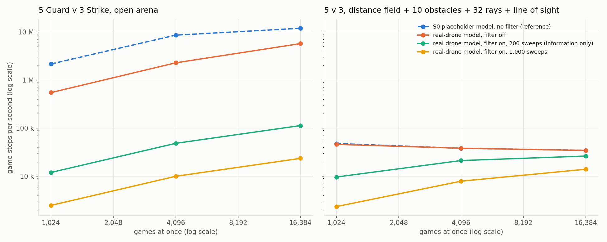

Simulator: training simulator, tier 1 (batched PyTorch, GPU), with the exploratory real-drone response model and the safety filter.

# 2026-11-15T15:18:31+08:00 2026-11-15_s1_tier1_fitted_filter record

Result: **INFO (no gates)**. Ledger row T4.

## Purpose

Measure how fast tier 1 runs once it carries the real drone's command chain, and what the safety filter costs. Two new pieces sit between the policy and the drone's motion:

- **The commander copy** (`models/commander.py`). The ground commander is CMU's program that turns a speed command into one setpoint per 0.05 s for the drone: a point to hold, a speed and an acceleration. The copy reproduces its real-drone teleop law: speed cap 0.5 m/s, a ramp of 5 m/s², and a reference point leashed 0.5 m from the drone.
- **The PX4 response** (`models/fitted.py`). PX4 is the flight software on the drone. Its reaction to that setpoint is the small model fitted to real flight logs at speeds up to 0.5 m/s (exploratory, no gates; `params/real_exploratory_v0.toml`).

The **safety filter** (`core/safety_filter.py`, a port of CMU's collision filter) keeps the speeds commanded to drones of the same team outside a 1.10 m keep-out, centre to centre. The drones themselves can come slightly closer: see "What the filter does not cover" below. It sits where the commander calls it: on the ramped command, before the setpoint is built (`swarm_commander.py:2140-2146`). It never acts between a Guard drone and a Strike drone. It works by repeated corrections ("sweeps") of every drone's speed. 1,000 sweeps is the count its parity record used; 200 is shown for information only.

Throughput only. Nothing here says how well a policy will fly; observed in the training simulator.

## Commit

Repository HEAD `b467aa5d2c7cca2762ef09c450fd5ba3785f4c7f`, with this task's files uncommitted (the lead commits). Every result row carries `code_sha` `bf462451bc04` (sha256 over `source/`, `scripts/`, `configs/` at run time). Changes after the run: the figure script, then review fix round 1 (per-team speed cap in `envs/tier1_bench.py`, a `[filter]` key check and docstrings in `models/fitted.py`, tests); the folder's `code_sha` is now `59d98edf8f6c`. The measured code path changed only by the speed cap (see "Speed caps per team"). Files: `models/commander.py` `973c877b65eb`, `models/fitted.py` `56f7f447fc31`, `envs/tier1_bench.py` `45dc451e9f3d`, `scripts/benchmark_tier1.py` `3d7fe6dac663` (sha256 prefixes).

One point set was re-measured: the first `fitted_off` rows of `t1_5v3_open` carried `code_sha` `fb3788b21770`, because the figure script briefly existed under `scripts/` when that process started. Those rows are kept in `fitted_off_open_superseded_sha_fb3788b21770.jsonl` and replaced by a re-run with the matching code (547 k / 2.27 M / 5.70 M game-steps/s against 538 k / 2.20 M / 5.53 M before; same code path).

## Config

`configs/s0_benchmark.toml` cases `t1_5v3_open` and `t1_5v3_full` (sha256 `2d3114864a8f`, `[timing]`: 50 warm-up steps and at least 2 s, at least 200 timed steps and 2 s, 2 repeats), with `num_games` 1,024, 4,096 and 16,384 from `configs/s1.toml` `[filter_bench]`. Copies of both configs and the parameter file are in the run folder. Command lines: `runs/2026-11-15_s1_tier1_fitted_filter/run.sh`.

| Setting | Flags | Output |
|---|---|---|
| S0 placeholder model, no filter (reference) | none | `placeholder.jsonl` |
| real-drone model, filter off | `--response params/real_exploratory_v0.toml` | `fitted_off.jsonl` |
| real-drone model, filter on, 1,000 sweeps | `... --safety-filter --filter-iterations 1000` | `fitted_f1000.jsonl` |
| real-drone model, filter on, 200 sweeps (information only) | `... --safety-filter --filter-iterations 200` | `fitted_f200.jsonl` |

Cases: 5 Guard and 3 Strike drones per game (8 drones). `t1_5v3_open`: open arena, no sensing. `t1_5v3_full`: the construction-site-size distance field, 10 obstacles, 32 range rays per drone and line of sight between drones. Actions are random, drawn on the GPU inside the timed loop (S0's stand-in for a policy). The environment's speed cap stays at its 4.0 m/s default, so every command saturates the commander's 0.5 m/s cap.

## Model parameter set

`params/real_exploratory_v0.toml` (sha256 `9233fb03e520`): PX4 part fitted to `log103.ulg` (drone_2, 13 November 2026), family lag1, delay 0.148 s, lag 1.65 s, acceleration limit 1.72 m/s²; vertical channel not fitted (PROPOSED). Filter: radius 0.55 m, speed cap 1.0 m/s, alpha 2.5, tolerance 2e-3.

## Seeds

Environment seed 0 (the `Tier1BenchCfg` default) for placement and obstacles. Actions are unseeded random draws, as in S0; throughput does not depend on them.

## Machine

This laptop: NVIDIA GeForce RTX 5070 Ti Laptop GPU (12 GB), Intel Core Ultra 9 275HX, torch 2.7.0+cu128, conda `env_isaaclab`. `nvidia-smi` before the run (`preflight.txt`) and before the re-run showed only the remote-desktop daemon on the GPU; no simulator or Isaac process.

## Games at once

1,024, 4,096 and 16,384 games of 8 drones each.

## Steps per second

Game-steps per second (one game advanced by one 0.05 s step), mean of the 2 repeats; tier 1, 8 drones per game, RTX 5070 Ti Laptop GPU. Drone-steps per second are 8 times these. No result had a NaN. The two repeats of a point agree within 6.0 % (largest: filter off, open arena, 1,024 games; next 4.6 %, the same setting with full sensing; all others within 3.9 %).

| Case | Setting | 1,024 games | 4,096 games | 16,384 games |
|---|---|---|---|---|
| `t1_5v3_open` | S0 placeholder (reference) | 2,153,425 | 8,532,832 | 11,855,791 |
| `t1_5v3_open` | real-drone model, filter off | 547,174 | 2,271,956 | 5,696,511 |
| `t1_5v3_open` | filter on, 1,000 sweeps | 2,496 | 10,027 | 23,613 |
| `t1_5v3_open` | filter on, 200 sweeps (information) | 12,046 | 48,438 | 113,208 |
| `t1_5v3_full` | S0 placeholder (reference) | 47,987 | 38,222 | 34,675 |
| `t1_5v3_full` | real-drone model, filter off | 46,117 | 38,303 | 34,500 |
| `t1_5v3_full` | filter on, 1,000 sweeps | 2,356 | 7,938 | 14,042 |
| `t1_5v3_full` | filter on, 200 sweeps (information) | 9,680 | 21,279 | 26,383 |

Peak GPU memory: at most 1,166 MB (`t1_5v3_full`, 16,384 games, filter on).

*Figure 1. Tier 1 game-steps per second against games at once, 5 Guard and 3 Strike drones, on this laptop's GPU; left the open arena, right full sensing. Dashed: S0's placeholder model; solid: the real-drone model with the filter off, on at 200 sweeps and on at 1,000 sweeps. Both axes are logarithmic; on the right the dashed line lies under the filter-off line.*

**Reading.** Without the filter, the real-drone model runs 2.1–3.9 times slower than the placeholder in the open arena (five PX4 sub-steps per tick and the commander), and within 4 % of it with full sensing, where the rays dominate. With the filter at 1,000 sweeps, 4,096 games run at 10,027 game-steps/s in the open arena and 7,938 with full sensing: the filter's fixed loop of 1,000 small GPU steps per tick sets the pace, and throughput still rises with games, so the GPU is not yet full.

## What the filter does not cover

The commander's filter limits the stick velocity, but the position setpoint it also sends PX4 is not filtered, so in the training simulator two teammates flown head-on came to 1.083 m, inside the 1.10 m keep-out. After a correction the commander keeps that setpoint up to 0.2 m ahead of the drone, and PX4 keeps flying toward it; the commander's own comment says so (`swarm_commander.py:2221-2228`). On the real drone the same code path is used; this is a hypothesis for the real drone, not observed in flight.

The head-on run (`tests/test_fitted.py`, two Guard drones at 0.5 m/s toward each other, 10 s, 1,000 sweeps), closest approach by variant:

| Variant | Closest approach |
|---|---|
| as fitted (v0 parameters) | 1.083 m, then settles at 1.100 m |
| PX4 position gain 0 (no pull toward the setpoint) | 1.1001 m |
| no delay | 1.037 m |
| no acceleration limit | 0.90 m |

The drone's response decides how far the setpoint runs ahead, so a new parameter set can move the dip. Training keeps this behaviour because it is the real command chain's.

## Speed caps per team (added after this run)

After review, the fitted path caps each team's command norm before the commander: Strike drones at `strike_speed_mps` (default 0.5 m/s, the real config's stick cap) and Guard drones at that ÷ 1.5 (0.33 m/s). It is a per-element clamp with negligible cost. The numbers above were measured before it, when every command saturated the commander's single 0.5 m/s cap; they were not re-run.

## Gates

None. This run is informational (`gates.toml`, written before the first point: `gates = []`). Result: INFO (no gates).

## Notes added after the gatekeeper check (15 Nov)

Added by the technical writer at the lead's request; no number in this record changed.

- **Parameter file changed after the run (comments only).** The run used the copy in `runs/2026-11-15_s1_tier1_fitted_filter/real_exploratory_v0.toml`, sha256 `9233fb03e520` (the value under "Model parameter set"). Afterwards `params/real_exploratory_v0.toml` gained three comment lines, the feed-forward caveat from review m1; no value changed (`diff` of the two files shows only those three added lines). Its sha256 is now `4c93543f51ab`.

## Notes added after the final S1 review (15 Nov)

Added by the implementer of the final-review fixes; no number in this record changed.

- **One import line changed in `models/fitted.py`.** `lag_alpha` now comes from `models/_filters.py` instead of `models/response.py` (the simulator route). The function is the same code, moved, so the measured path is unchanged; the file's sha256 under "Commit" no longer matches today's file.
