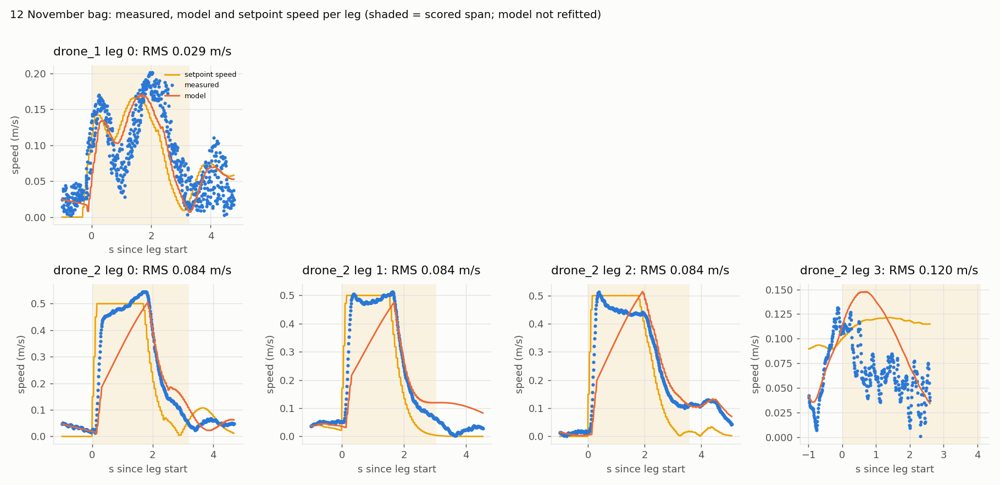

Observed in flight logs: real drone, 12 November 2026 rosbag; the training simulator's drone model checked, not refitted

# 2026-11-15_s2_bag_check record

Result: **FAIL** (gates on drone_2). Ledger row T5.

## Purpose

Check the training simulator's drone model (`params/real_exploratory_v0.toml`, fitted to the 13 November PX4 logs of drone_2) against a different recording it never saw: the 12 November two-drone flight, recorded as a rosbag at the full 19 Hz command rate. Nothing is refitted; the parameter file is read as written. This answers one question: does the model, fitted at one speed in one log, still describe the real drone's velocity in another flight? Observed in flight logs; it says nothing about how a trained strategy will fly.

## Commit

Repository HEAD `96894cc007251ed0d6046f734bcda7b1d83be41e`, this task's files uncommitted (the lead commits). Code fingerprint (sha256 over `source/`, `scripts/`, `configs/`): `9a63692248ff`. The bag is read-only: `svg_20261112_094546_0.mcap`, sha256 `e8a648bc60a0dcf4`, 592 MB.

## Config

`python scripts/bag_check.py --bag <bag dir> --params params/real_exploratory_v0.toml --gates configs/s2.toml --name 2026-11-15_s2_bag_check`. Gates (`[bag_check_gates]`, copied to `runs/2026-11-15_s2_bag_check/gates.toml` before the run, approved before any result): drone `drone_2`; velocity RMS at most 0.10 m/s on every leg (leg start to leg end + 1 s); worst time to 63 % of a change (start or stop) off by at most 0.10 s; at least 3 legs, otherwise INFO with no verdict.

How the numbers are made: the setpoint (what the commander sent, 18.8 Hz) is held onto a 0.01 s grid; each leg is a stretch where the setpoint speed is above 0.1 m/s, with a window from 1.0 s before to 2.5 s after (cut halfway to the next leg). As in the S1 fit, a leg counts only if the drone stays above 0.3 m for the whole window; takeoffs, landings and setpoints followed on the ground are not flights. 3 such legs were left out of drone_2's count (the result with every leg is given under Results). The model starts each window from the measured position and velocity and flies the setpoint. Time is the bag's own log time: the measured velocity crosses the WiFi before it is logged, so its delay includes one network leg.

## Model parameter set

`params/real_exploratory_v0.toml` (sha256 `4c93543f51ab`), `[px4]` table, family lag1: delay 0.1482 s, lag 1.6496 s, acceleration limit 1.7178 m/s^2, Kp 0.95. Exploratory.

## Seeds

None: no random numbers.

## Machine

CPU only, this laptop; no GPU, no simulator.

## Games at once

Not applicable.

## Steps per second

Not applicable (not a speed run).

## Gates

| Gate | Limit | drone_2 (gated) | Result |
|---|---|---|---|
| legs found | at least 3 | 4 | PASS |
| worst leg velocity RMS | 0.10 m/s | 0.120 m/s | FAIL |
| worst 63 % time error | 0.10 s | 0.690 s (6 start/stop pairs) | FAIL |

## Results

RMS over every leg's scored span, both axes together (m/s). Baselines: the drone flies the setpoint speed exactly, and the same 0.15 s later.

| Drone | Legs | Worst leg RMS | Pooled RMS, model | Pooled, setpoint speed | Pooled, setpoint 0.15 s later | Best extra shift (info) | Verdict if gated |
|---|---|---|---|---|---|---|---|
| drone_1 (reported) | 1 | 0.029 | 0.029 | 0.037 | 0.030 | 0.06 s (RMS 0.028 vs 0.029) | INFO |
| drone_2 (gated) | 4 | 0.120 | 0.093 | 0.090 | 0.066 | -0.10 s (RMS 0.085 vs 0.093) | FAIL |

Information only, every leg including those on the ground or in takeoff and landing (drone_2): 7 legs, worst leg RMS 0.566 m/s, pooled model RMS 0.498 m/s against 0.459 m/s for the setpoint speed itself; verdict it would give: FAIL. It moves no verdict here.

Information only, a different reading of the setpoint. The run above holds each 19 Hz message until the next one, as this check was specified. The model's acceleration feed-forward is the slope of the speed setpoint, and a held setpoint makes that slope a sharp spike that the model's acceleration limit mostly cuts off. The S1 fit instead joined its setpoint messages by straight lines. Joined by lines (drone_2, same legs): leg RMS 0.043, 0.044, 0.050, 0.120 m/s, worst 63 % time error 0.084 s, verdict it would give: FAIL. This does not change the result above; a run with that reading would be a new, separately decided run.

Per leg (drone_2):

| Leg | Start (bag s) | Peak setpoint (m/s) | RMS (m/s) | t63 error start (s) | t63 error stop (s) |
|---|---|---|---|---|---|
| 0 | 20.3 | 0.50 | 0.084 | 0.606 | 0.135 |
| 1 | 36.8 | 0.50 | 0.084 | 0.690 | 0.053 |
| 2 | 45.4 | 0.50 | 0.084 | 0.662 | 0.288 |
| 3 | 217.8 | 0.12 | 0.120 | n/a | n/a |

*Speed of the setpoint (amber), the real drone (blue dots) and the model (orange), one panel per leg. Shaded: the span scored. Drone_2: worst leg RMS 0.120 m/s against 0.10; worst 63 % time error 0.690 s against 0.10.*

## What this result can and cannot change

A FAIL here does not touch `params/`: the model file stays as it is, and the model of record still waits on the planned-push flight (designed pushes at several speeds, which the logs so far lack). A PASS would say the model also holds on a second flight at the same low speed; it would not say it holds at 2 m/s or above. A FAIL would say the model, fitted on one log, misses another by more than the approved limits; it would be a reason to refit on more data, not a number to loosen. Exploratory: the bag has only the goal flights (speeds up to 0.5 m/s, no stick), so it cannot give the eight legs of S1's own fit gates.

## Limits

- Same low-speed regime as the fit (setpoint at most 0.5 m/s); the simulator's 2 to 6 m/s are untested.
- Measured velocity is PX4's estimate after the WiFi; its delay includes one network leg, so a model delay larger than the 13 November PX4-log fit is expected and is not by itself an error.
- The acceleration feed-forward is derived from the held speed setpoint, as in the fit.
- The best extra shift is information only and moved no gate.
