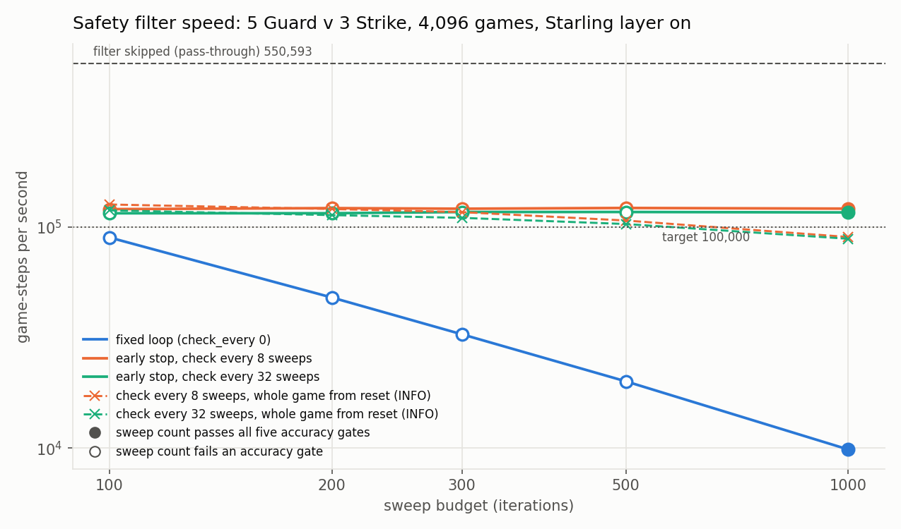

Simulator: training simulator, tier 1 (safety-filter port vs CMU cbf_filter.py on T2's scenes; S2 game with the Starling layer for speed)

# 2026-11-16T01:39:46+08:00 2026-11-16_s2_filter_speed_2 record

Result: **PASS** under the selection rule fixed in the S2 plan. Ledger row T8. Observed in the training simulator; nothing here is a flight result.

**Read this with the whole-game check below.** The chosen setting cleared the 100,000 target over the timed window the brief fixes (S0's), which falls in a quiet part of the game. Over one whole game from the start it averaged 90,121 game-steps/s, under the target. The verdict stands as the rule gives it; whether it is enough is the owner's call.

## Purpose

The safety filter keeps drones apart. Run T4 showed that at 1,000 sweeps it is too slow to train with (about 10,000 game-steps per second). This run tries two ways to make it faster and checks each against the filter's accuracy:

- **fewer sweeps** (`iterations` 500, 300, 200, 100 instead of 1,000);
- **an early stop** (`check_every`): every 8 or 32 sweeps the filter checks which games are finished and keeps working only on the others, and stops when none is left.

A setting is chosen if it is as accurate as run T2 on all five accuracy gates and reaches at least 100,000 game-steps per second in the S2 game with the Starling layer. A game-step is one game advanced one 0.05 s step.

The early stop needs the GPU to tell the CPU how many games are left, one host sync per check. The S2 plan allows exactly this (decision D10). This run counts those syncs.

## Commit

Repository HEAD `bcae60bf3982` at launch. Uncommitted at launch (`launch_commit.txt`):

- this task's files: `scripts/filter_speed.py`, `scripts/make_s2_figures.py`, `core/starling_layer.py` (the early-stop docstring and the wall fix below), tests;
- another builder's Task 6 follow-up: `core/game.py` (a 3-D closest-approach number, one small batched sum per step), `core/metrics.py`, `core/play.py`, `scripts/score.py`.

Code fingerprint `ee9c631ed44d` (the speed and accuracy phases). After the run, `scripts/filter_speed.py` gained the whole-game INFO phase and `scripts/make_s2_figures.py` gained its lines in the figure; neither changes the code that was timed. The whole-game phase has no code fingerprint of its own: it ran from the working tree as it stood after the run, which still held the other builder's uncommitted `core/game.py` change listed above.

**Wall fix, in the code timed.** Before this run a reviewer found that at a wall the commander copy kept the speed the wall had taken away. The safety filter then believed a drone pinned at a wall was moving away, and let an opposite drone close to about 0.77 m (keep-out 1.10 m). `StarlingLayer.keep_in` now also zeroes the outward part of the commander's published speed and ramp on every axis the wall clamped, as the real commander's fence does. The first attempt at this run (T7, ABORTED) was stopped to put this fix in.

## Config

- Gates: `configs/s2.toml` (sha256 `c60f9c02ca25`), tables `[filter_speed]` and `[filter_speed_gates]`, copied to `runs/2026-11-16_s2_filter_speed_2/gates.toml` before the run.
- Candidates: `iterations` 1000, 500, 300, 200, 100 × `check_every` 0, 8, 32. `check_every` 0 is the fixed loop of T2.
- Game: `configs/s2_game.toml` (sha256 `d51420c293df`), committed neutral values, no local file read. Starling layer on, preset "partner", so the filter acts on every pair of drones, both teams.
- Command: `runs/2026-11-16_s2_filter_speed_2/run.sh`, which runs `filter_speed.py --gates configs/s2.toml --name 2026-11-16_s2_filter_speed_2 --phase both --device cuda --seed 0 --sync-steps 20`.
- Whole-game INFO, after the run: `run_fullgame.sh` in the same folder (`--phase fullgame`).
- **Owner's ruling (16 November 2026, "4 decimals. yes.")**: the `max_abs_dv_mps` limit 1.6666 is T2's value written to 4 decimals. The measured value is rounded to 4 decimals before the comparison. T2's own value, raw 1.6666038, rounds to 1.6666 and passes. Every other gate compares as written. `configs/s2.toml` was not edited.

## Model parameter set

`params/real_exploratory_v0.toml` (sha256 `4c93543f51ab`), exploratory: commander copy, PX4 response fitted to one flight log, filter radius 0.55 m (keep-out 1.10 m), filter speed cap 1.0 m/s, alpha 2.5, tolerance 0.002.

## Seeds

- Accuracy: T2's 2,000 scenes, seed 20261115.
- Speed: game seed 0. Random actions in [-1, 1] are drawn on the GPU inside the timed loop from a generator seeded 0, re-seeded for every repeat and candidate, so every candidate sees the same action sequence.

## Machine

This laptop: NVIDIA GeForce RTX 5070 Ti Laptop GPU (12 GB), Intel Core Ultra 9 275HX; torch 2.7.0+cu128, conda `env_isaaclab`, headless. `nvidia-smi` before launch (`preflight.txt`) showed only the remote-desktop daemon as a compute process. A reviewer's test run had held the GPU until 01:39; this run waited for it to end.

## Games at once

4,096 games, 5 Guard v 3 Strike (8 drones per game), arenas drawn across the three size bands (4–16 m), ring starts.

## Accuracy (CPU, float32, 8 threads)

Each setting was run on T2's 2,000 scenes and compared with CMU's filter. Limits (FIXED): `max_abs_dv_mps` ≤ 1.6666 (after rounding to 4 decimals), `constraint_residual_max` ≤ 2.08973, `emergency_agreement_min` ≥ 0.999, `cross_team_corrections` ≤ 0, `max_abs_dv_first_phase_mps` ≤ 0.02.

| iterations | max abs dv (m/s), raw | constraint residual | emergency agreement | cross-team corrections | max abs dv, first-phase scenes (m/s) | all five |
|---|---|---|---|---|---|---|
| 1000 | 1.6666038 PASS | 2.089727 PASS | 0.999 PASS | 0 PASS | 6.18e-05 PASS | **PASS** |
| 500 | 2.8344789 FAIL | 2.6009108 FAIL | 0.9955 FAIL | 0 PASS | 6.18e-05 PASS | FAIL |
| 300 | 2.8344789 FAIL | 2.6009108 FAIL | 0.992 FAIL | 0 PASS | 6.18e-05 PASS | FAIL |
| 200 | 3.5878633 FAIL | 5.0077156 FAIL | 0.9845 FAIL | 0 PASS | 6.18e-05 PASS | FAIL |
| 100 | 4.685157 FAIL | 7.0830675 FAIL | 0.926 FAIL | 0 PASS | 4.685157 FAIL | FAIL |

Each row holds for `check_every` 0, 8 and 32 alike. The early stop gave exactly the fixed loop's velocities on all 2,000 scenes: largest difference 0 m/s, no emergency decision changed. The numbers equal the 7a table and T7's accuracy phase. Fewer sweeps lose accuracy only on the hard scenes, where CMU needed its slow second phase; the "first-phase" gate holds down to 200 sweeps. Full table: `accuracy.md`.

## Steps per second

Game-steps per second, mean of 2 repeats, timed by `bench/timing.run_case` with S0's settings:

- warm-up of at least 50 steps and at least 2 s;
- timed window of at least 200 steps and at least 2 s.

"Share in filter" is 1 − (rate with the filter) / (rate with the filter replaced by a pass-through). Host syncs per step were counted on steps 4–23 of a fresh game, with PyTorch's sync-debug mode (a prototype that may miss some syncs).

Baseline, filter replaced by a pass-through: 550,593 game-steps/s (repeats 601,270 and 499,916).

| iterations | check_every | game-steps/s | share in filter | host syncs per step (start of game) | accuracy | ≥ 100,000 |
|---|---|---|---|---|---|---|
| 1000 | 0 | 9,856 | 98.2 % | 0 | PASS | no |
| 1000 | 8 | **121,118** | 78.0 % | 125 | PASS | **yes** |
| 1000 | 32 | 116,441 | 78.9 % | 32 | PASS | yes |
| 500 | 0 | 20,041 | 96.4 % | 0 | FAIL | no |
| 500 | 8 | 121,972 | 77.8 % | 63 | FAIL | yes |
| 500 | 32 | 116,956 | 78.8 % | 16 | FAIL | yes |
| 300 | 0 | 32,708 | 94.1 % | 0 | FAIL | no |
| 300 | 8 | 121,010 | 78.0 % | 38 | FAIL | yes |
| 300 | 32 | 116,933 | 78.8 % | 10 | FAIL | yes |
| 200 | 0 | 47,987 | 91.3 % | 0 | FAIL | no |
| 200 | 8 | 121,774 | 77.9 % | 25 | FAIL | yes |
| 200 | 32 | 115,440 | 79.0 % | 7 | FAIL | yes |
| 100 | 0 | 89,691 | 83.7 % | 0 | FAIL | no |
| 100 | 8 | 120,477 | 78.1 % | 13 | FAIL | yes |
| 100 | 32 | 115,397 | 79.0 % | 4 | FAIL | yes |

Repeat spread at most 0.07 for every candidate; 0.17 for the baseline, which is used only for the share column. No NaN in any timed step. Peak GPU memory 94 MiB. Full table: `speed.md`.

*Game-steps per second against the filter's sweep budget, 5v3, 4,096 games, Starling layer on. Solid lines: the run of record; dashed: one whole game from the start (INFO). Filled marker: that sweep count passes all five accuracy gates. Only 1,000 sweeps is accurate; with the early stop it clears 100,000 in the timed window but not over a whole game.* Made by `scripts/make_s2_figures.py filter_speed runs/2026-11-16_s2_filter_speed_2 docs/figures/s2_filter_speed.png`.

## Whole-game check (INFO, not a gate)

With the early stop, the filter costs more when games are crowded, so the speed depends on the part of the game being timed. This shows in the run itself:

- **Sync count:** at the start of a game, 1,000 sweeps with `check_every` 8 made 125 syncs per step. That is every possible check, so the loop never ended early.
- **Timed window:** 200 steps took 6.8 s, about 34 ms per step. At that speed the loop must have ended at the first checks.
- **Reason:** with random actions the drones stay near their starts. Once the first close pairs are sorted out, few games have anything left to filter.

To see a whole game, each early-stop candidate was timed again over one game of 1,200 steps from the start (`--phase fullgame`, 01:54–02:10, same GPU, same seed; no code fingerprint of its own, see Commit), with its syncs counted over a second whole game:

| iterations | check_every | game-steps/s, whole game | slowest / fastest 100 steps | host syncs per step, whole game |
|---|---|---|---|---|
| 1000 | 8 | **90,121** | 25,210 / 141,699 | 12.1 |
| 1000 | 32 | 88,484 | 26,751 / 128,516 | 4.0 |
| 500 | 8 | 107,001 | 43,159 / 144,526 | 10.2 |
| 500 | 32 | 103,175 | 45,189 / 127,403 | 3.5 |
| 300 | 8 | 116,795 | 61,180 / 146,576 | 9.3 |
| 300 | 32 | 110,027 | 62,548 / 127,756 | 3.4 |
| 200 | 8 | 120,622 | 76,640 / 144,225 | 8.9 |
| 200 | 32 | 113,218 | 76,719 / 126,781 | 3.3 |
| 100 | 8 | 126,457 | 102,523 / 143,460 | 8.6 |
| 100 | 32 | 118,942 | 101,830 / 128,805 | 3.2 |

The first 100 steps of a game are the slowest: 25,210 game-steps/s at 1,000 sweeps with `check_every` 8, against about 130,000 in mid-game. The fixed loop (`check_every` 0) does the same work at every step, so its rates above hold for any part of the game and were not timed again.

What this means for training:

- A Guard team that learns to meet Strike drones makes games more crowded than random actions do. The early stop then saves less.
- In this check every game started together (reset fraction 2.2e-5). In training, games restart at different times, so some game is always in its crowded start and every step may pay up to 125 checks; the rate could then fall below 90,121, and that was not measured.
- So 121,118 is an upper end for this setting. Over a whole game with random actions it gave 90,121. With trained play or staggered restarts it would likely be lower.
- Before any claim about training time (such as the S2 plan's "about 17 min" for 100 M game-steps, decision D7), an INFO run with staggered restarts should measure the rate.

## Gates

| Gate | Measured | Limit (FIXED) | Result |
|---|---|---|---|
| accuracy, five gates (above), at `iterations` 1000 | all five pass (`max_abs_dv_mps` 1.6666038 raw, 1.6666 rounded) | as listed | PASS |
| `game_steps_per_s_min`, chosen candidate (1000, 8) | 121,118 | ≥ 100,000 | PASS |

**Selection: PASS.** Chosen: `iterations` 1000, `check_every` 8 (the fastest accurate candidate; the fastest of all is 500 / 8 at 121,972, which fails accuracy).

Following the rule, the lead sets `configs/s2_game.toml` `[starling_layer] filter_iterations = 1000, filter_check_every = 8` after this record; the change is not made here. Read the whole-game check before relying on the 100,000 figure.

## Edited after the run (gatekeeper review, 16 November 2026)

Wording only; no number changed and nothing was re-run. Added: the whole-game check had all games starting together, and the staggered-restart INFO run recommended before any training-time claim. Corrected: the whole-game phase's time span (01:54–02:10, `fullgame.json` written 02:09:42). Stated: that phase has no code fingerprint of its own.
