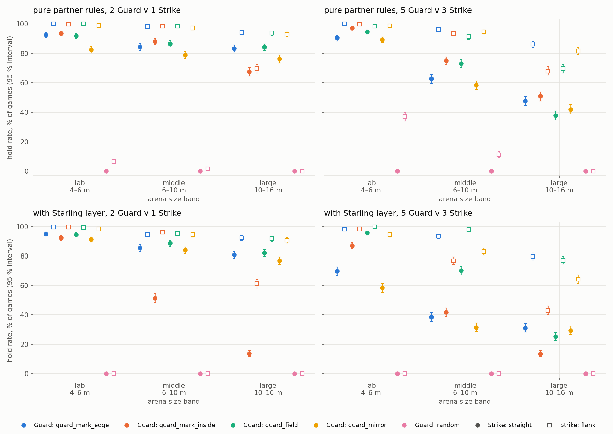
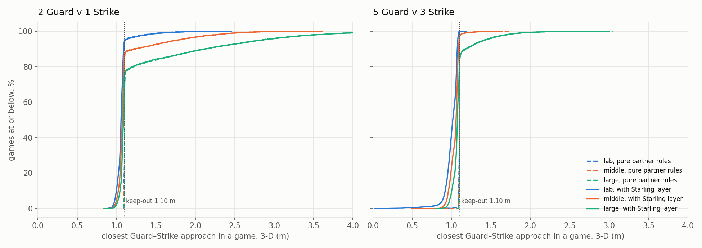

Simulator: training simulator, tier 1 (S2 game, batched PyTorch on the GPU): pure partner rules, and with the Starling layer (exploratory drone model + safety filter on every pair), wall handling fixed.

# 2026-11-16T02:19:33+08:00 2026-11-16_s2_scripted_reference_2 record

Result: **INFO (no gates)**. Ledger row T9. Observed in the training simulator; nothing here is a flight result.

**This run supersedes T6's Starling-layer closest-approach and breach numbers** ([T6 record](2026-11-16_s2_scripted_reference_record.md)). T6 ran with a bug at the walls; this run uses the fixed layer. T6's pure-rule numbers are reproduced exactly (see Results).

## Purpose

This is the same scoring as T6, re-run after three changes:

- **Wall fix.** When the Starling layer stops a drone at a wall, it now also tells the commander copy, so the safety filter no longer sees that drone as moving away.
- **3-D distance.** The game now reports the closest Guard–Strike distance in 3-D as well as horizontally, and a breach (a Guard–Strike pair closer than the 1.10 m keep-out) is now judged in 3-D.
- **Faster filter.** The filter checks every 8 sweeps whether it can stop early (the setting run T8 chose).

The **hold rate** is the share of games in which no Strike drone reached the zone before the time-out (the Guard team held). Every strategy, scripted or trained or NUS's, is scored by this same tool (`scripts/score.py`).

## Commit

Repository HEAD `f6702ca405af9f9877c4a389f8f2f799957a31b4` at launch; the working tree under `svg_training/` had no code changes. Code fingerprint (sha256 over every `.py` and `.toml` under `source/`, `scripts/` and `configs/`, local folder excluded): `c004fe5853c4`. After the run, `scripts/make_s2_figures.py` gained one figure function (`closest_cross_3d`). The record, the ledger row and the figures were added.

## Config

The same command as T6, into a new folder (`runs/2026-11-16_s2_scripted_reference_2/run.sh`):

`score.py --guard guard_mark_edge,guard_mark_inside,guard_field,guard_mirror,random --strike strike_straight,strike_flank --sizes 2v1,5v3 --presets pure,starling --games-per-band 1000 --bands lab,middle,large --seed 0 --no-local --device cuda`

- Game config: `configs/s2_game.toml`, sha256 `165f1ba733d6`. Committed neutral values only (`--no-local`). Keep-out 1.10 m for both teams (the flight stack's value, not a partner value), Strike team 0.5 m/s, Guard team 0.33 m/s, 1,200 steps of 0.05 s, walls stop drones, ring starts.
- `[starling_layer]` at launch: `params/real_exploratory_v0.toml`, filter 1,000 sweeps, `filter_check_every = 8`. The "starling" preset switches the layer on.
- Gates: none (`gates.toml` = `gates = []`, written before the run).
- Each preset × size × band is one batch of 10,000 games: 10 strategy pairs, 1,000 games each. Each game slot counts only its first finished game.

## Model parameter set

`params/real_exploratory_v0.toml` (sha256 `4c93543f51ab`), exploratory. Fitted to one 13 November log of drone_2 at speeds up to 0.5 m/s (family lag1, delay 0.148 s, lag 1.65 s, acceleration limit 1.72 m/s², Kp 0.95); its held-out check T5 = FAIL. Filter radius 0.55 m (keep-out 1.10 m), speed cap 1.0 m/s.

## Seeds

As in T6: game seed 0 + band index; Guard strategy seed 101, Strike 202.

## Machine

This laptop: RTX 5070 Ti Laptop GPU (12 GB), torch 2.7.0+cu128, conda `env_isaaclab`, headless. `nvidia-smi` before launch (`preflight.txt`): desktop processes and the remote-desktop daemon (639 MiB) only; no simulator, no compute job over 2 GB. Another session was running CPU-only tests during the run, so the speeds below may be slightly low.

## Games at once

10,000 per batch, 12 batches, 120,000 games. Drones per game: 3 (2v1) or 8 (5v3).

## Steps per second

Game-steps per second (one game advanced by one 0.05 s step). Tier 1, 10,000 games per batch, RTX 5070 Ti Laptop GPU. Every batch ran the full 1,200 steps.

| Preset | 2v1 (3 drones) lab / middle / large | 5v3 (8 drones) lab / middle / large |
|---|---|---|
| pure partner rules | 1,685,289 / 1,713,912 / 1,705,909 | 1,385,957 / 1,346,821 / 1,392,461 |
| with Starling layer (1,000 sweeps, check every 8) | 386,845 / 309,714 / 296,343 | 21,439 / 34,259 / 43,833 |

Run time 1,342 s (22 min), against 66 min for T6. With the Starling layer, 2v1 ran 13–17 times faster than in T6, and 5v3 only 1.2–2.5 times faster. The early stop helps little in 5v3: with crowded drones the filter rarely settles, so it runs most of its 1,000 sweeps. The 5v3 lab batch alone took 560 s.

## Gates

None. This is an INFO run. No verdict is given.

## Results

### Pure partner rules: reproduced

All 60 pure-rule rows of `scores.json` match T6 exactly: 13 fields each, including hold rate, interval, mean end step, closest approach and breach share. So do all 420 pure-rule per-game arrays (byte for byte). The wall fix and the filter setting do not touch the pure rules. T6's pure-rule hold-rate table and figure stand as they are.

### Hold rate with the Starling layer

Hold rate, % of games, 1,000 games per cell. Every 95 % interval is at most ±3.1 points; each is in `scores.md` and the figure.

| Guard v Strike | 2v1 lab | 2v1 middle | 2v1 large | 5v3 lab | 5v3 middle | 5v3 large |
|---|---|---|---|---|---|---|
| mark edge v straight | 95.1 | 85.6 | 80.9 | 69.8 | 38.5 | 31.1 |
| mark edge v flank | 99.6 | 94.6 | 92.4 | 98.3 | 93.5 | 79.8 |
| mark inside v straight | 92.5 | 51.4 | 13.7 | 87.1 | 41.7 | 13.6 |
| mark inside v flank | 99.6 | 96.3 | 61.3 | 98.5 | 76.9 | 43.0 |
| field v straight | 94.6 | 88.7 | 82.1 | 95.8 | 70.2 | 25.4 |
| field v flank | 99.4 | 95.2 | 91.8 | 100.0 | 98.0 | 77.1 |
| mirror v straight | 91.3 | 84.0 | 76.9 | 58.4 | 31.5 | 29.4 |
| mirror v flank | 98.5 | 94.5 | 90.7 | 94.5 | 83.1 | 64.2 |
| random v straight | 0.0 | 0.0 | 0.0 | 0.0 | 0.0 | 0.0 |
| random v flank | 0.1 | 0.0 | 0.0 | 0.0 | 0.0 | 0.0 |

*Share of games the Guard team held, with 95 % intervals, per arena size band; each point is 1,000 games. Colour is the Guard strategy; filled markers are the straight Strike, open ones the flank Strike. Top row: pure partner rules; bottom row: with the fixed Starling layer.*

Compared with T6, the Starling-layer hold rates hardly moved. The mean change is 0.16 points and the largest 1.8 points (field v flank, 2v1 middle: 97.0 % to 95.2 %). None of the 60 intervals is disjoint from T6's. The reading of T6 stands: scripted Guard strategies hold far more often than random moves, hold rates fall as the arena grows, and the Starling layer lowers most hold rates. The largest drops are mark inside v straight in large arenas (67.5 % pure against 13.7 %) and 5v3 lab mark edge and mirror (21–31 points).

### How close Guard and Strike drones came (Starling layer)

Per game, the closest distance between any Guard and any Strike drone, all 10 strategy pairs pooled (10,000 games per row), in 3-D and horizontally. A breach is a game with a pair closer than 1.10 m in 3-D. The filter share is the share of live drone-steps the safety filter changed (team-mates included).

| Size | Band | 3-D min (m) | 3-D 1st pct | 3-D 5th pct | 3-D median | horizontal min | horizontal 5th pct | games with a breach | filter share | start miss |
|---|---|---|---|---|---|---|---|---|---|---|
| 2v1 | lab | 0.851 | 0.946 | 0.979 | 1.057 | 0.001 | 0.284 | 94.3 % | 81.7 % | 0.0 % |
| 2v1 | middle | 0.832 | 0.962 | 1.000 | 1.072 | 0.001 | 0.657 | 87.3 % | 71.5 % | 0.0 % |
| 2v1 | large | 0.842 | 0.981 | 1.021 | 1.091 | 0.003 | 0.971 | 75.4 % | 57.1 % | 0.0 % |
| 5v3 | lab | 0.025 | 0.665 | 0.888 | 1.014 | 0.000 | 0.041 | 100.0 % | 89.4 % | 34.7 % |
| 5v3 | middle | 0.491 | 0.889 | 0.939 | 1.056 | 0.002 | 0.267 | 96.8 % | 72.5 % | 2.1 % |
| 5v3 | large | 0.790 | 0.934 | 0.975 | 1.073 | 0.002 | 0.563 | 83.1 % | 50.8 % | 0.0 % |

Pure partner rules: the same as T6 (3-D = horizontal, since every drone flies at one height). The minimum is 1.088 m (2v1), and 0.608 m in 5v3 lab, from crowded starts. Breach shares are 8–44 %, mostly pairs settling within 12 mm of the keep-out.

*Share of games whose closest Guard–Strike distance in 3-D is at or below each value, all strategy pairs pooled. Dashed: pure partner rules; solid: with the fixed Starling layer. Dotted line: the 1.10 m keep-out.*

What the closeness numbers mean:

- **Horizontal against 3-D.** The near-zero horizontal minima are drones passing one above the other: the filter keeps drones apart in 3-D and moves them up and down. Measured in 3-D, the 2v1 minimum is 0.83–0.85 m. The two lowest 3-D values, 0.025 m (5v3 lab) and 0.491 m (5v3 middle), come from games that began with a start miss.
- **Most breaches are shallow.** The median closest approach in 3-D is 1.01–1.09 m, a few centimetres inside the keep-out. That matches the model's open-space loss of about 0.05 m, which the T6 review put down to the fitted acceleration limit and the slow lag.
- **Some go deeper.** The four scripted Guards never command up or down, so for them 3-D = horizontal. Without a start miss they now bottom out at 0.89–0.91 m (2v1) and 0.75–0.80 m (5v3). In T6 the floor was 0.75–0.77 m in every band (0.662 m in 5v3 lab without a start miss). Games under 0.9 m: none in 2v1, and 6.4 % / 1.3 % / 0.2 % in 5v3 lab / middle / large (T6: 1.6–6.1 % in 2v1, 4.5–32.7 % in 5v3). So the wall fix removed the 0.770 m floor, but in crowded 5v3 games pairs still come about 0.3 m inside the keep-out. That is deeper than the open-space loss, and its cause is not diagnosed (see Limits).
- **The breach share barely moved** (2v1 lab 94.3 % against T6's 94.4 %): almost every game has a shallow breach either way. What changed is the depth.

### Starts that could not be spaced (start miss)

| Size | lab | middle | large |
|---|---|---|---|
| 2v1 | 0.0 % | 0.0 % | 0.0 % |
| 5v3 | 34.7 % | 2.1 % | 0.0 % |

The same as T6 (same draws). Pooled over the 10 pairs, 5v3 lab with the Starling layer: the Guard team held 77.6 % of the 3,472 games with a start miss, and 66.3 % of the 6,528 without one. Pure rules: 85.2 % and 78.2 %, as in T6.

## What this result can and cannot change

It replaces T6 as the reference that later strategies are compared with, under exactly these settings: neutral values, these sizes and bands, this drone model, and the filter at 1,000 sweeps with a check every 8. A trained or partner strategy is judged against it only when scored by the same tool under the same settings. It does not authorise a flight and says nothing yet about real drones. A run with the partner's own values (local file) is a local run whose record gives only the file name and sha256.

## Limits

- **Exploratory drone model**: fitted on one flight, held-out check T5 = FAIL. Limits from Task 4, from the 13 November flight logs, not validated:
  - In open space the model loses about 0.05 m of the keep-out (head-on 1.050 m).
  - The time to 63 % of a speed change is 0.6–0.9 s in the model against about 0.35 s on the real drone (the commander's 5 m/s² ramp is cut by the fitted 1.72 m/s² limit).
  - The model has an unpinned slow mode of about 9 s.
  - So in short lab-band games the Strike/Guard speed ratio is not exactly 1.5.
- **Deep approaches in crowded games, not diagnosed.** Scripted Guard–Strike pairs come to 0.75–0.80 m in 5v3 (without a start miss), about 0.3 m inside the keep-out. That is deeper than the open-space loss. Candidates: several drones squeezing one pair, the filter running out of sweeps in crowded scenes (it rarely settles in 5v3), and the model's lag. It is a property of the training simulator, and says nothing about the real commander.
- **Start misses.** About a third of 5v3 lab games start with drones closer than the keep-out. They are played and counted, and they give the lowest 3-D values.
- **Filter setting.** 1,000 sweeps with a check every 8 is the setting T8 chose for speed; T8's accuracy check covers it. T6 used no early stop. Hold rates differ from T6 by at most 1.8 points, so the setting changed little here.
- **Arenas differ per pair.** The 10 pairs in a batch play independent arena and start draws, not the same ones.
- One seed (0), on this laptop.
