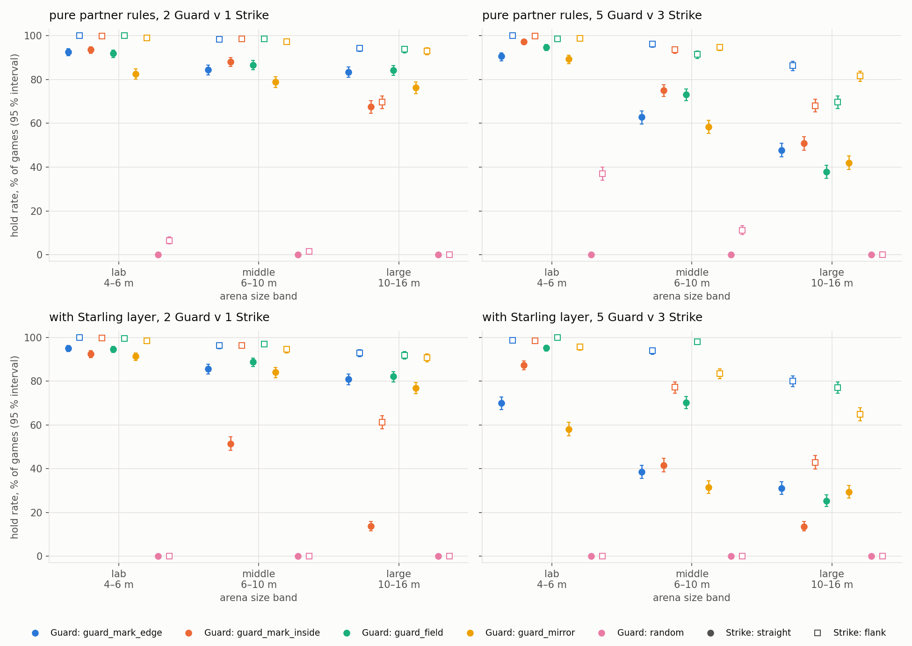
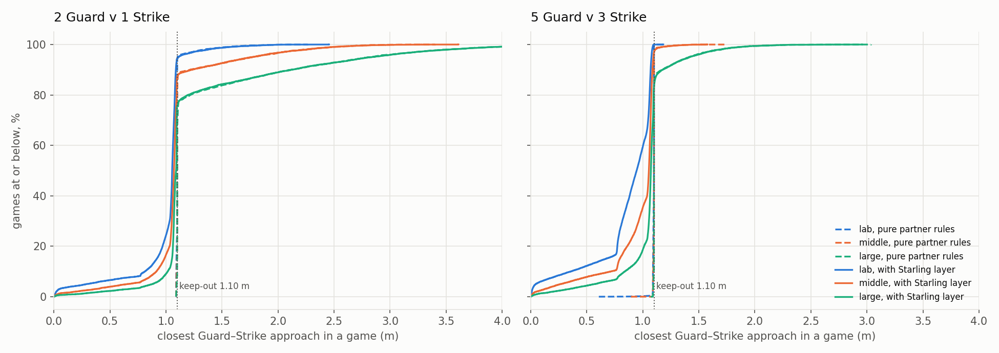

Simulator: training simulator, tier 1 (S2 game, batched PyTorch on the GPU): pure partner rules, and with the Starling layer (exploratory drone model + safety filter on every pair).

# 2026-11-16T00:00:43+08:00 2026-11-16_s2_scripted_reference record

Result: **INFO (no gates)**. Ledger row T6. Observed in the training simulator; nothing here is a flight result.

## Purpose

This is the reference point that every later strategy is scored against. Every strategy (these scripted ones, the stand-in trainer's, and later NUS's) is scored by the same tool, `scripts/score.py`, the same way.

Five scripted Guard strategies played two scripted Strike strategies. The Guard strategies are mark the zone edge, mark just inside it, field, mirror, and random. The Strike strategies are straight at the zone, and flank round a Guard drone in the way. Each pair played at two team sizes (2 Guard v 1 Strike, 5 v 3), in three arena size bands, under two sets of rules:

- **pure partner rules**: point drones at fixed team speeds, kept apart by the push-apart rule;
- **with Starling layer**: each drone flies through a copy of the ground commander, the safety filter (every pair of drones, both teams) and the PX4 response fitted to flight logs (exploratory). The push-apart rule is off, so only the filter keeps drones apart.

The **hold rate** is the share of games in which no Strike drone reached the zone before the time-out (the Guard team held). It is given with its 95 % interval. The run also reports how close Guard and Strike drones came, and how often the starting positions could not be placed far enough apart.

## Commit

Repository HEAD `914cf310ca135e946ec9d97a88d0e9ea75f024ba` at launch, with this task's files uncommitted (the lead commits): `core/play.py`, `core/metrics.py`, `scripts/score.py`, `scripts/make_s2_figures.py`, `tests/test_play.py`, `tests/test_score.py`. Code fingerprint (sha256 over every `.py` and `.toml` under `source/`, `scripts/` and `configs/`, local folder excluded): `62d10c3a2f8e`. After the run only the record, the ledger row, the figures and the task report were added; no code changed.

## Config

Command (in `runs/2026-11-16_s2_scripted_reference/run.sh`):

`score.py --guard guard_mark_edge,guard_mark_inside,guard_field,guard_mirror,random --strike strike_straight,strike_flank --sizes 2v1,5v3 --presets pure,starling --games-per-band 1000 --bands lab,middle,large --seed 0 --no-local --device cuda`

- Game config: `configs/s2_game.toml`, sha256 `d51420c293df`. Committed neutral values only (`--no-local`): no local partner file was read. Keep-out 1.10 m for both teams (the flight stack's value, not a partner value), Strike team 0.5 m/s, Guard team 0.33 m/s, 1,200 steps of 0.05 s (60 s), walls stop drones, ring starts.
- `[starling_layer]` at launch: `params/real_exploratory_v0.toml`, filter 1,000 sweeps, `filter_check_every = 0` (no early stop). The file holds `enabled = false`; the "starling" preset switches it on.
- Gates: none. `gates.toml` holds `gates = []` and was written before anything ran (S2 plan, Task 6).
- Bands: lab 4–6 m, middle 6–10 m, large 10–16 m arena side.
- How a game is counted: one batch per preset × size × band. Each of the 10 strategy pairs plays 1,000 games on its own slice of the batch. Each game slot counts only its first finished game.

## Model parameter set

`params/real_exploratory_v0.toml` (sha256 `4c93543f51ab`), exploratory. The PX4 part was fitted to one 13 November log of drone_2 at speeds up to 0.5 m/s: family lag1, delay 0.148 s, lag 1.65 s, acceleration limit 1.72 m/s², Kp 0.95. Commander stick cap 0.5 m/s. Filter radius 0.55 m (keep-out 1.10 m), speed cap 1.0 m/s. Used only by the "with Starling layer" half.

## Seeds

Game seed = 0 + band index (lab 0, middle 1, large 2). Strategy seeds: Guard 101, Strike 202 (only the random Guard uses its seed). The 10 pairs in a batch see different arenas, each drawn independently.

## Machine

This laptop: NVIDIA GeForce RTX 5070 Ti Laptop GPU (12 GB), torch 2.7.0+cu128, conda `env_isaaclab`, headless. `nvidia-smi` before launch (`preflight.txt`) showed only the desktop, the remote-desktop daemon (639 MiB) and small desktop apps. No simulator was running and no compute job held more than 2 GB.

## Games at once

10,000 per batch (10 strategy pairs × 1,000), 12 batches: 2 presets × 2 sizes × 3 bands. That is 120,000 games, 1,000 per strategy pair, size, band and preset. Drones per game: 3 (2v1) or 8 (5v3).

## Steps per second

Game-steps per second (one game advanced one 0.05 s step). Tier 1, 10,000 games per batch, RTX 5070 Ti Laptop GPU. Every batch ran the full 1,200 steps, because some game in each batch went to the time-out.

| Preset | 2v1 (3 drones) lab / middle / large | 5v3 (8 drones) lab / middle / large |
|---|---|---|
| pure partner rules | 1,444,451 / 1,471,888 / 1,470,660 | 1,242,339 / 1,265,598 / 1,292,932 |
| with Starling layer (filter 1,000 sweeps) | 22,863 / 22,962 / 18,478 | 17,675 / 13,496 / 18,309 |

Run time: 3,974 s in all (66 min). The Starling batches took 523–889 s each, the pure batches 8–10 s each. With 1,000 sweeps the filter costs about 0.4 s per step at 1,000 or 10,000 games alike (a probe before the run). So the 10 pairs were packed into one batch to cut the run from about 8 h to about 1 h.

## Gates

None. This is an INFO run. No verdict is given.

## Results

Hold rate, % of games (the Guard team held), 1,000 games per cell. Every 95 % interval is at most ±3.1 points; each one is in `scores.md` and the figure.

**Pure partner rules**

| Guard v Strike | 2v1 lab | 2v1 middle | 2v1 large | 5v3 lab | 5v3 middle | 5v3 large |
|---|---|---|---|---|---|---|
| mark edge v straight | 92.6 | 84.5 | 83.5 | 90.6 | 62.8 | 47.8 |
| mark edge v flank | 100.0 | 98.4 | 94.4 | 100.0 | 96.2 | 86.3 |
| mark inside v straight | 93.7 | 88.1 | 67.5 | 97.3 | 75.0 | 50.8 |
| mark inside v flank | 99.9 | 98.5 | 69.7 | 99.9 | 93.7 | 68.1 |
| field v straight | 91.9 | 86.7 | 84.2 | 94.7 | 73.1 | 37.9 |
| field v flank | 100.0 | 98.5 | 93.9 | 98.6 | 91.5 | 69.7 |
| mirror v straight | 82.6 | 78.9 | 76.4 | 89.4 | 58.4 | 42.0 |
| mirror v flank | 99.1 | 97.2 | 93.0 | 98.8 | 94.8 | 81.6 |
| random v straight | 0.0 | 0.0 | 0.0 | 0.0 | 0.0 | 0.0 |
| random v flank | 6.4 | 1.5 | 0.0 | 37.0 | 11.1 | 0.0 |

**With Starling layer**

| Guard v Strike | 2v1 lab | 2v1 middle | 2v1 large | 5v3 lab | 5v3 middle | 5v3 large |
|---|---|---|---|---|---|---|
| mark edge v straight | 95.1 | 85.6 | 80.9 | 69.9 | 38.5 | 31.1 |
| mark edge v flank | 99.9 | 96.2 | 92.9 | 98.6 | 93.9 | 80.0 |
| mark inside v straight | 92.5 | 51.4 | 13.7 | 87.4 | 41.6 | 13.6 |
| mark inside v flank | 99.6 | 96.3 | 61.3 | 98.4 | 77.2 | 42.9 |
| field v straight | 94.6 | 88.7 | 82.1 | 95.2 | 70.3 | 25.3 |
| field v flank | 99.5 | 97.0 | 91.9 | 100.0 | 97.9 | 77.1 |
| mirror v straight | 91.3 | 84.0 | 76.9 | 58.1 | 31.5 | 29.4 |
| mirror v flank | 98.5 | 94.5 | 90.8 | 95.6 | 83.5 | 64.9 |
| random v straight | 0.0 | 0.0 | 0.0 | 0.0 | 0.0 | 0.0 |
| random v flank | 0.0 | 0.0 | 0.0 | 0.0 | 0.0 | 0.0 |

*Share of games the Guard team held, with 95 % intervals, per arena size band; each point is 1,000 games. Colour is the Guard strategy; filled markers are the straight Strike, open ones the flank Strike. Top row: pure partner rules; bottom row: with the Starling layer.*

What the numbers show. Every scripted Guard strategy holds far more often than random moves (random holds 0–37 %). The hold rate falls as the arena grows, most at 5v3. The flank Strike is held more often than the straight one, probably because its detour round a Guard drone costs it more time than being blocked costs the straight run (not measured). The Starling layer lowers most hold rates. It lowers some a lot: mark inside v straight, 2v1 large, falls from 67.5 % to 13.7 %, and the 5v3 lab hold rates of mark edge and mirror fall by 21–31 points. Field changes least.

### How close Guard and Strike drones came

Per game, the closest horizontal distance between any Guard and any Strike drone, over all 10 strategy pairs (10,000 games per row). A breach is a game in which some Guard–Strike pair came closer than the 1.10 m keep-out.

**Every Starling-layer closest-approach and breach number in this record is affected by a bug found in review** (the walls in the Starling layer; see "Edited after the run"). The Starling rows of the table below, the solid lines of the second figure and the Starling breach and filter shares are kept as recorded, but they do not describe the drone model. The Starling-layer hold rates above may also move once the bug is fixed.

| Preset | Size | Band | min (m) | 1st pct | 5th pct | median | games with a breach | filter changed (share of drone-steps) | start miss |
|---|---|---|---|---|---|---|---|---|---|
| pure | 2v1 | lab | 1.088 | 1.090 | 1.091 | 1.100 | 26.4 % | 0 | 0.0 % |
| pure | 2v1 | middle | 1.089 | 1.090 | 1.092 | 1.100 | 16.2 % | 0 | 0.0 % |
| pure | 2v1 | large | 1.090 | 1.091 | 1.096 | 1.100 | 8.1 % | 0 | 0.0 % |
| pure | 5v3 | lab | 0.608 | 1.087 | 1.090 | 1.100 | 44.3 % | 0 | 34.7 % |
| pure | 5v3 | middle | 0.894 | 1.090 | 1.092 | 1.100 | 28.3 % | 0 | 2.1 % |
| pure | 5v3 | large | 1.070 | 1.091 | 1.094 | 1.100 | 12.2 % | 0 | 0.0 % |
| Starling | 2v1 | lab | 0.001 | 0.010 | 0.289 | 1.055 | 94.4 % | 81.7 % | 0.0 % |
| Starling | 2v1 | middle | 0.001 | 0.032 | 0.653 | 1.072 | 87.4 % | 71.5 % | 0.0 % |
| Starling | 2v1 | large | 0.001 | 0.194 | 0.877 | 1.090 | 75.5 % | 57.1 % | 0.0 % |
| Starling | 5v3 | lab | 0.000 | 0.006 | 0.045 | 0.945 | 100.0 % | 89.4 % | 34.7 % |
| Starling | 5v3 | middle | 0.001 | 0.015 | 0.265 | 1.054 | 96.8 % | 72.4 % | 2.1 % |
| Starling | 5v3 | large | 0.001 | 0.055 | 0.572 | 1.073 | 83.2 % | 50.8 % | 0.0 % |

*Share of games whose closest Guard–Strike distance (horizontal) is at or below each value, all strategy pairs pooled. Dashed: pure partner rules. Solid: with the Starling layer. Dotted line: the 1.10 m keep-out.*

What the closeness numbers mean:

- **Pure partner rules.** The push-apart holds pairs within 0.012 m of the keep-out (min 1.088 m). The breach count is mostly this rounding-size gap. The deeper 5v3 values come from crowded starts: 49 of the 62 pure-rule 5v3 games under 1.08 m began with a start miss.
- **Starling layer.** Pairs go far deeper. In the median 5v3 lab game the closest pair is at 0.945 m. Two different things are mixed in these numbers:
  - **Drones passing over or under each other.** The filter keeps drones 1.10 m apart in 3-D. The random Guard also commands up and down, and the filter moves drones vertically, so a pair can pass one above the other at nearly zero horizontal distance. The horizontal distances near zero all come from pairs with the random Guard. A separate probe (not a run of record; `scripts/probe_closest_3d.py`, committed after it ran) played 1,000 games, 2v1 lab, random v flank, 300 steps. Its horizontal minimum was 0.004 m, but the 3-D minimum was 0.851 m (median 1.017 m). The median height gap at the closest horizontal moment was 1.01 m, and the Strike drone's height ranged from 0.57 to 1.80 m.
  - **Real breaches by the four scripted Guards**, which never command up or down. Over their 8,000 games per row, 83–100 % breach the keep-out. The minimum is 0.75–0.77 m in every row except 5v3 lab. There, 145 games went below 0.75 m, and 140 of them began with a start miss. The lowest without a start miss was 0.662 m. The same probe with mark edge v flank gave 0.774 m in 3-D with no height gap. The cause is a bug, found in review: at a wall, the Starling layer clamps the drone's position and stops it, but does not pass the clamp back to the commander copy (its published setpoint and speed profile). The safety filter therefore still sees the walled drone as moving away, so it lets the other drone close in. Such pairs settle where d² + 0.8 d − 1.21 = 0, at d = 0.770 m: the floor in these numbers. The model itself loses only about 0.05 m of the keep-out in open space (see Limits).
- **Filter use.** The filter changed 51–89 % of live drone-steps under the Starling layer (team-mates included).

### Starts that could not be spaced (start miss)

| Size | lab | middle | large |
|---|---|---|---|
| 2v1 | 0.0 % | 0.0 % | 0.0 % |
| 5v3 | 34.7 % | 2.1 % | 0.0 % |

The same draws were used for both presets, so the shares match. A 4–6 m arena is too small to place 8 drones 1.2 m apart with the Strike drones 1.10 m from every Guard drone in about a third of draws. These games are played and counted, not dropped. Pooled over the 10 pairs, 5v3 lab: with a start miss the Guard team held 85.2 % (pure) and 77.2 % (Starling) of 3,472 games. Without one it held 78.2 % and 66.7 % of 6,528 games.

## What this result can and cannot change

Its pure-rule half sets the reference that later strategies are compared with. The Starling half is affected by the wall bug, and will be replaced by a re-run on the fixed layer (a new ledger row). The reference holds only under exactly these settings (neutral values, these sizes and bands, this drone model and filter setting). It does not authorise a flight and says nothing yet about real drones. A trained or partner strategy is judged against these numbers only when it is scored by the same tool under the same settings. With the partner's own values (local file) the numbers would differ. Such a run is a local run whose record gives only the file name and sha256.

## Limits

- **Exploratory drone model** (`real_exploratory_v0`, fitted to one 13 November flight at up to 0.5 m/s; its held-out check T5 = FAIL). Limits found in Task 4, from the 13 November flight logs, not validated:
  - In open space, away from the walls, the model loses only about 0.05 m of the keep-out: Task 4's head-on approach came to 1.050 m. The reviewer's reading: the fitted 1.72 m/s² acceleration limit and the slow lag, not the position setpoint (a bare 1v1 head-on gave 1.096 m).
  - The time to 63 % of a speed change is 0.6–0.9 s in the model against about 0.35 s on the real drone. The commander's 5 m/s² ramp is cut by the fitted 1.72 m/s² acceleration limit.
  - The model has an unpinned slow mode of about 9 s (lag 1.65 s, Kp 0.95).
  - So in short lab-band games the Strike/Guard speed ratio is not exactly 1.5.
- **Wall bug in the Starling layer (found in review).** Scripted Guard–Strike pairs came to 0.75–0.77 m under the layer (0.662 m in 5v3 lab without a start miss), with no height gap (probe: 0.774 m in 3-D). Cause: `keep_in` clamps a drone at a wall but does not feed the clamp back to the commander copy, so the filter treats the walled drone as retreating. Pairs then hold at d² + 0.8 d − 1.21 = 0, d = 0.770 m. It is a bug in the training simulator, not a property of the drone model or the real commander. Every Starling-layer closest and breach number here is affected, and the Starling hold rates may be. T6 stays as recorded (INFO). The scripted reference will be re-run on the fixed layer as a new ledger row.
- **Horizontal scoring.** In this run, closest approach and breach were measured horizontally (scoring is horizontal, STANDARDS §4), but the filter works in 3-D. Strategies that move up and down (here only the random Guard) show near-zero horizontal approaches that are vertical passes. This run did not record the 3-D distance. The 3-D figures above come from the probe, run once before its script was committed; they were not re-run. Since this run the game reports `closest_cross_3d_m` and judges a breach in 3-D.
- **Filter setting.** 1,000 sweeps, no early stop: the setting at launch. Task 7 may choose another; a Starling half run with it is a new run.
- **Arenas differ per pair.** The 10 strategy pairs in a batch play different arena and start draws (packed batch), not the same ones. Each pair still has 1,000 independent games per band.
- **Pure-rule breaches.** These come from the push-apart repair settling a few millimetres to 12 mm inside the keep-out, and from crowded 5v3 starts. They are not deep approaches.
- One seed (0), on this laptop.

## Edited after the run (lead's review, 16 November 2026)

Wording only. No number, table or figure changed, and the run was not repeated.

- The review found the cause of the deep Starling-layer approaches: the wall bug in `core/starling_layer.py` `keep_in`. The bug is fixed outside this record.
- Every Starling-layer closest-approach and breach number is now marked as affected.
- The open-space model limit (about 0.05 m) is now credited to the acceleration limit and the slow lag. Earlier text blamed the deep approaches on the position-setpoint leak and the slow mode; that is removed.
- The record now says the scripted reference will be re-run on the fixed layer as a new ledger row.
- The probe script is now committed as `scripts/probe_closest_3d.py`.
- The first caption was shortened to three sentences.
