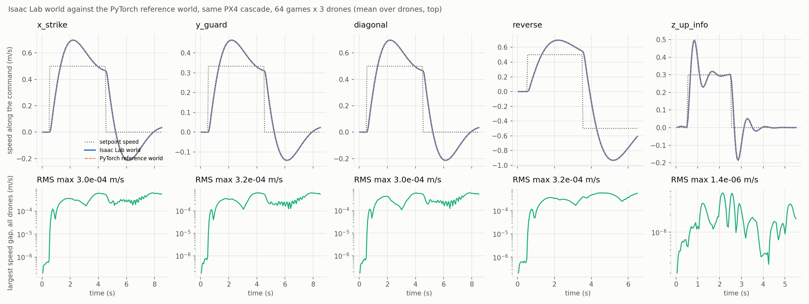

Simulator: observed in the training simulator (tier 2, Isaac Lab) against its PyTorch reference world; no real drone

# 2026-11-16T06:19:17+08:00 2026-11-16_s2b_agreement record

Result: **FAIL** against `[agreement_gates]` of `configs/s2b.toml`. Ledger row T10. Observed in the training simulator; nothing here is a flight result.

## What this run shows

- **One gate failed, by 15 %.** After 1 s of the same slow push and twist with no controller (open loop), the drones in the two worlds ended up to 1.15 mm apart; the gate allows 1.0 mm. Their attitudes differed by at most 0.034° (gate 0.1°).
- **Why: Isaac Lab on the GPU turns a slowly turning body a little less per step than the equations say.** For a slow roll the turn per step was 0.993 of the expected turn for 14 steps, then jumped back near 1 and sagged again (a saw-tooth, in `diagnosis/probe.jsonl`). The body rates themselves agree to 1e-6. A 0.03° smaller tilt points the thrust very slightly differently, and over 1 s that adds up to about a millimetre. This also explains the 0.007° gap the S2b spike saw: it reappears here exactly (−2.8284° against −2.8350°).
- **It is the GPU part of PhysX, not our adapter or the PyTorch world.** The same smoke checks with PhysX on the CPU (`--device cpu`, 4 games, not a run of record, `diagnosis/smoke_cpu.json`) give 0.021 mm and 0.00014°, and the roll check matches to 0.00002°. The cause inside PhysX's GPU code was not found (its source is not on this laptop); a lower-precision sine and cosine in its attitude step is a guess, not a finding.
- **Under the PX4 cascade, which is how the game flies the drones, the worlds agree 30 times better than the gates ask.** Speeds differ by at most 0.0003 m/s RMS (gate 0.01) and end positions by at most 0.6 mm (gate 20 mm), on all five steps, with no upsets and no non-finite values. The cascade corrects the small attitude difference every step.
- **The body PhysX holds is the one specified:** mass, inertia, centre of mass, no damping, no sleeping, gyroscopic forces on, no collider, all read back. A free tumble matches the PyTorch world's default gyroscopic step (0.07° apart after 2 s) and not the plan's explicit one (2.07°), which confirms Task 2's choice.
- **Found and fixed before this run:** the very first PhysX step after start-up turned a body about 1.29 times faster than its inertia allows. `IsaacWorld` now takes one settling step at start-up and puts the drones back; the first-step check above shows the two worlds then agree.
- **Decision for the lead:** the gate stays as written, so this run is a FAIL. Tasks 6–9 wait for the ruling.

How the steps were flown: 0.5 s of hold, then the setpoint ramps at the step speed for `push_s`, then for `release_s` it moves at `then_mps` (the `reverse` step: −0.5 m/s) or stops. Yaw is held at the start heading; the cascade's yaw is the drone's (15 Hz yaw torque filter, motor lag on), the same in both worlds.

## Purpose

S2b flies the S2 game on rigid-body Starlings. Two worlds can move those bodies: Isaac Lab (PhysX, the one training will use) and a small PyTorch world written to the same equations, which the CPU tests use. This run gives both worlds the same forces, then the same PX4 control cascade, and measures how far apart they end up. If they agree, everything checked on the PyTorch world also holds in Isaac Lab, and the Isaac Lab body is the one we specified (mass, inertia, no damping, no collider).

## Commit

`1a94f87-dirty`, code fingerprint `f57f1f7dd1ce`.

## Config

- Gates: `configs/s2b.toml` (sha256 `16814e44e881`), tables `[agreement]` and `[agreement_gates]`, copied to `runs/2026-11-16_s2b_agreement/gates.toml` before the run.
- Physics: `params/starling_physics_v0.toml` (sha256 `11fce758d518`), physics step 0.005 s, plant rotor positions `cad`, motor lag on.
- Cascade: the drone's own PX4 gains, yaw torque filter 15.0 Hz (the drone's `MC_YAW_CUTOFF`), allocator saturation feedback on. The same cascade drives both worlds; the yaw-gain question that is open with the owner does not change this comparison.
- PyTorch world: `TorchRigidBodyWorld`, gyroscopic step `momentum_preserving` (PhysX's own).
- PhysX solver type 1 (Isaac Lab default, TGS); one `RigidObjectCollection` of all drone slots; wrench set as one body-frame force and torque per drone per physics step.
- Command: `svg-isaaclab -p scripts/physics_agreement.py --headless --gates configs/s2b.toml --name 2026-11-16_s2b_agreement`.

## Model parameter set

Rigid-body Starling `params/starling_physics_v0.toml`: mass 0.557 kg, inertia [0.002943, 0.001857, 0.004649] kg m², CMU system identification; gains copied from the drone's file.

## Seeds

Start poses and headings: torch generator seeded 20261116 (`[agreement] seed`).

## Machine

NVIDIA GeForce RTX 5070 Ti Laptop GPU; Isaac Sim 5.1.0 / Isaac Lab 2.3.2 in the container `svg-training:isaaclab-2.3.2`, headless. GPU memory in use before launch (nvidia-smi): 2815 MiB. Wall time 91.6 s.

## Games at once

64 games x 3 drones = 192 bodies in each world, side by side in one process.

## Steps per second

Not measured here (Task 7 measures throughput).

## Gates

| Gate | Limit | Measured | Result |
|---|---|---|---|
| `open_loop_pos_max_m` | 0.001 | 0.00115 | FAIL |
| `open_loop_angle_max_deg` | 0.1 | 0.0342 | PASS |
| `closed_loop_vel_rms_max_mps` | 0.01 | 0.000324 | PASS |
| `closed_loop_pos_max_m` | 0.02 | 0.000599 | PASS |
| `mass_inertia_rel_err_max` | 0.0001 | 0 | PASS |
| `nan_max` | 0 | 0 | PASS |

## The body PhysX holds (read back)

- Mass 0.557–0.557 kg; inertia diagonal [0.002943, 0.001857, 0.004649] to [0.002943, 0.001857, 0.004649] kg m²; largest off-diagonal entry 0; centre of mass at most 0 m from the body origin.
- Rigid-body settings on the stage (`/World/envs/env_0/Drone_0`): gyroscopic forces on, damping 0.0 / 0.0, sleep threshold 0.0, max angular velocity 10000 deg/s, collider none.

## Checks without the cascade

| Check | Isaac Lab world | PyTorch world |
|---|---|---|
| Hover 2 s: drift (m) | 9.78e-06 | 0.00e+00 |
| Hover 2 s: largest body rate (rad/s) | 0.00e+00 | 0.00e+00 |
| Nose north, +x body force of 1.0 m/s²: world acceleration (m/s²) | [-0.0, 1.0, 0.0] | [-0.0, 1.0, 0.0] |

State write check: a random state written to every other drone in both worlds, then one free step: largest gaps 1.2e-05 m, 2.5e-06 (quaternion), 0.0e+00 m/s, 3.1e-06 rad/s.

First step after the start (a roll torque from rest): roll rate -0.011893 rad/s in Isaac Lab, -0.011893 in the PyTorch world.

Open loop (gate 2): 1.0 s of thrust 1.1 x weight and torque [0.0002, -0.0001, 5e-05] N m from hover, random headings. The drones moved 0.494 m on average and tilted 2.48 deg. Largest gap between the worlds over every step: 1.15e-03 m and 3.42e-02 deg. Roll, pitch and yaw of game 0, drone 0 are in `results.json` for every step in both worlds.

Roll check (INFO, the S2b spike's test): after 0.2 s of a 1 % roll differential the roll angle is -2.8284 deg in Isaac Lab and -2.8350 deg in the PyTorch world (exact formula -2.7659, semi-implicit Euler formula -2.8350); roll rate -0.48273 / -0.48273 rad/s (want -0.48273).

Tumble (INFO): 2.0 s of free tumbling, half the drones from body rates (2, -1, 1.5) rad/s, half from the cascade's rate limits (130, -130, 150 deg/s).

| World | energy change, mean | angular momentum change, largest | attitude gap to Isaac (deg) | rate gap to Isaac (rad/s) |
|---|---|---|---|---|
| Isaac Lab (PhysX) | +4.65e-03 | 1.04e-04 | — | — |
| PyTorch, PhysX's gyroscopic step (default) | +4.80e-03 | 9.95e-06 | 0.073 | 0.00053 |
| PyTorch, the plan's explicit gyroscopic step | +1.63e-02 | 8.41e-03 | 2.07 | 0.0786 |

## Closed loop (gate 3)

Setpoints: p_sp ramps at the step speed, v_ff = step speed, a_ff = 0; yaw held at the start heading; then_mps flown during the release time, else the setpoint stops; 0.5 s of hold first. Speeds are world velocities.

| Step | speed RMS gap, largest drone (m/s) | position gap at the end (m) | at the end of the push (m) | peak speed Isaac / torch (m/s) | largest tilt Isaac / torch (deg) | upsets | non-finite |
|---|---|---|---|---|---|---|---|
| x_strike | 3.02e-04 | 2.93e-04 | 2.68e-04 | 0.6973 / 0.6970 | 5.21 / 5.22 | 0 / 0 | 0 |
| y_guard | 3.24e-04 | 3.10e-04 | 2.58e-04 | 0.4649 / 0.4645 | 3.48 / 3.49 | 0 / 0 | 0 |
| diagonal | 2.96e-04 | 3.41e-04 | 2.66e-04 | 0.6974 / 0.6971 | 5.21 / 5.22 | 0 / 0 | 0 |
| reverse | 3.16e-04 | 5.99e-04 | 3.06e-04 | 0.9334 / 0.9330 | 10.77 / 10.77 | 0 / 0 | 0 |
| z_up_info | 1.43e-06 | 7.74e-06 | 7.74e-06 | 0.4969 / 0.4969 | 0.00 / 0.00 | 0 / 0 | 0 |

*Speed along the command for each step, averaged over all drones: Isaac Lab world (solid) and PyTorch reference world (dashed) under the same PX4 cascade. Below, the largest speed gap between the two worlds over all drones, log scale. Made by `scripts/physics_agreement.py --figure-from`.*

## Files

`runs/2026-11-16_s2b_agreement/`: `gates.toml`, `results.json`, `closed_loop.npz`, `run.log`, `preflight.txt` (exit 10: WiFi only with remote desktop; headless launches in this state approved by the owner on 16 November 2026); `diagnosis/`: the GPU and CPU smoke runs and the roll probe (`probe_solver.py`, scratch, not committed). This record was rewritten from `results.json` with `--record-from` after the run for table formatting only (no number changed; the run's own text is `record_as_written_by_run.md`), then the section "What this run shows" was added by hand.
