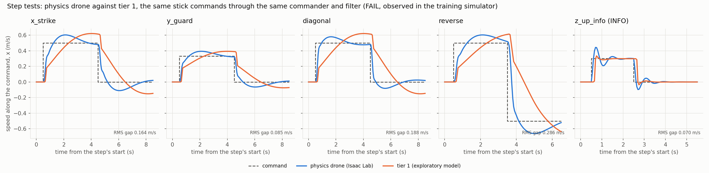
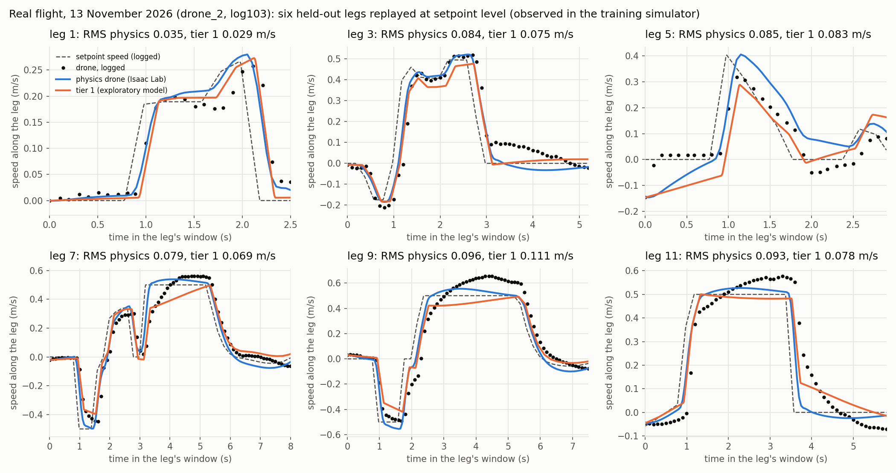

Simulator: observed in the training simulator (tier 2, Isaac Lab) and tier 1, against real flight logs (13 November 2026, drone_2)

# 2026-11-16T23:57:14+08:00 2026-11-16_s2b_step_tests record

Result: **FAIL** against `[step_gates]` of `configs/s2b.toml`. Ledger row T11. Observed in the training simulator; nothing here is a flight result.

## What this run shows

- **Against the real flight, the physics drone's speed is close enough, but its timing is not.** Fed the setpoints PX4 logged on the six held-out legs, its worst leg is 0.096 m/s from the logged speed (gate 0.10; tier 1's drone model, fed the same setpoints, 0.111). But the time to reach 63 % of a change is off by up to 0.38 s (gate 0.10): 4 of the 12 changes miss the gate (leg 5 stop 0.38 s, leg 11 stop 0.25 s, leg 9 start 0.13 s and stop 0.12 s).
- **Mostly, the physics drone answers sooner than the real drone did.** In 10 of the 12 changes it reaches 63 % earlier, typically by 0.05–0.13 s (leg 9 start: 0.27 s against the real 0.40 s). Shifting its speed 0.09 s later would lower the pooled error from 0.060 to 0.049 m/s (INFO only, D7: no delay is applied). This fits the plan's known gaps: the physics drone has no estimator and no transport delay, and no hover-thrust estimator or `THR_MDL_FAC`. The one large miss the other way is leg 5's stop, where the physics drone slows down 0.38 s later than the real drone. Leg 5's start state is suspect: its first logged speed sample is 0.147 m/s sideways, and the next one, 0.1 s later, is 0.023 m/s. Both models start from that lone sample (the window's start speed, as S1 did). Without leg 5, the worst t63 error would be 0.245 s (leg 11 stop). That figure is INFO; the gate value stays 0.377 s.
- **Through the commander copy, tier 1's drone model is far slower than the physics drone.** For the same stick commands tier 1 takes 0.56–0.88 s to reach 63 % of a push and 0.90–1.22 s to stop; the physics drone takes 0.19–0.25 s. The speeds differ by up to 0.29 m/s RMS on the reverse step (gate 0.10). Fed PX4's logged setpoints directly (the replay), the same tier 1 model is close to the real drone. So its slowness shows up only in closed loop with the commander copy. A documented candidate is the feed-forward caveat in `params/real_exploratory_v0.toml`. The fit saw a "derived" feed-forward (the slope of the 5 Hz logged speed), but in the game tier 1 gets the commander's exact 5 m/s² ramp, against the model's fitted 1.72 m/s² acceleration limit. This run does not test that.
- **Reading rule:** the physics drone fails against the real log, so it differs from the real drone. The gates measure the gap: speed within 0.10 m/s on every leg, timing up to 0.38 s off. Against tier 1 the gap is larger still, and tier 1's own timing error against the log (setpoint level) is 0.18 s, also above 0.10.
- **Hover:** from rest, with nothing to disturb it, the physics drone held position to 2 mm and stayed exactly level (tilt 0.000 deg at every physics step). This shows no drift and no self-excited wobble, but it is a weak test, because nothing excited it. After a step, which does excite it, the tilt spread over the last 2 s of each release is 0.08–0.22 deg (largest tilt there 1.0 deg, on the reverse step). That is INFO, from this run's `arrays.npz`: well under the hover gate's 1 deg, so no wobble is seen.
- **Tilt:** to start a 0.5 m/s push the physics drone tilts up to 13 deg, and to reverse from +0.5 to −0.5 m/s up to 25 deg (gate 45.5). No upsets and no non-finite values. The real drone's tilt was not compared. With drone_1's 30 deg limit (INFO) the speeds change by at most 0.018 m/s, the largest tilt is 24.8 deg, and the replay is unchanged.
- **Isaac Lab against the PyTorch reference world, same layers (INFO):** steps differ by at most 0.0006 m/s, replays by 0.001 m/s.
- **How it ran:** on the host, headless. The preflight returned 11, because a Task 9 diagnosis run (`train_standin.py`, not the AirStack simulator) held 710 MiB. Under the lead's ruling, step tests may share the GPU, since they are not timing runs.

## Purpose

S2b flies the game on rigid-body Starlings in Isaac Lab, under a copy of PX4 1.14's control cascade with the drone's own gains, except the SIM-ONLY yaw-rate gains of the owner's ruling (the physics drone). This run asks two questions. First: does the physics drone answer a stick command like the real drone did? Its speed is compared with the real drone's on six legs of a real flight (log103, 13 November 2026, drone_2), feeding it the setpoints PX4 logged. Second: does it answer like tier 1's drone model, the fast PyTorch model the game used until now? The same stick commands go through the same commander copy and safety filter to both.

Reading rule (written before the run, from the plan): if the physics drone passes against the real log and fails against tier 1, the exploratory tier 1 model is the one that differs from the real drone (in the game its time to 63 % is about 0.6 s at the start of a push and 0.9 s at the stop). If it fails against the real log, the physics drone differs from the real drone, and the gates say by how much.

## Gates

| Gate | Limit | Measured | Result |
|---|---|---|---|
| `hover_drift_max_m` | <= 0.05 | 0.0020 | PASS |
| `hover_tilt_std_max_deg` | <= 1.0 | 0.0000 | PASS |
| `peak_tilt_max_deg` | <= 45.5 | 25.3018 | PASS |
| `upsets_max` | <= 0 | 0 | PASS |
| `real_min_windows` | >= 6 | 6 | PASS |
| `real_vel_rms_max_mps` | <= 0.1 | 0.0957 | PASS |
| `real_t63_err_max_s` | <= 0.1 | 0.3769 | FAIL |
| `tier1_vel_rms_max_mps` | <= 0.1 | 0.2861 | FAIL |
| `tier1_t63_gap_max_s` | <= 0.1 | 0.9925 | FAIL |

## Hover (10 s from rest, every game and both drones)

- Largest drift from the start: 0.0020 m (tier 1: 0.0000 m).
- Tilt spread over the last 5 s (largest per-drone standard deviation, 20 Hz samples): 0.0000 deg. Largest tilt: 0.000 deg in the 20 Hz samples, 0.000 deg at any physics step (200 Hz).

## Steps: physics drone against tier 1, same stick commands

Each step: 0.5 s of hold, the stick command for the push time, then the release command. Speeds are along the command. t63 = time from the change of command until the speed covers 63 % of the change, the command's levels for both drones.

| Step | gated | speed RMS gap (m/s) | t63 push physics / tier 1 (s) | t63 release physics / tier 1 (s) | peak speed physics / tier 1 (m/s) | largest tilt (deg) |
|---|---|---|---|---|---|---|
| x_strike | yes | 0.1639 | 0.253 / 0.884 | 0.233 / 1.175 | 0.603 / 0.621 | 13.36 |
| y_guard | yes | 0.0848 | 0.214 / 0.558 | 0.198 / 0.904 | 0.393 / 0.393 | 9.78 |
| diagonal | yes | 0.1879 | 0.188 / 0.884 | 0.182 / 1.175 | 0.579 / 0.621 | 18.69 |
| reverse | yes | 0.2861 | 0.253 / 0.884 | 0.279 / 1.215 | 0.660 / 0.636 | 24.53 |
| z_up_info | INFO | 0.0696 | 0.071 / 0.181 | 0.076 / 0.181 | 0.443 / 0.335 | 0.00 |

*Speed along the stick command for each step: the physics drone in Isaac Lab, tier 1's drone model, and the command. Both drones get the same commands through the same commander copy and safety filter. Made by `scripts/make_s2b_figures.py steps` from this run's `arrays.npz`.*

## Real flight log: six held-out legs replayed at setpoint level

Log `/home/jeremychia/flight_logs/2026-11-13/ulog_drone_2/log103.ulg`, sha256 `4db5b1fcf33e69c6…`. 12 legs found; held out (odd legs, as S1): [1, 3, 5, 7, 9, 11]; same legs and split as S1's `split.json`: True. Tier 1 here is the S1 drone model fed the same setpoints; its per-leg RMS reproduces S1's within 0.0000 m/s.

| Leg | seconds | speed RMS physics / tier 1 (m/s) | t63 start logged / physics / tier 1 (s) | t63 stop logged / physics / tier 1 (s) |
|---|---|---|---|---|
| 1 | 2.5 | 0.0353 / 0.0287 | 0.241 / 0.245 / 0.279 | 0.273 / 0.230 / 0.241 |
| 3 | 5.2 | 0.0842 / 0.0749 | 0.323 / 0.230 / 0.263 | 0.347 / 0.333 / 0.319 |
| 5 | 2.9 | 0.0849 / 0.0831 | 0.224 / 0.212 / 0.299 | 0.633 / 1.010 / 0.570 |
| 7 | 8.0 | 0.0785 / 0.0691 | 0.382 / 0.300 / 0.283 | 0.556 / 0.469 / 0.516 |
| 9 | 7.5 | 0.0957 / 0.1110 | 0.397 / 0.267 / 0.314 | 0.584 / 0.464 / 0.499 |
| 11 | 5.8 | 0.0930 / 0.0777 | 0.455 / 0.366 / 0.377 | 0.487 / 0.243 / 0.304 |

- Worst leg speed RMS: physics 0.0957 m/s, tier 1 0.1110 m/s (gate 0.10, physics only). Pooled over all legs, per axis (S1's exploratory number): physics 0.0599, tier 1 0.0582 m/s.
- Worst t63 error over 12 changes: physics 0.377 s, tier 1 0.183 s (gate 0.10 s, physics only).
- INFO (D7, not applied): shifting the physics drone's speed later by +0.09 s would give the lowest pooled RMS, 0.0495 m/s (worst leg 0.1023).

*The six held-out legs of the 13 November flight (drone_2): the speed the drone logged, the physics drone and tier 1's drone model, each fed PX4's logged setpoints, along each leg's direction. Made by `scripts/make_s2b_figures.py real_replay` from this run's files.*

## INFO variants

- drone_1's 30 deg tilt limit (D11): steps differ from the 45 deg drone by at most 0.01812 m/s; largest tilt 24.77 deg; replay worst-leg RMS 0.0957 m/s.
- PyTorch reference world, same layers: steps differ from Isaac Lab by at most 0.00062 m/s (RMS 0.00030); replay by at most 0.00096 m/s.
- Game 5 repeats x_strike in another game slot: largest speed difference to game 0 0.000000 m/s.
- Float32 positions: the farthest drone sits about 57 m from the world origin, where float32 steps by 3.8e-06 m. (At training scale, 4,096 games at 40 m spacing, about 2.5 km, the step is about 2.4e-4 m; not measured here.)

## What is not modelled

- The drone's `THR_MDL_FAC` 0.9 and the hover-thrust estimator (`MPC_USE_HTE` 1): the physics drone has a fixed hover thrust and a linear motor (plan, known differences for Task 7).
- No transport delay and no estimator: the cascade reads the true state (D7).
- Yaw-rate gains: SIM-ONLY: AirStack simulator yaw-rate gains (CHG-0024), owner's ruling 16 Nov 2026; never port to the drone (params/sim_only_yaw_v0.toml, sha256 d0944b889f90): yaw-rate P/I/D 0.25/0.2/0. Owner's ruling of 16 November 2026 (T10 FAIL accepted, the SIM-ONLY yaw gains used for the physics drone); never a drone value.
- The replay feeds PX4's logged setpoint with S1's `derived` acceleration feed-forward (the slope of the 5 Hz logged speed), sampled at the 0.05 s tick; on the drone PX4 received the commander's own 20 Hz setpoint.
- The game's rules (walls, height band, zone, resets) are not in the loop in the step tests: the layers are driven directly, one commanded drone and one still drone 10 m away.

## Commit

`9471b61-dirty`, code fingerprint `a61699f93051`.

## Config

- Gates: `configs/s2b.toml` (sha256 `16814e44e881`), `[step_tests]` and `[step_gates]`, copied to `runs/2026-11-16_s2b_step_tests/gates.toml` before the run.
- Game: `s2_game.toml` (sha256 `da8dd28fab3b`), committed neutral values, local file: none; preset partner; safety filter on every pair, 1000 sweeps, early stop every 8.
- Physics drone: `params/starling_physics_v0.toml`, physics step 0.005 s, rotor positions cad, motor lag on, tilt limit 45 deg.
- Tier 1: Starling layer, `params/real_exploratory_v0.toml` (exploratory).
- Command: `python scripts/physics_step_tests.py --phase run --headless --gates configs/s2b.toml --name 2026-11-16_s2b_step_tests`.

## Model parameter set

Rigid-body Starling `params/starling_physics_v0.toml` (drone's gains) with the SIM-ONLY yaw-rate gains of `params/sim_only_yaw_v0.toml`; tier 1 `params/real_exploratory_v0.toml` (exploratory).

## Seeds

None drawn: every start, command and setpoint is fixed (torch seeded 0).

## Machine

NVIDIA GeForce RTX 5070 Ti Laptop GPU; Isaac Sim 5.1.0 / Isaac Lab 2.3.2 on the HOST (conda `env_isaaclab`), not the container: the container mounts only `svg_training/`, and the flight log is host-only (plan D13). Headless. GPU compute processes before launch: `3905, 297 MiB, /usr/libexec/gnome-remote-desktop-daemon; 534412, 710 MiB, /home/jeremychia/miniconda3/envs/env_isaaclab/bin/python`. Wall time 162.7 s.

## Games at once

6 games x 2 drones (slot 0 commanded, slot 1 still 10 m away).

## Steps per second

Not measured here (the throughput record measures it).

## Files

`runs/2026-11-16_s2b_step_tests/`: `gates.toml`, `windows.npz` + `windows.json` (from `--phase windows` on the host), `arrays.npz`, `results.json`, `run.log`, `preflight.txt`.
