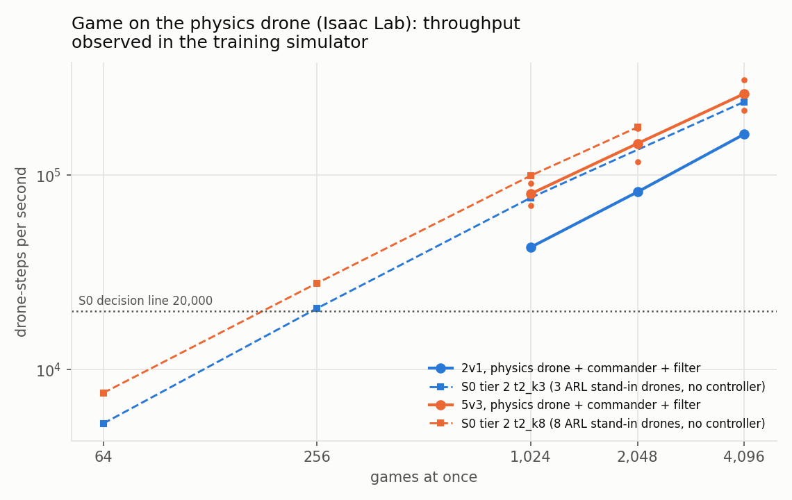

Simulator: observed in the training simulator (tier 2, Isaac Lab), random actions, safety filter on every pair

# 2026-11-17T00:18:38+08:00 2026-11-16_s2b_throughput record

Result: **INFO (no gates)**. Read-off (not a gate): the best point runs 262,190 drone-steps per second; S0's decision line for training on tier 2 is 20,000 (`trainable_drone_steps_per_s_min`): above it. Observed in the training simulator; nothing here is a flight result.

## What this run shows

- **Every point is above S0's line of 20,000 drone-steps per second.** The slowest point, 2v1 with 1,024 games, runs 42,590. The fastest, 5v3 with 4,096 games, runs 262,190 (mean of two repeats). By S0's decision rule, the game on the physics drone in Isaac Lab is fast enough to train on directly, not only to check tier 1. This was observed on this laptop, with random actions and no learner in the loop.
- **Speed grows in step with the number of games.** Doubling the games almost doubles the drone-steps per second at every size. So within this range the GPU is not full. The time per game tick stays about the same at each size: 72–76 ms for 2v1 and 90–152 ms for 5v3. The run is likely bound by kernel launches (not measured): each tick launches many small GPU operations, 10 cascade steps and 10 PhysX steps. More games per process would probably run faster still. That was not measured here: the sweep stops at 4,096, as `[throughput]` says.
- **Where the time goes** (profiling pass, a guide only): the PX4 cascade takes 36–50 % of a tick, PhysX 20–24 %, and the safety filter 11–12 % for 2v1 and 26–27 % for 5v3, where there are many more pairs. Every tick makes exactly 2 world writes (D9). No NaN, no upsets, no non-finite wrenches at any point.
- **For 5v3 the two repeats differ by 26–39 %. 2v1 repeats agree within 2 %.** In game-steps per second, repeat 0 then repeat 1: 1,024 games 11,316 / 8,721; 2,048 games 21,732 / 14,622; 4,096 games 38,647 / 26,900. No other process was on the GPU before or after any point (the rows keep nvidia-smi's lists). Repeat 1 is slower at all three 5v3 points, so the gap is systematic. **Cause not found.** Candidate (untested): the safety filter's early stop depends on the data, and each repeat draws its random actions from a different seed (0 + repeat). One diagnosis, not of record, was a single sample on the PyTorch world on the GPU (5v3, 1,024 games), shared with a 710 MiB process. With game seed 0, actions seeded 0 and 1 ran 12,226 and 8,807 game-steps/s. With game seed 1, actions seeded 1 and 2 ran 12,250 and 12,227. That hints that the gap goes with the particular games rather than the order of the repeats or Isaac, but it does not show why. The profiled filter share is not higher in the slow repeats. The means are reported. The read-off is safe either way: the slowest single row is 42,248 drone-steps per second.
- S0's tier 2 line (dashed in the figure) is S0's benchmark: ARL Robot 1 stand-in drones (Isaac Lab `Multirotor` with thrusters, a ground plane, one asset per drone slot), random thrust, no controller and no filter, at the same 200 Hz. The physics drone game carries the commander, the filter and the cascade on top, yet runs about as fast for 5v3. One likely reason is that it holds all drone slots in one rigid-object collection (S2b spike); this run did not test that.
- The run folder is dated 16 November, but the six points ran on 17 November, 00:18–00:24.

## Purpose

How fast does the game run on the physics drone in Isaac Lab, with everything a training run would have on: the commander copy, the safety filter on every pair, PX4 1.14's cascade at 200 Hz and PhysX? The actions are random (the stand-in for a policy). The numbers decide whether training can use this tier directly or only check results from tier 1.

## Throughput

Means of the repeats. Game-steps per second = games x game ticks per second (environment steps).

| Size | Games | Drones per game | Game-steps per second | Drone-steps per second | filter / cascade / physics share | writes per tick (max) | GPU memory: torch allocations only, peak (PhysX not counted) / whole device in use (MB) | repeat spread | NaN | upsets | status |
|---|---|---|---|---|---|---|---|---|---|---|---|
| 2v1 | 1,024 | 3 | 14,197 | 42,590 | 0.11 / 0.49 / 0.23 | 2 | 15 / 4,682 | 1.6% | 0 | 0 | ok (2 of 2) |
| 2v1 | 2,048 | 3 | 27,332 | 81,996 | 0.11 / 0.49 / 0.23 | 2 | 21 / 4,683 | 0.2% | 0 | 0 | ok (2 of 2) |
| 2v1 | 4,096 | 3 | 54,170 | 162,510 | 0.12 / 0.47 / 0.24 | 2 | 33 / 4,713 | 0.1% | 0 | 0 | ok (2 of 2) |
| 5v3 | 1,024 | 8 | 10,019 | 80,150 | 0.26 / 0.39 / 0.20 | 2 | 27 / 4,682 | 25.9% | 0 | 0 | ok (2 of 2) |
| 5v3 | 2,048 | 8 | 18,177 | 145,417 | 0.26 / 0.38 / 0.21 | 2 | 46 / 4,712 | 39.1% | 0 | 0 | ok (2 of 2) |
| 5v3 | 4,096 | 8 | 32,774 | 262,190 | 0.27 / 0.36 / 0.23 | 2 | 85 / 4,771 | 35.8% | 0 | 0 | ok (2 of 2) |

*Drone-steps per second against the number of games, physics drone in Isaac Lab with the commander, the safety filter on every pair and PX4's cascade; random actions. Dashed: S0's tier 2 benchmark (ARL Robot 1 stand-in drones with thrusters, random thrust, no controller, no filter) at the same drones per game. Grey: S0's 20,000 decision line. Made by `scripts/make_s2b_figures.py throughput`.*

## How it was measured

- One process per point, on the HOST (conda `env_isaaclab`), not the container; headless; `scripts/isaac_preflight.sh --approved-headless` returned 0 (GPU free) before each point. A `*` in the status column marks a point where nvidia-smi listed another compute process before or after it.
- Timing as S0: 50 warm-up steps and at least 2 s, a timed window of at least 200 steps and 2.0 s, 2 repeats; the world is built once per point, the game afresh per repeat.
- Shares come from a separate 20-tick pass with a synchronised timer around the safety filter, the cascade and the physics step (each called once or 10 times per tick); the timers' own synchronisation is included, so the shares are a guide, not a split of the throughput above. Writes per tick: world state writes in one game tick (D9 allows two).
- Game: `configs/s2_game.toml` (sha256 `da8dd28fab3b`), committed neutral values, local file: none; preset partner; safety filter on every pair, 1000 sweeps, early stop every 8 (as the file says at launch).
- Physics drone: physics step 0.005 s (10 per tick), motor lag on; SIM-ONLY: AirStack simulator yaw-rate gains (CHG-0024), owner's ruling 16 Nov 2026; never port to the drone (params/sim_only_yaw_v0.toml, sha256 d0944b889f90): yaw-rate P/I/D 0.25/0.2/0.
- NaN = timed steps with a non-finite position, speed or reward; upsets = games in which a drone tipped past 60 deg or turned non-finite (D10).

## Commit

`9471b61` plus uncommitted work: `scripts/physics_throughput.py` and the other Task 7 files were not yet committed when the points ran. The code fingerprint `d6dd5e1928d4` (hash of source/, scripts/, configs/) identifies the code as it ran.

Source and configs: `source/` and `configs/` are unchanged between the recorded commit and 413c713. The script edits made after the run were wording, the figure legend, an INFO field and the out-of-memory row only.

## Config

`configs/s2b.toml` `[throughput]` (no gates; sizes ['2v1', '5v3'], games [1024, 2048, 4096], 2 repeats). Command per point: `python scripts/physics_throughput.py --headless --size <size> --num-games <n> --gates configs/s2b.toml --out runs/2026-11-16_s2b_throughput/results.jsonl`.

## Model parameter set

Rigid-body Starling `params/starling_physics_v0.toml` (drone's gains) with the SIM-ONLY yaw-rate gains of `params/sim_only_yaw_v0.toml` (owner's ruling of 16 November 2026; never a drone value).

## Seeds

Game seed 0; torch seeded 0 + repeat for the random actions.

## Machine

NVIDIA GeForce RTX 5070 Ti Laptop GPU; Isaac Sim 5.1.0 / Isaac Lab 2.3.2 on the host, headless.

## Games at once

1,024, 2,048, 4,096 games of 2v1 (3 drones) and 5v3 (8 drones).

## Files

`runs/2026-11-16_s2b_throughput/`: `results.jsonl` (every row), one `preflight_<size>_<games>.txt` and `log_<size>_<games>.txt` per point.
