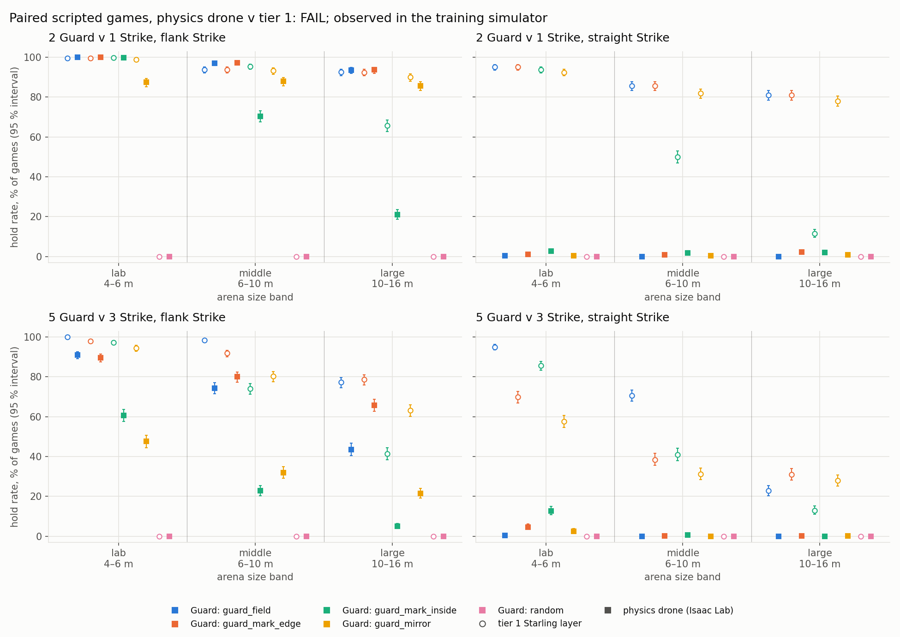
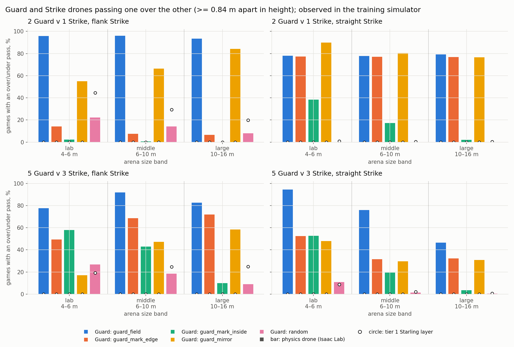

Observed in the training simulator: tier 2 (Isaac Lab) against tier 1 (Starling layer, exploratory), paired scripted games, committed neutral values

# 2026-11-17T01:15:24+08:00 2026-11-17_s2b_scripted_compare record

Result: **FAIL** against `[compare_games_gates]` of `configs/s2b.toml`. Ledger row T13. Observed in the training simulator; nothing here is a flight result.

## What this run shows

- **The physics drone changes who wins.** In 36 of the 60 cells (Guard × Strike × size × band) the Guard team's hold rate moves by more than the 0.10 gate, always downwards on the physics drone (−0.115 to −0.948). The largest is field v straight, 2v1 lab: 95.1 % on tier 1, 0.3 % on the physics drone.
- **Against the straight Strike, the scripted Guards stop holding.** On the physics drone they hold 0–13 %, where tier 1 gave 11.5–95.1 %. Against the flank Strike the backends agree within the gate in 9 of 12 scripted 2v1 cells but only 2 of 12 in 5v3 (gaps down to −0.51).
- **Why: Strike drones pass over or under the Guards.** The safety filter keeps drones 1.10 m apart in 3-D, so once two drones are at different heights it can push them apart up and down. With scripted Guards this happened in none of 48,000 tier 1 games and in 43–64 % of physics games: one drone climbs towards 1.8 m, the other drops towards 0.6 m, and the Strike drone flies into the zone (figure 2).
- **Tested: a 1 mm height difference is enough.** On tier 1 no drone ever leaves its start height of 1.20 m, and the Guards held 97.5 % of 40 games of 2v1 lab mark edge v straight. With every Strike drone started 1 mm higher, tier 1's Guards held 0 %, as on the physics drone, where one drone's largest height change from its start was 0.646 m. Script `scripts/diag_vertical_pass.py`, CPU; command and numbers in the [vertical-pass note](../docs/notes/2026-11-17_s2b_vertical_pass_note.md).
- **The owner chose to keep this behaviour** (17 November 2026, S2b plan section "Owner's answer, third round", option (a), commit `997a5d2`). Passing over or under stays part of the game, and Guards will have to learn to cover height later. The gate stays and the FAIL stands.
- **The physics drone also answers faster.** Task 7 (T11) found tier 1 takes 0.6–0.9 s to reach 63 % of a commanded speed against 0.19–0.25 s, because its fitted 1.72 m/s² acceleration limit cuts the commander's 5 m/s² pulse. The 1 mm test shows this is not needed for the collapse against the straight Strike; how much it adds elsewhere (5v3 against the flank Strike) is not separated.
- **Closest approach: no worse with scripted Guards.** In all 48 scripted cells the physics minimum and 5th percentile of the 3-D closest Guard–Strike approach are within 0.071 m and 0.018 m of tier 1's (gate 0.10 m), and in 44 the physics minimum is the larger. The 4 failing cells are random Guards in middle and large arenas, 0.12–0.23 m closer at the minimum; cause not diagnosed (candidate, untested: tier 1's slow response smooths out the random Guards' changing commands).
- **No upsets and no NaN** in 60,000 physics games, and no non-finite wrench value.
- **The games were paired.** Every cell's 1,000 game slots began from the same arena, zone, starts and start misses on both backends; `compare_backends.py` checked this and would have refused otherwise. Outcome agreement on the same slot ranged from 5 % to 99.9 % over the scripted cells (median 63 %).

## Purpose

S2b puts the S2 game on rigid-body Starlings in Isaac Lab: PX4 1.14's control cascade with the drone's own gains, except the SIM-ONLY yaw-rate gains of the owner's ruling. This run asks whether the scripted reference games give the same answers there as on tier 1 (the Starling layer with the exploratory fitted drone model). Same strategies, same arenas, same starts, one backend changed. If they agree, tier 1 can stand in for the physics drone when scoring strategies; if not, the gates say where and by how much.

## Gates

`configs/s2b.toml` `[compare_games_gates]`, owner-approved 16 November 2026. The closest-approach rule is the owner's decision A of 16 November, which replaced "physics closest approach at least 1.0 m in every game". The gates were copied to `runs/2026-11-17_s2b_scripted_compare/gates.toml` at 01:15:17, before either side ran.

| Gate | Limit | Measured | Result |
|---|---|---|---|
| `max_cell_hold_gap`: per cell, physics − tier 1 hold rate | ≤ 0.10 in all 60 cells | largest 0.948; 36 of 60 cells over | FAIL |
| `closest_cross_3d_gap_max_m`: per cell, games without a start miss, physics minimum and 5th percentile at most this far below tier 1's | ≤ 0.10 m in all 60 cells | largest 0.234 m (minimum), 0.035 m (5th percentile); 4 of 60 cells over | FAIL |
| `upsets_max` | 0 | 0 | PASS |
| `nan_max` | 0 | 0 | PASS |

## Hold rates

Hold rate = share of games the Guard team held (no Strike drone reached the zone). Tier 1 → physics drone, in %, 1,000 paired games each; **x** = the cell's gap is over 0.10. Each rate's Wilson 95 % interval is in `compare.md` and figure 1; none is wider than ±3.1 points.

| Guard v Strike | 2v1 lab | 2v1 middle | 2v1 large | 5v3 lab | 5v3 middle | 5v3 large |
|---|---|---|---|---|---|---|
| mark edge v straight | 95.1 → 1.1 **x** | 85.6 → 0.8 **x** | 80.9 → 2.3 **x** | 69.8 → 4.7 **x** | 38.5 → 0.1 **x** | 31.1 → 0.2 **x** |
| mark edge v flank | 99.6 → 99.9 | 93.7 → 97.2 | 92.4 → 93.6 | 98.0 → 89.6 | 91.8 → 80.0 **x** | 78.6 → 65.8 **x** |
| mark inside v straight | 93.7 → 2.6 **x** | 49.9 → 1.8 **x** | 11.5 → 2.0 | 85.6 → 12.8 **x** | 41.0 → 0.6 **x** | 13.0 → 0.0 **x** |
| mark inside v flank | 99.7 → 99.8 | 95.4 → 70.4 **x** | 65.6 → 21.0 **x** | 97.3 → 60.7 **x** | 74.1 → 22.8 **x** | 41.3 → 5.0 **x** |
| field v straight | 95.1 → 0.3 **x** | 85.6 → 0.0 **x** | 80.9 → 0.0 **x** | 95.0 → 0.4 **x** | 70.6 → 0.0 **x** | 22.8 → 0.0 **x** |
| field v flank | 99.6 → 99.9 | 93.7 → 97.0 | 92.5 → 93.5 | 100.0 → 91.0 | 98.4 → 74.4 **x** | 77.2 → 43.6 **x** |
| mirror v straight | 92.4 → 0.3 **x** | 81.8 → 0.3 **x** | 78.0 → 0.8 **x** | 57.7 → 2.6 **x** | 31.2 → 0.0 **x** | 28.0 → 0.1 **x** |
| mirror v flank | 98.9 → 87.4 **x** | 93.2 → 87.8 | 90.0 → 85.7 | 94.5 → 47.6 **x** | 80.2 → 32.0 **x** | 63.1 → 21.5 **x** |
| random v straight | 0.0 → 0.0 | 0.0 → 0.0 | 0.0 → 0.0 | 0.0 → 0.0 | 0.0 → 0.0 | 0.0 → 0.0 |
| random v flank | 0.0 → 0.0 | 0.0 → 0.0 | 0.0 → 0.0 | 0.0 → 0.0 | 0.0 → 0.0 | 0.0 → 0.0 |

*Figure 1. Share of games the Guard team held, with 95 % intervals, per arena size band; each point is 1,000 paired games. Open circles: tier 1 Starling layer; filled squares: the physics drone in Isaac Lab. Colour is the Guard strategy. One panel per team size and Strike behaviour.*

Against the straight Strike the physics squares sit near zero in every panel, while tier 1 holds most games in small arenas. Against the flank Strike the two backends sit close in 2v1 except mark inside and mirror lab. In 5v3 the physics drone holds less in every band.

The tier 1 side reproduces S2's reference (T9) within the spread of fresh draws: same strategies and settings, but paired draws instead of T9's packed ones, so different arenas. All 60 cells are within 0.043 of T9 (mean 0.008). The 0.10 gate is well above chance.

## Passing one over the other

*Figure 2. Share of games in which a Guard and a Strike drone passed one over the other: closest horizontal approach under 0.55 m while the closest 3-D approach stayed at or above 1.0 m, so they were at least 0.84 m apart in height. Bars: physics drone; circles: tier 1. From the run's per-game arrays.*

With scripted Guards the tier 1 circles are at zero in every cell: those drones never leave their start height. Random Guards command up and down, so on tier 1 they also pass over or under (up to 45 % of games). A pass does not decide a game by itself: in 2v1 field v flank the drones pass in 94–96 % of physics games and the Guard team still holds 93.5–99.9 %.

Pooled over the four scripted Guards (12,000 games per row):

| Size | Strike | tier 1: games with a pass | physics: games with a pass | physics: Strike wins | physics: Strike wins with a pass |
|---|---|---|---|---|---|
| 2v1 | straight | 0 | 7,704 (64.2 %) | 11,877 (99.0 %) | 7,701 (64.8 %) |
| 2v1 | flank | 0 | 5,221 (43.5 %) | 1,668 (13.9 %) | 115 (6.9 %) |
| 5v3 | straight | 0 | 5,174 (43.1 %) | 11,785 (98.2 %) | 5,006 (42.5 %) |
| 5v3 | flank | 0 | 6,752 (56.3 %) | 5,660 (47.2 %) | 2,393 (42.3 %) |

The pass test is strict (0.84 m of height), so Strike wins without it may still involve a smaller vertical dodge; this run does not say.

Diagnosis: `scripts/diag_vertical_pass.py` (committed; CPU, PyTorch reference world), its commands and numbers in the [vertical-pass note](../docs/notes/2026-11-17_s2b_vertical_pass_note.md): 40 games of 2v1 lab, mark edge and field against the straight Strike, plus 1 mm and 10 mm Strike start offsets on tier 1. Re-run from the committed script on 17 November with the same numbers as the first run.

## Closest approach (3-D, games without a start miss)

All 48 scripted-Guard cells pass. Largest physics shortfall against tier 1: 0.071 m at the minimum and 0.018 m at the 5th percentile. The 4 failing cells are all random Guards:

| Size | Guard v Strike | band | tier 1 min / p5 (m) | physics min / p5 (m) | min gap / p5 gap (m) |
|---|---|---|---|---|---|
| 2v1 | random v straight | middle | 0.869 / 0.978 | 0.737 / 0.968 | 0.133 / 0.010 |
| 2v1 | random v straight | large | 0.936 / 0.999 | 0.702 / 0.983 | 0.234 / 0.016 |
| 5v3 | random v flank | large | 0.889 / 0.951 | 0.699 / 0.915 | 0.190 / 0.035 |
| 5v3 | random v straight | large | 0.893 / 0.962 | 0.771 / 0.948 | 0.122 / 0.014 |

The lowest physics value without a start miss is 0.699 m (5v3) and 0.702 m (2v1), both from random Guards. Tier 1's lowest is 0.686 m (5v3, mirror v flank lab) and 0.832 m (2v1). The keep-out is 1.10 m. Breach share (any game with a Guard–Strike pair under 1.10 m in 3-D), mean over the cells: tier 1 89 %, physics 86 %. As in T9, most breaches are shallow.

## Not done here

- No full separation of the two causes. The 1 mm test covers 2v1 lab against the straight Strike only.
- No physics run with the drones held at one height. The owner kept vertical passing in the game.
- No tier 1 refit (the T11 finding stands as it was).

## Commit

Repository HEAD `4eb6e553f97cae26e494bd2b9e3080d09f1f5b92` at launch. Task 8's code was uncommitted in the working tree. Code fingerprint (sha256 over `source/`, `scripts/`, `configs/`): `1b6fdebc64fe`, the same in all three score runs. After the runs, `scripts/make_s2b_figures.py` gained the `vertical_pass` figure function, and this record, the ledger row and the two figures were added. `compare_backends.py` and the score runs were not changed.

## Config

- Gates: `configs/s2b.toml` (sha256 `16814e44e881`), `[compare_games]` and `[compare_games_gates]`.
- Game: `configs/s2_game.toml` (sha256 `da8dd28fab3b`), committed neutral values (`--no-local`, local file: none), partner preset. Keep-out 1.10 m, Strike team 0.5 m/s, Guard team 0.33 m/s, 1,200 steps of 0.05 s, walls stop drones, ring starts, height band 0.5–1.8 m, start height 1.2 m. Safety filter on every pair, 1,000 sweeps, early stop checked every 8.
- Strategies (`[compare_games]`): Guard team `guard_mark_edge`, `guard_mark_inside`, `guard_field`, `guard_mirror`, `random`; Strike team `strike_straight`, `strike_flank`; sizes 2v1 and 5v3; bands lab, middle, large; 1,000 games per band; seed 0; `--batch-per-pair`.
- Commands (`runs/2026-11-17_s2b_scripted_compare/run.sh`):
  - tier 1: `score.py --guard <5> --strike <2> --presets starling --sizes 2v1,5v3 --batch-per-pair --games-per-band 1000 --seed 0 --no-local --device cuda --out runs/2026-11-17_s2b_scripted_compare_starling`
  - physics, once per size: the same with `--presets physics --sizes <size> --headless --out runs/2026-11-17_s2b_scripted_compare_physics_<size>`
  - then `compare_backends.py --a runs/..._starling --b runs/..._physics_2v1,runs/..._physics_5v3 --gates configs/s2b.toml --name 2026-11-17_s2b_scripted_compare`.

## Model parameter set

- Tier 1: Starling layer, `params/real_exploratory_v0.toml` (sha256 `4c93543f51ab`), exploratory (S1 fit; held-out check T5 = FAIL).
- Physics drone: `params/starling_physics_v0.toml` (sha256 `888f4aea1b5a`), physics step 0.005 s, rotor positions cad, motor lag on, tilt limit 45°. Yaw-rate gains: SIM-ONLY: AirStack simulator yaw-rate gains (CHG-0024), owner's ruling 16 Nov 2026; never port to the drone (`params/sim_only_yaw_v0.toml`, sha256 `d0944b889f90`): yaw-rate P/I/D 0.25/0.2/0. Every other gain is the drone's own.

## Seeds

Game seed 0 + band index for every pair, on both backends (paired). Guard strategy seed 101, Strike 202.

## Machine

- **GPU and software:** this laptop, NVIDIA GeForce RTX 5070 Ti Laptop GPU (12 GB). torch 2.7.0+cu128, Python 3.11, conda `env_isaaclab`. Isaac Sim 5.1.0 / Isaac Lab 2.3.2 on the **host**, not the container: the container lacks the Starling USD (lead's ruling). Headless.
- **Preflight** (`preflight.txt` in each score folder): tier 1 and physics 2v1 exit 0. Physics 5v3 exit 11, from this run's own physics 2v1 process (pid 652540); no AirStack simulator and no containers were up.
- **Probes before launch, not of record:** one 5v3 lab batch per side (mark edge v flank, seed 99, scratch folder), to estimate run time. Physics 184 s and tier 1 194 s per 1,000-game batch, so each physics size was estimated under the 90-minute line. The same probe pair checked the pairing on real data (identical starts, arenas and start misses) before the runs were trusted.
- **Shared GPU.** These are not timing runs. The three ran together: tier 1 01:15–03:07, physics 2v1 01:15–04:02, physics 5v3 01:19–05:02. From about 01:49 (and still at 04:32) the lead's NUS reference training (JAX, a different project, owner-approved) also ran on the GPU.
  - The physics 5v3 process was paused (SIGSTOP) from 02:21:26 to 02:37:52 to ease contention, then resumed. The batch in flight then includes the pause.
  - The game logic does not depend on timing: what each step computes does not depend on how long it takes. Bit-for-bit repeatability under GPU contention was not checked.

## Games at once

1,000 per batch: one batch per Guard × Strike pair × band × size, 60 batches per backend, 60,000 games per backend. Drones per game: 3 (2v1) or 8 (5v3).

## Steps per second

INFO only and not comparable: three runs of this task and another project's training shared the GPU. Wall time: tier 1 6,694 s (both sizes), physics 2v1 10,012 s, physics 5v3 13,318 s. Per batch of 1,000 games: tier 1 7–35 s (2v1) and 21–522 s (5v3); physics 56–1,078 s (2v1) and 46–2,567 s (5v3; the longest batch includes the pause). Short batches are those whose games all ended early (random Guards). The throughput record (T12) gives the physics drone's speed on a free GPU.

## Files

- `runs/2026-11-17_s2b_scripted_compare/`: `gates.toml`, `run.sh`, `compare.json` (sha256 `1b5aa222888b`), `compare.md`.
- `runs/2026-11-17_s2b_scripted_compare_starling/`, `_physics_2v1/` and `_physics_5v3/`: `scores.json`, `scores.md`, `per_game.npz`, `gates.toml` (score.py's own, empty), `preflight.txt`, `launched.txt`, `run.log`; `_physics_5v3/notes.txt` has the pause.
- Figures: `docs/figures/s2b_scripted_compare.png` (`make_s2b_figures.py scripted_compare`) and `docs/figures/s2b_scripted_compare_vertical.png` (`make_s2b_figures.py vertical_pass`), both from this run's files.

## Edited after the run (fix round 1, 17 November 2026)

Wording and evidence only; no number of the run changed, and the run was not repeated. The diagnosis script moved
from a git-ignored folder to `scripts/diag_vertical_pass.py` and was run again with the same numbers; the note
[2026-11-17_s2b_vertical_pass_note.md](../docs/notes/2026-11-17_s2b_vertical_pass_note.md) holds its commands. One
measure is now named as measured (one drone's largest height change from its start, 0.646 m for mark edge; not a
pair's height gap). The owner's answer is cited by commit (`997a5d2`). The results bullets were shortened. The
safety gates of `compare_backends.py` (upsets, NaN) now refuse missing data instead of counting it as zero; T13's
compare gives the same result under the stricter check.
