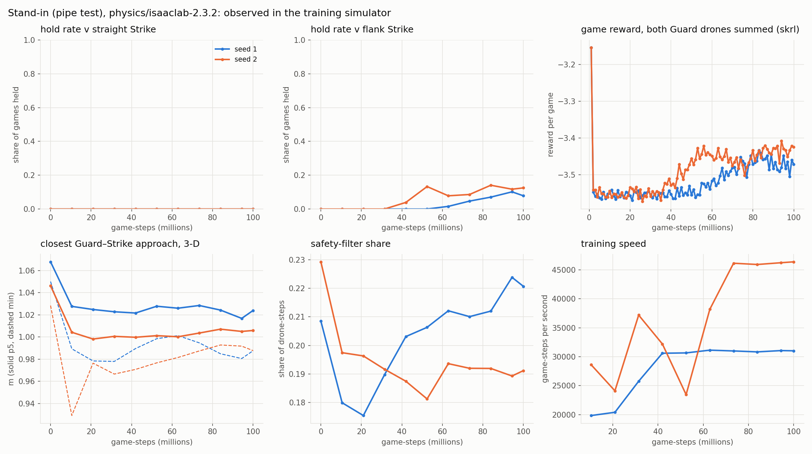
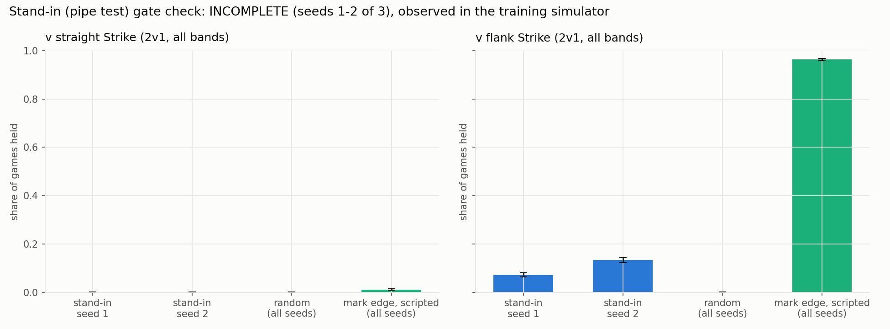

Observed in the training simulator (tier 2, Isaac Lab), physics drone with the safety filter on every pair (committed neutral values); stand-in pipe test, not a strategy of record

# 2026-11-17T03:36:29+08:00 2026-11-17_s2b_standin_isaac record

Result: **FAIL** against `[standin_gates]` of `configs/s2.toml` (unchanged): seeds 1–2 fail every cell; seed 3 not run, cannot change it (the gate needs all 3 seeds to pass). Seed 3 was not started on this laptop and is queued for the home RTX 5090, to complete the record. Ledger row T14. Observed in the training simulator; nothing here is a flight result.

## What this run shows

- **The pipe works on the Isaac Lab drones.** Each seed trained the 100 M game-steps of `[standin_v2]` (99,999,744 = 24,414 timesteps × 4,096 games; 762 updates, the last 30 timesteps collected after the last update), with no NaN, no upset drone and no non-finite wrench. Each run folder loaded in `score.py` as a Guard strategy and was scored on the physics drone.
- **Against the straight Strike drone nothing was learned.** Both seeds hold 0 of 3,000 games, the same as random Guards (0 of 3,000). The scripted reference `guard_mark_edge` holds only 1.1 % on the same games. In most of these games the stand-in Guard drones were not in the Strike drone's way: the median horizontal closest approach is 1.04–1.92 m, and the games end about as early as with random Guards (mean end step 96–216 against 84–217). In a few games a Guard drone did get in the way (5th percentile 0.41–0.67 m horizontally, 1.05–1.10 m in 3-D) and the Strike drone still got through, which is consistent with T13's over/under passing; this run did not test that.
- **Against the flank Strike drone a little was learned, far short of the gate.** Here the Guard drones do meet the Strike drone: the median horizontal closest approach is 0.02–0.14 m in the lab and middle bands while the 3-D one stays near 1.0 m, so the drones pass one above the other (as in T13). Seed 1 holds 7.2 % (215 of 3,000) and seed 2 13.3 % (400 of 3,000), against random 0 % and `guard_mark_edge` 96.3 % (both seeds' games). The gate asks for at least 20 points above random. The learning curve first shows a hold v flank between 31 and 42 M game-steps for seed 2 and between 52 and 63 M for seed 1; the curve points are 10.5 M apart (figure 1), so the start is known only to that spacing.
- **Closest approach (3-D, scoring games):** the stand-in Guard drones come to 0.95 m (seed 1) and 0.95 m (seed 2) from a Strike drone, under the 1.10 m keep-out, as the scripted Guards do on the physics drone (`guard_mark_edge` 0.92–0.95 m). Random Guards come closer, 0.63–0.77 m. No scoring game had an upset drone.
- **For the end goal:** the stand-in learner with `[standin_v2]` does not learn to hold on the physics drone in 100 M game-steps. On pure partner rules the same settings reached 0.06–0.32 v straight (Step B pilots). The likely difference is the game on the physics drone, where Strike drones can pass vertically (owner's option (a): this stays in the game; the Guard team must cover height); no tier 1 control run was made here, so this is not tested. Also observed (from the saved networks): by 100 M the log std of vx, vy and vz fell from −1.6 to −2.5 … −3.2 (std about 0.04–0.08) in both seeds, so exploration had largely stopped while the hold v straight was still 0.

## Purpose

S2b Task 9, run 2: train the stand-in (2 Guard drones, skrl IPPO) against the scripted Strike mix on the physics drone in Isaac Lab, score each seed on the physics drone, and apply the stand-in gate. It is a pipe test: does training, saving, loading and scoring work end to end on the Isaac Lab drones? It is not a strategy of record.

## Settings

- Settings table **`[standin_v2]` of `configs/s2b.toml`** (sha256 `06e8804eeb75fef9035bb64f80655a235401b56f4b27d49bada82b9660563dee`), the final proposal of the Task 9 diagnosis. **`[standin_v2]` was taken as approved by the lead from the owner's go-ahead for Isaac runs (17 November, 03:25); the owner has not yet confirmed the table itself.** The comment above the table in `configs/s2b.toml` ("Owner approved [standin_v2] …") and the `SETTINGS_TABLES` string in `scripts/train_standin.py` ("approved by the owner 17 Nov 2026", written into each run's `interface.toml` as `settings_table_status`) say "approved" ahead of that confirmation; they are left as they are because the table's sha256 is stored in both run folders. It differs from the committed `[standin]` in: 100 M game-steps per seed (50 M), initial policy log std −1.6 (skrl's 0), and the log std of the yaw-rate axis frozen at −1.6 for `physics`, because no reward depends on yaw. (The table's comment says "axes the motion ignores"; on the physics drone yaw is in fact flown by the cascade and seen in the observation, but it earns nothing.) Discount 0.99, GAE lambda 0.95, entropy 0, value-loss scale 2.5, ratio and value clip 0.2, grad-norm clip 0.5 are skrl's defaults, now written down and checked against skrl's effective values. Everything else as `[standin]`.
- Lead's rulings behind two brief deviations: no PyTorch control run (run 1) tonight, the Step B pilots being the pure-rules control (`runs/sdd/s2b/progress.md`, 17 Nov); Isaac on the host, not the container, because the container has skrl 1.4.3 and the trainer needs skrl 2.x (same file).
- `interface.toml [settings_values]` holds the table as read, including `preset = "pure"`, `wall_clock_cap_min = 45` and `seeds = [1, 2, 3]`; for these physics runs the effective values are in `[training]` and at the top level (preset physics, cap 180 min).
- Owner's game-design ruling (17 Nov, option a): vertical over/under passing stays in the game, so for `physics` the vz axis is trained.
- Command per seed: `train_standin.py --headless --config configs/s2.toml --settings standin_v2 --seed <s> --name 2026-11-17_s2b_standin_isaac_seed<s> --motion physics --eval-every-updates 80 --stop-at 2026-11-17T07:58:00` (host conda `env_isaaclab`).
- **Deviation: learning-curve evaluation every 80 updates, not the default 20.** On the physics drone one evaluation flies the whole 4,096-game world for up to 1,200 steps (about 75–150 s). At 20 updates the evaluations alone would have cost about 90 min per seed and only one seed would have fitted before the laptop was packed. This is not expected to change training: the evaluation games use their own generator and the whole world state is written back after each one. That write-back was shown bit-exact on the PyTorch reference world only; on PhysX it is not verified (Task 9 report, concern 4). The curves have 11 points per seed instead of 40. The same value was used for both seeds.
- `--stop-at 07:58` was a safety stop for the 08:15 deadline (clean stop at an update boundary); it did not trigger.
- Wall-clock cap: `[standin_s2b] wall_clock_cap_min_isaac` = 180 min of training time; not reached.

## Gates

`[standin_gates]` copied before the runs to `runs/2026-11-17_s2b_standin_isaac/gates.toml`: for every seed and both Strike behaviours, trained hold rate minus random ≥ 0.20 and disjoint Wilson 95 % intervals, over 3 bands × 1,000 games, evaluation seed = training seed + 1000; all 3 seeds must pass.

| Seed | Strike | Stand-in hold (95 %) | Random hold (95 %) | Gain | Cell |
|---|---|---|---|---|---|
| 1 | straight | 0.000 (0.000–0.001) | 0.000 (0.000–0.001) | +0.000 | FAIL |
| 1 | flank | 0.072 (0.063–0.081) | 0.000 (0.000–0.001) | +0.072 | FAIL |
| 2 | straight | 0.000 (0.000–0.001) | 0.000 (0.000–0.001) | +0.000 | FAIL |
| 2 | flank | 0.133 (0.122–0.146) | 0.000 (0.000–0.001) | +0.133 | FAIL |
| 3 | both | not run on the laptop; queued for the 5090 | | | — |

Verdict: **FAIL** (seeds 1–2 fail every cell; seed 3 not run, cannot change it). `train_standin.py verdict` over the two seeds gives FAIL with no seed passing (`seeds_passed = []`); a PASS needs every seed to pass and at least 3 seeds, so no seed 3 can turn it into a PASS. Its output is kept unedited in `runs/2026-11-17_s2b_standin_isaac/verdict_seeds_1_2/verdict.json`, and figure 2 is drawn from it. No gate was moved.

*Figure 1. Learning curves on the physics drone (256 evaluation games, mean actions; evaluation seed = gate seed, so not used to pick a checkpoint). Hold rate v straight stays 0; v flank first rises above 0 between 31 and 42 M game-steps (seed 2) and 52 and 63 M (seed 1), to about 0.1; points are 10.5 M apart. Training speed rose once the other Isaac jobs left the GPU.*

*Figure 2. Scoring games, 2v1, Wilson 95 %: stand-in per seed (3,000 games each), random and the scripted `guard_mark_edge` (information; 6,000 games each, both seeds' games pooled). Title: the tool's verdict (FAIL) as written, plus a note on the seeds (`--note`).*

## Per seed

| Seed | Status | Wall time (start → end) | Training / evaluation time | Game-steps | Hold v straight / v flank (scoring) | 3-D closest, min / p5 range over bands (m) | Upsets / NaN |
|---|---|---|---|---|---|---|---|
| 1 | FINISHED | 03:36 → 05:02 (86 min) | 3,667 s / 1,462 s | 99,999,744 of 100 M | 0.000 / 0.072 | 0.95 / 1.01–1.10 | 0 / 0 |
| 2 | FINISHED | 05:02 → 06:11 (69 min) | 2,934 s / 1,199 s | 99,999,744 of 100 M | 0.000 / 0.133 | 0.95 / 1.00–1.08 | 0 / 0 |
| 3 | NOT RUN here | — | — | — | — | — | — |

## GPU sharing

- Seed 1 shared the GPU with Task 8's two Isaac scoring runs of record (2 × 2.3 GB; they finished at about 04:02 and 05:01). The preflight returned 11 (GPU in use) because of them only; this was accepted by the lead's ruling. Training ran at 20–31 k game-steps/s.
- Seed 2 had the GPU to itself apart from this task's own scoring of seed 1 (05:02–05:46, about 2.3 GB). The preflight returned 0. Training ran at 23–46 k game-steps/s.
- A 640-timestep timing run before seed 1 (not of record, `runs/sdd/s2b/task9/isaac_timing_v2diag_seed1/`, diagnosis flags with the same values) gave 21.6 k game-steps/s and about 140 s per evaluation; it set the evaluation interval.

## Seeds done and left

- Done on this laptop: seeds 1 and 2 (trained and scored, with the `guard_mark_edge` reference).
- **Left for the RTX 5090: seed 3** (training and scoring). Lead's ruling at 05:52: seed 3 would have ended 08:07–08:15, too close to the 08:15 stop. The commands are in `runs/sdd/s2b/task-9-isaac-report.md`.

## Commit

- Training, seed 1: `997a5d2-dirty`; seed 2: `a288d69-dirty` (as each `interface.toml` says). The commits between them add only `scripts/workstation/` files. No file under `source/`, `configs/` or `params/`, and neither `scripts/train_standin.py` nor `scripts/score.py`, changed on disk after 03:36 (seed 1's start; checked by modification time at the end), so both seeds ran the same training and scoring code. The files that did change after 03:36: `scripts/workstation/*`, `scripts/make_s2b_flowchart.py`, `scripts/compare_backends.py`, `scripts/diag_vertical_pass.py` (other sessions) and `scripts/make_s2b_figures.py` (this task, the figure only).
- Scoring (`scores.json` meta): seed 1 gate scoring commit `a288d69`, code fingerprint `0395a6ffb496`; seed 1 `guard_mark_edge` scoring commit `c4d722d`, fingerprint `fbcfdd12b4fb`; seed 2 gate and `guard_mark_edge` scoring commit `a3e1039`, fingerprint `7236b4691a3a` (the fingerprint hashes all of source/, scripts/ and configs/, so it moves with any edit there).
- `git diff 997a5d2..a3e1039` also touches `scripts/score.py` and `source/svg_training/core/play.py` (Task 8). Those files were already on disk (modified 00:46 and 00:48) before seed 1 started at 03:36, so they were part of seed 1's `-dirty` tree too.

## Config

`configs/s2.toml` `[standin_gates]` (gates, unchanged, pinned); `configs/s2b.toml` `[standin_v2]` (settings), `[standin_s2b]` (caps), `[tensorboard]`; game `configs/s2_game.toml` (sha256 `da8dd28fab3b`), committed neutral values only (`--no-local`).

## Model parameter set

Physics drone `params/starling_physics_v0.toml` (sha256 `888f4aea1b5a`), with the SIM-ONLY yaw-rate gains of `params/sim_only_yaw_v0.toml` (owner's ruling 16 Nov 2026; never a drone value); commander and safety filter from `params/real_exploratory_v0.toml` (exploratory). Physics step 0.005 s, motor lag on.

## Seeds

Training seeds 1 and 2; scoring seeds 1001 and 1002 (training seed + 1000); Strike strategy seeds as `score.py` (seed + 202).

## Machine

NVIDIA GeForce RTX 5070 Ti Laptop GPU (12 GB); Isaac Sim 5.1.0 / Isaac Lab 2.3.2 on the host (conda `env_isaaclab`, skrl 2.1.0), headless; WiFi with a remote-desktop program running (owner's approval of 16 Nov for headless launches).

## Games at once

Training 4,096 games (2v1, 3 drones each); learning-curve evaluation 256 of them; scoring 1,000 games per pair and band (`--batch-per-pair`).

## Steps per second

Training game-steps per second (training time only): seed 1 19.8–31.1 k (shared with Task 8), seed 2 23.4–46.4 k (shared with this task's scoring until 05:46). Drone-steps per second = 3 × these.

## Files

- `runs/2026-11-17_s2b_standin_isaac/`: `gates.toml`, `preflight_seed1.txt` (exit 11), `preflight_seed2.txt` (exit 0), `launched.txt`, `verdict_seed1_only/`, `verdict_seeds_1_2/` (the tool output), `curves_table.md`, `bars_table.md` (the numbers plotted).
- `runs/2026-11-17_s2b_standin_isaac_seed{1,2}/` (interface.toml, agent.pt, curve.json, train_result.json, TensorBoard files) and their `.log`.
- `runs/2026-11-17_s2b_standin_isaac_seed{1,2}_score/` (trained + random) and `..._score_mark_edge/` (information), with logs.
- Figures: `docs/figures/s2b_standin_isaac_curves.png`, `docs/figures/s2b_standin_isaac_bars.png`.

## Edited after the run (17 November 2026)

Wording and evidence only; no number of the run changed and nothing was re-run.

- Fix round 1 (`ec89c6d`, 06:52): the verdict changed from INCOMPLETE to **FAIL** in this record, the ledger row T14
  (an in-place edit of an append-only ledger, recorded here) and the bars figure title, because a PASS needs every seed
  to pass and both seeds fail every cell. The bars figure is now built from the tool's own `verdict.json`. The
  approval wording now says the owner has not yet confirmed `[standin_v2]`.
- Gatekeeper read (07:25): the ledger row still said "owner-approved"; it now says "taken as approved by the lead;
  owner has not confirmed the table" (second in-place ledger edit). The `[standin_v2]` table was committed at 06:39,
  after both seeds ran; it was on disk from 03:32, and the committed table hashes to the runs' stored `06e8804e…`.
- If seed 3 runs on the 5090, it gets its own record and ledger row that cite this one.

