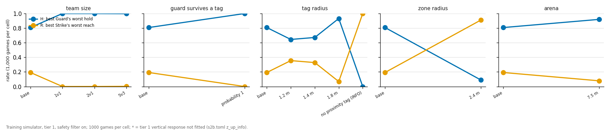

Simulator: training simulator, tier 1 (fast engine; Starling layer: commander copy, safety filter on every pair, fitted PX4 response, exploratory). Observed in the training simulator; not a flight result.

# 2026-11-21_ste_l011_screen record

## Run notes

- **Never suspend the machine during a GPU job** (no closed lid, no sleep): the cap clock and the GPU-hour ledger are wall clock less the owner's gpu_pause.sh pauses only, so a suspend counts in full against the cap and is billed as GPU-hours (tooling task L07-SUSPEND). Say here whether the machine was suspended during the run.
- **Finding L011-F1**: the scripted players decide every tick (0.05 s), not at the sheet's 0.6 s decision period (timing.decision_s). This sweep measures scripted play at 0.05 s. L0.12's trainers must fix their decision period explicitly (T41's recipe used 12 ticks = 0.6 s).

## Purpose

STE task L0.11 Screening sweep (INFO, PLAN.md section 4): scripted Guards against scripted Strikes, the base case (3v3, tag 1.6 m, zone 1.6 m, Guard survives 0, 6.5 m lab arena) and one factor changed at a time; it shortlists at most 3 rule variants for L0.12 by the rule written in the gate file before the run.

## Commit

`9b54dff6e05d21f297a844d9766e024225ca8beb`

## Config

- Gate file `svg_training/configs/ste_l011/gates.toml` at commit 9b54dff6, sha256 `8bfbc2cb8f1d6551fb3060bc750c24f9b2220ebafb19fcd44e9e3baa1c24e5d4` (copy in the run folder: `gates.toml`).
- Game `base`: `configs/ste_l011/base.toml`, sha256 `96e0e7f61a49999da54eee81a544bf64c519cd80833f0dcdfa2a07edfc10cc4d`.
- Game `tag_1p2`: `configs/ste_l011/tag_1p2.toml`, sha256 `60a225a1f6876407edac2a12ac1002a161971e7b4c7923a838e710723ee4e378`.
- Game `tag_1p4`: `configs/ste_l011/tag_1p4.toml`, sha256 `ddcfa1f56fd533907651225260939426617a38db83aec5f94404b6b27202124f`.
- Game `tag_1p8`: `configs/ste_l011/tag_1p8.toml`, sha256 `d27cedb5aa55537d691d07c59b5dc538002ec2b7d7674c52d1567afdc012beeb`.
- Game `zone_2p4`: `configs/ste_l011/zone_2p4.toml`, sha256 `5782327bf434bf19cbeb752811fc6af770fab329e9dbda8dba13046023764bc7`.
- Game `survive_1`: `configs/ste_l011/survive_1.toml`, sha256 `512f46de7612c4a44eede71591d67150807fcfed6c46d38626b8a7c999428804`.
- Game `arena_7p5`: `configs/ste_l011/arena_7p5.toml`, sha256 `ce8cc5f876dfeb4c28130f7692bee0069d6fd479cddf1b30dff77934d5fdd1a9`.
- Game `tag_off`: `configs/ste_l011/tag_off.toml`, sha256 `fae94c1f36ec026b4e9778fbb497b576d5dce0b8f67b443b1ed7e77512d000e1`.
- Game `tag_0p05`: `configs/ste_l011/tag_0p05.toml`, sha256 `be8d5b2ef7dc58958c329374370aea026fa7a650950564a3e3dc3b04bcc4db33`.
- Game `tag_10m`: `configs/ste_l011/tag_10m.toml`, sha256 `816892b3524829f6fda1646bcea12f0030a713fc7106a50ea1c34727f6fabe78`.
- Game `zone_2p4_tag_off`: `configs/ste_l011/zone_2p4_tag_off.toml`, sha256 `86613ffd577fa58f56d865d5527d145a181cfa55335a227d583f83933c60ccd7`.
- 1000 games per cell, 30 cells per batch, at most 2400 ticks per game; device cuda.

- Closest 3-D approach (results.md): among drones still in the game after the tag step (a pair tagged on a step is out before the distance is taken: core/game.py; QC M-3).

## Model parameter set

Tier 1 Starling layer: `params/real_exploratory_v0.toml` (fitted PX4 response, exploratory); safety filter on every pair, 1000 sweeps, check every 8.

## Seeds

Game seed 110000 for every batch (paired starts: one draw of 1000 games tiled over the cells); Guard players seed + 101, Strike players seed + 202.

## Machine

jeremychia-Legion-Pro-7-16IAX10H; GPU NVIDIA GeForce RTX 5070 Ti Laptop GPU; torch 2.7.0+cu128; Python 3.11.15. Exit code 0 (DONE). Effective time 1096 s of a 2.879 h cap. job l011_screen (task L0.11), asked 2.879 GPU-h, used 0.305 GPU-h (shared ledger).

## Games at once

1000 x up to 30 cells per batch; 24 batches played; sizes 1v1, 2v1, 3v3, 5v3.

## Steps per second

217,655 game-steps per second over all batches (233,800,000 game-steps in 1074 s, tier 1, NVIDIA GeForce RTX 5070 Ti Laptop GPU); per batch, with games and drones per game, in `results.md` (Batches).

## Gates

Verdict: **INFO (no gates on the screen; every control PASS)**.

The screen is INFO: no pass mark. The controls, written in the gate file before the run, gate the reading:

| Control | Status | Detail |
|---|---|---|
| ctl_tag_fires_2v1 | PASS | 1000 games: 1 tags each, all ended at step 1 |
| ctl_tag_fires_3v3 | PASS | 1000 games: 3 tags each, all ended at step 1 |
| ctl_tag_fires_5v3 | PASS | 1000 games: 3 tags each, all ended at step 1 |
| ctl_reach_fires_1v1 | PASS | 1000 reaches in 1000 games |
| ctl_reach_fires_3v3 | PASS | 1000 reaches in 1000 games |
| ctl_same_seed | PASS | 30000 games equal |
| ctl_stand_still | PASS | 0 reaches in 5000 games |
| ctl_still_1v1 | PASS | 0 tags in 1000 games |
| ctl_still_2v1 | PASS | 0 tags in 1000 games |
| ctl_still_3v3 | PASS | 0 tags in 1000 games |
| ctl_still_5v3 | PASS | 0 tags in 1000 games |
| ctl_tiny_tag | PASS | 0 tags in 10000 games |
| ctl_tag_off | PASS | 0 tags in 30000 games |
| tags_one_for_one | PASS | every played game one for one |
| paired_starts | PASS | 6 start setting(s), one set of starts each |
| no_nonfinite_actions | PASS | 0 non-finite actions |

Cut by the projection: none.

## Shortlist for L0.12 (rule: gate file [shortlist])

**base, tag_1p2, tag_1p4**; without the z_up_info columns: base, tag_1p2, tag_1p4. The lead picks the shortlist and records why before L0.12 (PLAN.md row L0.11).

The base case is always carried as the reference for the proposed 1.6 m rules (LEAD CALL 21 Nov 2026); the rule adds at most two more.

| Variant | H | g* | R | s* | d | |
|---|---|---|---|---|---|---|
| base | 0.808 | guard_mark_edge | 0.192 | strike_straight | 0.192 | reference, ruled out because Guard-trivial looking: a scripted Guard holds against every scripted Strike |
| tag_1p2 | 0.645 | guard_field | 0.355 | strike_straight | 0.355 | eligible |
| tag_1p4 | 0.672 | guard_mirror | 0.328 | strike_low | 0.328 | eligible |
| tag_1p8 | 0.932 | guard_mark_edge | 0.068 | strike_straight | 0.068 | Guard-trivial looking: a scripted Guard holds against every scripted Strike |
| zone_2p4 | 0.089 | guard_field | 0.911 | strike_straight | 0.089 | Strike-trivial looking: a scripted Strike reaches against every scripted Guard |
| survive_1 | 1.0 | guard_parked_centre | 0.0 | strike_straight | 0.0 | Guard-trivial looking: a scripted Guard holds against every scripted Strike |
| arena_7p5 | 0.92 | guard_mark_edge | 0.078 | strike_straight | 0.08 | Guard-trivial looking: a scripted Guard holds against every scripted Strike |
| size_1v1 | 1.0 | guard_mark_edge | 0.0 | strike_straight | 0.0 | Guard-trivial looking: a scripted Guard holds against every scripted Strike |
| size_2v1 | 1.0 | guard_mark_edge | 0.0 | strike_straight | 0.0 | Guard-trivial looking: a scripted Guard holds against every scripted Strike |
| size_5v3 | 0.998 | guard_mark_edge | 0.002 | strike_low | 0.002 | Guard-trivial looking: a scripted Guard holds against every scripted Strike |
| no proximity tag (INFO; ctl_tag_off) | 0.0 | guard_parked_centre | 1.0 | strike_high | 0.0 | INFO reference, never shortlisted (P1 is the owner's at G0) |

## Figures and videos

Committed copies (made by `scripts/make_ste_l011_figures.py` from the run's own results.json): the factor summary
[factors.png](../docs/figures/ste_l011/factors.png), the base-case heatmap [base_heatmap.png](../docs/figures/ste_l011/base_heatmap.png),
one heatmap set per factor in [docs/figures/ste_l011/](../docs/figures/ste_l011/), the run's full results table
[results](../docs/figures/ste_l011/results_2026-11-21_ste_l011_screen.md), and three clips in
[docs/media/ste_l011/](../docs/media/ste_l011/).

**Figure 1.** Best scripted Guard's worst-case hold rate (H, blue) and best scripted Strike's worst-case reach rate
(R, orange) per factor, 1,000 games per cell, training simulator tier 1 with the safety filter on. Only the tag radius
(1.2 and 1.4 m) brings both sides off the 0 and 1 ends; team sizes, a surviving Guard, a 1.8 m tag and the 7.5 m arena
look Guard-trivial, a 2.4 m zone and no tag look Strike-trivial.

**Reading (scripted play only; INFO).** A "hold" here is a trade, not a defence: across all 280 tag-on sweep cells no
game reached the 120 s time-out (median game length 1.8–3.9 s per group), and at 1v1 and 3v3 every hold ended with all
Guards tagged out as well (holds leave 1 Guard at 2v1, 2 at 5v3, 3 when a Guard survives its tag). So at the base rules
"a scripted Guard holds 81 % against every scripted Strike" means every Strike was traded one-for-one before any reached
the zone: head-count decides these games, the concern of PLAN finding F1, and it bears on what a tag costs (P12). At 1v1,
2v1 and 5v3 a scripted Guard holds every game (5v3: 998 of 1,000). Guards start on a circle around the zone centre
(0.66–0.8 m at 3v3, 0.58–0.8 m at 2v1, 0.98 m at 5v3; since 14517865 no Guard flies to the centre) and the 1.6 m tag
radius equals the 1.6 m zone radius, so a Strike entering the zone at flight height is likely already in tag range of a
Guard (candidate cause, not tested; at 1v1 the high and low Strikes, 0.5 m off the Guard's height, reach in all 1,000
games with 0 tags). Whether learning changes this is L0.12's question.

## Run notes added by the lead

- The waiter reported `ENDED_EARLY exit=0 (DONE)` (exit 20): the driver finished cleanly (exit 0, 24 batches, every
  control PASS), but the launch's `--min-s 1800` was set from the worst-case projection (every batch 2,400 ticks); the
  batches ended in 400–500 ticks because games ended early. Not a fault of the run; the next launch sets `--min-s` from
  the measured batch length.
- The CUDA smoke before this run (runs/2026-11-21_ste_l011_cuda_smoke, SMOKE PASS) measured the base batch 24 % slower
  than the pilot with a CPU test suite beside it; the projection was raised ×1.24 (commit 9b54dff). A CPU test suite also
  ran beside this sweep for part of it, so its game-steps/s are not a clean speed measurement.
- GPU-hours: pilot 0.034 + CUDA smoke 0.087 + this sweep 0.305 = 0.426 of the L0.11 cap of 3.0 (laptop ledger).
- The machine was not suspended during the run: effective time 1,096 s against a wall-clock span of 1,098.6 s in
  `launches.jsonl`.
- Gate file: `svg_training/configs/ste_l011/gates.toml` at commit 9b54dff6 (sha256 8bfbc2cb…), run from a detached
  worktree at that commit.

## Original figure notes

Figures from the run's own results.json by `scripts/make_ste_l011_figures.py`: `figures/`. Clips (STANDARDS section 8): videos/guard_parked_ring_v_strike_straight.gif: guard_parked_ring v strike_straight, game 0, outcome hold at 2.8 s (0.05 MB, 4 s to make); videos/guard_field_v_strike_converge.gif: guard_field v strike_converge, game 0, outcome hold at 2.7 s (0.05 MB, 5 s to make); videos/guard_mark_edge_v_strike_sacrifice.gif: guard_mark_edge v strike_sacrifice, game 0, outcome hold at 2.7 s (0.05 MB, 5 s to make).

## Confounds stated before the run

- zone_2p4: zone radius 2.4 m: the ring stays 2.75 m (2.75 >= 2.4 + 0.3); the alternative 2.4 + (2.75 - 1.6) = 3.55 m does not fit the 3.0 m keep-in limit. Second change: the run-in from the ring to the zone edge is 0.35 m (0.7 s at 0.5 m/s) instead of 1.15 m (2.3 s)
- arena_7p5: 7.5 m arena with the hangar ring 3.2 m (the sheet's hangar value): two things change, the arena side (keep-in 3.5 m) and the ring (run-in 1.6 m instead of 1.15 m)
- height_offset_cell: built as an INFO sensitivity group (LEAD CALL 21 Nov 2026): group sens_strike_dz_1mm, the base game with every Strike drone started 1 mm higher (strike_start_dz_m 0.001) through the sweep's own starts hook (ste/sweep.py SweepGame._draw_starts; the core game draws every start at one height and is not changed), strike_straight against every Guard script, compared with the base cells of the same pairs. T13 lesson: on the physics drone a 1 mm offset flips Strike over/under outcomes; tier 1 holds heights, so a change here is a tier-1 effect. Every other group: no offset, no jitter
