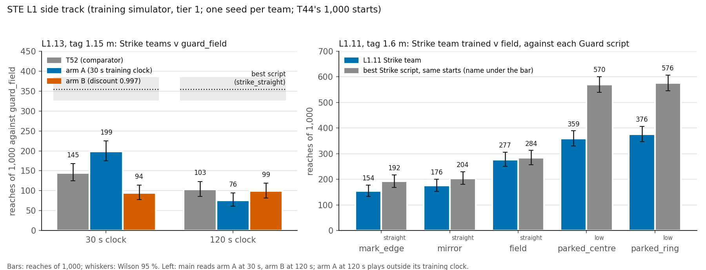

Simulator: training simulator, tier 1 (fast engine; Starling layer: commander copy, safety filter on every pair, fitted PX4 response, exploratory); study tag on (P1, PROPOSED). Observed in the training simulator; not a flight result.

# 2026-11-22_ste_l111_strike record

Written by hand from the three run folders' `results.json` / `results.md` / `learner_control.json` (the L0.12 record
writer needs a `verdict.json`, which these runs do not have, and would print a category the spec rules out); the
tables are copied from `results.md`.

## Purpose

STE task L1.11 (INFO; spec `ste_learning/drafts/L1_SIDE_TRACK_SPEC.md` v2 and addendum 1, question Q1, written before any
run): at tag 1.15 m the trained Strike team stayed below the script, but its opponent changed with the tag (mark_edge at
1.6 m, field at 1.15 m). Here a Strike team is trained against guard_field at tag 1.6 m (explicit training opponent, not
the maximin pick), T46's base Strike recipe (shaped, weight 1.0), 0.55 B game-steps, new seed; then scored against every
Guard script at 1.6 m. Compared with strike_straight's 284 against field at 1.6 m (T44) and T46's base Strike against
field, 85 (T56 X4).

Three run folders: `runs/2026-11-22_ste_l111_run0` (run 0, the learner positive control), `runs/2026-11-22_ste_l111_strike`
(the training run), `runs/2026-11-22_ste_l111_score` (cross-play against every Guard script).

## Commit

- run 0 and training: `37e87e0eccc72f476ad8261bc8e524e4de5d45a3` (diff sha256 `e3b0c44298fc`, the empty diff).
- cross-play scoring: `37e87e0eccc72f476ad8261bc8e524e4de5d45a3` with uncommitted changes (diff sha256 `7e10041dde8c`).
  That diff hash equals the hash of `git diff 53847481 aa8cdeb7 -- .` (53847481 touched only the spec), so the code and
  configs that ran equal commit `aa8cdeb7f64c7e47d073a806e4a92a2dbb534057` ("score-matrix configs filled from the
  finished runs"), committed 38 s after the launch (20:28:21 launch, 20:28:59 commit).

## Config

- Gate file `configs/ste_l1/l111_strike_gates.toml`, sha256 `84aea8592800f0d3fc205bbf879df9252ce3b6775fe3515b070d73ae9df80ef0` (copy in each training run folder).
- Game (training and scoring) `configs/ste_l011/base.toml`, sha256 `96e0e7f61a49999da54eee81a544bf64c519cd80833f0dcdfa2a07edfc10cc4d`: tag 1.6 m, 120 s clock.
- Reference `configs/ste_l012/t44_reference.npz`, sha256 `4bc5e011071adced368b2a0025fc47499839e0bbc8d8d650207bd12c3da0f8b5`; one start set `5aeba7ab2b582f2973034c8203c17ed3e8239fef7029a1f991fe95b82369843c`; T44 gate sha256 `8bfbc2cb8f1d6551fb3060bc750c24f9b2220ebafb19fcd44e9e3baa1c24e5d4`.
- Cross-play settings `configs/ste_l1/score_matrix_l111.toml`, sha256 `0660d4233fb513fba8bdc9d5d004ae09ab64afcf8bd74e45b9de4006b5b2189a`; player agent_final.pt `12a10bf68db580e6a0276dcf34dc1591d4b8086d723f9dbc7ca8a5d13586f406`, eval_final.npz `a7ba0884315b2a99c621db2a03a30447b5d34aa5a299f9b8f30eb8f212a6a0bf`.
- Pilot reused: `ste_provisional/pilots/2026-11-21_ste_l012_pilot/pilot.json`.
- Trainer: IPPO, 16,384 games, decision every 12 ticks (0.6 s), 32 rollouts, 5 epochs, 4 mini-batches, learning rate 0.0003, hidden [128, 128], init log std -1.6 (yaw frozen), discount 0.99, GAE 0.95, entropy 0, value loss 2.5, clips 0.2 / 0.2 / 0.5, shaping weight 1.0 (shaped Strike recipe), 550,000,000 game-steps.

Commands (`cmd.txt` of each run folder; launch 1 each; `python` = `~/miniconda3/envs/env_isaaclab/bin/python`):

```
scripts/ste_job.py launch --task L1.11 --name l111_run0 --run-dir runs/2026-11-22_ste_l111_run0 --min-s 120.0 --gpu-h 1.07 \
  --settings configs/ste_learning.toml --beat-s 60.0 -- python scripts/ste_exploit_l012.py --run0 \
  --gates configs/ste_l1/l111_strike_gates.toml --expect-gates-sha256 84aea859…80ef0 --run-dir runs/2026-11-22_ste_l111_run0 \
  --cap-h 1.07 --pilot-json ste_provisional/pilots/2026-11-21_ste_l012_pilot/pilot.json
scripts/ste_job.py launch --task L1.11 --name l111_strike --run-dir runs/2026-11-22_ste_l111_strike --min-s 120.0 --gpu-h 1.07 \
  --settings configs/ste_learning.toml --beat-s 60.0 -- python scripts/ste_exploit_l012.py \
  --gates configs/ste_l1/l111_strike_gates.toml --variant base --side strike --expect-gates-sha256 84aea859…80ef0 \
  --run0-json runs/2026-11-22_ste_l111_run0/learner_control.json --run-dir runs/2026-11-22_ste_l111_strike --cap-h 1.07 \
  --pilot-json ste_provisional/pilots/2026-11-21_ste_l012_pilot/pilot.json
scripts/ste_job.py launch --task L1.11 --name l111_score --run-dir runs/2026-11-22_ste_l111_score --min-s 60.0 --gpu-h 0.3 \
  --settings configs/ste_learning.toml --beat-s 60.0 -- python scripts/ste_score_matrix.py \
  --settings configs/ste_l1/score_matrix_l111.toml --run-dir runs/2026-11-22_ste_l111_score --cap-h 0.3
```

## Model parameter set

Tier 1 Starling layer: `params/real_exploratory_v0.toml` (fitted PX4 response, exploratory; `delay_s` 0.1482 from command
to motion), sha256 `4c93543f51ab41ea5bb0f81e6d1b0512f662a3e10126ec2d85fc3bb008cecaa2`; safety filter on every pair, 1000
sweeps, check every 8.

## Seeds

Training seed 130111 (run 0: 130113); scoring starts T44's (seed 110000, loaded). Clips: the clip seed's own starts
(clip_seed 120950), CPU, not the 1,000 scoring starts.

## Machine

jeremychia-Legion-Pro-7-16IAX10H, NVIDIA GeForce RTX 5070 Ti Laptop GPU, torch 2.7.0+cu128, device cuda; one launch each,
all exit 0 (DONE), not resumed. One job on the GPU at a time (no launch overlaps another L1 job); each job's wall time
is within 6 s of its effective time, so no suspend or pause.

| Run folder | Launched | Effective s (cap h) | Job, GPU-h used (shared ledger) |
|---|---|---|---|
| l111_run0 | 2026-11-22T19:04:12+08:00 | 217 (1.07) | l111_run0, 0.061 |
| l111_strike | 2026-11-22T19:08:12+08:00 | 1,338 (1.07) | l111_strike, 0.373 |
| l111_score | 2026-11-22T20:28:21+08:00 | 77 (0.3) | l111_score, 0.022 |

## Games at once and steps per second

16,384 training games, 6 drones per game, tier 1: median 431,307 game-steps/s; 88 updates, 553,648,128 game-steps
(budget: 553,648,128 of 550,000,000); stale-tick share 0.088. Finished training games per update (`train_log.jsonl`
`games_ended`): mean 98,739, median 106,206 over the 88 updates (55,034 at update 1, 114,420 at update 88).

## Run 0 (learner positive control)

**PASS** at the checkpoint of update 10: the shaped Strike recipe against guard_parked_centre reaches 502/1000 (0.471–0.533)
against the bar 416 (scripted strike_straight 466/1000 minus 0.05) (`runs/2026-11-22_ste_l111_run0/learner_control.json`,
sha256 fd3f6e005465).

## Gates

Verdict: **INFO** (no pass/fail gate; the controls are gated).

| Control set | Status |
|---|---|
| training run, before / curve / final / INFO (15 controls: reference replay of the 6 guard_field script cells equal to T44 game for game before and after training, untrained exploiter still and no gain, paired starts, tags one for one, no non-finite actions) | **PASS** (all 15) |
| cross-play: own_replay (L1.11's evaluation batch replayed game for game, 277 = 277) and 5 script controls (every script cell equal to T44 game for game; the player's cell against guard_field equal to own_replay) | **PASS** (all 6) |

## Results

Training run, against its training opponent (copied from `runs/2026-11-22_ste_l111_strike/results.md`):

| Player | Count | Guards left in holds (mean) | Length median / p90 (s) |
|---|---|---|---|
| trained exploiter | 277/1000 = 0.277 (0.250-0.306) | 0.0 | 2.25 / 3.1 |
| untrained exploiter | 0/1000 = 0.000 (0.000-0.004) | | |
| best script (guard_field v strike_straight) | 284/1000 = 0.284 (0.257-0.313) | 0.0 | 2.0 / 2.9 |

Learned: True. Gain over the best script -0.007, intervals disjoint: False. Paired: exploiter only 6, script only 13.

Cross-play against every Guard script (copied from `runs/2026-11-22_ste_l111_score/results.md`; tag 1.6 m, 120 s; worst
cell first):

| Opponent | Player's reaches (Wilson 95 %) | Best script, same starts | Paired: player only / script only / both / neither | Player's games: reach / all Strike tagged / clock / other hold / unfinished | Median length (s) |
|---|---|---|---|---|---|
| guard_mark_edge | 154/1000 (0.133-0.178) | strike_straight 192/1000 (0.169-0.218) | 77 / 115 / 77 / 731 | 154 / 846 / 0 / 0 / 0 | 3.2 |
| guard_mirror | 176/1000 (0.154-0.201) | strike_straight 204/1000 (0.180-0.230) | 93 / 121 / 83 / 703 | 176 / 824 / 0 / 0 / 0 | 3.5 |
| guard_field | 277/1000 (0.250-0.306) | strike_straight 284/1000 (0.257-0.313) | 6 / 13 / 271 / 710 | 277 / 723 / 0 / 0 / 0 | 2.2 |
| guard_parked_centre | 359/1000 (0.330-0.389) | strike_low 570/1000 (0.539-0.600) | 27 / 238 / 332 / 403 | 359 / 641 / 0 / 0 / 0 | 4.0 |
| guard_parked_ring | 376/1000 (0.347-0.406) | strike_low 576/1000 (0.545-0.606) | 31 / 231 / 345 / 393 | 376 / 624 / 0 / 0 / 0 | 3.8 |

## Figures and videos



Right panel: the L1.11 Strike team (blue) against each of the 5 Guard scripts at tag 1.6 m, beside the best Strike script on the same starts (grey, named under the bar), Wilson 95 %. Level against field (277 v 284); clearly below only against the two parked Guards. Drawn by `scripts/make_ste_l1_side_figure.py` from the runs' results.json.

Clips: the clip seed's own starts (clip_seed 120950), CPU, not the 1,000 scoring starts; copies in
[docs/media/ste_l1_side](../docs/media/ste_l1_side/README.md).

- l111_strike: videos/base_strike_game0_reach.gif: game 0, reach at 3.2 s (0.06 MB), against guard_field
- l111_strike: videos/base_strike_game1_hold.gif: game 1, hold at 2.2 s (0.05 MB), against guard_field
- l111_run0: videos/base_strike_game0_reach.gif: game 0, reach at 24.5 s (0.26 MB), against guard_parked_centre
- l111_run0: videos/base_strike_game2_hold.gif: game 2, hold at 15.9 s (0.18 MB), against guard_parked_centre

## Ledger row

Ledger row: | T58 | 2026-11-22T19:04:12+08:00 | training simulator, tier 1 (fast engine; Starling layer: commander copy, safety filter on every pair, fitted PX4 response, exploratory); study tag on (P1, PROPOSED); NVIDIA GeForce RTX 5070 Ti Laptop GPU | 2026-11-22_ste_l111_strike | STE L1.11 Strike team trained v guard_field at tag 1.6 m (0.55 B game-steps): 277/1000 (0.250–0.306) v strike_straight 284 (0.257–0.313): level with the script (paired 6/13); cross-play below the best Strike script v all 5 Guard scripts on point estimates, intervals clear only v the two parked Guards; run 0 PASS; controls PASS; 0.456 GPU-h | INFO | records/2026-11-22_ste_l111_strike_record.md |

## Run notes added by the lead

- **Reading (pre-registered words; one seed, one start set; two reviewers).** Against field Guards at 1.6 m the trained
  Strike team is **level with the script**: 277 of 1,000 (0.250–0.306) against strike_straight's 284 (0.257–0.313);
  game for game 6 starts only the trained team wins, 13 only the script.
- **Not "pointing at the tag".** The run separated the opponent from the tag (guard_field at 1.6 m instead of 1.15 m),
  but the tag still moves together with the finished-games rate (reviewers: L1.11 about 109k finished training games
  per update, T52/T55 at 1.15 m about 3.2–3.8k). Median after update 15 (`train_log.jsonl` `games_ended`): L1.11
  109,184; T52 3,164 and T55 3,191 (records writer's count, not yet reviewed). So a "below"
  at 1.15 m and a "level" here cannot be put on the tag alone.
- **Cross-play.** Below the best Strike script on point estimates against all 5 Guard scripts. Clearly below
  (non-overlapping intervals) only against the two parked Guards (359 v 570, 376 v 576); overlapping against mark_edge
  (154 v 192) and mirror (176 v 204). Context: T46's base Strike team, trained against mark_edge (another seed and
  network), reaches 85 against field ([record T56](2026-11-22_ste_l012d_cross_tag_record.md), X4); L1.11 reaches 277.
- **Which starts can be won (records writer's count from
  `runs/2026-11-22_ste_l111_score/games/base_120s__guard_field.npz`, not yet reviewed; it replaces a reviewer's "about
  640" and "about 97 %", which do not reproduce at 1.6 m).** Against field Guards at 1.6 m the 6 scripts together reach
  286 of the 1,000 starts (the reviewer's count); 714 starts are won by no script, and 710 by neither a script nor L1.11.
  L1.11's 277 reaches include 273 of the 286 (95 %) plus 4 starts no script wins.
- **Code.** The cross-play scoring ran before its code was committed, but that code equals commit `aa8cdeb7` (field
  "Commit" above); its controls all PASS, including the replay of L1.11's own 1,000 evaluation games game for game.
- **Clips** ([docs/media/ste_l1_side](../docs/media/ste_l1_side/README.md)): the run 0 clips play against the parked
  centre Guard, not field.
- **Limits.** Tier 1 with the fitted Starling response (`delay_s` 0.1482 command-to-motion), laptop RTX 5070 Ti, one
  training seed, T44's 1,000 starts; observed in the training simulator, nothing flown.
- **GPU-hours** (shared ledger): run 0 0.061, training 0.373, cross-play 0.022; total 0.456, charged to L1.11.
