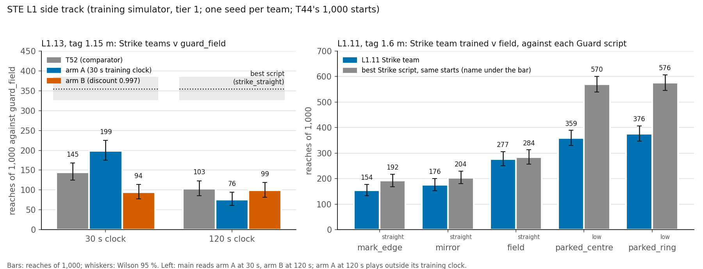

Simulator: training simulator, tier 1 (fast engine; Starling layer: commander copy, safety filter on every pair, fitted PX4 response, exploratory); study tag on (P1, PROPOSED). Observed in the training simulator; not a flight result.

# 2026-11-22_ste_l113 record

Written by hand from the seven run folders' `results.json` / `results.md` / `learner_control.json` (the L0.12 record
writer needs a `verdict.json`, which these runs do not have, and would print a category the spec rules out); the
tables are copied from `results.md`. Paired counts against T52 come from the per-game files in the re-score folders
(`games/*.npz`), checked by the records writer.

## Purpose

STE task L1.13 (INFO; spec `ste_learning/drafts/L1_SIDE_TRACK_SPEC.md` v2 and addendum 1, question Q2, written before any
run): at tag 1.15 m the Strike learner sees far fewer finished training games per game-step, and a clock loss 200
decisions away weighs only 0.99^200 ≈ 0.13. Two arms, each a Strike team trained against guard_field at tag 1.15 m,
0.30 B game-steps, new seed:

- **Arm A (clock):** a 30 s training clock (600 ticks), discount 0.99. Main read at the 30 s scoring clock.
- **Arm B (loss weight):** the real 120 s clock, discount 0.997 per decision (0.997^200 ≈ 0.55). Main read at 120 s.

Comparator: **T52** (the 1.15 m Strike team of L0.12b trained against guard_field, 120 s clock, discount 0.99; ABORTED at
0.54 B, information only), its saved network re-scored at both clocks on the same starts. Every trained team is also
scored against all 5 Guard scripts at both clocks. L1.14 and L1.15 get their own records.

Seven run folders: `runs/2026-11-22_ste_l113_t52_rescore`, `…_l113_run0_arm_a`, `…_l113_arm_a`, `…_l113_arm_a_rescore`,
`…_l113_run0_arm_b`, `…_l113_arm_b`, `…_l113_arm_b_rescore`.

## Commit

- T52 re-score: `c4fc15bdabdadbefa53fd7fb6c655ba5b23de439` with uncommitted changes (diff sha256 `4f61e05b04c5`). The
  scoring tool `scripts/ste_score_matrix.py` and the 30 s game file were then new files, not yet in git (the recorded
  diff covers tracked files only); both were committed in `37e87e0e` at 19:03 the same day, after two code reviews and
  their fixes. The code that ran is not shown identical to any commit: the recorded diff hash matches no commit from
  `37e87e0e` to `531dccc7` (checked over every subset of the tracked files those commits change), and the untracked
  files are not covered by it. The settings file is pinned by sha256 and equals
  the committed file. Between its two launches the tracked files were unchanged (`code.json` lists no change); the
  untracked scoring tool is not covered by that check.
- runs 0 and training, both arms: `37e87e0eccc72f476ad8261bc8e524e4de5d45a3` (diff sha256 `e3b0c44298fc`, the empty diff).
- arm A and arm B re-scores: `aa8cdeb7f64c7e47d073a806e4a92a2dbb534057` (diff sha256 `e3b0c44298fc`, the empty diff).

## Config

- Gate file `configs/ste_l1/l113_gates.toml`, sha256 `e602a4e68553f80e28dca728c6794dd7eec980dc4a33ed176c311516482cfa13` (copy in each training run folder). Variants `arm_a_clock30` (game `tag_1p15_clock30`, discount 0.99) and `arm_b_discount` (game `tag_1p15`, discount 0.997); g* guard_field, s* strike_straight; screen reference cells of `tag_1p15`.
- Games: `configs/ste_l011/tag_1p15.toml`, sha256 `b2e09683f7088964a7d1ca15dfc9c98d1e04c15e96b14196d6971afb75f27580` (tag 1.15 m, 120 s, 2,400 ticks); `configs/ste_l1/tag_1p15_clock30.toml`, sha256 `a29fcd3394d4ade6087c45a2fd164a51ffb9b481058cb6356332600b7f98403b` (the same game, 600 ticks = 30 s; arm A's training game and the 30 s scoring game).
- Reference `configs/ste_l012b/screen_reference.npz`, sha256 `49014000d07e8b52ae579deb325dad53d98c5020f533026dfbff778f306b2296`; one start set `5aeba7ab2b582f2973034c8203c17ed3e8239fef7029a1f991fe95b82369843c`; L0.12b screen gate sha256 `881375f054a78ae33c7fd330e271a4e3b27a0a1cf3d58eca4b893cdca8ce2479`. At 30 s the script cells use the 120 s reference: every script game there ends by tick 434.
- Re-score settings (sha256): `configs/ste_l1/score_matrix_t52.toml` `50116c13a56e330780d6a9378f863ac583e734e68bd38951de1735b52c792caf`; `score_matrix_l113_arm_a.toml` `75af10b333ace73bb233b10b6a575a9fa0f0a58a469f893d25432ade65116c2d`; `score_matrix_l113_arm_b.toml` `0e374ec89f92a3ce2a4e146cf8ef6948ca252ae49fe8a29b8349e23d9f0690e6`.
- Players (agent_final.pt sha256): T52 `ste_provisional/players/2026-11-21_ste_l012b_tag_1p15_strike` `6ca45c318389ada0ab741e3ea76acf8feab79f359a94d6abbb12431f3aba846d` (its gate file `ace5e18d77c2…`); arm A `dd67c35ca69f4f62fe81655c2ebf13fec6f8fb68985e7e0629d44ba400d6ad02`; arm B `69c869e186f359eb3c117dc6815a07743fa048019060e5dc7d52a7bdbe4792e7`.
- Trainer (both arms): IPPO, 16,384 games, decision every 12 ticks (0.6 s), 32 rollouts, 5 epochs, 4 mini-batches, learning rate 0.0003, hidden [128, 128], init log std -1.6 (yaw frozen), GAE 0.95, entropy 0, value loss 2.5, clips 0.2 / 0.2 / 0.5, shaping weight 1.0 (shaped Strike recipe), 300,000,000 game-steps; discount 0.99 (arm A) / 0.997 (arm B).

Commands (`cmd.txt` of each run folder; `python` = `~/miniconda3/envs/env_isaaclab/bin/python`; every job through
`scripts/ste_job.py launch --task L1.13 --settings configs/ste_learning.toml --beat-s 60.0`):

```
--name t52_rescore  --run-dir runs/2026-11-22_ste_l113_t52_rescore  --min-s 60.0  --gpu-h 0.45 -- python scripts/ste_score_matrix.py --settings configs/ste_l1/score_matrix_t52.toml --run-dir runs/2026-11-22_ste_l113_t52_rescore --cap-h 0.45
--name l113_run0_a  --run-dir runs/2026-11-22_ste_l113_run0_arm_a  --min-s 120.0 --gpu-h 0.68 -- python scripts/ste_exploit_l012.py --run0 --gates configs/ste_l1/l113_gates.toml --variant arm_a_clock30 --expect-gates-sha256 e602a4e6…2cfa13 --run-dir runs/2026-11-22_ste_l113_run0_arm_a --cap-h 0.68 --pilot-json ste_provisional/pilots/2026-11-21_ste_l012_pilot/pilot.json
--name l113_arm_a   --run-dir runs/2026-11-22_ste_l113_arm_a       --min-s 120.0 --gpu-h 0.68 -- python scripts/ste_exploit_l012.py --gates configs/ste_l1/l113_gates.toml --variant arm_a_clock30 --side strike --expect-gates-sha256 e602a4e6…2cfa13 --run0-json runs/2026-11-22_ste_l113_run0_arm_a/learner_control.json --run-dir runs/2026-11-22_ste_l113_arm_a --cap-h 0.68 --pilot-json ste_provisional/pilots/2026-11-21_ste_l012_pilot/pilot.json
--name l113_run0_b  --run-dir runs/2026-11-22_ste_l113_run0_arm_b  --min-s 120.0 --gpu-h 0.68 -- python scripts/ste_exploit_l012.py --run0 --gates configs/ste_l1/l113_gates.toml --variant arm_b_discount --expect-gates-sha256 e602a4e6…2cfa13 --run-dir runs/2026-11-22_ste_l113_run0_arm_b --cap-h 0.68 --pilot-json ste_provisional/pilots/2026-11-21_ste_l012_pilot/pilot.json
--name l113_arm_b   --run-dir runs/2026-11-22_ste_l113_arm_b       --min-s 120.0 --gpu-h 0.68 -- python scripts/ste_exploit_l012.py --gates configs/ste_l1/l113_gates.toml --variant arm_b_discount --side strike --expect-gates-sha256 e602a4e6…2cfa13 --run0-json runs/2026-11-22_ste_l113_run0_arm_b/learner_control.json --run-dir runs/2026-11-22_ste_l113_arm_b --cap-h 0.68 --pilot-json ste_provisional/pilots/2026-11-21_ste_l012_pilot/pilot.json
--name l113_arm_b_rescore --run-dir runs/2026-11-22_ste_l113_arm_b_rescore --min-s 60.0 --gpu-h 0.4 -- python scripts/ste_score_matrix.py --settings configs/ste_l1/score_matrix_l113_arm_b.toml --run-dir runs/2026-11-22_ste_l113_arm_b_rescore --cap-h 0.4
--name l113_arm_a_rescore --run-dir runs/2026-11-22_ste_l113_arm_a_rescore --min-s 60.0 --gpu-h 0.4 -- python scripts/ste_score_matrix.py --settings configs/ste_l1/score_matrix_l113_arm_a.toml --run-dir runs/2026-11-22_ste_l113_arm_a_rescore --cap-h 0.4
```

## Model parameter set

Tier 1 Starling layer: `params/real_exploratory_v0.toml` (fitted PX4 response, exploratory; `delay_s` 0.1482 from command
to motion), sha256 `4c93543f51ab41ea5bb0f81e6d1b0512f662a3e10126ec2d85fc3bb008cecaa2`; safety filter on every pair, 1000
sweeps, check every 8.

## Seeds

Training seeds: arm A 130131, arm B 130132; both runs 0: 130135 (the gate file's one [run0] seed). Scoring starts T44's
(seed 110000, loaded). Clips: the clip seed's own starts (clip_seed 120950), CPU, not the 1,000 scoring starts.

## Machine

jeremychia-Legion-Pro-7-16IAX10H, NVIDIA GeForce RTX 5070 Ti Laptop GPU, torch 2.7.0+cu128, device cuda.

| Run folder | Launched | Exit | Effective s (cap h) | Job, GPU-h used (shared ledger) |
|---|---|---|---|---|
| l113_t52_rescore | 2026-11-22T18:02:34+08:00; again 18:21:15 | launch 1: 3 (the log says "stopped (cap)", after the 120 s batches, in the first 30 s batch; launch 1's `--cap-h` is not kept: `cmd.txt` holds launch 2's command); launch 2: 0 (DONE), resumed at the next batch not yet checked | 1,336 (0.45) | t52_rescore, 0.372 |
| l113_run0_arm_a | 2026-11-22T19:30:42+08:00 | 0 (DONE) | 345 (0.68) | l113_run0_a, 0.096 |
| l113_arm_a | 2026-11-22T19:36:42+08:00 | 0 (DONE) | 1,137 (0.68) | l113_arm_a, 0.320 |
| l113_run0_arm_b | 2026-11-22T19:56:12+08:00 | 0 (DONE) | 256 (0.68) | l113_run0_b, 0.071 |
| l113_arm_b | 2026-11-22T20:00:42+08:00 | 0 (DONE) | 1,483 (0.68) | l113_arm_b, 0.427 |
| l113_arm_b_rescore | 2026-11-22T20:29:51+08:00 | 0 (DONE) | 850 (0.4) | l113_arm_b_rescore, 0.237 |
| l113_arm_a_rescore | 2026-11-22T20:44:22+08:00 | 0 (DONE) | 939 (0.4) | l113_arm_a_rescore, 0.261 |

Total 1.785 GPU-h. The L1.13 task cap in `configs/ste_learning.toml`: 1.0 GPU-h at `c4fc15bd`, 1.7 at `37e87e0e` (spec
addendum 1), 2.1 at `aa8cdeb7` (0.4 from L1.6, for the re-scores). The T52 re-score ran from an uncommitted tree, so
the cap in force for it is not recorded. One job on the GPU at a time (no launch overlaps another L1 job); each job's wall
time is within 55 s of its effective time, so no suspend or pause.

## Games at once and steps per second

| Arm | Updates, game-steps | Median game-steps/s | Stale-tick share | Finished training games per update (`train_log.jsonl`), median after update 15 |
|---|---|---|---|---|
| A (30 s clock) | 48, 301,989,888 (budget 300,000,000) | 302,915 | 0.007 | 13,193 |
| B (discount 0.997) | 48, 301,989,888 (budget 300,000,000) | 319,596 | 0.002 | 3,808 |

16,384 training games, 6 drones per game, tier 1. For comparison, T52's own log (`ste_provisional/players/…`, 86
updates): 3,164, median after update 15.

## Learning curve at the same update

Reaches against guard_field on the 256 curve games, read at update 40 (251,658,240 game-steps; `curve.json`): arm A
58 of 256, arm B 31, T52 27. T52 trained 86 updates (0.54 B game-steps), the arms 48 (0.30 B). Arm A's curve plays
at the 30 s clock, arm B's and T52's at 120 s, so arm A's curve is not comparable with the others update by update.

## Run 0 (learner positive control), per arm

| Arm | Game | Reads (reaches against guard_parked_centre, of 1,000) | Bar (strike_straight 899 − 0.05) | Status |
|---|---|---|---|---|
| A | tag_1p15_clock30 | update 10: 839 (0.815–0.860), below the bar; update 20: 990 (0.982–0.995) | 849 | **PASS** at update 20 (`learner_control.json` sha256 bf08297cc8c8) |
| B | tag_1p15 | update 10: 946 (0.930–0.958) | 849 | **PASS** at update 10 (sha256 d592ec18c1cd) |

## Gates

Verdict: **INFO** (no pass/fail gate; the controls are gated: any control not PASS and no number is reported).

| Run | Controls | Status |
|---|---|---|
| T52 re-score | own_replay: T52's evaluation batch replayed whole at 120 s, equal to its eval_final.npz game for game, trained reaches 103 (record 103); 10 script controls (5 Guard scripts × 2 clocks), every script cell equal to the screen reference game for game | **PASS** (all 11) |
| arm A, arm B training | 15 each: reference replay before and after training, untrained exploiter still and no gain, paired starts, tags one for one, no non-finite actions (before, curve, final, INFO) | **PASS** (all 15, each arm) |
| arm A, arm B re-scores | own_replay (199 = 199; 99 = 99) and 10 script controls each | **PASS** (all 11, each) |

## Results

Main reads against guard_field, the training opponent (Wilson 95 %; one network each, one start set):

| Team | At 30 s | At 120 s | Paired v T52 at 30 s (team only / T52 only) | Paired v T52 at 120 s |
|---|---|---|---|---|
| T52 (comparator) | 145 (0.125-0.168) | 103 (0.086-0.123) | - | - |
| arm A (30 s training clock) | **199 (0.175-0.225)** (main read) | 76 (0.061-0.094) (INFO) | 68 / 14 | 35 / 62 |
| arm B (discount 0.997) | 94 (0.077-0.114) (INFO) | **99 (0.082-0.119)** (main read) | - | 50 / 54 |
| best script, strike_straight | 355 (0.326-0.385) | 355 (0.326-0.385) | | |

Training-run results against guard_field (copied from each `results.md`): arm A 199/1000 = 0.199 (0.175-0.225) at 30 s,
Guards left in holds 0.02, length median / p90 19.4 / 24.3 s, paired with the script 0 / 156; arm B 99/1000 = 0.099
(0.082-0.119) at 120 s, Guards left in holds 0.43, length median / p90 97.1 / 120.0 s, paired with the script 3 / 259.
Untrained 0/1000 for both. Learned: True for both.

Re-scores against every Guard script (copied from `results.md`; tag 1.15 m; worst cell first per block):

**T52, 120 s clock**

| Opponent | Player's reaches (Wilson 95 %) | Best script, same starts | Paired: player only / script only / both / neither | Player's games: reach / all Strike tagged / clock / other hold / unfinished | Median length (s) |
|---|---|---|---|---|---|
| guard_mirror | 69/1000 (0.055-0.086) | strike_high 604/1000 (0.573-0.634) | 26 / 561 / 43 / 370 | 69 / 101 / 830 / 0 / 0 | 120.0 |
| guard_field | 103/1000 (0.086-0.123) | strike_straight 355/1000 (0.326-0.385) | 1 / 253 / 102 / 644 | 103 / 126 / 771 / 0 / 0 | 120.0 |
| guard_mark_edge | 112/1000 (0.094-0.133) | strike_high 598/1000 (0.567-0.628) | 52 / 538 / 60 / 350 | 112 / 137 / 751 / 0 / 0 | 120.0 |
| guard_parked_ring | 377/1000 (0.347-0.407) | strike_low 966/1000 (0.953-0.976) | 9 / 598 / 368 / 25 | 377 / 1 / 622 / 0 / 0 | 120.0 |
| guard_parked_centre | 395/1000 (0.365-0.426) | strike_low 984/1000 (0.974-0.990) | 4 / 593 / 391 / 12 | 395 / 0 / 605 / 0 / 0 | 120.0 |

**T52, 30 s clock**

| Opponent | Player's reaches (Wilson 95 %) | Best script, same starts | Paired: player only / script only / both / neither | Player's games: reach / all Strike tagged / clock / other hold / unfinished | Median length (s) |
|---|---|---|---|---|---|
| guard_mark_edge | 34/1000 (0.024-0.047) | strike_high 598/1000 (0.567-0.628) | 10 / 574 / 24 / 392 | 34 / 15 / 951 / 0 / 0 | 30.0 |
| guard_mirror | 40/1000 (0.030-0.054) | strike_high 604/1000 (0.573-0.634) | 8 / 572 / 32 / 388 | 40 / 226 / 734 / 0 / 0 | 30.0 |
| guard_field | 145/1000 (0.125-0.168) | strike_straight 355/1000 (0.326-0.385) | 0 / 210 / 145 / 645 | 145 / 50 / 805 / 0 / 0 | 30.0 |
| guard_parked_ring | 178/1000 (0.156-0.203) | strike_low 966/1000 (0.953-0.976) | 0 / 788 / 178 / 34 | 178 / 0 / 822 / 0 / 0 | 30.0 |
| guard_parked_centre | 202/1000 (0.178-0.228) | strike_low 984/1000 (0.974-0.990) | 0 / 782 / 202 / 16 | 202 / 0 / 798 / 0 / 0 | 30.0 |

**Arm A, 30 s clock (main read)**

| Opponent | Player's reaches (Wilson 95 %) | Best script, same starts | Paired: player only / script only / both / neither | Player's games: reach / all Strike tagged / clock / other hold / unfinished | Median length (s) |
|---|---|---|---|---|---|
| guard_mirror | 160/1000 (0.139-0.184) | strike_high 604/1000 (0.573-0.634) | 60 / 504 / 100 / 336 | 160 / 782 / 58 / 0 / 0 | 16.4 |
| guard_field | 199/1000 (0.175-0.225) | strike_straight 355/1000 (0.326-0.385) | 0 / 156 / 199 / 645 | 199 / 784 / 17 / 0 / 0 | 19.4 |
| guard_mark_edge | 305/1000 (0.277-0.334) | strike_high 598/1000 (0.567-0.628) | 130 / 423 / 175 / 272 | 305 / 507 / 188 / 0 / 0 | 23.2 |
| guard_parked_ring | 715/1000 (0.686-0.742) | strike_low 966/1000 (0.953-0.976) | 5 / 256 / 710 / 29 | 715 / 0 / 285 / 0 / 0 | 25.3 |
| guard_parked_centre | 790/1000 (0.764-0.814) | strike_low 984/1000 (0.974-0.990) | 3 / 197 / 787 / 13 | 790 / 0 / 210 / 0 / 0 | 23.6 |

**Arm A, 120 s clock (INFO)**

| Opponent | Player's reaches (Wilson 95 %) | Best script, same starts | Paired: player only / script only / both / neither | Player's games: reach / all Strike tagged / clock / other hold / unfinished | Median length (s) |
|---|---|---|---|---|---|
| guard_field | 76/1000 (0.061-0.094) | strike_straight 355/1000 (0.326-0.385) | 0 / 279 / 76 / 645 | 76 / 444 / 480 / 0 / 0 | 119.7 |
| guard_mirror | 197/1000 (0.174-0.223) | strike_high 604/1000 (0.573-0.634) | 75 / 482 / 122 / 321 | 197 / 405 / 398 / 0 / 0 | 116.9 |
| guard_mark_edge | 198/1000 (0.174-0.224) | strike_high 598/1000 (0.567-0.628) | 77 / 477 / 121 / 325 | 198 / 187 / 615 / 0 / 0 | 120.0 |
| guard_parked_ring | 369/1000 (0.340-0.399) | strike_low 966/1000 (0.953-0.976) | 15 / 612 / 354 / 19 | 369 / 1 / 630 / 0 / 0 | 120.0 |
| guard_parked_centre | 423/1000 (0.393-0.454) | strike_low 984/1000 (0.974-0.990) | 7 / 568 / 416 / 9 | 423 / 1 / 576 / 0 / 0 | 120.0 |

**Arm B, 120 s clock (main read)**

| Opponent | Player's reaches (Wilson 95 %) | Best script, same starts | Paired: player only / script only / both / neither | Player's games: reach / all Strike tagged / clock / other hold / unfinished | Median length (s) |
|---|---|---|---|---|---|
| guard_field | 99/1000 (0.082-0.119) | strike_straight 355/1000 (0.326-0.385) | 3 / 259 / 96 / 642 | 99 / 623 / 278 / 0 / 0 | 97.1 |
| guard_mirror | 111/1000 (0.093-0.132) | strike_high 604/1000 (0.573-0.634) | 36 / 529 / 75 / 360 | 111 / 762 / 127 / 0 / 0 | 67.6 |
| guard_mark_edge | 180/1000 (0.157-0.205) | strike_high 598/1000 (0.567-0.628) | 63 / 481 / 117 / 339 | 180 / 632 / 188 / 0 / 0 | 90.1 |
| guard_parked_ring | 759/1000 (0.732-0.784) | strike_low 966/1000 (0.953-0.976) | 26 / 233 / 733 / 8 | 759 / 4 / 237 / 0 / 0 | 83.5 |
| guard_parked_centre | 815/1000 (0.790-0.838) | strike_low 984/1000 (0.974-0.990) | 14 / 183 / 801 / 2 | 815 / 0 / 185 / 0 / 0 | 77.4 |

**Arm B, 30 s clock (INFO)**

| Opponent | Player's reaches (Wilson 95 %) | Best script, same starts | Paired: player only / script only / both / neither | Player's games: reach / all Strike tagged / clock / other hold / unfinished | Median length (s) |
|---|---|---|---|---|---|
| guard_mark_edge | 30/1000 (0.021-0.043) | strike_high 598/1000 (0.567-0.628) | 12 / 580 / 18 / 390 | 30 / 63 / 907 / 0 / 0 | 30.0 |
| guard_mirror | 62/1000 (0.049-0.079) | strike_high 604/1000 (0.573-0.634) | 22 / 564 / 40 / 374 | 62 / 274 / 664 / 0 / 0 | 30.0 |
| guard_field | 94/1000 (0.077-0.114) | strike_straight 355/1000 (0.326-0.385) | 0 / 261 / 94 / 645 | 94 / 64 / 842 / 0 / 0 | 30.0 |
| guard_parked_ring | 274/1000 (0.247-0.302) | strike_low 966/1000 (0.953-0.976) | 5 / 697 / 269 / 29 | 274 / 0 / 726 / 0 / 0 | 30.0 |
| guard_parked_centre | 329/1000 (0.301-0.359) | strike_low 984/1000 (0.974-0.990) | 3 / 658 / 326 / 13 | 329 / 0 / 671 / 0 / 0 | 30.0 |

Unchosen tags against guard_field in the training runs' final batch (INFO; from `results.md`): arm A 199 of 2,558 tags
pushed together by the filter (0.078), filter active 401 (0.157), closest tag pair 1.14 m; arm B 243 of 2,386 (0.102),
501 (0.210), 1.13 m; none at the filter edge.

## Figures and videos



Reaches of 1,000 against guard_field at tag 1.15 m (left), Wilson 95 %; dotted line and band: the best script, 355. Main reads: arm A at 30 s (199 v T52 145), arm B at 120 s (99 v 103). T52's 30 s score was re-scored with the reviewed tool: 145 again. Drawn by `scripts/make_ste_l1_side_figure.py` from the runs' results.json.

Clips: the clip seed's own starts (clip_seed 120950), CPU, not the 1,000 scoring starts; copies in
[docs/media/ste_l1_side](../docs/media/ste_l1_side/README.md). Among the 4 recorded clip games against guard_field, neither
arm reached the zone, so both arms' clips are holds; the run 0 clips play against the parked centre Guard.

- arm A: videos/arm_a_clock30_strike_game0_hold.gif: game 0, hold at 28.8 s (0.29 MB)
- arm A: videos/arm_a_clock30_strike_game1_hold.gif: game 1, hold at 17.0 s (0.20 MB)
- arm B: videos/arm_b_discount_strike_game0_hold.gif: game 0, hold at 120.0 s (1.13 MB)
- arm B: videos/arm_b_discount_strike_game1_hold.gif: game 1, hold at 114.1 s (0.94 MB)
- run 0 arm A: videos/arm_a_clock30_strike_game0_reach.gif: game 0, reach at 9.3 s (0.13 MB); game1_reach at 8.6 s (0.13 MB)
- run 0 arm B: videos/arm_b_discount_strike_game0_reach.gif: game 0, reach at 16.7 s (0.20 MB); game1_reach at 15.7 s (0.19 MB)

## Ledger row

Ledger row: | T59 | 2026-11-22T18:02:34+08:00 | training simulator, tier 1 (fast engine; Starling layer: commander copy, safety filter on every pair, fitted PX4 response, exploratory); study tag on (P1, PROPOSED); NVIDIA GeForce RTX 5070 Ti Laptop GPU | 2026-11-22_ste_l113 (7 run folders: t52_rescore, run0_arm_a, arm_a, arm_a_rescore, run0_arm_b, arm_b, arm_b_rescore) | STE L1.13 1.15 m Strike team v guard_field, two arms of 0.30 B and T52 re-scored at both clocks: arm A (30 s training clock) 199/1000 (0.175–0.225) at 30 s v T52 145 (0.125–0.168), clears the pre-registered margin, but only just (0.175 v 0.168); paired 68/14; caveats: the shorter clock changes what the learner sees, and T52 at 30 s plays outside its training clock; arm A at 120 s 76 v T52 103 (INFO); arm B (discount 0.997) 99/1000 (0.082–0.119) v T52 103 (0.086–0.123) at 120 s, level with T52 (paired 50/54); T52 control 103 PASS; runs 0 PASS; controls PASS; 1.832 GPU-h incl. the 30 s re-check | INFO | records/2026-11-22_ste_l113_record.md |

## Run notes added by the lead

- **Arm A (reading words fixed in the spec; one seed, one start set; two reviewers).** With a shorter training clock the
  1.15 m Strike team reaches 199 at 30 s (T52: 145); the higher weight of a clock loss alone (arm B) did not do it. The
  gain clears the pre-registered margin, but only just (0.175 v 0.168: arm A's lower bound against T52's upper bound). Game for
  game the pairing is strong: 68 starts only arm A wins, 14 only T52.
- **Caveats that travel with arm A's gain.** (1) The shorter clock also changes what the learner sees, so this is not
  proof that more finished games is the cause. (2) T52 at 30 s plays outside its own training clock (120 s). (3) At 120 s
  arm A reaches 76 (0.061–0.094) against T52's 103 (0.086–0.123): by the pre-registered interval rule the two overlap;
  a paired sign test (not pre-registered) gives 35 v 62, p = 0.008. Arm A's time-left input is then outside the range it
  trained on (at most 30 s); the L1.14 test (clamped time-left) checks this. (4) T52's 145 at 30 s came from the scoring
  tool before it was reviewed and committed (field "Commit" above), in a re-score whose first launch stopped at its cap
  and whose second resumed it; its own-replay control covers the 120 s batch only. A re-score of T52 at 30 s with the
  reviewed code is scheduled (L1.13, about 0.07 GPU-h); its result will be added here. Arm A saw 13,193 finished training
  games per update, T52 3,164 (median after update 15).
- **Arm B: level with T52.** 99 (0.082–0.119) against T52's 103 at 120 s; paired 50 v 54. It did change behaviour:
  against field Guards, games ending at the clock fell from 771 (T52) to 278 and games with every Strike drone tagged rose
  from 126 to 623. It is above T52 against each of the other 4 Guard scripts with intervals clear (mirror 111 v 69, mark_edge
  180 v 112, parked ring 759 v 377, parked centre 815 v 395). A null is weak evidence (spec).
- **T52 re-score.** At 120 s against field it reaches 103, equal to its record game for game (control PASS; the 103
  is in T52's own [record](2026-11-21_ste_l012b_tag_1p15_strike_record.md), ABORTED, information only). At the 30 s clock it reaches 145, more than 103 (intervals
  miss by 0.002: 0.125 against 0.123; paired 120 s v 30 s: 17 v 59). Against every Guard script, T52's reaches within the
  first 30 s of a 120 s game are fewer than its reaches in a 30 s game: field 61 → 145, mirror 6 → 40, mark_edge 0 → 34,
  parked ring 43 → 178, parked centre 48 → 202. In 99 of the 126 games against field where every Strike drone was tagged
  at 120 s, the last one fell after 90 s.
- **Hypothesis (a reviewer's reading, untested; L1.14 tests it):** the network holds back while its time-left input is
  large.
- **Which starts can be won (reviewer reading, from the per-game data, no GPU; recounted by the records writer from
  the re-scores' `games/*guard_field.npz`).** Against field Guards at 1.15 m the 6 scripts together reach 361 of the
  1,000 starts; about 640 starts (records writer's count: 635 to 639) are won by no script and by none of the trained
  1.15 m teams scored here. The trained teams find
  21–55 % of the 361 (arm A at 120 s 76, 21 %; T52 at 120 s 102, 28 %; arm A at 30 s 199, 55 %), almost only starts the
  straight script also wins (at most 3 reaches per cell outside them).
- **Code.** T52's re-score ran with uncommitted changes (field "Commit" above); its controls all PASS, including the
  replay of T52's own 1,000 evaluation games at 120 s game for game; no control replays a 30 s batch of T52's own.
- **Clips** ([docs/media/ste_l1_side](../docs/media/ste_l1_side/README.md)): both arms' clips are holds (no reach among
  the 4 clip games); run 0 clips play against the parked centre Guard.
- **Limits.** Tier 1 with the fitted Starling response (`delay_s` 0.1482 command-to-motion), laptop RTX 5070 Ti, one
  training seed per arm, T44's 1,000 starts; observed in the training simulator, nothing flown.
- **GPU-hours** (shared ledger): arm A 0.320 + run 0 0.096 + re-score 0.261; arm B 0.427 + run 0 0.071 + re-score 0.237;
  T52 re-score 0.372 (ledger job name t52_rescore); total 1.785, charged to L1.13.
- **Re-check of T52 at 30 s with the reviewed code (added 22 Nov 2026, after the records above).** Run
  `runs/2026-11-22_ste_l113_t52_30s_recheck` (settings `configs/ste_l1/score_matrix_t52_30s_recheck.toml`, sha256
  `fcdd96af9972…`; commit `c1155b8cb0c42bbbbc335acb87fd8fbb6d87aee6`, empty diff; launched 2026-11-22T21:59:09+08:00,
  one launch, exit 0; job l113_t52_30s_recheck, 0.047 GPU-h, charged to L1.13, which brings L1.13 to 1.832 GPU-h of its
  2.1 cap). T52 at 30 s against guard_field reaches **145 again (0.125–0.168)**; own-replay control PASS (103 = 103 at
  120 s) and the guard_field script cells equal to the screen reference game for game. The reaches match the earlier
  30 s batch game for game (records writer's count from `games/*.npz`, not yet reviewed). Caveat (4) on arm A's gain,
  the unreviewed comparator, is **retired**; caveats (1) and (2) stand; (3), arm A at 120 s outside its trained range, is answered by
  [record T60](2026-11-22_ste_l114_record.md): clamped to at most 30 s it reaches 172.
- **Arm A's clamped 120 s read** (time-left input held inside the range it trained on): 172 of 1,000 (0.150–0.197)
  against its plain 76, in [record T60](2026-11-22_ste_l114_record.md).
