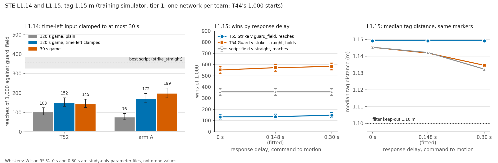

Simulator: training simulator, tier 1 (fast engine; Starling layer: commander copy, safety filter on every pair, fitted PX4 response, exploratory); study tag on (P1, PROPOSED). Observed in the training simulator; not a flight result.

# 2026-11-22_ste_l114 record

Written by hand from the three run folders' `results.json` / `results.md` (scoring runs of `scripts/ste_score_matrix.py`);
the tables are copied from `results.md`. Paired counts against the plain runs and reach times were computed by the
records writer from the per-game files (`games/*.npz`), checked by two reviewers; they are not pre-registered.

## Purpose

STE task L1.14, the time-left test (INFO, scoring only; spec `ste_learning/drafts/L1_SIDE_TRACK_SPEC.md` addenda 2 and 3,
written before these runs). T52 (trained at 120 s) reaches more against guard_field in a 30 s game (145) than in the first
30 s of a 120 s game (61). Hypothesis (a reviewer's reading): the network holds back while its time-left input is large.
Test: change only the time-left value the network sees (all other inputs and the game untouched), against guard_field,
T44's 1,000 starts.

- **Control C-offset** (run first; the other two start only after it PASSES): T52 in the 30 s game with time-left + 90 s
  must reproduce the first 600 ticks of T52's own 120 s games game for game.
- **Test T-clamp:** T52 in the 120 s game with time-left clamped to at most 30 s.
- **Arm A at 120 s, clamped to at most 30 s** (INFO): arm A (L1.13, trained on a 30 s clock) never saw a time-left above
  30 s; this is the fair 120 s read of arm A, beside its plain 120 s score.

Three run folders: `runs/2026-11-22_ste_l114_offset`, `runs/2026-11-22_ste_l114_t52_clamp`,
`runs/2026-11-22_ste_l114_arm_a_clamp`.

## Commit

`c1155b8cb0c42bbbbc335acb87fd8fbb6d87aee6` on branch `ste-l1-side` (diff sha256 `e3b0c44298fc`, the empty diff) for all three runs: the time-left
override in the scoring tool after two code reviews and fixes.

## Config

- Settings (sha256, copy in each run folder): `configs/ste_l1/score_matrix_l114_t52_offset.toml` `aad30f5040a6c20d5daeca32bf0d4c0159001d67ff9a5e55165579f004230121` (`time_left = { offset_s = 90.0 }`); `score_matrix_l114_t52_clamp.toml` `a10a182c16689c2ba3c2d243629970d70c4e914c5570ef043368889f0134344c` (`time_left = { clamp_max_s = 30.0 }`); `score_matrix_l114_arm_a_clamp.toml` `ae2fe998db4419801b0b94cd2acb8a5a6dd180d62bf1aaf13c05388ab0cd092d` (clamp 30 s).
- Players (agent_final.pt sha256): T52 `ste_provisional/players/2026-11-21_ste_l012b_tag_1p15_strike` `6ca45c318389…`; arm A `runs/2026-11-22_ste_l113_arm_a` `dd67c35ca69f…`.
- Games: C-offset `configs/ste_l1/tag_1p15_clock30.toml` (`a29fcd3394d4…`, 30 s); T-clamp and arm A `configs/ste_l011/tag_1p15.toml` (`b2e09683f708…`, 120 s); tag 1.15 m.
- Reference `configs/ste_l012b/screen_reference.npz` (`49014000d07e…`); one start set `5aeba7ab2b58…`.

Commands (`cmd.txt`; every job through `scripts/ste_job.py launch --task L1.14 --settings configs/ste_learning.toml
--beat-s 60.0`, then `python scripts/ste_score_matrix.py`):

```
--name l114_offset      … --settings configs/ste_l1/score_matrix_l114_t52_offset.toml --run-dir runs/2026-11-22_ste_l114_offset --cap-h 0.08
--name l114_t52_clamp   … --settings configs/ste_l1/score_matrix_l114_t52_clamp.toml  --run-dir runs/2026-11-22_ste_l114_t52_clamp --cap-h 0.12
--name l114_arm_a_clamp … --settings configs/ste_l1/score_matrix_l114_arm_a_clamp.toml --run-dir runs/2026-11-22_ste_l114_arm_a_clamp --cap-h 0.10
```

## Model parameter set

Tier 1 Starling layer: `params/real_exploratory_v0.toml` (fitted PX4 response, exploratory; `delay_s` 0.1482 from command
to motion), sha256 `4c93543f51ab41ea5bb0f81e6d1b0512f662a3e10126ec2d85fc3bb008cecaa2`; safety filter on every pair.

## Seeds

Scoring starts T44's (seed 110000, loaded); no training; no clips (scoring only).

## Machine

jeremychia-Legion-Pro-7-16IAX10H, NVIDIA GeForce RTX 5070 Ti Laptop GPU, device cuda; one launch each, exit 0 (DONE),
one job at a time.

| Run folder | Launched | Effective s (cap h) | Job, GPU-h used (shared ledger) |
|---|---|---|---|
| l114_offset | 2026-11-22T21:49:49+08:00 | 128 (0.08) | l114_offset, 0.036 |
| l114_t52_clamp | 2026-11-22T21:52:09+08:00 | 248 (0.12) | l114_t52_clamp, 0.069 |
| l114_arm_a_clamp | 2026-11-22T21:56:29+08:00 | 146 (0.10) | l114_arm_a_clamp, 0.041 |

## Gates

Verdict: **INFO** (no pass/fail gate; the controls are gated: any control not PASS and no number is reported).

| Run | Control | Status |
|---|---|---|
| all three | own_replay: the player's own evaluation batch replayed game for game (T52 103 = 103; arm A 199 = 199) | **PASS** |
| all three | script cells of guard_field equal to the screen reference game for game | **PASS** |
| l114_offset | **C-offset:** own evaluation 61 reaches by tick 600; offset games 61 reaches, 61 at the same tick, 0 at another tick, 0 extra, 0 missing, 0 unfinished | **PASS** |

## Results

Copied from `results.md` (against guard_field, tag 1.15 m; one trained network each, one start set):

| Run | Player's reaches (Wilson 95 %) | Best script, same starts | Paired: player only / script only / both / neither | Player's games: reach / all Strike tagged / clock / other hold / unfinished | Median length (s) |
|---|---|---|---|---|---|
| C-offset: T52, 30 s game, time-left + 90 s | 61/1000 (0.048-0.078) | strike_straight 355/1000 (0.326-0.385) | 0 / 294 / 61 / 645 | 61 / 0 / 939 / 0 / 0 | 30.0 |
| T-clamp: T52, 120 s game, time-left ≤ 30 s | 152/1000 (0.131-0.176) | strike_straight 355/1000 (0.326-0.385) | 0 / 203 / 152 / 645 | 152 / 216 / 632 / 0 / 0 | 120.0 |
| arm A, 120 s game, time-left ≤ 30 s (INFO) | 172/1000 (0.150-0.197) | strike_straight 355/1000 (0.326-0.385) | 0 / 183 / 172 / 645 | 172 / 765 / 63 / 0 / 0 | 37.8 |

Beside the plain runs (plain numbers from [record T59](2026-11-22_ste_l113_record.md); paired counts computed by the
records writer from the per-game files; not pre-registered):

| Team, 120 s game | Plain | Clamped ≤ 30 s | Paired: clamped only / plain only | Ends, plain → clamped (reach / all Strike tagged / clock) | Median length (s), plain → clamped |
|---|---|---|---|---|---|
| T52 | 103 (0.086-0.123) | 152 (0.131-0.176) | 62 / 13 | 103 / 126 / 771 → 152 / 216 / 632 | 120.0 → 120.0 |
| arm A | 76 (0.061-0.094) | 172 (0.150-0.197) | 107 / 11 | 76 / 444 / 480 → 172 / 765 / 63 | 119.7 → 37.8 |

Also computed by the records writer (not pre-registered): T52 clamped reaches 137 of its 152 by tick 600 (30 s), against 61
of 103 plain; the median reach time is 20.0 s clamped, 27.8 s plain. T52 clamped against T52 in a 30 s game (145):
paired 10 / 3. Arm A clamped against arm A in a 30 s game (199): paired 3 / 30; 171 of its 172 reaches come by 30 s.
Tag distance median, trained cell: 1.148 m (C-offset), 1.149 m (T-clamp, arm A clamped).

## Figures and videos

No clips (scoring only).



Left panel: reaches of 1,000 against guard_field, Wilson 95 %. Clamping the time-left input to at most 30 s lifts T52 at 120 s from 103 to 152 (intervals clear) and arm A from 76 to 172; both stay below the best script (355, dotted). Drawn by `scripts/make_ste_l1_side_figure.py` from the runs' results.json.

## Ledger row

Ledger row: | T60 | 2026-11-22T21:49:49+08:00 | training simulator, tier 1 (fast engine; Starling layer: commander copy, safety filter on every pair, fitted PX4 response, exploratory); study tag on (P1, PROPOSED); NVIDIA GeForce RTX 5070 Ti Laptop GPU | 2026-11-22_ste_l114 (3 run folders: offset, t52_clamp, arm_a_clamp) | STE L1.14 time-left test (scoring only, v guard_field, tag 1.15 m): control C-offset PASS (61 reaches by tick 600, all 61 at the same tick); T52 at 120 s with time-left clamped ≤ 30 s 152/1000 (0.131–0.176) v plain 103 (0.086–0.123): attacks earlier and reaches more when its time-left input says time is short; arm A clamped 172 (0.150–0.197) v plain 76 (INFO); both still below the best script (355); controls PASS; 0.147 GPU-h | INFO | records/2026-11-22_ste_l114_record.md |

## Run notes added by the lead

- **Control C-offset PASS.** With its time-left input raised by 90 s, T52 in the 30 s game plays the first 600 ticks of
  its own 120 s games exactly: the same 61 reaches at the same ticks, none extra or missing. This checks the offset path of the
  time-left override game for game; the clamp path has no game-for-game control (its code changes only the time-left
  input, reviewed twice).
- **T-clamp (pre-registered words; one network, one start set).** The interval of the clamped reaches (0.131–0.176) lies
  above T52's plain 120 s interval (0.086–0.123): **the 1.15 m Strike team attacks earlier and reaches more when its
  time-left input says time is short: 152 against 103.** Game for game, 62 starts only the clamped run wins, 13 only
  the plain run (not pre-registered). The result is consistent with the hypothesis from T59 (the network holds back
  while its time-left input is large); one network, one start set.
- **Arm A at 120 s, clamped (INFO): the fair 120 s read of arm A.** 172 (0.150–0.197) against its plain 120 s score of
  76, with time-left inside the range it trained on. Not the same as arm A in a 30 s game: against its 30 s games
  (199) it is paired 3 v 30 (not pre-registered); 171 of its 172 reaches come by 30 s. Most of its losses now end with every Strike drone tagged (765 of 1,000),
  median game 37.8 s.
- **Still below the script.** Both clamped teams stay below strike_straight's 355 on the same starts; no start is won by
  a clamped team that the script loses (player only 0 in both rows).
- **Limits.** Tier 1 with the fitted Starling response (`delay_s` 0.1482 command-to-motion), laptop RTX 5070 Ti, one
  trained network per row, T44's 1,000 starts; observed in the training simulator, nothing flown.
- **GPU-hours** (shared ledger): l114_offset 0.036, l114_t52_clamp 0.069, l114_arm_a_clamp 0.041; total 0.147, charged
  to L1.14 (cap 0.3).
