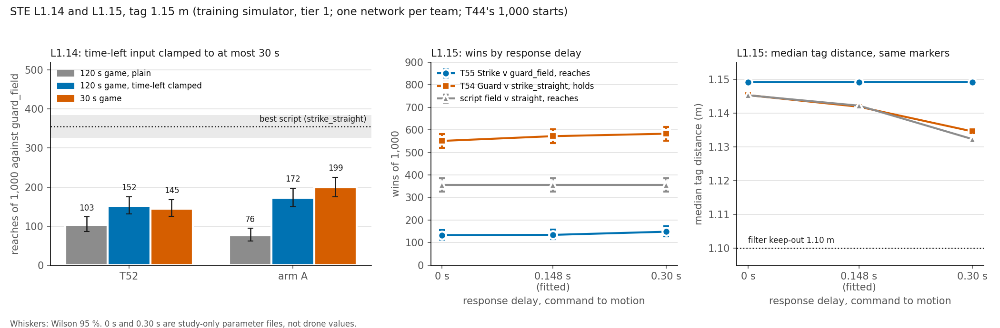

Simulator: training simulator, tier 1 (fast engine; Starling layer: commander copy, safety filter on every pair, fitted PX4 response, exploratory); study tag on (P1, PROPOSED). Observed in the training simulator; not a flight result.

# 2026-11-22_ste_l115 record

Written by hand from the two run folders' `results.json` / `results.md` (scoring runs of `scripts/ste_score_matrix.py`);
the numbers are copied from them (tag distances exact from `results.json`). Paired counts between delays were computed
by the records writer from the per-game files (`games/*.npz`), checked by two reviewers; they are not pre-registered.

## Purpose

STE task L1.15, the delay check (INFO, scoring only; spec `ste_learning/drafts/L1_SIDE_TRACK_SPEC.md` addendum 3, written
before these runs). The tier-1 game carries the fitted Starling response delay (`params/real_exploratory_v0.toml`
`delay_s` 0.1482): a delay from command to motion, not a late position; tags are judged on true positions, as motion
capture would. Whether the 1.15 m picture depends on that delay was unmeasured. Re-score at `delay_s` 0 and 0.30 s
(0.148 s = the existing results; two study parameter files, copies of v0 with only `delay_s` changed, labelled
study-only, never a drone value), tag 1.15 m, 120 s, T44's 1,000 starts: T55 (1.15 m Strike team, 5×) against
guard_field, T54 (1.15 m Guard team, 3×) against strike_straight, and the script cell guard_field v strike_straight.

Pre-registered reading words: "the 1.15 m picture **depends on the response delay**" if, at 0 or 0.30 s, any of the three
cells' wins move outside both its own interval at 0.148 s and the new one (non-overlap), or the median tag distance
moves by more than 1 cm (then the 1.15 m training side track pauses until L1.7); otherwise "the 1.15 m results hold
across response delays 0–0.30 s".

Two run folders: `runs/2026-11-22_ste_l115_t55`, `runs/2026-11-22_ste_l115_t54`.

## Commit

`c1155b8cb0c42bbbbc335acb87fd8fbb6d87aee6` on branch `ste-l1-side` (diff sha256 `e3b0c44298fc`, the empty diff) for both
runs.

## Config

- Settings (sha256, copy in each run folder): `configs/ste_l1/score_matrix_l115_t55.toml` `dbe7315b3a71b7ebc98502089a32b6631be717a2914189a0e1e94eb25e6f25da`; `configs/ste_l1/score_matrix_l115_t54.toml` `d1052c5afb99be6f6e9990d555c18f592886f084958755ff147490fc3055ed83`.
- Players (agent_final.pt sha256): T55 `ste_provisional/players/2026-11-22_ste_l012c_tag_1p15_strike` `e20e550ca88bd5e5728e1eec86a7da1bbc031306d9150f511bce3a3b09e97e1c`; T54 `ste_provisional/players/2026-11-22_ste_l012c_tag_1p15_guard` `78c6dbdf0beb354bdebe834e6cd7c1d6b321c195dc0dc7ef7cfded00e1f5a4f2`.
- Games and parameter sets (sha256):

| Delay | Game file | Parameter file |
|---|---|---|
| 0 s | `configs/ste_l1/tag_1p15_delay0.toml` `2cc38662f5b9d709aca18333283e564b2d4544dc3fa62b2cfce255a6e5ceee92` | `configs/ste_l1/study_params_delay0.toml` `b10571bd419b9a843016637186ce9f250eba57bcadb3e08e972151f651b6eead` (STUDY-ONLY) |
| 0.1482 s | `configs/ste_l011/tag_1p15.toml` `b2e09683f7088964a7d1ca15dfc9c98d1e04c15e96b14196d6971afb75f27580` | `params/real_exploratory_v0.toml` `4c93543f51ab41ea5bb0f81e6d1b0512f662a3e10126ec2d85fc3bb008cecaa2` |
| 0.30 s | `configs/ste_l1/tag_1p15_delay0p30.toml` `84e0c7289340a1c7b3e6aed056d93955cc03034bd72f61c899f0cd2360bcd04b` | `configs/ste_l1/study_params_delay0p30.toml` `2b827cd25f82ae3eec42659d1aa47d0a479f414cc4e8c7f1b0d25f295e68e5a2` (STUDY-ONLY) |

- Reference `configs/ste_l012b/screen_reference.npz` (`49014000d07e…`, the 0.148 s cells only); one start set `5aeba7ab2b58…`.

Commands (`cmd.txt`; through `scripts/ste_job.py launch --task L1.15 --settings configs/ste_learning.toml --beat-s 60.0`,
then `python scripts/ste_score_matrix.py`):

```
--name l115_t55 … --settings configs/ste_l1/score_matrix_l115_t55.toml --run-dir runs/2026-11-22_ste_l115_t55 --cap-h 0.22
--name l115_t54 … --settings configs/ste_l1/score_matrix_l115_t54.toml --run-dir runs/2026-11-22_ste_l115_t54 --cap-h 0.05
```

## Model parameter set

Tier 1 Starling layer, three response delays as above; safety filter on every pair (keep-out 1.10 m).

## Seeds

Scoring starts T44's (seed 110000, loaded); no training; no clips (scoring only).

## Machine

jeremychia-Legion-Pro-7-16IAX10H, NVIDIA GeForce RTX 5070 Ti Laptop GPU, device cuda; one launch each, exit 0 (DONE),
one job at a time.

| Run folder | Launched | Effective s (cap h) | Job, GPU-h used (shared ledger) |
|---|---|---|---|
| l115_t55 | 2026-11-22T22:02:10+08:00 | 525 (0.22) | l115_t55, 0.147 |
| l115_t54 | 2026-11-22T22:11:10+08:00 | 23 (0.05) | l115_t54, 0.007 |

## Gates

Verdict: **INFO** (no pass/fail gate; the controls are gated).

| Run | Control | Status |
|---|---|---|
| both | own_replay at 0.1482 s: the player's evaluation batch replayed game for game (T55 134 = 134; T54 572 = 572) | **PASS** |
| both | script cells at 0.1482 s equal to the screen reference game for game (T55: also its own cell v guard_field equal to own_replay) | **PASS** |
| both | plumbing at 0 s and 0.30 s (paired starts, tags one for one, no non-finite actions; no screen reference exists for these games, so script cells are reported, not compared) | **PASS** |

## Results

Wins of 1,000 (Wilson 95 %) and median tag distance (m), by response delay; tag 1.15 m, 120 s:

| Cell | 0 s | 0.1482 s | 0.30 s |
|---|---|---|---|
| T55 (Strike, 5×) v guard_field, reaches | 133 (0.113-0.155) | 134 (0.114-0.157) | 148 (0.127-0.171) |
| T54 (Guard, 3×) v strike_straight, holds | 551 (0.520-0.582) | 572 (0.541-0.602) | 583 (0.552-0.613) |
| script guard_field v strike_straight (T55 run's copy), reaches (holds 645) | 355 (0.326-0.385) | 355 (0.326-0.385) | 355 (0.326-0.385) |
| median tag distance, T55 cell | 1.1491 | 1.1491 | 1.1491 |
| median tag distance, T54 cell | 1.1453 | 1.1418 | 1.1345 |
| median tag distance, script cell | 1.1452 | 1.1422 | 1.1323 |
| minimum tag distance, T55 cell / T54 cell / script cell | 1.1364 / 1.1324 / 1.1367 | 1.1344 / 1.1223 / 1.1233 | 1.1340 / 1.1065 / 1.1058 |
| median closest approach between any pair (INFO, not gated), T55 / T54 / script cell | 1.1486 / 1.1432 / 1.1429 | 1.1486 / 1.1384 / 1.1380 | 1.1486 / 1.1271 / 1.1240 |

How games end (reach / all Strike tagged / clock) and median length: T55 133 / 34 / 833, 134 / 42 / 824, 148 / 39 / 813,
all 120.0 s; T54 449 / 551 / 0 (2.8 s), 428 / 572 / 0 (2.9 s), 417 / 583 / 0 (3.0 s); script 355 / 645 / 0, 2.6 / 2.55 /
2.65 s.

Paired counts against 0.1482 s (records writer's count from `games/*.npz`; not pre-registered, sign tests included):

| Cell | 0 s only / 0.1482 s only | 0.30 s only / 0.1482 s only |
|---|---|---|
| T55 reaches | 4 / 5 | 19 / 5 (p = 0.007) |
| T54 holds | 6 / 27 (p = 0.0003) | 17 / 6 (p = 0.035) |
| script reaches | 0 / 0 (identical game for game) | 0 / 0 (identical game for game) |

## Figures and videos

No clips (scoring only).



Middle and right panels: wins of 1,000 (Wilson 95 %) and median tag distance at response delay 0, 0.148 and 0.30 s. Wins overlap at every delay; the tag distance of T54 and the script cell moves toward the 1.10 m keep-out with more delay (script 0.99 cm from 0.148 to 0.30 s, the pre-registered baseline; 1.30 cm from 0 s). Drawn by `scripts/make_ste_l1_side_figure.py` from results.json.

## Ledger row

Ledger row: | T61 | 2026-11-22T22:02:10+08:00 | training simulator, tier 1 (fast engine; Starling layer: commander copy, safety filter on every pair, response delay 0 / 0.1482 / 0.30 s, the 0 and 0.30 s files study-only, exploratory); study tag on (P1, PROPOSED); NVIDIA GeForce RTX 5070 Ti Laptop GPU | 2026-11-22_ste_l115 (2 run folders: t55, t54) | STE L1.15 delay check (scoring only, tag 1.15 m, delay 0 / 0.1482 / 0.30 s): T55 v guard_field 133 / 134 / 148; T54 v strike_straight 551 / 572 / 583; script 355 / 355 / 355; intervals overlap in every cell; median tag distance moves at most 0.99 cm from 0.148 s (script cell at 0.30 s; line 1 cm): by the pre-registered rule the 1.15 m results hold across response delays 0–0.30 s; the delay changes the game a little (tags about 1 cm deeper at 0.30 s, 1.30 cm from 0 s; small paired win changes, not pre-registered); controls PASS; 0.154 GPU-h | INFO | records/2026-11-22_ste_l115_record.md |

## Run notes added by the lead

- **Reading (pre-registered words and baseline; one network per side, one start set).** The rule compares each delay
  with 0.148 s, the fitted value: every cell's interval at 0 s and at 0.30 s overlaps its interval at 0.148 s, and no
  median tag distance moves by more than 1 cm from its 0.148 s value (largest: the script cell, 0.99 cm, 1.1422 →
  1.1323 m, 0.148 → 0.30 s; T54 0.73 cm). **By the pre-registered rule the results hold: the 1.15 m results hold across
  response delays 0–0.30 s.** The 1.15 m side track continues.
- **The response delay does change the 1.15 m game a little (not pre-registered).** Tags happen about 1 cm deeper at
  0.30 s. Across the full range 0 → 0.30 s the median tag distance moves 1.30 cm in the script cell (1.1452 → 1.1323 m)
  and 1.07 cm in the T54 cell (1.1453 → 1.1345 m), over 1 cm; the median closest approach between any pair moves 1.40 cm
  in the script cell (1.1380 → 1.1240 m, 0.148 → 0.30 s) and 1.14 cm in the T54 cell. The smallest tag distance at
  0.30 s is 1.106 m (script cell; T54 cell 1.1065 m). T55's cell does not move (median 1.1491 m, minimum 1.1340–1.1364 m).
  Paired wins change a little on both sides (sign tests not pre-registered): T54 0 v 0.148 s 6 / 27 (p = 0.0003), 0.30 v
  0.148 s 17 / 6 (p = 0.035); T55 0.30 v 0.148 s 19 / 5 (p = 0.007). The script cell's 1,000 outcomes are identical at
  all three delays. Worth re-checking when L1.3 gives fitted values.
- **What the delay is.** `delay_s` is the delay from a command to the drone's motion in tier 1's fitted response, not a
  late position report: tags are judged on true positions.
- **Limits.** Tier 1, laptop RTX 5070 Ti, one trained network per side, T44's 1,000 starts; the 0 s and 0.30 s parameter
  files are study-only, not drone values; observed in the training simulator, nothing flown.
- **GPU-hours** (shared ledger): l115_t55 0.147, l115_t54 0.007; total 0.154, charged to L1.15 (cap 0.3).
