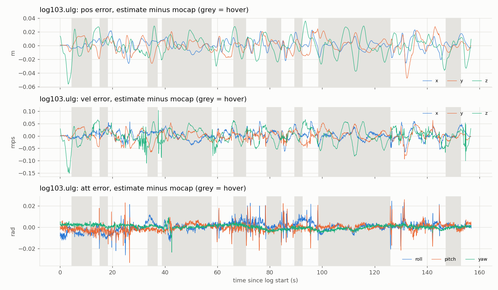
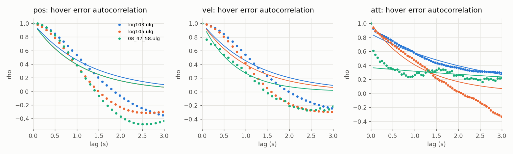

Real flight logs analysed for the training simulator's drone model (EXPLORATORY). Not a training result and not a flight result: no drone was flown for this record.

# 2026-11-23_ste_l13_fit record

Written by hand from `runs/2026-11-23_ste_l13_fit/results.md` and `results.json` (made by `scripts/fit_estimate_error.py`),
with the corrections of two reviewers (marked where they change the script's text). The script's own docstring calls
this "not a run of record: no gate, no ledger row"; the ledger row below records the analysis as INFO, EXPLORATORY.

## Purpose

STE task L1.3, the estimate-error part (EXPLORATORY, INFO): fit the statistics of EKF2's estimate error (sigma and
correlation time tau per quantity) that the L1.1b model (`state_error_*` in `params/starling_physics_v1.toml`,
[record T62](2026-11-23_ste_l1_model_check_record.md)) needs, from real PX4 logs with motion capture (mocap) fused. Error
= EKF2's estimate minus the mocap sample it fuses; the mocap stands in for the truth. Position and velocity in ENU,
attitude in body axes. Drag and the stage-1 limits of L1.3 remain open.

## Commit

Branch `ste-l1-3` at `8ca664aa…` with the fit script and its test not yet committed:
`scripts/fit_estimate_error.py` sha256 `ef66dbd02d931bae65cb007c9d2070ae7b60281bea6dc8de3fb2ea435ba9d899` (last written
03:29:19, the results 03:29:32), `tests/test_fit_estimate_error.py` sha256 `370d0d808bb436f632744f6724e28af5c33249326ca7951de2772f4cef9dda73`.

## Config

- Logs (read only, sha256 in `results.json`): main `log103.ulg` (`/home/jeremychia/flight_logs/2026-11-13/ulog_drone_2/`,
  sha256 `4db5b1fcf33e69c65fc0a939cfe0ec89d2275d5245f741bd2ae71e6f646cfe08`, drone_2, 157 s); cross-checks `log105.ulg`
  (`…/2026-11-13/two_drone_teleop/drone_2/`, `88f298560498…`, 66 s) and `08_47_58.ulg`
  (`…/2026-11-13/two_drone_teleop/drone_1_candidates/`, `030785c87e0a…`, 69 s). All three: EKF2_EV_DELAY 0.050 s,
  EKF2_EV_CTRL 11 (mocap horizontal and vertical position and yaw fused).
- Sample rules (fixed before the first fit; exploratory scans of log103 had been run): airborne = not landed and above
  0.3 m, 1 s trimmed at each end; hover = horizontal and vertical speed under 0.1 m/s for at least 3 s; moving =
  horizontal speed above 0.2 m/s; autocorrelation to 6 s, floor rho 0.15.
- **Tau rule: the 1/e crossing of the error's autocorrelation, settled after seeing these logs** (fix round 1, one rule
  for every quantity); the A = 1 fit through the origin is the cross-check.
- Outputs (sha256): `results.md` `7450bb28a5e9…`, `results.json` `f7444f089d83…`, `proposed_starling_physics_v1.toml`
  `65ec951f4a41…` (a PROPOSED block; v1 itself is not changed), figures `estimate_error_hover.png` `6eaeeb6e934a…`,
  `estimate_error_acf.png` `382d3d9c5a5a…` (copies in `docs/figures/ste_l13/`).

Command (CPU, not launched as a job): `scripts/fit_estimate_error.py --out-dir runs/2026-11-23_ste_l13_fit` (logs and
main log as in the script's defaults).

## Machine

jeremychia-Legion-Pro-7-16IAX10H, CPU only; results written 2026-11-23T03:29:32+08:00. GPU-hours: 0.

## Gates

Verdict: **INFO, EXPLORATORY** (no gate). One flight log is thin (STANDARDS §5): the values are a proposal for the lead,
not fitted drone values.

## Results

Proposal (log103.ulg, hover 81 s in 9 segments, pooled over three axes; reviewed values):

| Quantity | sigma | tau, 1/e rule (s) | tau, A = 1 cross-check (s) | Status, note |
|---|---|---|---|---|
| position | 0.0099 m | 1.2 | 1.3 | PROPOSED |
| velocity | 0.022 m/s | 1.3 | 1.3 | PROPOSED |
| attitude | ≤ 0.0027 rad | about 2.0 | 2.3 | PROPOSED, UPPER BOUND; tau weak (independent recompute 1.87 s; split-half by the reviewers 4.2 / 1.5 s; the script's split-half 2.07 / 1.62 s); the mocap's own noise floor 0.0013 rad is 0.48 × sigma (the OPEN cut is 0.5) |

Cross-check logs (hover, pooled over three axes; copied from `results.md`):

| Log | Hover (s, segments) | Position sigma / tau 1/e | Velocity sigma / tau 1/e | Attitude sigma / tau 1/e |
|---|---|---|---|---|
| log103.ulg (main) | 81, 9 | 0.0099 m / 1.23 s | 0.0222 m/s / 1.26 s | 0.0027 rad / 1.97 s |
| log105.ulg | 21, 3 | 0.0136 m / 1.01 s | 0.0310 m/s / 1.06 s | 0.0018 rad / 1.24 s |
| 08_47_58.ulg | 23, 4 | 0.0082 m / 1.01 s | 0.0217 m/s / 0.86 s | 0.0011 rad / 0.40 s |

Mocap and timing (copied from `results.md`):

| Log | Mocap rate (Hz) | Mocap position noise (m) | Mocap attitude noise (rad) | Mocap age at arrival (s) | EKF2_EV_DELAY (s) | Fusion horizon behind now (ms) | Best position shift while moving (s) |
|---|---|---|---|---|---|---|---|
| log103.ulg | 33.8 | 0.00010 | 0.00130 | 0.006 | 0.050 | 41.1 | 0.035 (21 s moving) |
| log105.ulg | 33.8 | 0.00007 | 0.00067 | 0.007 | 0.050 | 41.1 | 0.033 (6 s) |
| 08_47_58.ulg | 33.8 | 0.00007 | 0.00078 | 0.009 | 0.050 | 33.0 | 0.007 (3 s) |

Moving segments (not used for the proposal): position error spread per axis up to 0.025 m (log105 z; log103 up to
0.0182 m), velocity up to 0.063 m/s.

INFO, second-order fit (damped oscillator, autocorrelation to 6 s; log103 hover): position pooled ζ 0.28, ωn 0.97 rad/s
(period about 6.5 s), mostly the z axis (ζ 0.17, squared misfit 48× lower than first order); velocity pooled ζ 0.36,
ωn 1.01 rad/s. Step to step the first-order model is rougher than the drone: autocorrelation at 0.1 s, position pooled,
observed 0.990 against 0.923 (first order) and 0.996 (second order). Roll's ζ 1.88 is overdamped: no period (the
script's table prints 2.9 s from 2π/ωn; it has no meaning there).

EKF2's estimate minus the mocap over the whole of log103.ulg; grey bands are the hover segments used for the fit. Position
errors stay within about ±0.04 m in hover (larger in the first seconds and while moving); the swing-back over a few
seconds is visible in z. Drawn by `scripts/fit_estimate_error.py`.

Autocorrelation of the hover error (dots) and the first-order fits (lines) for the three logs. Position and velocity go
below 0 after about 2 s, which a first-order error never does; the fit matches only the first decay. Attitude decays
slowly with a white part at short lags. Drawn by `scripts/fit_estimate_error.py`.

## Ledger row

Ledger row: | T63 | 2026-11-23T03:29:32+08:00 | real flight logs (PX4 ULog, drone_2 log103 and two cross-check logs, 13 Nov 2026), analysed on the CPU for the tier-2 drone model; no simulation, no flight | 2026-11-23_ste_l13_fit | STE L1.3 estimate-error fit (EXPLORATORY): log103 hover 81 s, EKF2 estimate minus mocap: position sigma 0.0099 m, tau 1/e 1.2 s (A = 1 fit 1.3); velocity 0.022 m/s, 1.3 s; attitude ≤ 0.0027 rad (upper bound), about 2.0 s (weak); tau rule settled after seeing the data; errors swing back (second order fits better, follow-up L1.1c); mocap age 6–9 ms v EKF2_EV_DELAY 50 ms; proposal only, v1 unchanged; 0 GPU-h | INFO | records/2026-11-23_ste_l13_fit_record.md |

## Run notes added by the lead

- **What the numbers are.** In hover the EKF2 estimate differs from the mocap it fuses by about 1 cm in position
  (σ 0.0099 m), 2 cm/s in velocity and at most 0.003 rad in attitude, with errors that last about 1–2 s. They are a
  proposal for `state_error_*`, from one 81 s hover in 9 pieces; "about 99 independent samples" for position is rough
  (duration over two tau, three axes pooled although they are not independent).
- **The tau rule was chosen after seeing the data.** The 1/e crossing replaced the free log-domain fit in fix round 1,
  after the logs had been read; the A = 1 fit is printed beside it.
- **The error swings back.** Position and velocity autocorrelations go below 0 (position −0.38 at 3.4 s, velocity −0.28
  at 3.5 s); a first-order Gauss–Markov error never does, so sigma and tau match only the size and the first decay. A
  second-order error fits better (INFO above), mainly in z; follow-up L1.1c. Position and velocity errors are drawn
  independently in the model; on the drone the velocity error correlates only about 0.2 with the rate of the position
  error (reviewer).
- **Mocap timing.** A mocap sample is about 6–9 ms old when it reaches PX4 (measured indirectly against the gyro-driven
  tilt, a few ms uncertain), while EKF2 is told 50 ms (EKF2_EV_DELAY). HYPOTHESIS (not tested in flight): EKF2's position
  then runs ahead of the drone while it moves, by about speed × 29 ms (about 1.4 cm at 0.5 m/s; log103's best moving
  shift 0.035 s minus the 0.006 s age).
- **Do not quote about 1 cm as the in-flight error.** That is hover. While moving, the position error's spread per axis
  reaches 0.025 m, plus the speed-dependent lead above.
- **Limits of the proxy.** The mocap is the reference, so errors it shares with EKF2 (mocap calibration, the marker
  centre against the IMU: EKF2_EV_POS_* are 0) are invisible. EKF2 fuses mocap yaw only (EKF2_EV_CTRL 11), so roll and
  pitch are an independent comparison against a mocap tilt with its own slow errors (ground-plane level, turning with
  yaw): the attitude sigma is an upper bound.
- **How to use them (the flight panel's guidance).** Nominal arm = the proposal (0.0099 m / 1.2 s, 0.022 m/s / 1.3 s,
  0.0027 rad / 2.0 s). Conservative arm ≈ 2 × sigma (0.02 m, 0.05 m/s, 0.005 rad), each at tau 1.3 s and at 0.5 s.
- **What it means at a 1.15 m tag.** The tag band above the filter's 1.10 m keep-out is 5 cm; 1 cm of estimate error is
  20 % of it. Per axis, the band is about 5 nominal hover sigmas, 2.5 conservative sigmas and 2 of the largest moving spreads
  (0.025 m); between two drones the errors add (relative error √2·σ), so about 3.6 nominal sigmas. Tags judged on the estimate are therefore not clean at the edge of the band; the owner's motion-capture tag
  (judged on mocap positions) avoids that.
- **What the NEAR-962 recording needs** (from `results.md`): the mocap capture time on a clock synced with PX4; ULog at
  the highest rate for vehicle_local_position, vehicle_attitude, vehicle_visual_odometry and estimator_innovations (here
  10, 20, 34 and 100 Hz); an independent reference if possible; hovers of at least 5 min on both drones; moving legs at
  known speeds; each log's sha256 and EKF2_EV_DELAY / EKF2_EV_CTRL in the record.
- **Known test gap.** The per-axis ULog test cannot catch a flipped ENU z sign (follow-up, folded into task L1.1c's tests).
- **Drones.** The main fit is drone_2 only (log103); the cross-check `08_47_58.ulg` sits under `drone_1_candidates/`, so
  its drone_1 identity is likely but not confirmed.
- **Wording fixes from review** (the script's `results.md` still carries the originals): roll's ζ 1.88 is overdamped, no
  period; the line "position and velocity errors are linked on the drone" is dropped (see above); "about 99 independent
  samples" is rough.
- **Limits.** One main log of 81 s hover, two short cross-checks, one airframe per drone; the proposal is EXPLORATORY and
  changes no parameter file; nothing flown for this record.
