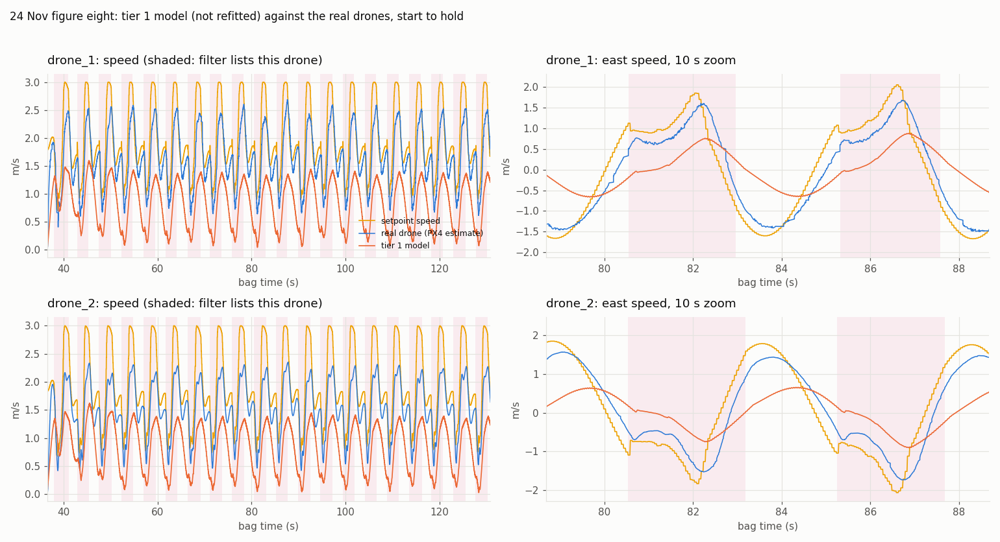

Observed in flight logs: real drones, 24 November 2026 rosbag (figure eight, two drones); tier 1's drone model replayed on the CPU, not refitted; no simulator run, no training result

# 2026-11-24_fig8_heldout record

Result: **INFO** (no gates). Ledger row T72. Draft until reviewed (one reviewer: an internal INFO record).

## Purpose

Check tier 1's drone model (the fitted PX4 response, `params/real_exploratory_v0.toml`, response delay 0.1482 s) against
a flight it never saw and at speeds it was never fitted at: the 24 Nov figure-eight mission, both drones, from the
commander's `start` to its `hold` (about 36.9–131.3 s in the survey's time,
[flight-log survey](../docs/notes/2026-11-24_flight_logs_survey.md)). The setpoint PX4 received is replayed through the
model and compared with each real drone's own velocity estimate, separately where the safety filter listed the drone
and where it did not. Information only: no parameter changes (STANDARDS §5 rule 10: the run of record of the `real`
set waits on the planned-pushes flight NEAR-962).

## Pre-registered reading (written and committed before any replay of the real bag)

Before this section was committed the bag was opened only to list its topics and to check that the fields exist
(setpoint speed reaches 3.0 m/s; the logged acceleration field is finite). No replay was run.

**Status.** INFO only. No gate, no PASS or FAIL, no verdict on the model. Nothing under `params/` changes, whatever the
numbers. A reading outside the 12 Nov range is a reason to put faster pushes into the NEAR-962 flight plan, not a refit.

**Primary method** (`scripts/fig8_check.py`, which reuses `scripts/bag_check.py`'s reader, setpoint rules, baselines and
shift search, so the numbers sit beside the 12 Nov check like for like):
- window per drone: first `/svg/commander_status` with last command `start` to the first after it with `hold`, on
  bag_check's time zero (first setpoint or local-position message; 0.39 s after the bag's first message);
- setpoint (position, speed) held onto a 0.01 s grid; acceleration feed-forward derived from the held speed setpoint
  (as the model was fitted and as the 12 Nov check ran); the `[px4]` table as written; started once from the measured
  position and speed at the window start and flown across the whole window (one open-loop window of about 94 s);
- horizontal only (x east, y north): the model has no fitted vertical channel; estimate error (L1.7) off, so the replay
  is deterministic (its velocity sigma, 0.022 m/s from T63, is small against the errors expected here);
- each measured sample is labelled from the latest `/svg/cbf_active` message (comma-separated names, exact name match):
  "filter on" when the drone's own name is listed, "filter off" when not, unknown when no message in the last 0.25 s.
  The setpoint is the commander's output after the filter in both classes, so the split reads PX4's response to
  filter-shaped setpoints, not the filter itself.

**Metrics and their reading words.** Per drone and per subset (all, filter on, filter off):

| Metric | 12 Nov check's range (from its record) |
|---|---|
| model velocity RMS, x axis, y axis, and both axes together (bag_check's convention) | 0.029–0.120 m/s (pooled 0.029 drone_1, 0.093 drone_2; worst leg 0.120) |
| best extra shift of the model, searched over [−0.10, 0.30] s (best-fit lag beyond the model's own delay) | −0.10 (drone_2, at the search edge) to +0.06 s (drone_1) |
| RMS after that shift (residual after lag) | 0.028–0.085 m/s |
| model RMS divided by the setpoint-speed baseline RMS | 0.78–1.03 (0.029/0.037, 0.093/0.090) |

Each number gets exactly one of: "inside the 12 Nov check's range" (low ≤ x ≤ high) or "outside the 12 Nov check's range
(above / below)". No other judgement word.

**Caveats stated in advance.**
- Speed: the model was fitted at up to 0.5 m/s (13 Nov) and the 12 Nov check flew up to 0.5 m/s; this flight's setpoint
  reaches 3.0 m/s and the drones about 2.7 m/s. Every number here is outside the fit range; an absolute RMS that grows
  with speed is expected and is not by itself a model fault.
- The 12 Nov record has no per-axis numbers; per-axis RMS is set against its both-axes range (same scale: both-axes RMS
  is the root of the mean of the two axes' squares).
- One 94 s open-loop window against 12 Nov's 3–6 s legs, each started from rest.
- The 12 Nov drone_2 best shift sat on the search edge (−0.10 s). A best shift on either edge here is reported as "at the
  search edge"; the same search over [−0.30, 0.80] s is given as information.
- The measured speed is PX4's estimate, logged on the laptop after the WiFi (bag log time), as on 12 Nov.

**Information-only variants, named now:** the logged acceleration field instead of the derived one (what PX4 received);
the setpoint joined by straight lines (as the S1 fit); the model restarted every 5 s from the measured state (1 s
run-in, unscored), like bag_check's short legs; the share of time the model sits on its acceleration limit (1.72 m/s²)
or speed cap (3.0 m/s); the measured horizontal acceleration (95th percentile). They move no reading word.

## Results

In short: tier 1's model, fitted at up to 0.5 m/s, flies this 2 m/s figure eight slower than the real drones and late.
With the pre-registered method (derived acceleration) it reaches about half their speed (median 0.84 m/s against
1.51–1.61 measured; peaks 1.59–1.62 against 2.35–2.69), velocity error 0.77–0.84 m/s RMS, 6–7 times the 12 Nov check's
worst leg and 1.36–1.64 times the error of simply assuming the drone flies the setpoint speed. Fed the acceleration
field PX4 actually received (closer to how tier 1 runs: it feeds the commander's acceleration; information only), it
reaches about two thirds (median 1.05–1.06 m/s, peaks 1.91–1.94), error 0.49–0.58 m/s RMS, 0.86–1.13 times the
setpoint baseline, still 4–5 times the 12 Nov worst leg. Every RMS number is outside the 12 Nov check's range (above). The shift search does not
rescue it: the best shift sits on the search edge (−0.10 s) in every subset and still at or near the wide edge
(−0.20 to −0.30 s): the gap is amplitude, not timing.

Window: bag_check seconds 36.483–130.883 (commander `start` to `hold`; the survey's 36.9–131.3 s less its 0.39 s
earlier zero), 94.4 s; 11,313 measured samples for drone_1, 9,476 for drone_2. The filter listed drone_1 54 % and
drone_2 56 % of the window, in 20 stretches each (median 2.5–2.6 s, longest 3.1–3.2 s); no sample unknown.

### Primary (pre-registered method), with the reading words

RMS in m/s; "both" is bag_check's convention. 12 Nov ranges: model RMS 0.029–0.120; best shift −0.10 to +0.06 s;
RMS after shift 0.028–0.085; model / setpoint 0.78–1.03.

| Drone | Subset | Samples | Model RMS x / y / both | Reading (each RMS) | Best shift (s) | Reading | RMS after shift | Reading | Model / setpoint | Reading |
|---|---|---|---|---|---|---|---|---|---|---|
| drone_1 | all | 11,313 | 0.706 / 0.955 / 0.840 | outside (above) | −0.10, at search edge | inside | 0.792 | outside (above) | 1.64 | outside (above) |
| drone_1 | filter on | 6,122 | 0.649 / 0.801 / 0.729 | outside (above) | −0.10, at search edge | inside | 0.694 | outside (above) | 1.33 | outside (above) |
| drone_1 | filter off | 5,191 | 0.768 / 1.109 / 0.954 | outside (above) | −0.10, at search edge | inside | 0.895 | outside (above) | 2.06 | outside (above) |
| drone_2 | all | 9,476 | 0.669 / 0.858 / 0.769 | outside (above) | −0.10, at search edge | inside | 0.722 | outside (above) | 1.36 | outside (above) |
| drone_2 | filter on | 5,333 | 0.606 / 0.636 / 0.621 | outside (above) | −0.10, at search edge | inside | 0.590 | outside (above) | 0.97 | **inside** |
| drone_2 | filter off | 4,143 | 0.741 / 1.078 / 0.925 | outside (above) | −0.10, at search edge | inside | 0.863 | outside (above) | 2.08 | outside (above) |

"outside" and "inside" mean outside / inside the 12 Nov check's range. The "inside" best shifts are inside only
because the 12 Nov range also ends on the search edge; with the wide search ([−0.30, 0.80] s, information) the best shift
is −0.30 s (at its edge) for "all" and "filter off" on both drones, −0.24 s (drone_1) and −0.20 s (drone_2) with the
filter on, and the RMS after it 0.58–0.80 m/s. The one ratio inside (drone_2, filter on, 0.97) comes from the
baseline, not the model: the filter-shaped setpoint is itself a poor description of the drone there (setpoint RMS
0.642 m/s against 0.445 with the filter off).

Baselines (both axes, all samples): the setpoint speed itself 0.511 (drone_1) and 0.564 (drone_2) m/s; the setpoint
0.15 s later 0.302 and 0.394 m/s. Both beat the model here; on 12 Nov the 0.15 s-later setpoint also beat it on
drone_2 (0.066 against 0.093).

### Information only (named before the run; they move no reading word)

Per drone, drone_1 / drone_2. Model speed: median (peak) of the model at the measured samples; the real drones:
median 1.61 / 1.51 m/s, peak 2.69 / 2.35. "On acc. limit": share of the model's 0.01 s steps at its 1.72 m/s² limit.

| Variant (all samples) | Model RMS | Best shift (s) | Model / setpoint | Model speed, median (peak) | On acc. limit |
|---|---|---|---|---|---|
| primary (held setpoint, derived acceleration) | 0.840 / 0.769 | −0.10 / −0.10 (edge) | 1.64 / 1.36 | 0.84 (1.59) / 0.85 (1.62) | 43 % / 43 % |
| logged acceleration field (what PX4 received) | 0.577 / 0.487 | −0.06 / −0.06 | 1.13 / 0.86 | 1.06 (1.91) / 1.05 (1.94) | 87 % / 86 % |
| setpoint joined by lines | 0.521 / 0.440 | −0.01 / −0.01 | 0.94 / 0.73 | 1.13 (1.91) / 1.12 (1.94) | 90 % / 91 % |
| restarted every 5 s (19 windows, 1 s run-in) | 0.857 / 0.800 | −0.10 / −0.10 (edge) | 1.67 / 1.42 | not computed | not computed |

- With the held setpoint and derived acceleration, the feed-forward is a spike every 0.05 s that the model's limit
  clips (the 12 Nov record names this); its 43 % on the limit likely counts those spikes. With a smooth acceleration
  (logged field, or the setpoint joined by lines) the model is on its limit 86–91 % of the time. The real drones'
  horizontal acceleration (slope over 0.1 s) has median 2.58 / 2.55 m/s² and 95th percentile 4.35 / 3.83 m/s²; the
  logged setpoint acceleration reaches its 3.0 m/s² cap (95th percentile 3.00 on both). The model's PX4 speed request
  is on the 3.0 m/s cap in 31 % of steps (primary; 24–26 % logged acceleration, 12–14 % joined by lines).
- Restarting every 5 s does not help (0.80–0.86 m/s), so the error is not a drift built up over the long open-loop
  window: the model is too slow within each few seconds.

*Left: horizontal speed over the whole mission, setpoint (amber), real drone (blue, PX4's estimate) and tier 1's model
(orange, pre-registered method: derived acceleration); shaded where the safety filter listed the drone. Right: east
speed over 10 s. The model reaches about half the real drone's swing and lags it; fed the logged acceleration
(information, not drawn) it reaches about two thirds.*

### What this likely means (mechanisms say "likely": no control run)

- The model is likely too slow for this regime mainly because of its fitted acceleration limit, 1.72 m/s²: fed a
  smooth acceleration it sits on that limit 86–91 % of the time, while the real drones accelerate at a median 2.6 m/s²
  here. The fitted velocity lag (1.65 s, which the parameter file notes is poorly pinned: +25 % moved the fit's RMS by
  0.0002 m/s) may add to it; this check cannot separate the two.
- The derived acceleration of the pre-registered method (spiky from a held 20 Hz setpoint, then clipped) likely costs
  part of the error: the logged-acceleration and joined-by-lines variants cut the RMS by 31–43 %, but stay 3.7–4.8
  times above the 12 Nov check's worst leg.
- With and without the filter the model misses in the same way; the error is lower with the filter on, likely because
  the filter slows the setpoint there (the figure: shaded stretches sit on the setpoint dips).
- Nothing here changes `params/`. It supports flying faster pushes (and turns) in the NEAR-962 flight, so the fit of
  record sees the accelerations the game will ask for (the simulator's 2–6 m/s, 12 Nov record Limits); whether the
  planned 0.25–1.0 m/s pushes reach accelerations near 2–4 m/s² is not known from this check.

## Commit, config, parameter set

- Code: `scripts/fig8_check.py` at this branch (`fig8-check`), reusing `scripts/bag_check.py` unchanged; tests
  `tests/test_fig8_check.py` (10, synthetic bag, < 1 MB). The pre-registered reading above was committed (f095b440)
  before the replay. One bug in an information variant was found and fixed after the first replay, test first: the
  restarted-every-5 s windows took their baselines from the pre-delayed setpoint (ratio 2.87 for drone_1); the
  primary numbers did not change. After the first replay, as information only: the model's own speed (median, peak),
  and the acceleration-limit share and model speed for the logged-acceleration and joined-by-lines variants (added on
  review, because the primary method's 43 % likely counts clipped derivative spikes); the primary numbers are identical
  on rerun.
- Command: `python scripts/fig8_check.py --bag <bag dir> --params params/real_exploratory_v0.toml --out
  records/evidence/2026-11-24_fig8_heldout`.
- Bag (read-only, owner's, not in git): `svg_20261124_073433_0.mcap`, sha256 `5fc12207ed159529…`, 196.3 MB.
- Parameter set: `params/real_exploratory_v0.toml` (sha256 `4c93543f51ab…`), `[px4]` as written: lag1, delay 0.1482 s,
  lag 1.6496 s, acceleration limit 1.7178 m/s², Kp 0.95, speed cap 3.0 m/s. Exploratory. Estimate error off.
- Seeds: none (deterministic). Machine: CPU only, about 3 s; no GPU, no simulator. Games at once, steps per second: not
  applicable.
- Evidence: [metrics.json](evidence/2026-11-24_fig8_heldout/metrics.json) (every number above, per subset and
  variant), [fig8_heldout.png](evidence/2026-11-24_fig8_heldout/fig8_heldout.png).

## Limits

- One flight, two drones, one manoeuvre (the figure eight at 2.0 m/s scenario speed); speeds 99 % of the time above the
  fit range.
- The setpoint already jumps to about 1.8 m/s at the `start` command while the drones hover, so the window starts with a
  step from rest; the model starts from the measured (near-zero) speed.
- Measured speed is PX4's estimate logged after the WiFi; its delay includes one network leg, as on 12 Nov.
- The model's vertical channel and the commander copy are not exercised: the setpoint PX4 received is replayed directly.
