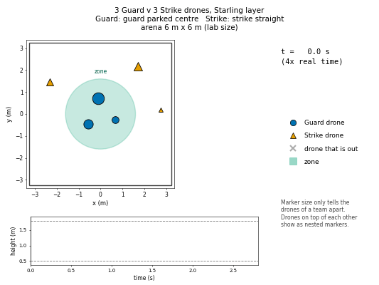

Simulator: training simulator, tier 1 (fast engine; Starling layer: commander copy, safety filter on every pair, fitted PX4 response, exploratory); study tag on (P1); landing (L2.3) and filter option B (L2.1, PROPOSED) as the arms say; CPU (RTX 5090 workstation). Observed in the training simulator; not a flight result.

# 2026-11-24_ste_l25_screen record

DRAFT before review (owner ruling R22: one reviewer for an internal record; two if it goes on a reader page or to a gate).

## Purpose

STE task L2.5 Parked-Guard control and scripted opponents under the new rules (INFO, no gate). The risk named at the
design review (DISCUSSION §2.14, "a large radius favours a parked Guard"): with a 1.6 m one-for-one tag, does a Guard
team that stands still hold as well as one that plays? And what do the two new rules built on 24 Nov 2026, landing
(tagged drones descend as filter obstacles, L2.3) and filter option B (only the Guard drone gives way in a Guard–Strike
pair, L2.1, PROPOSED), change in scripted play? The owner's P2 (option B) and P7 (drone loss) rulings read this record.
Spec `ste_learning/drafts/L2_5_SPEC.md`, frozen before the run (reading words, plumbing checks, withholding rules).

## Commit and config

Commit `3103d4d0` on `development` (the run folder's `code.json`, pinned at launch, clean tree). `results.json` names
`5442c06c`: likely the branch head when the results were written at 12:41:12 (5442c06c was committed at 12:40:19; the
commits between the two touch L1.5 files only, and the running process had loaded its code at launch). Gate file
`configs/ste_l2/l25_screen_gates.toml`, sha256 `bc5a585dcdc49ef2dac711cf4af1d7d661a1dffef9abe914702edf83ecca02ba`
(pinned at launch; copy in the evidence folder).
`scripts/ste_sweep_l011.py`, device CPU, seed 110000, 1,000 games per cell on T44's own 1,000 3v3 starts (loaded from
`configs/ste_l012/t44_reference.npz`), up to 2,400 ticks (120 s); fitted PX4 response (`params/real_exploratory_v0.toml`).
Main game: 3v3, tag 1.6 m one for one at 3-D centres, zone 1.6 m, 6.5 m lab arena. Launched by `scripts/ste_job.py
launch --task L2.5 --gpu-h 0` at 11:54:57, ended 12:41:12 (+08:00), exit 0; effective time 2,774 s (46 min) of the
4.5 h cap. The thread count is not known: the launcher records only PYTHONPATH, CUDA_VISIBLE_DEVICES,
PYTORCH_CUDA_ALLOC_CONF and its two shared-folder variables (`ste/jobs.py` RECORDED_ENV), not OMP_NUM_THREADS. Read by `scripts/ste_l25_read.py` (this record's commit; tests
`tests/test_ste_l25_read.py`), which applies the spec to the run's per-game arrays.

| Group | Landing | Filter share | Tag | Cells |
|---|---|---|---|---|
| base (ctl_reference_replay: T44's game, replayed) | off | equal | 1.6 m | 5 Guard × 6 Strike scripts |
| landing | on | equal | 1.6 m | 30 |
| gy | off | option B | 1.6 m | 30 |
| landing_gy | on | option B | 1.6 m | 30 |
| ctl_tag_off_landing | on (inert) | equal | off | 2 parked × 6 |
| ctl_tag_off_landing_gy | on (inert) | option B | off | 2 parked × 6 |

Guard scripts: guard_parked_centre (at 3v3 every Guard holds its start: **the still Guard**), guard_parked_ring (flies to
a ring station and stops), and the moving scripts guard_mark_edge (the named comparator), guard_mirror, guard_field.
Strike scripts: straight, flank, high, low, sacrifice, converge (high and low: tier 1's vertical response is not
fitted). Feint and dodge Strike scripts do not exist and were not built (spec).

## Controls

All 12 hold: tag fires (landing + option B game), reach fires, **reference replay (the 30 base cells equal T44 game for
game at full size on the CPU)**, zero tags with the tag off (both tag-off groups), same seed twice (landing_gy, 30,000
games equal), stand-still never reaches, zero tags when still, zero tags at a 0.05 m tag, one-for-one tags, one start
set, no non-finite action. Table in `results.md`.

**Plumbing checks (spec; from the run's per-game arrays, paired games):**

| Check | Compared | Games that differ | Result |
|---|---|---|---|
| P-b | tag off: even split v option B (outcome, end step or closest approach) | 11,429 of 12,000 | option B shown to reach the game (with the tag off only) |
| P-c | landing v base (end step or closest approach) | 6,978 of 30,000 | landing shown to reach the game |

Nothing is withheld. Option B reaching the game is shown with the tag off only; with the tag on, see reading 3.

## Result (INFO), in the spec's words

Hold = Guard team wins of 1,000 games (Wilson 95 %). "No change detected" means no change larger than this test can
see (about 40–60 games in 1,000), not "no effect".

**Reading 1, still Guard v the moving scripts** (worst cell over the six Strike scripts):

| Rule set | Still Guard | Ring Guard | mark_edge | mirror | field | Words |
|---|---|---|---|---|---|---|
| base (T44, known) | 430 (40.0–46.1 %) v low | 424 v low | 808 (78.2–83.1 %) v straight | 796 | 716 | still Guard below mark_edge |
| landing | 432 (40.2–46.3 %) v low | 426 v low | 802 (77.6–82.6 %) v straight | 796 | 716 | **still Guard below mark_edge** |
| gy | 431 (40.1–46.2 %) v low | 424 v low | 808 (78.2–83.1 %) v straight | 799 | 716 | **still Guard below mark_edge** |
| landing_gy | 432 (40.2–46.3 %) v low | 426 v low | 803 (77.7–82.6 %) v straight | 798 | 716 | **still Guard below mark_edge** |

Both parked scripts are also below mirror and field in every rule set. Cell by cell, the still Guard is below
mark_edge against five of the six Strike scripts in every rule set. Against strike_converge it holds 986 against
mark_edge's 972 (landing: not distinguishable) and 963 / 965 (gy, landing_gy: "still Guard above mark_edge"): one cell,
and the worst-cell reading above is unchanged (likely because converge sends every Strike drone to one point, where
parked Guards trade them away; not tested). The driver's g* is guard_mark_edge in every tag-on group (H 0.802 landing, 0.808 gy, 0.803 landing_gy).

**Reading 2, with and without the tag (parked Guards):**

| Rule set | Parked | Worst cell with the tag | Worst cell without | Words |
|---|---|---|---|---|
| landing | still | 432 v low | 0 v straight | the tag raises the parked Guard's hold |
| landing | ring | 426 v low | 0 v straight | the tag raises the parked Guard's hold |
| landing_gy | still | 432 v low | 0 v straight | the tag raises the parked Guard's hold |
| landing_gy | ring | 426 v low | 0 v straight | the tag raises the parked Guard's hold |

Cell by cell the tag raises the parked hold in 23 of 24 cells. The one exception: ring Guards against strike_flank with
the even split, 477 with the tag against 752 without ("the tag lowers it"): without the tag the ring Guards block the
flank Strikes until the time-out, likely the safety filter acting as a wall (both teams give way). With option B the same
cell holds 86 without the tag (still Guard v flank: 331 even split, 171 option B).

**The risk word:** landing: **not seen with scripted Strikes in this rule set**; landing_gy: **not seen with scripted
Strikes in this rule set** (the tag raises the still Guard's hold, but it stays below mark_edge).

**Reading 3, option B on and off (P2):** landing_gy v landing and gy v base: **no change detected** in all 30 cells of
both pairs. **At this tag size option B is not testable with scripted play:** the tag fires at 1.6 m, before the
filter (which keeps pairs 1.10 m apart and starts acting head-on at about 1.32–1.57 m) acts on most Guard–Strike pairs
(likely, not tested). With the tag off, where the filter does act, option B changes 11,429 of 12,000 games, and the
parked Guards' holds against strike_flank drop from 331 to 171 (still Guard) and from 752 to 86 (ring Guard). Paired
readout (30,000 paired games each):

| Pair | hold → reach | reach → hold | same outcome, end step changed |
|---|---|---|---|
| landing_gy v landing | 71 | 97 | 3,203 |
| gy v base | 76 | 91 | 2,789 |

The discordant games sit almost all in the mark_edge (44 / 52 and 45 / 45) and mirror (27 / 40 and 28 / 39) cells;
parked and field Guards change 0–6 outcomes each. The largest single cell is mark_edge v converge, 965 v 972 (20 hold →
reach, 13 reach → hold). The filter columns the driver records barely move: filter rate equal to the third decimal in
most cells; share of tags with the filter active on the tag's tick 0.11–0.39 for mark_edge, under 0.10 for the parked
Guards, either way; breach rate 0 and closest 3-D approach 1.600 m in every cell.

**Reading 4, landing on and off (P7, landing part):** landing v base and landing_gy v gy: **no change detected** in 28
of 30 cells; **landing raises the Guard team's hold** in two cells only, both against strike_low: mark_edge 895 v 844
(51 reach → hold, 0 hold → reach) and mirror 898 v 847 (52 / 1) with the even split; 902 v 847 and 899 v 846 with option
B. field against strike_low is unchanged (no change detected), as are the parked Guards. Tier 1's vertical response is
not fitted, and strike_low is a height script, so these two cells are read with care. Paired readout:

| Pair | hold → reach | reach → hold | same outcome, end step changed |
|---|---|---|---|
| landing v base | 90 | 164 | 3,724 |
| landing_gy v gy | 79 | 164 | 3,840 |

With landing on, the filter corrects live drones more often in the moving-Guard cells (mark_edge v straight 0.250 v
0.219 of live drone-steps), as expected when a landing pair stays in every filter pair.

**Plain reading.** Tested: whether, under the 1.6 m tag, a Guard team that stands still does as well as one that
plays, with the new landing and option-B rules, 1,000 scripted games per pairing. What happened: standing still holds
43 % at worst against 80 % for the named moving script (mark_edge), so the risk is **not seen with scripted Strikes**;
the tag is what makes standing still hold at all (it raises the parked hold in 23 of 24 cells; 0 % at worst without
it). Landing moved the hold rate in two cells only (moving Guards against the low Strike, about 5 points more; tier 1's
vertical response is not fitted, so read with care). Option B is not testable at this tag size: the tag fires before
the filter acts (likely, not tested); with the tag off it changes 11,429 of 12,000 games and removes most of the parked
Guards' blocking holds against the flank Strike (331 → 171, 752 → 86). Why it matters: landing barely changes scripted
play at 1.6 m (P7, landing part); option B (P2) is not measured by this screen in the main game and needs the 1.15 m
tag or a trained team; how a trained team uses either rule is not measured.

## For the owner's P2 and P7 rulings

**P2 (filter option B), what the data show.** At the 1.6 m tag option B is not testable with scripted play: it changed
no scripted cell's hold rate by more than this test can see, with or without landing (168 of 30,000 paired outcomes
changed with landing on, 71 against the Guard team, 97 for it), likely because the tag fires at 1.6 m before the
filter (1.10 m apart, acting head-on from about 1.32–1.57 m) acts on most Guard–Strike pairs; not tested. With the tag off, option B changed 11,429 of 12,000 games and took away most of the parked Guards' blocking
holds against the flank Strike (still Guard 331 → 171, ring Guard 752 → 86): likely because the Strike drone no longer
gives way, so the filter no longer works as a wall for the Guard team. **What they do not show:** a trained team (one
that learned to use the even split as a wall, as the STE Guard policy likely does, DISCUSSION §2.14, would lose more);
the 1.15 m tag (main training after L2), where the filter acts before the tag; tier 2 (L2.6); filter activations
before a tag (not recorded); how close a Strike drone gets to a wall-pinned Guard drone (the L2.1 shortfall, 0.39 m in
tier 1): the closest-approach column reads 1.600 m everywhere because a pair closer than 1.6 m is tagged out first;
anything about flight.

**P2, cost.** Option B was slower on the CPU wherever the filter stayed busy: the tag-off pair took 1,597 s with option
B against 301 s with the even split (5.3 ×, same cells, same games). The 0.05 m tag control (landing + option B, play
that does not end) took 256 s against 26 s for the stand-still control (about 10 ×; both are option B games, the
second with still Strike drones, so this pair shows a busy option B filter against an idle one, not option B against
the even split). Likely the option B filter path and its emergency fallback pass (L2.1 measured the fallback doubling
filter cost). If option B is chosen it would raise training cost; not measured on a trained run or on the GPU.

**P7 (drone loss), landing part only, what the data show.** Landing on changed 6,978 of 30,000 games in end step or
closest approach and 254 outcomes (90 against the Guard team, 164 for it); hold rates are unchanged beyond resolution
in 28 of 30 cells; in two cells only (mark_edge 895 v 844, mirror 898 v 847, both against the low Strike; field
unchanged) the moving Guards hold about 5 points more. Likely reason, not tested: the low Strike flies near the bottom of
the height band and meets the descending pair in the filter; tier 1's vertical response is not fitted, so these two
cells are read with care. **What they do not show:** scheduled drop-outs and drawn team sizes (not in this screen),
sizes other than 3v3, how close a live drone comes to a landing one (the closeness columns count live drones only;
L2.3's own tests cover it), the L2.3 shortfall (a drone landing onto a drone held at the height-band floor closes to
0.95–1.05 m, a builder's test scene), L2.4's absent slots, which still get the team reward (the learner must mask them,
an L3 item), a real descent.

## What the spec did not anticipate

- **Option B's CPU cost** (figures in "P2, cost" above): it is why the run took 46 min against the 27 min projected.
- **The closest-approach and breach columns cannot show the L2.1 shortfall at a 1.6 m tag** (above): 1.600 m and 0 in
  every cell by construction.

## What this does not show

Scripts only, no trained team (L3.5 must beat the parked Guard); tier 1 only; one start set (T44's); 3v3 only; vertical
Strike scripts not fitted in tier 1; scripted players decide every tick (L011-F1); option B is PROPOSED; feint and dodge
not built; no drop-out, no drawn sizes.

## GPU-hours and files

0 GPU-h (CPU). Evidence in `records/evidence/2026-11-24_ste_l25_screen/`: `results.md` (every cell), `controls.json`,
`gates.toml`, `l25_readings.md` and `l25_readings.json` (the spec's readings, every cell and paired count),
`hold_composition.png`, three clips of landing + option B (`guard_parked_centre_v_strike_straight.gif`,
`guard_mark_edge_v_strike_straight.gif`, `guard_field_v_strike_flank.gif`). Run folder
`runs/2026-11-24_ste_l25_screen/` (not in git).
