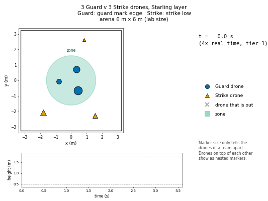

Simulator: training simulator, tier 1 (fast engine; Starling layer: commander copy, safety filter on every pair, fitted PX4 response, exploratory) against tier 2 (the same command chain driving the Isaac Lab 2.3.2 rigid-body Starling in PhysX, PX4 1.14 cascade copy); study tag on (P1); landing (L2.3) and filter option B (L2.1, PROPOSED) per group; estimate error off and nominal (L1.1b / L1.7, EXPLORATORY); NVIDIA GeForce RTX 5090. Observed in the training simulator; not a flight result.

# 2026-11-24_ste_l26_tier12 record

**DRAFT, not reviewed yet.** This record feeds the P2 and P7 rulings, so R22 asks for two independent reviewers (numbers
and completeness) before it is read as final.

## Purpose

STE task L2.6, scripted games, tier 1 against tier 2, under the new rules (INFO, no gate). WORK_BREAKDOWN L2.6 asks
whether the fast engine still predicts tier 2 ("T13 repeated with tag, option B, delay and drag"), and whether the two
tiers agree on what each new rule does. L3–L6 train on tier 1 and check on tier 2; the owner's P2 (option B) and P7
(drone loss, landing part) rulings read tier-1 screens (T70). Delay and drag are not in this run: both are 0 and not
fitted in `params/starling_physics_v1.toml`. The lead accepted this as a gap against the task text, so this run repeats
T13 with tag, option B and the estimate error.

Spec `ste_learning/drafts/L2_6_SPEC.md`, written and reviewed before the run (cells, groups, drop order, reading
words, plumbing rules, limits).

## Commit and config

- Code commit `8adfad3e` on `development`, clean tree (both run folders' `code.json`: diff sha256 `e3b0c44298fc`, the
  empty diff).
- Gate file `configs/ste_l2/l26_gates.toml`, sha256 `7cf3fd28ced129f89982e44ebacd8568029fa33c0ba7bafd8a9789f033579a35`,
  pinned at the first launch; the copy in the evidence folder has the same sha256.
- Driver `scripts/ste_tier12_l26.py`.
- Every batch: 7 cells × 1,000 games on T44's first 1,000 3v3 starts (loaded, never re-drawn), seed 110000, up to
  2,400 ticks (120 s).
  - The 6 main cells: mark_edge v straight, parked_centre v straight, parked_ring v flank, field v flank, mark_edge v
    low, field v straight.
  - The 7th is a repeat of mark_edge v straight.
- One Isaac world of 7,000 games × 6 drones.
- Tier 1 and tier 2 both on CUDA.
- Tier 2 = the same game file with the physics backend and `params/starling_physics_v1.toml` (off) or
  `params/starling_physics_v1_nominal.toml` (nominal).
- Main game: tag one for one at 3-D centres (1.6 m or 1.15 m per group), zone 1.6 m, 6.5 m lab arena.

| Group | Tag | Landing | Share | Arm | Played |
|---|---|---|---|---|---|
| base_1p6 (T44's game) | 1.6 m | off | equal | off | yes (protected) |
| landing_1p15 | 1.15 m | on | equal | off | yes (protected) |
| landing_gy_1p15 | 1.15 m | on | option B | off | yes (protected) |
| landing_1p6 | 1.6 m | on | equal | off | yes (protected) |
| base_1p6_copy (between-batch copy of base_1p6) | 1.6 m | off | equal | off | yes |
| landing_gy_1p15_err | 1.15 m | on | option B | nominal on both tiers | yes |
| landing_1p15_err | 1.15 m | on | equal | nominal on both tiers | yes |
| landing_gy_1p6 | 1.6 m | on | option B | off | yes |

No group was dropped: every group fitted the cap at the smoke's measured rates (`plan.json`).

**Launches** (both through `scripts/ste_job.py`, alone on the GPU, `isaac_preflight.sh --approved-headless` exit 0):
- **Required Isaac smoke** (`runs/2026-11-24_ste_l26_isaac_smoke/`): launched 13:40:46 (+08:00), 1,000 games per
  cell, 100 ticks, exit 0. 50 controls: 45 PASS, 4 INFO, 1 NOT_CHECKED. This was the first time landing and option B
  ran on the physics drone.
  - Measured seconds per batch tick (7,000 games): tier 2 0.080 even split, 0.224 option B; tier 1 0.026 and 0.094.
  - At 1.15 m, option B's tier-2 batch took 21.5 s against 7.7 s for the even split (× 2.8; tier 1 × 3.6).
  - With these rates the protected worst case was 1,826 s against a 4,680 s cap (1.3 h).
- **The run** (`runs/2026-11-24_ste_l26_tier12/`): launched 13:43:43 with `--rates-from` the smoke folder, ended
  13:48:50, exit 0, effective 304 s.

## Controls

All hold: 50 controls, 46 PASS and 4 INFO (the error arm's repeat copies, INFO by the spec). Table in `results.md`.
- **tag_fires_t2:** 7,000 games, 3 tags each, all ended at step 1.
- **Tier 1 base_1p6:** replays T44, EQUAL within CUDA tolerances.
- **Tier 1 landing_1p6 and landing_gy_1p6:** equal T70's CPU counts in all 6 cells (802, 534, 477, 807, 895, 716 and
  803, 534, 477, 808, 902, 716), inside the ±10 band.
- **known_t2:** parked_centre v straight holds 539, inside T53's 507–569 (T64: 541).
- **C-1a** before every tier-2 batch: largest gap 0.0081–0.0090 m (limit 0.02 m).
- **Tier 2:** 0 non-finite wrench or setpoint, 0 upsets in all 8 batches. Paired starts, tags one for one and no
  non-finite action in every batch.
- **Off-arm repeat copies:**
  - tier 1: 0 games differ (exact);
  - tier 2: 0–4 games with another outcome, 21–32 with another outcome or end step.

**Between-batch copy (copy_1p6):** base_1p6 and its later copy differ in **0 games** (outcome and end step), on both
tiers. So on tier 2 the within-batch repeat (another slot of the same batch) carries the only copy noise seen: 0–4
outcomes, as T64 found (4–7).

**Plumbing (spec, reading 5):** every rule pair reached both tiers beyond copy noise. On tier 2 the floor was 4
outcomes × 6 cells, and the between-batch count was 0. Changed outcomes per pair:

| Pair | Tier 1 | Tier 2 |
|---|---|---|
| landing at 1.6 m | 72 | 83 |
| option B at 1.15 m | 179 | 224 |
| option B at 1.15 m with the error | 167 | 235 |
| option B at 1.6 m | 33 | 32 |
| tag 1.6 → 1.15 m | 1,524 | 1,745 |

For the two error pairs, the error copies' repeat cell differed in 722–748 games on tier 2 (outcome or end step),
against an off floor of 32 (margin 2 × 32 + 20); on tier 1 it differed in 659–663 against 0. So the error reached
both tiers.

## Result (INFO), in the spec's words

Holds = Guard-team wins of 1,000 games (Wilson 95 %). "Predicts" means **agrees within the test's resolution** only:
no difference larger than this test can see (about 40–60 games in 1,000). 42 cell words (7 rule sets × 6 cells), no
multiplicity correction, unpaired intervals on paired games.

**Reading 1, per cell:**
- 33 "tier 1 predicts tier 2";
- 7 "tier 2 differs, inside T13's 0.10";
- 2 "tier 2 differs by more than T13's 0.10". Both are guard_mark_edge v strike_low with option B at 1.15 m:
  - error off: 432 → 315 holds (−0.117), same outcome on 883 of 1,000 starts;
  - nominal error: 435 → 307 (−0.128), 870 of 1,000.

Of the seven "inside 0.10" separations:
- four sit at 1.15 m, all with tier 2 holding fewer (−0.061 to −0.079: mark_edge v low without option B, and
  mark_edge v straight with it);
- three are one cell at 1.6 m in three rule sets (base_1p6, landing_1p6, landing_gy_1p6): parked_ring v flank, where
  tier 2 holds more (+0.087, 477 → 564).

**Reading 2, per rule set:**

| Rule set | Word | Cells beyond 0.10 / separated |
|---|---|---|
| base_1p6 | predicts tier 2 within T13's 0.10, not in every cell | 0 / 1 (parked_ring v flank +0.087) |
| landing_1p6 | predicts within 0.10, not in every cell | 0 / 1 (the same cell) |
| landing_gy_1p6 | predicts within 0.10, not in every cell | 0 / 1 (the same cell) |
| landing_1p15 | predicts within 0.10, not in every cell | 0 / 1 (mark_edge v low −0.071) |
| landing_1p15_err | predicts within 0.10, not in every cell | 0 / 1 (mark_edge v low −0.078) |
| **landing_gy_1p15** | **does not predict tier 2 in this rule set (a gap larger than T13's 0.10)** | 1 (mark_edge v low −0.117) / 1 more (mark_edge v straight −0.061) |
| **landing_gy_1p15_err** | **does not predict tier 2 (a gap larger than T13's 0.10)** | 1 (mark_edge v low −0.128) / 1 more (mark_edge v straight −0.079) |

No rule set has every cell inside the test's resolution. The tier-1 to tier-2 gap is largest where both option B and
the 1.15 m tag are on, and in the one height script (strike_low). Tier 1's vertical response is not fitted. At 1.15 m
the 0.5–1.8 m height band allows passes under or over the tag radius (spec). The tier-1 clip below shows a strike_low
drone flying at about 0.6 m under a Guard drone at 1.2 m and reaching the zone. That the 0.117 gap comes from passes
under is likely, not tested: passes are not counted in this run.

**Reading 3, same-outcome share (no word):** 0.87–1.00 per cell. Tier 2's own copy agreement in the same batch is
0.996–1.000 (off arm) and 0.957–0.968 (error arm). For the two known cells at base_1p6: 0.913 and 0.993 (T64: 0.912,
0.993).

**Reading 4, rule effects across tiers** (rule-effect words; hold → reach / reach → hold counts per tier):

| Pair | Both tiers agree | Cells where only one tier detects an effect |
|---|---|---|
| landing at 1.6 m (P7) | 5 of 6 | mark_edge v low: tier 1 raises 844 → 895 (0 / 51), tier 2 no change detected 863 → 878 (2 / 17) |
| option B at 1.15 m (P2) | **6 of 6** | none: both lower mark_edge v straight (tier 1 442 → 368, 80 / 6; tier 2 382 → 307, 78 / 3); no change detected in the other 5 on both tiers |
| option B at 1.15 m, nominal error | 4 of 6 | mark_edge v straight (tier 1 429 → 379 no change detected, tier 2 380 → 300 lowers) and mark_edge v low (tier 1 452 → 435, tier 2 374 → 307 lowers) |
| option B at 1.6 m | 6 of 6 (no change detected everywhere) | none |
| tag 1.6 → 1.15 m | 6 of 6 (lowers in every cell on both tiers) | none |
| estimate error at 1.15 m (two pairs) | 6 of 6 each (no change detected everywhere) | none |
| copy pair | 6 of 6 (no change, 0 games differ) | none |

No pair has the tiers disagreeing on a direction.

**Plain reading.**
- **Tested:** whether the fast engine (tier 1) gives the Isaac Lab drone's (tier 2) results for six scripted 3v3
  pairings under the new rules (tag 1.6 m and 1.15 m, landing, option B, the estimate error), and whether both agree
  on what each rule does.
- **What happened:** they agree within about 0.10 in 40 of 42 cell readings and agree on every rule's direction. The
  exceptions are at 1.15 m with option B: tier 2 holds fewer games than tier 1, most of all against the low-flying
  Strike script (0.117 and 0.128 lower).
- **Why it matters:** tier 1 is fit to screen the new rules and to train on at 1.6 m and 1.15 m. A 1.15 m result near a
  bar, or one that rests on height play, needs a tier-2 check.

Clips: tier 1 only; tier 2 pending (Clips, below).

## For the owner's P2 and P7 rulings

**P2 (filter option B): what the data show.**
- At the 1.15 m tag, option B lowers the Guard team's hold against mark_edge v straight on both tiers:
  - tier 1: 442 → 368 (80 hold → reach, 6 reach → hold);
  - tier 2: 382 → 307 (78 / 3).
- No change detected in the other 5 cells on either tier. Both tiers agree in 6 of 6 cells.
- With the nominal estimate error they agree in 4 of 6: tier 2 also detects a drop in mark_edge v straight and
  mark_edge v low, where tier 1's drop is smaller (429 → 379, 452 → 435) and within its intervals.
- At 1.6 m option B changes no cell on either tier: it is not testable there with scripted play, on tier 2 as on tier 1
  (T70).
- The one cell beyond T13's 0.10 between the tiers is mark_edge v low with option B at 1.15 m (0.117, and 0.128 with
  the error). strike_low is a height script, and tier 1's vertical response is not fitted.
- Likely mechanism (not tested): at 1.15 m the filter acts before the tag, so a Strike drone that no longer gives way
  gets past moving Guards more often.

**P2, what they do not show:**
- a trained team (one that learned to use the even split as a wall would likely lose more, T70);
- option B's cost on a trained run;
- the wall-pinned shortfall: the minimum closest approach of any opposite pair is 1.114–1.134 m at 1.15 m on both
  tiers in these cells, but the L2.1 scene with a Guard pinned at a wall is not among them;
- passes over or under, which are not counted.

**P7 (landing part): what the data show.**
- At 1.6 m, landing gives the same word on both tiers in 5 of 6 cells (no change detected).
- The cell where only tier 1 sees it is again mark_edge v low: tier 1 844 → 895 (0 / 51) "raises", tier 2 863 → 878
  (2 / 17) "no change detected". Tier 2 moves the same way, by less.
- T70's one landing effect (a height-script cell, tier 1 not fitted vertically) is therefore smaller on tier 2 and not
  detected at this resolution. Likely because tier 2's vertical response differs; not tested.

**P7, what they do not show:** scheduled drop-outs, drawn team sizes, sizes other than 3v3, how close a live drone comes
to a landing one (live drones only in the closeness columns), L2.3's floor shortfall, absent slots in a learner, a real
descent.

## What the spec did not anticipate

- **Tier-2 clips.** The existing clip path (`viz/replay.record_games` on an Isaac world, own starts from clip seed
  260000) gave a Strike reach in all 8 games of both clip cells, twice in a row. Tier 1 and the CPU tier-2 twin gave the
  same mixed outcomes (4 holds of 8).
  - A diagnostic (job `l26_clip_diag`, 0.011 GPU-h, a session scratch script, not committed): the run's own path
    (`exploit.play_cells` on T44's starts) on an 8-game Isaac world reproduced the run's first 8 tier-2 games exactly in
    both cells. The run's numbers are not in question.
  - `record_games` on an Isaac world is. Cause not diagnosed. Those 4 tier-2 GIFs are not used.
- **The between-batch copy found no noise** (0 games on both tiers). The run-wide floor therefore came from the
  within-batch repeat alone.
- **Option B's tier-2 cost** at 7,000 games was × 2.8 per tick, under the 3.7 fallback (smoke).

## Clips

The spec's follow-up render (lead's decision), with `scripts/ste_l26_clips.py --tier1-only` (CPU; tests
`tests/test_ste_l26_clips.py`).
- Tier 1, landing + option B at 1.15 m, own starts from clip seed 260000, the first reach and the first hold per cell.
- 2-D with the height panel, 4× real time.
- Every game's outcome is in `clips/clips.json`.

| Cell | Game 0 (reach) | Game 2 (hold) |
|---|---|---|
| mark_edge v low | `l26_landing_gy_1p15_guard_mark_edge_v_strike_low_tier1_game0_reach.gif` (reach at 3.6 s, under a Guard drone) | `…_strike_low_tier1_game2_hold.gif` (2.5 s) |
| mark_edge v straight | `…_strike_straight_tier1_game0_reach.gif` (2.9 s) | `…_strike_straight_tier1_game2_hold.gif` (1.9 s) |

**Tier 2 clips: pending** until the Isaac clip path is fixed (above). 3-D Isaac clips: pending (VID-1).

## What this does not show

- Scripts only (they act every tick, L011-F1), no trained team.
- One start set, 3v3, 6 cells, one seed.
- Delay and drag not modelled (accepted gap).
- **The estimate error is not the same on both tiers:**
  - tier 1 has position and velocity only;
  - tier 2 also has attitude, inside the cascade copy, while the game, commander and filter read the true state.
- **Tier 1 carries a lumped setpoint delay** (0.1482 s); tier 2 has none.
- Passes over or under are not counted.
- The 1.15 m tier-1 numbers have no earlier run to anchor them.
- Tier 2 is not the AirStack simulator and not flight.
- Option B is PROPOSED.

## GPU-hours and files

GPU-hours for task L2.6, from the shared ledger (`runs/shared/gpu_hours.log`, group L2.6):

| Job | GPU-h |
|---|---|
| smoke | 0.043 |
| run | 0.085 |
| clip job (its tier-2 GIFs are not used) | 0.006 |
| clip diagnostic | 0.011 |
| **total** | **0.145 of the 1.5 cap** |

The tier-1 clips ran on the CPU.

Evidence in `records/evidence/2026-11-24_ste_l26_tier12/`:
- `results.md` (every cell and pair; the driver's page);
- `controls.json`;
- `plan.json`;
- `l26_gates.toml` (the pinned copy);
- `smoke_results.md` (the Isaac smoke's page);
- `clips/` (4 GIFs, `clips.json`).

Run folders `runs/2026-11-24_ste_l26_isaac_smoke/` and `runs/2026-11-24_ste_l26_tier12/` (dev worktree), and
`runs/2026-11-24_ste_l26_clips/` and `runs/2026-11-24_ste_l26_clip_diag/` (l26 worktree). None of them is in git.
