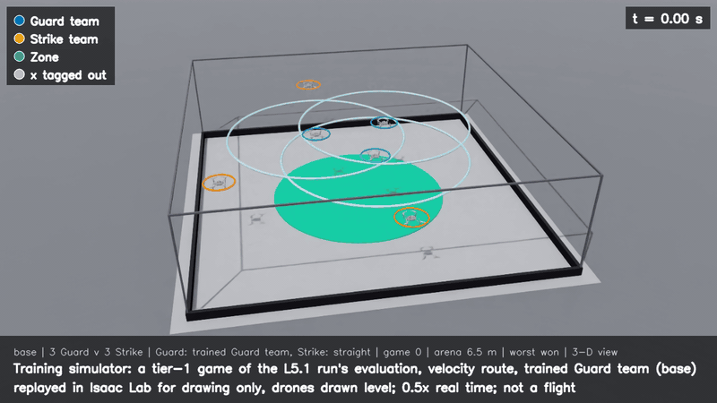
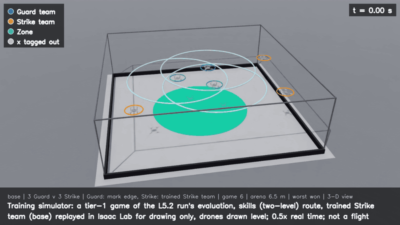
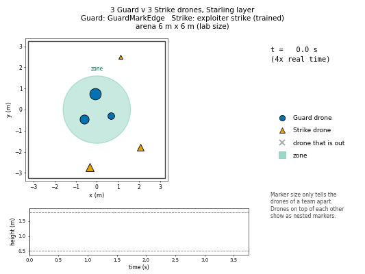

Simulator: training simulator, tier 1 (fast engine; Starling layer: commander copy, safety filter on every pair, fitted PX4 response, exploratory) for every training run, score and read; tier 2 (Isaac Lab 2.3.2 rigid-body Starling) for the L3.1 smoke of scripted-choice replays and for the 3-D drawings; NVIDIA GeForce RTX 5090. Observed in the training simulator; a pipeline check, not for flight.

# 2026-11-25 STE L3-L6 pipeline check record

**DRAFT, two reviewers pending (R22).** Nothing here is reviewed yet. The numbers are copied from the run folders'
own pages (listed per task below); the reader's comparison is quoted as `read.md` states it.

## Purpose

STE tasks L3.1 to L6.2, the pipeline check of the owner's R23 (cap 20 GPU-h, "pipeline check, not for flight"). Spec
`ste_learning/drafts/L3_L6_PIPELINE_SPEC.md`, written and reviewed before any run. Question: for each route (pure
RL "velocity", and the two-level "skills" route of R30), does the whole pipeline work (train, score, export, reload,
every control passing), and how do these two trained policies compare on the same budget, read as INFO (R19, R31, R32).

Run on the RTX 5090 on 25 Nov 2026 (machine clock +08:00), from 02:58 to 04:36. Tier 1 trained and scored every
policy. Tier 2 enters only through the L3.1 smoke of scripted-choice replays and through the 3-D clips (tier-1 games
replayed in Isaac Lab for drawing only).

Titles: the drivers' own pages are titled "L0.12" (the learner's driver, `scripts/ste_exploit_l012.py`, serves L3.x and
L5.x). Task IDs here are the spec's: L3.1 smoke, L3.2 / L3.3 pilots, L3.4 / L3.5 run 0, L4.1 held arm, L4.2 suite,
L5.1 to L5.4 main runs and controls, L6.1 read, L6.2 export.

## Commit

Each run folder's `code.json` names the commit and the diff sha256 `e3b0c44298fc`, the empty diff (clean tree), for
every run that has one:

| Runs | Commit |
|---|---|
| L3.2 and L3.3 pilots | `ec0b926b` |
| L3.4 velocity run 0; L5.1 velocity Guard and Strike; L5.3 velocity pool-only | `0f990ba8` (the fill step) |
| L3.5 skills run 0; L5.2 skills Guard; L5.4 pilot | `f7b4bcf0` |
| L5.2 skills Strike; L5.4 skills pool-only Guard | `8d24c1ba` |
| L6.2 exports (all four `interface.toml`) | `8d24c1ba` |
| L3.1 smoke | no `code.json` in its folder; the development worktree's HEAD at its launch was `ec0b926b` (git log, not a recording of the run) |

The reader's fixes `8c53fcdc` (04:27:19) and `026fc00c` (04:30:26) precede the read of record (launched 04:36:24).

## Config

Four gate files, one template (`configs/ste_l3/`), sha256 of each run's `gates.sha256`, written before the run:

| File | Task | sha256 (first 16) |
|---|---|---|
| `velocity_gates.toml` | L5.1 and L3.4 | `c3c9c84845d65b42` |
| `skills_gates.toml` | L5.2 and L3.5 | `e16e77298833ca1a` |
| `velocity_poolonly_gates.toml` | L5.3 | `0a1314e742cde46f` |
| `skills_poolonly_gates.toml` | L5.4 | `37e7dff182e5bb97` |

The two pilots (L3.2, L3.3) ran before the fill step, under the files' earlier shas (`8d8d5b9e523f1d2e`,
`6c83762d689aa272`); the L5.4 pilot ran under the pool-only file. The skills file carries the run 0 mark
`skills_reach_min = 0.554` (re-set 25 Nov 2026: the rule was pre-registered before the ceiling run and the value 0.554 came from it; see L3.5).

- Game: T44's `configs/ste_l011/base.toml` (3v3, the 1-for-1 nearest-pair tag at 1.6 m, zone 1.6 m), landing off (R32),
  the even filter split (R31), the estimate error off. T44's 1,000 starts and reference (reference sha256
  `4bc5e011071adced368b2a0025fc47499839e0bbc8d8d650207bd12c3da0f8b5`; start set `5aeba7ab2b58`).
- Recipe: T46's (IPPO, per-slot MLP [128, 128], 12-tick decisions), 16,384 games, 550 M game-steps per run on both
  routes (88 updates, 553,648,128 game-steps), pool of every script of the other team except `random` and the
  absent-drone mask on; the pool-only controls without the mask.
- Fill step (pre-registered rule, applied after the pilots): the velocity route's `side_overrides.strike` is the
  shaped Strike recipe (its pilot: no reach in either probe against g*, `guard_mark_edge`, the rule's input, so the shaped fallback by
  default; the probes against `guard_parked_centre` did reach, 0/4, 12/56, 98/190 reaches per update, `pilot.md`); the skills route keeps T41's recipe (probes: 10,819 bare against 11,701 shaped reaches, rule picked the
  T41 recipe). The step budget stays at 550 M.
- Driver `scripts/ste_exploit_l012.py` (training and scoring), `scripts/ste_l3_isaac_smoke.py`,
  `scripts/ste_l3_run0_ceiling.py`, `scripts/ste_l3_held_arm.py`, `scripts/ste_l4_suite.py`,
  `scripts/ste_l6_export.py`, `scripts/ste_l6_read.py`, `scripts/ste_l5_clips3d.py`.

## Model parameter set

Tier 1: `params/real_exploratory_v0.toml` (sha256 `4c93543f51ab41ea5bb0f81e6d1b0512f662a3e10126ec2d85fc3bb008cecaa2`,
from the exports' `interface.toml`), exploratory. The tier-2 smoke and clips use the Isaac Lab rigid-body Starling
(`starling2max.usd`, sha256 `ae57650efa56dfd32b551903c5126fe0219832800b160ab0b92231308b13a1a5`, per `clips3d.json`).

## Seeds

Training 140201 (Strike) and 140202 (Guard); run 0 140203; learning-curve evaluations 140900 (256 games on their own
starts); clips 140950; pool draws 140001. Every score is on T44's 1,000 starts. The same seeds and the same pool draws
in all four gate files.

## Machine

NVIDIA GeForce RTX 5090 (host recorded in each page), torch 2.7.0+cu128, Python 3.11.18, device cuda for training and
for the smoke; the held arm, the suite, the ceiling and its oracle check, the exports and the read ran on the CPU.
The ceiling and its oracle check ran in the worktree `AirStack-starling-max2-run0mark` (branch `l3-run0-mark`); every
other run in `AirStack-starling-max2-dev`.

## Games at once

16,384 games of 3v3 (6 drones per game) for every run of record. The pilots measured 8,192, 16,384 and 32,768. The
smoke played 9,000 games in one Isaac world (1,000 per cell).

## Steps per second

Median game-steps per second at 16,384 games, 6 drones per game, tier 1, RTX 5090, from each run's `results.md`
(drone-steps per second is six times that):

| Run | Game-steps/s | Drone-steps/s |
|---|---|---|
| L5.1 velocity Guard | 652,624 | 3,915,744 |
| L5.1 velocity Strike | 963,681 | 5,782,086 |
| L5.2 skills Guard | 578,824 | 3,472,944 |
| L5.2 skills Strike | 568,879 | 3,413,274 |
| L5.3 velocity pool-only Guard | 667,121 | 4,002,726 |
| L5.4 skills pool-only Guard | 585,228 | 3,511,368 |

The pilots' rates at 16,384 games, Strike / Guard (game-steps/s; `pilot.md` of each):

| Pilot | Strike | Guard |
|---|---|---|
| L3.2 velocity | 978,683 | 858,709 |
| L3.3 skills | 889,946 | 851,667 |
| L5.4 skills pool-only | 897,577 | 709,947 |

Launch condition B1 (the spec's section 1: the skills pilot's rate with dispatch and pool at least 1/2.25 = 0.444 of
the velocity pilot's at the same size): 889,946 / 978,683 = 0.909 (Strike) and 851,667 / 858,709 = 0.992 (Guard), met
(computed for this record from the two pilot pages). The smoke measured the two-level team on Isaac at 2,312,729
game-steps/s against 2,994,698 for one script (ratio 0.772, its page).

## Gates and per-task results

Gates are pass marks written before the run and never moved. Run 0 has a gate. The pilots, the smoke's throughput, the
held arm, the suite's numbers, the exports' differences and the reads (L6.1) have none: INFO. Controls are gated in
every run (a failing control ends the run with exit 6).

| Task | Run folder (`runs/`, dev worktree unless noted) | Exit | Controls | Headline | GPU-h |
|---|---|---|---|---|---|
| L3.1 smoke of the tier-2 skills fixed-choice replay | `2026-11-25_ste_l3_isaac_smoke` | 0 | 6 of 6 PASS | tier 2, 9,000 games in one Isaac world; upsets 0 in every cell; two tier-2 clips (reach); two-level team 2,312,729 v one script 2,994,698 game-steps/s | 0.027 |
| L3.2 velocity pilot | `2026-11-25_ste_l3_pilot_velocity` | 0 | 12 of 12 PASS | rates above; Strike recipe by the rule: shaped (no reach in either probe v g*, the rule's input, by default; the probes v guard_parked_centre did reach) | 0.064 |
| L3.3 skills pilot | `2026-11-25_ste_l3_pilot_skills` | 0 | 10 of 10 PASS | rates above; Strike recipe by the rule: T41 recipe; B1 met | 0.055 |
| L3.4 velocity run 0 (Strike v parked Guard) | `2026-11-25_ste_l3_run0_velocity` | 0 | 9 of 9 PASS | **PASS**: 490/1000 reaches at update 10 of 88 against the threshold 0.416 (the scripted strike_straight's 466, less 0.05; first passing read, L0.12's rule) | 0.027 |
| L3.5 skills run 0 (Strike v parked Guard) | `2026-11-25_ste_l3_run0_skills` | 0 | 10 of 10 PASS | **PASS**: 644/1000 [0.614, 0.673] at the final checkpoint (update 88, 553,648,128 game-steps) against the mark 0.554; best constant choice 604 | 0.284 |
| L3.5 CPU ceiling of the mark, and its oracle check | `AirStack-starling-max2-run0mark`: `2026-11-25_ste_l3_run0_ceiling`, `2026-11-25_ste_l3_run0_oracle` | 0, 0 | 5 of 5 PASS; oracle check PASS | best constant choice `free:strike_low+strike_low+strike_straight` 604/1000 [0.573, 0.634]; mark (604 - 50) / 1000 = 0.554, above the untrained team's upper bound 0.4970 (`MARK_SET`); the oracle check replayed the best and the top 3 choices (604, 603, 601), 0 games differ for each | 0 (CPU) |
| L5.1 velocity Guard | `2026-11-25_ste_l5_velocity_guard` | 0 | 15 of 15 PASS | 903/1000 [0.883, 0.920] against strike_straight; driver word: gain (+0.095 over the best script, guard_mark_edge v strike_straight, 808) | 0.246 (+ 0.017 clips) |
| L5.1 velocity Strike | `2026-11-25_ste_l5_velocity_strike` | 0 | 15 of 15 PASS | 230/1000 [0.205, 0.257] against guard_mark_edge; driver word: weak (learned, not clearly above the script; best script 192) | 0.264 (+ 0.043 clips) |
| L5.2 skills Guard | `2026-11-25_ste_l5_skills_guard` | 0 | 14 of 14 PASS | 813/1000 [0.788, 0.836] against strike_straight; driver word: weak (learned, not clearly above the script; best script 808) | 0.277 (+ 0.016 clips) |
| L5.2 skills Strike | `2026-11-25_ste_l5_skills_strike` | 0 | 14 of 14 PASS | 176/1000 [0.154, 0.201] against guard_mark_edge; driver word: **INCONCLUSIVE: the exploiter did not learn (trained not above untrained)** (untrained 192, best script 192) | 0.284 (+ 0.022 clips) |
| L5.3 velocity pool-only (control), Guard | `2026-11-25_ste_l5_velocity_poolonly_guard` | 0 | 15 of 15 PASS | 889/1000 [0.868, 0.907] against strike_straight; driver word: gain | 0.242 (+ 0.016 clips) |
| L5.4 skills pool-only pilot | `2026-11-25_ste_l54_pilot_skills_poolonly` | 0 | 10 of 10 PASS | rates above; Strike recipe by the rule: T41 recipe (10,557 bare, 11,516 shaped reaches) | 0.057 |
| L5.4 skills pool-only (control), Guard | `2026-11-25_ste_l5_skills_poolonly_guard` | 0 | 14 of 14 PASS | 812/1000 [0.787, 0.835] against strike_straight; driver word: weak (best script 808) | 0.274 (+ 0.024 clips) |
| L6.2 export and reload, four policies | `2026-11-25_ste_l62_export_{velocity_guard,velocity_strike,skills_guard,skills_strike}_r` | 0 each | 1 of 1 PASS each | all four reload in a fresh process under onnxruntime and onnx's reference evaluator, 24 golden rows each (3 slots x 8); largest absolute difference 2.4e-07 and 1.2e-07 (velocity Guard, Strike), 1.9e-06 and 1.4e-06 (skills Guard, Strike) against the tolerance 1e-06 + 1e-06 x max abs golden row; the skills exports' choices, skill lists equal and commands difference 0.0 | 0 (CPU) |
| L4.2 scoring suite on known players | `2026-11-25_ste_l42_suite_r` | 0 | 36 of 36 PASS | status PASS: the pooled row, best single choice and choice share of scripted and untrained teams equal the reference, both routes, both sides | 0 (CPU) |
| L4.1 held-command arm | `2026-11-25_ste_l41_held_arm_r` | 0 | 1 of 1 PASS | no word given; per-cell counts only (`held_arm_results.md`). Headline: the hold-1 control holds in 60 of 60 cells (equal to the reference game for game); for strike_straight held and closed-loop counts are equal in all 5 cells | 0 (CPU) |
| L6.1 per-route reads and the route comparison | `2026-11-25_ste_l61_read_r` (manifest `2026-11-25_ste_l61_manifest.toml`, sha256 `b7b451088250e75593ecbb3e98f703d97dd7bbf98aa003e2bf0b52bf5fec2483`) | 0 | not applicable (the reader refuses on any failed input) | velocity PIPELINE WORKS; skills PIPELINE WORKS; comparison INFO (below) | 0 (CPU) |

Notes on the table:
- Run 0 writes `learner_control.json`, not `results.md`; it is the evidence file for L3.4 and L3.5.
- The "driver word" is the training driver's own word, comparing the trained team in its training-cell opponent
  against the untrained team and the best script. It is a different test from the reader's comparison below.
- The controls column counts the run's controls (its `controls.json`, or for the pilots the `pilot.md` list).

### L3.4 and L3.5: run 0

**Velocity run 0: PASS.** The rule: the trained Strike team against `guard_parked_centre` at least the scripted
strike_straight's 466 less 0.05 (threshold 0.416), read at updates 10 to 88, PASS at the first passing read. It passed
at update 10: 490/1000 [0.459, 0.521] (62,914,560 game-steps, 49 s of training, recipe: the shaped Strike recipe).

**Skills run 0: PASS.** The rule: at least the mark 0.554 at the final checkpoint (update 88), the earlier reads INFO.
The final read: 644/1000 [0.614, 0.673] at 553,648,128 game-steps, against the mark 0.554. The best constant choice of
the two-level Strike team is 604/1000 (`free:strike_low+strike_low+strike_straight`). The nine reads (INFO before the
last):

| Update | 10 | 20 | 30 | 40 | 50 | 60 | 70 | 80 | 88 (decides) |
|---|---|---|---|---|---|---|---|---|---|
| Reaches of 1,000 | 665 | 669 | 667 | 633 | 461 | 620 | 639 | 639 | 644 |

The read at update 50 (461) is below the mark and does not count (INFO by the rule).

The mark was re-set on 25 Nov 2026 from 0.90 (the 1v1 screen's number; in the 3v3 game no constant choice reaches
900). The rule, (best constant choice - 50) / 1000, was pre-registered before the ceiling run; the value 0.554 came from
it (the ceiling page itself shows the gate file's mark at that time as 0.9). The ceiling run and its oracle check are in the table
(`l35_ceiling_results.md`, `l35_oracle_check.json`).

### L3.1: the smoke's six controls, against spec section 4

Tier 2 (Isaac Lab), 1,000 games per cell on T44's first 1,000 starts, 9,000 games in one world; each control ends the
smoke on failure. Values from `results.json` and `controls.json` of the smoke (`l31_isaac_smoke_results.md`):

| Spec section 4 check | Control | Measured |
|---|---|---|
| 1. CUDA replay tolerance (holds and reaches within 10 games of T44's, at most 20 games with another outcome) | `ctl_replay_guard`, `ctl_replay_strike` PASS | 17 cells (8 Guard, 9 Strike): 11 cells with 0 of 1,000 games differing; the 6 mixed-choice cells differ in 2 to 5 games in outcome (largest count gap to T44: 3 holds, 668 v 671 and 866 v 864) |
| 2. Device placement and no host read inside a tick | `ctl_device_placement` PASS | 9 tensors on cuda; 0 host syncs inside the dispatch (choose, command) in the replay batches, measured with torch's CUDA sync debug mode, which the smoke page calls a prototype that does not see every sync |
| 3. Snapshot reload across devices | `ctl_reload_across_devices` PASS | cuda to cpu: largest absolute logit difference 5.96e-08 (tolerance 1e-05), greedy choices equal |
| 4. Two tier-2 clips that play | `ctl_clips` PASS | 2 clips of 2 (games 0 and 1, both a reach) |
| 5. Non-finite and stale | `ctl_nonfinite_stale` PASS | 0 non-finite actions or physics values; stale share 0.0234 of the update's ticks; upsets 0 in every group |
| 6. Throughput (INFO, no gate) | recorded | two-level team 2,312,729 game-steps/s against 2,994,698 for one script (ratio 0.772) |

### L6.2: what the export and reload check does (spec section 5)

From `export.py`'s reload check and `read.json`; the four exports all pass (table above).
- The reload refuses a file whose sha256 differs from the one in `interface.toml`.
- It refuses a file whose schema or status differs; `status = "pipeline check, not for flight"` is written in
  `interface.toml` and in every ONNX file's metadata, and the reload reads both.
- It runs in a fresh Python process (CPU), under onnxruntime and, separately, onnx's reference evaluator.
- The golden rows (8 per slot, so 24 per export) must match within the exporter's tolerance, `1e-06 + 1e-06 * max
  |golden row|` (an absolute plus a relative part; the spec said 1e-06 absolute, and the larger skills outputs, up to
  9.99, make the bound about 1.1e-05).
- For the skills exports each head's argmax, the leader's choice, the flown skill and the skill lists must be equal
  exactly (`choices_equal`, `skill_lists_equal` true), and the final commands, computed from the pinned
  `opponents/scripted.py` (its sha256 is checked), must match within the same tolerance (largest difference 0.0).
- The reader additionally refuses an export whose `source_checkpoint_sha256` is not the sha256 of the run's
  `agent_final.pt`.
- At export, the run's own team (its route loader) equals the golden rows: largest difference 0.00e+00 in all four.

### L5: the six training runs

Each run trained 88 updates, 553,648,128 game-steps, on 16,384 games, with every control PASS. What each driver wrote
(`l5_*_results.md`):

| Run | Trained | Untrained | Best script | Driver word |
|---|---|---|---|---|
| velocity Guard | 903/1000 v strike_straight | 534 | 808 (guard_mark_edge v strike_straight) | gain |
| velocity Strike | 230/1000 v guard_mark_edge | 0 | 192 | weak (learned, not clearly above the script) |
| skills Guard | 813/1000 v strike_straight | 534 | 808 | weak (learned, not clearly above the script) |
| skills Strike | 176/1000 v guard_mark_edge | 192 | 192 | **INCONCLUSIVE: the exploiter did not learn (trained not above untrained)** |
| velocity pool-only Guard | 889/1000 v strike_straight | 534 | 808 | gain |
| skills pool-only Guard | 812/1000 v strike_straight | 534 | 808 | weak (learned, not clearly above the script) |

**The skills Strike run's own driver word** against its training-cell opponent guard_mark_edge is "INCONCLUSIVE: the
exploiter did not learn (trained not above untrained)": 176/1000 [0.154, 0.201], the untrained team 192/1000, the best
script 192/1000. Every one of its 14 controls passed. Beside it, the reader's comparison (below) reports its worst
cell, 0.176 (against guard_mark_edge), against the velocity Strike policy's 0.079 (against guard_field). This record
does not explain the difference.

The velocity Strike run's own driver word is "weak (learned, not clearly above the script)": 230/1000 against
guard_mark_edge, the untrained team 0. The reader's worst cell for this policy is 0.079 against guard_field (the Strike
team table below).

## Comparison and reads (L6.1), INFO, as `read.md` states them

Label INFO. Every read is of **these two trained policies** (one seed each; the intervals cover the sampling of the
starts only). The reader's own header: draft until two independent reviewers have checked it (R22). Numbers below are
copied from `read.md` (full text and `read.json` in evidence), not re-derived.

**Per route:**

| Route | Word | Why |
|---|---|---|
| velocity | **PIPELINE WORKS** | every required task as section 3 of the spec lists it |
| skills | **PIPELINE WORKS** | every required task as section 3 of the spec lists it |

The spec's word asks for the budget reached, every control PASS, the final scoring and the export and reload of each main
run. It does not use the driver's learned or INCONCLUSIVE word, so the skills route reads PIPELINE WORKS beside the skills
Strike run's INCONCLUSIVE driver word.

**Separate reads:**
- Attribution, velocity (L5.3, Guard side; a control, not part of a route's word): pooled row, pool + mask minus pool only: +0.005 [+0.001, +0.009], above.
- Attribution, skills (L5.4, Guard side; a control, not part of a route's word): pooled row, pool + mask minus pool only: +0.002 [-0.003, +0.007], not distinguishable.
- Held-command arm: read (`held_arm_results.md`).

**Guard team** (velocity minus skills; K = 6 opponent cells, 1,000 starts). The headline is the worst cell not among the
cells against strike_high and strike_low (whose response is "vertical response not fitted in tier 1"):

| Policy | Worst cell | Rate [95 %] | Pooled row [95 %] | Against the best single choice |
|---|---|---|---|---|
| velocity | strike_straight | 0.903 [0.883, 0.920] | 0.963 [0.957, 0.970] | +0.076 [+0.062, +0.090] v guard_mark_edge: above |
| skills | strike_straight | 0.813 [0.788, 0.836] | 0.895 [0.883, 0.907] | +0.008 [+0.001, +0.014] v guard_mark_edge: above |

Worst cells, velocity against skills: **above**. The interval of a minimum over K cells is optimistic (biased low, not
adjusted for K). Paired same-cell differences, velocity minus skills:

| Opponent | Difference [95 %] | Word |
|---|---|---|
| strike_straight | +0.090 [+0.063, +0.117] | above |
| strike_flank | +0.094 [+0.074, +0.114] | above |
| strike_high (vertical response not fitted in tier 1) | +0.088 [+0.064, +0.112] | above |
| strike_low (vertical response not fitted in tier 1) | +0.115 [+0.091, +0.139] | above |
| strike_sacrifice | +0.019 [+0.005, +0.033] | above |
| strike_converge | +0.004 [-0.007, +0.015] | not distinguishable |

Pooled row, velocity minus skills: +0.068 [+0.055, +0.082], **above**.

**Strike team** (velocity minus skills; K = 5 opponent cells, 1,000 starts):

| Policy | Worst cell | Rate [95 %] | Pooled row [95 %] | Against the best single choice |
|---|---|---|---|---|
| velocity | guard_field | 0.079 [0.064, 0.097] | 0.373 [0.358, 0.388] | +0.030 [+0.009, +0.050] v strike_low: above |
| skills | guard_mark_edge | 0.176 [0.154, 0.201] | 0.376 [0.359, 0.393] | +0.033 [+0.021, +0.044] v strike_low: above |

Worst cells, velocity against skills: **below**. Paired same-cell differences, velocity minus skills:

| Opponent | Difference [95 %] | Word |
|---|---|---|
| guard_field | -0.126 [-0.147, -0.105] | below |
| guard_mark_edge | +0.054 [+0.019, +0.089] | above |
| guard_parked_centre | +0.005 [-0.029, +0.039] | not distinguishable |
| guard_parked_ring | +0.002 [-0.032, +0.036] | not distinguishable |
| guard_mirror | +0.050 [+0.017, +0.083] | above |

Pooled row, velocity minus skills: -0.003 [-0.022, +0.016], **not distinguishable**.

**Choice shares of the skills policies** (described, not worded; per opponent cell, and by decision index, in `read.md`
and `read.json`):
- skills Strike team: in every Guard cell about 0.43-0.49 of decisions fly strike_flank and 0.51-0.54 strike_low;
- skills Guard team: against strike_converge the share of guard_parked_ring is 0.23 (0.00 in the other five cells).

No claim of adaptation is made here. A share that changes with the opponent on the same starts is the only sign of adaptation
this check can give.

**What the reader cannot show** is in the list below.

## Launch errors and re-launches

Not of record, and not a result (R34's context: a failure of our own launch, not of the policies):
- **The pilot's gate.** The reader's first read (`..._l61_read`, 04:24:03, exit 2) refused the L3.2 pilot: the
  pilot ran before the fill step, so its gate sha (`8d8d5b9e523f1d2e`) differs from the filled file's (`c3c9c84845d65b42`)
  by design. Fixed in commits `8c53fcdc` and `026fc00c`: a pilot under its own gate-file copy equal to the filled file
  except `side_overrides.strike`, `game_steps_per_run` and `skills_reach_min` is read. One reviewer checked the fix.
- **Job folders of L4.1, L4.2 and L6.2.** A trial read with the fixed reader (output in the session's scratch folder,
  not of record) then refused the first L6.2 export: `2026-11-25_ste_l41_held_arm`, `..._l42_suite` and
  `..._l62_export_{velocity_guard,velocity_strike,skills_guard,skills_strike}` (no `_r`) were launched with the job
  folder one level above the script's output (`arm/`, `suite/`, `export/`), and the reader reads `exit_code` beside
  the output. The same commands were re-launched into one folder each (the `_r` folders): CPU only, 0 GPU-h. The
  suite's `suite_check.json` checks, the arm's `results.md` and the four exports' `interface.toml` are byte-identical
  (`cmp`) to those of the first launches. Then the read of record (`..._l61_read_r`) ran.
- No GPU run was repeated, and the unallocated hours were not used (R34's re-run allowance, at most 2 GPU-h, not spent).

## Videos

Every run saves 2-D evaluation GIFs (`videos/`, STANDARDS §8). Each of the six L5 runs also has 3-D clips drawn in
Isaac Lab (`videos3d/`, `clips3d.json`): the worst cell's first game the trained team won, its first game it lost, and
the opponent met most in training. Every 3-D game replays the tier-1 game exactly (outcome, end step, tags, start
positions: 0 mismatches) and is drawn only; **these are tier-1 games, not tier-2 results.** Evidence holds the 2-D GIFs of
each run (`gifs2d/`) and, for two games only, the 3-D GIF (`gifs3d/`).

*L5.1 velocity Guard team v strike_straight, game 0 (a hold; its worst cell, 903/1000), 0.5x real time. Tier 1 game
drawn in Isaac Lab. One game, chosen by the script's fixed rule.*

*L5.2 skills Strike team v guard_mark_edge, game 6 (a reach at 3.8 s, 0.5x real time). This is one of the 176 reaches of
1,000 games in that cell, the first game of the cell the trained team won (the script's fixed rule); it is not typical.
The run's driver word for this cell is INCONCLUSIVE (above).*

*L5.2 skills Strike team, 2-D evaluation game 0 against guard_mark_edge: a reach (the run's own video, 1,000-game
evaluation of the final checkpoint).*

## What this does not show

From the spec (section 3) and `read.md`:
- one seed per route and side: no seed spread; the intervals are over the 1,000 starts only;
- the 1.6 m tag only;
- tier 1 training only; tier 2 only through the scripted smoke (L3.1) and the drawings;
- no flight: nothing here is a flight result, and the exports (`status = "pipeline check, not for flight"`) are not
  flight artefacts. That an onnxruntime or torch runs in the AirStack ground container is UNVERIFIED (the reload
  check does not settle it); flying the skills route needs a 20 Hz port of the scripts (L7, an AirStack change the
  owner gates);
- the estimate error off;
- scripted opponents only (no self-play or league);
- no held-out opponent: every scored script was in the training pool, so adaptation to an unseen opponent is not
  tested;
- today's per-slot MLP and observation v0.1 (not the attention encoder or v0.3);
- a policy without memory or opponent identity (it can adapt only to what it observes);
- the skills route's closed-loop advantage (the held arm, L4.1, measures it for the scripts);
- a 550 M budget, not a budget of record;
- the vertical response is not fitted in tier 1: cells against strike_high and strike_low carry that label;
- a second seed or any other read paid from the unallocated hours would be an added read; none was run;
- this record is DRAFT: two reviewers have not yet checked it.

## GPU-hours

From `~/AirStack-starling-max2/svg_training/runs/shared/gpu_hours.log` (JSON lines, sum of (end - start) / 3600 per
job; the shared ledger). The total below is the sum of the unrounded values, so the rounded rows may add to 2.290.
Tonight's total of L3-L6: **2.291 GPU-h** of the 20 GPU-h cap (R23), the 3-D clip renders included.

| Job | Group | GPU-h |
|---|---|---|
| l3_isaac_smoke | L3.1 | 0.027 |
| l3_pilot_velocity | L3.2 | 0.064 |
| l3_pilot_skills | L3.3 | 0.055 |
| l3_run0_velocity | L3.4 | 0.027 |
| l3_run0_skills | L3.5 | 0.284 |
| l5_velocity_guard | L5.1 | 0.246 |
| l5_velocity_strike | L5.1 | 0.264 |
| l5_skills_guard | L5.2 | 0.277 |
| l5_skills_strike | L5.2 | 0.284 |
| l5_velocity_poolonly_guard | L5.3 | 0.242 |
| l54_pilot_skills_poolonly | L5.4 | 0.057 |
| l5_skills_poolonly_guard | L5.4 | 0.274 |
| training runs, pilots, smoke and run 0 (subtotal) | | 2.102 |
| clips3d_velocity_guard | L5.1 | 0.017 |
| clips3d_velocity_strike | L5.1 | 0.043 |
| clips3d_skills_guard | L5.2 | 0.016 |
| clips3d_skills_strike | L5.2 | 0.022 |
| clips3d_velocity_poolonly_guard | L5.3 | 0.016 |
| clips3d_skills_poolonly_guard | L5.4 | 0.024 |
| l5_clips3d_smoke, l5_clips3d_smoke_strike (test renders of the clip script) | L5.1 | 0.017, 0.034 |
| 3-D clip renders (subtotal) | | 0.189 |
| **total** | | **2.291 of the 20 cap** |

Not counted: `l26_clips_t2` (0.008, group L2.6, the tier-2 clips of task L2.6 that ran the same night; it belongs to
T71's task). The CPU runs (L3.5 ceiling and oracle check, L4.1, L4.2, L6.1, L6.2) used 0 GPU-h.
By task cap (spec section 1), L3.1 to L5.4 used 2.291 of the 11.4 total of the caps; the unallocated 8.6 GPU-h were not used.

## Evidence

In `records/evidence/2026-11-25_ste_l3_l6_pipeline/` (byte copies of the run folders' files; they hold the
workstation's absolute paths, as earlier records' evidence does):
- `read.md`, `read.json`, `l61_manifest.toml`; `suite_check.json`; `held_arm_results.md`;
- `l31_isaac_smoke_results.md`; `l32_pilot_velocity_pilot.md`, `l33_pilot_skills_pilot.md`,
  `l54_pilot_skills_poolonly_pilot.md`;
- `l3_run0_velocity_learner_control.json`, `l3_run0_skills_learner_control.json` (run 0 writes no `results.md`);
- `l35_ceiling_results.md`, `l35_oracle_check.json`;
- `l5_{velocity_guard,velocity_strike,skills_guard,skills_strike,velocity_poolonly_guard,skills_poolonly_guard}_results.md`;
- `exports/{velocity_guard,velocity_strike,skills_guard,skills_strike}_interface.toml`;
- `gifs2d/<run>/` (the 2-D evaluation GIFs of each L5 run, of both run 0s and of the smoke);
- `gifs3d/` (two 3-D GIFs and their `clips3d.json`).

Run folders (not in git): `runs/2026-11-25_ste_l3_*`, `..._l41_*`, `..._l42_*`, `..._l5_*`, `..._l54_*`, `..._l61_*`,
`..._l62_*` in the dev worktree, and the ceiling and its oracle check in the run0mark worktree.
