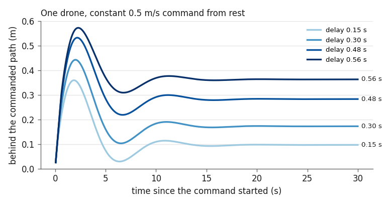

INTERNAL · result page of the STE learning track, task L0.14 "Crazyflie route check" ([PLAN](PLAN.md) §4; written 21 Nov 2026). It feeds the fleet question P13 at gate G0 ([DISCUSSION](DISCUSSION_2026-11-19_20.md) §2.16). INFO only: no gate, no verdict. Record: [2026-11-21_ste_l014_crazyflie_route_record.md](../records/2026-11-21_ste_l014_crazyflie_route_record.md). Every number was observed in the training simulator or in the Crazyflie repository's offline planner; nothing here is a flight result, and nothing was flown.

# Crazyflie route check

The lab has two Starlings and many Crazyflies. The question for gate G0 is whether the game could be flown on the
Crazyflies, at Starling sizes (the same 1.10 m filter distance, speeds and zone), and what that would need. This page has
three parts:

1. **Does the STE Guard policy cope with a slower drone?** The policy (T41) is scored in its own game with a later drone
   response beside the Starling's.
2. **Which team sizes fit which arena** at the 1.10 m filter distance, from the Crazyflie repository's offline planner.
3. **What a Crazyflie session would build**: a specification only.

Terms: *T41* is the STE Guard policy (3 Guard drones, trained against NUS's Strike policy *S20*;
[record](../records/2026-11-19_nus_phase5_pilot_p1b_run4_record.md), [recipe](../docs/TRAIN_A_GUARD.md)). *Tier 1* is
the fast training simulator. The *hangar game* is the game T41 was trained and scored in (Phase 4 row 5: the safety
filter on every pair of drones, height free, NUS's hangar in metres). A *hold* is a game the Guard team wins.

> **Results in short** (details and limits below):
> 1. **Slower drone:** with every drone in the game (both teams) made about as late as the logged Crazyflie (delays
>    0.48–0.56 s; at the Guard team's 0.33 m/s the drone trails its path by 0.51–0.59 s, the logged Crazyflie by
>    0.54–0.60 s), T41 held 791 and 768 of 1,000 games against 831 with the Starling's response. Guard and Strike drones
>    came closer than 1.0 m in 101 and 149 games instead of 7, and in 2 and 1 games under 0.50 m, the game's contact
>    distance.
> 2. **Arena fit, like for like:** in the 6.5 m square the Crazyflie planner found 0 of 100 matches with a solver
>    emergency at 3v3 and 0 of 100 at 5v3, where DISCUSSION §2.16 (20 Nov) reports 5 of 100 each (Fisher p ≈ 0.06 for
>    each pair: not a clear difference); and 0 of 100 at 5v3 with lag 0.15 s, where 20 Nov reports 3 of 100. Every
>    other case had 0 too (2,868 matches in all, but 788 of them barely met and 800 reuse the same seeds). Only the
>    planner's `tag` rules and hand-set start marks were run; the 20 Nov rules and marks were not recorded, and the
>    rule set matters (the positive control fires only under the `pressure` rule sets (`pressure`, `zone_pressure`)).
> 3. **What a Crazyflie session would build:** one adapter core, a golden fixture, a rule plug-in (specified, not built).

## Plan (written before the runs, 21 Nov 2026)

**Part 1.**

- **Game**: T41's own hangar game, exactly as in its record: T41 plays its mean actions, one decision per 12 ticks
  (0.6 s), against S20; the Phase 4 paired starts; T41's evaluation seed 1101, opponent seed 1303. Run on the CPU.
- **Games**: all 1,000 paired starts, T41's own count (256 games took 7 minutes on the CPU, so 1,000 per cell fit).
  A second evaluation seed changes nothing: 32 games with seed 1102 gave the same 32 outcomes as seed 1101 (the starts
  are fixed and both players are deterministic). So this is one policy, one opponent, 1,000 starts; "seeds" do not apply.
- **Slower drone**: tier 1's Starling model (`params/real_exploratory_v0.toml`, fitted to one real flight, EXPLORATORY)
  already delays every setpoint it gets by `[px4] delay_s` = 0.148 s. The cells change that one number: 0.148 s (the
  Starling, the reference), 0.30 s, 0.48 s and 0.56 s. 0.48 s is chosen so that tier 1's drone trails a 0.5 m/s command
  by 0.567 s, as the logged Crazyflie trails its setpoint (step probe below, measured before any game ran); 0.56 s is
  the Crazyflie's number used as a delay. *Corrected 21 Nov after QC:* at the Guard team's 0.33 m/s the two trail by
  0.51 s and 0.59 s, so the Crazyflie-like case is the 0.48–0.56 s band, not one cell (Part 1 results). Each cell uses a copy of the file with that line changed, written into the
  run folder; the game reads it through its existing `starling.params` setting. No default and no code of the game or
  the drone model changes.
- **Not a Crazyflie model.** The logged Crazyflie trails its setpoint by about 0.56 s under its default controller (the
  Crazyflie repository's `docs/details/guard-design-notes.md`); a Crazyflie flies other dynamics too. A pure delay is the
  simplest way to make the same drone late. The planner's own stand-in, a first-order lag, was not run in tier 1.
- **How late each cell really is**: one drone flies a constant 0.5 m/s command from rest for 30 s; the page reports how
  far it trails the commanded path, in seconds, averaged over 20–30 s (settled).
- **Proof that nothing else changed**: the default path and a copy of the file at 0.148 s play the same 16 games for
  600 ticks; every output must match bit for bit, or the run stops before any cell.
- **What is compared**: hold rate with Wilson 95 % interval; games lost and gained against the Starling cell, start by
  start; closest Guard–Strike approach; share of games with an opposite pair inside 1.10 m; filter share; game length.
- **Two limits, known in advance.** The delay applies to every drone, S20's included (an all-Crazyflie game), so a hold
  rate that stays up does not isolate the Guard. The copy of CMU's commander keeps the Starling's leashes (0.5 m and
  0.2 m). A delay for one team only would need code in the game; it is not built (an open question below).

**Part 2.**

- **Planner**: `plan_guard` from `~/CrazySwarm2-with-Mocap_Strike-and-Guard` at commit `637c534`, copied into a scratch
  folder and run from there (that repository is read-only for this track); its `git status` is checked before and after.
- **The 20 Nov commands were not recorded.** They are rebuilt from the list in DISCUSSION §2.16: 1.10 m sphere, speeds
  0.33 m/s (Guard) and 0.5 m/s (Strike), lag 0.6 s, height band 0.5–1.8 m, 100 matches per case, the planner's seeds 0–99.
- **Arenas**: a 6.5 m square (the Starling fence's size; a square room written as the planner's arena file); the
  planner's own circle option at 3.25 m (the circle inside that square); the Crazyflie room as surveyed (about
  10.4 × 9.9 m).
- **Marks**: the planner's own start marks are refused at 1.10 m in the 3.25 m circle at every size and in the 6.5 m
  square at 3v3 and 5v3 (`pre_run_checks/planner_own_marks.txt`), so every case uses the same
  hand-set marks round the protected point at the room centre: Guards evenly on a 1.4 m ring (just outside the protected
  point's keep-out), Strikes on a 2.75 m ring (the STE game's Strike start ring), each Strike half-way between two Guard
  bearings, all on one side.
- **Strategies and rules**: the planner's default pairing (defence `shell`, attack `coordinated`) for 100 matches;
  every built-in defence against every built-in attack (16 pairings × 6 seeds) in the square and the room; the planner's
  `tag` rules (an attacker within 1.15 m of a defender for 1.1 s is downed) with the strike radius set to the STE zone
  radius, 1.6 m. *Changed 21 Nov after a stopped first launch:* the plan first kept the planner's own strike radius,
  2.4 m. The Strikes start 2.75 m from the protected point, only 0.35 m outside it, and scored quickly (mean match 2.6 s, 1v1 in
  the square: 0 defence wins in 100, closest pair 3.29 m), so the launch was stopped after 1v1 and 2v1 and restarted at
  1.6 m. The stopped run is kept (`arena_fit_STOPPED_strike_radius_2.4`).
- **Not the STE game's tag**: the planner's tag needs 1.1 s within 1.15 m, a 5 cm band outside the 1.10 m filter
  distance; the STE study tag (1.6 m, PROPOSED) is a different rule. The planner's protected point also keeps every drone
  1.2 m away from the zone centre, which the STE game does not.
- **Reported**: matches with at least one solver-emergency tick (apart from every other safety failure), the closest
  pair in metres against 1.10 m, defence wins. The planner's own SAFE verdict uses the Crazyflie's 0.35 m floor and is
  not the Starling's distance.
- **Repeat at the Starling's lag**: 5v3 in the 6.5 m square at lag 0.15 s.
- The marks and pairings are fixed here, before the runs; they are not tuned to reproduce the 20 Nov counts.

**Follow-up, added 21 Nov after the sweep, before running it.** The sweep found no solver emergency in any case, where
20 Nov found them in 5 of 100 matches at 3v3 and 5v3 in the 6.5 m arena. To locate the difference, one change at a time
from the sweep, marks unchanged, 3v3 and 5v3, the square and the room, seeds 0–99, default pairing:
(a) the after-match finale flown, as `plan_guard` does by default (its emergencies are counted with the match's);
(b) the planner's own strike radius, 2.4 m. Each is run once and reported as it comes out.

## Part 1 results: the STE Guard policy with a slower drone

**With every drone made about as late as a Crazyflie (the 0.48–0.56 s band), T41 still held 791 and 768 of 1,000
games against 831 with the Starling's response; but a Guard drone and a Strike drone came closer than 1.0 m in 101 and
149 games instead of 7, and under 0.50 m (the game's contact distance) in 2 and 1, as close as 0.31 m (3-D).** Observed in
the training simulator, CPU, one policy, one opponent, every drone slowed (both teams).


*T41 v S20 on the 1,000 Phase 4 paired starts, one tier 1 drone model per column. The hold rate falls by 4 to 6 points
at the Crazyflie-like delays; games with an opposite pair closer than 1.0 m rise from 7 to 101 and 149.*

| Delay (s) | Trails a path at 0.5 / 0.33 m/s by (s) | Holds of 1,000 | Wilson 95 % | Lost / gained v 0.15 s | Games closer than 1.10 m / 1.0 m / 0.50 m | Closest (m, 3-D) | Filter share | Mean game end (tick) |
|---|---|---|---|---|---|---|---|---|
| 0.148 (Starling) | 0.19 / 0.18 | **831** | [0.807, 0.853] | — | 198 / 7 / 0 | 0.85 | 33.5 % | 2,035 |
| 0.30 | 0.35 / 0.33 | 822 | [0.797, 0.844] | 35 / 26 | 260 / 31 / 0 | 0.71 | 33.7 % | 2,012 |
| **0.48** (Crazyflie-like band) | **0.57 / 0.51** | **791** | [0.765, 0.815] | 77 / 37 | 305 / **101** / **2** | **0.39** | 32.7 % | 1,946 |
| **0.56** (Crazyflie-like band) | **0.73 / 0.59** | **768** | [0.741, 0.793] | 106 / 43 | 315 / **149** / **1** | **0.31** | 32.3 % | 1,890 |

*Games closer than*: games in which a Guard drone and a Strike drone came closer than that distance (3-D) at least
once: 1.10 m is the flight filter's distance; 1.0 m is the hangar game's own keep-out (its "rule breach" measure, the one
T41's record reports as 0.005); 0.50 m is the game's contact distance ("a crash in flight"). Counted from `per_game.npz`
by the figure script. *Trails*: the step probe at the Strike team's 0.5 m/s and the Guard team's 0.33 m/s
(`response/step_probe_two_speeds.json`); the logged Crazyflie trails by 0.54–0.60 s (near 1 m/s). At 0.5 m/s part of the
gap is distance lost once while the drone speeds up (likely the fitted acceleration limit and the commander's 0.5 m
leash; not isolated), so the 0.33 m/s column is the steadier measure. *Filter share*: share of live drone-ticks the safety filter changed. A game lasts up to 2,400
ticks (120 s).



*The step probe behind the "trails" column: the settled gap divided by the speed. Every cell also falls up to 0.57 m
behind while speeding up, because the fitted Starling response is slow to accelerate.*

**Checks.**
- **Nothing else changed (C-1, PASS):** the default path and a copy of the parameter file at the fitted delay gave equal
  outputs, bit for bit, over 16 games and 600 ticks (outcomes, end ticks, closest approaches, rule breaches, filter
  shares, final positions and speeds). Each derived file was reloaded and differs from the base in `[px4] delay_s` only.
- **Every game finished, no non-finite action (C-2, PASS).**
- **The Starling cell agrees with T41's own score:** 831 of 1,000 on the CPU against 829 of 1,000 on the GPU in T41's
  record (Wilson intervals overlap; CPU and GPU arithmetic differ slightly, so equality is not expected). The closest
  approach (0.85 m against 0.87 m) and the games closer than 1.0 m (7 against 5 of 1,000) are close too.
- The second evaluation seed gives the same games (Plan), so the counts come from one deterministic set of 1,000 starts.

**What this shows, and what it does not.**
- T41's hold rate survives a Crazyflie-like lag in this game, 4 to 6 points down across the 0.48–0.56 s band. Read start by start the drop is
  real, not noise: of the 114 games that changed, 77 were lost and 37 gained (exact sign test p = 0.0002; at 0.30 s,
  35 against 26, p = 0.31, no clear change).
- The safety picture changes more than the score. Tier 1's filter changes each drone's velocity command from where the
  drones are now (the ramped stick, before the commander forms its setpoint: `models/fitted.py`, step 2, the place
  where CMU's commander calls its filter); a later drone carries out that command later, so pairs likely come closer
  than the filter allows. The cause is not tested here. In a game where the Guard team blocks by being in the way, that
  is the concern for any slower platform.
- Not isolated: S20's drones are slowed too, so part of the change may be S20's. A delay for one team only needs code
  in the game (not built; an option for G0, below).
- Not a Crazyflie: a pure delay on a Starling model, with CMU's commander copy and its leashes; the Crazyflie's own
  engine shapes commands differently (part 3). A tier 1 model fitted to Crazyflie logs needs the 6 Nov flight logs,
  which are not on this machine.

Run folder: `runs/2026-11-21_ste_l014/response/` (`results.json`, `per_game.npz`, the four derived parameter files);
4,570 s on the laptop CPU, 4 threads, shared with another job; code at `15f32606` plus this task's uncommitted files.

## Part 2 results: team sizes and arenas at 1.10 m

**Like for like, in the 6.5 m square: 0 of 100 matches with a solver emergency at 3v3 and 0 of 100 at 5v3, where
DISCUSSION §2.16 (20 Nov) reports 5 of 100 each; and 0 of 100 at 5v3 with lag 0.15 s, where 20 Nov reports 3 of 100.**
0 against 5 in 100 gives Fisher p ≈ 0.06 (0 against 3: p ≈ 0.25): not a clear difference. Both results stand side by
side. Every other case had no emergency either and no other safety check failed: 2,868 matches in all, of which 788
(1v1 and 2v1 in the small arenas, 1v1 in the room) barely met, and the 800 follow-up matches reuse the sweep's seeds
(400 of them, finale on, replay the same matches up to the result). Only the planner's `tag` rules and the hand-set
start marks were run. The 20 Nov set-up was not recorded, so the difference is not located: two of the unrecorded
differences (the finale, the planner's strike radius) did not bring the emergencies back; the rule set and the marks
are not yet tested, and the rule set matters (the positive control below fires only under the `pressure` rule sets (`pressure`, `zone_pressure`)). The lead appends a dated note beside §2.16 (the record is append-only); recovering the 20 Nov
commands from the home RTX 5090 is an optional follow-up (lead's ruling, 21 Nov).


*The planner's default pairing, 100 matches per bar. Left: no emergency anywhere. Right: in the larger teams most
matches bring two stand-in aircraft a few centimetres inside 1.10 m (closest pairs in the table below).*

| Guards v Strikes | Arena | Matches | Guard wins | Emergency | Closest pair (m) | Inside 1.10 m | Mean match (s) |
|---|---|---|---|---|---|---|---|
| 1v1 | 6.5 m square | 100 | 0 | 0 | 2.50 | 0 | 4.2 |
| 2v1 | 6.5 m square | 100 | 0 | 0 | 1.47 | 0 | 4.1 |
| 3v3 | 6.5 m square | 100 | 99 | 0 | 1.06 | 91 | 13.4 |
| 5v3 | 6.5 m square | 100 | 100 | 0 | 1.06 | 99 | 10.3 |
| 1v1 | 3.25 m circle | 100 | 0 | 0 | 2.50 | 0 | 4.3 |
| 2v1 | 3.25 m circle | 100 | 0 | 0 | 1.27 | 0 | 4.3 |
| 3v3 | 3.25 m circle | 100 | 99 | 0 | 1.06 | 81 | 9.8 |
| 5v3 | 3.25 m circle | 100 | 100 | 0 | 1.07 | 96 | 6.9 |
| 1v1 | Crazyflie room | 100 | 0 | 0 | 2.50 | 0 | 8.3 |
| 2v1 | Crazyflie room | 100 | 99 | 0 | 1.09 | 85 | 9.0 |
| 3v3 | Crazyflie room | 100 | 100 | 0 | 1.07 | 54 | 16.9 |
| 5v3 | Crazyflie room | 100 | 100 | 0 | 1.07 | 98 | 15.4 |
| 5v3, lag 0.15 s | 6.5 m square | 100 | 100 | 0 | 1.08 | 100 | 9.1 |

Every case: the planner's default pairing, seeds 0–99, lag 0.6 s unless stated, strike radius 1.6 m. *Inside 1.10 m*:
matches whose closest airborne pair came closer than the filter distance. *Guard wins* are the planner's own game
(its tag and strike rules), not the STE game.

Other cases, all with 0 emergencies and 0 other failures:

| Cases | Matches | Closest pair (m) | Inside 1.10 m | Guard wins |
|---|---|---|---|---|
| Every built-in defence v every built-in attack (16 pairings × seeds 0–5), each size, 6.5 m square | 4 × 96 | 1.02–2.32 | 0, 0, 68, 91 (1v1 to 5v3) | 0, 0, 60, 94 |
| The same in the Crazyflie room | 4 × 96 | 1.02–1.58 | 0, 23, 49, 92 | 0, 48, 61, 94 |
| Follow-up (a): finale flown, 3v3 and 5v3, square and room | 4 × 100 | 1.05–1.06 | 95, 100, 66, 100 | 99, 100, 100, 100 |
| Follow-up (b): strike radius 2.4 m, 3v3 and 5v3, square and room | 4 × 100 | 1.06–1.07 | 80, 100, 55, 98 | 74, 100, 100, 100 |

**Positive control: the emergency counter does fire on this machine.** The planner's own command-line matrix at the
Crazyflie's settings with its keep-out widened to 0.60 m (`plan_guard --matrix --rules all --seeds 4 --tau 0.6 --set
d_cc=0.60`, the case its design notes report as moving the problem into solver emergencies) flagged 2 of 80 cells, both
under the `pressure` rule sets; re-run alone (`--rules pressure --defense hunter --attack flood --seeds 4 --no-finale`),
seed 1 had a solver emergency on 4 ticks. So the zero above is a measurement, not a dead counter. This task ran only
the planner's `tag` rules; the 20 Nov rule set is not recorded either.

**What this shows, and what it does not.**
- At the 1.10 m filter distance the planner found every size safe on its own terms in every arena tried, including
  eight drones in the 6.5 m square. Its safety terms are the Crazyflie's: a 0.35 m hard floor, its own solver.
- 1v1 and 2v1 in the small arenas test little: the Strike drone scores in about 4 s and passes the Guard drones at
  1.27–2.50 m. "Clean" there means the drones barely met.
- The matches are short (4–17 s) because the planner's tag removes Strike drones within seconds; the STE game runs up
  to 120 s with a 1-for-1 tag, so its drones stay close for longer.
- In 3v3 and 5v3, most matches bring two aircraft to 1.02–1.09 m. The cause is not tested: the lag is not enough on its
  own (at lag 0.15 s, 100 of 100 matches still come to 1.08 m), and the planner also counts tagged drones while they
  descend.
- The marks are hand-set (Plan); other marks, or a strategy that crowds the walls more, may behave differently.

Provenance: Crazyflie repository commit `637c534`, its `git status` empty before and after every run (checked by the
driver, `repo_untouched: true`); the planner package copied to a scratch folder (sha256 `40d2d953b56eec7e…` of the
copy); Python 3.12.3, numpy 2.4.6, scipy 1.17.1, pyyaml 6.0.1 (the system interpreter). Run folders:
`runs/2026-11-21_ste_l014/arena_fit/` (21 cases, 652 s) and `…/arena_fit_followup/` (8 cases, 891 s), with one JSON per
case holding every match.


## Part 3: what a Crazyflie session would build (specification)

Nothing is written in the Crazyflie repository in this task. A later session, inside that repository and under its own
rules, would build three things; this track would supply the third's data. The Crazyflie engine already takes outside
strategies and rule sets from any importable module (`--policy-module` for the planner, `policy_module:=` for the show),
so none of this edits its package.

**1. One adapter core** (one `Policy` subclass for the Guard team; about 150 lines, estimate from DISCUSSION §2.16).
Each engine tick (20 Hz, the same as tier 1's 0.05 s tick) it gets the engine's `View` and returns a velocity request per
active Guard drone. It has three pieces:

| Piece | What it must do | Where it is defined here |
|---|---|---|
| Observation builder | Turn the `View` into the 71 numbers of interface v0.1 for each Guard drone, in the same order and units: own position from the zone centre (x, y) and own height; own velocity; sine and cosine of yaw; zone radius, arena half side, time left (s); team (−1); alive; 8 slots (5 Guard slots, then 3 Strike slots) of relative position, relative velocity and a present flag; the zone centre from the arena centre. A drone that is out is absent (zeros), never re-slotted. Velocities must be measured (from motion capture) for every drone: the `View` gives a team's own drones their last *command*, which tier 1 never did | `core/observations.py` `build_obs`; T41's `interface.toml` `[observation]` |
| Decision hold | Ask the networks once every 12 ticks (0.6 s), starting at the first tick, and repeat the answer in between, all Guard drones on the same schedule | `nus/pilot.py` `HeldStrategy`; T41 record ("one decision per 12 ticks") |
| Action scaling | Guard drone k is played by network k (T41 has one network per slot, so it plays exactly 3 Guard drones and must refuse any other count); apply the saved observation scaler without updating it; take the mean action, clamp to [−1, 1]; cap the velocity part at length 1, then multiply by the Guard speed (0.33 m/s); drop the yaw rate (the engine takes velocities only) | `opponents/learned.py` `SkrlPolicyStrategy`; T41's `interface.toml` `[action]` |

Frames: the Crazyflie world frame is ROS (x, y, z up), the same handedness as tier 1's world ENU; the game square and
the zone are placed in it by the adapter's settings (zone centre, arena half side), with no rotation unless the room
needs one. The engine then caps the request at the team speed and its own acceleration limit and passes it through its
own safety filter. That shaping differs from tier 1's copy of CMU's commander (ramp, leash): a known difference, named
here, not hidden.

**2. A state-to-observation golden fixture.** A small committed file, made in `svg_training` by `core/observations.py`
(the source of truth), with a handful of hand-set game states: 3 Guard drones and 3 Strike drones, one Strike drone out,
the zone off the arena centre, a non-zero yaw, some time left. Each record holds the drones' positions, velocities, yaws
and alive flags, the zone and arena, the 71 numbers expected for each Guard drone, and T41's mean actions for them. The
Crazyflie session's test builds a `View` from the same states and must reproduce the 71 numbers (to 1e-6) and the
actions (to 1e-5): this checks the observation builder, the slot order, the scaler and the network loading in one go.
The fixture belongs to interface v0.1; a layout change raises the version (STANDARDS §3) and makes a new fixture.

**3. The rule plug-in.** A `Rules` subclass in the same outside module, the STE study tag of L0.9: a Guard drone and a
Strike drone whose centres are closer than the tag radius (1.6 m, PROPOSED, P1) are both out, nearest pair first, each
drone in at most one tag per tick; a Strike drone wins by reaching the zone (horizontal distance to the zone centre
inside the zone radius); the Guard team wins when time runs out. In the engine's terms: both teams downable, a down rate
that fills the meter in one tick for the drones of a matched pair, a strike rate on horizontal distance. The engine asks
for each team's rates separately, so the plug-in must compute the same pairing from positions in both calls. About
20–30 lines (estimate, DISCUSSION §2.16). The engine already refuses a tag radius inside its filter distance; 1.6 m is
outside 1.10 m. Filter option B (P2) is a separate change to that repository's safety layer and stays the owner's
ruling.

**What it needs from outside the adapter**: the engine's Starling-metre settings (filter distance 1.10 m as a sphere,
speeds 0.33 / 0.5 m/s, height band 0.5–1.8 m: the overrides used in part 2), a game fence smaller than the room, the
protected point's 1.2 m keep-out removed or shrunk (the STE zone has no object at its centre), and a mapping from drone
names to slots. Before any flight: the planner run with the adapter and T41 over many seeds
(`plan_guard --policy-module`), then that repository's own flight steps.

## What gate G0 reads (lead's ruling, 21 Nov 2026)

Both kinds of number, each labelled for what it is:

| Number | Where | What it measures |
|---|---|---|
| The planner's SAFE verdict | part 2 | no two stand-in aircraft inside the Crazyflie's own hard floor (0.35 m across, 0.62 m up and down), no solver emergency, no wall or band breach, no backstop |
| Matches whose closest pair came inside 1.10 m | part 2 | the Starling's flight-filter distance, measured on the planner's stand-in aircraft |
| Games closer than 1.10 m, 1.0 m and 0.50 m | part 1 | a Guard–Strike pair inside the flight-filter distance, the hangar game's keep-out, and the game's contact distance ("a crash in flight"), in tier 1 |

## Options for P13 (the fleet question at gate G0)

Listed plainly; the recommendation is the lead's to add.

| Option | What these results say about it |
|---|---|
| All Starlings: the 1v1 only, as planned | Two Starlings cannot show 2v1, 3v3 or 5v3, nor play on after a tag (DISCUSSION §2.16). Part 1's Starling cell is T41's own game |
| All Crazyflies at Starling metres (1.10 m, the same speeds and zone), and the Starling 1v1 as planned | Part 2: the Crazyflie planner found every size from 1v1 to 5v3 free of solver emergencies at 1.10 m, in the 6.5 m square and the Crazyflie room, under the planner's `tag` rules and hand-set marks (0 of 100 at 3v3 and at 5v3 in the square, beside 20 Nov's 5 of 100 each: not a clear difference). Part 1: one Starling-trained policy kept most of its score with every drone (both teams) at a Crazyflie-like lag in tier 1, but Guard–Strike pairs came closer than 1.0 m in 10–15 % of games (1–2 games under 0.50 m); whether one policy file serves both drones stays open (DISCUSSION §2.16). Part 3 lists the build |
| That, plus one mix later (Starling Guards against Crazyflie Strikes) | Not tested here. DISCUSSION §2.16: downwash unmeasured, no filter between the two stacks today, two drone models in one game |
| A Crazyflie-sized game with its own training | Not tested here. DISCUSSION §2.16: under that repository's separation floors and a second training programme |

Two pieces of work that would sharpen the Crazyflie options, for the owner to choose at G0 (neither is started; lead's
ruling, 21 Nov):

- **A Crazyflie response fitted from the 6 Nov flight logs**, as a tier 1 parameter set of its own (STANDARDS §5
  rules 4–5); it needs those logs on the training workstation.
- **A per-team delay setting** in the game (a new setting, off by default, bit-identical when off), to see whether the
  close passes come from the Guard team's lag, the Strike team's, or both.

## Open questions

1. **Recover the 20 Nov planner commands** on the home RTX 5090 (weekday, optional), to locate the difference between
   20 Nov's 5 of 100 and today's 0 of 100 (3v3 and 5v3, 6.5 m square; not a clear difference, Fisher p ≈ 0.06). Known
   so far: the finale and the 2.4 m strike radius are not it; only the `tag` rules and hand-set marks were run at
   1.10 m; the counter fires under the `pressure` rule sets, so the rule set matters.

## Reproduce

```bash
cd ~/AirStack-starling-max2-l14/svg_training; unset PYTHONPATH
# part 1 (CPU, about 75 min; needs scripts/nus_install_provisional.sh for configs/local and the T41 run folder)
CUDA_VISIBLE_DEVICES="" OMP_NUM_THREADS=4 MKL_NUM_THREADS=4 PYTHONPATH=source \
  ~/miniconda3/envs/env_isaaclab/bin/python scripts/ste_l014_response_check.py --run-dir runs/<date>_ste_l014/response
# part 2 (the planner's own interpreter; the work folder must be outside the Crazyflie repository; about 11 + 15 min)
/usr/bin/python3 -B scripts/ste_l014_arena_fit.py --run-dir runs/<date>_ste_l014/arena_fit --work-dir <scratch>/l014_planner
/usr/bin/python3 -B scripts/ste_l014_arena_fit.py --run-dir runs/<date>_ste_l014/arena_fit_followup \
  --work-dir <scratch>/l014_planner_followup --kind followup
# figures (from the two result files)
~/miniconda3/envs/env_isaaclab/bin/python scripts/make_ste_l014_figures.py \
  --response runs/<date>_ste_l014/response/results.json --arena runs/<date>_ste_l014/arena_fit/arena.json
```

Settings: [configs/ste_l014.toml](../configs/ste_l014.toml). Tests: `tests/test_ste_l014.py`.
