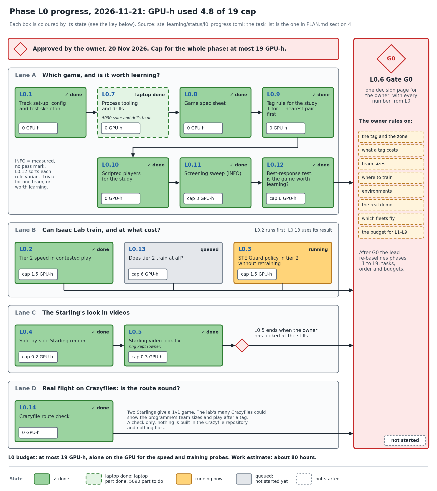
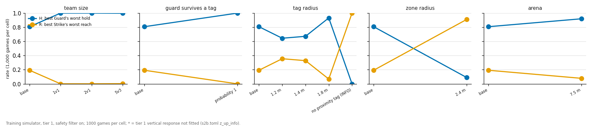
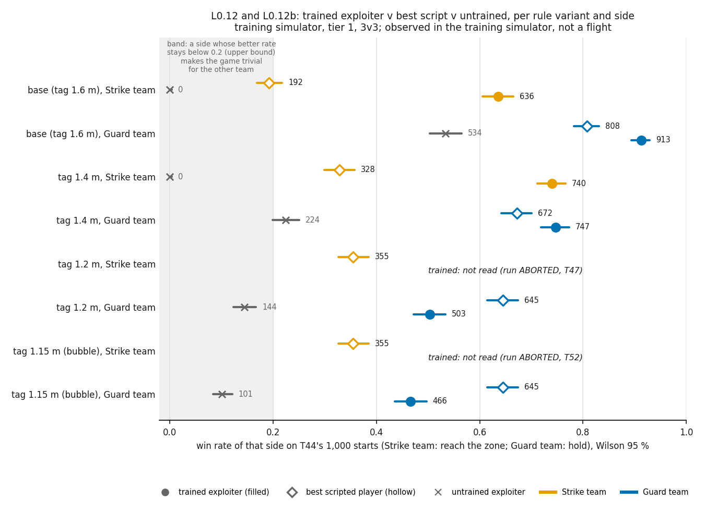
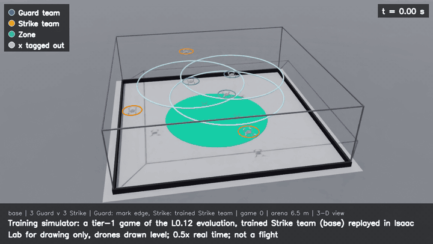
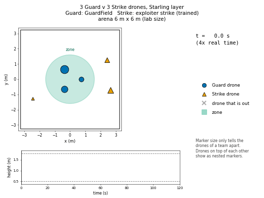
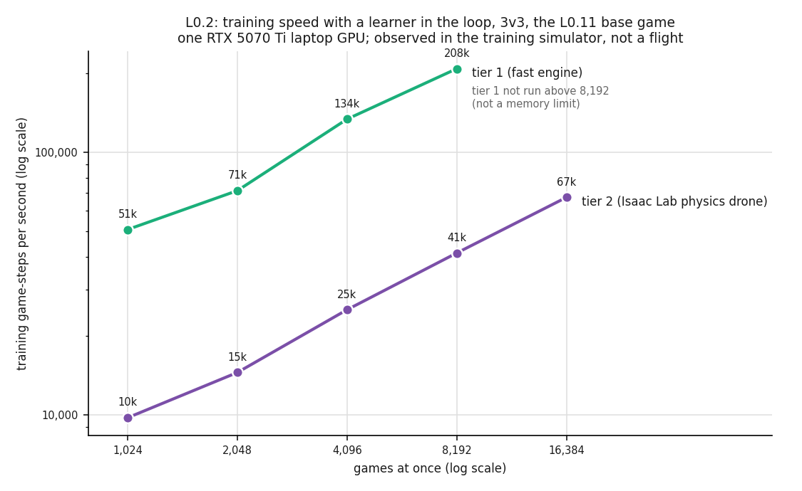
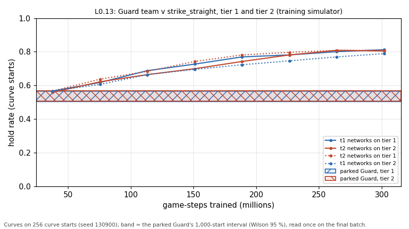

INTERNAL · the decision page of gate G0, the end of phase L0 of STE's learning track ([PLAN](PLAN.md) §5, task L0.6). DRAFT of 21 Nov 2026, written from the committed records; the lead walks the owner through it before the ruling. Every number was observed in the training simulator (or, for the Crazyflie check, in the Crazyflie repository's offline planner); nothing here is a flight result, and nothing was flown.

# Gate G0: what to decide at the end of phase L0

Terms used on this page. *Tier 1*: the fast training simulator. *Tier 2*: Isaac Lab with the Starling as a physics drone.
*Scripts*: hand-written players. *Trained team*: a team trained against the best script of the other side (one
training seed per side). *Hold*: the Guard team wins; *reach*: a Strike drone reaches the zone. *Tag distance*: how close a
Guard drone must come to a Strike drone to tag it (both drones leave the game: 1-for-1). *Filter*: the flight software's
safety filter, which keeps every pair of drones 1.10 m apart.

## What phase L0 found

L0 asked which game to train, whether it is worth learning, and whether Isaac Lab can train it. The game is worth
learning at tag distances of 1.6 m and 1.4 m: trained teams beat the best scripts on both sides. At 1.2 m, and at 1.15 m, the tag
the drones can really make (just outside the filter's 1.10 m bubble), the scripts give a two-sided game (Guards hold
645 of 1,000, Strikes reach 355: [T44](../records/2026-11-21_ste_l011_screen_record.md), [T50](../records/2026-11-21_ste_l012b_screen_record.md)), but the trained Guards were still below the scripts and still improving when their
budget ran out, and both trained Strike runs stopped one or two updates short. Isaac Lab trains as well as the fast engine on the one
task tried, at about 5× the cost per game-step ([T53](../records/2026-11-21_ste_l013_tier2_trains_record.md)). Team sizes other than 3v3, including the two-Starling 1v1, were only
screened with scripts, and there a good scripted Guard team wins almost every game.

> **What the lead recommends** (items marked DRAFT are the writer's draft for the lead to confirm before the walk-through)
> 1. **Run the longer 1.15 m trainings before ruling the tag** (lead, [status](status/STATUS_LATEST.md)): about 3.5–4 GPU-h (est.); it is the cell that completes the tag argument.
> 2. DRAFT: rule the tag after (1); 1.4 m is the closest tag at which training beat the scripts on both sides.
> 3. DRAFT: keep 1-for-1 tags, the 1.6 m zone, the 6.5 m arena with the 2.75 m Strike start ring, and 3v3 as the training size.
> 4. DRAFT: keep D3 (train in Isaac Lab; tier 1 for quick experiments) and budget tier 2 at about 5× tier 1 per game-step.
> 5. Fleets: Crazyflies first at Starling metres, the Starling 1v1 as planned, the mix later (lead, [DISCUSSION §2.16](DISCUSSION_2026-11-19_20.md#216-real-flight-on-starlings-crazyflies-or-a-mix-owner-20-nov)); the drone demo: proximity tag, physical intercept in simulation only (owner's proposal, [§11](DISCUSSION_2026-11-19_20.md#11-owner-decisions-and-a-lead-correction-21-nov-2026)).
> 6. L1–L9 budget: no committed figure yet; the lead states one before the walk-through.

**Phase L0 by task.** Green is done; L0.7 is done on the laptop, its RTX 5090 part is open; L0.6 is this page. The
"9.9 GPU-h" in the title is the status's figure; the records add up to 8.93 GPU-h ([budget](#6-budget-used)); the lead
reconciles the two.

## 1. The decisions

Evidence strength, one label per row: **trained, both sides** (a trained Guard team and a trained Strike team were each
scored against the best script); **trained, one side**; **scripted screen only**; **not tested in L0**. Records:
[T44](../records/2026-11-21_ste_l011_screen_record.md) screen, [T45](../records/2026-11-21_ste_l014_crazyflie_route_record.md)
Crazyflie check, [T46](../records/2026-11-21_ste_l012_best_response_record.md) and
[T47](../records/2026-11-21_ste_l012_tag_1p2_strike_record.md) best response,
[T48](../records/2026-11-21_ste_l02_speed_record.md) speed, [T49](../records/2026-11-21_ste_l03_transfer_record.md)
transfer, [T50](../records/2026-11-21_ste_l012b_screen_record.md), [T51](../records/2026-11-21_ste_l012b_best_response_record.md)
and [T52](../records/2026-11-21_ste_l012b_tag_1p15_strike_record.md) bubble tag, [T53](../records/2026-11-21_ste_l013_tier2_trains_record.md)
Isaac Lab trains. Counts are of 1,000 games on the same starts.

| # | Decision | What L0 measured | Evidence strength | Lead's recommendation | Still open |
|---|---|---|---|---|---|
| 1 | **Tag distance** (P1; [section 2](#2-the-tag-rule)). Options (PLAN §5): a distance L0.12 found worth learning; no proximity tag; a larger zone | see rows 1a–1e | — | DRAFT: rule after the longer 1.15 m runs (row 2); 1.4 m if a ruling is needed now | P1 overturns the FIXED row "the main game has no tag" ([GAME_SPEC](GAME_SPEC.md)) |
| 1a | tag 1.6 m (base) | scripts: Guards hold 808, Strikes reach 192 ([T44](../records/2026-11-21_ste_l011_screen_record.md)); trained Guard team 913 v 808, trained Strike team 636 v 192 ([T46](../records/2026-11-21_ste_l012_best_response_record.md)) | trained, both sides | — | up to 27 % of a scripted cell's tags were filter pushes ([T50](../records/2026-11-21_ste_l012b_screen_record.md)) |
| 1b | tag 1.4 m | scripts 672 / 328 ([T44](../records/2026-11-21_ste_l011_screen_record.md)); trained Guard team 747 v 672, trained Strike team 740 v 328 ([T46](../records/2026-11-21_ste_l012_best_response_record.md)) | trained, both sides | — | the Guard gain is against the low Strike, whose height response tier 1 does not fit; against the straight Strike 673 v 701, no gain ([T46](../records/2026-11-21_ste_l012_best_response_record.md)) |
| 1c | tag 1.2 m | scripts 645 / 355; trained Guard team 503 v 645 ([T46](../records/2026-11-21_ste_l012_best_response_record.md)); Strike run ABORTED ([T47](../records/2026-11-21_ste_l012_tag_1p2_strike_record.md)) | trained, one side | — | Guards still rising at the budget's end ([DISCUSSION §11](DISCUSSION_2026-11-19_20.md#11-owner-decisions-and-a-lead-correction-21-nov-2026)); not re-run (owner, 21 Nov) |
| 1d | tag 1.15 m ("touch the bubble": filter 1.10 m + 0.05 m) | scripts 645 / 355 ([T50](../records/2026-11-21_ste_l012b_screen_record.md)); trained Guard team 466 v 645 ([T51](../records/2026-11-21_ste_l012b_best_response_record.md)); Strike run ABORTED ([T52](../records/2026-11-21_ste_l012b_tag_1p15_strike_record.md)) | trained, one side | — | Guards still rising at the budget's end; trained Strike side unread |
| 1e | no proximity tag (filter only; today's FIXED rule) | best scripted Guards hold 0: a scripted Strike team reaches the zone in every game ([T44](../records/2026-11-21_ste_l011_screen_record.md), INFO cell) | scripted screen only | — | not trained |
| 2 | **Longer 1.15 m runs** (pending owner question) | — (new runs: one Guard, one Strike, 3× the training, about 1.65 B game-steps each) | not tested in L0 | **yes** (lead, [status](status/STATUS_LATEST.md)); about 3.5–4 GPU-h (est.), within the 19 GPU-h cap | the owner's answer |
| 3 | **Varied tag distance in training** | nothing: every run trained at one tag distance | not tested in L0 | no committed recommendation | named only in the status's list of G0 items; what "varied" means (range, per game or per stage) is not written down |
| 4 | **What a tag costs** (D2 revisit, `guard_survives_tag_prob`) | Guard survives (1): best scripted Guards hold 1,000 ([T44](../records/2026-11-21_ste_l011_screen_record.md)). 1-for-1 (0): every scripted hold a full trade, no tag-on game ran to the clock ([T44](../records/2026-11-21_ste_l011_screen_record.md)); against a trained Strike team 37 of 364 holds ran to the clock at 1.6 m ([T46](../records/2026-11-21_ste_l012_best_response_record.md)) | 1-for-1: trained, both sides (1.6 and 1.4 m); survive: scripted screen only | DRAFT: keep 1-for-1 (0) | no value between 0 and 1 run; survive 1 at the 1.6 m tag only |
| 5 | **Zone size** (P12) | zone 2.4 m: best scripted Guards hold 89 ([T44](../records/2026-11-21_ste_l011_screen_record.md)), a game the Strike team wins with scripts; a second change rode along (run-in from the start ring 0.35 m instead of 1.15 m) | scripted screen only | DRAFT: keep 1.6 m | tag-before-zone tie decides 33 of 808 base holds ([follow-ups](../docs/notes/2026-11-21_ste_l011_followups.md)); zone not varied at 1.15 m |
| 6 | **Team size 3v3** | every trained run was 3v3 ([T46](../records/2026-11-21_ste_l012_best_response_record.md), [T51](../records/2026-11-21_ste_l012b_best_response_record.md), [T53](../records/2026-11-21_ste_l013_tier2_trains_record.md)) | trained, both sides (1.6, 1.4 m) | DRAFT: 3v3 as the training size | 3v3 is NUS's size, not one of the programme's (2v1, 5v3) |
| 7 | **Team sizes 1v1, 2v1, 5v3** (P9; [section 3](#3-1v1-the-two-starling-demo-size)) | best scripted Guards hold 1,000 / 1,000 / 998 ([T44](../records/2026-11-21_ste_l011_screen_record.md)). Crazyflie planner, 6.5 m square, 100 matches per size: 0 solver emergencies at every size, but a pair came inside 1.10 m in 91 (3v3) and 99 (5v3) ([T45](../records/2026-11-21_ste_l014_crazyflie_route_record.md); planner `tag` rules and hand-set marks only; 20 Nov runs gave 5 of 100 emergencies at 3v3 and 5v3) | scripted screen only | DRAFT: none ruled as a main size until one is trained | screened at the 1.6 m tag only; no size other than 3v3 trained; whether eight drones fit the 6.5 m arena ([DISCUSSION §2.16](DISCUSSION_2026-11-19_20.md#216-real-flight-on-starlings-crazyflies-or-a-mix-owner-20-nov)) |
| 8 | **Arena size and Strike start ring** (F8, L08-F1) | 6.5 m arena with the 2.75 m ring: every trained run. 7.5 m with the 3.2 m hangar ring: best scripted Guards hold 920 ([T44](../records/2026-11-21_ste_l011_screen_record.md)), two changes at once | 6.5 m: trained, both sides; 7.5 m: scripted screen only | DRAFT: 6.5 m lab arena, 2.75 m ring (both PROPOSED in [GAME_SPEC](GAME_SPEC.md)) | arena and ring effects not separated |
| 9 | **Where to train** (D3; [section 4](#4-where-to-train)). Options (PLAN §5): everything on Isaac Lab; or the league on tier 1 with fine-tuning and evaluation on Isaac Lab, each with its GPU-hours | Isaac Lab about 5× slower per game-step ([T48](../records/2026-11-21_ste_l02_speed_record.md)); T41 holds 856 on Isaac Lab v 831 on tier 1 ([T49](../records/2026-11-21_ste_l03_transfer_record.md)); Isaac Lab trains: 832 v 836 ([T53](../records/2026-11-21_ste_l013_tier2_trains_record.md)) | trained, one side (Guard team, one seed) | DRAFT: keep D3 (owner, 20 Nov: train in Isaac Lab, tier 1 for quick experiments) | GPU-hours per option not yet worked out; physics check 0.0166 m of a 0.02 m limit, a larger world may fail it |
| 10 | **Environments** (P10) | nothing: every L0 game is the open arena | not tested in L0 | DRAFT: open arena first, construction-site world as a later phase (PLAN §5 option 1) | the parent FIXED rule asks for realistic 3-D worlds |
| 11 | **Which fleets fly** (P13) | T41 holds 831 at the Starling's lag, 791 and 768 at Crazyflie-like lags; games closer than 1.0 m 7 → 101 and 149, under 0.50 m (contact) 0 → 2 and 1 ([T45](../records/2026-11-21_ste_l014_crazyflie_route_record.md)); the planner at 1.10 m: 0 solver emergencies in 2,868 matches (788 barely met; `tag` rules and hand-set marks only), pairs inside 1.10 m in most 3v3 and 5v3 matches | scripted screen only (closest label: planner players, plus T41 re-scored with a delay, not trained for it) | Crazyflies first at Starling metres; Starling 1v1 as planned; mix deferred (lead, [DISCUSSION §2.16](DISCUSSION_2026-11-19_20.md#216-real-flight-on-starlings-crazyflies-or-a-mix-owner-20-nov)) | one policy file for both drones or one each; the 6 Nov Crazyflie logs not on the workstation ([CRAZYFLIE_ROUTE](CRAZYFLIE_ROUTE.md#options-for-p13-the-fleet-question-at-gate-g0)) |
| 12 | **The real demo** (P11). Options (PLAN §5): a learned 1v1; a scripted 1v1; team play shown in the AirStack simulator only | 1v1 at the 1.6 m tag: best scripted Guards hold every game ([T44](../records/2026-11-21_ste_l011_screen_record.md)); two Starlings cannot play on after a tag ([DISCUSSION §2.16](DISCUSSION_2026-11-19_20.md#216-real-flight-on-starlings-crazyflies-or-a-mix-owner-20-nov)) | scripted screen only | PLAN §13 planned answer: a scripted 1v1 on the drones, learning shown in simulation; owner's proposal: proximity tag measured by motion capture, same rule in simulation ([§11](DISCUSSION_2026-11-19_20.md#11-owner-decisions-and-a-lead-correction-21-nov-2026)) | 1v1 never tried at 1.15 m |
| 13 | **Physical-intercept study** (proposal) | nothing run | not tested in L0 | owner's proposal ([§11](DISCUSSION_2026-11-19_20.md#11-owner-decisions-and-a-lead-correction-21-nov-2026)): in simulation only, a strategy layer hands over to a terminal intercept at the tag distance | a real intercept needs other hardware and a flight-safety decision; phase and budget not set |
| 14 | **L1–L9 budget** | Isaac Lab: 302 M game-steps cost 1.29 GPU-h v 0.24 on tier 1 ([T53](../records/2026-11-21_ste_l013_tier2_trains_record.md)); L0 used 8.93 of 19 GPU-h ([section 6](#6-budget-used)) | trained, one side (cost of one Guard run) | no committed figure; PLAN §9 is OPEN | PLAN §9: version 1 guessed about 60 GPU-h; the review expects tier 2 from scratch to cost 3–10× that |
| 15 | **0.6 s decision period** (L011-F1) | scripts decide every 0.05 s, learners every 0.6 s; scripts held 0.6 s barely change: 808 → 793, 645 → 645, 695 → 693; exception low Strike at 1.4 m 672 → 738 ([follow-ups](../docs/notes/2026-11-21_ste_l011_followups.md)) | scripted screen only | DRAFT: keep 0.6 s for learners (PROPOSED in [GAME_SPEC](GAME_SPEC.md), T41's value) | every trained-v-script comparison carries this difference |
| 16 | **L0.7's RTX 5090 part** (L07-5090) | laptop: full test suite 1,420 passed, wake-up and resume drills as expected ([status](status/STATUS_LATEST.md)) | not tested in L0 (5090 part) | DRAFT: defer to the first 5090 session; close L0 on the laptop part | 5090 checks TEST-F2b and L09-5090 wait for the same session |

**Scripted screen, one factor at a time** ([T44](../records/2026-11-21_ste_l011_screen_record.md)). Blue: the best
scripted Guard team's worst-case hold rate; orange: the best scripted Strike team's worst-case reach rate. Only tag
1.2 m and 1.4 m leave both teams a real chance; other sizes, a surviving Guard and the 7.5 m arena favour the Guard team;
a 2.4 m zone and no tag favour the Strike team. Scripts only, 1.6 m tag unless shown.

## 2. The tag rule

The main decision. The figure shows, for each tag distance and side, the trained team (filled dot), the best script
(hollow diamond) and an untrained team (cross).

**Trained v scripted, per tag distance.** At 1.6 m and 1.4 m the trained team (dot) beats the best script (diamond) on
both sides. At 1.2 m and 1.15 m the trained Guard team stays below the script; the trained Strike runs stopped short and
are not read. Tier 1, 3v3, 1,000 starts. Same L0.12 points alone: [best_response.png](../docs/figures/ste_l012/best_response.png).

| Tag distance | Scripts: Guards hold / Strikes reach | Trained Guard team v best script | Trained Strike team v best script | Evidence strength | Tags the filter pushed (tag's tick only) |
|---|---|---|---|---|---|
| none (filter only) | 0 / 1,000 ([T44](../records/2026-11-21_ste_l011_screen_record.md), INFO) | not trained | not trained | scripted screen only | — |
| 1.8 m | 932 / 68 ([T44](../records/2026-11-21_ste_l011_screen_record.md)) | not trained | not trained | scripted screen only | not measured |
| 1.6 m (base) | 808 / 192 | **913** v 808 ([T46](../records/2026-11-21_ste_l012_best_response_record.md)) | **636** v 192 | trained, both sides | up to 27 % per cell; 8,814 of 81,948 overall ([T50](../records/2026-11-21_ste_l012b_screen_record.md), replay of T44's 1.6 m cells) |
| 1.4 m | 672 / 328 | **747** v 672 (v straight Strikes 673 v 701) | **740** v 328 | trained, both sides | not measured |
| 1.2 m | 645 / 355 | 503 v 645 (untrained 144) | ABORTED ([T47](../records/2026-11-21_ste_l012_tag_1p2_strike_record.md)) | trained, one side | not measured |
| 1.15 m (bubble) | 645 / 355 ([T50](../records/2026-11-21_ste_l012b_screen_record.md)) | 466 v 645 (untrained 101) ([T51](../records/2026-11-21_ste_l012b_best_response_record.md)) | ABORTED ([T52](../records/2026-11-21_ste_l012b_tag_1p15_strike_record.md)) | trained, one side | 0–10 % per cell; 629 of 64,325 overall; trained Guard team 0 of 2,263 ([T50](../records/2026-11-21_ste_l012b_screen_record.md), [T51](../records/2026-11-21_ste_l012b_best_response_record.md)) |

What the numbers say, and what they do not:

- **1.6 m and 1.4 m are worth learning on both sides** (the trained gains' intervals clear the scripts'). The 1.4 m Guard
  gain is measured against the low Strike, a script whose height response tier 1 does not fit.
- **1.2 m and 1.15 m: slower to learn within the budget, not shown unlearnable.** The trained Guard teams learned (far
  above the untrained 144 and 101) but ended below the script. Their learning curves were still climbing at the last
  update: 47 → 108 and 38 → 105 holds of 256 curve starts, against 156 → 234 and levelling off at 1.6 m
  ([DISCUSSION §11](DISCUSSION_2026-11-19_20.md#11-owner-decisions-and-a-lead-correction-21-nov-2026); curve reads use
  256 curve starts, not the scoring starts, so they do not compare with the 1,000-start scores above).
- **At the 1.15 m bubble, almost no tag is a filter push on the tag's own tick** (0–10 % per scripted cell, 0 of 2,263
  for the trained Guard team). Earlier ticks are not measured. The share is higher at 1.6 m (up to 27 % per cell), where
  the filter's 1.10 m bubble sits well inside the tag distance (finding L010-G0).
- **How the trained Strike team wins at 1.6 m** (lead's reading of one 2-D clip,
  [base_trained_strike_game0_reach](../docs/media/ste_l012/base_trained_strike_game0_reach.gif); no control run): it climbs to the 1.8 m
  height limit over Guards at 1.2 m, trades two drones, and the last one waits and slips in; median game 7.5 s against
  2.4 s for the scripts ([T46](../records/2026-11-21_ste_l012_best_response_record.md)).
- **ABORTED Strike runs** (information only, [section 7](#7-aborted-runs-information-only)): at 1.2 m and 1.15 m the
  trained Strikes mostly wait out the 120 s clock.

> **Pending owner question: longer 1.15 m runs.** One Guard and one Strike run at 3× the training (about 1.65 B
> game-steps each), caps sized from the 1.15 m timings so neither stops short: about 3.5–4 GPU-h (est., from the
> [status](status/STATUS_LATEST.md)). This is the cell that completes the argument: it says whether training beats the
> scripts at the 1.15 m tag, the one the drones can really make. The lead recommends yes; the owner decides.

| Tag 1.6 m: trained Strike team reaches the zone (3-D) | Tag 1.6 m: trained Guard team holds (3-D) |
|---|---|
|  |  |
| Trained Strikes v mark-edge Guards, game 0 of [T46](../records/2026-11-21_ste_l012_best_response_record.md): reach at 6.1 s (636 reaches of 1,000). Faint circle = each Guard's tag distance. Tier 1 game replayed in Isaac Lab for drawing; not a flight. | Trained Guards v straight Strikes, game 0 of [T46](../records/2026-11-21_ste_l012_best_response_record.md): hold at 2.5 s, 3-for-3 tags, no Guard left (913 holds of 1,000). Tier 1 game replayed in Isaac Lab for drawing; not a flight. |

| Tag 1.15 m: trained Guard team holds (2-D) | Tag 1.15 m: ABORTED trained Strike run, game to the clock (2-D) |
|---|---|
|  |  |
| Trained Guards v straight Strikes, game 2 of [T51](../records/2026-11-21_ste_l012b_best_response_record.md): hold at 2.8 s. Over 1,000 games 466 holds, below the script's 645. Top view with height panel; tier 1, not a flight. | ABORTED run [T52](../records/2026-11-21_ste_l012b_tag_1p15_strike_record.md), proves nothing: two pairs trade, the last Strike waits outside the zone until the 120 s clock ends. Tier 1, not a flight. |

More clips: tag 1.4 m trained players in 3-D ([docs/media/ste_l012/3d](../docs/media/ste_l012/3d/README.md)); scripted
1.2 m games in 3-D ([docs/media/ste_l011/3d](../docs/media/ste_l011/3d/README.md), drawn before the tag circles); all
1.15 m clips ([docs/media/ste_l012b](../docs/media/ste_l012b/README.md)). No 3-D clip exists yet at 1.15 m or 1.2 m for
trained players.

## 3. 1v1: the two-Starling demo size

| Size | Best scripted Guards hold | Best scripted Strikes reach | Source |
|---|---|---|---|
| 1v1 | 1,000 (mark-edge, mirror and field Guards each hold all 1,000 against every Strike script) | 0 | [T44](../records/2026-11-21_ste_l011_screen_record.md), [results table](../docs/figures/ste_l011/results_2026-11-21_ste_l011_screen.md) |
| 2v1 | 1,000 | 0 | [T44](../records/2026-11-21_ste_l011_screen_record.md) |
| 5v3 | 998 | 2 | [T44](../records/2026-11-21_ste_l011_screen_record.md) |

At 1v1, the size two Starlings can fly, a good scripted Guard wins every game at the 1.6 m tag: the game is
Guard-trivial with scripts. Only the parked Guards lose games (a Guard parked at the centre loses all 1,000 to Strikes
flying high or low). Nothing was
trained at 1v1, and 1v1 was not screened at 1.15 m. Two Starlings also cannot play on after a tag: AirStack's land
command lands every drone ([DISCUSSION §2.16](DISCUSSION_2026-11-19_20.md#216-real-flight-on-starlings-crazyflies-or-a-mix-owner-20-nov)).
No 1v1 clip exists.

## 4. Where to train

| Question | Number | Record | Limits |
|---|---|---|---|
| How fast does each tier train? | 3v3, laptop GPU: tier 1 51k–208k, Isaac Lab 10k–67k game-steps/s (1,024 to 8,192 / 16,384 games at once); Isaac Lab 4.9–5.3× slower at 3v3, 4.1× at 5v3, 7.2× at 2v1, 9.8× at 1v1 | [T48](../records/2026-11-21_ste_l02_speed_record.md) | one update per point; laptop only |
| Does a tier-1 policy work on Isaac Lab? | T41 holds 856 on Isaac Lab v 831 on tier 1 (paired: lost 51, gained 76) | [T49](../records/2026-11-21_ste_l03_transfer_record.md) | one policy, one opponent, one start set; no general claim |
| Does Isaac Lab train? | PASS: 832 holds (parked Guards 538) v 836 on tier 1 at the same 302 M game-steps; each run's networks score within 22 games on the other tier; 1.29 v 0.24 GPU-h | [T53](../records/2026-11-21_ste_l013_tier2_trains_record.md) | one seed, one opponent, Guard team only |
| Is the physics check safe at scale? | 0.0166 m of a 0.02 m limit at 16,384 games (0.0036 m at 1,024 games in T48) | [T53](../records/2026-11-21_ste_l013_tier2_trains_record.md) | rises from 1,024 to 3,000 games, cause not separated; a larger world (for example on the 5090) may fail it |

| Training speed, both tiers | Isaac Lab and tier 1 learn alike |
|---|---|
|  |  |
| Game-steps per second against games at once, 3v3, laptop GPU ([T48](../records/2026-11-21_ste_l02_speed_record.md)). Tier 1 is about 5× faster at 3v3. | Hold rate during training, each run on its own tier and on the other ([T53](../records/2026-11-21_ste_l013_tier2_trains_record.md)); read on 256 curve starts, so the ends sit near 0.79–0.81, not at 832 / 836. |

T41 on both tiers, with the parked-Guard control: [transfer.png](../docs/figures/ste_l03/transfer.png).

## 5. Other findings reported at G0

Findings only; the recommendations are in [section 1](#1-the-decisions).

| ID | Finding | Source |
|---|---|---|
| L011-G0 | With scripts every hold is a one-for-one trade: no tag-on game ran to the clock, and at 1v1 and 3v3 a hold leaves no Guard, so head-count decides. Against trained Strike teams some holds do run to the clock (37 of 364 at 1.6 m, 1 of 260 at 1.4 m) | [T44](../records/2026-11-21_ste_l011_screen_record.md), [T46](../records/2026-11-21_ste_l012_best_response_record.md) |
| L010-G0 | The filter can push a pair into tag distance (a tag nobody chose), because its 1.10 m bubble is inside the tag distance. On the tag's tick: 0–10 % per cell at 1.15 m, up to 27 % at 1.6 m | [T50](../records/2026-11-21_ste_l012b_screen_record.md) |
| L011-F1 | Scripts decide every 0.05 s, learners every 0.6 s (row 15) | [follow-ups](../docs/notes/2026-11-21_ste_l011_followups.md) |
| Tier drift | One played game drifts 0.26 m apart between the tiers within 20 ticks, though the physics agree to 0.0028 m on recorded inputs; compare tiers as rates over 1,000 games, not game by game (cause: lead's reading, no control run) | [T49](../records/2026-11-21_ste_l03_transfer_record.md) |
| Out of memory | Isaac Lab's out-of-memory path was never exercised (nothing ran out of memory) | [T48](../records/2026-11-21_ste_l02_speed_record.md) |
| L07-SUSPEND | A laptop sleep during a GPU job would count as GPU-hours; rule in force: never sleep during a GPU job. No L0 run was suspended (each record says so) | [status](status/STATUS_LATEST.md) |
| L07-5090, L09-5090, TEST-F2b | Machine checks that run on the RTX 5090 only; waiting for its next session | [status](status/STATUS_LATEST.md) |
| Crazyflie route | Open: why 20 Nov's planner runs showed 5 of 100 emergencies and 21 Nov's 0 of 100 (not a clear difference); a Crazyflie response fit; a per-team delay setting | [CRAZYFLIE_ROUTE](CRAZYFLIE_ROUTE.md#open-questions) |

## 6. Budget used

| Task | Cap (PLAN §4) | GPU-h used | Record |
|---|---|---|---|
| L0.11 Screening sweep | 3 | 0.426 (sweep 0.305, pilot 0.034, smoke 0.087) | [T44](../records/2026-11-21_ste_l011_screen_record.md) |
| L0.12 Best-response test | 6 | 3.372 (pilot 0.178, run 0 0.061, five runs, the ABORTED 1.2 m Strike run 0.659) | [T46](../records/2026-11-21_ste_l012_best_response_record.md), [T47](../records/2026-11-21_ste_l012_tag_1p2_strike_record.md) |
| L0.12b Bubble tag | about 1.3 beyond L0.12's cap (owner, 21 Nov) | 1.589 (screen 0.200, run 0 and Guard 0.619, ABORTED Strike 0.770) | [T50](../records/2026-11-21_ste_l012b_screen_record.md), [T51](../records/2026-11-21_ste_l012b_best_response_record.md), [T52](../records/2026-11-21_ste_l012b_tag_1p15_strike_record.md) |
| L0.2 Tier 2 speed | 1.5 (1.4 set before the run) | 0.389 (run 0.294, smokes 0.095) | [T48](../records/2026-11-21_ste_l02_speed_record.md) |
| L0.13 Does tier 2 train? | 6 | 1.590 (tier 1 0.237, tier 2 1.289, smokes 0.063) | [T53](../records/2026-11-21_ste_l013_tier2_trains_record.md) |
| L0.3 Guard policy on tier 2 | 1.5 (1.4 set before the run) | 1.281 (run 1.240, smoke 0.041) | [T49](../records/2026-11-21_ste_l03_transfer_record.md) |
| L0.4 Starling render | 0.2 | 0.028 | [status](status/STATUS_LATEST.md) (no record) |
| L0.5 Video look, with the 3-D clips | 0.3 | 0.258 | [status](status/STATUS_LATEST.md) (no record) |
| L0.1, L0.7–L0.10, L0.14 | 0 | 0 | — |
| **Phase L0** | **19** | **8.93** | sum of the rows above; the status and the progress chart say 9.9 |

The longer 1.15 m runs (row 2) would add about 3.5–4 GPU-h (est.): about 12.9 of 19 on the records' sum.

## 7. ABORTED runs (information only)

An ABORTED run proves nothing: it stopped before its budget, so no side reading is taken from it. Both stopped because
the time cap left too little reserve for the final batch.

| Run | Stopped at | Seen in its evaluation (information only) | Re-run? |
|---|---|---|---|
| Trained Strike team, tag 1.2 m ([T47](../records/2026-11-21_ste_l012_tag_1p2_strike_record.md)) | update 87 of 88 | 114 reaches v 355 for the script; 786 of 1,000 games ran to the 120 s clock | no (owner, 21 Nov) |
| Trained Strike team, tag 1.15 m ([T52](../records/2026-11-21_ste_l012b_tag_1p15_strike_record.md)) | update 86 of 88 | 103 reaches v 355; 771 of 1,000 games ran to the clock | folded into the longer-runs question (row 2) |

Sources for this page: [PLAN §5](PLAN.md#5-gate-g0-what-the-owner-rules-with-l0s-numbers),
[GAME_SPEC](GAME_SPEC.md), [DISCUSSION §3 and §7–11](DISCUSSION_2026-11-19_20.md#3-decisions),
[status](status/STATUS_LATEST.md), [CRAZYFLIE_ROUTE](CRAZYFLIE_ROUTE.md), the records linked above
([ledger](../records/LEDGER.md)).
