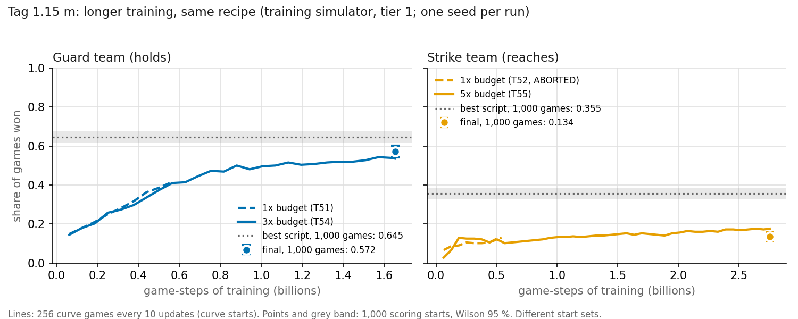
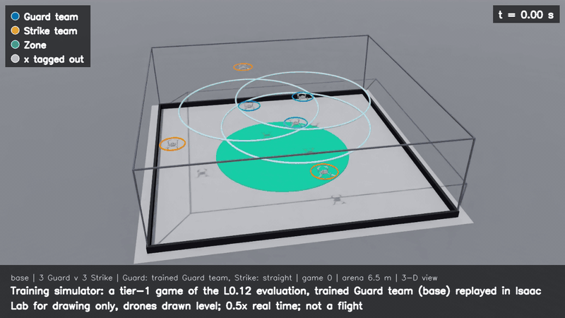
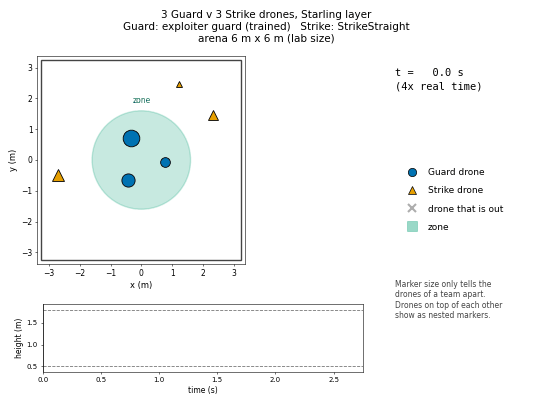

INTERNAL · the decision page of gate G0, the end of phase L0 of STE's learning track ([PLAN](PLAN.md) §5, task L0.6). DRAFT of 22 Nov 2026, written from the committed records; the lead walks the owner through it before the ruling. Every number was observed in the training simulator (or, for the Crazyflie check, in the Crazyflie repository's offline planner); nothing here is a flight result, and nothing was flown.

# Gate G0: what to decide at the end of phase L0

*Tier 1*: the fast training simulator. *Tier 2*: Isaac Lab with the Starling as a physics drone. *Scripts*: hand-written
players. *Trained team*: trained against the best script of the other side (one seed per side). *Hold*: the Guard team
wins; *reach*: a Strike drone reaches the zone. *Tag distance*: how close a Guard drone must come to a Strike drone to tag
it (both leave the game: 1-for-1). *Filter*: the flight software's safety filter, which aims to keep every pair 1.10 m apart (not exact: 198 of 1,000 T41
games came closer, closest 0.85 m, [T45](../records/2026-11-21_ste_l014_crazyflie_route_record.md)).

## What phase L0 found

At a tag distance of 1.6 m each trained team was scored against one opponent: the trained Guard team beats the best
script against straight Strikes (913 v 808; other Strike scripts untested). The trained Strike team beats the script
against mark_edge, its training opponent (636 v 192), but of the two opponents tried it fails against the second:
against field Guards it reaches 85, below the script's 284 ([T56](../records/2026-11-22_ste_l012d_cross_tag_record.md)). At 1.4 m the trained Strike team
beats the scripts against its training opponent (mirror; no other opponent tried); the trained Guard team's small gain
may come from deciding every 0.6 s rather than from learning. The Guard strategy trained at 1.6 m does not carry over to
1.15 m (195 v 572 for the team trained at 1.15 m, T56); the Strike team against field Guards is level within the
intervals (121 v 134). At 1.2 m, and at 1.15 m, the owner's realistic-tag rule (the filter's 1.10 m + 0.05 m), the scripts give a two-sided game (Guards hold 645 of 1,000,
Strikes reach 355: [T44](../records/2026-11-21_ste_l011_screen_record.md), [T50](../records/2026-11-21_ste_l012b_screen_record.md)),
but the trained teams ended below the scripts, also with 3× (Guard) and 5× (Strike) the training (L0.12c, T54, T55). Isaac
Lab trains as well as the fast engine on the one task tried (one training seed, one opponent, one start set; lead's
reading), at about 5× the cost per game-step ([T53](../records/2026-11-21_ste_l013_tier2_trains_record.md)). Sizes other than 3v3, including the two-Starling 1v1,
were only screened with scripts, and there a good scripted Guard team wins almost every game.

> **What the lead recommends**
> 1. **Tag 1.6 m for L1 set-up and pilots.**
>    - *Evidence.* Each trained team was scored against one opponent: the Strike team fails against a second (85
>      against field Guards, [L0.12d](#l012d-cross-tag-check-22-nov-2026)); the Guard team (913) is untested against other Strike scripts. The Guard
>      strategy trained at 1.6 m does not carry over to 1.15 m (195 v 572); the Strike team against field Guards is level
>      within the intervals (121 v 134). Any policy for a 1.15 m game is trained at 1.15 m; the ±0.1 m spread around
>      1.6 m does not reach 1.15 m.
>    - *Before any trained strategy is shown in the AirStack simulator or flown:* train against a pool of opponents
>      (scripts, then self-play), score every team against every opponent and report the worst cell, two seeds for
>      plan-changing reads. Until then the first demo is the scripted 1v1 at 1.6 m (P11).
>    - *1.15 m.* It stays the realistic target. The longer runs ([T54](../records/2026-11-22_ste_l012c_tag_1p15_guard_record.md), [T55](../records/2026-11-22_ste_l012c_tag_1p15_strike_record.md)) left both trained sides
>      below the scripts: Guard 572 v 645 (466 at 1×), Strike 134 v 355 at 5×, both curves still rising slowly; no cause
>      is known ([DISCUSSION §12](DISCUSSION_2026-11-19_20.md#12-l012c-findings-22-nov-2026)). The curriculum pilot from 1.6 m (optional L2.8 of the [costed draft](drafts/L1_L9_COSTED_PLAN_DRAFT.md))
>      loses priority (its warm-start value is not tested). Panel proposals (22 Nov): the guard_field check ran (L0.12d,
>      X2 and X4); the shorter-training-clock 1.15 m Strike run is not run (there the Strike training games finish about
>      13–15× less often than at 1.6 m), see [DISCUSSION §12](DISCUSSION_2026-11-19_20.md#12-l012c-findings-22-nov-2026) and [§13](DISCUSSION_2026-11-19_20.md#13-l012d-cross-tag-check-22-nov-2026).
> 2. Keep 1-for-1 tags, the 1.6 m zone, the 6.5 m arena with the 2.75 m Strike start ring, 3v3 for training; vary the tag distance by ±0.1 m in training (L1).
> 3. Train and test 1v1 explicitly in L1: it is the two-Starling demo size and Guard-trivial with scripts.
> 4. Keep D3 (train in Isaac Lab; the fast engine for quick experiments and debugging only); open arena first.
> 5. Fleets: Crazyflies first at Starling metres, the Starling 1v1 as planned, the mix later.
> 6. L1–L9 budget: [costed draft](drafts/L1_L9_COSTED_PLAN_DRAFT.md) on D3, about 87 GPU-h at tag 1.6 m; approve L1 + L2 at 10 GPU-h. On top come L1.11 (the guard_field Strike pilot, about 0.6 GPU-h), cross-play scoring and proposal (b) (minutes each): L1 + L2 then about 10.6–11 GPU-h, so approving 11 GPU-h covers them. The draft still puts some tasks on the fast engine (its open question A12): the owner's call.

**Phase L0 by task.** Green is done; L0.7's RTX 5090 part is open; L0.6 is this page. GPU-hours from the ledger:
13.77 of 19 ([budget](#8-budget-used)).

## 1. The decisions

Evidence strength: **trained, both sides** (a trained team of each side scored against the best script); **trained, one
side**; **scripted screen only**; **not tested in L0**; **planning item (no measurement)**. Counts are of 1,000 games on
T44's starts, except T45 and T49 (T41's hangar starts) and the Crazyflie planner (counts of 100 matches). "Lead:" marks the lead's recommendation. The 1.15 m runs carry three labels. "Incomplete: one side only" (records, ledger): the record tool reads one side at a time. "Worth learning by the band" (PLAN, run notes): the screening rule only asks whether either side's best player, script or trained, wins at least 20 % of games; at 1.15 m the scripts alone pass it, so it says nothing about the trained teams, which both lost to the scripts. "Trained, both sides" (this page): how strong the evidence is, not a verdict.

| # | Decision | What L0 measured | Evidence strength | Lead's recommendation | Still open |
|---|---|---|---|---|---|
| 1 | **Tag distance** (P1) | rows 1a–1f; [section 2](#2-the-tag-rule) | — | lead: 1.6 m for L1 set-up and pilots (recommendation 1); 1.15 m stays the target; how to reach it is not shown (rows 1d, 1f, 2) | P1 overturns the FIXED "no tag" row ([GAME_SPEC](GAME_SPEC.md)) |
| 1a | 1.6 m | trained Guards 913 v script 808; trained Strikes 636 v 192 against mark_edge, their training opponent ([T46](../records/2026-11-21_ste_l012_best_response_record.md)), but 85 v 284 against field Guards ([T56](../records/2026-11-22_ste_l012d_cross_tag_record.md), X4); Guards scored against straight Strikes only | trained, both sides (each scored against one opponent; the Strike team fails against a second) | — | up to 27 % of a cell's tags are filter pushes; one seed per side |
| 1b | 1.4 m | trained Guards 747 v 672; trained Strikes 740 v 328 against mirror, their training opponent ([T46](../records/2026-11-21_ste_l012_best_response_record.md)); no other opponent tried | trained, both sides (Strike team scored against one opponent) | — | Guard gain (747) overlaps the low-Strike script with commands held 0.6 s (738, 0.710–0.764): possibly the decision period, not learning; against straight Strikes no gain |
| 1c | 1.2 m | scripts 645 / 355; trained Guards 503 v 645, still climbing; Strike run ABORTED ([T46](../records/2026-11-21_ste_l012_best_response_record.md), [T47](../records/2026-11-21_ste_l012_tag_1p2_strike_record.md)) | trained, one side | — | not re-run (owner, 21 Nov) |
| 1d | 1.15 m (filter 1.10 m + 0.05 m) | scripts 645 / 355; trained Guards 466 at 1×, **572 at 3×** v 645; trained Strikes **134 at 5×** v 355 ([T50](../records/2026-11-21_ste_l012b_screen_record.md), [T51](../records/2026-11-21_ste_l012b_best_response_record.md), [T54](../records/2026-11-22_ste_l012c_tag_1p15_guard_record.md), [T55](../records/2026-11-22_ste_l012c_tag_1p15_strike_record.md)) | trained, both sides | — | both trained sides below the scripts; one seed per side |
| 1e | no proximity tag (filter only) | the high scripted Strike reaches in every game; the best scripted Guard holds 0 ([T44](../records/2026-11-21_ste_l011_screen_record.md), INFO cell) | scripted screen only | — | — |
| 1f | 1.6 m-trained teams at 1.15 m (L0.12d) | Guard team 195 v 572 trained at 1.15 m (script 645); Strike team v field 121 v 134 trained at 1.15 m (script 355), v mark_edge 931 ([T56](../records/2026-11-22_ste_l012d_cross_tag_record.md), [section 2](#l012d-cross-tag-check-22-nov-2026)) | trained, both sides (scoring only) | lead: a 1.15 m policy is trained at 1.15 m | one seed per side, one start set |
| 2 | **Longer 1.15 m runs** (DONE 22 Nov 2026: L0.12c, 4.71 GPU-h) | Guard 3×: 572 v script 645 (466 at 1×); Strike 5×: 134 v 355; the trained Strikes usually trade two for two, then the last one waits out the clock ([T54](../records/2026-11-22_ste_l012c_tag_1p15_guard_record.md), [T55](../records/2026-11-22_ste_l012c_tag_1p15_strike_record.md)); [figure](../docs/figures/ste_l012c/longer_runs.png) | trained, both sides | lead: neither side reaches the scripts at these budgets; route to 1.15 m not shown (recommendation 1, [DISCUSSION §12](DISCUSSION_2026-11-19_20.md#12-l012c-findings-22-nov-2026)) | one seed per side, one opponent, one start set |
| 3 | **Varied tag distance in training** | every run used one tag distance | not tested in L0 | lead: yes, the tag distance drawn within ±0.1 m of the chosen value, tested in L1 | — |
| 4 | **What a tag costs** (D2, `guard_survives_tag_prob`) | Guard survives: scripted Guards hold 1,000; 1-for-1: holds are trades ([T44](../records/2026-11-21_ste_l011_screen_record.md)); [section 3](#3-the-scripted-screen-one-factor-at-a-time) | 1-for-1: trained, both sides; survive: scripted screen only | lead: keep 1-for-1 | values between 0 and 1 not run |
| 5 | **Zone size** (P12) | 2.4 m zone: scripted Guards hold 89 ([T44](../records/2026-11-21_ste_l011_screen_record.md)) | scripted screen only | lead: keep 1.6 m | the 2.4 m cell also shortened the run-in |
| 6 | **Team size 3v3** | every trained run was 3v3 | trained, both sides | lead: 3v3 for training | not a programme size (2v1, 5v3) |
| 7 | **Team sizes 2v1, 5v3** (P9) | scripted Guards hold 1,000 and 998 ([T44](../records/2026-11-21_ste_l011_screen_record.md)) | scripted screen only | lead: 3v3 for training (row 6) | 1.6 m tag only; whether 8 drones fit 6.5 m ([T45](../records/2026-11-21_ste_l014_crazyflie_route_record.md)) |
| 8 | **Team size 1v1** (demo size) | scripted Guards hold 1,000 ([T44](../records/2026-11-21_ste_l011_screen_record.md)); [section 4](#4-1v1-the-two-starling-demo-size) | scripted screen only | lead: train and test 1v1 explicitly in L1 because it is the two-Starling demo size and is Guard-trivial with scripts | 1v1 not screened at 1.15 m (added to draft task L1.9) |
| 9 | **Arena and Strike start ring** (F8, L08-F1) | 6.5 m + 2.75 m ring: every trained run; 7.5 m + 3.2 m ring: scripted Guards hold 920 ([T44](../records/2026-11-21_ste_l011_screen_record.md)) | 6.5 m: trained, both sides; 7.5 m: scripted screen only | lead: 6.5 m arena with the 2.75 m ring | arena and ring not separated |
| 10 | **Where to train** (D3) | Isaac Lab ~5× slower; trains 832 v 836 ([T53](../records/2026-11-21_ste_l013_tier2_trains_record.md)); [section 5](#5-where-to-train) | trained, one side | lead: keep D3: L1–L9 about 87 GPU-h (46 to at least 149); training on tier 1 and checking on tier 2 about 37 (16–104); league on tier 1 with a tier 2 fine-tune 24–114 ([costed draft](drafts/L1_L9_COSTED_PLAN_DRAFT.md) §1, §4) | physics check near its limit at 16,384 games; whether the draft's tier 1 training reads fit D3 is the owner's call ([draft](drafts/L1_L9_COSTED_PLAN_DRAFT.md) A12) |
| 11 | **Environments** (P10) | every L0 game in the open arena | not tested in L0 | lead: open arena first | parent FIXED rule asks for realistic 3-D worlds |
| 12 | **Which fleets fly** (P13) | inputs: T41 holds 831 → 791 / 768 at Crazyflie-like lags; planner at 1.10 m: 0 emergencies, but pairs inside 1.10 m in 91 (3v3) and 99 (5v3) of 100 matches ([T45](../records/2026-11-21_ste_l014_crazyflie_route_record.md)); [section 6](#6-fleets-and-the-real-demo) | planning item; inputs: T45 lag re-score and planner sweep | lead: Crazyflies first at Starling metres; Starling 1v1 as planned; mix deferred ([DISCUSSION §2.16](DISCUSSION_2026-11-19_20.md#216-real-flight-on-starlings-crazyflies-or-a-mix-owner-20-nov)) | one policy file for both drones or one each |
| 13 | **The real demo** (P11) | row 8; two Starlings cannot play on after a tag | planning item (no measurement) | owner's proposal: proximity tag by motion capture, same rule in simulation ([DISCUSSION §11](DISCUSSION_2026-11-19_20.md#11-owner-decisions-and-a-lead-correction-21-nov-2026); earlier contact-tag plan: [contact-tag track](../docs/plans/2026-11-17-contact-tag-track.md), DRAFT) | learned or scripted 1v1 (PLAN §5); lead: scripted 1v1 at 1.6 m until a trained strategy passes the opponent panel (recommendation 1) |
| 14 | **Physical-intercept study** | — | planning item (no measurement) | owner's proposal: simulation only, a terminal intercept at the tag distance ([§11](DISCUSSION_2026-11-19_20.md#11-owner-decisions-and-a-lead-correction-21-nov-2026); see the [contact-tag track](../docs/plans/2026-11-17-contact-tag-track.md), DRAFT) | real intercept: other hardware, flight-safety decision |
| 15 | **L1–L9 budget** | Isaac Lab: 302 M game-steps 1.29 GPU-h v 0.24 on tier 1 ([T53](../records/2026-11-21_ste_l013_tier2_trains_record.md)); L0 used 13.77 of 19 | planning item; inputs: T53 tier costs, the GPU-hour ledger | lead: [costed draft](drafts/L1_L9_COSTED_PLAN_DRAFT.md) on D3 (Isaac Lab): about 87 GPU-h for L1–L9 at tag 1.6 m (46 to at least 149); approve L1 + L2 at 10 GPU-h | PLAN §9 is OPEN |
| 16 | **0.6 s decision period** (L011-F1) | scripts held 0.6 s barely change: 808 → 793, except the low Strike at 1.4 m: 672 → 738 ([follow-ups](../docs/notes/2026-11-21_ste_l011_followups.md)) | scripted screen only | lead: keep 0.6 s | scripts decide every 0.05 s in every comparison |
| 17 | **L0.7's RTX 5090 part** (L07-5090) | laptop part done: suite 1,420 passed, both drills as expected ([status](status/STATUS_LATEST.md)) | planning item (no measurement) | lead: the first item of the next 5090 session (it checks that machine; the owner asked for a laptop run first and was told why it cannot, [DISCUSSION §11](DISCUSSION_2026-11-19_20.md#11-owner-decisions-and-a-lead-correction-21-nov-2026)) | TEST-F2b, L09-5090 wait for the same session |

---

## 2. The tag rule

| Trained team v best script v untrained, per tag distance | Learning curves by tag distance |
|---|---|
|  |  |
| Filled dot trained, hollow diamond best script, cross untrained; 1,000 starts ([T46](../records/2026-11-21_ste_l012_best_response_record.md), [T51](../records/2026-11-21_ste_l012b_best_response_record.md)). The 1.6 m and 1.4 m points alone: [best_response.png](../docs/figures/ste_l012/best_response.png). | Share of 256 curve starts won during training ([curve_reads.csv](../docs/figures/ste_l012/curve_reads.csv)); not the 1,000 scoring starts. Strike curves at 1.2 m and 1.15 m are from ABORTED runs (information only). |

**In short:** at 1.2 m and 1.15 m the trained Guards were still climbing when the budget ended (47 → 108 and
38 → 105 of 256), while at 1.6 m they were levelling off (156 → 234) ([curve_reads.csv](../docs/figures/ste_l012/curve_reads.csv)). The longer
1.15 m runs (L0.12c) then showed the Guard curve slowing once it won about half of the curve games and the Strike curve rising only slowly, 0.10 → 0.18 ([figure](../docs/figures/ste_l012c/longer_runs.png)).

| Tag distance | Scripts: Guards hold / Strikes reach | Trained Guard team v best script | Trained Strike team v best script | Evidence strength | Tags the filter pushed (tag's tick) |
|---|---|---|---|---|---|
| none | 0 / 1,000 ([T44](../records/2026-11-21_ste_l011_screen_record.md)) | not trained | not trained | scripted screen only | — |
| 1.8 m | 932 / 68 ([T44](../records/2026-11-21_ste_l011_screen_record.md)) | not trained | not trained | scripted screen only | not measured |
| 1.6 m | 808 / 192 | **913** v 808 ([T46](../records/2026-11-21_ste_l012_best_response_record.md)) | **636** v 192 against mark_edge (its training opponent); 85 v 284 against field ([T56](../records/2026-11-22_ste_l012d_cross_tag_record.md)) | trained, both sides (each scored against one opponent; the Strike team fails against a second) | up to 27 % per cell ([T50](../records/2026-11-21_ste_l012b_screen_record.md)) |
| 1.4 m | 672 / 328 | **747** v 672 (v straight Strikes 673 v 701) | **740** v 328 against mirror (its training opponent; no other tried) | trained, both sides (Strike team scored against one opponent) | not measured |
| 1.2 m | 645 / 355 | 503 v 645 (untrained 144) | ABORTED ([T47](../records/2026-11-21_ste_l012_tag_1p2_strike_record.md)) | trained, one side | not measured |
| 1.15 m | 645 / 355 ([T50](../records/2026-11-21_ste_l012b_screen_record.md)) | 466 v 645 at 1× ([T51](../records/2026-11-21_ste_l012b_best_response_record.md)); **572** v 645 at 3× ([T54](../records/2026-11-22_ste_l012c_tag_1p15_guard_record.md)) | ABORTED at 1× ([T52](../records/2026-11-21_ste_l012b_tag_1p15_strike_record.md)); **134** v 355 at 5× ([T55](../records/2026-11-22_ste_l012c_tag_1p15_strike_record.md)) | trained, both sides | 0–10 % per scripted cell; trained Guards 0 of 2,379; trained Strikes' games: 10.6 % of tags |

- **1.6 m: each trained team was scored against one opponent; the Strike team fails against a second.** Trained
  Guards 913 v 808 (793 with the scripts' commands held 0.6 s), against strike_straight, the same Strike script as at
  1.15 m; untested against other Strike scripts. Trained Strikes 636 v
  192 against mark_edge, their training opponent, but 85 v the script's 284 against field Guards (T56).
- **1.4 m: clear on the Strike side only, against one opponent.** Trained Strikes 740 v 328 against mirror, their
  training opponent; no other opponent tried. The trained Guards' 747 overlaps the best script
  with its commands held 0.6 s (738, 0.710–0.764, [follow-ups](../docs/notes/2026-11-21_ste_l011_followups.md)), so the
  +0.075 may be the decision period, not learning; against straight Strikes there is no gain (673 v 701).
- **1.2 m and 1.15 m: slower to learn within the budget, not shown unlearnable** (lead's correction,
  [DISCUSSION §11](DISCUSSION_2026-11-19_20.md#11-owner-decisions-and-a-lead-correction-21-nov-2026)). The trained
  Guards learned (far above untrained) but ended below the script. No cause is established at 1.15 m; the explanations
  checked (the 0.6 s decision period, [follow-ups §4](../docs/notes/2026-11-21_ste_l011_followups.md#4-commands-held-for-06-s-finding-l011-f1);
  the Strike reward; exploration; filter pushes) were checked indirectly and none points to it; the learner's own decision period was never varied ([DISCUSSION §12](DISCUSSION_2026-11-19_20.md#12-l012c-findings-22-nov-2026)).
- **Filter pushes** (finding L010-G0): the filter's 1.10 m bubble sits inside the tag distance, so it can push a pair into
  a tag nobody chose. On the tag's own tick: at 1.15 m 1.0 % of scripted tags (trained Strikes' games 10.6 %), up to 27 % of a cell's tags at 1.6 m. Earlier ticks not measured.
- **ABORTED Strike runs** wait out the 120 s clock ([section 9](#9-aborted-runs-information-only), information only).

> **Longer 1.15 m runs (L0.12c, owner-approved, done 22 Nov 2026; [T54](../records/2026-11-22_ste_l012c_tag_1p15_guard_record.md), [T55](../records/2026-11-22_ste_l012c_tag_1p15_strike_record.md)).** Same recipe, new seeds: the Guard
> run at 3× the training holds **572** of 1,000 (466 at 1×) against the script's 645; the Strike run at 5× reaches **134**
> against the script's 355: it usually trades two Strikes for two Guards, then the last Strike waits out the clock. Both learned (untrained 101 and 0), both stay below the
> scripts. At 5× the Strike team stays far below the script; its curve was still rising slowly (0.102 → 0.176 of the
> 256 curve games from 0.57 B to 2.76 B game-steps). Whether more training or a different recipe closes the gap is not
> shown; no cause is established ([DISCUSSION §12](DISCUSSION_2026-11-19_20.md#12-l012c-findings-22-nov-2026)). One seed per side, one opponent, one start set; observed in
> the training simulator.
>
> | Learning curves at 1× and the longer budgets, with the final 1,000-game results |
> |---|
> |  |
> | Lines: 256 curve games every 10 updates; points and grey bands: 1,000 scoring starts, Wilson 95 % ([T54](../records/2026-11-22_ste_l012c_tag_1p15_guard_record.md), [T55](../records/2026-11-22_ste_l012c_tag_1p15_strike_record.md)). 2-D clips: [ste_l012c](../docs/media/ste_l012c/README.md). |

**Clips.** The 3-D clips replay games of the run's scoring evaluation (T44's 1,000 starts). The 2-D clips are each run's
own video games, on separate clip starts (`clip_seed` 120950 in the gate files): a "game 0" in one is not "game 0" in the other.

| 1.6 m, trained Strikes reach (3-D) | 1.6 m, trained Guards hold (3-D) |
|---|---|
|  |  |
| Trained Strikes v mark-edge Guards, scoring game 0 ([T46](../records/2026-11-21_ste_l012_best_response_record.md)): reach at 6.1 s. Faint circle = each Guard's tag distance. Replayed in Isaac Lab for drawing; not a flight. | Trained Guards v straight Strikes, scoring game 0 ([T46](../records/2026-11-21_ste_l012_best_response_record.md)): hold at 2.5 s, 3-for-3 tags. Replayed in Isaac Lab for drawing; not a flight. |

| 1.6 m, trained Strikes (2-D, clip starts) | 1.15 m, trained Guards hold (2-D, clip starts) |
|---|---|
|  |  |
| Clip game 0: reach at 14.5 s. Lead's reading (this clip only, no control run): the Strikes climb to the 1.8 m limit over Guards at 1.2 m, trade two drones, the last slips in. Tier 1, not a flight. | Clip game 2: hold at 2.8 s; over 1,000 scoring games 466 holds, script 645 ([T51](../records/2026-11-21_ste_l012b_best_response_record.md)). Tier 1, not a flight. |

| 1.15 m, trained Guards at 3× (2-D, clip starts) | 1.15 m, trained Strikes at 5× (2-D, clip starts) |
|---|---|
|  |  |
| Clip game 2: hold at 2.6 s; over 1,000 scoring games 572 holds, script 645 ([T54](../records/2026-11-22_ste_l012c_tag_1p15_guard_record.md)). Tier 1, not a flight. | Clip game 0: the game runs to the 120 s clock (a hold); over 1,000 scoring games 134 reaches, script 355 ([T55](../records/2026-11-22_ste_l012c_tag_1p15_strike_record.md)). Tier 1, not a flight. |

More: 1.4 m in 3-D ([ste_l012/3d](../docs/media/ste_l012/3d/README.md)); scripted 1.2 m in 3-D
([ste_l011/3d](../docs/media/ste_l011/3d/README.md)); the 1× 1.15 m clips ([ste_l012b](../docs/media/ste_l012b/README.md));
the longer-run clips ([ste_l012c](../docs/media/ste_l012c/README.md)) and their figure
([longer_runs.png](../docs/figures/ste_l012c/longer_runs.png)); the 1.6 m-trained teams at 1.15 m
([ste_l012d](../docs/media/ste_l012d/README.md)). No trained 3-D clip exists at 1.2 m or 1.15 m yet; the
L0.12c 3-D clips are pending.

### L0.12d cross-tag check (22 Nov 2026)

Scoring only, no training ([T56](../records/2026-11-22_ste_l012d_cross_tag_record.md); clips
[ste_l012d](../docs/media/ste_l012d/README.md)). T46's 1.6 m-trained Strike team, reaches of 1,000:

| Opponent | Tag 1.6 m | Tag 1.15 m |
|---|---|---|
| guard_mark_edge (its training opponent) | 636 (T46) | 931 (X3) |
| guard_field | 85 (X4; script 284) | 121 (X2; 1.15 m-trained 134; script 355) |

- **Strike side:** the opponent moves the Strike team's score far more than the tag does (one seed): against mark_edge the same network goes 636 → 931 when only the tag changes; part of that may come through the opponent itself (mark_edge holds 808 → 422 against straight Strikes). T46 and T55 changed tag and opponent together, so "the
  Strike team learns at 1.6 m but not at 1.15 m" is not supported. X3 does not show 1.15 m is learnable either:
  mark_edge is weak at 1.15 m (the straight-Strike script also reaches 578 against it).
- **Guard side:** the reading stands (same opponent strike_straight at both tags: 913 v 808 at 1.6 m, 572 v 645 at
  1.15 m). The 1.6 m-trained Guard team at 1.15 m holds 195 (1.15 m-trained 572, script 645, untrained 101): the Guard
  strategy does not carry over. The Strike team against field Guards: 121 v 134 trained at 1.15 m, intervals overlap.
- In X1, X2 and X4 the trained team wins 0, 0 and 1 games the script loses: it wins almost only starts the script also wins.
- **Limits:** one seed per side, one start set; each trained team is overfit to one opponent; the "best script" was
  chosen against other scripts only; between tags mark_edge falls 808 → 422 holds (field 716 → 645); X2 matches T55
  in wins only (median game 16.3 s v 120 s).

**Two proposals for the owner (PROPOSED, not run):** (a) a Strike team trained against guard_field at 1.6 m (about
0.6 GPU-h): separates "field Guards are hard" from "1.15 m is hard"; (b) score T46's 1.6 m Guard team against every
Strike script at 1.6 m (minutes): its 913 is against strike_straight only.

## 3. The scripted screen, one factor at a time

**Scripted screen** ([T44](../records/2026-11-21_ste_l011_screen_record.md)). Blue: best scripted Guard team's worst-case
hold rate; orange: best scripted Strike team's worst-case reach rate. Of T44's distances, only tags of 1.2 m and 1.4 m leave both teams a real
chance. Scripts only, 1.6 m tag unless shown.

| Factor (rows) | Best scripted Guards hold | Note |
|---|---|---|
| Guard survives a tag (4) | 1,000 | with 1-for-1, no tag-on scripted game ran to the clock; a hold is a full trade at 1v1 and 3v3, leaves 1 Guard at 2v1 and 2 at 5v3; against trained Strikes 37 of 364 holds at 1.6 m did ([T46](../records/2026-11-21_ste_l012_best_response_record.md)) |
| Zone 2.4 m (5) | 89 | the run-in from the start ring also fell from 1.15 m to 0.35 m |
| 2v1, 5v3 (7) | 1,000, 998 | the programme's sizes |
| Arena 7.5 m (9) | 920 | the start ring also moved (3.2 m) |

## 4. 1v1: the two-Starling demo size

| Guard script at 1v1, 1.6 m tag | Holds of 1,000 against each Strike script | Source |
|---|---|---|
| mark-edge, mirror, field | 1,000 against straight, flank, high and low (high and low are tier-1 vertical response not fitted, `z_up_info`) | [results table](../docs/figures/ste_l011/results_2026-11-21_ste_l011_screen.md) |
| parked at the centre | 693, 541, 0, 0 | same |

A good scripted Guard wins every 1v1 game: Guard-trivial with scripts. Nothing was trained at 1v1, and 1v1 was not
screened at 1.15 m. Two Starlings also cannot play on after a tag: AirStack's land command lands every drone
([DISCUSSION §2.16](DISCUSSION_2026-11-19_20.md#216-real-flight-on-starlings-crazyflies-or-a-mix-owner-20-nov)). No 1v1 clip exists.

## 5. Where to train

| Question | Number | Record | Limits |
|---|---|---|---|
| How fast? | 3v3, laptop GPU: tier 1 51k–208k, Isaac Lab 10k–67k game-steps/s; Isaac Lab 4.9–5.3× slower at 3v3, 9.8× at 1v1 | [T48](../records/2026-11-21_ste_l02_speed_record.md) | one update per point |
| Does a tier-1 policy work on Isaac Lab? | T41 holds 856 there v 831 on tier 1 | [T49](../records/2026-11-21_ste_l03_transfer_record.md) | one policy, one opponent, one start set |
| Does Isaac Lab train? | PASS: 832 (parked Guards 538) v 836 on tier 1, same 302 M game-steps; 1.29 v 0.24 GPU-h | [T53](../records/2026-11-21_ste_l013_tier2_trains_record.md) | one training seed, one opponent, one start set; Guard team only; lead's reading |
| Physics check at scale | 0.0166 m of a 0.02 m limit at 16,384 games | [T53](../records/2026-11-21_ste_l013_tier2_trains_record.md) | a larger world (e.g. on the 5090) may fail it |

| Training speed, both tiers | Isaac Lab and tier 1 learn alike (one seed, one opponent, one start set; lead's reading) |
|---|---|
|  |  |
| Game-steps per second against games at once, 3v3, laptop GPU ([T48](../records/2026-11-21_ste_l02_speed_record.md)). | Hold rate during training on each tier ([T53](../records/2026-11-21_ste_l013_tier2_trains_record.md)); read on 256 curve starts, so the ends sit near 0.79–0.81. One training seed, one opponent, one start set; lead's reading. |

## 6. Fleets and the real demo

| Input | Number | Record |
|---|---|---|
| T41 with every drone delayed like a Crazyflie (0.48 / 0.56 s) | holds 831 → 791 / 768; games closer than 1.0 m 7 → 101 / 149; under 0.50 m (contact) 0 → 2 / 1 | [T45](../records/2026-11-21_ste_l014_crazyflie_route_record.md) |
| Crazyflie planner at 1.10 m, 6.5 m square | 0 solver emergencies at every size, but a pair inside 1.10 m in 91 (3v3) and 99 (5v3) of 100 matches; `tag` rules and hand-set marks only (20 Nov runs: 5 of 100 emergencies) | [T45](../records/2026-11-21_ste_l014_crazyflie_route_record.md) |
| Options and open questions | all-Starling, all-Crazyflie, a mix; Crazyflie logs not yet on the workstation | [CRAZYFLIE_ROUTE](CRAZYFLIE_ROUTE.md#options-for-p13-the-fleet-question-at-gate-g0) |

## 7. Other findings reported at G0

| ID | Finding | Source |
|---|---|---|
| L011-G0 | With scripts every hold is a one-for-one trade, so head-count decides; against trained Strikes some holds run to the clock | [T44](../records/2026-11-21_ste_l011_screen_record.md), [T46](../records/2026-11-21_ste_l012_best_response_record.md) |
| L010-G0 | The filter can push a pair into a tag nobody chose (section 2) | [T50](../records/2026-11-21_ste_l012b_screen_record.md) |
| L011-F1 | Scripts decide every 0.05 s, learners every 0.6 s; the low Strike at 1.4 m is the one script that changes (672 → 738 holds) | [follow-ups](../docs/notes/2026-11-21_ste_l011_followups.md) |
| Tier drift | One played game drifts 0.26 m between tiers within 20 ticks (physics alone agree to 0.0028 m): compare tiers as rates, not single games (cause: lead's reading, no control run) | [T49](../records/2026-11-21_ste_l03_transfer_record.md) |
| Out of memory | Isaac Lab's out-of-memory path was never exercised | [T48](../records/2026-11-21_ste_l02_speed_record.md) |
| L07-SUSPEND | A laptop sleep during a GPU job would count as GPU-hours; rule in force: never sleep during a GPU job; no run of record was suspended | [status](status/STATUS_LATEST.md) |

## 8. Budget used

From the shared GPU-hour ledger (`runs/shared/gpu_hours.log` on the laptop, not in git); L0.11 and L0.13 appear as totals
in their records; L0.12, L0.2 and L0.3 as parts summing within 0.002; L0.4 and L0.5 are in the ledger only.

| Task | Cap (PLAN §4) | GPU-h used | Record |
|---|---|---|---|
| L0.11 Screening sweep | 0.5 (3 until 21 Nov) | 0.426 | [T44](../records/2026-11-21_ste_l011_screen_record.md) |
| L0.12 Best-response test | 13 (6 until 21 Nov; L0.12b, L0.12c and L0.12d charged here; all four parts 9.79) | 3.37 | [T46](../records/2026-11-21_ste_l012_best_response_record.md), [T47](../records/2026-11-21_ste_l012_tag_1p2_strike_record.md) |
| L0.12b Bubble tag | charged to L0.12: approved as about 1.3 beyond the then 6 GPU-h cap, inside the 13 since L0.12c (owner, [DISCUSSION §11](DISCUSSION_2026-11-19_20.md#11-owner-decisions-and-a-lead-correction-21-nov-2026)) | 1.59 | [T50](../records/2026-11-21_ste_l012b_screen_record.md), [T51](../records/2026-11-21_ste_l012b_best_response_record.md), [T52](../records/2026-11-21_ste_l012b_tag_1p15_strike_record.md) |
| L0.13 Does tier 2 train? | 1.6 (6 until 21 Nov) | 1.590 | [T53](../records/2026-11-21_ste_l013_tier2_trains_record.md) |
| L0.2 Tier 2 speed | 0.4 (1.5 until 21 Nov) | 0.391 | [T48](../records/2026-11-21_ste_l02_speed_record.md) |
| L0.3 Guard policy on tier 2 | 1.3 (1.5 until 21 Nov) | 1.282 | [T49](../records/2026-11-21_ste_l03_transfer_record.md) |
| L0.4 Starling render | 0.2 | 0.028 | ledger only |
| L0.5 Video look, with the 3-D clips | 0.3 | 0.258 | ledger only |
| L0.1, L0.7–L0.10, L0.14 | 0 | 0 | — |
| L0.12c Longer 1.15 m runs | owner-approved about 6.5 (in L0.12's 13) | 4.71 | [T54](../records/2026-11-22_ste_l012c_tag_1p15_guard_record.md), [T55](../records/2026-11-22_ste_l012c_tag_1p15_strike_record.md) |
| L0.12d Cross-tag check | charged to L0.12 | 0.119 | [T56](../records/2026-11-22_ste_l012d_cross_tag_record.md) |
| **Phase L0** | **19** | **13.77** | — |

## 9. ABORTED runs (information only)

An ABORTED run proves nothing: both stopped before their budget because the time cap left too little reserve.

| Run | Stopped at | Seen in its evaluation | Re-run? |
|---|---|---|---|
| Trained Strikes, 1.2 m ([T47](../records/2026-11-21_ste_l012_tag_1p2_strike_record.md)) | update 87 of 88 | 114 reaches v script 355; 786 of 1,000 games to the 120 s clock | no (owner, 21 Nov) |
| Trained Strikes, 1.15 m ([T52](../records/2026-11-21_ste_l012b_tag_1p15_strike_record.md)) | update 86 of 88 | 103 reaches v 355; 771 games to the clock | answered by the 5× run, [T55](../records/2026-11-22_ste_l012c_tag_1p15_strike_record.md) (row 2) |

Sources: [PLAN §5](PLAN.md#5-gate-g0-what-the-owner-rules-with-l0s-numbers), [GAME_SPEC](GAME_SPEC.md),
[DISCUSSION §3 and §7–13](DISCUSSION_2026-11-19_20.md#3-decisions), [status](status/STATUS_LATEST.md),
[CRAZYFLIE_ROUTE](CRAZYFLIE_ROUTE.md), [ledger](../records/LEDGER.md).
