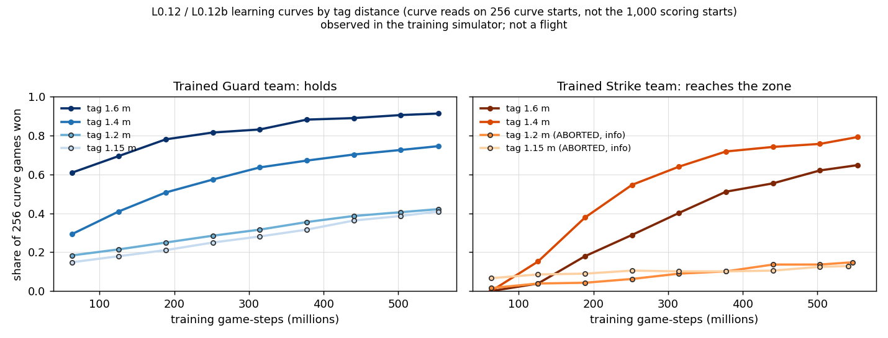

INTERNAL · the decision page of gate G0, the end of phase L0 of STE's learning track ([PLAN](PLAN.md) §5, task L0.6). DRAFT of 21 Nov 2026, written from the committed records; the lead walks the owner through it before the ruling. Every number was observed in the training simulator (or, for the Crazyflie check, in the Crazyflie repository's offline planner); nothing here is a flight result, and nothing was flown.

# Gate G0: what to decide at the end of phase L0

*Tier 1*: the fast training simulator. *Tier 2*: Isaac Lab with the Starling as a physics drone. *Scripts*: hand-written
players. *Trained team*: trained against the best script of the other side (one seed per side). *Hold*: the Guard team
wins; *reach*: a Strike drone reaches the zone. *Tag distance*: how close a Guard drone must come to a Strike drone to tag
it (both leave the game: 1-for-1). *Filter*: the flight software's safety filter, which keeps every pair 1.10 m apart.

## What phase L0 found

At tag distances of 1.6 m and 1.4 m the game is worth learning: trained teams beat the best scripts on both sides. At
1.2 m, and at 1.15 m, the tag the drones can really make, the scripts give a two-sided game (Guards hold 645 of 1,000,
Strikes reach 355: [T44](../records/2026-11-21_ste_l011_screen_record.md), [T50](../records/2026-11-21_ste_l012b_screen_record.md)),
but the trained Guards ended below the scripts while still improving, and both trained Strike runs stopped short. Isaac
Lab trains as well as the fast engine on the one task tried, at about 5× the cost per game-step
([T53](../records/2026-11-21_ste_l013_tier2_trains_record.md)). Sizes other than 3v3, including the two-Starling 1v1,
were only screened with scripts, and there a good scripted Guard team wins almost every game.

> **What the lead recommends**
> 1. **Run the longer 1.15 m trainings** (one Guard, one Strike, 3× the training; about 3.5–4 GPU-h, est.), then rule the tag; 1.4 m if a ruling is needed now.
> 2. Keep 1-for-1 tags, the 1.6 m zone, the 6.5 m arena with the 2.75 m Strike start ring, 3v3 for training; vary the tag distance by ±0.1 m in training (L1).
> 3. Train and test 1v1 explicitly in L1: it is the two-Starling demo size and Guard-trivial with scripts.
> 4. Keep D3 (train in Isaac Lab, tier 1 for quick experiments); open arena first.
> 5. Fleets: Crazyflies first at Starling metres, the Starling 1v1 as planned, the mix later.
> 6. L1–L9 budget: the lead brings a costed plan to the walk-through (Sunday).

**Phase L0 by task.** Green is done; L0.7's RTX 5090 part is open; L0.6 is this page. The chart's title carries the
status's earlier 9.9 GPU-h; the GPU-hour ledger gives 8.93 ([budget](#8-budget-used)).

## 1. The decisions

Evidence strength: **trained, both sides** (a trained team of each side scored against the best script); **trained, one
side**; **scripted screen only**; **not tested in L0**; **planning item (no measurement)**. Counts are of 1,000 games on
the same starts. "Lead:" marks the lead's recommendation.

| # | Decision | What L0 measured | Evidence strength | Lead's recommendation | Still open |
|---|---|---|---|---|---|
| 1 | **Tag distance** (P1) | rows 1a–1e; [section 2](#2-the-tag-rule) | — | lead: rule after the longer 1.15 m runs if the owner approves them; 1.4 m if a ruling is needed now | P1 overturns the FIXED "no tag" row ([GAME_SPEC](GAME_SPEC.md)) |
| 1a | 1.6 m | trained Guards 913 v script 808; trained Strikes 636 v 192 ([T46](../records/2026-11-21_ste_l012_best_response_record.md)) | trained, both sides | — | up to 27 % of a cell's tags are filter pushes |
| 1b | 1.4 m | trained Guards 747 v 672; trained Strikes 740 v 328 ([T46](../records/2026-11-21_ste_l012_best_response_record.md)) | trained, both sides | — | Guard gain is against the low Strike only |
| 1c | 1.2 m | scripts 645 / 355; trained Guards 503 v 645, still climbing; Strike run ABORTED ([T46](../records/2026-11-21_ste_l012_best_response_record.md), [T47](../records/2026-11-21_ste_l012_tag_1p2_strike_record.md)) | trained, one side | — | not re-run (owner, 21 Nov) |
| 1d | 1.15 m (filter 1.10 m + 0.05 m) | scripts 645 / 355; trained Guards 466 v 645, still climbing; Strike run ABORTED ([T50](../records/2026-11-21_ste_l012b_screen_record.md), [T51](../records/2026-11-21_ste_l012b_best_response_record.md), [T52](../records/2026-11-21_ste_l012b_tag_1p15_strike_record.md)) | trained, one side | — | trained Strike side unread |
| 1e | no proximity tag (filter only) | scripted Strikes reach in every game ([T44](../records/2026-11-21_ste_l011_screen_record.md), INFO cell) | scripted screen only | — | — |
| 2 | **Longer 1.15 m runs** (pending) | — | not tested in L0 | lead: yes; about 3.5–4 GPU-h (est., [status](status/STATUS_LATEST.md)) | the owner's answer |
| 3 | **Varied tag distance in training** | every run used one tag distance | not tested in L0 | lead: yes, the tag distance drawn within ±0.1 m of the chosen value, tested in L1 | — |
| 4 | **What a tag costs** (D2, `guard_survives_tag_prob`) | Guard survives: scripted Guards hold 1,000; 1-for-1: holds are trades ([T44](../records/2026-11-21_ste_l011_screen_record.md)); [section 3](#3-the-scripted-screen-one-factor-at-a-time) | 1-for-1: trained, both sides; survive: scripted screen only | lead: keep 1-for-1 | values between 0 and 1 not run |
| 5 | **Zone size** (P12) | 2.4 m zone: scripted Guards hold 89 ([T44](../records/2026-11-21_ste_l011_screen_record.md)) | scripted screen only | lead: keep 1.6 m | the 2.4 m cell also shortened the run-in |
| 6 | **Team size 3v3** | every trained run was 3v3 | trained, both sides | lead: 3v3 for training | not a programme size (2v1, 5v3) |
| 7 | **Team sizes 2v1, 5v3** (P9) | scripted Guards hold 1,000 and 998 ([T44](../records/2026-11-21_ste_l011_screen_record.md)) | scripted screen only | lead: 3v3 for training (row 6) | 1.6 m tag only; whether 8 drones fit 6.5 m ([T45](../records/2026-11-21_ste_l014_crazyflie_route_record.md)) |
| 8 | **Team size 1v1** (demo size) | scripted Guards hold 1,000 ([T44](../records/2026-11-21_ste_l011_screen_record.md)); [section 4](#4-1v1-the-two-starling-demo-size) | scripted screen only | lead: train and test 1v1 explicitly in L1 because it is the two-Starling demo size and is Guard-trivial with scripts | 1v1 not screened at 1.15 m |
| 9 | **Arena and Strike start ring** (F8, L08-F1) | 6.5 m + 2.75 m ring: every trained run; 7.5 m + 3.2 m ring: scripted Guards hold 920 ([T44](../records/2026-11-21_ste_l011_screen_record.md)) | 6.5 m: trained, both sides; 7.5 m: scripted screen only | lead: 6.5 m arena with the 2.75 m ring | arena and ring not separated |
| 10 | **Where to train** (D3) | Isaac Lab ~5× slower; trains 832 v 836 ([T53](../records/2026-11-21_ste_l013_tier2_trains_record.md)); [section 5](#5-where-to-train) | trained, one side | lead: keep D3 | physics check near its limit at 16,384 games |
| 11 | **Environments** (P10) | every L0 game in the open arena | not tested in L0 | lead: open arena first | parent FIXED rule asks for realistic 3-D worlds |
| 12 | **Which fleets fly** (P13) | inputs: T41 holds 831 → 791 / 768 at Crazyflie-like lags; planner at 1.10 m: 0 emergencies ([T45](../records/2026-11-21_ste_l014_crazyflie_route_record.md)); [section 6](#6-fleets-and-the-real-demo) | planning item (no measurement) | lead: Crazyflies first at Starling metres; Starling 1v1 as planned; mix deferred ([DISCUSSION §2.16](DISCUSSION_2026-11-19_20.md#216-real-flight-on-starlings-crazyflies-or-a-mix-owner-20-nov)) | one policy file for both drones or one each |
| 13 | **The real demo** (P11) | row 8; two Starlings cannot play on after a tag | planning item (no measurement) | owner's proposal: proximity tag by motion capture, same rule in simulation ([DISCUSSION §11](DISCUSSION_2026-11-19_20.md#11-owner-decisions-and-a-lead-correction-21-nov-2026)) | learned or scripted 1v1 (PLAN §5) |
| 14 | **Physical-intercept study** | — | planning item (no measurement) | owner's proposal: simulation only, a terminal intercept at the tag distance ([§11](DISCUSSION_2026-11-19_20.md#11-owner-decisions-and-a-lead-correction-21-nov-2026)) | real intercept: other hardware, flight-safety decision |
| 15 | **L1–L9 budget** | Isaac Lab: 302 M game-steps 1.29 GPU-h v 0.24 on tier 1 ([T53](../records/2026-11-21_ste_l013_tier2_trains_record.md)); L0 used 8.93 of 19 | planning item (no measurement) | lead brings a costed plan to the walk-through (Sunday) | PLAN §9 is OPEN |
| 16 | **0.6 s decision period** (L011-F1) | scripts held 0.6 s barely change: 808 → 793 at 1.6 m ([follow-ups](../docs/notes/2026-11-21_ste_l011_followups.md)) | scripted screen only | lead: keep 0.6 s | scripts decide every 0.05 s in every comparison |
| 17 | **L0.7's RTX 5090 part** (L07-5090) | laptop part done: suite 1,420 passed, both drills as expected ([status](status/STATUS_LATEST.md)) | planning item (no measurement) | lead: defer to the first 5090 session | TEST-F2b, L09-5090 wait for the same session |

---

## 2. The tag rule

| Trained team v best script v untrained, per tag distance | Learning curves by tag distance |
|---|---|
|  |  |
| Filled dot trained, hollow diamond best script, cross untrained; 1,000 starts ([T46](../records/2026-11-21_ste_l012_best_response_record.md), [T51](../records/2026-11-21_ste_l012b_best_response_record.md)). The 1.6 m and 1.4 m points alone: [best_response.png](../docs/figures/ste_l012/best_response.png). | Share of 256 curve starts won during training ([curve_reads.csv](../docs/figures/ste_l012/curve_reads.csv)); not the 1,000 scoring starts. Strike curves at 1.2 m and 1.15 m are from ABORTED runs (information only). |

**In one sentence:** at 1.2 m and 1.15 m the trained Guards were still climbing when the budget ended (47 → 108 and
38 → 105 of 256), while at 1.6 m they were levelling off (156 → 234) ([curve_reads.csv](../docs/figures/ste_l012/curve_reads.csv)).

| Tag distance | Scripts: Guards hold / Strikes reach | Trained Guard team v best script | Trained Strike team v best script | Evidence strength | Tags the filter pushed (tag's tick) |
|---|---|---|---|---|---|
| none | 0 / 1,000 ([T44](../records/2026-11-21_ste_l011_screen_record.md)) | not trained | not trained | scripted screen only | — |
| 1.8 m | 932 / 68 ([T44](../records/2026-11-21_ste_l011_screen_record.md)) | not trained | not trained | scripted screen only | not measured |
| 1.6 m | 808 / 192 | **913** v 808 ([T46](../records/2026-11-21_ste_l012_best_response_record.md)) | **636** v 192 | trained, both sides | up to 27 % per cell ([T50](../records/2026-11-21_ste_l012b_screen_record.md)) |
| 1.4 m | 672 / 328 | **747** v 672 (v straight Strikes 673 v 701) | **740** v 328 | trained, both sides | not measured |
| 1.2 m | 645 / 355 | 503 v 645 (untrained 144) | ABORTED ([T47](../records/2026-11-21_ste_l012_tag_1p2_strike_record.md)) | trained, one side | not measured |
| 1.15 m | 645 / 355 ([T50](../records/2026-11-21_ste_l012b_screen_record.md)) | 466 v 645 (untrained 101) ([T51](../records/2026-11-21_ste_l012b_best_response_record.md)) | ABORTED ([T52](../records/2026-11-21_ste_l012b_tag_1p15_strike_record.md)) | trained, one side | 0–10 % per cell; trained Guards 0 of 2,263 |

- **1.6 m and 1.4 m: worth learning on both sides.** The 1.4 m Guard gain is against the low Strike, whose height
  response tier 1 does not fit; against the straight Strike there is no gain.
- **1.2 m and 1.15 m: slower to learn within the budget, not shown unlearnable** (lead's correction,
  [DISCUSSION §11](DISCUSSION_2026-11-19_20.md#11-owner-decisions-and-a-lead-correction-21-nov-2026)). The trained
  Guards learned (far above untrained) but ended below the script.
- **Filter pushes** (finding L010-G0): the filter's 1.10 m bubble sits inside the tag distance, so it can push a pair into
  a tag nobody chose. On the tag's own tick: rare at 1.15 m, up to 27 % of a cell's tags at 1.6 m. Earlier ticks not measured.
- **ABORTED Strike runs** wait out the 120 s clock ([section 9](#9-aborted-runs-information-only), information only).

> **Pending owner question: longer 1.15 m runs.** One Guard and one Strike run at 3× the training (about 1.65 B
> game-steps each), caps sized from the 1.15 m timings: about 3.5–4 GPU-h (est., [status](status/STATUS_LATEST.md)).
> It completes the argument: does training beat the scripts at the tag the drones can really make? The lead recommends
> yes; the owner decides.

**Clips.** The 3-D clips replay games of the run's scoring evaluation (T44's 1,000 starts). The 2-D clips are each run's
own video games, on separate clip starts (`clip_seed` 120950 in the gate files): a "game 0" in one is not "game 0" in the other.

| 1.6 m, trained Strikes reach (3-D) | 1.6 m, trained Guards hold (3-D) |
|---|---|
|  |  |
| Trained Strikes v mark-edge Guards, scoring game 0 ([T46](../records/2026-11-21_ste_l012_best_response_record.md)): reach at 6.1 s. Faint circle = each Guard's tag distance. Replayed in Isaac Lab for drawing; not a flight. | Trained Guards v straight Strikes, scoring game 0 ([T46](../records/2026-11-21_ste_l012_best_response_record.md)): hold at 2.5 s, 3-for-3 tags. Replayed in Isaac Lab for drawing; not a flight. |

| 1.6 m, trained Strikes (2-D, clip starts) | 1.15 m, trained Guards hold (2-D, clip starts) |
|---|---|
|  |  |
| Clip game 0: reach at 14.5 s. Lead's reading (this clip only, no control run): the Strikes climb to the 1.8 m limit over Guards at 1.2 m, trade two drones, the last slips in. Tier 1, not a flight. | Clip game 2: hold at 2.8 s; over 1,000 scoring games 466 holds, script 645 ([T51](../records/2026-11-21_ste_l012b_best_response_record.md)). Tier 1, not a flight. |

More: 1.4 m in 3-D ([ste_l012/3d](../docs/media/ste_l012/3d/README.md)); scripted 1.2 m in 3-D
([ste_l011/3d](../docs/media/ste_l011/3d/README.md)); every 1.15 m clip ([ste_l012b](../docs/media/ste_l012b/README.md)).
No trained 3-D clip exists at 1.2 m or 1.15 m.

## 3. The scripted screen, one factor at a time

**Scripted screen** ([T44](../records/2026-11-21_ste_l011_screen_record.md)). Blue: best scripted Guard team's worst-case
hold rate; orange: best scripted Strike team's worst-case reach rate. Only tags of 1.2 m and 1.4 m leave both teams a real
chance. Scripts only, 1.6 m tag unless shown.

| Factor (rows) | Best scripted Guards hold | Note |
|---|---|---|
| Guard survives a tag (4) | 1,000 | with 1-for-1, every scripted hold is a full trade and no tag-on game ran to the clock; against trained Strikes 37 of 364 holds at 1.6 m did ([T46](../records/2026-11-21_ste_l012_best_response_record.md)) |
| Zone 2.4 m (5) | 89 | the run-in from the start ring also fell from 1.15 m to 0.35 m |
| 2v1, 5v3 (7) | 1,000, 998 | the programme's sizes |
| Arena 7.5 m (9) | 920 | the start ring also moved (3.2 m) |

## 4. 1v1: the two-Starling demo size

| Guard script at 1v1, 1.6 m tag | Holds of 1,000 against each Strike script | Source |
|---|---|---|
| mark-edge, mirror, field | 1,000 against straight, flank, high and low | [results table](../docs/figures/ste_l011/results_2026-11-21_ste_l011_screen.md) |
| parked at the centre | 693, 541, 0, 0 | same |

A good scripted Guard wins every 1v1 game: Guard-trivial with scripts. Nothing was trained at 1v1, and 1v1 was not
screened at 1.15 m. Two Starlings also cannot play on after a tag: AirStack's land command lands every drone
([DISCUSSION §2.16](DISCUSSION_2026-11-19_20.md#216-real-flight-on-starlings-crazyflies-or-a-mix-owner-20-nov)). No 1v1 clip exists.

## 5. Where to train

| Question | Number | Record | Limits |
|---|---|---|---|
| How fast? | 3v3, laptop GPU: tier 1 51k–208k, Isaac Lab 10k–67k game-steps/s; Isaac Lab 4.9–5.3× slower at 3v3, 9.8× at 1v1 | [T48](../records/2026-11-21_ste_l02_speed_record.md) | one update per point |
| Does a tier-1 policy work on Isaac Lab? | T41 holds 856 there v 831 on tier 1 | [T49](../records/2026-11-21_ste_l03_transfer_record.md) | one policy, one opponent, one start set |
| Does Isaac Lab train? | PASS: 832 (parked Guards 538) v 836 on tier 1, same 302 M game-steps; 1.29 v 0.24 GPU-h | [T53](../records/2026-11-21_ste_l013_tier2_trains_record.md) | one seed, Guard team only |
| Physics check at scale | 0.0166 m of a 0.02 m limit at 16,384 games | [T53](../records/2026-11-21_ste_l013_tier2_trains_record.md) | a larger world (e.g. on the 5090) may fail it |

| Training speed, both tiers | Isaac Lab and tier 1 learn alike |
|---|---|
|  |  |
| Game-steps per second against games at once, 3v3, laptop GPU ([T48](../records/2026-11-21_ste_l02_speed_record.md)). | Hold rate during training on each tier ([T53](../records/2026-11-21_ste_l013_tier2_trains_record.md)); read on 256 curve starts, so the ends sit near 0.79–0.81. |

## 6. Fleets and the real demo

| Input | Number | Record |
|---|---|---|
| T41 with every drone delayed like a Crazyflie (0.48 / 0.56 s) | holds 831 → 791 / 768; games closer than 1.0 m 7 → 101 / 149; under 0.50 m (contact) 0 → 2 / 1 | [T45](../records/2026-11-21_ste_l014_crazyflie_route_record.md) |
| Crazyflie planner at 1.10 m, 6.5 m square | 0 solver emergencies at every size, but a pair inside 1.10 m in 91 (3v3) and 99 (5v3) of 100 matches; `tag` rules and hand-set marks only (20 Nov runs: 5 of 100 emergencies) | [T45](../records/2026-11-21_ste_l014_crazyflie_route_record.md) |
| Options and open questions | all-Starling, all-Crazyflie, a mix; Crazyflie logs not yet on the workstation | [CRAZYFLIE_ROUTE](CRAZYFLIE_ROUTE.md#options-for-p13-the-fleet-question-at-gate-g0) |

## 7. Other findings reported at G0

| ID | Finding | Source |
|---|---|---|
| L011-G0 | With scripts every hold is a one-for-one trade, so head-count decides; against trained Strikes some holds run to the clock | [T44](../records/2026-11-21_ste_l011_screen_record.md), [T46](../records/2026-11-21_ste_l012_best_response_record.md) |
| L010-G0 | The filter can push a pair into a tag nobody chose (section 2) | [T50](../records/2026-11-21_ste_l012b_screen_record.md) |
| L011-F1 | Scripts decide every 0.05 s, learners every 0.6 s; the low Strike at 1.4 m is the one script that changes (672 → 738 holds) | [follow-ups](../docs/notes/2026-11-21_ste_l011_followups.md) |
| Tier drift | One played game drifts 0.26 m between tiers within 20 ticks (physics alone agree to 0.0028 m): compare tiers as rates, not single games (cause: lead's reading, no control run) | [T49](../records/2026-11-21_ste_l03_transfer_record.md) |
| Out of memory | Isaac Lab's out-of-memory path was never exercised | [T48](../records/2026-11-21_ste_l02_speed_record.md) |
| L07-SUSPEND | A laptop sleep during a GPU job would count as GPU-hours; rule in force: never sleep during a GPU job; no L0 run was suspended | [status](status/STATUS_LATEST.md) |

## 8. Budget used

From the shared GPU-hour ledger (`runs/shared/gpu_hours.log` on the laptop, not in git); every figure except L0.4 and
L0.5 also appears in its record.

| Task | Cap (PLAN §4) | GPU-h used | Record |
|---|---|---|---|
| L0.11 Screening sweep | 3 | 0.426 | [T44](../records/2026-11-21_ste_l011_screen_record.md) |
| L0.12 Best-response test, with L0.12b bubble tag | 6, plus about 1.3 for L0.12b (owner, 21 Nov) | 4.960 | [T46](../records/2026-11-21_ste_l012_best_response_record.md), [T47](../records/2026-11-21_ste_l012_tag_1p2_strike_record.md), [T50](../records/2026-11-21_ste_l012b_screen_record.md)–[T52](../records/2026-11-21_ste_l012b_tag_1p15_strike_record.md) |
| L0.13 Does tier 2 train? | 6 | 1.590 | [T53](../records/2026-11-21_ste_l013_tier2_trains_record.md) |
| L0.2 Tier 2 speed | 1.5 | 0.391 | [T48](../records/2026-11-21_ste_l02_speed_record.md) |
| L0.3 Guard policy on tier 2 | 1.5 | 1.282 | [T49](../records/2026-11-21_ste_l03_transfer_record.md) |
| L0.4 Starling render | 0.2 | 0.028 | ledger only |
| L0.5 Video look, with the 3-D clips | 0.3 | 0.258 | ledger only |
| L0.1, L0.7–L0.10, L0.14 | 0 | 0 | — |
| **Phase L0** | **19** | **8.93** | the longer 1.15 m runs would bring it to about 12.9 (est.) |

## 9. ABORTED runs (information only)

An ABORTED run proves nothing: both stopped before their budget because the time cap left too little reserve.

| Run | Stopped at | Seen in its evaluation | Re-run? |
|---|---|---|---|
| Trained Strikes, 1.2 m ([T47](../records/2026-11-21_ste_l012_tag_1p2_strike_record.md)) | update 87 of 88 | 114 reaches v script 355; 786 of 1,000 games to the 120 s clock | no (owner, 21 Nov) |
| Trained Strikes, 1.15 m ([T52](../records/2026-11-21_ste_l012b_tag_1p15_strike_record.md)) | update 86 of 88 | 103 reaches v 355; 771 games to the clock | in the longer-runs question (row 2) |

Sources: [PLAN §5](PLAN.md#5-gate-g0-what-the-owner-rules-with-l0s-numbers), [GAME_SPEC](GAME_SPEC.md),
[DISCUSSION §3 and §7–11](DISCUSSION_2026-11-19_20.md#3-decisions), [status](status/STATUS_LATEST.md),
[CRAZYFLIE_ROUTE](CRAZYFLIE_ROUTE.md), [ledger](../records/LEDGER.md).
