INTERNAL · report for the G0 decision, written by the lead 22 Nov 2026; all game results observed in the training simulator (the Crazyflie planner results in the Crazyflie repository's offline planner); nothing flown.

# Gate G0 report: what phase L0 found, and what is to be decided

## Summary

Scores below count games won out of 1,000 fixed starts: the Guard team "holds" (stops the attack), the Strike team
"reaches" the zone. Training beat the hand-written players at a tag distance of 1.6 m, but each trained team was tested
against one opponent only: the trained Guard team held 913 of 1,000 games against the best script's 808 (scored against
straight Strikes only), and the trained Strike team reached the zone in 636 against 192 but only 85 against a second
Guard script.
At the realistic tag distance of 1.15 m, both trained teams stayed below the hand-written players, even with three to
five times the training, and no cause is known. Isaac Lab trains as well as the fast engine on the one task tried (lead's
reading; one seed, one opponent), at about five times the cost. The lead recommends doing the drone-model work now, which
works at any tag, and choosing the demo's tag at the end of the next two phases (the drone-model phase and the game-rules
phase); for those two phases the lead recommends approving 12 GPU-hours (10 base, about 0.6 plus minutes for two optional checks, about
0.7 for one 1.15 m test run, rounded up; the 0.7 and the 12 are the lead's estimate). Everything here is from the training simulator: one seed per side, one set of starts, 3v3 only.

---

## 1. Before reading: the game in a few words

**The game.** Three Strike drones try to put any one drone into a circular zone of radius 1.6 m; three Guard drones try
to stop them for 120 s. The arena is a 6.5 m square. The Strike team "reaches" (wins) the moment one Strike drone is in
the zone; the Guard team "holds" (wins) if the clock runs out or no Strike drone is left.

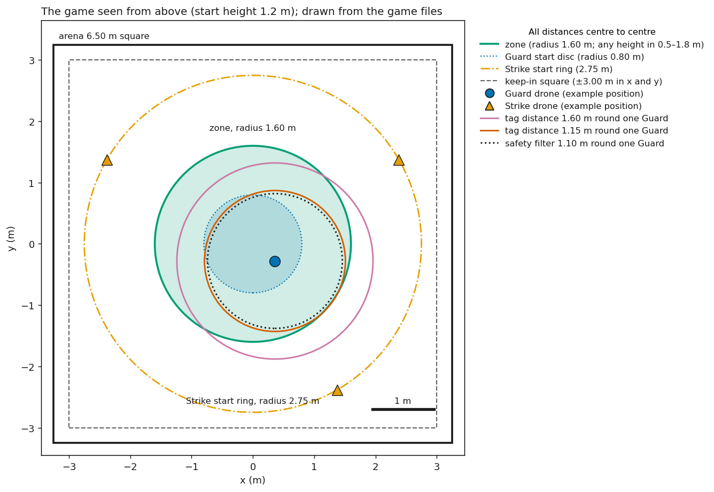

**Figure 1.** The game from above, drawn by a script from the game files. The pink and red circles are the two tag
distances (1.6 m and 1.15 m) round one Guard drone; the dotted circle is the safety filter's 1.10 m, just inside the
1.15 m tag. Drone positions are examples.

| Word | Meaning |
|---|---|
| Tag | when a Guard drone and a Strike drone come closer than the *tag distance* (3-D, centre to centre), both leave the game, one for one. The tag is a study rule: the programme's main game has none, and whether to have one is [decision row 1](#2-the-tag-distance-decision-row-1) |
| Safety filter | a copy of the flight software's collision filter; it changes every command so that pairs stay at least 1.10 m apart (not exactly: the closest seen was 0.85 m). The 1.15 m tag is this 1.10 m plus 5 cm: a tag the drones can really make |
| "N of 1,000" | every score is out of 1,000 games, one from each of 1,000 fixed starting positions, so two players can be compared game for game. Two results (the Guard network in Isaac Lab, and the delay test of the Crazyflie route) use a different, older set of 1,000 starts and an older game, the hangar game |
| Trained team v script | a *script* is a hand-written player that does not learn. A *trained team* learned by playing one fixed script of the other side; the other side never learned |
| One seed | each trained result is one training run; a repeat with a different random start (a second *seed*) might land elsewhere. None was repeated |
| Decision period | **trained players pick a new command every 0.6 s; the scripts decide every 0.05 s.** This is a known unfairness in every comparison, and it may explain one result (the Guard gain at 1.4 m) |
| Training simulator | *tier 1*, the fast engine: a simplified Starling with the flight software's command chain; most results come from it. *Tier 2*, Isaac Lab: the Starling as a physics drone with rotors. Neither is the AirStack simulator or a flight |
| GPU-hour (GPU-h) | one hour of the shared GPU; every run in this phase used the RTX 5070 Ti laptop |
| Lead's reading | the lead's interpretation, not checked by a control test |
| Hypothesis | an explanation that has not been tested |
| Exploratory | built from a first fit that real flight data has not yet confirmed |
| FIXED / PROPOSED / OPEN | a value's status: FIXED by the programme rules, PROPOSED and not yet ruled, OPEN awaiting the owner's ruling |

A Wilson 95 % interval is quoted beside some counts: the range a repeat on fresh starts would likely fall in, at most
about ±30 games at 1,000 games. A difference counts as real only when the two ranges do not overlap. More terms are in
[appendix J](#j-glossary-of-codes) and the [glossary](../docs/GLOSSARY.md).

---

## 2. The tag-distance decision (row 1)

**The short answer to "why train at 1.6 m if a team must train at the tag it plays?"** What carries over to another tag
is the drone-model work of the next phase: delay, noise and drag in the simulated drone are the same at any tag. A
trained Guard strategy did not carry over: the Guard team trained at 1.6 m holds 195 of 1,000 at 1.15 m, against 572 for the
team trained there, so in the lead's reading it is not usable for a 1.15 m demo (one seed, one opponent; the Strike
result was level within the intervals, 121 against 134). If the demo
ends up at 1.15 m, the few 1.6 m training runs in the next phase are worth only as method checks and as the 1.6 m answer;
repeating them at 1.15 m would cost at least about 5–10 GPU-h (lead's estimate: 1.5–3.1 GPU-h at 1.6 m for the 1v1 and
varied-tag reads, times the costed draft's factor of at least 3.3 for 1.15 m, [costed draft](drafts/L1_L9_COSTED_PLAN_DRAFT.md) section 4).

**What the next phase is.** Phase L1 is the drone-model phase: it adds the position estimate's delay and noise, and drag,
to the simulated Starling in Isaac Lab and in the fast engine. On the AirStack side it only records about 1 h of
velocity-step logs to compare against; AirStack code changes come in phase L7 and flight in L8. The fit stays
exploratory until a planned real flight (NEAR-962) ([costed draft](drafts/L1_L9_COSTED_PLAN_DRAFT.md)). Its tasks that
touch the tag, one line each:

| Task | What it does | GPU-h (estimate) | Depends on the tag? |
|---|---|---|---|
| L1.8 | re-scores the 1.6 m teams already trained on the new Isaac Lab drone | 0.1–1.2 | no: re-scoring works at any tag |
| L1.9 | trains a 1v1 Strike team and a 1v1 Guard team on the fast engine, plus a scripted 1v1 screen at 1.15 m | 0.5–1.9 | yes |
| L1.10 | trains 3v3 teams of both sides with the tag drawn within ±0.1 m of the chosen value | 1.0–1.2 | yes |
| L1.11 (optional) | trains a Strike team against field Guards at 1.6 m, to tell "field Guards are hard" from "1.15 m is hard" | about 0.6 | yes |
| L1.12 (optional) | scores the 1.6 m Guard team against every Strike script (its 913 is against one) | minutes | yes |

**Why 1.6 m for those few training reads.**

- It is the only tag where both trained sides beat the scripts, each scored against one opponent (Guard 913 against
  808, against straight Strikes only; Strike 636 against 192 against its training opponent, 85 against 284 against field
  Guards). At 1.4 m the Strike team also beat its script (740 against 328, one opponent) and the Guard gain may come from
  the decision period. So 1.6 m is the cheapest place to check that a method works.
- Planning cost for all later phases (L1–L9, the drone-model phase through documentation) is about 87 GPU-h at 1.6 m, against at least 135 at 1.15 m with no upper figure until a
  route to 1.15 m is shown ([costed draft](drafts/L1_L9_COSTED_PLAN_DRAFT.md), section 4).
- It leaves a flight safety margin of 0.5 m over the filter's 1.10 m (nominal; nothing has been flown).

**What the lead concedes.** Re-scoring (L1.8) works at any tag, so "the 1.6 m teams are a good test bench" is a weak
argument for it. And if the demo is played at 1.15 m, a tag drawn within ±0.1 m of 1.6 m never reaches 1.15 m.

**The options.**

| Option | Cost, phases L1–L9 (planning) | First approval | Catch |
|---|---|---|---|
| (a) 1.6 m | about 87 GPU-h | L1 + L2: 11 GPU-h (10 base + the two optional checks) | not the realistic tag; the Strike evidence is one opponent deep |
| (b) 1.4 m | same as (a) | same as (a) | Guard 747 against 672 may be the decision period, not learning; Strike 740 against 328 against one opponent |
| (c) 1.15 m | at least 135 GPU-h, no upper figure | L1 + the curriculum pilot: 15 GPU-h (L1 first, the lead re-costs the rest) | nothing trained beats the scripts yet (Guard 572 against 645, Strike 134 against 355) |
| **(d) decide later** | as (a) until the choice, plus about 0.7 for the shorter-clock run | L1 + L2: 12 GPU-h (lead's recommendation) | the 1.15 m route is only probed, not solved, by the end of L2 |

**The lead's recommendation: option (d).** This is a recommendation, not a finding.

1. The tag-independent drone-model work of L1 goes ahead now.
2. L1's few training reads run at 1.6 m, because it is the only tag where both trained sides beat the scripts (each
   scored against one opponent); at 1.4 m the Strike team also beat its script (740 against 328, one opponent) and the
   Guard gain may come from the decision period. That makes 1.6 m the cheapest place to check the method.
3. A small 1.15 m side track runs alongside: the optional field-Guard Strike run (L1.11, about 0.6 GPU-h, inside the 11)
   and a 1.15 m Strike run with a shorter game clock, which tests the "too few finished games" lead of
   [section 5.6](#56-the-longer-115-m-runs). The costed draft does not cost that run; the lead estimates about 0.7 GPU-h
   (one Strike run at the base budget took 0.594 GPU-h at 1.6 m, [T46](../records/2026-11-21_ste_l012_best_response_record.md),
   and 1.15 m runs are 1.1–1.3× slower per game-step, costed draft R10). It is not inside the 11.
4. **Budget under (d):** 10 GPU-h base (drone-model phase up to 6.1 + game-rules phase up to 3.9) + about 1 for the two
   optional checks + about 0.7 for the shorter-clock run, so the lead recommends approving **12 GPU-h** for L1 + L2
   (lead's estimate), plus about 1 h of AirStack simulator time. Under (a) or (b) it would be 11, under (c) 15.
   [G0_DECISION](G0_DECISION.md) still says 10 and 11; it is rewritten after the ruling.
5. The demo's tag is chosen at the end of L2 (the game-rules phase).

Under every option, every trained result so far is 3v3 while the demo is 1v1, and the first demo is the scripted 1v1 at
1.6 m. This updates recommendation 1 of [G0_DECISION](G0_DECISION.md) ("1.6 m for L1 set-up and pilots"); the lead will
rewrite it after the owner rules.

### 2.1 What phase L0 can and cannot say about 1.6 m against 1.15 m

**Short answer: L0 does not show which tag gives the better swarm strategy.** It answers a narrower question, one side at
a time, with a simple recipe.

- **What L0 trained.** One side at a time, against one fixed script, one seed, one network per drone, in the fast engine
  (section 5.5). The planned main training (the league phase) is different: both teams learn, against each other and a
  pool of past opponents, with the learner built in phase L3, in Isaac Lab, three seeds.
- **The 1.6 m runs were short; the 1.15 m runs were longer.** A standard run is 0.55 billion game-steps. At 1.15 m the
  Guard team trained three times that (1.65 billion) and the Strike team five times (2.76 billion, section 5.6). The
  Strike run is inside the range planned for one league run (2–5 billion per seed, [costed draft](drafts/L1_L9_COSTED_PLAN_DRAFT.md) section 1 and
  task L5.5, PROPOSED), but only loosely comparable: fast engine, one side learning, a different learner. Both trained
  sides still stayed below the scripts, and no cause is known.
- **Guard side: the 1.15 m game was harder to learn.** Against the same opponent at both tags, the trained Guard team
  beat the script at 1.6 m (913 against 808) and stayed below it at 1.15 m (572 against 645, with three times the
  training). One seed.
- **Strike side: not shown either way.** The Strike team's opponent changed with the tag, and the same 1.6 m-trained
  Strike team reaches 636 against its training opponent but 85 against a second Guard script (section 5.7). Whether the
  tag or the opponent is the difficulty is not separated; the optional Strike run against field Guards at 1.6 m
  (task L1.11, about 0.6 GPU-h) would separate them.
- **The scores of the two tags do not compare directly.** The tag changes the game: the best scripted Guards hold 808
  at 1.6 m and 645 at 1.15 m. "Better" here means "the trained team beats the scripts of the same game".
- **So 1.6 m is the set-up tag, not the answer to which tag is better.** It is the tag where the Guard side's training
  worked, and where the Strike side's worked against one opponent (it fails against a second), so the pipeline can be
  built and checked there. It is also the tag of the first demo, the scripted 1v1, because of its safety margin over
  the filter's 1.10 m. 1.15 m stays the realistic target; whether the full pipeline can train it is open, and option (d)
  above leaves that choice until the end of the game-rules phase.

### 2.2 Training at another tag distance

**Short answer: phases L0 to L9 build the pipeline once; a new tag reruns a large part of it, but no new code.** The
tag is one setting in a game file (`configs/ste_l011/tag_*.toml`). This section is the lead's reading of the
[costed draft](drafts/L1_L9_COSTED_PLAN_DRAFT.md); the plan does not spell out a new-tag procedure.

| Done once, reused for every tag | Phase |
|---|---|
| The realistic drone model (redone only if the drone changes) | L1 |
| The game rules in the training code (only their checks rerun, row 1 of the next table) | L2 |
| The learner | L3 |
| The scoring suite's code | L4 |
| The documentation (a results update per tag) | L9 |

| Repeated for each new tag, in order | From | GPU-h (costed draft, at 1.6 m) |
|---|---|---|
| 1. Check the game is learnable at the new tag: the scripts re-screened under the full rules (task L2.5), then one training read per side under the full rules (task L2.7), scored against every script | L2 | 0.3–0.5, then 1.0–1.4 |
| 2. Re-calibrate the scoring on known players (task L4.3) and freeze new pass/fail limits; the owner approves them | L4 | 0.7–4.5 |
| 3. League pilots, then the long training runs in Isaac Lab, three seeds (tasks L5.3–L5.5) | L5 | 33 to at least 100 |
| 4. Score the runs, cross-checks, export, the intercept hand-over at the new tag (L6) | L6 | 4.3–27 |
| 5. Games in the AirStack simulator (L7.2) | L7 | about 2 h of simulator time |
| 6. Flight, with the flight checks redone for the new tag (scoring at the tag, separation, arena fit, logging) and the owner's approval | L8 | a flight campaign |

Steps 2–4 alone are about 75 of the 87 GPU-h planned (planning figures 2 + 63 + 10) for phases L1–L9 at 1.6 m. At 1.15 m the training rows need at
least 3.3 times the game-steps (costed draft section 4), with no upper figure, because no recipe has been shown to work there.

Two cautions:

- **Step 1 can fail.** At 1.15 m, training stayed below the scripts even at three to five times the standard budget
  (section 5.6). A tag that fails needs a new recipe before step 3, at a cost nobody can give yet.
- **A new tag can change the game, not only the numbers.** At 1.6 m the tag equals the zone radius; at 1.15 m the tag
  sits just outside the safety filter's 1.10 m. Step 1 also tests that the game still makes sense.

A trained Guard strategy did not carry over between tags (the 1.6 m Guard team holds 195 at 1.15 m against 572 for one
trained there, section 5.7, one seed); the Strike result was level within the intervals (121 against 134). Training
with the tag drawn within ±0.1 m only makes a strategy robust near one tag. Two routes between tags are written down,
both untested: starting 1.15 m training from the 1.6 m networks (a warm start, panel proposal,
[DISCUSSION §12](DISCUSSION_2026-11-19_20.md#12-l012c-findings-22-nov-2026)), and the optional curriculum pilot that
steps the tag down from 1.6 m (costed draft task L2.8).

---

## 3. All decisions at a glance

The decision page is [G0_DECISION](G0_DECISION.md); section 4 below gives the evidence row by row. "If wrong" is the
lead's view of what a wrong call would cost.

| Row | Decision | Options | Recommended | Cost (GPU-h) | If the recommendation is wrong |
|---|---|---|---|---|---|
| 1 | Tag distance | 1.6 m, 1.4 m, 1.15 m, or decide later | decide later; drone-model work now, the few training reads at 1.6 m, a small 1.15 m side track | next two phases: (a) or (b) 11; (c) 15 (costed draft); (d) 12 (lead's estimate) all later phases, drone model through documentation: about 87 at 1.6 m or 1.4 m; at least 135 at 1.15 m | the 1.6 m training reads are redone at 1.15 m: at least about 5–10 GPU-h (lead's estimate) |
| 2 | Longer 1.15 m runs | — | done; nothing to rule | 4.71 used | — |
| 3 | Vary the tag in training | fixed tag, or drawn within ±0.1 m | vary, tested in the next phase | 1.0–1.2 | strategies stay brittle to tag error, or about 1 GPU-h is spent for nothing |
| 4 | What a tag costs | both drones leave, or the Guard survives | both leave | none | with a surviving Guard the scripted game is one-sided (Guards hold every game) |
| 5 | Zone size | 1.6 m or 2.4 m | 1.6 m | none | a 2.4 m zone hands the game to the Strike team (scripted Guards hold 89) |
| 6–8 | Team sizes | 1v1, 2v1, 3v3, 5v3 | 3v3 for training; 1v1 trained and tested next | 1v1 reads 0.5–1.9; 5v3 in training would add 18–98 | strategies may not transfer from 3v3 to the 1v1 demo; the 1v1 reads would show it early |
| 9 | Arena and Strike start ring | 6.5 m with 2.75 m, or 7.5 m with 3.2 m | 6.5 m with 2.75 m | none | the arena changes later and training is redone |
| 10 | Where to train | Isaac Lab; or fast engine with Isaac Lab checks; or a mix | Isaac Lab | about 87 (46 to at least 149), against about 37 (16–104) or 24–114 | about 50 GPU-h more than the fast-engine route (planning figures 87 against 37, [costed draft](drafts/L1_L9_COSTED_PLAN_DRAFT.md) section 4), or strategies that do not hold on the physics drone |
| 11 | Environments | open arena, or realistic 3-D worlds sooner | open arena first | none now; 3-D worlds would add 26–83 plus build work | the programme's realistic-world rule is met later |
| 12 | Which fleets fly | Starlings, Crazyflies, or a mix | Crazyflies first at Starling distances; Starling 1v1 as planned | not costed in GPU-h (Crazyflie side: build work in that repository) | Crazyflie lag turns out to need its own drone model and training (6–56 more, estimate) |
| 13 | The real demo | learned or scripted 1v1 | scripted 1v1 at 1.6 m until a trained team passes a panel of opponents | not costed (about 2 h of AirStack simulator time, then flight slots) | a learned demo comes later than hoped |
| 14 | Physical intercept | in simulation only, or real | simulation only | not costed | none for flight safety; a real intercept needs other hardware |
| 15 | Budget for the next two phases | 10 (base), 11 (with optional checks), 12 (with the 1.15 m test run), 15 (1.15 m route), or 6.5 (first phase only) | 12 with option (d); 11 with (a) or (b); 15 with (c) (lead's recommendation) | drone-model phase up to 6.1 + game-rules phase up to 3.9 = 10; optional checks (the field-Guard Strike run, about 0.6; scoring the 1.6 m Guard team against every Strike script and the cross-play scoring, minutes) = about 10.6–11; the shorter-clock 1.15 m Strike run about 0.7 (lead's estimate) = about 12; plus about 1 h of AirStack simulator time in each case | every hour is an estimate; a later request if the reads overrun |
| 16 | Decision period | keep 0.6 s, or decide more often | keep 0.6 s | none | trained players stay handicapped (or favoured) against scripts in every comparison |
| 17 | RTX 5090 checks | laptop first or the 5090 | first item of the next 5090 session (lead's call; the owner may confirm at G0) | 0.3–0.5 ([costed draft](drafts/L1_L9_COSTED_PLAN_DRAFT.md), task L1.0; the speed measure it repeats used 0.294) | none: the laptop's part is done |

---

## 4. Every other decision (rows 2–17)

**Row 2. Longer 1.15 m runs.** These are done (4.71 GPU-h): the Guard team at 3× the training holds 572 against the
script's 645, and the Strike team at 5× reaches 134 against 355 ([section 5.6](#56-the-longer-115-m-runs)). There is
nothing to rule; the result feeds row 1.

**Row 3. Vary the tag distance in training.** The choice is one fixed tag, or a tag drawn within ±0.1 m of the chosen
value in each game, so that strategies tolerate a tag measured a little wrong. It was not tested in L0, where every run
used one tag. The lead recommends varying it and testing that in L1 (L1.10, about 1.0–1.2 GPU-h). The catch: ±0.1 m round
1.6 m does not reach 1.15 m.

**Row 4. What a tag costs.** Either both drones leave (one for one), or the Guard drone survives. In the scripted screen a
surviving Guard makes the Guard team hold all 1,000 games, and one for one is what every trained run used
([T44](../records/2026-11-21_ste_l011_screen_record.md)). The lead recommends one for one. Values between "always" and
"never survives" were not run.

**Row 5. Zone size.** With a 2.4 m zone the best scripted Guard team holds only 89 of 1,000, so the game becomes the
Strike team's; at 1.6 m it is two-sided at the closer tags (scripted screen only). The lead recommends keeping 1.6 m.
The catch: the 2.4 m test also shortened the run-in from the start ring (from 1.15 m to 0.35 m), so two things changed.

**Rows 6–8. Team sizes.** The candidates are 1v1 (the two-Starling demo), 2v1 and 5v3 (the programme's sizes) and 3v3
(NUS's size). Every trained run was 3v3. With scripts only, a good Guard team holds every 1v1 and 2v1 game and 998 of
1,000 at 5v3, so those sizes look one-sided until training is tried on them. The lead recommends 3v3 for training and
training and testing 1v1 explicitly in L1 (L1.9), because 1v1 is the demo size and scripts alone make it trivial for the
Guard team. Two things are open: 1v1 was not screened at 1.15 m, and whether eight drones fit the 6.5 m arena is not
known ([T45](../records/2026-11-21_ste_l014_crazyflie_route_record.md)).

**Row 9. Arena and Strike start ring.** Every trained run used the 6.5 m arena with the 2.75 m ring. A 7.5 m arena with a
3.2 m ring makes scripted Guards hold 920. The lead recommends 6.5 m and 2.75 m. The screen changed the arena and the ring
together, so their effects are not separated.

**Row 10. Where to train (decision D3).** Training everything in Isaac Lab is planned at about 87 GPU-h for L1–L9 (46 to
at least 149). Training on the fast engine and checking in Isaac Lab would cost about 37 (16–104); a fast-engine league
with an Isaac Lab fine-tune 24–114 ([costed draft](drafts/L1_L9_COSTED_PLAN_DRAFT.md)). Isaac Lab trains as well as the
fast engine on one Guard task, at about 5× the cost ([section 5.4](#54-isaac-lab-can-train-at-about-five-times-the-cost)).
The lead recommends keeping D3. The catch: the costed draft still puts some quick training reads on the fast engine (its
open question A12, the owner's call), and Isaac Lab's physics check sits near its limit at 16,384 games at once.

**Row 11. Environments.** Every L0 game was in the open arena. The lead recommends the open arena first. The programme's
FIXED rule asks for realistic 3-D worlds (the construction site first); one such step would add about 26–83 GPU-h plus
build work.

**Row 12. Which fleets fly.** The options are all Starlings, all Crazyflies, or a mix. This is a planning item; its inputs
are in [appendix C](#c-the-crazyflie-route). The lead recommends Crazyflies first at Starling distances, the Starling 1v1
as planned and the mix later. Whether both drone types share one policy file is open.

**Row 13. The real demo.** The owner's proposal is a 1v1 game with the tag measured by motion capture, the same rule as in
simulation. Two Starlings cannot play on after a tag, because AirStack's land command lands every drone. The lead
recommends showing the scripted 1v1 at 1.6 m until a trained strategy passes a panel of opponents (every team against
every opponent, worst result reported, two seeds). A learned demo therefore comes after that panel.

**Row 14. Physical intercept.** The owner's proposal is to show a terminal intercept at the tag distance in simulation
only. The lead agrees. A real intercept would need other hardware and a separate flight-safety decision.

**Row 15. Budget.** L1 is estimated at up to 6.1 GPU-h and L2 at up to 3.9, so 10 GPU-h covers both. The two optional
checks (L1.11, about 0.6 GPU-h; L1.12 and the cross-play scoring, minutes each) bring this to about 10.6–11, so
approving 11 covers them ([G0_DECISION](G0_DECISION.md) recommendation 6 and row 15). On option (d) the 1.15 m shorter-clock Strike
run comes on top: the costed draft does not cost it, and the lead estimates about 0.7 GPU-h. So the lead recommends
approving 12 GPU-h under (d), 11 under (a) or (b), and 15 under (c) (L1 plus the curriculum pilot), each plus about 1 h of
AirStack simulator time (lead's recommendation; G0_DECISION still says 10 and 11 and is rewritten after the ruling). The
smallest alternative is L1 alone at 6.5 GPU-h. Phase L0 used
13.77 of its 19. Every hour is an estimate from L0's measured rates; the league runs of L5 drive the total.

**Row 16. Decision period.** Trained players hold each command for 0.6 s (12 ticks). Scripts with their commands held
0.6 s barely change (808 → 793 holds), except the low Strike script at 1.4 m (672 → 738)
([follow-ups](../docs/notes/2026-11-21_ste_l011_followups.md)). The lead recommends keeping 0.6 s. The catch: the scripts
decide every 0.05 s in every comparison, and the learner's own decision period was never varied.

**Row 17. RTX 5090 checks.** The owner asked for this part on the laptop first. It checks the 5090 machine itself (its CPU
type, its reference positions, its job drills), not graphics memory, so the lead keeps it as the first item of the next
5090 session ([DISCUSSION §11](DISCUSSION_2026-11-19_20.md#11-owner-decisions-and-a-lead-correction-21-nov-2026)); the
laptop's own part is done. The owner may confirm at G0.

---

## 5. The evidence

### 5.1 The game in detail

| Item | Value | Status | Source |
|---|---|---|---|
| Arena | 6.5 m square; every drone is kept within ±3.0 m of the centre in x and in y (the keep-in square) | PROPOSED | [base.toml](../configs/ste_l011/base.toml), `core/game.py` |
| Zone | circle of radius 1.6 m round the arena centre | OPEN | same |
| Height | drones fly between 0.5 m and 1.8 m; every drone starts at 1.2 m | PROPOSED | same |
| Starts | Guard drones inside a 0.8 m disc round the zone centre; Strike drones on a ring of radius 2.75 m | PROPOSED | same |
| Speeds | Strike drones 0.5 m/s, Guard drones 0.333 m/s | FIXED | same |
| Game length | 120 s (2,400 ticks of 0.05 s) | PROPOSED | same |
| Decision period | trained players 0.6 s (12 ticks); scripts every tick, 0.05 s | PROPOSED | [GAME_SPEC](GAME_SPEC.md), [gate file](../configs/ste_l012/gates.toml) |
| Safety filter | 0.55 m per drone, so 1.10 m centre to centre | FIXED | [parameter file](../params/real_exploratory_v0.toml) |

**Winning.** The Strike team wins the moment any one Strike drone is inside the zone; only the horizontal distance counts,
at any height in the band. If both teams would win on the same tick, the Strike team wins: the code checks the zone first
(`source/svg_training/core/game.py:312-318`). The Guard team wins if the 120 s clock runs out or no Strike drone is left.

**The tag.** A Guard drone and a Strike drone strictly closer than the tag distance (3-D, centre to centre) both leave the
game. If several pairs are in range, the nearest pair goes first and each drone takes part in at most one tag
(`source/svg_training/core/pair_rules.py:77-83`); `guard_survives_tag_prob = 0.0`, so the Guard drone never survives.
Tags are applied before the zone check on each tick. The programme's main game has no tag (FIXED,
[GAME_SPEC](GAME_SPEC.md) row `tag_rule.main_game_has_tag`); whether to have one is the owner's ruling (P1). Without a
tag, Guard drones can only block and let the filter push Strike drones aside, and the best Strike script then reaches the
zone in every game ([T44](../records/2026-11-21_ste_l011_screen_record.md)). Every trained run used the tag.

**The filter is not exact.** In one delay test, 198 of 1,000 games came closer than 1.10 m, 7 under 1.0 m, and the closest
pair was 0.85 m apart ([T45](../records/2026-11-21_ste_l014_crazyflie_route_record.md), part 1, Starling row; hangar
game).

**Rewards and training.** The learner gets +1 for a win and −1 for a loss at the end of the game; every drone of the team
gets the team's value. In the trained runs the Strike side also gets a reward for progress toward the zone edge (weight
1.0; hovering earns nothing), because without it the Strike learner's pilot saw no wins against the best Guard script (0
reaches in three probe updates) ([gate file](../configs/ste_l012/gates.toml), `side_overrides`;
[T46](../records/2026-11-21_ste_l012_best_response_record.md)). The Guard side gets win or loss only. Each run trains
one side against one fixed script of the other side (a *best response*). Each drone of the trained team has its own
network, trained with PPO, a standard reinforcement-learning method (T46); the one shared network per team of decision
D6 is for later phases. A standard run plays about 550 million game-steps (one game-step = one 0.05 s tick of one game),
16,384 games at once.

### 5.2 How we test

**The scripts** (`source/svg_training/opponents/scripted.py`):

| Script | What it does |
|---|---|
| guard_mark_edge | each Guard drone marks one Strike drone and sits on the zone edge between the zone centre and that drone |
| guard_field | each Guard drone is pulled to the zone-edge point facing the nearest Strike drone and pushed away from team-mates closer than 1.1 m |
| guard_mirror | each Guard drone holds a ring at 1.2 times the zone radius toward its marked Strike drone and copies that drone's sideways movement |
| guard_parked_centre ("parked") | a lone Guard flies to the zone centre and stops; with two or more Guards, each simply holds its start position |
| guard_parked_ring | the Guard team parks on a ring round the zone centre (0.8 m for up to three Guards) and ignores the Strike drones |
| strike_straight | flies straight at the zone centre |
| strike_flank | flies straight unless a Guard drone blocks the line, then aims at a point beside that Guard |
| strike_high, strike_low | climb (or descend) to 0.1 m inside the top (or bottom) of the height band first, then fly straight in |
| strike_sacrifice, strike_converge | one Strike drone draws a Guard while the others enter opposite; or all Strike drones arrive together from spread bearings |

The best script of a side is the one with the highest worst-case win rate against the other side's scripts:

| Tag | Best Guard script | Best Strike script |
|---|---|---|
| 1.6 m | guard_mark_edge | strike_straight |
| 1.4 m | guard_mirror | strike_low |
| 1.2 m and 1.15 m | guard_field | strike_straight |

Sources: [T44](../records/2026-11-21_ste_l011_screen_record.md), [T50](../records/2026-11-21_ste_l012b_screen_record.md).

**The starts.** Scores are out of 1,000 games from the same 1,000 fixed starts (seed 110000), except two: the Guard
network re-scored in Isaac Lab ([T49](../records/2026-11-21_ste_l03_transfer_record.md)) and the Crazyflie delay test
([T45](../records/2026-11-21_ste_l014_crazyflie_route_record.md), part 1) use the earlier hangar game and its starts
(seed 1101).

### 5.3 The scripted screen

**In one line:** with scripts only, tag distances of 1.15–1.4 m give a two-sided game; most other settings make it
one-sided.

Every Guard script played every Strike script, 1,000 games per pairing, changing one factor at a time from the base game
(3v3, tag 1.6 m, zone 1.6 m, 6.5 m arena) ([T44](../records/2026-11-21_ste_l011_screen_record.md); tag 1.15 m in
[T50](../records/2026-11-21_ste_l012b_screen_record.md)).

| Setting | Best Guard script holds (worst case) | Best Strike script reaches (worst case) |
|---|---|---|
| base (tag 1.6 m) | 808 | 192 |
| tag 1.8 m | 932 | 68 |
| tag 1.4 m | 672 | 328 |
| tag 1.2 m | 645 | 355 |
| tag 1.15 m | 645 | 355 |
| no tag (filter only) | 0 | 1,000 |
| zone 2.4 m | 89 | 911 |
| Guard survives its tag | 1,000 | 0 |
| arena 7.5 m (ring 3.2 m) | 920 | 78 |
| 1v1 | 1,000 | 0 |
| 2v1 | 1,000 | 0 |
| 5v3 | 998 | 2 |

"Worst case" is the best script's score against the other side's hardest script, so the columns need not add to 1,000.

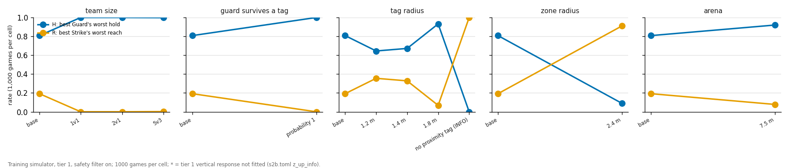

**Figure 2.** Blue: best scripted Guard team's worst-case hold rate; orange: best scripted Strike team's worst-case
reach rate, per factor, 1,000 games each. Only the 1.2 m and 1.4 m tags pull both teams away from the 0 and 1 ends
([T44](../records/2026-11-21_ste_l011_screen_record.md)).

**What it shows.** With scripts every hold is a one-for-one trade: no scripted game with the tag on reached the clock, and
at 1v1 and 3v3 every hold ended with all Guard drones tagged out too. At 1v1 the parked Guard holds 693, 541, 0 and 0
against the straight, flanking, high and low Strike scripts; the mark-edge, mirror and field Guard scripts hold 1,000
against all four ([results table](../docs/figures/ste_l011/results_2026-11-21_ste_l011_screen.md)). **What it does not
show.** Whether training changes the picture. The 2.4 m zone also shortened the run-in, and the 7.5 m arena also moved the
ring. The high and low Strike scripts depend on a vertical response tier 1 has not fitted. 1v1 was not screened at 1.15 m.

### 5.4 Isaac Lab can train, at about five times the cost

**In one line:** a Guard team trained in Isaac Lab ends where the same training in the fast engine ends, at about five
times the cost per game-step (lead's reading; one seed, one opponent).

| Question | Result | Record |
|---|---|---|
| How fast? | 3v3 on the laptop GPU: tier 1 51k–208k game-steps/s, Isaac Lab 10k–67k; Isaac Lab 4.9–5.3× slower at 3v3, 9.8× at 1v1 | [T48](../records/2026-11-21_ste_l02_speed_record.md) |
| Does a fast-engine network work in Isaac Lab? | the earlier STE Guard network holds 856 in Isaac Lab against 831 in tier 1, a difference of 25 games (sign test p = 0.033), in the hangar game | [T49](../records/2026-11-21_ste_l03_transfer_record.md) |
| Does Isaac Lab train? | PASS: trained Guards hold 832 (parked Guards 538); the tier 1 twin run holds 836 (parked 534); 1.29 GPU-h against 0.24 | [T53](../records/2026-11-21_ste_l013_tier2_trains_record.md) |
| Physics check at scale | 0.0166 m of the 0.02 m limit at 16,384 games | [T53](../records/2026-11-21_ste_l013_tier2_trains_record.md) |

| Training speed, both simulators | Isaac Lab and tier 1 learn alike |
|---|---|
| 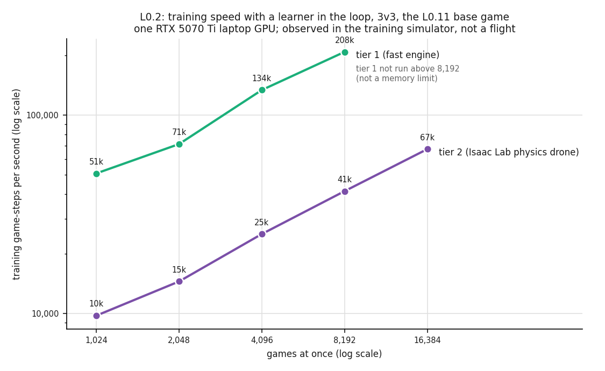 | 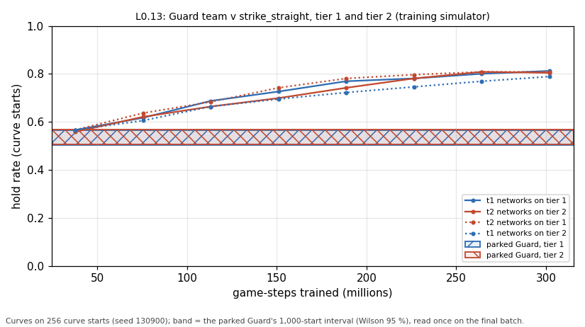 |
| **Figure 3.** Game-steps per second against games at once, 3v3, laptop GPU ([T48](../records/2026-11-21_ste_l02_speed_record.md)). Isaac Lab sits about five times below tier 1 at the same game count. | **Figure 4.** Hold rate during training in each simulator, read on 256 separate curve starts ([T53](../records/2026-11-21_ste_l013_tier2_trains_record.md)). The two curves track each other and end near 0.8. One seed, one opponent. |

**What it shows.** Training in Isaac Lab works for the Guard side of the base game; in the training test, each network
plays within 22 games of itself on the other simulator. **What it does not show.** The Strike side was not trained in
Isaac Lab. It is one seed, one opponent and one start set (lead's reading). The physics check sits close to its limit, so a
larger world, for example on the RTX 5090, may fail it.

### 5.5 Trained teams at 1.6, 1.4, 1.2 and 1.15 m

**In one line:** training beat the best script on both sides at 1.6 m and on the Strike side at 1.4 m, each against one
opponent; at 1.2 m and 1.15 m the trained Guard team learned a lot but ended below the script.

One Guard run and one Strike run per tag distance, each about 550 million game-steps, each against the best script of the
other side ([T46](../records/2026-11-21_ste_l012_best_response_record.md),
[T47](../records/2026-11-21_ste_l012_tag_1p2_strike_record.md),
[T51](../records/2026-11-21_ste_l012b_best_response_record.md),
[T52](../records/2026-11-21_ste_l012b_tag_1p15_strike_record.md)).

| Tag | Trained Guard team holds (best script; untrained) | Trained Strike team reaches (best script; untrained) |
|---|---|---|
| 1.6 m | **913** (808; 534), against straight Strikes only | **636** (192; 0), against mark_edge only |
| 1.4 m | **747** (672; 224), against low Strikes | **740** (328; 0), against mirror only |
| 1.2 m | 503 (645; 144) | run ABORTED |
| 1.15 m | 466 (645; 101) | run ABORTED |

"Untrained" is the network as training starts it: it commands zero speed, so its drones hold still
(`source/svg_training/ste/exploit.py`); the gap to it shows how much was learned. An ABORTED run stopped before its
budget and proves nothing ([appendix E](#e-aborted-runs-information-only)).

| Trained team v best script v untrained, per tag | Learning curves by tag |
|---|---|
| 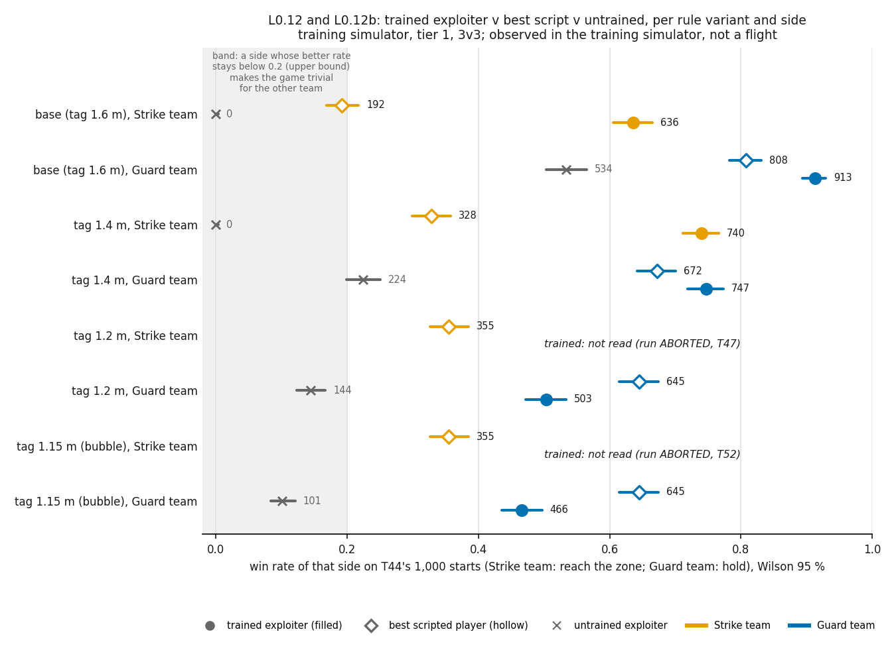 | 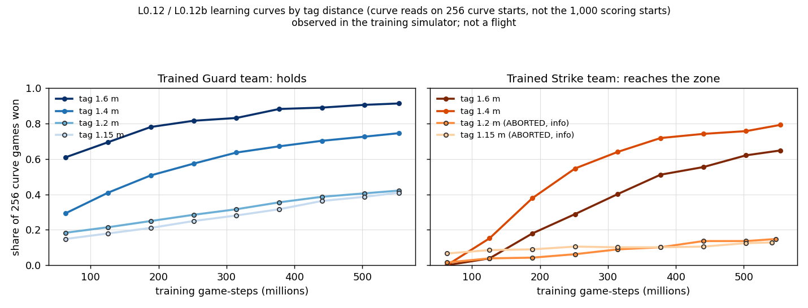 |
| **Figure 5.** Dot: trained team (the title's "exploiter"; "L0.12", "L0.12b" are the training tasks, "T44's starts" the 1,000 fixed starts); diamond: best script; cross: untrained. The dot is right of the diamond at 1.6 m and 1.4 m and, for Guards, left of it at 1.2 m and 1.15 m ([T46](../records/2026-11-21_ste_l012_best_response_record.md), [T51](../records/2026-11-21_ste_l012b_best_response_record.md)). | **Figure 6.** Share of 256 curve games won during training ([curve_reads.csv](../docs/figures/ste_l012/curve_reads.csv)). At 1.2 m and 1.15 m the Guard curves were still climbing when the budget ended; at 1.6 m the Guard curve was levelling off. Strike curves at 1.2 m and 1.15 m come from ABORTED runs. |

| 1.6 m, trained Strike team reaches (3-D replay) | 1.6 m, trained Guard team holds (3-D replay) |
|---|---|
| 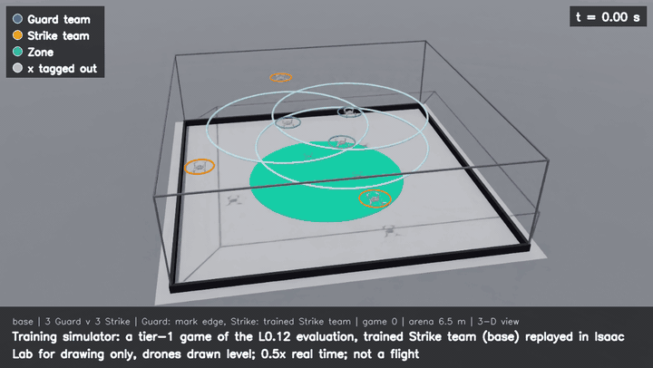 | 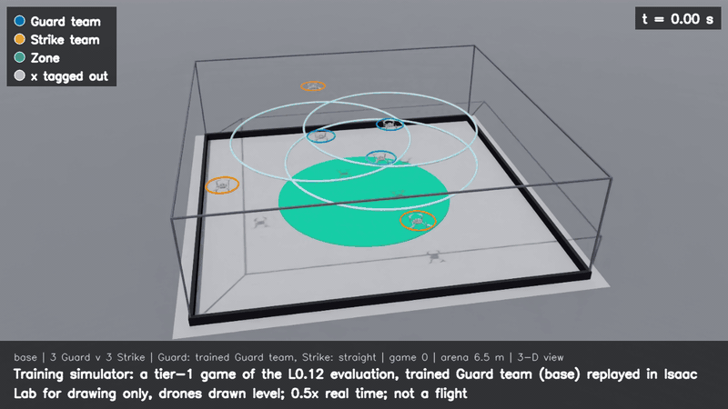 |
| **Clip 1.** Trained Strike team against mark-edge Guards, scoring game 0: reach at 6.1 s. The faint circle round each Guard is its tag distance ([T46](../records/2026-11-21_ste_l012_best_response_record.md)). Replayed in Isaac Lab for drawing; not a flight. | **Clip 2.** Trained Guard team against straight Strikes, scoring game 0: hold at 2.5 s, three tags for three ([T46](../records/2026-11-21_ste_l012_best_response_record.md)). Replayed in Isaac Lab for drawing; not a flight. |

**What it shows.**

- **1.6 m.** Both trained teams beat their training opponent's best script, and the intervals do not overlap. The
  trained Strike games last longer (median 7.5 s against 2.4 s for the scripts on the same starts).
- **1.4 m.** The Strike gain is large (740 against 328). The Guard gain (747 against 672) may come from deciding every
  0.6 s rather than from learning: the low Strike script with its commands held 0.6 s already gives the Guard script
  738 holds (range 710–764) ([follow-ups](../docs/notes/2026-11-21_ste_l011_followups.md)). Against straight Strikes the
  1.4 m trained Guard team shows no gain (673 against 701).
- **1.2 m and 1.15 m.** The trained Guard teams learned (503 and 466 against 144 and 101 untrained) but ended below the
  field-Guard script's 645. The first reading, "training only works at 1.4 m and wider", was withdrawn because the curves
  were still rising ([appendix F](#f-what-was-corrected-along-the-way)).

**What it does not show.** Each trained team was scored against one opponent, its training opponent
([section 5.7](#57-the-cross-tag-check) tests a second). One seed per side. There is no completed Strike run at 1.2 m or
1.15 m in this set; section 5.6 has the longer 1.15 m Strike run.

### 5.6 The longer 1.15 m runs

**In one line:** three times the training lifted the Guard team from 466 to 572 holds and five times the training gave
the Strike team 134 reaches, but both stayed below the scripts (645 and 355).

The same recipe with new seeds: the Guard team at 3× the steps (1.65 billion) and the Strike team at 5× (2.76 billion),
together 4.71 GPU-h ([T54](../records/2026-11-22_ste_l012c_tag_1p15_guard_record.md),
[T55](../records/2026-11-22_ste_l012c_tag_1p15_strike_record.md)).

| Side | Budget | Trained (of 1,000) | Untrained | Best script | Curve (share of 256 curve games) |
|---|---|---|---|---|---|
| Guard | 3× | 572 holds (range 541–602) | 101 | 645 (615–674) | 0.50 at 1.07 B → 0.54 at 1.57 B game-steps, slowing |
| Strike | 5× | 134 reaches (114–157) | 0 | 355 (326–385) | 0.102 at 0.57 B → 0.176 at 2.76 B, still rising |

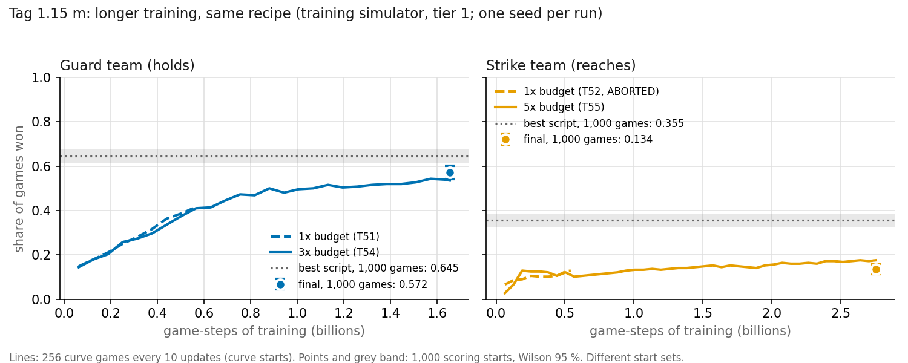

**Figure 7.** Lines: learning curves at 1× (dashed) and the longer budgets (solid). Points: final 1,000-game results;
grey band: the best script, Wilson 95 %. Both final points sit below the script's band
([T54](../records/2026-11-22_ste_l012c_tag_1p15_guard_record.md), [T55](../records/2026-11-22_ste_l012c_tag_1p15_strike_record.md)).

| 1.15 m, trained Guard team at 3× (2-D) | 1.15 m, trained Strike team at 5× (2-D) |
|---|---|
| 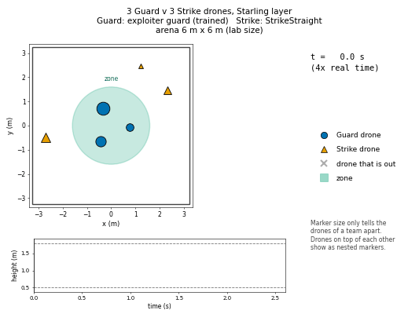 | 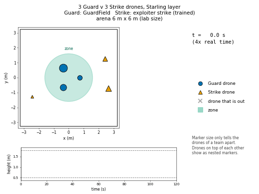 |
| **Clip 3.** Trained Guard team against straight Strikes; the Guard team holds at 2.6 s. Over 1,000 scoring games: 572 holds, script 645 ([T54](../records/2026-11-22_ste_l012c_tag_1p15_guard_record.md)). Tier 1, top view with height panel, 4× real time. | **Clip 4.** Trained Strike team against field Guards; the game runs to the 120 s clock (a hold). Over 1,000 scoring games: 134 reaches, script 355 ([T55](../records/2026-11-22_ste_l012c_tag_1p15_strike_record.md)). Tier 1, 4× real time. |

**What it shows.** Both sides learned, and more training helped the Guard side. In the Strike team's 1,000 scoring games,
824 ran to the 120 s clock; the Strike team ended with one drone left in 793 games, two in 114, three in 51 and none in 42.
It usually trades two Strike drones for two Guards, then the last Strike drone waits out the clock against the last Guard
instead of running for the zone ([T55](../records/2026-11-22_ste_l012c_tag_1p15_strike_record.md)). In these trained games
every tag happened between 1.12 m and 1.15 m, and none at or inside 1.11 m, so about 4 cm of the nominal 5 cm band is used
([DISCUSSION §12](DISCUSSION_2026-11-19_20.md#12-l012c-findings-22-nov-2026)).

**What it does not show.** Whether still more training, or a different recipe, closes the gap. No cause is known. One
measured difference stands out: at 1.2 m and 1.15 m most Strike training games run to the clock, so per game-step the
Strike learner sees about 13–15 times fewer finished games than at 1.6 m and 1.4 m (per training update: 3,106 and 3,191
at 1.2 m and 1.15 m, against 40,451 and 48,211 at 1.6 m and 1.4 m). Whether that causes the slow learning is **not
tested** ([DISCUSSION §12](DISCUSSION_2026-11-19_20.md#12-l012c-findings-22-nov-2026)). A second hypothesis, also
untested: a loss 200 decisions away weighs only about 0.13 of an immediate loss to the learner, so waiting can look
cheaper than attacking and losing early.

### 5.7 The cross-tag check

**In one line:** the Guard strategy trained at 1.6 m does not carry over to 1.15 m, and the 1.6 m Strike strategy fails
against a Guard script it never trained against.

Scoring only, no training: the 1.6 m-trained teams in four new pairings, 0.119 GPU-h
([T56](../records/2026-11-22_ste_l012d_cross_tag_record.md)). The 1.6 m-trained Strike team, reaches of 1,000:

| Opponent | Tag 1.6 m | Tag 1.15 m |
|---|---|---|
| guard_mark_edge (its training opponent) | 636 | 931 |
| guard_field | 85 (script 284) | 121 (1.15 m-trained team 134; script 355) |

The 1.6 m-trained Guard team at 1.15 m against straight Strikes holds **195** (1.15 m-trained team 572, script 645,
untrained 101).

| 1.6 m-trained Guard team at 1.15 m | 1.6 m-trained Strike team at 1.15 m v field Guards |
|---|---|
| 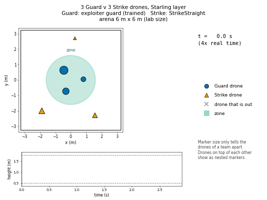 |  |
| **Clip 5.** The 1.6 m-trained Guard team against straight Strikes at 1.15 m; the Strike team reaches the zone at 2.9 s. Over 1,000 games: 195 holds ([T56](../records/2026-11-22_ste_l012d_cross_tag_record.md)). Tier 1, 4× real time. | **Clip 6.** The 1.6 m-trained Strike team against field Guards at 1.15 m; the Guard team holds at 20.5 s. Over 1,000 games: 121 reaches ([T56](../records/2026-11-22_ste_l012d_cross_tag_record.md)). Tier 1, 4× real time. |

**What it shows.**

- **Strike side:** for this one seed, the opponent moves the Strike team's score far more than the tag does. Against
  mark_edge the same network goes from 636 to 931 when only the tag changes; part of that may come through the opponent
  itself (mark_edge holds 808 against straight Strikes at 1.6 m but 422 at 1.15 m). Earlier runs changed the tag and the
  opponent together, so "the Strike team learns at 1.6 m but not at 1.15 m" is not supported.
- **Guard side:** the same opponent (straight Strikes) was used at both tags: trained 913 against script 808 at 1.6 m,
  572 against 645 at 1.15 m. The budgets (1× and 3×) and the seeds differ, so the comparison is not exact. The 1.6 m
  Guard strategy does not carry over (195 at 1.15 m). That a 1.15 m strategy must be trained at 1.15 m is the lead's
  recommendation drawn from this, not a finding.
- In three of the pairings (the Guard team at 1.15 m, the Strike team against field Guards at both tags) the trained
  team wins 0, 0 and 1 games that the script loses: it wins almost only starts the script also wins. The fourth pairing
  has no script to compare with.

**What it does not show.** That 1.15 m is learnable for the Strike team: mark_edge is weak at 1.15 m (the straight Strike
script also reaches 578 against it). One seed per side, one start set; each trained team is overfit to one opponent by
design.

---

## 6. Limits

**In one line:** these are early, narrow results from a training simulator.

- **Training simulator only.** Nothing was flown; no result here authorises a flight.
- **One seed per side.** No trained result was repeated with a second seed.
- **One start set.** Every score uses the same 1,000 starts (two re-scores use the older hangar starts, section 5.2).
- **One opponent per trained team.** Each trained team was trained, and mostly scored, against one script; the 1.6 m
  Strike team fails against a second (section 5.7); the 1.6 m Guard team was scored against straight Strikes only.
- **3v3 only.** No team was trained at 1v1, 2v1 or 5v3.
- **Decision period.** Trained players decide every 0.6 s, scripts every 0.05 s; this can favour or hurt either side (the
  1.4 m Guard gain may come from it).
- **The filter is not exact.** Pairs come closer than 1.10 m in some games (closest 0.85 m in one test).
- **The words in the records.** "Worth learning by the band" is a screening rule: it asks only whether either side's best
  player, script or trained, wins at least 20 % of games; at 1.15 m the scripts alone pass it, so it says nothing about
  the trained teams. "Incomplete: one side only" means the record tool read one side at a time. "Trained, both sides"
  says how strong the evidence is, not that training worked.

---

## Appendices

### A. How the trained players move

**In one line:** the trained Strike teams trade and then wait; the trained Guard teams sit almost still at 1.6 m and step
out toward the zone edge at 1.15 m (lead's reading of four clips, not measured).

**Strike teams** (from the records):

- **1.6 m:** the Strike drones climb to the 1.8 m height limit over Guards at 1.2 m, two of them trade with Guards, and
  the last waits at the edge and slips in. This is the lead's reading of one clip, with no control run
  ([T46](../records/2026-11-21_ste_l012_best_response_record.md), note (b)). Hypothesis, not tested: this tactic exploits
  mark_edge rather than beating Guard teams in general (it reaches 85 against field Guards).
- **1.15 m:** the Strike team trades two for two, then the last drone waits out the clock; 824 of 1,000 games ran to the
  clock ([T55](../records/2026-11-22_ste_l012c_tag_1p15_strike_record.md)).

**Guard teams.** No record describes them. The lead extracted the frames of four 2-D clips (8 or 9 frames each) and
looked at them.

| 1.6 m, trained Guards hold (clip game 0) | 1.15 m, trained Guards at 3×, same start, Strike team reaches |
|---|---|
| 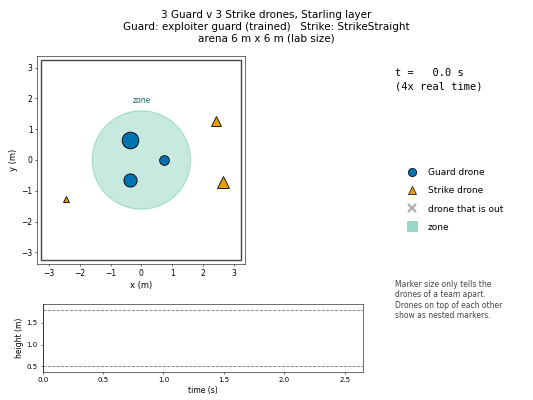 |  |
| **Clip 7.** Trained Guards against straight Strikes at 1.6 m: the Guards barely move and the Strikes fly into tag range; three tags for three, hold at 2.7 s ([T46](../records/2026-11-21_ste_l012_best_response_record.md)). Tier 1, 4× real time. | **Clip 8.** Same start at 1.15 m: two Guards move out toward the zone edge, but one Strike reaches the zone at 2.9 s, more than 1.15 m from any Guard ([T54](../records/2026-11-22_ste_l012c_tag_1p15_guard_record.md)). Tier 1, 4× real time. |

**Lead's reading of 4 clips, not measured** (1.6 m clip games 0 and 1; 1.15 m at 3× clip games 0 and 2):

- **At 1.6 m** the trained Guard drones stay close to their start places inside the zone, moving a few tenths of a metre
  at most. The straight Strike drones fly into the 1.6 m tag range and every pair trades within about 2.7 s.
- **At 1.15 m** the trained Guard drones move outward, toward the zone edge on the side the Strike drones come from (by
  roughly half a metre in the frames). Their tag reaches less far, so they go to meet the attackers. In the reach clip
  the Guard drones cover the top and bottom of the zone and a Strike drone enters between them.
- In all four clips every drone stays near the 1.2 m start height.
- **What cannot be told from these clips:** what earns the 1.6 m team its 913. Untrained Guards hold 534 and parked
  Guards 534 in the same game, and clips in which the Guards look nearly still do not show the difference. Eight frames
  per clip are too few to see timing. Measuring Guard behaviour (distance moved, where tags happen) is not done.
- The clip titles say "arena 6 m x 6 m" because the title rounds 6.5 to a whole number (Python rounds the half to the even
  6; `source/svg_training/viz/replay.py:166`). The box drawn is the full 6.5 m arena (`replay.py:210`).

### B. How many tags the safety filter caused

**In one line:** in scripted games at 1.15 m about 1 % of tags are caused by the filter on the tag's own tick, against
up to 27 % of a scripted pairing's tags at 1.6 m; in the trained Strike team's games at 1.15 m, 10.6 %.

The filter's 1.10 m circle sits inside the tag distance, so the filter can push a pair together into a tag nobody chose.
A *filter push* is counted when, on the tag's tick, the filter's correction closed the pair faster than the players' own
commands did.

| Games | Tags pushed together by the filter | Record |
|---|---|---|
| scripted pairings at 1.6 m | up to 27 % of a pairing's tags | [T50](../records/2026-11-21_ste_l012b_screen_record.md) (replay of the 1.6 m cells) |
| scripted pairings at 1.15 m | 0–10 % per pairing; 1.0 % over all (629 of 64,325) | [T50](../records/2026-11-21_ste_l012b_screen_record.md) |
| trained Guard team at 1.15 m (3×) | 0 of 2,379 | [T54](../records/2026-11-22_ste_l012c_tag_1p15_guard_record.md) |
| trained Strike team at 1.15 m (5×) | 194 of 1,826 (10.6 %) | [T55](../records/2026-11-22_ste_l012c_tag_1p15_strike_record.md) |

Filter effects on the ticks before a tag are not measured.

### C. The Crazyflie route

**In one line:** slowing every drone to a Crazyflie-like lag costs the trained Guard team some holds and brings drones
much closer together; the Crazyflie planner fits 3v3 in the 6.5 m square but pairs still pass inside 1.10 m.

Could Crazyflies (small indoor drones) play the game at Starling distances first? The earlier STE Guard network was
re-scored with every drone delayed like a Crazyflie, in the hangar game on its own starts (seed 1101), and the Crazyflie
repository's offline planner was run at 1.10 m ([T45](../records/2026-11-21_ste_l014_crazyflie_route_record.md)).

| Input | Result |
|---|---|
| Guard network with every drone delayed (Starling 0.148 s; Crazyflie-like 0.48 and 0.56 s) | holds 831 → 791 and 768; games closer than 1.0 m 7 → 101 and 149; under 0.50 m (contact) 0 → 2 and 1 |
| Crazyflie planner at 1.10 m, 6.5 m square | 0 solver emergencies at every size, but a pair inside 1.10 m in 91 (3v3) and 99 (5v3) of 100 matches |

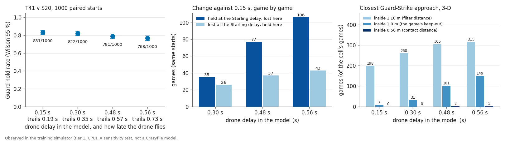

**Figure 8.** Hold rate of the STE Guard network as every drone's delay grows, with the games lost and gained start by
start and the count of close approaches. Holds fall from 831 to 768 at the longest delay, and approaches under 1.0 m
rise from 7 to 149 ([T45](../records/2026-11-21_ste_l014_crazyflie_route_record.md)).

A pure delay on a Starling model is not a Crazyflie model. One network, one opponent, one game. The planner's matches are
short (4–17 s).

### D. The two machines

Every L0 run used the RTX 5070 Ti laptop. The laptop's part of the process checks is done: the full test suite passed
(1,420) and both job drills behaved as expected ([status](status/STATUS_LATEST.md)). The RTX 5090's part checks that
machine itself, so the lead keeps it as the first item of the next 5090 session (row 17).

### E. ABORTED runs (information only)

Two Strike runs stopped one or two updates short of their budget because the time cap left too little reserve; they
prove nothing.

| Run | Stopped at | Seen in its evaluation | Re-run? |
|---|---|---|---|
| Strike team, 1.2 m ([T47](../records/2026-11-21_ste_l012_tag_1p2_strike_record.md)) | update 87 of 88 | 114 reaches against 355; 786 of 1,000 games to the clock | no (owner, 21 Nov) |
| Strike team, 1.15 m ([T52](../records/2026-11-21_ste_l012b_tag_1p15_strike_record.md)) | update 86 of 88 | 103 reaches against 355; 771 games to the clock | answered by the 5× run (section 5.6) |

### F. What was corrected along the way

Four readings given earlier were too strong and were withdrawn after checks
([DISCUSSION §11–§13](DISCUSSION_2026-11-19_20.md#11-owner-decisions-and-a-lead-correction-21-nov-2026)).

- **"Training beats the scripts only at 1.4 m and wider" (21 Nov) — withdrawn.** The curves at 1.2 m and 1.15 m were
  still rising when the budget ended; L0 shows slower learning there, not that it cannot be learned.
- **A "why" explanation of the 1.15 m shortfall — withdrawn.** It was given in chat before a fact-check; the check found
  none of the floated causes supported (decision period, Strike reward, exploration, filter pushes). No cause is known.
- **"Limited by the recipe, not the budget" — withdrawn.** The 5× Strike curve was still rising.
- **"The Strike team learns at 1.6 m but not at 1.15 m" — not supported.** Earlier runs changed tag and opponent
  together. The cross-tag check shows the opponent moves the Strike score far more than the tag, for one seed; part of
  the tag's effect may come through the opponent (mark_edge is weaker at 1.15 m)
  ([T56](../records/2026-11-22_ste_l012d_cross_tag_record.md)).
- Two smaller corrections: decision D3 was first stated wrongly in chat, and "the trained Strikes learned not to be
  tagged" became "trades two for two, then waits".

### G. Budget used

L0 used 13.77 of its 19 GPU-hours.

| Work | GPU-h used |
|---|---|
| Scripted screen | 0.426 |
| Trained teams at 1.6, 1.4 and 1.2 m | 3.37 |
| Tag 1.15 m screen and runs | 1.59 |
| Longer 1.15 m runs | 4.71 |
| Cross-tag check | 0.119 |
| Isaac Lab training test | 1.590 |
| Isaac Lab speed | 0.391 |
| Guard network in Isaac Lab | 1.282 |
| Starling look and 3-D clips | 0.286 |
| **Phase L0** | **13.77 of 19** |

From the shared GPU-hour ledger on the laptop (`runs/shared/gpu_hours.log`, not in git); per task in
[G0_DECISION section 8](G0_DECISION.md#8-budget-used).

### H. What is not done

- 3-D clips of the 1.15 m games and of the cross-tag games (only 2-D clips exist).
- The 1.15 m Strike run with a shorter game clock (PROPOSED; about 0.7 GPU-h, lead's estimate).
- The 1.6 m Guard team scored against every Strike script (PROPOSED, minutes).
- Guard behaviour measured (appendix A is a reading of clips).
- 1v1 screened at 1.15 m; 1v1 trained at all.
- The RTX 5090's own checks.

### I. Records

| Record | What | Link |
|---|---|---|
| T44 | scripted screen, one factor at a time | [record](../records/2026-11-21_ste_l011_screen_record.md) |
| T45 | Crazyflie route: delays and planner | [record](../records/2026-11-21_ste_l014_crazyflie_route_record.md) |
| T46 | trained teams at 1.6, 1.4 and 1.2 m (Guard) | [record](../records/2026-11-21_ste_l012_best_response_record.md) |
| T47 | Strike team at 1.2 m (ABORTED) | [record](../records/2026-11-21_ste_l012_tag_1p2_strike_record.md) |
| T48 | Isaac Lab speed | [record](../records/2026-11-21_ste_l02_speed_record.md) |
| T49 | Guard network in Isaac Lab (hangar game) | [record](../records/2026-11-21_ste_l03_transfer_record.md) |
| T50 | scripted screen at 1.15 m | [record](../records/2026-11-21_ste_l012b_screen_record.md) |
| T51 | Guard team at 1.15 m, 1× | [record](../records/2026-11-21_ste_l012b_best_response_record.md) |
| T52 | Strike team at 1.15 m, 1× (ABORTED) | [record](../records/2026-11-21_ste_l012b_tag_1p15_strike_record.md) |
| T53 | Isaac Lab training test | [record](../records/2026-11-21_ste_l013_tier2_trains_record.md) |
| T54 | Guard team at 1.15 m, 3× | [record](../records/2026-11-22_ste_l012c_tag_1p15_guard_record.md) |
| T55 | Strike team at 1.15 m, 5× | [record](../records/2026-11-22_ste_l012c_tag_1p15_strike_record.md) |
| T56 | cross-tag check | [record](../records/2026-11-22_ste_l012d_cross_tag_record.md) |

Other pages: the decision page [G0_DECISION](G0_DECISION.md); the reasons and owner rulings
[DISCUSSION](DISCUSSION_2026-11-19_20.md); the game sheet [GAME_SPEC](GAME_SPEC.md); the L1–L9 cost estimate
[costed draft](drafts/L1_L9_COSTED_PLAN_DRAFT.md); clips by run in [ste_l012](../docs/media/ste_l012/README.md),
[ste_l012c](../docs/media/ste_l012c/README.md) and [ste_l012d](../docs/media/ste_l012d/README.md). Figure 1 is drawn by
`scripts/make_g0_report_figures.py` from `configs/ste_l011/base.toml`, `configs/ste_l011/tag_1p15.toml` and the parameter
file they name.

### J. Glossary of codes

| Code | Meaning |
|---|---|
| Phases L0–L9 | L0 game definition and feasibility (this report), L1 drone model, L2 game rules in the training copy, L3 learner, L4 evaluation suite, L5 league self-play, L6 checks and export, L7 AirStack side, L8 real flight, L9 documentation |
| L0.12, L1.9 and similar | a task inside a phase (L1.8–L1.12 are explained in section 2) |
| T44–T56 | records of runs in the [ledger](../records/LEDGER.md) (appendix I) |
| D and P numbers | decisions (D) and owner proposals (P) in the [discussion record](DISCUSSION_2026-11-19_20.md): D3 = train in Isaac Lab, D6 = one shared network per team, P1 = the tag rule, P12 = zone size against tag distance |
| A12 | the costed draft's open question whether its quick fast-engine training reads fit D3 |
| NEAR-962 | a planned real Starling flight (a planned-push flight), the final timing check of the drone model; not flown yet |
| Curve games | 256 extra games played every 10 training updates to draw a learning curve; separate from the 1,000 scoring starts |
| Training update | one round of learning from a batch of games just played; a standard run has 88 |
| B | a billion game-steps |
| League | training against a pool of opponents (earlier saved versions of the other team plus scripts), planned for L5 |
| Curriculum pilot | a trial run that starts training at the 1.6 m tag and moves it toward 1.15 m (optional task L2.8 of the costed draft) |
| Exploiter | the records' word for a trained team (it exploits one fixed opponent) |
