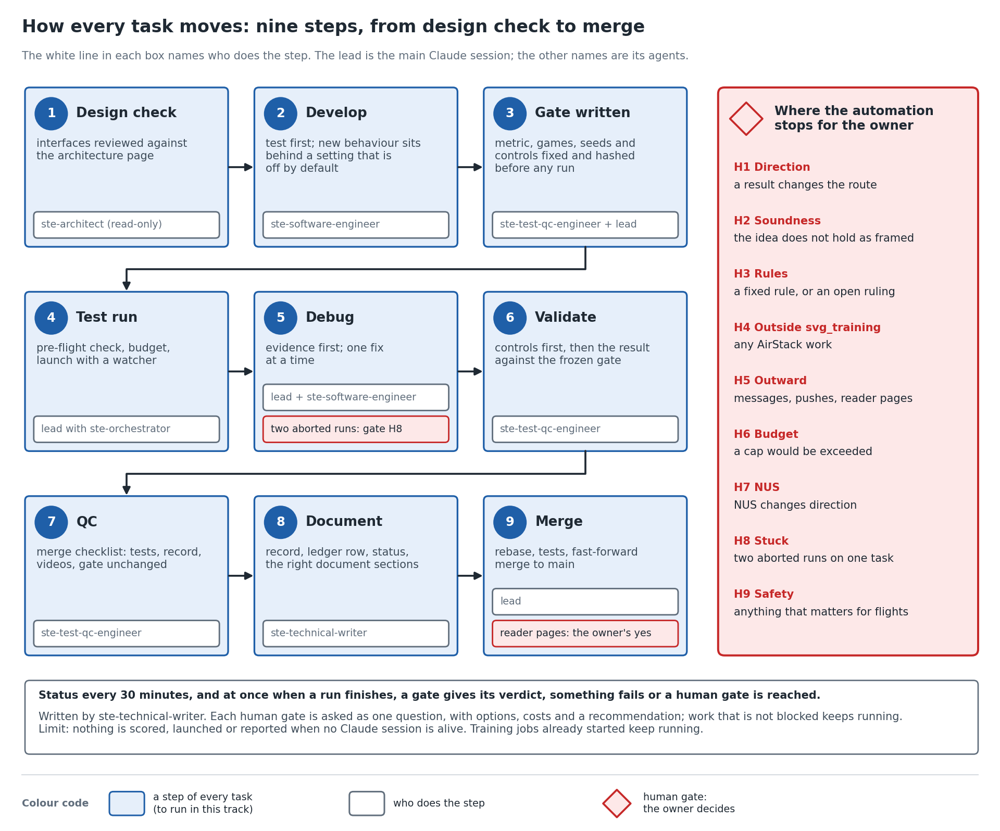

INTERNAL · how the STE learning track's work runs: the nine steps of a task, the human gates, the team of agents and the
rules that never bend · start at [README.md](README.md); the working plan: [PLAN.md](PLAN.md).

# How the work runs

## How the work runs

Every task moves through the same nine steps. The pass mark (the *gate*) is written and fixed before the run, and
the role that scores a result is never the role that built it. In validation, the control runs come first: a known
good player must pass and a known bad one must fail before any trained policy is scored.

The work runs unattended between *human gates*: points where it stops until the owner decides. Each gate is asked as
one question with options, costs and a recommendation. Work that is not blocked keeps running.

| Gate | The automation stops when |
|---|---|
| H1 Direction | a failed or inconclusive result changes the route |
| H2 Soundness | the idea does not hold as framed: a rule variant is trivial for one team, or tier 2 cannot train |
| H3 Rules | a fixed programme rule, an open ruling, or the gate limits of a run of record are at stake |
| H4 Outside `svg_training` | any AirStack work is needed |
| H5 Outward | a message to NUS or CMU, a push, or a reader page |
| H6 Budget | a cap would be exceeded |
| H7 NUS | NUS changes direction |
| H8 Stuck | two aborted runs on one task |
| H9 Safety | anything that matters for real flights |

The lead decides smaller technical matters alone and records them: settings of pilot runs, debugging fixes, task
order inside a phase.

**Status.** A status is posted every 30 minutes, and at once when a run finishes, a gate gives its verdict,
something fails or a human gate is reached. It carries no invented numbers.

**The limit.** Nothing is scored, launched or reported when no Claude session is alive. Training jobs already
started keep running. A new session reads the state files in [status/](status/), adopts the live jobs and restarts
any job a reboot killed. The resume drill of task L0.7 showed this on both machines (laptop 21 November; RTX 5090 23 November,
run under task L1.0 since L0 had closed).

## The team

| Agent | Role |
|---|---|
| lead | the main Claude session: plans, launches, commits and merges |
| [`ste-architect`](agents/ste-architect.md) | architecture and interfaces; reviews designs before code |
| [`ste-software-engineer`](agents/ste-software-engineer.md) | builds and tests code, test first, inside `svg_training/` only |
| [`ste-test-qc-engineer`](agents/ste-test-qc-engineer.md) | writes gates before runs, scores results, checks before merges |
| [`ste-technical-writer`](agents/ste-technical-writer.md) | the 30-minute status and every document update |
| [`ste-orchestrator`](agents/ste-orchestrator.md) | keeps the process moving unattended; stops at human gates |
| existing advisers | specialist reviews, read-only: [the list](../docs/claude/AGENTS_AND_SKILLS.md) |

## Rules that never bend

- Write only inside `svg_training/`. AirStack changes are specified here and made by an AirStack session after the
  owner approves.
- Gates are written before a run and never moved.
- A training result is not a flight result.
- Never push (the owner pushes); never `git add -A`; never `--no-verify`.
- NUS's source code is never committed.
- Stop and ask the owner at every human gate.

## What is asked of the owner now

Nothing now: gate G0 was ruled on 22 November 2026 ([DISCUSSION §14](DISCUSSION_2026-11-19_20.md#14-gate-g0-rulings-owner-22-nov-2026)). The questions asked earlier:

| # | Question | Answer |
|---|---|---|
| 1 | Approve phase L0, with a cap of 19 GPU-h, alone on the GPU for its probes? | **approved** (owner, 20 November 2026) |
| 2 | When everything waits on the owner: the full status every 30 minutes, or one line every 2 hours? | not answered; the standing rule holds: the full status every 30 minutes |
| 3 | Gate G0: the game, the route and the L1 + L2 budget | **ruled** (owner, 22 November 2026) |

Still open, each brought when its phase starts: the AirStack approach (D4, L7), drone loss in the game (P7, L2), whether
attacker drones run the filter (P8), the video style (P4), the CMU filter-change proposal (P6), filter option B (P2,
end of L2) and the budgets of L3 to L9.
