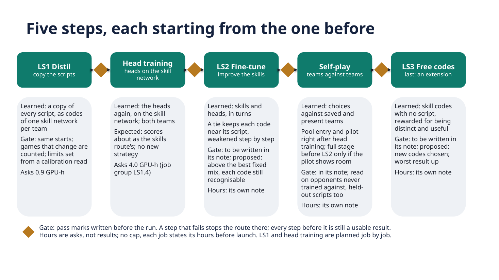
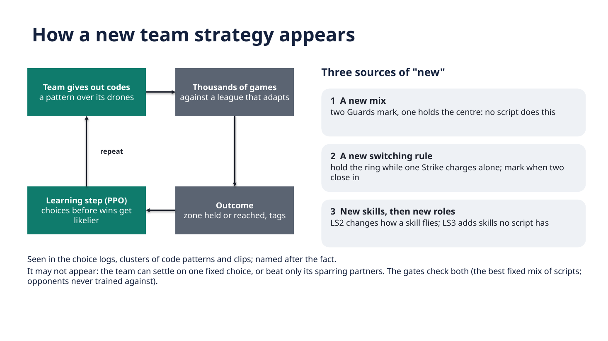

READ · The learned-skills route, the third route of the STE learning track: what it is, why it was added, its four stages and how a trained team is used. The execution plan behind it: [drafts/LEARNED_SKILLS_BRIDGE_PLAN.md](drafts/LEARNED_SKILLS_BRIDGE_PLAN.md); the track as a whole: [README.md](README.md); the slides: [figures/learned_skills_route.pptx](figures/learned_skills_route.pptx).

# The learned-skills route

The STE learning track trains two drone teams for the area-denial game: the Guard team holds a circular zone and the
Strike team tries to reach it. The *learned-skills route* is a way of training them in which the drones learn their own
individual skills and their own team strategy, starting from the hand-written ones. It was adopted as the track's third
route on 25 November 2026 ([DISCUSSION, R35](DISCUSSION_2026-11-19_20.md)). It is a design: nothing of it has been
built, trained or flown, and its budget is not yet set.

Terms used on this page:

- *Policy*: the trained program that turns what a drone sees into a speed command.
- *Script*: a hand-written behaviour for one drone or a whole team, for example "sit on the zone edge between the
  centre and the Strike drone marked" (`opponents/scripted.py`).
- *Team strategy*: a script that coordinates the whole team (parked on a ring, field, sacrifice, converge).
- *Drone skill*: a script that does not read the drone's team-mates (mark the edge, mirror, flank).
- *Head*: the part of a policy that makes one choice. The *team head* chooses a team strategy or "free"; under "free",
  each drone's *drone head* chooses its own skill.
- *Skill code*: a number that names one skill; the skill network reads it as an input.
- *Gate*: a pass mark written before a run and never moved after it.

## Architecture at a glance

![The whole route on one picture, in three bands. Every game: what each drone sees goes to the heads (every 0.6 s: a team strategy for all drones, or "free" and each drone picks), which pass a skill code to the skill network; the skill network also reads what the drone sees and which drone it is, every tick, and outputs a velocity; the safety filter, which also takes the opponent team, and the game step follow, and the next observation closes the loop. Training only: the game outcome becomes the reward of the learning step, which copies the teacher scripts in LS1 and is reinforcement learning from LS2, and updates the heads and the skills. After training: when each team's gates pass, a Guard team export and a Strike team export, each heads plus skill network](figures/ls_architecture.png)

Read from top left to bottom right. The top band runs in every game, during training and after it; the middle band
exists only in training; the bottom band is what comes out. Teal parts are learned, grey parts are hand-written and
unchanged; the dashed arrow is teaching, used in training only. The learning step is a supervised copy of the
scripts in LS1 and reinforcement learning (PPO) from LS2.

## Three routes, one game

| Route | What is learned | What is hand-written | Built |
|---|---|---|---|
| Pure RL (velocity route) | the whole policy: it outputs a velocity | nothing in the policy | yes (L3) |
| Skills route | when to use which script, and which drone uses which | every movement | yes (L3) |
| Learned-skills route | the choices, then the skills, then new skills and team patterns | the scripts, only as teachers | no |

All three share the game, the safety filter that keeps every pair of drones apart, the scoring and the export. They
differ only in what turns a drone's view into a command.

## Why a third route

The skills route can never fly a movement that no script contains. Its ceiling is the best mix of scripts: in the
L3–L6 pipeline check, the best fixed choice of the Strike team's skills reached the zone in 604 of 1,000 games against
the parked Guard team, and the trained skills team reached it in 644 ([pipeline-check record](../records/2026-11-25_ste_l3_l6_pipeline_record.md),
one seed, observed in the training simulator). The pure RL route can learn any movement but starts from random
flight and keeps no structure: its behaviour has no names to check, count or explain.

The learned-skills route keeps the structure of the skills route (named skills, team strategies, two heads) and makes
the skills themselves learnable. Every stage starts from the exact behaviour of the stage before, so no stage starts
from random flight.

## Four stages

| Stage | What is learned | Starts from | Gate (pass mark written before the run) | GPU-hours |
|---|---|---|---|---|
| **LS1 Distil** | a copy of every script, as codes of one *skill network* per team | the scripts | the copy plays like the scripts, cell by cell, within a stated tolerance | about 1 (estimate) |
| **LS2 Fine-tune** | the heads' choices and the skills themselves, with a tie that keeps each code near its script, weakened step by step | LS1 | above the best fixed mix of scripts; each code still recognisable | 5 to 8 (estimate) |
| **LS3 Free codes** | skill codes with no script, rewarded for being distinct and useful | LS2 | the new codes are chosen and raise the worst result | 10 to 20 (estimate) |
| **LS4 League** | which code each drone gets, against past and present opponents and saved exploits | LS3 | the robustness suite: opponents never trained against, drone loss | open |

A stage that fails its gate stops the route there, and every stage before it is still a usable result: LS1 alone gives
a skills team that exports as two network files, with no port of the scripts into the flight software. Only LS1 is
planned task by task; LS2 to LS4 come back with their own design notes and costs.

*Distil* means fitting a network to copy another behaviour. The copy is fitted on the states the scripts reach and
then on the states the copy itself reaches, labelled by the scripts, so it stays right when its own small errors take
it off the scripts' path.

## Inside one decision: two speeds

Every 0.6 s the heads give each drone a skill code, held for 12 ticks. Every tick (0.05 s) the skill network turns the
drone's view, its slot in the team and its code into a velocity. The skill code is the only link between the two
speeds. This matches the skills route, where a chosen script also runs every tick for its 0.6 s.

The drone's slot is an input because several scripts depend on which drone is running them (in *sacrifice*, Strike 0 is
always the decoy), and the 71 numbers a drone sees do not state its own index. One network shared by all drones of a
team needs to be told.

## How a new team strategy appears

Nobody writes the new strategy. The team gives out skill codes, thousands of games are played at once, and the learning
step (PPO, the reinforcement-learning method the track uses) makes the choices that came before wins more likely. In
LS4 the opponents adapt as well: when one team finds a pattern that wins, the other team's training pushes against
it, and the first team has to find something else.

New strategy can come from three places:

1. **A new mix of existing skills**: two Guards mark, one holds the centre; no script does this.
2. **A new switching rule**: hold the ring while one Strike drone charges alone, and mark when two close in on one side.
   This is the likely answer to *sacrifice*, whose decoy draws the nearest Guard to open a gap.
3. **New skills, then new roles**: LS2 changes how a skill flies; LS3 adds skills no script has, and new combinations
   become possible.

It shows in the choice logs, in clusters of code patterns over many games and in clips, and is named after the fact. It
may also not appear: a team can settle on one fixed choice, or beat only the opponents it trained against. The gates
check both, against the best fixed mix of scripts and against opponents never trained against.

## After training: two separate team policies

- Each team is exported on its own: the two heads and the skill network, as ONNX files with an `interface.toml` that
  lists the skills, the team size and the hold rule. The Guard team's export can be used without the Strike team's and
  the reverse.
- A policy reads only positions and velocities of the drones, the zone and the clock. It does not know what flies the
  other team, so any player that obeys the game's rules can face it: a script of `opponents/scripted.py`, outside code
  named as `package.module:ClassName` ([PLUG_IN_YOUR_CODE](../docs/PLUG_IN_YOUR_CODE.md)), a trained team, or in
  flight a hand-flown drone.
- In the training simulator such a match is 1,000 games in seconds. A match against opponents the team never trained
  against is the held-out attacker test of the robustness suite. An opponent that wins can be added to the training
  pool of the next run.
- Flight is phases L7 (AirStack simulator) and L8 (real drones), each gated by the owner. Nothing here has flown; real
  Starling games are one against one.

## What changes in the code

The pipeline stays: the game, the opponent pool, the scoring, the run contract, the GPU-hour ledger, the job launcher,
the clips and the export path. Every driver builds its skills through one function, `skills.two_level_dispatch`, so one
setting, `[learner] skill_source = "net"`, swaps the scripts for the skill network everywhere; its default,
`"scripts"`, keeps today's behaviour bit for bit.

| Stage | New | Changed | Learner |
|---|---|---|---|
| LS1 | the skill network, the distillation (data, fit, relabelling), a driver, an equivalence check, a gate file | the setting in `ste/skills.py`; a new graph type in `ste/export.py` | unchanged: the fit is supervised |
| LS2 | alternating training of skills and heads; the tie to the scripts | the skill network becomes a trained policy shared by all drones of a team | yes; planned on the track's next learner version (shared actor, team critic) |
| LS3 | a diversity reward and its classifier | wider heads | yes |
| LS4 | saved exploits as permanent league entries | the league of the next learner version | yes |

## Where it stands

| Item | State |
|---|---|
| The route | adopted, 25 November 2026 (R35) |
| LS1 budget (about 1 GPU-hour from the L3–L6 pipeline-check cap) | not decided |
| Order against the next learner version | not decided; proposed: LS1 beside it, LS2 onwards on it |
| Design review of the plan (two reviewers) | not started |
| Code, runs | none |
| Execution workflow: what is added to the pipeline and which jobs run | draft for the owner's review: [drafts/LS_EXECUTION_WORKFLOW.md](drafts/LS_EXECUTION_WORKFLOW.md) |

Files: the plan, [drafts/LEARNED_SKILLS_BRIDGE_PLAN.md](drafts/LEARNED_SKILLS_BRIDGE_PLAN.md) (LS1 task by task, LS2 to
LS4 as outlines); the slides, [figures/learned_skills_route.pptx](figures/learned_skills_route.pptx) (editable
PowerPoint flowcharts with speaker notes), drawn by [make_ste_learned_skills_deck.py](../scripts/make_ste_learned_skills_deck.py),
which also renders the pictures on this page.
