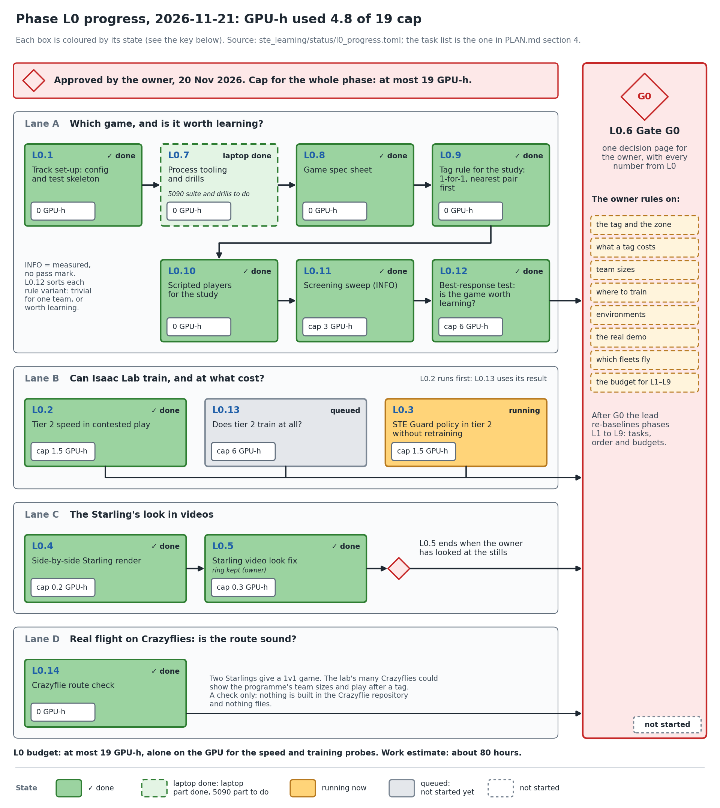

READ · STE's own training of Guard and Strike teams: what is being built, the decisions taken and the plan. Results so far, each with its record: [the overview](../docs/OVERVIEW.md); the whole story from the NUS port on: [../README.md](../README.md); where each task stands today: [the status page](status/STATUS_LATEST.md).

# STE learning track

STE (the lab) trains its own Guard team and Strike team policies for the area-denial game: the Guard team holds a
circular zone and the Strike team tries to reach it. A *policy* is the trained program that turns what a drone sees
into a speed command.

Why a track of its own: policies trained with NUS's code lose most games under STE drone conditions (the six tests on
the [front page](../README.md)): the Strike team reaches the zone in 43 of 1,000 games, then in 740 once the safety
filter of AirStack (the flight software, from CMU) is added, then in 983 once drones may change height (3-D). These
counts were observed in the training simulator.

The track runs in parallel with NUS's work and does not wait for it (decision D1); NUS's results plug in when ready. The
goal is a pair of policies that play under rules that can fly, keep the team plan when a drone is lost, and hold against
attackers they did not train against. They are then checked in the AirStack simulator (the flight software's own
simulator) and in real flights, each with the owner's approval: first on the lab's small Crazyflie drones at Starling
distances, then a one-against-one (1v1) game on the two Starlings (gate G0 ruling R12; the rulings R1 to R18 are in
[DISCUSSION §14](DISCUSSION_2026-11-19_20.md#14-gate-g0-rulings-owner-22-nov-2026)).

**Where it stands (23 November 2026).** Phase L0 is done and the owner ruled gate G0 on 22 November: the main game
has a 1-for-1 tag, 1.6 m while the pipeline is built and 1.15 m for the main training after phase L2; phases L1 and L2
are approved together with a cap of 13 GPU-h, and L1 (the drone model) is in work. L3 to L9 open at their own gates.
Task by task: [the status page](status/STATUS_LATEST.md). Results so far: [the overview](../docs/OVERVIEW.md).

## Where it stands

Three labels are used on this page. DECIDED: the owner said so. PROPOSED: suggested, not yet ruled. OPEN: waiting
for the owner's ruling. D and P numbers are rows of the [discussion record](DISCUSSION_2026-11-19_20.md).

| Item | Status | Ruled at |
|---|---|---|
| STE runs its own learning track, in parallel with NUS (D1) | DECIDED | — |
| A tag takes out one Guard drone and one Strike drone (D2) | DECIDED (gate G0, 22 Nov 2026) | — |
| Main training happens in Isaac Lab; the fast engine is for quick experiments and checks, as in the L0 and L1 studies so far (D3, ruling A12) | DECIDED (gate G0, 22 Nov 2026) | — |
| Policies run on the mission-control laptop, not on the drones (D5) | DECIDED | — |
| Learner: one shared policy per team, drone loss, self-play against a pool (D6) | DECIDED | — |
| Isaac Lab videos show the Starling as it looks in the AirStack simulator (D9) | DECIDED | — |
| The main game has a 1-for-1 tag: 1.6 m to build the pipeline, a 1.15 m side track in L1–L2, 1.15 m main training after L2; zone radius 1.6 m (P1, P12) | DECIDED (gate G0, 22 Nov 2026) | the trained demo's tag: end of L2 |
| Team sizes: train 3v3, plus the 1v1 reads in L1; every trained team also scored at 2v1 and 5v3 (P9) | DECIDED (gate G0, 22 Nov 2026) | — |
| Environments: open arena (E0) until a trained team passes the *opponent panel* (every trained team against every opponent, worst result reported), then E1 blocks, then E2 the construction site (P10) | DECIDED (gate G0, 22 Nov 2026) | — |
| The track's real-flight demo (not the 26 November flights): the scripted 1v1 at 1.6 m until a trained team passes the opponent panel (P11) | DECIDED (gate G0, 22 Nov 2026) | — |
| Fleets: Crazyflies first at Starling distances, the Starling 1v1 as planned (P13) | DECIDED (gate G0, 22 Nov 2026) | — |
| Budget of L1 + L2: 13 GPU-h | DECIDED (gate G0, 22 Nov 2026) | — |
| Budgets of phases L3 to L9 | OPEN | re-baselined later |
| Filter option B (P2) | PROPOSED | end of phase L2 |
| How AirStack is changed (D4) | OPEN | phase L7 |

Two technical calls were made by the lead (the main Claude session) and recorded: the drone's estimator is modelled
first as a delay plus noise (D7; since task L1.1b, decided 22 and built 23 November, as a slowly drifting estimate error
instead, off by default, with sizes from a first, exploratory fit to real flight logs), and work on NUS's training
recipe is paused (D8); this track does not depend on it.

**The first gate.** Phase L0 (approved 20 November 2026) ended at gate G0, ruled by the owner on 22 November 2026
([DISCUSSION §14](DISCUSSION_2026-11-19_20.md#14-gate-g0-rulings-owner-22-nov-2026)). The report that explains L0's
results for that ruling: [G0_REPORT.md](G0_REPORT.md).

## What is being built

Green boxes already exist in `svg_training`; blue boxes are to be built; amber dashed boxes wait for a ruling.

**The loop, in words.** A game starts with a number of drones per team and their start positions. Each drone gets its
own view of team-mates, opponents and the zone. The team's policy turns that view into a speed command. The command
passes through a copy of the flight software's command chain: CMU's commander, then the safety filter, which changes
commands so that every pair of drones stays 1.10 m apart. A simulated Starling flies the command. The game rules then
decide who is out and whether a Strike drone reached the zone, and the team gets its reward: a win or a loss. The
learner uses thousands of such games at once to improve both policies. One pass takes 0.6 s of game time.

**After training.** A fixed evaluation suite scores the policies against pass marks written before each run. A policy
that passes is exported as two files: the policy itself and an interface file that states what the policy expects.

**Below the boundary.** Everything above is built inside `svg_training`. The flight side is only specified here; an
AirStack session builds it after the owner approves. The mission-control laptop runs the policy once per drone every
0.6 s and sends the commands through CMU's commander and flight filter to PX4, the flight controller on each drone.
This is tried in the AirStack simulator first, then on real drones: Crazyflies first, then the two Starlings in a 1v1
game.

**Terms used in the figure.**

| Term | Meaning | Status |
|---|---|---|
| Shared policy | One network copied onto every drone of a team. Each drone feeds it its own view and gets its own command | DECIDED (D6) |
| Team critic | The part of training that scores the whole team's situation. It is used in training only and never flown | DECIDED (D6) |
| PPO | The learning method: a standard algorithm that improves a policy step by step from the games it played | — |
| Self-play | Both teams learn by playing games against each other | DECIDED (D6) |
| Scripted player | A hand-written player that follows fixed rules and does not learn, for example a Guard team that stays parked | exists |
| League | The pool of opponents a team trains against: earlier saved versions of the other team, plus scripted players | DECIDED (D6) |
| Tier 1 | STE's fast game engine: a simplified drone, used for quick experiments and debugging | exists |
| Tier 2 | The Isaac Lab physics drone: a Starling with rotors and PX4-style control loops | exists |
| Estimator effect | A real drone flies on a position estimate that is slightly off; both tiers get a model of that error (task L1.1b, L1.7), off by default | exists |
| Tag | A Guard drone and a Strike drone closer than the tag radius are both out and land. 1.6 m between centres while the pipeline is built, 1.15 m main training after L2 | DECIDED (P1, gate G0, 22 Nov 2026) |
| Option B | A safety-filter variant: in a Guard–Strike pair only the Guard drone swerves | PROPOSED (P2) |

## The plan

L1 and L2 are approved; L3 to L9 are the intended path, set again at their own gates. L9, documentation, runs alongside
every phase. The picture predates the G0 ruling; the table is current.

Terms in the table: a *pilot* is a short trial run; a *smoke test* is a very short run that only checks the code
works; a *run of record* is a run whose result is reported and scored against a gate; a *seed* is the random
starting point of a run, so 3 seeds means three independent repeats; *QC* is quality control, the checks before a
merge. The AirStack simulator runs the real PX4 code.

| Phase | What | Simulator | Ends at |
|---|---|---|---|
| L0 Game definition and feasibility | which game to train, whether it is worth learning, whether Isaac Lab can train it and at what cost | tier 1, tier 2 | gate G0 (owner) |
| L1 Drone model | estimator effect, drag, fit to flight logs | tier 2; AirStack simulator logs | the lead (exploratory) |
| L2 Game rules in the training copy | the rules chosen at G0, landing, drone loss, filter option B | tier 1, then tier 2 | owner rules on option B |
| L3 Learner | observation version 0.3, shared policy, team critic, PPO | tier 1 pilot, tier 2 smoke test | owner approves the observation |
| L4 Evaluation suite and gates | test suite, gates file, calibration on known players | tier 1, tier 2 | owner approves gate limits |
| L5 League self-play | pilots, then the runs of record with 3 seeds | as ruled at G0 | owner rules the budget |
| L6 QC and export | scoring, cross-checks, the policy file | tier 1, tier 2 | owner approves the hand-over |
| L7 AirStack side | specifications here; built and played by an AirStack session | AirStack simulator | owner |
| L8 Real flight | real games: Crazyflies first at Starling distances, then a 1v1 on the Starlings (ruling R12) | Crazyflies; real Starlings (two drones) | owner |
| L9 Documentation | status, records, results page | — | owner, for reader pages |

Each result is reported as "observed in the training simulator" until it has flown.

## Phase L0, done

Phase L0 (20–22 November 2026) settled which game to train and whether Isaac Lab can train it: a screening sweep of rule
variants with hand-written teams, best-response training on the shortlisted variants, Isaac Lab speed and training
probes, a transfer check of the STE Guard policy, and the Crazyflie route check. It used 13.77 of its 19 GPU-h. The owner
ruled gate G0 on 22 November on its numbers. What it found and why: [the G0 report](G0_REPORT.md); the rulings:
[G0_DECISION.md](G0_DECISION.md) and [DISCUSSION §14](DISCUSSION_2026-11-19_20.md#14-gate-g0-rulings-owner-22-nov-2026);
its task list, the questions it set out to answer and the review that shaped it, kept for the record:
[L0_HISTORY.md](L0_HISTORY.md).

## Files in this folder

| Read order | File | What it holds |
|---|---|---|
| 1 | this page | what the track is, the decisions taken and the plan |
| 2 | [DISCUSSION_2026-11-19_20.md](DISCUSSION_2026-11-19_20.md) | why: every question, decision (D1 to D9), proposal (P1 to P13, most ruled at gate G0) and the G0 rulings |
| 3 | [PLAN.md](PLAN.md) | the working plan for Claude sessions: phases, tasks, gates, budgets |
| 4 | [STANDARDS.md](STANDARDS.md) | the track's rules, on top of [the parent rules](../STANDARDS.md) |
| 5 | [ARCHITECTURE.md](ARCHITECTURE.md) | components, interfaces, what exists and what is new |
| 6 | [CODING_PRACTICES.md](CODING_PRACTICES.md) | how code is written, tested, reviewed and merged |
| 7 | [WORK_BREAKDOWN.md](WORK_BREAKDOWN.md) | every task in detail |
| 8 | [VALIDATION_QC.md](VALIDATION_QC.md) | test levels, gates per stage, the robustness suite |
| 9 | [AUTOMATION.md](AUTOMATION.md) | what wakes the work, launch rules, resume, human gates |
| 10 | [DOCS_AND_STATUS.md](DOCS_AND_STATUS.md) | which pages change when; the 30-minute status |
| 11 | [HOW_THE_WORK_RUNS.md](HOW_THE_WORK_RUNS.md) | how a task moves, the human gates, the team of agents and the rules that never bend |
| 12 | [status/](status/) | the latest status ([STATUS_LATEST.md](status/STATUS_LATEST.md)), its history (LOG.md) and the template |
| 13 | [agents/](agents/) | the definitions of the agents named in HOW_THE_WORK_RUNS |
| — | [L0_HISTORY.md](L0_HISTORY.md) | phase L0's task list and the review that shaped it, kept for the record |
| — | [G0_REPORT.md](G0_REPORT.md), [G0_DECISION.md](G0_DECISION.md) | gate G0: the report on L0's results, and the decision page |
| — | [CRAZYFLIE_ROUTE.md](CRAZYFLIE_ROUTE.md) | task L0.14: could the game be flown on the lab's Crazyflies |
| — | [GAME_SPEC.md](GAME_SPEC.md) | the game spec sheet: every value of the game the track trains, with its status and source (task L0.8); the same values in `configs/ste_game.toml` |
| — | [figures/](figures/) | the flowcharts, drawn by [make_ste_learning_figures.py](../scripts/make_ste_learning_figures.py), and the L0.14 figures |

PLAN.md wins where it and a reference page (5 to 10) differ. `drafts/` holds the pre-registered specs that runs and
tests read; superseded pages are in [archive/](archive/README.md).
