INTERNAL · every status of STE's own learning track, oldest first, one dated heading per update; append-only · the latest: [STATUS_LATEST.md](STATUS_LATEST.md); the folder: [../README.md](../README.md)

## 2026-11-20 12:25

**Status, 2026-11-20 12:25 (+08:00), event: human gate passed (the owner approved phase L0)** · GPU 11 % / 57 W / 2.4 GB of 32 GB · 0 training processes (0 paused) · RTX 5090

### Phases

| Phase | Status | Math library | Simulator | What |
|---|---|---|---|---|
| ▶ L0 Game definition and feasibility | RUNNING (approved by the owner 20 Nov 2026, cap 19 GPU-h) | PyTorch | tier 1 fast engine, tier 2 Isaac Lab | which game the track trains; is it worth learning; can tier 2 train, and at what cost |
| L1 Drone model | NOT STARTED | PyTorch | tier 2 Isaac Lab; AirStack simulator logs | estimator effect, drag, fit to flight logs |
| L2 Game rules in the training copy | NOT STARTED | PyTorch | tier 1 fast engine, then tier 2 Isaac Lab | the rules chosen at gate G0, landing, drone loss, filter option B |
| L3 Learner | NOT STARTED | PyTorch | tier 1 fast engine, tier 2 Isaac Lab | observation version 0.3, shared policy, team critic, PPO |
| L4 Evaluation suite and gates | NOT STARTED | PyTorch | tier 1 fast engine, tier 2 Isaac Lab | test suite, gates file, calibration on known players |
| L5 League self-play | NOT STARTED | PyTorch | as ruled at gate G0 | pilots, then the runs of record with 3 seeds |
| L6 QC and export | NOT STARTED | PyTorch | tier 1 fast engine, tier 2 Isaac Lab | scoring, cross-checks, the policy file |
| L7 AirStack side | NOT STARTED | none | AirStack simulator | specifications here; built and played by an AirStack session |
| L8 Real flight | NOT STARTED | none | real flight | a real 1v1 game |
| L9 Documentation | RUNNING | none | none | status, records, results page |

L1 to L9 are the intended path; their tasks and budgets are set again at gate G0.

### Phase L0 Game definition and feasibility, task by task

| ID | Plain name | Status | Simulator | Result / ETA |
|---|---|---|---|---|
| L0.1 | Track set-up: config and test skeleton | NOT STARTED | none | next; cap 0 GPU-h |
| L0.7 | Process tooling and drills | NOT STARTED | none | after L0.1; cap 0 GPU-h |
| L0.8 | Game spec sheet | NOT STARTED | none | after L0.7; cap 0 GPU-h |
| L0.9 | Tag rule for the study: 1-for-1, nearest pair first | NOT STARTED | tier 1 fast engine | after L0.8; cap 0 GPU-h |
| L0.10 | Scripted players for the study | NOT STARTED | tier 1 fast engine | after L0.9; cap 0 GPU-h |
| L0.11 | Screening sweep (INFO) | NOT STARTED | tier 1 fast engine | after L0.10; cap 3 GPU-h |
| L0.12 | Best-response test: is the game worth learning? | NOT STARTED | tier 1 fast engine | after L0.11; cap 6 GPU-h |
| L0.2 | Tier 2 speed in contested play | NOT STARTED | tier 2 Isaac Lab | after L0.7; cap 1.5 GPU-h |
| L0.13 | Does tier 2 train at all? | NOT STARTED | tier 2 Isaac Lab | after L0.2; cap 6 GPU-h |
| L0.3 | STE Guard policy in tier 2 without retraining | NOT STARTED | tier 2 Isaac Lab | after L0.2; cap 1.5 GPU-h |
| L0.4 | Side-by-side Starling render | NOT STARTED | tier 2 Isaac Lab | cap 0.2 GPU-h |
| L0.5 | Starling video look fix | NOT STARTED | tier 2 Isaac Lab | after L0.4; cap 0.3 GPU-h |
| L0.6 | Gate G0 | NOT STARTED | none | after every task above; the owner decides |

GPU-h used in L0 so far: 0 of 19.

### Other workstreams

| ID | Plain name | Status |
|---|---|---|
| DOC-1 | Links to the track from the repository's front page and the training front page | DONE |
| DOC-2 | Track pages and figures say "L0 approved" | DONE |

**Next.** L0.1 Track set-up: config and test skeleton (starts now, CPU only); then L0.7 Process tooling and drills and L0.8 Game spec sheet.

**Waiting on you.** Nothing until gate G0.

## 2026-11-20 14:45

**Status, 2026-11-20 14:45 (+08:00), event: task finished (L0.1); owner's rulings on fleets** · GPU 10 % / 2.0 GB of 32 GB · 0 training processes (0 paused) · RTX 5090

### Phases

| Phase | Status | Math library | Simulator | What |
|---|---|---|---|---|
| ▶ L0 Game definition and feasibility | RUNNING (approved by the owner 20 Nov 2026, cap 19 GPU-h) | PyTorch | tier 1 fast engine, tier 2 Isaac Lab | which game the track trains; is it worth learning; can tier 2 train, and at what cost |
| L1 Drone model | NOT STARTED | PyTorch | tier 2 Isaac Lab; AirStack simulator logs | estimator effect, drag, fit to flight logs |
| L2 Game rules in the training copy | NOT STARTED | PyTorch | tier 1 fast engine, then tier 2 Isaac Lab | the rules chosen at gate G0, landing, drone loss, filter option B |
| L3 Learner | NOT STARTED | PyTorch | tier 1 fast engine, tier 2 Isaac Lab | observation version 0.3, shared policy, team critic, PPO |
| L4 Evaluation suite and gates | NOT STARTED | PyTorch | tier 1 fast engine, tier 2 Isaac Lab | test suite, gates file, calibration on known players |
| L5 League self-play | NOT STARTED | PyTorch | as ruled at gate G0 | pilots, then the runs of record with 3 seeds |
| L6 QC and export | NOT STARTED | PyTorch | tier 1 fast engine, tier 2 Isaac Lab | scoring, cross-checks, the policy file |
| L7 AirStack side | NOT STARTED | none | AirStack simulator | specifications here; built and played by an AirStack session |
| L8 Real flight | NOT STARTED | none | real flight | a real 1v1 game |
| L9 Documentation | RUNNING | none | none | status, records, results page |

L1 to L9 are the intended path; their tasks and budgets are set again at gate G0.

### Phase L0 Game definition and feasibility, task by task

| ID | Plain name | Status | Simulator | Result / ETA |
|---|---|---|---|---|
| L0.1 | Track set-up: config and test skeleton | DONE | none | `configs/ste_learning.toml`, the `ste` package, 38 config tests and a 33-test scan for hard-coded numbers; two tests that failed on some run numbers fixed; three reference pages brought in line with PLAN version 2; independent QC done (one gap found and closed); full CPU suite 1186 passed, 57 skipped; 0 GPU-h |
| L0.7 | Process tooling and drills | NOT STARTED | none | next; cap 0 GPU-h |
| L0.8 | Game spec sheet | NOT STARTED | none | after L0.7; cap 0 GPU-h |
| L0.9 | Tag rule for the study: 1-for-1, nearest pair first | NOT STARTED | tier 1 fast engine | after L0.8; cap 0 GPU-h |
| L0.10 | Scripted players for the study | NOT STARTED | tier 1 fast engine | after L0.9; cap 0 GPU-h |
| L0.11 | Screening sweep (INFO) | NOT STARTED | tier 1 fast engine | after L0.10; cap 3 GPU-h |
| L0.12 | Best-response test: is the game worth learning? | NOT STARTED | tier 1 fast engine | after L0.11; cap 6 GPU-h |
| L0.2 | Tier 2 speed in contested play | NOT STARTED | tier 2 Isaac Lab | after L0.7; cap 1.5 GPU-h |
| L0.13 | Does tier 2 train at all? | NOT STARTED | tier 2 Isaac Lab | after L0.2; cap 6 GPU-h |
| L0.3 | STE Guard policy in tier 2 without retraining | NOT STARTED | tier 2 Isaac Lab | after L0.2; cap 1.5 GPU-h |
| L0.4 | Side-by-side Starling render | NOT STARTED | tier 2 Isaac Lab | cap 0.2 GPU-h |
| L0.5 | Starling video look fix | NOT STARTED | tier 2 Isaac Lab | after L0.4; cap 0.3 GPU-h |
| L0.14 | Crazyflie route check | NOT STARTED | tier 1 fast engine (CPU) | added 20 Nov with the owner's yes; cap 0 GPU-h |
| L0.6 | Gate G0 | NOT STARTED | none | after every task above; the owner decides |

GPU-h used in L0 so far: 0 of 19.

### Other workstreams

| ID | Plain name | Status |
|---|---|---|
| DOC-1 | Links to the track from the repository's front page and the training front page | DONE |
| DOC-2 | Track pages and figures say "L0 approved" | DONE |
| FLEET-1 | Owner's question (20 Nov): real flight on Starlings, Crazyflies or a mix | DONE for now: recorded in DISCUSSION §2.16; the owner added task L0.14 and a fleet question at gate G0 (P13) |
| DOC-3 | Root `CLAUDE.md` row for this folder; README §2 paragraph on why NUS's JAX code was converted to PyTorch (both approved by the owner, 20 Nov) | DONE |

**Next.** L0.7 Process tooling and drills (CPU only), then L0.8 Game spec sheet.

**Waiting on you.** Nothing until gate G0. To bring when convenient: the Crazyflie flight logs of 6 Nov 2026 (a response fit needs them; L0.14 does not).

## 2026-11-20 21:45

**Status, 2026-11-20 21:45 (+08:00), event: owner moves to the laptop** · RTX 5090 · GPU 0 % / 79 W / 1.3 GB of 32 GB · 0 training processes (0 paused)

### Phases

| Phase | Status | Math library | Simulator | What |
|---|---|---|---|---|
| NUS port Phases 1–4 | DONE | JAX (NUS), PyTorch | NUS 2-D game (JAX), Copy of NUS 2-D game (PyTorch), tier 2 Isaac Lab | NUS's code installed, game and policies copied to PyTorch, six tests towards STE drones |
| NUS port Phase 5 | PAUSED (lead call D8) | PyTorch | Copy of NUS 2-D game (PyTorch), tier 1 fast engine | 5.1 Method match FAIL (T43); STE Guard policy 829 of 1,000 (T41) |
| NUS port Phase 6 | DONE | none | none | public documents with videos |
| ▶ L0 Game definition and feasibility | RUNNING (approved 20 Nov, cap 19 GPU-h) | PyTorch | tier 1 fast engine, tier 2 Isaac Lab | which game, worth learning, can tier 2 train, is the Crazyflie route sound |
| L1–L8 | NOT STARTED | PyTorch | as ruled at gate G0 | drone model, rules, learner, evaluation, league, export, AirStack side, real flight |
| L9 Documentation | RUNNING | none | none | status, records, results page |

### Phase L0 Game definition and feasibility, task by task

| ID | Plain name | Status | Simulator | Result / ETA |
|---|---|---|---|---|
| L0.1 | Track set-up: config and test skeleton | DONE | none | settings file, loader, tests; independent QC closed all findings |
| L0.7 | Process tooling and drills | RUNNING | none | built (`scripts/ste_job.py`, AUTOMATION §7); builder's CPU suite 1326 passed, 57 skipped; independent QC and the drills still to do |
| L0.8 | Game spec sheet | NOT STARTED | none | next after L0.7; CPU |
| L0.9 | Tag rule for the study: 1-for-1, nearest pair first | NOT STARTED | tier 1 fast engine | after L0.8; CPU |
| L0.10 | Scripted players for the study | NOT STARTED | tier 1 fast engine | after L0.9; CPU |
| L0.11 | Screening sweep (INFO) | NOT STARTED | tier 1 fast engine | cap 3 GPU-h |
| L0.12 | Best-response test: is the game worth learning? | NOT STARTED | tier 1 fast engine | cap 6 GPU-h |
| L0.2 | Tier 2 speed in contested play | NOT STARTED | tier 2 Isaac Lab | 5090; cap 1.5 GPU-h |
| L0.13 | Does tier 2 train at all? | NOT STARTED | tier 2 Isaac Lab | 5090, after L0.2; cap 6 GPU-h |
| L0.3 | STE Guard policy in tier 2 without retraining | NOT STARTED | tier 2 Isaac Lab | needs the T41 run folder (5090 only); cap 1.5 GPU-h |
| L0.4 | Side-by-side Starling render | NOT STARTED | tier 2 Isaac Lab | cap 0.2 GPU-h |
| L0.5 | Starling video look fix | NOT STARTED | tier 2 Isaac Lab | after L0.4; cap 0.3 GPU-h |
| L0.14 | Crazyflie route check | NOT STARTED | tier 1 fast engine (CPU) | part 1 needs the T41 run folder (5090 only); cap 0 GPU-h |
| L0.6 | Gate G0 | NOT STARTED | none | after every task above; the owner decides |

GPU-h used in L0 so far: 0 of 19 (RTX 5090: 0; laptop: 0).

### Other workstreams

| ID | Plain name | Status |
|---|---|---|
| SYNC-1 | Branch `development` for working on both machines; machine-switch note in HANDOFF §0 | DONE (to push) |
| SYNC-2 | Status skill `train-status` and the owner's standing rules in CLAUDE.md, so new sessions on either machine post this without being asked | DONE (to push) |
| SYNC-3 | Root `CLAUDE.md`: "work lands on `development`" line for training work | WAITING: owner's yes (outside `svg_training/`) |

**Next.** On the laptop: L0.7 independent QC and the two drills, then L0.8 Game spec sheet (CPU).

**Waiting on you.**
1. Push branch `development` from GitHub Desktop, then on the laptop follow HANDOFF §0 "MOVING BETWEEN MACHINES".
2. SYNC-3: may the root `CLAUDE.md` say that training work lands on `development` while it exists? Blocks nothing.
3. The STE Guard policy's run folder (4.4 MB, 5090 only) is needed by L0.3 and L0.14: commit it, or copy it by hand when needed? Blocks nothing until those tasks.

## 2026-11-20 22:20

**Status, 2026-11-20 22:20 (+08:00), event: owner's rulings on the working branch and the checkpoint** · RTX 5090 · GPU 0 % / 79 W / 1.3 GB of 32 GB · 0 training processes (0 paused)

### Phases

| Phase | Status | Math library | Simulator | What |
|---|---|---|---|---|
| NUS port Phases 1–4 | DONE | JAX (NUS), PyTorch | NUS 2-D game (JAX), Copy of NUS 2-D game (PyTorch), tier 2 Isaac Lab | NUS's code installed, game and policies copied to PyTorch, six tests towards STE drones |
| NUS port Phase 5 | PAUSED (lead call D8) | PyTorch | Copy of NUS 2-D game (PyTorch), tier 1 fast engine | 5.1 Method match FAIL (T43); STE Guard policy 829 of 1,000 (T41) |
| NUS port Phase 6 | DONE | none | none | public documents with videos |
| ▶ L0 Game definition and feasibility | RUNNING (approved 20 Nov, cap 19 GPU-h) | PyTorch | tier 1 fast engine, tier 2 Isaac Lab | which game, worth learning, can tier 2 train, is the Crazyflie route sound |
| L1–L8 | NOT STARTED | PyTorch | as ruled at gate G0 | drone model, rules, learner, evaluation, league, export, AirStack side, real flight |
| L9 Documentation | RUNNING | none | none | status, records, results page |

### Phase L0 Game definition and feasibility, task by task

| ID | Plain name | Status | Simulator | Result / ETA |
|---|---|---|---|---|
| L0.1 | Track set-up: config and test skeleton | DONE | none | settings file, loader, tests; independent QC closed all findings |
| L0.7 | Process tooling and drills | RUNNING | none | built (`scripts/ste_job.py`, AUTOMATION §7); builder's CPU suite 1326 passed, 57 skipped; independent QC and the drills still to do |
| L0.8 | Game spec sheet | NOT STARTED | none | next after L0.7; CPU |
| L0.9 | Tag rule for the study: 1-for-1, nearest pair first | NOT STARTED | tier 1 fast engine | after L0.8; CPU |
| L0.10 | Scripted players for the study | NOT STARTED | tier 1 fast engine | after L0.9; CPU |
| L0.11 | Screening sweep (INFO) | NOT STARTED | tier 1 fast engine | cap 3 GPU-h |
| L0.12 | Best-response test: is the game worth learning? | NOT STARTED | tier 1 fast engine | cap 6 GPU-h |
| L0.2 | Tier 2 speed in contested play | NOT STARTED | tier 2 Isaac Lab | 5090; cap 1.5 GPU-h |
| L0.13 | Does tier 2 train at all? | NOT STARTED | tier 2 Isaac Lab | 5090, after L0.2; cap 6 GPU-h |
| L0.3 | STE Guard policy in tier 2 without retraining | NOT STARTED | tier 2 Isaac Lab | T41 policy now in the bundle; cap 1.5 GPU-h |
| L0.4 | Side-by-side Starling render | NOT STARTED | tier 2 Isaac Lab | cap 0.2 GPU-h |
| L0.5 | Starling video look fix | NOT STARTED | tier 2 Isaac Lab | after L0.4; cap 0.3 GPU-h |
| L0.14 | Crazyflie route check | NOT STARTED | tier 1 fast engine (CPU) | T41 policy now in the bundle; cap 0 GPU-h |
| L0.6 | Gate G0 | NOT STARTED | none | after every task above; the owner decides |

GPU-h used in L0 so far: 0 of 19 (RTX 5090: 0; laptop: 0).

### Other workstreams

| ID | Plain name | Status |
|---|---|---|
| SYNC-1 | Branch `development` for working on both machines; machine-switch note in HANDOFF §0 | DONE (to push) |
| SYNC-2 | Status skill `train-status` and the owner's standing rules in CLAUDE.md, so new sessions on either machine post this without being asked | DONE (to push) |
| SYNC-3 | Root `CLAUDE.md` and every page: training work lands on `development` | DONE (owner, 20 Nov; to push) |
| SYNC-4 | STE Guard policy (T41 run folder) in the PROVISIONAL bundle | DONE (owner, 20 Nov; to push) |

**Next.** On the laptop: L0.7 independent QC and the two drills, then L0.8 Game spec sheet (CPU).

**Waiting on you.** Push branch `development` from GitHub Desktop, then on the laptop follow HANDOFF §0 "MOVING BETWEEN
MACHINES". Nothing else.

## 2026-11-20 23:09

**Status, 2026-11-20 23:09 (+08:00), event: laptop set up, full CPU suite run, two test fixes queued** · laptop RTX 5070 Ti · GPU 6 % / 14 W / 1.8 GB of 12 GB · 0 training processes (0 paused)

### Phases

| Phase | Status | Math library | Simulator | What |
|---|---|---|---|---|
| NUS port Phases 1–4 | DONE | JAX (NUS), PyTorch | NUS 2-D game (JAX), Copy of NUS 2-D game (PyTorch), tier 2 Isaac Lab | NUS's code installed, game and policies copied to PyTorch, six tests towards STE drones |
| NUS port Phase 5 | PAUSED (lead call D8) | PyTorch | Copy of NUS 2-D game (PyTorch), tier 1 fast engine | 5.1 Method match FAIL (T43); STE Guard policy 829 of 1,000 (T41) |
| NUS port Phase 6 | DONE | none | none | public documents with videos |
| ▶ L0 Game definition and feasibility | RUNNING (approved 20 Nov, cap 19 GPU-h) | PyTorch | tier 1 fast engine, tier 2 Isaac Lab | which game, worth learning, can tier 2 train, is the Crazyflie route sound |
| L1–L8 | NOT STARTED | PyTorch | as ruled at gate G0 | drone model, rules, learner, evaluation, league, export, AirStack side, real flight |
| L9 Documentation | RUNNING | none | none | status, records, results page |

### Phase L0 Game definition and feasibility, task by task

| ID | Plain name | Status | Simulator | Result / ETA |
|---|---|---|---|---|
| L0.1 | Track set-up: config and test skeleton | DONE | none | settings file, loader, tests; independent QC closed all findings |
| L0.7 | Process tooling and drills | RUNNING | none | laptop: independent QC next, then fix L07-F1, then the wake-up and resume drills |
| L0.8 | Game spec sheet | NOT STARTED | none | after L0.7; CPU |
| L0.9 | Tag rule for the study: 1-for-1, nearest pair first | NOT STARTED | tier 1 fast engine | after L0.8; CPU |
| L0.10 | Scripted players for the study | NOT STARTED | tier 1 fast engine | after L0.9; CPU |
| L0.11 | Screening sweep (INFO) | NOT STARTED | tier 1 fast engine | cap 3 GPU-h |
| L0.12 | Best-response test: is the game worth learning? | NOT STARTED | tier 1 fast engine | cap 6 GPU-h |
| L0.2 | Tier 2 speed in contested play | NOT STARTED | tier 2 Isaac Lab | 5090; cap 1.5 GPU-h |
| L0.13 | Does tier 2 train at all? | NOT STARTED | tier 2 Isaac Lab | 5090, after L0.2; cap 6 GPU-h |
| L0.3 | STE Guard policy in tier 2 without retraining | NOT STARTED | tier 2 Isaac Lab | T41 policy in the bundle (installed on the laptop too); cap 1.5 GPU-h |
| L0.4 | Side-by-side Starling render | NOT STARTED | tier 2 Isaac Lab | cap 0.2 GPU-h |
| L0.5 | Starling video look fix | NOT STARTED | tier 2 Isaac Lab | after L0.4; cap 0.3 GPU-h |
| L0.14 | Crazyflie route check | NOT STARTED | tier 1 fast engine (CPU) | T41 policy installed on the laptop; cap 0 GPU-h |
| L0.6 | Gate G0 | NOT STARTED | none | after every task above; the owner decides |

GPU-h used in L0 so far: 0 of 19 (RTX 5090: 0, from the 22:20 status; laptop: 0, no job launched).

Laptop full CPU suite (20 Nov, `development` at 5c5d465, after `scripts/nus_install_provisional.sh`): **1,333 passed, 2 failed, 48 skipped** in 24 min. Both failures repeat when run alone:
- **L07-F1** `test_ste_job.py::test_f_d_a_killed_job_reads_dead_the_waiter_says_died_and_the_same_command_resumes`: the waiter prints 0.3 s, the elapsed time was 0.293 s. Candidate cause: the one-decimal rounding against an exact bound (not yet confirmed).
- **TEST-F2** `test_train_standin.py::test_default_path_bit_identical_after_the_nus_hooks`: same torch 2.7.0 and skrl 2.1.0 as recorded on the 5090 (18 Nov), different agent hash. Candidate cause: CPU-dependent maths routines (laptop Intel Core Ultra 9 275HX, no AVX-512), not tested.

### Other workstreams

| ID | Plain name | Status |
|---|---|---|
| SYNC-1 | Branch `development` on both machines; laptop worktree `~/AirStack-starling-max2-dev` | DONE |
| SYNC-2 | Status skill `train-status` and the owner's standing rules in CLAUDE.md | DONE |
| SYNC-3 | Root `CLAUDE.md` and every page: training work lands on `development` | DONE |
| SYNC-4 | STE Guard policy (T41 run folder) in the PROVISIONAL bundle | DONE; installed on the laptop (46 files, agent.pt c91bea51…) |
| L07-F1 | Fix: waiter-duration test bound (rounding) | QUEUED (inside L0.7 QC) |
| TEST-F2 | Fix: bit-level training fingerprint is machine-specific | QUEUED (after L07-F1; diagnose threads and local files first) |

**Next.** (1) L0.7 Process tooling and drills: independent QC (read-only). (2) L07-F1, then TEST-F2, one at a time. (3) L0.7 drills on the laptop, then L0.8 Game spec sheet.

**Waiting on you.** Nothing (owner, 20 Nov: "go ahead with ur recommendations then continue").

## 2026-11-20 23:12

**Status, 2026-11-20 23:12 (+08:00), event: TEST-F2 fixed**  · laptop RTX 5070 Ti · GPU 0 % / 15 W / 1.8 GB of 12 GB · 0 training processes (0 paused)

### Phases

| Phase | Status | Math library | Simulator | What |
|---|---|---|---|---|
| NUS port Phases 1–4 | DONE | JAX (NUS), PyTorch | NUS 2-D game (JAX), Copy of NUS 2-D game (PyTorch), tier 2 Isaac Lab | NUS's code installed, game and policies copied to PyTorch, six tests towards STE drones |
| NUS port Phase 5 | PAUSED (lead call D8) | PyTorch | Copy of NUS 2-D game (PyTorch), tier 1 fast engine | 5.1 Method match FAIL (T43); STE Guard policy 829 of 1,000 (T41) |
| NUS port Phase 6 | DONE | none | none | public documents with videos |
| ▶ L0 Game definition and feasibility | RUNNING (approved 20 Nov, cap 19 GPU-h) | PyTorch | tier 1 fast engine, tier 2 Isaac Lab | which game, worth learning, can tier 2 train, is the Crazyflie route sound |
| L1–L8 | NOT STARTED | PyTorch | as ruled at gate G0 | drone model, rules, learner, evaluation, league, export, AirStack side, real flight |
| L9 Documentation | RUNNING | none | none | status, records, results page |

### Phase L0 Game definition and feasibility, task by task

| ID | Plain name | Status | Simulator | Result / ETA |
|---|---|---|---|---|
| L0.1 | Track set-up: config and test skeleton | DONE | none | settings file, loader, tests; independent QC closed all findings |
| L0.7 | Process tooling and drills | RUNNING | none | laptop: independent QC next, then fix L07-F1, then the wake-up and resume drills |
| L0.8 | Game spec sheet | NOT STARTED | none | after L0.7; CPU |
| L0.9 | Tag rule for the study: 1-for-1, nearest pair first | NOT STARTED | tier 1 fast engine | after L0.8; CPU |
| L0.10 | Scripted players for the study | NOT STARTED | tier 1 fast engine | after L0.9; CPU |
| L0.11 | Screening sweep (INFO) | NOT STARTED | tier 1 fast engine | cap 3 GPU-h |
| L0.12 | Best-response test: is the game worth learning? | NOT STARTED | tier 1 fast engine | cap 6 GPU-h |
| L0.2 | Tier 2 speed in contested play | NOT STARTED | tier 2 Isaac Lab | 5090; cap 1.5 GPU-h |
| L0.13 | Does tier 2 train at all? | NOT STARTED | tier 2 Isaac Lab | 5090, after L0.2; cap 6 GPU-h |
| L0.3 | STE Guard policy in tier 2 without retraining | NOT STARTED | tier 2 Isaac Lab | T41 policy in the bundle (installed on the laptop too); cap 1.5 GPU-h |
| L0.4 | Side-by-side Starling render | NOT STARTED | tier 2 Isaac Lab | cap 0.2 GPU-h |
| L0.5 | Starling video look fix | NOT STARTED | tier 2 Isaac Lab | after L0.4; cap 0.3 GPU-h |
| L0.14 | Crazyflie route check | NOT STARTED | tier 1 fast engine (CPU) | T41 policy installed on the laptop; cap 0 GPU-h |
| L0.6 | Gate G0 | NOT STARTED | none | after every task above; the owner decides |

GPU-h used in L0 so far: 0 of 19 (RTX 5090: 0, from the 22:20 status; laptop: 0, no job launched).

Laptop full CPU suite (20 Nov, `development` at 5c5d465, after `scripts/nus_install_provisional.sh`): **1,333 passed, 2 failed, 48 skipped** in 24 min. Both failures repeat when run alone:
- **L07-F1** `test_ste_job.py::test_f_d_a_killed_job_reads_dead_the_waiter_says_died_and_the_same_command_resumes`: the waiter prints 0.3 s, the elapsed time was 0.293 s. Candidate cause: the one-decimal rounding against an exact bound (not yet confirmed).
- **TEST-F2** `test_train_standin.py::test_default_path_bit_identical_after_the_nus_hooks`: FIXED (447b317). Measured on the laptop: the hash repeats (75d2a955…), hold rates equal the recorded [0.25, 0.375], and forcing PyTorch's CPU capability down changes the hash; threads (trainer runs one) and local files (not read on this path) ruled out. The fingerprint is now one hash per CPU capability; hold rates are checked on every machine.

### Other workstreams

| ID | Plain name | Status |
|---|---|---|
| SYNC-1 | Branch `development` on both machines; laptop worktree `~/AirStack-starling-max2-dev` | DONE |
| SYNC-2 | Status skill `train-status` and the owner's standing rules in CLAUDE.md | DONE |
| SYNC-3 | Root `CLAUDE.md` and every page: training work lands on `development` | DONE |
| SYNC-4 | STE Guard policy (T41 run folder) in the PROVISIONAL bundle | DONE; installed on the laptop (46 files, agent.pt c91bea51…) |
| L07-F1 | Fix: waiter-duration test bound (rounding) | QUEUED (L0.7 independent QC running, read-only) |
| TEST-F2 | Fix: bit-level training fingerprint is machine-specific | DONE (447b317; trainer test file 43 passed, 1 skipped) |
| TEST-F2b | On the 5090: confirm its CPU capability is AVX512 (the key its 18 Nov hash is now filed under) | WAITING: next 5090 session runs the test (fails or skips loudly if wrong) |

**Next.** (1) L0.7 Process tooling and drills: independent QC (running). (2) L07-F1 and any QC findings, one at a time. (3) L0.7 drills on the laptop, then L0.8 Game spec sheet.

**Waiting on you.** Nothing (owner, 20 Nov: "go ahead with ur recommendations then continue").

## 2026-11-20 23:13

**Status, 2026-11-20 23:13 (+08:00), event: L0.8 started**   · laptop RTX 5070 Ti · GPU 0 % / 15 W / 1.8 GB of 12 GB · 0 training processes (0 paused)

### Phases

| Phase | Status | Math library | Simulator | What |
|---|---|---|---|---|
| NUS port Phases 1–4 | DONE | JAX (NUS), PyTorch | NUS 2-D game (JAX), Copy of NUS 2-D game (PyTorch), tier 2 Isaac Lab | NUS's code installed, game and policies copied to PyTorch, six tests towards STE drones |
| NUS port Phase 5 | PAUSED (lead call D8) | PyTorch | Copy of NUS 2-D game (PyTorch), tier 1 fast engine | 5.1 Method match FAIL (T43); STE Guard policy 829 of 1,000 (T41) |
| NUS port Phase 6 | DONE | none | none | public documents with videos |
| ▶ L0 Game definition and feasibility | RUNNING (approved 20 Nov, cap 19 GPU-h) | PyTorch | tier 1 fast engine, tier 2 Isaac Lab | which game, worth learning, can tier 2 train, is the Crazyflie route sound |
| L1–L8 | NOT STARTED | PyTorch | as ruled at gate G0 | drone model, rules, learner, evaluation, league, export, AirStack side, real flight |
| L9 Documentation | RUNNING | none | none | status, records, results page |

### Phase L0 Game definition and feasibility, task by task

| ID | Plain name | Status | Simulator | Result / ETA |
|---|---|---|---|---|
| L0.1 | Track set-up: config and test skeleton | DONE | none | settings file, loader, tests; independent QC closed all findings |
| L0.7 | Process tooling and drills | RUNNING | none | laptop: independent QC next, then fix L07-F1, then the wake-up and resume drills |
| L0.8 | Game spec sheet | RUNNING | none | builder on branch `ste-l0.8` (CPU; lead's call: runs beside the L0.7 review, disjoint files) |
| L0.9 | Tag rule for the study: 1-for-1, nearest pair first | NOT STARTED | tier 1 fast engine | after L0.8; CPU |
| L0.10 | Scripted players for the study | NOT STARTED | tier 1 fast engine | after L0.9; CPU |
| L0.11 | Screening sweep (INFO) | NOT STARTED | tier 1 fast engine | cap 3 GPU-h |
| L0.12 | Best-response test: is the game worth learning? | NOT STARTED | tier 1 fast engine | cap 6 GPU-h |
| L0.2 | Tier 2 speed in contested play | NOT STARTED | tier 2 Isaac Lab | 5090; cap 1.5 GPU-h |
| L0.13 | Does tier 2 train at all? | NOT STARTED | tier 2 Isaac Lab | 5090, after L0.2; cap 6 GPU-h |
| L0.3 | STE Guard policy in tier 2 without retraining | NOT STARTED | tier 2 Isaac Lab | T41 policy in the bundle (installed on the laptop too); cap 1.5 GPU-h |
| L0.4 | Side-by-side Starling render | NOT STARTED | tier 2 Isaac Lab | cap 0.2 GPU-h |
| L0.5 | Starling video look fix | NOT STARTED | tier 2 Isaac Lab | after L0.4; cap 0.3 GPU-h |
| L0.14 | Crazyflie route check | NOT STARTED | tier 1 fast engine (CPU) | T41 policy installed on the laptop; cap 0 GPU-h |
| L0.6 | Gate G0 | NOT STARTED | none | after every task above; the owner decides |

GPU-h used in L0 so far: 0 of 19 (RTX 5090: 0, from the 22:20 status; laptop: 0, no job launched).

Laptop full CPU suite (20 Nov, `development` at 5c5d465, after `scripts/nus_install_provisional.sh`): **1,333 passed, 2 failed, 48 skipped** in 24 min. Both failures repeat when run alone:
- **L07-F1** `test_ste_job.py::test_f_d_a_killed_job_reads_dead_the_waiter_says_died_and_the_same_command_resumes`: the waiter prints 0.3 s, the elapsed time was 0.293 s. Candidate cause: the one-decimal rounding against an exact bound (not yet confirmed).
- **TEST-F2** `test_train_standin.py::test_default_path_bit_identical_after_the_nus_hooks`: FIXED (447b317). Measured on the laptop: the hash repeats (75d2a955…), hold rates equal the recorded [0.25, 0.375], and forcing PyTorch's CPU capability down changes the hash; threads (trainer runs one) and local files (not read on this path) ruled out. The fingerprint is now one hash per CPU capability; hold rates are checked on every machine.

### Other workstreams

| ID | Plain name | Status |
|---|---|---|
| SYNC-1 | Branch `development` on both machines; laptop worktree `~/AirStack-starling-max2-dev` | DONE |
| SYNC-2 | Status skill `train-status` and the owner's standing rules in CLAUDE.md | DONE |
| SYNC-3 | Root `CLAUDE.md` and every page: training work lands on `development` | DONE |
| SYNC-4 | STE Guard policy (T41 run folder) in the PROVISIONAL bundle | DONE; installed on the laptop (46 files, agent.pt c91bea51…) |
| L07-F1 | Fix: waiter-duration test bound (rounding) | QUEUED (L0.7 independent QC running, read-only) |
| TEST-F2 | Fix: bit-level training fingerprint is machine-specific | DONE (447b317; trainer test file 43 passed, 1 skipped) |
| TEST-F2b | On the 5090: confirm its CPU capability is AVX512 (the key its 18 Nov hash is now filed under) | WAITING: next 5090 session runs the test (fails or skips loudly if wrong) |

**Next.** (1) L0.7 Process tooling and drills: independent QC (running). (2) L07-F1 and any QC findings, one at a time; L0.8 being built beside it. (3) L0.7 drills on the laptop, then L0.8 Game spec sheet.

**Waiting on you.** Nothing (owner, 20 Nov: "go ahead with ur recommendations then continue").

## 2026-11-20 23:24

**Status, 2026-11-20 23:24 (+08:00), event: L0.7 independent QC returned: NOT DONE (1 Critical, 5 Important)**    · laptop RTX 5070 Ti · GPU 0 % / 15 W / 1.8 GB of 12 GB · 0 training processes (0 paused)

### Phases

| Phase | Status | Math library | Simulator | What |
|---|---|---|---|---|
| NUS port Phases 1–4 | DONE | JAX (NUS), PyTorch | NUS 2-D game (JAX), Copy of NUS 2-D game (PyTorch), tier 2 Isaac Lab | NUS's code installed, game and policies copied to PyTorch, six tests towards STE drones |
| NUS port Phase 5 | PAUSED (lead call D8) | PyTorch | Copy of NUS 2-D game (PyTorch), tier 1 fast engine | 5.1 Method match FAIL (T43); STE Guard policy 829 of 1,000 (T41) |
| NUS port Phase 6 | DONE | none | none | public documents with videos |
| ▶ L0 Game definition and feasibility | RUNNING (approved 20 Nov, cap 19 GPU-h) | PyTorch | tier 1 fast engine, tier 2 Isaac Lab | which game, worth learning, can tier 2 train, is the Crazyflie route sound |
| L1–L8 | NOT STARTED | PyTorch | as ruled at gate G0 | drone model, rules, learner, evaluation, league, export, AirStack side, real flight |
| L9 Documentation | RUNNING | none | none | status, records, results page |

### Phase L0 Game definition and feasibility, task by task

| ID | Plain name | Status | Simulator | Result / ETA |
|---|---|---|---|---|
| L0.1 | Track set-up: config and test skeleton | DONE | none | settings file, loader, tests; independent QC closed all findings |
| L0.7 | Process tooling and drills | RUNNING | none | independent QC: NOT DONE, 1 Critical + 5 Important to fix (below), then full suite on both machines, then the drills |
| L0.8 | Game spec sheet | RUNNING | none | builder on branch `ste-l0.8` (CPU; lead's call: runs beside the L0.7 review, disjoint files) |
| L0.9 | Tag rule for the study: 1-for-1, nearest pair first | NOT STARTED | tier 1 fast engine | after L0.8; CPU |
| L0.10 | Scripted players for the study | NOT STARTED | tier 1 fast engine | after L0.9; CPU |
| L0.11 | Screening sweep (INFO) | NOT STARTED | tier 1 fast engine | cap 3 GPU-h |
| L0.12 | Best-response test: is the game worth learning? | NOT STARTED | tier 1 fast engine | cap 6 GPU-h |
| L0.2 | Tier 2 speed in contested play | NOT STARTED | tier 2 Isaac Lab | 5090; cap 1.5 GPU-h |
| L0.13 | Does tier 2 train at all? | NOT STARTED | tier 2 Isaac Lab | 5090, after L0.2; cap 6 GPU-h |
| L0.3 | STE Guard policy in tier 2 without retraining | NOT STARTED | tier 2 Isaac Lab | T41 policy in the bundle (installed on the laptop too); cap 1.5 GPU-h |
| L0.4 | Side-by-side Starling render | NOT STARTED | tier 2 Isaac Lab | cap 0.2 GPU-h |
| L0.5 | Starling video look fix | NOT STARTED | tier 2 Isaac Lab | after L0.4; cap 0.3 GPU-h |
| L0.14 | Crazyflie route check | NOT STARTED | tier 1 fast engine (CPU) | T41 policy installed on the laptop; cap 0 GPU-h |
| L0.6 | Gate G0 | NOT STARTED | none | after every task above; the owner decides |

GPU-h used in L0 so far: 0 of 19 (RTX 5090: 0, from the 22:20 status; laptop: 0, no job launched).

Laptop full CPU suite (20 Nov, `development` at 5c5d465, after `scripts/nus_install_provisional.sh`): **1,333 passed, 2 failed, 48 skipped** in 24 min. Both failures repeat when run alone:
- **L07-F1** `test_ste_job.py::test_f_d_a_killed_job…resumes`: CONFIRMED by QC: the tool does not over-report (it measures from the same start; ~0.255 s raw, printed rounded to 0.3); the test compares the rounded text with the exact elapsed time. Fix: allow half a display step.
- **TEST-F2** `test_train_standin.py::test_default_path_bit_identical_after_the_nus_hooks`: FIXED (447b317). Measured on the laptop: the hash repeats (75d2a955…), hold rates equal the recorded [0.25, 0.375], and forcing PyTorch's CPU capability down changes the hash; threads (trainer runs one) and local files (not read on this path) ruled out. The fingerprint is now one hash per CPU capability; hold rates are checked on every machine.

### Other workstreams

| ID | Plain name | Status |
|---|---|---|
| SYNC-1 | Branch `development` on both machines; laptop worktree `~/AirStack-starling-max2-dev` | DONE |
| SYNC-2 | Status skill `train-status` and the owner's standing rules in CLAUDE.md | DONE |
| SYNC-3 | Root `CLAUDE.md` and every page: training work lands on `development` | DONE |
| SYNC-4 | STE Guard policy (T41 run folder) in the PROVISIONAL bundle | DONE; installed on the laptop (46 files, agent.pt c91bea51…) |
| L07-F1 | Fix: waiter-duration test bound (rounding) (QC I5) | QUEUED, fix 1 of 6 |
| L07-C1 | Fix: an open pause takes time off every job, and launch does not check for one: a job launched during a pause runs on the GPU with 0 GPU-h counted and its cap never fires | QUEUED, fix 2 of 6 (Critical) |
| L07-I1 | Fix: a new run reusing an old job name inherits that job's GPU-hours as credit (task cap can be exceeded) | QUEUED, fix 3 of 6 |
| L07-I2 | Fix: `cmd.txt` relaunch loses the environment (PYTHONPATH, CUDA alloc setting, shared-folder path) | QUEUED, fix 4 of 6 |
| L07-I3 | Fix: the launcher's wrapper can die (clock step back, full disk) while the job runs on: GPU time stops being logged | QUEUED, fix 5 of 6 |
| L07-I4 | Fix: a job resumed after a reboot is flagged ENDED_EARLY (exit 20) though it finished correctly | QUEUED, fix 6 of 6 (lead's call: fix, it is the prescribed resume path) |
| TEST-F2 | Fix: bit-level training fingerprint is machine-specific | DONE (447b317; trainer test file 43 passed, 1 skipped) |
| TEST-F2b | On the 5090: confirm its CPU capability is AVX512 (the key its 18 Nov hash is now filed under) | WAITING: next 5090 session runs the test (fails or skips loudly if wrong) |

**Next.** (1) L0.7 fixes L07-F1, C1, I1–I4, one at a time, each tested first and committed alone; scoped QC re-check. (2) Full CPU suite, then the wake-up and resume drills on the laptop. (3) L0.8 Game spec sheet (being built), then L0.9 Tag rule.

**Waiting on you.** Nothing (owner, 20 Nov: "go ahead with ur recommendations then continue").

## 2026-11-20 23:28

**Status, 2026-11-20 23:28 (+08:00), event: L07-F1 fixed; C1 being built**     · laptop RTX 5070 Ti · GPU 0 % / 15 W / 1.8 GB of 12 GB · 0 training processes (0 paused)

### Phases

| Phase | Status | Math library | Simulator | What |
|---|---|---|---|---|
| NUS port Phases 1–4 | DONE | JAX (NUS), PyTorch | NUS 2-D game (JAX), Copy of NUS 2-D game (PyTorch), tier 2 Isaac Lab | NUS's code installed, game and policies copied to PyTorch, six tests towards STE drones |
| NUS port Phase 5 | PAUSED (lead call D8) | PyTorch | Copy of NUS 2-D game (PyTorch), tier 1 fast engine | 5.1 Method match FAIL (T43); STE Guard policy 829 of 1,000 (T41) |
| NUS port Phase 6 | DONE | none | none | public documents with videos |
| ▶ L0 Game definition and feasibility | RUNNING (approved 20 Nov, cap 19 GPU-h) | PyTorch | tier 1 fast engine, tier 2 Isaac Lab | which game, worth learning, can tier 2 train, is the Crazyflie route sound |
| L1–L8 | NOT STARTED | PyTorch | as ruled at gate G0 | drone model, rules, learner, evaluation, league, export, AirStack side, real flight |
| L9 Documentation | RUNNING | none | none | status, records, results page |

### Phase L0 Game definition and feasibility, task by task

| ID | Plain name | Status | Simulator | Result / ETA |
|---|---|---|---|---|
| L0.1 | Track set-up: config and test skeleton | DONE | none | settings file, loader, tests; independent QC closed all findings |
| L0.7 | Process tooling and drills | RUNNING | none | independent QC: NOT DONE, 1 Critical + 5 Important to fix (below), then full suite on both machines, then the drills |
| L0.8 | Game spec sheet | RUNNING | none | builder on branch `ste-l0.8` (CPU; lead's call: runs beside the L0.7 review, disjoint files) |
| L0.9 | Tag rule for the study: 1-for-1, nearest pair first | NOT STARTED | tier 1 fast engine | after L0.8; CPU |
| L0.10 | Scripted players for the study | NOT STARTED | tier 1 fast engine | after L0.9; CPU |
| L0.11 | Screening sweep (INFO) | NOT STARTED | tier 1 fast engine | cap 3 GPU-h |
| L0.12 | Best-response test: is the game worth learning? | NOT STARTED | tier 1 fast engine | cap 6 GPU-h |
| L0.2 | Tier 2 speed in contested play | NOT STARTED | tier 2 Isaac Lab | 5090; cap 1.5 GPU-h |
| L0.13 | Does tier 2 train at all? | NOT STARTED | tier 2 Isaac Lab | 5090, after L0.2; cap 6 GPU-h |
| L0.3 | STE Guard policy in tier 2 without retraining | NOT STARTED | tier 2 Isaac Lab | T41 policy in the bundle (installed on the laptop too); cap 1.5 GPU-h |
| L0.4 | Side-by-side Starling render | NOT STARTED | tier 2 Isaac Lab | cap 0.2 GPU-h |
| L0.5 | Starling video look fix | NOT STARTED | tier 2 Isaac Lab | after L0.4; cap 0.3 GPU-h |
| L0.14 | Crazyflie route check | NOT STARTED | tier 1 fast engine (CPU) | T41 policy installed on the laptop; cap 0 GPU-h |
| L0.6 | Gate G0 | NOT STARTED | none | after every task above; the owner decides |

GPU-h used in L0 so far: 0 of 19 (RTX 5090: 0, from the 22:20 status; laptop: 0, no job launched).

Laptop full CPU suite (20 Nov, `development` at 5c5d465, after `scripts/nus_install_provisional.sh`): **1,333 passed, 2 failed, 48 skipped** in 24 min. Both failures repeat when run alone:
- **L07-F1** `test_ste_job.py::test_f_d_a_killed_job…resumes`: CONFIRMED by QC: the tool does not over-report (it measures from the same start; ~0.255 s raw, printed rounded to 0.3); the test compares the rounded text with the exact elapsed time. Fix: allow half a display step.
- **TEST-F2** `test_train_standin.py::test_default_path_bit_identical_after_the_nus_hooks`: FIXED (447b317). Measured on the laptop: the hash repeats (75d2a955…), hold rates equal the recorded [0.25, 0.375], and forcing PyTorch's CPU capability down changes the hash; threads (trainer runs one) and local files (not read on this path) ruled out. The fingerprint is now one hash per CPU capability; hold rates are checked on every machine.

### Other workstreams

| ID | Plain name | Status |
|---|---|---|
| SYNC-1 | Branch `development` on both machines; laptop worktree `~/AirStack-starling-max2-dev` | DONE |
| SYNC-2 | Status skill `train-status` and the owner's standing rules in CLAUDE.md | DONE |
| SYNC-3 | Root `CLAUDE.md` and every page: training work lands on `development` | DONE |
| SYNC-4 | STE Guard policy (T41 run folder) in the PROVISIONAL bundle | DONE; installed on the laptop (46 files, agent.pt c91bea51…) |
| L07-F1 | Fix: waiter-duration test bound (rounding) (QC I5) | DONE (a4100d0; 30 of 30 runs pass; L0.7 test files 217 passed) |
| L07-C1 | Fix: an open pause takes time off every job, and launch does not check for one: a job launched during a pause runs on the GPU with 0 GPU-h counted and its cap never fires | RUNNING, fix 2 of 6 (Critical); lead's design: pauses are still always logged (your "I'm using the PC" signal), launch refuses while a pause is open, and a pause counts only against the jobs it actually stopped |
| L07-I1 | Fix: a new run reusing an old job name inherits that job's GPU-hours as credit (task cap can be exceeded) | QUEUED, fix 3 of 6 |
| L07-I2 | Fix: `cmd.txt` relaunch loses the environment (PYTHONPATH, CUDA alloc setting, shared-folder path) | QUEUED, fix 4 of 6 |
| L07-I3 | Fix: the launcher's wrapper can die (clock step back, full disk) while the job runs on: GPU time stops being logged | QUEUED, fix 5 of 6 |
| L07-I4 | Fix: a job resumed after a reboot is flagged ENDED_EARLY (exit 20) though it finished correctly | QUEUED, fix 6 of 6 (lead's call: fix, it is the prescribed resume path) |
| L07-M | QC's 10 minor findings (runs/ste_l07/qc_report.md) | PARKED until the six fixes land |
| L07-5090 | L0.7 on the 5090: full CPU suite and the two drills there (L0.7 is DONE only after both machines) | WAITING: next 5090 session |
| TEST-F2 | Fix: bit-level training fingerprint is machine-specific | DONE (447b317; trainer test file 43 passed, 1 skipped) |
| TEST-F2b | On the 5090: confirm its CPU capability is AVX512 (the key its 18 Nov hash is now filed under) | WAITING: next 5090 session runs the test (fails or skips loudly if wrong) |

**Next.** (1) L0.7 fixes L07-F1, C1, I1–I4, one at a time, each tested first and committed alone; scoped QC re-check. (2) Full CPU suite, then the wake-up and resume drills on the laptop. (3) L0.8 Game spec sheet (being built), then L0.9 Tag rule.

**Waiting on you.** Nothing (owner, 20 Nov: "go ahead with ur recommendations then continue").

## 2026-11-20 23:39

**Status, 2026-11-20 23:39 (+08:00), event: 30-minute update**      · laptop RTX 5070 Ti · GPU 72 % / 22 W / 1.7 GB of 12 GB · 0 training processes (0 paused)

### Phases

| Phase | Status | Math library | Simulator | What |
|---|---|---|---|---|
| NUS port Phases 1–4 | DONE | JAX (NUS), PyTorch | NUS 2-D game (JAX), Copy of NUS 2-D game (PyTorch), tier 2 Isaac Lab | NUS's code installed, game and policies copied to PyTorch, six tests towards STE drones |
| NUS port Phase 5 | PAUSED (lead call D8) | PyTorch | Copy of NUS 2-D game (PyTorch), tier 1 fast engine | 5.1 Method match FAIL (T43); STE Guard policy 829 of 1,000 (T41) |
| NUS port Phase 6 | DONE | none | none | public documents with videos |
| ▶ L0 Game definition and feasibility | RUNNING (approved 20 Nov, cap 19 GPU-h) | PyTorch | tier 1 fast engine, tier 2 Isaac Lab | which game, worth learning, can tier 2 train, is the Crazyflie route sound |
| L1–L8 | NOT STARTED | PyTorch | as ruled at gate G0 | drone model, rules, learner, evaluation, league, export, AirStack side, real flight |
| L9 Documentation | RUNNING | none | none | status, records, results page |

### Phase L0 Game definition and feasibility, task by task

| ID | Plain name | Status | Simulator | Result / ETA |
|---|---|---|---|---|
| L0.1 | Track set-up: config and test skeleton | DONE | none | settings file, loader, tests; independent QC closed all findings |
| L0.7 | Process tooling and drills | RUNNING | none | independent QC: NOT DONE, 1 Critical + 5 Important to fix (below), then full suite on both machines, then the drills |
| L0.8 | Game spec sheet | RUNNING | none | builder on branch `ste-l0.8` (CPU; lead's call: runs beside the L0.7 review, disjoint files) |
| L0.9 | Tag rule for the study: 1-for-1, nearest pair first | NOT STARTED | tier 1 fast engine | after L0.8; CPU |
| L0.10 | Scripted players for the study | NOT STARTED | tier 1 fast engine | after L0.9; CPU |
| L0.11 | Screening sweep (INFO) | NOT STARTED | tier 1 fast engine | cap 3 GPU-h |
| L0.12 | Best-response test: is the game worth learning? | NOT STARTED | tier 1 fast engine | cap 6 GPU-h |
| L0.2 | Tier 2 speed in contested play | NOT STARTED | tier 2 Isaac Lab | 5090; cap 1.5 GPU-h |
| L0.13 | Does tier 2 train at all? | NOT STARTED | tier 2 Isaac Lab | 5090, after L0.2; cap 6 GPU-h |
| L0.3 | STE Guard policy in tier 2 without retraining | NOT STARTED | tier 2 Isaac Lab | T41 policy in the bundle (installed on the laptop too); cap 1.5 GPU-h |
| L0.4 | Side-by-side Starling render | NOT STARTED | tier 2 Isaac Lab | cap 0.2 GPU-h |
| L0.5 | Starling video look fix | NOT STARTED | tier 2 Isaac Lab | after L0.4; cap 0.3 GPU-h |
| L0.14 | Crazyflie route check | NOT STARTED | tier 1 fast engine (CPU) | T41 policy installed on the laptop; cap 0 GPU-h |
| L0.6 | Gate G0 | NOT STARTED | none | after every task above; the owner decides |

GPU-h used in L0 so far: 0 of 19 (RTX 5090: 0, from the 22:20 status; laptop: 0, no job launched).

Laptop full CPU suite (20 Nov, `development` at 5c5d465, after `scripts/nus_install_provisional.sh`): **1,333 passed, 2 failed, 48 skipped** in 24 min. Both failures repeat when run alone:
- **L07-F1** `test_ste_job.py::test_f_d_a_killed_job…resumes`: CONFIRMED by QC: the tool does not over-report (it measures from the same start; ~0.255 s raw, printed rounded to 0.3); the test compares the rounded text with the exact elapsed time. Fix: allow half a display step.
- **TEST-F2** `test_train_standin.py::test_default_path_bit_identical_after_the_nus_hooks`: FIXED (447b317). Measured on the laptop: the hash repeats (75d2a955…), hold rates equal the recorded [0.25, 0.375], and forcing PyTorch's CPU capability down changes the hash; threads (trainer runs one) and local files (not read on this path) ruled out. The fingerprint is now one hash per CPU capability; hold rates are checked on every machine.

### Other workstreams

| ID | Plain name | Status |
|---|---|---|
| SYNC-1 | Branch `development` on both machines; laptop worktree `~/AirStack-starling-max2-dev` | DONE |
| SYNC-2 | Status skill `train-status` and the owner's standing rules in CLAUDE.md | DONE |
| SYNC-3 | Root `CLAUDE.md` and every page: training work lands on `development` | DONE |
| SYNC-4 | STE Guard policy (T41 run folder) in the PROVISIONAL bundle | DONE; installed on the laptop (46 files, agent.pt c91bea51…) |
| L07-F1 | Fix: waiter-duration test bound (rounding) (QC I5) | DONE (a4100d0; 30 of 30 runs pass; L0.7 test files 217 passed) |
| L07-C1 | Fix: an open pause takes time off every job, and launch does not check for one: a job launched during a pause runs on the GPU with 0 GPU-h counted and its cap never fires | RUNNING, fix 2 of 6 (Critical); lead's design: pauses are still always logged (your "I'm using the PC" signal), launch refuses while a pause is open, and a pause counts only against the jobs it actually stopped |
| L07-I1 | Fix: a new run reusing an old job name inherits that job's GPU-hours as credit (task cap can be exceeded) | QUEUED, fix 3 of 6 |
| L07-I2 | Fix: `cmd.txt` relaunch loses the environment (PYTHONPATH, CUDA alloc setting, shared-folder path) | QUEUED, fix 4 of 6 |
| L07-I3 | Fix: the launcher's wrapper can die (clock step back, full disk) while the job runs on: GPU time stops being logged | QUEUED, fix 5 of 6 |
| L07-I4 | Fix: a job resumed after a reboot is flagged ENDED_EARLY (exit 20) though it finished correctly | QUEUED, fix 6 of 6 (lead's call: fix, it is the prescribed resume path) |
| L07-M | QC's 10 minor findings (runs/ste_l07/qc_report.md) | PARKED until the six fixes land |
| L07-5090 | L0.7 on the 5090: full CPU suite and the two drills there (L0.7 is DONE only after both machines) | WAITING: next 5090 session |
| TEST-F2 | Fix: bit-level training fingerprint is machine-specific | DONE (447b317; trainer test file 43 passed, 1 skipped) |
| TEST-F2b | On the 5090: confirm its CPU capability is AVX512 (the key its 18 Nov hash is now filed under) | WAITING: next 5090 session runs the test (fails or skips loudly if wrong) |

**Next.** (1) L0.7 fixes L07-F1, C1, I1–I4, one at a time, each tested first and committed alone; scoped QC re-check. (2) Full CPU suite, then the wake-up and resume drills on the laptop. (3) L0.8 Game spec sheet (being built), then L0.9 Tag rule.

**Waiting on you.** Nothing (owner, 20 Nov: "go ahead with ur recommendations then continue").

## 2026-11-20 23:44

**Status, 2026-11-20 23:44 (+08:00), event: L07-C1 fixed; I1 being built**       · laptop RTX 5070 Ti · GPU 72 % / 22 W / 1.7 GB of 12 GB · 0 training processes (0 paused)

### Phases

| Phase | Status | Math library | Simulator | What |
|---|---|---|---|---|
| NUS port Phases 1–4 | DONE | JAX (NUS), PyTorch | NUS 2-D game (JAX), Copy of NUS 2-D game (PyTorch), tier 2 Isaac Lab | NUS's code installed, game and policies copied to PyTorch, six tests towards STE drones |
| NUS port Phase 5 | PAUSED (lead call D8) | PyTorch | Copy of NUS 2-D game (PyTorch), tier 1 fast engine | 5.1 Method match FAIL (T43); STE Guard policy 829 of 1,000 (T41) |
| NUS port Phase 6 | DONE | none | none | public documents with videos |
| ▶ L0 Game definition and feasibility | RUNNING (approved 20 Nov, cap 19 GPU-h) | PyTorch | tier 1 fast engine, tier 2 Isaac Lab | which game, worth learning, can tier 2 train, is the Crazyflie route sound |
| L1–L8 | NOT STARTED | PyTorch | as ruled at gate G0 | drone model, rules, learner, evaluation, league, export, AirStack side, real flight |
| L9 Documentation | RUNNING | none | none | status, records, results page |

### Phase L0 Game definition and feasibility, task by task

| ID | Plain name | Status | Simulator | Result / ETA |
|---|---|---|---|---|
| L0.1 | Track set-up: config and test skeleton | DONE | none | settings file, loader, tests; independent QC closed all findings |
| L0.7 | Process tooling and drills | RUNNING | none | independent QC: NOT DONE, 1 Critical + 5 Important to fix (below), then full suite on both machines, then the drills |
| L0.8 | Game spec sheet | RUNNING | none | builder on branch `ste-l0.8` (CPU; lead's call: runs beside the L0.7 review, disjoint files) |
| L0.9 | Tag rule for the study: 1-for-1, nearest pair first | NOT STARTED | tier 1 fast engine | after L0.8; CPU |
| L0.10 | Scripted players for the study | NOT STARTED | tier 1 fast engine | after L0.9; CPU |
| L0.11 | Screening sweep (INFO) | NOT STARTED | tier 1 fast engine | cap 3 GPU-h |
| L0.12 | Best-response test: is the game worth learning? | NOT STARTED | tier 1 fast engine | cap 6 GPU-h |
| L0.2 | Tier 2 speed in contested play | NOT STARTED | tier 2 Isaac Lab | 5090; cap 1.5 GPU-h |
| L0.13 | Does tier 2 train at all? | NOT STARTED | tier 2 Isaac Lab | 5090, after L0.2; cap 6 GPU-h |
| L0.3 | STE Guard policy in tier 2 without retraining | NOT STARTED | tier 2 Isaac Lab | T41 policy in the bundle (installed on the laptop too); cap 1.5 GPU-h |
| L0.4 | Side-by-side Starling render | NOT STARTED | tier 2 Isaac Lab | cap 0.2 GPU-h |
| L0.5 | Starling video look fix | NOT STARTED | tier 2 Isaac Lab | after L0.4; cap 0.3 GPU-h |
| L0.14 | Crazyflie route check | NOT STARTED | tier 1 fast engine (CPU) | T41 policy installed on the laptop; cap 0 GPU-h |
| L0.6 | Gate G0 | NOT STARTED | none | after every task above; the owner decides |

GPU-h used in L0 so far: 0 of 19 (RTX 5090: 0, from the 22:20 status; laptop: 0, no job launched).

Laptop full CPU suite (20 Nov, `development` at 5c5d465, after `scripts/nus_install_provisional.sh`): **1,333 passed, 2 failed, 48 skipped** in 24 min. Both failures repeat when run alone:
- **L07-F1** `test_ste_job.py::test_f_d_a_killed_job…resumes`: CONFIRMED by QC: the tool does not over-report (it measures from the same start; ~0.255 s raw, printed rounded to 0.3); the test compares the rounded text with the exact elapsed time. Fix: allow half a display step.
- **TEST-F2** `test_train_standin.py::test_default_path_bit_identical_after_the_nus_hooks`: FIXED (447b317). Measured on the laptop: the hash repeats (75d2a955…), hold rates equal the recorded [0.25, 0.375], and forcing PyTorch's CPU capability down changes the hash; threads (trainer runs one) and local files (not read on this path) ruled out. The fingerprint is now one hash per CPU capability; hold rates are checked on every machine.

### Other workstreams

| ID | Plain name | Status |
|---|---|---|
| SYNC-1 | Branch `development` on both machines; laptop worktree `~/AirStack-starling-max2-dev` | DONE |
| SYNC-2 | Status skill `train-status` and the owner's standing rules in CLAUDE.md | DONE |
| SYNC-3 | Root `CLAUDE.md` and every page: training work lands on `development` | DONE |
| SYNC-4 | STE Guard policy (T41 run folder) in the PROVISIONAL bundle | DONE; installed on the laptop (46 files, agent.pt c91bea51…) |
| L07-F1 | Fix: waiter-duration test bound (rounding) (QC I5) | DONE (a4100d0; 30 of 30 runs pass; L0.7 test files 217 passed) |
| L07-C1 | Fix: an open pause takes time off every job, and launch does not check for one: a job launched during a pause runs on the GPU with 0 GPU-h counted and its cap never fires | DONE (7a0aec0 on branch ste-l0.7-fix; red 48 failed, then L0.7 + NUS pause tests 251 passed). Pauses still always logged; launch refuses while one is open; a pause counts only against the jobs it stopped |
| L07-I1 | Fix: a new run reusing an old job name inherits that job's GPU-hours as credit (task cap can be exceeded) | RUNNING, fix 3 of 6 |
| L07-I2 | Fix: `cmd.txt` relaunch loses the environment (PYTHONPATH, CUDA alloc setting, shared-folder path) | QUEUED, fix 4 of 6 |
| L07-I3 | Fix: the launcher's wrapper can die (clock step back, full disk) while the job runs on: GPU time stops being logged | QUEUED, fix 5 of 6 |
| L07-I4 | Fix: a job resumed after a reboot is flagged ENDED_EARLY (exit 20) though it finished correctly | QUEUED, fix 6 of 6 (lead's call: fix, it is the prescribed resume path) |
| L07-C1b | Fix: our own "pause the siblings, run solo" step (AUTOMATION §2.2) is now refused too; lead's design: pauses the session makes are tagged and do not block launch, your pauses still do | QUEUED, after I4 |
| L07-M | QC's 10 minor findings (+3 from the C1 build: pid-only matching, test pause pattern shared across sessions, pid reuse) (runs/ste_l07/qc_report.md) | PARKED until the six fixes land |
| L07-5090 | L0.7 on the 5090: full CPU suite and the two drills there (L0.7 is DONE only after both machines) | WAITING: next 5090 session |
| TEST-F2 | Fix: bit-level training fingerprint is machine-specific | DONE (447b317; trainer test file 43 passed, 1 skipped) |
| TEST-F2b | On the 5090: confirm its CPU capability is AVX512 (the key its 18 Nov hash is now filed under) | WAITING: next 5090 session runs the test (fails or skips loudly if wrong) |

**Next.** (1) L0.7 fixes L07-F1, C1, I1–I4, one at a time, each tested first and committed alone; scoped QC re-check. (2) Full CPU suite, then the wake-up and resume drills on the laptop. (3) L0.8 Game spec sheet (being built), then L0.9 Tag rule.

**Waiting on you.** Nothing (owner, 20 Nov: "go ahead with ur recommendations then continue").

## 2026-11-20 23:49

**Status, 2026-11-20 23:49 (+08:00), event: L07-I1 fixed; I2 being built**        · laptop RTX 5070 Ti · GPU 72 % / 22 W / 1.7 GB of 12 GB · 0 training processes (0 paused)

### Phases

| Phase | Status | Math library | Simulator | What |
|---|---|---|---|---|
| NUS port Phases 1–4 | DONE | JAX (NUS), PyTorch | NUS 2-D game (JAX), Copy of NUS 2-D game (PyTorch), tier 2 Isaac Lab | NUS's code installed, game and policies copied to PyTorch, six tests towards STE drones |
| NUS port Phase 5 | PAUSED (lead call D8) | PyTorch | Copy of NUS 2-D game (PyTorch), tier 1 fast engine | 5.1 Method match FAIL (T43); STE Guard policy 829 of 1,000 (T41) |
| NUS port Phase 6 | DONE | none | none | public documents with videos |
| ▶ L0 Game definition and feasibility | RUNNING (approved 20 Nov, cap 19 GPU-h) | PyTorch | tier 1 fast engine, tier 2 Isaac Lab | which game, worth learning, can tier 2 train, is the Crazyflie route sound |
| L1–L8 | NOT STARTED | PyTorch | as ruled at gate G0 | drone model, rules, learner, evaluation, league, export, AirStack side, real flight |
| L9 Documentation | RUNNING | none | none | status, records, results page |

### Phase L0 Game definition and feasibility, task by task

| ID | Plain name | Status | Simulator | Result / ETA |
|---|---|---|---|---|
| L0.1 | Track set-up: config and test skeleton | DONE | none | settings file, loader, tests; independent QC closed all findings |
| L0.7 | Process tooling and drills | RUNNING | none | independent QC: NOT DONE, 1 Critical + 5 Important to fix (below), then full suite on both machines, then the drills |
| L0.8 | Game spec sheet | RUNNING | none | builder on branch `ste-l0.8` (CPU; lead's call: runs beside the L0.7 review, disjoint files) |
| L0.9 | Tag rule for the study: 1-for-1, nearest pair first | NOT STARTED | tier 1 fast engine | after L0.8; CPU |
| L0.10 | Scripted players for the study | NOT STARTED | tier 1 fast engine | after L0.9; CPU |
| L0.11 | Screening sweep (INFO) | NOT STARTED | tier 1 fast engine | cap 3 GPU-h |
| L0.12 | Best-response test: is the game worth learning? | NOT STARTED | tier 1 fast engine | cap 6 GPU-h |
| L0.2 | Tier 2 speed in contested play | NOT STARTED | tier 2 Isaac Lab | 5090; cap 1.5 GPU-h |
| L0.13 | Does tier 2 train at all? | NOT STARTED | tier 2 Isaac Lab | 5090, after L0.2; cap 6 GPU-h |
| L0.3 | STE Guard policy in tier 2 without retraining | NOT STARTED | tier 2 Isaac Lab | T41 policy in the bundle (installed on the laptop too); cap 1.5 GPU-h |
| L0.4 | Side-by-side Starling render | NOT STARTED | tier 2 Isaac Lab | cap 0.2 GPU-h |
| L0.5 | Starling video look fix | NOT STARTED | tier 2 Isaac Lab | after L0.4; cap 0.3 GPU-h |
| L0.14 | Crazyflie route check | NOT STARTED | tier 1 fast engine (CPU) | T41 policy installed on the laptop; cap 0 GPU-h |
| L0.6 | Gate G0 | NOT STARTED | none | after every task above; the owner decides |

GPU-h used in L0 so far: 0 of 19 (RTX 5090: 0, from the 22:20 status; laptop: 0, no job launched).

Laptop full CPU suite (20 Nov, `development` at 5c5d465, after `scripts/nus_install_provisional.sh`): **1,333 passed, 2 failed, 48 skipped** in 24 min. Both failures repeat when run alone:
- **L07-F1** `test_ste_job.py::test_f_d_a_killed_job…resumes`: CONFIRMED by QC: the tool does not over-report (it measures from the same start; ~0.255 s raw, printed rounded to 0.3); the test compares the rounded text with the exact elapsed time. Fix: allow half a display step.
- **TEST-F2** `test_train_standin.py::test_default_path_bit_identical_after_the_nus_hooks`: FIXED (447b317). Measured on the laptop: the hash repeats (75d2a955…), hold rates equal the recorded [0.25, 0.375], and forcing PyTorch's CPU capability down changes the hash; threads (trainer runs one) and local files (not read on this path) ruled out. The fingerprint is now one hash per CPU capability; hold rates are checked on every machine.

### Other workstreams

| ID | Plain name | Status |
|---|---|---|
| SYNC-1 | Branch `development` on both machines; laptop worktree `~/AirStack-starling-max2-dev` | DONE |
| SYNC-2 | Status skill `train-status` and the owner's standing rules in CLAUDE.md | DONE |
| SYNC-3 | Root `CLAUDE.md` and every page: training work lands on `development` | DONE |
| SYNC-4 | STE Guard policy (T41 run folder) in the PROVISIONAL bundle | DONE; installed on the laptop (46 files, agent.pt c91bea51…) |
| L07-F1 | Fix: waiter-duration test bound (rounding) (QC I5) | DONE (a4100d0; 30 of 30 runs pass; L0.7 test files 217 passed) |
| L07-C1 | Fix: an open pause takes time off every job, and launch does not check for one: a job launched during a pause runs on the GPU with 0 GPU-h counted and its cap never fires | DONE (7a0aec0 on branch ste-l0.7-fix; red 48 failed, then L0.7 + NUS pause tests 251 passed). Pauses still always logged; launch refuses while one is open; a pause counts only against the jobs it stopped |
| L07-I1 | Fix: a new run reusing an old job name inherits that job's GPU-hours as credit (task cap can be exceeded) | DONE (07b6509; credit keyed by job name + run folder; red 24 failed, then 256 passed) |
| L07-I2 | Fix: `cmd.txt` relaunch loses the environment (PYTHONPATH, CUDA alloc setting, shared-folder path) | RUNNING, fix 4 of 6 |
| L07-I3 | Fix: the launcher's wrapper can die (clock step back, full disk) while the job runs on: GPU time stops being logged | QUEUED, fix 5 of 6 |
| L07-I4 | Fix: a job resumed after a reboot is flagged ENDED_EARLY (exit 20) though it finished correctly | QUEUED, fix 6 of 6 (lead's call: fix, it is the prescribed resume path) |
| L07-C1b | Fix: our own "pause the siblings, run solo" step (AUTOMATION §2.2) is now refused too; lead's design: pauses the session makes are tagged and do not block launch, your pauses still do | QUEUED, after I4 |
| L07-M | QC's 10 minor findings (+3 from the C1 build: pid-only matching, test pause pattern shared across sessions, pid reuse) (runs/ste_l07/qc_report.md) | PARKED until the six fixes land |
| L07-5090 | L0.7 on the 5090: full CPU suite and the two drills there (L0.7 is DONE only after both machines) | WAITING: next 5090 session |
| TEST-F2 | Fix: bit-level training fingerprint is machine-specific | DONE (447b317; trainer test file 43 passed, 1 skipped) |
| TEST-F2b | On the 5090: confirm its CPU capability is AVX512 (the key its 18 Nov hash is now filed under) | WAITING: next 5090 session runs the test (fails or skips loudly if wrong) |

**Next.** (1) L0.7 fixes L07-F1, C1, I1–I4, one at a time, each tested first and committed alone; scoped QC re-check. (2) Full CPU suite, then the wake-up and resume drills on the laptop. (3) L0.8 Game spec sheet (being built), then L0.9 Tag rule.

**Waiting on you.** Nothing (owner, 20 Nov: "go ahead with ur recommendations then continue").

## 2026-11-20 23:54

**Status, 2026-11-20 23:54 (+08:00), event: L07-I2 fixed; I3 being built**         · laptop RTX 5070 Ti · GPU 72 % / 22 W / 1.7 GB of 12 GB · 0 training processes (0 paused)

### Phases

| Phase | Status | Math library | Simulator | What |
|---|---|---|---|---|
| NUS port Phases 1–4 | DONE | JAX (NUS), PyTorch | NUS 2-D game (JAX), Copy of NUS 2-D game (PyTorch), tier 2 Isaac Lab | NUS's code installed, game and policies copied to PyTorch, six tests towards STE drones |
| NUS port Phase 5 | PAUSED (lead call D8) | PyTorch | Copy of NUS 2-D game (PyTorch), tier 1 fast engine | 5.1 Method match FAIL (T43); STE Guard policy 829 of 1,000 (T41) |
| NUS port Phase 6 | DONE | none | none | public documents with videos |
| ▶ L0 Game definition and feasibility | RUNNING (approved 20 Nov, cap 19 GPU-h) | PyTorch | tier 1 fast engine, tier 2 Isaac Lab | which game, worth learning, can tier 2 train, is the Crazyflie route sound |
| L1–L8 | NOT STARTED | PyTorch | as ruled at gate G0 | drone model, rules, learner, evaluation, league, export, AirStack side, real flight |
| L9 Documentation | RUNNING | none | none | status, records, results page |

### Phase L0 Game definition and feasibility, task by task

| ID | Plain name | Status | Simulator | Result / ETA |
|---|---|---|---|---|
| L0.1 | Track set-up: config and test skeleton | DONE | none | settings file, loader, tests; independent QC closed all findings |
| L0.7 | Process tooling and drills | RUNNING | none | independent QC: NOT DONE, 1 Critical + 5 Important to fix (below), then full suite on both machines, then the drills |
| L0.8 | Game spec sheet | RUNNING | none | builder on branch `ste-l0.8` (CPU; lead's call: runs beside the L0.7 review, disjoint files) |
| L0.9 | Tag rule for the study: 1-for-1, nearest pair first | NOT STARTED | tier 1 fast engine | after L0.8; CPU |
| L0.10 | Scripted players for the study | NOT STARTED | tier 1 fast engine | after L0.9; CPU |
| L0.11 | Screening sweep (INFO) | NOT STARTED | tier 1 fast engine | cap 3 GPU-h |
| L0.12 | Best-response test: is the game worth learning? | NOT STARTED | tier 1 fast engine | cap 6 GPU-h |
| L0.2 | Tier 2 speed in contested play | NOT STARTED | tier 2 Isaac Lab | 5090; cap 1.5 GPU-h |
| L0.13 | Does tier 2 train at all? | NOT STARTED | tier 2 Isaac Lab | 5090, after L0.2; cap 6 GPU-h |
| L0.3 | STE Guard policy in tier 2 without retraining | NOT STARTED | tier 2 Isaac Lab | T41 policy in the bundle (installed on the laptop too); cap 1.5 GPU-h |
| L0.4 | Side-by-side Starling render | NOT STARTED | tier 2 Isaac Lab | cap 0.2 GPU-h |
| L0.5 | Starling video look fix | NOT STARTED | tier 2 Isaac Lab | after L0.4; cap 0.3 GPU-h |
| L0.14 | Crazyflie route check | NOT STARTED | tier 1 fast engine (CPU) | T41 policy installed on the laptop; cap 0 GPU-h |
| L0.6 | Gate G0 | NOT STARTED | none | after every task above; the owner decides |

GPU-h used in L0 so far: 0 of 19 (RTX 5090: 0, from the 22:20 status; laptop: 0, no job launched).

Laptop full CPU suite (20 Nov, `development` at 5c5d465, after `scripts/nus_install_provisional.sh`): **1,333 passed, 2 failed, 48 skipped** in 24 min. Both failures repeat when run alone:
- **L07-F1** `test_ste_job.py::test_f_d_a_killed_job…resumes`: CONFIRMED by QC: the tool does not over-report (it measures from the same start; ~0.255 s raw, printed rounded to 0.3); the test compares the rounded text with the exact elapsed time. Fix: allow half a display step.
- **TEST-F2** `test_train_standin.py::test_default_path_bit_identical_after_the_nus_hooks`: FIXED (447b317). Measured on the laptop: the hash repeats (75d2a955…), hold rates equal the recorded [0.25, 0.375], and forcing PyTorch's CPU capability down changes the hash; threads (trainer runs one) and local files (not read on this path) ruled out. The fingerprint is now one hash per CPU capability; hold rates are checked on every machine.

### Other workstreams

| ID | Plain name | Status |
|---|---|---|
| SYNC-1 | Branch `development` on both machines; laptop worktree `~/AirStack-starling-max2-dev` | DONE |
| SYNC-2 | Status skill `train-status` and the owner's standing rules in CLAUDE.md | DONE |
| SYNC-3 | Root `CLAUDE.md` and every page: training work lands on `development` | DONE |
| SYNC-4 | STE Guard policy (T41 run folder) in the PROVISIONAL bundle | DONE; installed on the laptop (46 files, agent.pt c91bea51…) |
| L07-F1 | Fix: waiter-duration test bound (rounding) (QC I5) | DONE (a4100d0; 30 of 30 runs pass; L0.7 test files 217 passed) |
| L07-C1 | Fix: an open pause takes time off every job, and launch does not check for one: a job launched during a pause runs on the GPU with 0 GPU-h counted and its cap never fires | DONE (7a0aec0 on branch ste-l0.7-fix; red 48 failed, then L0.7 + NUS pause tests 251 passed). Pauses still always logged; launch refuses while one is open; a pause counts only against the jobs it stopped |
| L07-I1 | Fix: a new run reusing an old job name inherits that job's GPU-hours as credit (task cap can be exceeded) | DONE (07b6509; credit keyed by job name + run folder; red 24 failed, then 256 passed) |
| L07-I2 | Fix: `cmd.txt` relaunch loses the environment (PYTHONPATH, CUDA alloc setting, shared-folder path) | DONE (3b5e243; cmd.txt replays the first launch's environment; a different shared folder is refused; resume drill uses bash cmd.txt; red 3 failed, then 259 passed) |
| L07-I3 | Fix: the launcher's wrapper can die (clock step back, full disk) while the job runs on: GPU time stops being logged | RUNNING, fix 5 of 6 |
| L07-I4 | Fix: a job resumed after a reboot is flagged ENDED_EARLY (exit 20) though it finished correctly | QUEUED, fix 6 of 6 (lead's call: fix, it is the prescribed resume path) |
| L07-C1b | Fix: our own "pause the siblings, run solo" step (AUTOMATION §2.2) is now refused too; lead's design: pauses the session makes are tagged and do not block launch, your pauses still do | QUEUED, after I4 |
| L07-M | QC's 10 minor findings (+3 from the C1 build: pid-only matching, test pause pattern shared across sessions, pid reuse) (runs/ste_l07/qc_report.md) | PARKED until the six fixes land |
| L07-5090 | L0.7 on the 5090: full CPU suite and the two drills there (L0.7 is DONE only after both machines) | WAITING: next 5090 session |
| TEST-F2 | Fix: bit-level training fingerprint is machine-specific | DONE (447b317; trainer test file 43 passed, 1 skipped) |
| TEST-F2b | On the 5090: confirm its CPU capability is AVX512 (the key its 18 Nov hash is now filed under) | WAITING: next 5090 session runs the test (fails or skips loudly if wrong) |

**Next.** (1) L0.7 fixes L07-F1, C1, I1–I4, one at a time, each tested first and committed alone; scoped QC re-check. (2) Full CPU suite, then the wake-up and resume drills on the laptop. (3) L0.8 Game spec sheet (being built), then L0.9 Tag rule.

**Waiting on you.** Nothing (owner, 20 Nov: "go ahead with ur recommendations then continue").

## 2026-11-20 23:58

**Status, 2026-11-20 23:58 (+08:00), event: L0.8 built (28 values; full suite 1368 passed, only the old L07-F1 failure)**          · laptop RTX 5070 Ti · GPU 72 % / 22 W / 1.7 GB of 12 GB · 0 training processes (0 paused)

### Phases

| Phase | Status | Math library | Simulator | What |
|---|---|---|---|---|
| NUS port Phases 1–4 | DONE | JAX (NUS), PyTorch | NUS 2-D game (JAX), Copy of NUS 2-D game (PyTorch), tier 2 Isaac Lab | NUS's code installed, game and policies copied to PyTorch, six tests towards STE drones |
| NUS port Phase 5 | PAUSED (lead call D8) | PyTorch | Copy of NUS 2-D game (PyTorch), tier 1 fast engine | 5.1 Method match FAIL (T43); STE Guard policy 829 of 1,000 (T41) |
| NUS port Phase 6 | DONE | none | none | public documents with videos |
| ▶ L0 Game definition and feasibility | RUNNING (approved 20 Nov, cap 19 GPU-h) | PyTorch | tier 1 fast engine, tier 2 Isaac Lab | which game, worth learning, can tier 2 train, is the Crazyflie route sound |
| L1–L8 | NOT STARTED | PyTorch | as ruled at gate G0 | drone model, rules, learner, evaluation, league, export, AirStack side, real flight |
| L9 Documentation | RUNNING | none | none | status, records, results page |

### Phase L0 Game definition and feasibility, task by task

| ID | Plain name | Status | Simulator | Result / ETA |
|---|---|---|---|---|
| L0.1 | Track set-up: config and test skeleton | DONE | none | settings file, loader, tests; independent QC closed all findings |
| L0.7 | Process tooling and drills | RUNNING | none | independent QC: NOT DONE, 1 Critical + 5 Important to fix (below), then full suite on both machines, then the drills |
| L0.8 | Game spec sheet | RUNNING | none | built on branch `ste-l0.8`: `GAME_SPEC.md` + `configs/ste_game.toml`, 28 values (8 FIXED, 18 PROPOSED, 2 OPEN), 34 tests; label fix and independent QC next, then merge |
| L0.9 | Tag rule for the study: 1-for-1, nearest pair first | NOT STARTED | tier 1 fast engine | after L0.8; CPU |
| L0.10 | Scripted players for the study | NOT STARTED | tier 1 fast engine | after L0.9; CPU |
| L0.11 | Screening sweep (INFO) | NOT STARTED | tier 1 fast engine | cap 3 GPU-h |
| L0.12 | Best-response test: is the game worth learning? | NOT STARTED | tier 1 fast engine | cap 6 GPU-h |
| L0.2 | Tier 2 speed in contested play | NOT STARTED | tier 2 Isaac Lab | 5090; cap 1.5 GPU-h |
| L0.13 | Does tier 2 train at all? | NOT STARTED | tier 2 Isaac Lab | 5090, after L0.2; cap 6 GPU-h |
| L0.3 | STE Guard policy in tier 2 without retraining | NOT STARTED | tier 2 Isaac Lab | T41 policy in the bundle (installed on the laptop too); cap 1.5 GPU-h |
| L0.4 | Side-by-side Starling render | NOT STARTED | tier 2 Isaac Lab | cap 0.2 GPU-h |
| L0.5 | Starling video look fix | NOT STARTED | tier 2 Isaac Lab | after L0.4; cap 0.3 GPU-h |
| L0.14 | Crazyflie route check | NOT STARTED | tier 1 fast engine (CPU) | T41 policy installed on the laptop; cap 0 GPU-h |
| L0.6 | Gate G0 | NOT STARTED | none | after every task above; the owner decides |

GPU-h used in L0 so far: 0 of 19 (RTX 5090: 0, from the 22:20 status; laptop: 0, no job launched).

Laptop full CPU suite (20 Nov, `development` at 5c5d465, after `scripts/nus_install_provisional.sh`): **1,333 passed, 2 failed, 48 skipped** in 24 min. Both failures repeat when run alone:
- **L07-F1** `test_ste_job.py::test_f_d_a_killed_job…resumes`: CONFIRMED by QC: the tool does not over-report (it measures from the same start; ~0.255 s raw, printed rounded to 0.3); the test compares the rounded text with the exact elapsed time. Fix: allow half a display step.
- **TEST-F2** `test_train_standin.py::test_default_path_bit_identical_after_the_nus_hooks`: FIXED (447b317). Measured on the laptop: the hash repeats (75d2a955…), hold rates equal the recorded [0.25, 0.375], and forcing PyTorch's CPU capability down changes the hash; threads (trainer runs one) and local files (not read on this path) ruled out. The fingerprint is now one hash per CPU capability; hold rates are checked on every machine.

### Other workstreams

| ID | Plain name | Status |
|---|---|---|
| SYNC-1 | Branch `development` on both machines; laptop worktree `~/AirStack-starling-max2-dev` | DONE |
| SYNC-2 | Status skill `train-status` and the owner's standing rules in CLAUDE.md | DONE |
| SYNC-3 | Root `CLAUDE.md` and every page: training work lands on `development` | DONE |
| SYNC-4 | STE Guard policy (T41 run folder) in the PROVISIONAL bundle | DONE; installed on the laptop (46 files, agent.pt c91bea51…) |
| L07-F1 | Fix: waiter-duration test bound (rounding) (QC I5) | DONE (a4100d0; 30 of 30 runs pass; L0.7 test files 217 passed) |
| L07-C1 | Fix: an open pause takes time off every job, and launch does not check for one: a job launched during a pause runs on the GPU with 0 GPU-h counted and its cap never fires | DONE (7a0aec0 on branch ste-l0.7-fix; red 48 failed, then L0.7 + NUS pause tests 251 passed). Pauses still always logged; launch refuses while one is open; a pause counts only against the jobs it stopped |
| L07-I1 | Fix: a new run reusing an old job name inherits that job's GPU-hours as credit (task cap can be exceeded) | DONE (07b6509; credit keyed by job name + run folder; red 24 failed, then 256 passed) |
| L07-I2 | Fix: `cmd.txt` relaunch loses the environment (PYTHONPATH, CUDA alloc setting, shared-folder path) | DONE (3b5e243; cmd.txt replays the first launch's environment; a different shared folder is refused; resume drill uses bash cmd.txt; red 3 failed, then 259 passed) |
| L07-I3 | Fix: the launcher's wrapper can die (clock step back, full disk) while the job runs on: GPU time stops being logged | RUNNING, fix 5 of 6 |
| L07-I4 | Fix: a job resumed after a reboot is flagged ENDED_EARLY (exit 20) though it finished correctly | QUEUED, fix 6 of 6 (lead's call: fix, it is the prescribed resume path) |
| L08-F1 | Finding: the hangar's Strike start ring (3.2 m from the zone centre) does not fit the 6.5 m lab arena (drones kept within 3.0 m); a ring for 6.5 m is needed before L0.11's base case | OPEN: lead picks it in L0.10 (PROPOSED value, ruled at G0) |
| L07-C1b | Fix: our own "pause the siblings, run solo" step (AUTOMATION §2.2) is now refused too; lead's design: pauses the session makes are tagged and do not block launch, your pauses still do | QUEUED, after I4 |
| L07-M | QC's 10 minor findings (+3 from the C1 build: pid-only matching, test pause pattern shared across sessions, pid reuse) (runs/ste_l07/qc_report.md) | PARKED until the six fixes land |
| L07-5090 | L0.7 on the 5090: full CPU suite and the two drills there (L0.7 is DONE only after both machines) | WAITING: next 5090 session |
| TEST-F2 | Fix: bit-level training fingerprint is machine-specific | DONE (447b317; trainer test file 43 passed, 1 skipped) |
| TEST-F2b | On the 5090: confirm its CPU capability is AVX512 (the key its 18 Nov hash is now filed under) | WAITING: next 5090 session runs the test (fails or skips loudly if wrong) |

**Next.** (1) L0.7 fixes L07-F1, C1, I1–I4, one at a time, each tested first and committed alone; scoped QC re-check. (2) Full CPU suite, then the wake-up and resume drills on the laptop. (3) L0.8 Game spec sheet (being built), then L0.9 Tag rule.

**Waiting on you.**
1. L0.8: `configs/ste_game.toml` holds numbers taken from NUS's hangar game (zone 1.6 m, start ring 3.2 m, Guard disc 0.8 m, 120 s, speeds 0.6 / 1.2). NUS agreed its settings may be published (your decision 6, 18 Nov), but the parent STANDARDS §2 still says only `nus_provisional/` may hold NUS values. May I add one line to parent §2 allowing the track's game sheet to cite them? Until you say so the sheet stays on branch `ste-l0.8` / unpushed.

## 2026-11-21 00:04

**Status, 2026-11-21 00:04 (+08:00), event: L07-I3 fixed; I4 being built; L0.8 under independent QC**           · laptop RTX 5070 Ti · GPU 72 % / 22 W / 1.7 GB of 12 GB · 0 training processes (0 paused)

### Phases

| Phase | Status | Math library | Simulator | What |
|---|---|---|---|---|
| NUS port Phases 1–4 | DONE | JAX (NUS), PyTorch | NUS 2-D game (JAX), Copy of NUS 2-D game (PyTorch), tier 2 Isaac Lab | NUS's code installed, game and policies copied to PyTorch, six tests towards STE drones |
| NUS port Phase 5 | PAUSED (lead call D8) | PyTorch | Copy of NUS 2-D game (PyTorch), tier 1 fast engine | 5.1 Method match FAIL (T43); STE Guard policy 829 of 1,000 (T41) |
| NUS port Phase 6 | DONE | none | none | public documents with videos |
| ▶ L0 Game definition and feasibility | RUNNING (approved 20 Nov, cap 19 GPU-h) | PyTorch | tier 1 fast engine, tier 2 Isaac Lab | which game, worth learning, can tier 2 train, is the Crazyflie route sound |
| L1–L8 | NOT STARTED | PyTorch | as ruled at gate G0 | drone model, rules, learner, evaluation, league, export, AirStack side, real flight |
| L9 Documentation | RUNNING | none | none | status, records, results page |

### Phase L0 Game definition and feasibility, task by task

| ID | Plain name | Status | Simulator | Result / ETA |
|---|---|---|---|---|
| L0.1 | Track set-up: config and test skeleton | DONE | none | settings file, loader, tests; independent QC closed all findings |
| L0.7 | Process tooling and drills | RUNNING | none | independent QC: NOT DONE, 1 Critical + 5 Important to fix (below), then full suite on both machines, then the drills |
| L0.8 | Game spec sheet | RUNNING | none | committed on branch `ste-l0.8` (5a04097): `GAME_SPEC.md` + `configs/ste_game.toml`, 28 values (7 FIXED, 1 MEASURED, 18 PROPOSED, 2 OPEN), 34 tests; independent QC running; merge waits on your answer below |
| L0.9 | Tag rule for the study: 1-for-1, nearest pair first | NOT STARTED | tier 1 fast engine | after L0.8; CPU |
| L0.10 | Scripted players for the study | NOT STARTED | tier 1 fast engine | after L0.9; CPU |
| L0.11 | Screening sweep (INFO) | NOT STARTED | tier 1 fast engine | cap 3 GPU-h |
| L0.12 | Best-response test: is the game worth learning? | NOT STARTED | tier 1 fast engine | cap 6 GPU-h |
| L0.2 | Tier 2 speed in contested play | NOT STARTED | tier 2 Isaac Lab | 5090; cap 1.5 GPU-h |
| L0.13 | Does tier 2 train at all? | NOT STARTED | tier 2 Isaac Lab | 5090, after L0.2; cap 6 GPU-h |
| L0.3 | STE Guard policy in tier 2 without retraining | NOT STARTED | tier 2 Isaac Lab | T41 policy in the bundle (installed on the laptop too); cap 1.5 GPU-h |
| L0.4 | Side-by-side Starling render | NOT STARTED | tier 2 Isaac Lab | cap 0.2 GPU-h |
| L0.5 | Starling video look fix | NOT STARTED | tier 2 Isaac Lab | after L0.4; cap 0.3 GPU-h |
| L0.14 | Crazyflie route check | NOT STARTED | tier 1 fast engine (CPU) | T41 policy installed on the laptop; cap 0 GPU-h |
| L0.6 | Gate G0 | NOT STARTED | none | after every task above; the owner decides |

GPU-h used in L0 so far: 0 of 19 (RTX 5090: 0, from the 22:20 status; laptop: 0, no job launched).

Laptop full CPU suite (20 Nov, `development` at 5c5d465, after `scripts/nus_install_provisional.sh`): **1,333 passed, 2 failed, 48 skipped** in 24 min. Both failures repeat when run alone:
- **L07-F1** `test_ste_job.py::test_f_d_a_killed_job…resumes`: CONFIRMED by QC: the tool does not over-report (it measures from the same start; ~0.255 s raw, printed rounded to 0.3); the test compares the rounded text with the exact elapsed time. Fix: allow half a display step.
- **TEST-F2** `test_train_standin.py::test_default_path_bit_identical_after_the_nus_hooks`: FIXED (447b317). Measured on the laptop: the hash repeats (75d2a955…), hold rates equal the recorded [0.25, 0.375], and forcing PyTorch's CPU capability down changes the hash; threads (trainer runs one) and local files (not read on this path) ruled out. The fingerprint is now one hash per CPU capability; hold rates are checked on every machine.

### Other workstreams

| ID | Plain name | Status |
|---|---|---|
| SYNC-1 | Branch `development` on both machines; laptop worktree `~/AirStack-starling-max2-dev` | DONE |
| SYNC-2 | Status skill `train-status` and the owner's standing rules in CLAUDE.md | DONE |
| SYNC-3 | Root `CLAUDE.md` and every page: training work lands on `development` | DONE |
| SYNC-4 | STE Guard policy (T41 run folder) in the PROVISIONAL bundle | DONE; installed on the laptop (46 files, agent.pt c91bea51…) |
| L07-F1 | Fix: waiter-duration test bound (rounding) (QC I5) | DONE (a4100d0; 30 of 30 runs pass; L0.7 test files 217 passed) |
| L07-C1 | Fix: an open pause takes time off every job, and launch does not check for one: a job launched during a pause runs on the GPU with 0 GPU-h counted and its cap never fires | DONE (7a0aec0 on branch ste-l0.7-fix; red 48 failed, then L0.7 + NUS pause tests 251 passed). Pauses still always logged; launch refuses while one is open; a pause counts only against the jobs it stopped |
| L07-I1 | Fix: a new run reusing an old job name inherits that job's GPU-hours as credit (task cap can be exceeded) | DONE (07b6509; credit keyed by job name + run folder; red 24 failed, then 256 passed) |
| L07-I2 | Fix: `cmd.txt` relaunch loses the environment (PYTHONPATH, CUDA alloc setting, shared-folder path) | DONE (3b5e243; cmd.txt replays the first launch's environment; a different shared folder is refused; resume drill uses bash cmd.txt; red 3 failed, then 259 passed) |
| L07-I3 | Fix: the launcher's wrapper can die (clock step back, full disk) while the job runs on: GPU time stops being logged | DONE (ba13d99; every wrapper write survives an error, records a fault and retries; red 8 failed, then 267 passed) |
| L07-I4 | Fix: a job resumed after a reboot is flagged ENDED_EARLY (exit 20) though it finished correctly | RUNNING, fix 6 of 6 (lead's call: fix, it is the prescribed resume path) |
| L08-F1 | Finding: the hangar's Strike start ring (3.2 m from the zone centre) does not fit the 6.5 m lab arena (drones kept within 3.0 m); a ring for 6.5 m is needed before L0.11's base case | OPEN: lead picks it in L0.10 (PROPOSED value, ruled at G0) |
| L07-C1b | Fix: our own "pause the siblings, run solo" step (AUTOMATION §2.2) is now refused too; lead's design: pauses the session makes are tagged and do not block launch, your pauses still do | QUEUED, after I4 |
| L07-DISK | Follow-up: the planned disk-space check (a disk full through 10 retries at a job's end reads DIED) | PARKED (stated limit) |
| L07-M | QC's 10 minor findings (+3 from the C1 build: pid-only matching, test pause pattern shared across sessions, pid reuse) (runs/ste_l07/qc_report.md) | PARKED until the six fixes land |
| L07-5090 | L0.7 on the 5090: full CPU suite and the two drills there (L0.7 is DONE only after both machines) | WAITING: next 5090 session |
| TEST-F2 | Fix: bit-level training fingerprint is machine-specific | DONE (447b317; trainer test file 43 passed, 1 skipped) |
| TEST-F2b | On the 5090: confirm its CPU capability is AVX512 (the key its 18 Nov hash is now filed under) | WAITING: next 5090 session runs the test (fails or skips loudly if wrong) |

**Next.** (1) L0.7 fixes L07-F1, C1, I1–I4, one at a time, each tested first and committed alone; scoped QC re-check. (2) Full CPU suite, then the wake-up and resume drills on the laptop. (3) L0.8 Game spec sheet (being built), then L0.9 Tag rule.

**Waiting on you.**
1. L0.8: `configs/ste_game.toml` holds numbers taken from NUS's hangar game (zone 1.6 m, start ring 3.2 m, Guard disc 0.8 m, 120 s, speeds 0.6 / 1.2). NUS agreed its settings may be published (your decision 6, 18 Nov), but the parent STANDARDS §2 still says only `nus_provisional/` may hold NUS values. May I add one line to parent §2 allowing the track's game sheet to cite them? Until you say so the sheet stays on branch `ste-l0.8` / unpushed.

## 2026-11-21 00:09

**Status, 2026-11-21 00:09 (+08:00), event: L0.8 independent QC: NOT DONE (3 Important); fix round started**            · laptop RTX 5070 Ti · GPU 72 % / 22 W / 1.7 GB of 12 GB · 0 training processes (0 paused)

### Phases

| Phase | Status | Math library | Simulator | What |
|---|---|---|---|---|
| NUS port Phases 1–4 | DONE | JAX (NUS), PyTorch | NUS 2-D game (JAX), Copy of NUS 2-D game (PyTorch), tier 2 Isaac Lab | NUS's code installed, game and policies copied to PyTorch, six tests towards STE drones |
| NUS port Phase 5 | PAUSED (lead call D8) | PyTorch | Copy of NUS 2-D game (PyTorch), tier 1 fast engine | 5.1 Method match FAIL (T43); STE Guard policy 829 of 1,000 (T41) |
| NUS port Phase 6 | DONE | none | none | public documents with videos |
| ▶ L0 Game definition and feasibility | RUNNING (approved 20 Nov, cap 19 GPU-h) | PyTorch | tier 1 fast engine, tier 2 Isaac Lab | which game, worth learning, can tier 2 train, is the Crazyflie route sound |
| L1–L8 | NOT STARTED | PyTorch | as ruled at gate G0 | drone model, rules, learner, evaluation, league, export, AirStack side, real flight |
| L9 Documentation | RUNNING | none | none | status, records, results page |

### Phase L0 Game definition and feasibility, task by task

| ID | Plain name | Status | Simulator | Result / ETA |
|---|---|---|---|---|
| L0.1 | Track set-up: config and test skeleton | DONE | none | settings file, loader, tests; independent QC closed all findings |
| L0.7 | Process tooling and drills | RUNNING | none | independent QC: NOT DONE, 1 Critical + 5 Important to fix (below), then full suite on both machines, then the drills |
| L0.8 | Game spec sheet | RUNNING | none | committed on branch `ste-l0.8` (5a04097): `GAME_SPEC.md` + `configs/ste_game.toml`, 28 values (7 FIXED, 1 MEASURED, 18 PROPOSED, 2 OPEN), 34 tests; QC: every value matches its source and the start-ring finding holds, but tests miss label upgrades and wrong values, and two pending rulings (P10, P12) must read OPEN — fix round running; merge waits on your answer below |
| L0.9 | Tag rule for the study: 1-for-1, nearest pair first | NOT STARTED | tier 1 fast engine | after L0.8; CPU |
| L0.10 | Scripted players for the study | NOT STARTED | tier 1 fast engine | after L0.9; CPU |
| L0.11 | Screening sweep (INFO) | NOT STARTED | tier 1 fast engine | cap 3 GPU-h |
| L0.12 | Best-response test: is the game worth learning? | NOT STARTED | tier 1 fast engine | cap 6 GPU-h |
| L0.2 | Tier 2 speed in contested play | NOT STARTED | tier 2 Isaac Lab | 5090; cap 1.5 GPU-h |
| L0.13 | Does tier 2 train at all? | NOT STARTED | tier 2 Isaac Lab | 5090, after L0.2; cap 6 GPU-h |
| L0.3 | STE Guard policy in tier 2 without retraining | NOT STARTED | tier 2 Isaac Lab | T41 policy in the bundle (installed on the laptop too); cap 1.5 GPU-h |
| L0.4 | Side-by-side Starling render | NOT STARTED | tier 2 Isaac Lab | cap 0.2 GPU-h |
| L0.5 | Starling video look fix | NOT STARTED | tier 2 Isaac Lab | after L0.4; cap 0.3 GPU-h |
| L0.14 | Crazyflie route check | NOT STARTED | tier 1 fast engine (CPU) | T41 policy installed on the laptop; cap 0 GPU-h |
| L0.6 | Gate G0 | NOT STARTED | none | after every task above; the owner decides |

GPU-h used in L0 so far: 0 of 19 (RTX 5090: 0, from the 22:20 status; laptop: 0, no job launched).

Laptop full CPU suite (20 Nov, `development` at 5c5d465, after `scripts/nus_install_provisional.sh`): **1,333 passed, 2 failed, 48 skipped** in 24 min. Both failures repeat when run alone:
- **L07-F1** `test_ste_job.py::test_f_d_a_killed_job…resumes`: CONFIRMED by QC: the tool does not over-report (it measures from the same start; ~0.255 s raw, printed rounded to 0.3); the test compares the rounded text with the exact elapsed time. Fix: allow half a display step.
- **TEST-F2** `test_train_standin.py::test_default_path_bit_identical_after_the_nus_hooks`: FIXED (447b317). Measured on the laptop: the hash repeats (75d2a955…), hold rates equal the recorded [0.25, 0.375], and forcing PyTorch's CPU capability down changes the hash; threads (trainer runs one) and local files (not read on this path) ruled out. The fingerprint is now one hash per CPU capability; hold rates are checked on every machine.

### Other workstreams

| ID | Plain name | Status |
|---|---|---|
| SYNC-1 | Branch `development` on both machines; laptop worktree `~/AirStack-starling-max2-dev` | DONE |
| SYNC-2 | Status skill `train-status` and the owner's standing rules in CLAUDE.md | DONE |
| SYNC-3 | Root `CLAUDE.md` and every page: training work lands on `development` | DONE |
| SYNC-4 | STE Guard policy (T41 run folder) in the PROVISIONAL bundle | DONE; installed on the laptop (46 files, agent.pt c91bea51…) |
| L07-F1 | Fix: waiter-duration test bound (rounding) (QC I5) | DONE (a4100d0; 30 of 30 runs pass; L0.7 test files 217 passed) |
| L07-C1 | Fix: an open pause takes time off every job, and launch does not check for one: a job launched during a pause runs on the GPU with 0 GPU-h counted and its cap never fires | DONE (7a0aec0 on branch ste-l0.7-fix; red 48 failed, then L0.7 + NUS pause tests 251 passed). Pauses still always logged; launch refuses while one is open; a pause counts only against the jobs it stopped |
| L07-I1 | Fix: a new run reusing an old job name inherits that job's GPU-hours as credit (task cap can be exceeded) | DONE (07b6509; credit keyed by job name + run folder; red 24 failed, then 256 passed) |
| L07-I2 | Fix: `cmd.txt` relaunch loses the environment (PYTHONPATH, CUDA alloc setting, shared-folder path) | DONE (3b5e243; cmd.txt replays the first launch's environment; a different shared folder is refused; resume drill uses bash cmd.txt; red 3 failed, then 259 passed) |
| L07-I3 | Fix: the launcher's wrapper can die (clock step back, full disk) while the job runs on: GPU time stops being logged | DONE (ba13d99; every wrapper write survives an error, records a fault and retries; red 8 failed, then 267 passed) |
| L07-I4 | Fix: a job resumed after a reboot is flagged ENDED_EARLY (exit 20) though it finished correctly | RUNNING, fix 6 of 6 (lead's call: fix, it is the prescribed resume path) |
| L08-F1 | Finding: the hangar's Strike start ring (3.2 m from the zone centre) does not fit the 6.5 m lab arena (drones kept within 3.0 m); a ring for 6.5 m is needed before L0.11's base case | OPEN: lead picks it in L0.10 (PROPOSED value, ruled at G0) |
| L07-C1b | Fix: our own "pause the siblings, run solo" step (AUTOMATION §2.2) is now refused too; lead's design: pauses the session makes are tagged and do not block launch, your pauses still do | QUEUED, after I4 |
| L07-DISK | Follow-up: the planned disk-space check (a disk full through 10 retries at a job's end reads DIED) | PARKED (stated limit) |
| L07-M | QC's 10 minor findings (+3 from the C1 build: pid-only matching, test pause pattern shared across sessions, pid reuse) (runs/ste_l07/qc_report.md) | PARKED until the six fixes land |
| L07-5090 | L0.7 on the 5090: full CPU suite and the two drills there (L0.7 is DONE only after both machines) | WAITING: next 5090 session |
| TEST-F2 | Fix: bit-level training fingerprint is machine-specific | DONE (447b317; trainer test file 43 passed, 1 skipped) |
| TEST-F2b | On the 5090: confirm its CPU capability is AVX512 (the key its 18 Nov hash is now filed under) | WAITING: next 5090 session runs the test (fails or skips loudly if wrong) |

**Next.** (1) L0.7 fixes L07-F1, C1, I1–I4, one at a time, each tested first and committed alone; scoped QC re-check. (2) Full CPU suite, then the wake-up and resume drills on the laptop. (3) L0.8 Game spec sheet (being built), then L0.9 Tag rule.

**Waiting on you.**
1. L0.8: `configs/ste_game.toml` holds numbers taken from NUS's hangar game (zone 1.6 m, start ring 3.2 m, Guard disc 0.8 m, 120 s, speeds 0.6 / 1.2). NUS agreed its settings may be published (your decision 6, 18 Nov), but the parent STANDARDS §2 still says only `nus_provisional/` may hold NUS values. May I add one line to parent §2 allowing the track's game sheet to cite them? Until you say so the sheet stays on branch `ste-l0.8` / unpushed.

## 2026-11-21 00:12

**Status, 2026-11-21 00:12 (+08:00), event: L07-I4 fixed (all six QC fixes in); C1b being built**             · laptop RTX 5070 Ti · GPU 72 % / 22 W / 1.7 GB of 12 GB · 0 training processes (0 paused)

### Phases

| Phase | Status | Math library | Simulator | What |
|---|---|---|---|---|
| NUS port Phases 1–4 | DONE | JAX (NUS), PyTorch | NUS 2-D game (JAX), Copy of NUS 2-D game (PyTorch), tier 2 Isaac Lab | NUS's code installed, game and policies copied to PyTorch, six tests towards STE drones |
| NUS port Phase 5 | PAUSED (lead call D8) | PyTorch | Copy of NUS 2-D game (PyTorch), tier 1 fast engine | 5.1 Method match FAIL (T43); STE Guard policy 829 of 1,000 (T41) |
| NUS port Phase 6 | DONE | none | none | public documents with videos |
| ▶ L0 Game definition and feasibility | RUNNING (approved 20 Nov, cap 19 GPU-h) | PyTorch | tier 1 fast engine, tier 2 Isaac Lab | which game, worth learning, can tier 2 train, is the Crazyflie route sound |
| L1–L8 | NOT STARTED | PyTorch | as ruled at gate G0 | drone model, rules, learner, evaluation, league, export, AirStack side, real flight |
| L9 Documentation | RUNNING | none | none | status, records, results page |

### Phase L0 Game definition and feasibility, task by task

| ID | Plain name | Status | Simulator | Result / ETA |
|---|---|---|---|---|
| L0.1 | Track set-up: config and test skeleton | DONE | none | settings file, loader, tests; independent QC closed all findings |
| L0.7 | Process tooling and drills | RUNNING | none | all six QC fixes in (branch `ste-l0.7-fix`); C1b next, then a scoped QC re-check, the full suite and the laptop drills |
| L0.8 | Game spec sheet | RUNNING | none | committed on branch `ste-l0.8` (5a04097): `GAME_SPEC.md` + `configs/ste_game.toml`, 28 values (7 FIXED, 1 MEASURED, 18 PROPOSED, 2 OPEN), 34 tests; QC: every value matches its source and the start-ring finding holds, but tests miss label upgrades and wrong values, and two pending rulings (P10, P12) must read OPEN — fix round running; merge waits on your answer below |
| L0.9 | Tag rule for the study: 1-for-1, nearest pair first | NOT STARTED | tier 1 fast engine | after L0.8; CPU |
| L0.10 | Scripted players for the study | NOT STARTED | tier 1 fast engine | after L0.9; CPU |
| L0.11 | Screening sweep (INFO) | NOT STARTED | tier 1 fast engine | cap 3 GPU-h |
| L0.12 | Best-response test: is the game worth learning? | NOT STARTED | tier 1 fast engine | cap 6 GPU-h |
| L0.2 | Tier 2 speed in contested play | NOT STARTED | tier 2 Isaac Lab | 5090; cap 1.5 GPU-h |
| L0.13 | Does tier 2 train at all? | NOT STARTED | tier 2 Isaac Lab | 5090, after L0.2; cap 6 GPU-h |
| L0.3 | STE Guard policy in tier 2 without retraining | NOT STARTED | tier 2 Isaac Lab | T41 policy in the bundle (installed on the laptop too); cap 1.5 GPU-h |
| L0.4 | Side-by-side Starling render | NOT STARTED | tier 2 Isaac Lab | cap 0.2 GPU-h |
| L0.5 | Starling video look fix | NOT STARTED | tier 2 Isaac Lab | after L0.4; cap 0.3 GPU-h |
| L0.14 | Crazyflie route check | NOT STARTED | tier 1 fast engine (CPU) | T41 policy installed on the laptop; cap 0 GPU-h |
| L0.6 | Gate G0 | NOT STARTED | none | after every task above; the owner decides |

GPU-h used in L0 so far: 0 of 19 (RTX 5090: 0, from the 22:20 status; laptop: 0, no job launched).

Laptop full CPU suite (20 Nov, `development` at 5c5d465, after `scripts/nus_install_provisional.sh`): **1,333 passed, 2 failed, 48 skipped** in 24 min. Both failures repeat when run alone:
- **L07-F1** `test_ste_job.py::test_f_d_a_killed_job…resumes`: CONFIRMED by QC: the tool does not over-report (it measures from the same start; ~0.255 s raw, printed rounded to 0.3); the test compares the rounded text with the exact elapsed time. Fix: allow half a display step.
- **TEST-F2** `test_train_standin.py::test_default_path_bit_identical_after_the_nus_hooks`: FIXED (447b317). Measured on the laptop: the hash repeats (75d2a955…), hold rates equal the recorded [0.25, 0.375], and forcing PyTorch's CPU capability down changes the hash; threads (trainer runs one) and local files (not read on this path) ruled out. The fingerprint is now one hash per CPU capability; hold rates are checked on every machine.

### Other workstreams

| ID | Plain name | Status |
|---|---|---|
| SYNC-1 | Branch `development` on both machines; laptop worktree `~/AirStack-starling-max2-dev` | DONE |
| SYNC-2 | Status skill `train-status` and the owner's standing rules in CLAUDE.md | DONE |
| SYNC-3 | Root `CLAUDE.md` and every page: training work lands on `development` | DONE |
| SYNC-4 | STE Guard policy (T41 run folder) in the PROVISIONAL bundle | DONE; installed on the laptop (46 files, agent.pt c91bea51…) |
| L07-F1 | Fix: waiter-duration test bound (rounding) (QC I5) | DONE (a4100d0; 30 of 30 runs pass; L0.7 test files 217 passed) |
| L07-C1 | Fix: an open pause takes time off every job, and launch does not check for one: a job launched during a pause runs on the GPU with 0 GPU-h counted and its cap never fires | DONE (7a0aec0 on branch ste-l0.7-fix; red 48 failed, then L0.7 + NUS pause tests 251 passed). Pauses still always logged; launch refuses while one is open; a pause counts only against the jobs it stopped |
| L07-I1 | Fix: a new run reusing an old job name inherits that job's GPU-hours as credit (task cap can be exceeded) | DONE (07b6509; credit keyed by job name + run folder; red 24 failed, then 256 passed) |
| L07-I2 | Fix: `cmd.txt` relaunch loses the environment (PYTHONPATH, CUDA alloc setting, shared-folder path) | DONE (3b5e243; cmd.txt replays the first launch's environment; a different shared folder is refused; resume drill uses bash cmd.txt; red 3 failed, then 259 passed) |
| L07-I3 | Fix: the launcher's wrapper can die (clock step back, full disk) while the job runs on: GPU time stops being logged | DONE (ba13d99; every wrapper write survives an error, records a fault and retries; red 8 failed, then 267 passed) |
| L07-I4 | Fix: a job resumed after a reboot is flagged ENDED_EARLY (exit 20) though it finished correctly | DONE (13b1d88; judged on the trainer's saved progress across launches; red: drill pattern read 20; then 280 passed) |
| L08-F1 | Finding: the hangar's Strike start ring (3.2 m from the zone centre) does not fit the 6.5 m lab arena (drones kept within 3.0 m); a ring for 6.5 m is needed before L0.11's base case | OPEN: lead picks it in L0.10 (PROPOSED value, ruled at G0) |
| L07-C1b | Fix: our own "pause the siblings, run solo" step (AUTOMATION §2.2) is now refused too; lead's design: pauses the session makes are tagged and do not block launch, your pauses still do | RUNNING |
| L07-DISK | Follow-up: the planned disk-space check (a disk full through 10 retries at a job's end reads DIED) | PARKED (stated limit) |
| L07-M | QC's 10 minor findings (+3 from the C1 build: pid-only matching, test pause pattern shared across sessions, pid reuse) (runs/ste_l07/qc_report.md) | PARKED until the six fixes land |
| L07-5090 | L0.7 on the 5090: full CPU suite and the two drills there (L0.7 is DONE only after both machines) | WAITING: next 5090 session |
| TEST-F2 | Fix: bit-level training fingerprint is machine-specific | DONE (447b317; trainer test file 43 passed, 1 skipped) |
| TEST-F2b | On the 5090: confirm its CPU capability is AVX512 (the key its 18 Nov hash is now filed under) | WAITING: next 5090 session runs the test (fails or skips loudly if wrong) |

**Next.** (1) L0.7 fixes L07-F1, C1, I1–I4, one at a time, each tested first and committed alone; scoped QC re-check. (2) Full CPU suite, then the wake-up and resume drills on the laptop. (3) L0.8 Game spec sheet (being built), then L0.9 Tag rule.

**Waiting on you.**
1. L0.8: `configs/ste_game.toml` holds numbers taken from NUS's hangar game (zone 1.6 m, start ring 3.2 m, Guard disc 0.8 m, 120 s, speeds 0.6 / 1.2). NUS agreed its settings may be published (your decision 6, 18 Nov), but the parent STANDARDS §2 still says only `nus_provisional/` may hold NUS values. May I add one line to parent §2 allowing the track's game sheet to cite them? Until you say so the sheet stays on branch `ste-l0.8` / unpushed.

## 2026-11-21 00:15

**Status, 2026-11-21 00:15 (+08:00), event: L0.8 re-check: done apart from your ruling on NUS values**              · laptop RTX 5070 Ti · GPU 72 % / 22 W / 1.7 GB of 12 GB · 0 training processes (0 paused)

### Phases

| Phase | Status | Math library | Simulator | What |
|---|---|---|---|---|
| NUS port Phases 1–4 | DONE | JAX (NUS), PyTorch | NUS 2-D game (JAX), Copy of NUS 2-D game (PyTorch), tier 2 Isaac Lab | NUS's code installed, game and policies copied to PyTorch, six tests towards STE drones |
| NUS port Phase 5 | PAUSED (lead call D8) | PyTorch | Copy of NUS 2-D game (PyTorch), tier 1 fast engine | 5.1 Method match FAIL (T43); STE Guard policy 829 of 1,000 (T41) |
| NUS port Phase 6 | DONE | none | none | public documents with videos |
| ▶ L0 Game definition and feasibility | RUNNING (approved 20 Nov, cap 19 GPU-h) | PyTorch | tier 1 fast engine, tier 2 Isaac Lab | which game, worth learning, can tier 2 train, is the Crazyflie route sound |
| L1–L8 | NOT STARTED | PyTorch | as ruled at gate G0 | drone model, rules, learner, evaluation, league, export, AirStack side, real flight |
| L9 Documentation | RUNNING | none | none | status, records, results page |

### Phase L0 Game definition and feasibility, task by task

| ID | Plain name | Status | Simulator | Result / ETA |
|---|---|---|---|---|
| L0.1 | Track set-up: config and test skeleton | DONE | none | settings file, loader, tests; independent QC closed all findings |
| L0.7 | Process tooling and drills | RUNNING | none | all six QC fixes in (branch `ste-l0.7-fix`); C1b next, then a scoped QC re-check, the full suite and the laptop drills |
| L0.8 | Game spec sheet | WAITING (on you) | none | QC re-check passed (dec9d27 on `ste-l0.8`): 28 values, 7 FIXED, 1 MEASURED, 16 PROPOSED, 4 OPEN, every label pinned; merges after your answer below, then the full suite |
| L0.9 | Tag rule for the study: 1-for-1, nearest pair first | NOT STARTED | tier 1 fast engine | after L0.8; CPU |
| L0.10 | Scripted players for the study | NOT STARTED | tier 1 fast engine | after L0.9; CPU |
| L0.11 | Screening sweep (INFO) | NOT STARTED | tier 1 fast engine | cap 3 GPU-h |
| L0.12 | Best-response test: is the game worth learning? | NOT STARTED | tier 1 fast engine | cap 6 GPU-h |
| L0.2 | Tier 2 speed in contested play | NOT STARTED | tier 2 Isaac Lab | 5090; cap 1.5 GPU-h |
| L0.13 | Does tier 2 train at all? | NOT STARTED | tier 2 Isaac Lab | 5090, after L0.2; cap 6 GPU-h |
| L0.3 | STE Guard policy in tier 2 without retraining | NOT STARTED | tier 2 Isaac Lab | T41 policy in the bundle (installed on the laptop too); cap 1.5 GPU-h |
| L0.4 | Side-by-side Starling render | NOT STARTED | tier 2 Isaac Lab | cap 0.2 GPU-h |
| L0.5 | Starling video look fix | NOT STARTED | tier 2 Isaac Lab | after L0.4; cap 0.3 GPU-h |
| L0.14 | Crazyflie route check | NOT STARTED | tier 1 fast engine (CPU) | T41 policy installed on the laptop; cap 0 GPU-h |
| L0.6 | Gate G0 | NOT STARTED | none | after every task above; the owner decides |

GPU-h used in L0 so far: 0 of 19 (RTX 5090: 0, from the 22:20 status; laptop: 0, no job launched).

Laptop full CPU suite (20 Nov, `development` at 5c5d465, after `scripts/nus_install_provisional.sh`): **1,333 passed, 2 failed, 48 skipped** in 24 min. Both failures repeat when run alone:
- **L07-F1** `test_ste_job.py::test_f_d_a_killed_job…resumes`: CONFIRMED by QC: the tool does not over-report (it measures from the same start; ~0.255 s raw, printed rounded to 0.3); the test compares the rounded text with the exact elapsed time. Fix: allow half a display step.
- **TEST-F2** `test_train_standin.py::test_default_path_bit_identical_after_the_nus_hooks`: FIXED (447b317). Measured on the laptop: the hash repeats (75d2a955…), hold rates equal the recorded [0.25, 0.375], and forcing PyTorch's CPU capability down changes the hash; threads (trainer runs one) and local files (not read on this path) ruled out. The fingerprint is now one hash per CPU capability; hold rates are checked on every machine.

### Other workstreams

| ID | Plain name | Status |
|---|---|---|
| SYNC-1 | Branch `development` on both machines; laptop worktree `~/AirStack-starling-max2-dev` | DONE |
| SYNC-2 | Status skill `train-status` and the owner's standing rules in CLAUDE.md | DONE |
| SYNC-3 | Root `CLAUDE.md` and every page: training work lands on `development` | DONE |
| SYNC-4 | STE Guard policy (T41 run folder) in the PROVISIONAL bundle | DONE; installed on the laptop (46 files, agent.pt c91bea51…) |
| L07-F1 | Fix: waiter-duration test bound (rounding) (QC I5) | DONE (a4100d0; 30 of 30 runs pass; L0.7 test files 217 passed) |
| L07-C1 | Fix: an open pause takes time off every job, and launch does not check for one: a job launched during a pause runs on the GPU with 0 GPU-h counted and its cap never fires | DONE (7a0aec0 on branch ste-l0.7-fix; red 48 failed, then L0.7 + NUS pause tests 251 passed). Pauses still always logged; launch refuses while one is open; a pause counts only against the jobs it stopped |
| L07-I1 | Fix: a new run reusing an old job name inherits that job's GPU-hours as credit (task cap can be exceeded) | DONE (07b6509; credit keyed by job name + run folder; red 24 failed, then 256 passed) |
| L07-I2 | Fix: `cmd.txt` relaunch loses the environment (PYTHONPATH, CUDA alloc setting, shared-folder path) | DONE (3b5e243; cmd.txt replays the first launch's environment; a different shared folder is refused; resume drill uses bash cmd.txt; red 3 failed, then 259 passed) |
| L07-I3 | Fix: the launcher's wrapper can die (clock step back, full disk) while the job runs on: GPU time stops being logged | DONE (ba13d99; every wrapper write survives an error, records a fault and retries; red 8 failed, then 267 passed) |
| L07-I4 | Fix: a job resumed after a reboot is flagged ENDED_EARLY (exit 20) though it finished correctly | DONE (13b1d88; judged on the trainer's saved progress across launches; red: drill pattern read 20; then 280 passed) |
| L08-F1 | Finding: the hangar's Strike start ring (3.2 m from the zone centre) does not fit the 6.5 m lab arena (drones kept within 3.0 m); a ring for 6.5 m is needed before L0.11's base case | OPEN: lead picks it in L0.10 (PROPOSED value, ruled at G0) |
| L07-C1b | Fix: our own "pause the siblings, run solo" step (AUTOMATION §2.2) is now refused too; lead's design: pauses the session makes are tagged and do not block launch, your pauses still do | RUNNING |
| L08-M | L0.8 minors left: 3 hangar values unchecked on a clone without the NUS bundle; 3 values whose wrong value still passes; loader refuses some honest wording; tests tied to exact lines and the AirStack fence file | PARKED |
| L07-DISK | Follow-up: the planned disk-space check (a disk full through 10 retries at a job's end reads DIED) | PARKED (stated limit) |
| L07-M | QC's 10 minor findings (+3 from the C1 build: pid-only matching, test pause pattern shared across sessions, pid reuse) (runs/ste_l07/qc_report.md) | PARKED until the six fixes land |
| L07-5090 | L0.7 on the 5090: full CPU suite and the two drills there (L0.7 is DONE only after both machines) | WAITING: next 5090 session |
| TEST-F2 | Fix: bit-level training fingerprint is machine-specific | DONE (447b317; trainer test file 43 passed, 1 skipped) |
| TEST-F2b | On the 5090: confirm its CPU capability is AVX512 (the key its 18 Nov hash is now filed under) | WAITING: next 5090 session runs the test (fails or skips loudly if wrong) |

**Next.** (1) L0.7 fixes L07-F1, C1, I1–I4, one at a time, each tested first and committed alone; scoped QC re-check. (2) Full CPU suite, then the wake-up and resume drills on the laptop. (3) L0.8 Game spec sheet (being built), then L0.9 Tag rule.

**Waiting on you.**
1. L0.8: `configs/ste_game.toml` holds numbers taken from NUS's hangar game (zone 1.6 m, start ring 3.2 m, Guard disc 0.8 m, 120 s, speeds 0.6 / 1.2). NUS agreed its settings may be published (your decision 6, 18 Nov), but the parent STANDARDS §2 still says only `nus_provisional/` may hold NUS values. May I add one line to parent §2 allowing the track's game sheet to cite them? Until you say so the sheet stays on branch `ste-l0.8` / unpushed.

## 2026-11-21 00:16

**Status, 2026-11-21 00:16 (+08:00), event: L07-C1b fixed; C1c being built**               · laptop RTX 5070 Ti · GPU 72 % / 22 W / 1.7 GB of 12 GB · 0 training processes (0 paused)

### Phases

| Phase | Status | Math library | Simulator | What |
|---|---|---|---|---|
| NUS port Phases 1–4 | DONE | JAX (NUS), PyTorch | NUS 2-D game (JAX), Copy of NUS 2-D game (PyTorch), tier 2 Isaac Lab | NUS's code installed, game and policies copied to PyTorch, six tests towards STE drones |
| NUS port Phase 5 | PAUSED (lead call D8) | PyTorch | Copy of NUS 2-D game (PyTorch), tier 1 fast engine | 5.1 Method match FAIL (T43); STE Guard policy 829 of 1,000 (T41) |
| NUS port Phase 6 | DONE | none | none | public documents with videos |
| ▶ L0 Game definition and feasibility | RUNNING (approved 20 Nov, cap 19 GPU-h) | PyTorch | tier 1 fast engine, tier 2 Isaac Lab | which game, worth learning, can tier 2 train, is the Crazyflie route sound |
| L1–L8 | NOT STARTED | PyTorch | as ruled at gate G0 | drone model, rules, learner, evaluation, league, export, AirStack side, real flight |
| L9 Documentation | RUNNING | none | none | status, records, results page |

### Phase L0 Game definition and feasibility, task by task

| ID | Plain name | Status | Simulator | Result / ETA |
|---|---|---|---|---|
| L0.1 | Track set-up: config and test skeleton | DONE | none | settings file, loader, tests; independent QC closed all findings |
| L0.7 | Process tooling and drills | RUNNING | none | all six QC fixes in (branch `ste-l0.7-fix`); C1b next, then a scoped QC re-check, the full suite and the laptop drills |
| L0.8 | Game spec sheet | WAITING (on you) | none | QC re-check passed (dec9d27 on `ste-l0.8`): 28 values, 7 FIXED, 1 MEASURED, 16 PROPOSED, 4 OPEN, every label pinned; merges after your answer below, then the full suite |
| L0.9 | Tag rule for the study: 1-for-1, nearest pair first | NOT STARTED | tier 1 fast engine | after L0.8; CPU |
| L0.10 | Scripted players for the study | NOT STARTED | tier 1 fast engine | after L0.9; CPU |
| L0.11 | Screening sweep (INFO) | NOT STARTED | tier 1 fast engine | cap 3 GPU-h |
| L0.12 | Best-response test: is the game worth learning? | NOT STARTED | tier 1 fast engine | cap 6 GPU-h |
| L0.2 | Tier 2 speed in contested play | NOT STARTED | tier 2 Isaac Lab | 5090; cap 1.5 GPU-h |
| L0.13 | Does tier 2 train at all? | NOT STARTED | tier 2 Isaac Lab | 5090, after L0.2; cap 6 GPU-h |
| L0.3 | STE Guard policy in tier 2 without retraining | NOT STARTED | tier 2 Isaac Lab | T41 policy in the bundle (installed on the laptop too); cap 1.5 GPU-h |
| L0.4 | Side-by-side Starling render | NOT STARTED | tier 2 Isaac Lab | cap 0.2 GPU-h |
| L0.5 | Starling video look fix | NOT STARTED | tier 2 Isaac Lab | after L0.4; cap 0.3 GPU-h |
| L0.14 | Crazyflie route check | NOT STARTED | tier 1 fast engine (CPU) | T41 policy installed on the laptop; cap 0 GPU-h |
| L0.6 | Gate G0 | NOT STARTED | none | after every task above; the owner decides |

GPU-h used in L0 so far: 0 of 19 (RTX 5090: 0, from the 22:20 status; laptop: 0, no job launched).

Laptop full CPU suite (20 Nov, `development` at 5c5d465, after `scripts/nus_install_provisional.sh`): **1,333 passed, 2 failed, 48 skipped** in 24 min. Both failures repeat when run alone:
- **L07-F1** `test_ste_job.py::test_f_d_a_killed_job…resumes`: CONFIRMED by QC: the tool does not over-report (it measures from the same start; ~0.255 s raw, printed rounded to 0.3); the test compares the rounded text with the exact elapsed time. Fix: allow half a display step.
- **TEST-F2** `test_train_standin.py::test_default_path_bit_identical_after_the_nus_hooks`: FIXED (447b317). Measured on the laptop: the hash repeats (75d2a955…), hold rates equal the recorded [0.25, 0.375], and forcing PyTorch's CPU capability down changes the hash; threads (trainer runs one) and local files (not read on this path) ruled out. The fingerprint is now one hash per CPU capability; hold rates are checked on every machine.

### Other workstreams

| ID | Plain name | Status |
|---|---|---|
| SYNC-1 | Branch `development` on both machines; laptop worktree `~/AirStack-starling-max2-dev` | DONE |
| SYNC-2 | Status skill `train-status` and the owner's standing rules in CLAUDE.md | DONE |
| SYNC-3 | Root `CLAUDE.md` and every page: training work lands on `development` | DONE |
| SYNC-4 | STE Guard policy (T41 run folder) in the PROVISIONAL bundle | DONE; installed on the laptop (46 files, agent.pt c91bea51…) |
| L07-F1 | Fix: waiter-duration test bound (rounding) (QC I5) | DONE (a4100d0; 30 of 30 runs pass; L0.7 test files 217 passed) |
| L07-C1 | Fix: an open pause takes time off every job, and launch does not check for one: a job launched during a pause runs on the GPU with 0 GPU-h counted and its cap never fires | DONE (7a0aec0 on branch ste-l0.7-fix; red 48 failed, then L0.7 + NUS pause tests 251 passed). Pauses still always logged; launch refuses while one is open; a pause counts only against the jobs it stopped |
| L07-I1 | Fix: a new run reusing an old job name inherits that job's GPU-hours as credit (task cap can be exceeded) | DONE (07b6509; credit keyed by job name + run folder; red 24 failed, then 256 passed) |
| L07-I2 | Fix: `cmd.txt` relaunch loses the environment (PYTHONPATH, CUDA alloc setting, shared-folder path) | DONE (3b5e243; cmd.txt replays the first launch's environment; a different shared folder is refused; resume drill uses bash cmd.txt; red 3 failed, then 259 passed) |
| L07-I3 | Fix: the launcher's wrapper can die (clock step back, full disk) while the job runs on: GPU time stops being logged | DONE (ba13d99; every wrapper write survives an error, records a fault and retries; red 8 failed, then 267 passed) |
| L07-I4 | Fix: a job resumed after a reboot is flagged ENDED_EARLY (exit 20) though it finished correctly | DONE (13b1d88; judged on the trainer's saved progress across launches; red: drill pattern read 20; then 280 passed) |
| L08-F1 | Finding: the hangar's Strike start ring (3.2 m from the zone centre) does not fit the 6.5 m lab arena (drones kept within 3.0 m); a ring for 6.5 m is needed before L0.11's base case | OPEN: lead picks it in L0.10 (PROPOSED value, ruled at G0) |
| L07-C1b | Fix: our own "pause the siblings, run solo" step (AUTOMATION §2.2) is now refused too; lead's design: pauses the session makes are tagged and do not block launch, your pauses still do | DONE (51bfd5a; `GPU_PAUSE_BY=lead` tags the session's pauses; a bare `gpu_pause.sh pause` is still yours and still blocks; red 13 failed, then 298 passed) |
| L07-C1c | Fix: a session-tagged resume must refuse while any of your pauses is open (a resume today continues every job and closes your pauses too) | RUNNING (last fix of the wave) |
| L08-M | L0.8 minors left: 3 hangar values unchecked on a clone without the NUS bundle; 3 values whose wrong value still passes; loader refuses some honest wording; tests tied to exact lines and the AirStack fence file | PARKED |
| L07-DISK | Follow-up: the planned disk-space check (a disk full through 10 retries at a job's end reads DIED) | PARKED (stated limit) |
| L07-M | QC's 10 minor findings (+3 from the C1 build: pid-only matching, test pause pattern shared across sessions, pid reuse) (runs/ste_l07/qc_report.md) | PARKED until the six fixes land |
| L07-5090 | L0.7 on the 5090: full CPU suite and the two drills there (L0.7 is DONE only after both machines) | WAITING: next 5090 session |
| TEST-F2 | Fix: bit-level training fingerprint is machine-specific | DONE (447b317; trainer test file 43 passed, 1 skipped) |
| TEST-F2b | On the 5090: confirm its CPU capability is AVX512 (the key its 18 Nov hash is now filed under) | WAITING: next 5090 session runs the test (fails or skips loudly if wrong) |

**Next.** (1) L0.7 fixes L07-F1, C1, I1–I4, one at a time, each tested first and committed alone; scoped QC re-check. (2) Full CPU suite, then the wake-up and resume drills on the laptop. (3) L0.8 Game spec sheet (being built), then L0.9 Tag rule.

**Waiting on you.**
1. L0.8: `configs/ste_game.toml` holds numbers taken from NUS's hangar game (zone 1.6 m, start ring 3.2 m, Guard disc 0.8 m, 120 s, speeds 0.6 / 1.2). NUS agreed its settings may be published (your decision 6, 18 Nov), but the parent STANDARDS §2 still says only `nus_provisional/` may hold NUS values. May I add one line to parent §2 allowing the track's game sheet to cite them? Until you say so the sheet stays on branch `ste-l0.8` / unpushed.

## 2026-11-21 00:19

**Status, 2026-11-21 00:19 (+08:00), event: all seven L0.7 fixes in; independent re-check running**                · laptop RTX 5070 Ti · GPU 72 % / 22 W / 1.7 GB of 12 GB · 0 training processes (0 paused)

### Phases

| Phase | Status | Math library | Simulator | What |
|---|---|---|---|---|
| NUS port Phases 1–4 | DONE | JAX (NUS), PyTorch | NUS 2-D game (JAX), Copy of NUS 2-D game (PyTorch), tier 2 Isaac Lab | NUS's code installed, game and policies copied to PyTorch, six tests towards STE drones |
| NUS port Phase 5 | PAUSED (lead call D8) | PyTorch | Copy of NUS 2-D game (PyTorch), tier 1 fast engine | 5.1 Method match FAIL (T43); STE Guard policy 829 of 1,000 (T41) |
| NUS port Phase 6 | DONE | none | none | public documents with videos |
| ▶ L0 Game definition and feasibility | RUNNING (approved 20 Nov, cap 19 GPU-h) | PyTorch | tier 1 fast engine, tier 2 Isaac Lab | which game, worth learning, can tier 2 train, is the Crazyflie route sound |
| L1–L8 | NOT STARTED | PyTorch | as ruled at gate G0 | drone model, rules, learner, evaluation, league, export, AirStack side, real flight |
| L9 Documentation | RUNNING | none | none | status, records, results page |

### Phase L0 Game definition and feasibility, task by task

| ID | Plain name | Status | Simulator | Result / ETA |
|---|---|---|---|---|
| L0.1 | Track set-up: config and test skeleton | DONE | none | settings file, loader, tests; independent QC closed all findings |
| L0.7 | Process tooling and drills | RUNNING | none | all seven fixes in (branch `ste-l0.7-fix`); independent re-check running, then the full suite and the laptop drills |
| L0.8 | Game spec sheet | WAITING (on you) | none | QC re-check passed (dec9d27 on `ste-l0.8`): 28 values, 7 FIXED, 1 MEASURED, 16 PROPOSED, 4 OPEN, every label pinned; merges after your answer below, then the full suite |
| L0.9 | Tag rule for the study: 1-for-1, nearest pair first | NOT STARTED | tier 1 fast engine | after L0.8; CPU |
| L0.10 | Scripted players for the study | NOT STARTED | tier 1 fast engine | after L0.9; CPU |
| L0.11 | Screening sweep (INFO) | NOT STARTED | tier 1 fast engine | cap 3 GPU-h |
| L0.12 | Best-response test: is the game worth learning? | NOT STARTED | tier 1 fast engine | cap 6 GPU-h |
| L0.2 | Tier 2 speed in contested play | NOT STARTED | tier 2 Isaac Lab | 5090; cap 1.5 GPU-h |
| L0.13 | Does tier 2 train at all? | NOT STARTED | tier 2 Isaac Lab | 5090, after L0.2; cap 6 GPU-h |
| L0.3 | STE Guard policy in tier 2 without retraining | NOT STARTED | tier 2 Isaac Lab | T41 policy in the bundle (installed on the laptop too); cap 1.5 GPU-h |
| L0.4 | Side-by-side Starling render | NOT STARTED | tier 2 Isaac Lab | cap 0.2 GPU-h |
| L0.5 | Starling video look fix | NOT STARTED | tier 2 Isaac Lab | after L0.4; cap 0.3 GPU-h |
| L0.14 | Crazyflie route check | NOT STARTED | tier 1 fast engine (CPU) | T41 policy installed on the laptop; cap 0 GPU-h |
| L0.6 | Gate G0 | NOT STARTED | none | after every task above; the owner decides |

GPU-h used in L0 so far: 0 of 19 (RTX 5090: 0, from the 22:20 status; laptop: 0, no job launched).

Laptop full CPU suite (20 Nov, `development` at 5c5d465, after `scripts/nus_install_provisional.sh`): **1,333 passed, 2 failed, 48 skipped** in 24 min. Both failures repeat when run alone:
- **L07-F1** `test_ste_job.py::test_f_d_a_killed_job…resumes`: CONFIRMED by QC: the tool does not over-report (it measures from the same start; ~0.255 s raw, printed rounded to 0.3); the test compares the rounded text with the exact elapsed time. Fix: allow half a display step.
- **TEST-F2** `test_train_standin.py::test_default_path_bit_identical_after_the_nus_hooks`: FIXED (447b317). Measured on the laptop: the hash repeats (75d2a955…), hold rates equal the recorded [0.25, 0.375], and forcing PyTorch's CPU capability down changes the hash; threads (trainer runs one) and local files (not read on this path) ruled out. The fingerprint is now one hash per CPU capability; hold rates are checked on every machine.

### Other workstreams

| ID | Plain name | Status |
|---|---|---|
| SYNC-1 | Branch `development` on both machines; laptop worktree `~/AirStack-starling-max2-dev` | DONE |
| SYNC-2 | Status skill `train-status` and the owner's standing rules in CLAUDE.md | DONE |
| SYNC-3 | Root `CLAUDE.md` and every page: training work lands on `development` | DONE |
| SYNC-4 | STE Guard policy (T41 run folder) in the PROVISIONAL bundle | DONE; installed on the laptop (46 files, agent.pt c91bea51…) |
| L07-F1 | Fix: waiter-duration test bound (rounding) (QC I5) | DONE (a4100d0; 30 of 30 runs pass; L0.7 test files 217 passed) |
| L07-C1 | Fix: an open pause takes time off every job, and launch does not check for one: a job launched during a pause runs on the GPU with 0 GPU-h counted and its cap never fires | DONE (7a0aec0 on branch ste-l0.7-fix; red 48 failed, then L0.7 + NUS pause tests 251 passed). Pauses still always logged; launch refuses while one is open; a pause counts only against the jobs it stopped |
| L07-I1 | Fix: a new run reusing an old job name inherits that job's GPU-hours as credit (task cap can be exceeded) | DONE (07b6509; credit keyed by job name + run folder; red 24 failed, then 256 passed) |
| L07-I2 | Fix: `cmd.txt` relaunch loses the environment (PYTHONPATH, CUDA alloc setting, shared-folder path) | DONE (3b5e243; cmd.txt replays the first launch's environment; a different shared folder is refused; resume drill uses bash cmd.txt; red 3 failed, then 259 passed) |
| L07-I3 | Fix: the launcher's wrapper can die (clock step back, full disk) while the job runs on: GPU time stops being logged | DONE (ba13d99; every wrapper write survives an error, records a fault and retries; red 8 failed, then 267 passed) |
| L07-I4 | Fix: a job resumed after a reboot is flagged ENDED_EARLY (exit 20) though it finished correctly | DONE (13b1d88; judged on the trainer's saved progress across launches; red: drill pattern read 20; then 280 passed) |
| L08-F1 | Finding: the hangar's Strike start ring (3.2 m from the zone centre) does not fit the 6.5 m lab arena (drones kept within 3.0 m); a ring for 6.5 m is needed before L0.11's base case | OPEN: lead picks it in L0.10 (PROPOSED value, ruled at G0) |
| L07-C1b | Fix: our own "pause the siblings, run solo" step (AUTOMATION §2.2) is now refused too; lead's design: pauses the session makes are tagged and do not block launch, your pauses still do | DONE (51bfd5a; `GPU_PAUSE_BY=lead` tags the session's pauses; a bare `gpu_pause.sh pause` is still yours and still blocks; red 13 failed, then 298 passed) |
| L07-C1c | Fix: a session-tagged resume must refuse while any of your pauses is open (a resume today continues every job and closes your pauses too) | DONE (6291d15; a bare resume/stop is unchanged; red 4 failed, then 304 passed) |
| L08-M | L0.8 minors left: 3 hangar values unchecked on a clone without the NUS bundle; 3 values whose wrong value still passes; loader refuses some honest wording; tests tied to exact lines and the AirStack fence file | PARKED |
| L07-DISK | Follow-up: the planned disk-space check (a disk full through 10 retries at a job's end reads DIED) | PARKED (stated limit) |
| L07-M | QC's 10 minor findings (+3 from the C1 build: pid-only matching, test pause pattern shared across sessions, pid reuse) (runs/ste_l07/qc_report.md) | PARKED until the six fixes land |
| L07-5090 | L0.7 on the 5090: full CPU suite and the two drills there (L0.7 is DONE only after both machines) | WAITING: next 5090 session |
| TEST-F2 | Fix: bit-level training fingerprint is machine-specific | DONE (447b317; trainer test file 43 passed, 1 skipped) |
| TEST-F2b | On the 5090: confirm its CPU capability is AVX512 (the key its 18 Nov hash is now filed under) | WAITING: next 5090 session runs the test (fails or skips loudly if wrong) |

**Next.** (1) L0.7 fixes L07-F1, C1, I1–I4, one at a time, each tested first and committed alone; scoped QC re-check. (2) Full CPU suite, then the wake-up and resume drills on the laptop. (3) L0.8 Game spec sheet (being built), then L0.9 Tag rule.

**Waiting on you.**
1. L0.8: `configs/ste_game.toml` holds numbers taken from NUS's hangar game (zone 1.6 m, start ring 3.2 m, Guard disc 0.8 m, 120 s, speeds 0.6 / 1.2). NUS agreed its settings may be published (your decision 6, 18 Nov), but the parent STANDARDS §2 still says only `nus_provisional/` may hold NUS values. May I add one line to parent §2 allowing the track's game sheet to cite them? Until you say so the sheet stays on branch `ste-l0.8` / unpushed.

## 2026-11-21 00:23

**Status, 2026-11-21 00:23 (+08:00), event: L0.7 re-check: every fix verified; full suite running**                 · laptop RTX 5070 Ti · GPU 72 % / 22 W / 1.7 GB of 12 GB · 0 training processes (0 paused)

### Phases

| Phase | Status | Math library | Simulator | What |
|---|---|---|---|---|
| NUS port Phases 1–4 | DONE | JAX (NUS), PyTorch | NUS 2-D game (JAX), Copy of NUS 2-D game (PyTorch), tier 2 Isaac Lab | NUS's code installed, game and policies copied to PyTorch, six tests towards STE drones |
| NUS port Phase 5 | PAUSED (lead call D8) | PyTorch | Copy of NUS 2-D game (PyTorch), tier 1 fast engine | 5.1 Method match FAIL (T43); STE Guard policy 829 of 1,000 (T41) |
| NUS port Phase 6 | DONE | none | none | public documents with videos |
| ▶ L0 Game definition and feasibility | RUNNING (approved 20 Nov, cap 19 GPU-h) | PyTorch | tier 1 fast engine, tier 2 Isaac Lab | which game, worth learning, can tier 2 train, is the Crazyflie route sound |
| L1–L8 | NOT STARTED | PyTorch | as ruled at gate G0 | drone model, rules, learner, evaluation, league, export, AirStack side, real flight |
| L9 Documentation | RUNNING | none | none | status, records, results page |

### Phase L0 Game definition and feasibility, task by task

| ID | Plain name | Status | Simulator | Result / ETA |
|---|---|---|---|---|
| L0.1 | Track set-up: config and test skeleton | DONE | none | settings file, loader, tests; independent QC closed all findings |
| L0.7 | Process tooling and drills | RUNNING | none | all seven fixes verified by the independent re-check (304 passed); full suite running, then the laptop drills, then merge; DONE only after the 5090's suite and drills too |
| L0.8 | Game spec sheet | WAITING (on you) | none | QC re-check passed (dec9d27 on `ste-l0.8`): 28 values, 7 FIXED, 1 MEASURED, 16 PROPOSED, 4 OPEN, every label pinned; merges after your answer below, then the full suite |
| L0.9 | Tag rule for the study: 1-for-1, nearest pair first | NOT STARTED | tier 1 fast engine | after L0.8; CPU |
| L0.10 | Scripted players for the study | NOT STARTED | tier 1 fast engine | after L0.9; CPU |
| L0.11 | Screening sweep (INFO) | NOT STARTED | tier 1 fast engine | cap 3 GPU-h |
| L0.12 | Best-response test: is the game worth learning? | NOT STARTED | tier 1 fast engine | cap 6 GPU-h |
| L0.2 | Tier 2 speed in contested play | NOT STARTED | tier 2 Isaac Lab | 5090; cap 1.5 GPU-h |
| L0.13 | Does tier 2 train at all? | NOT STARTED | tier 2 Isaac Lab | 5090, after L0.2; cap 6 GPU-h |
| L0.3 | STE Guard policy in tier 2 without retraining | NOT STARTED | tier 2 Isaac Lab | T41 policy in the bundle (installed on the laptop too); cap 1.5 GPU-h |
| L0.4 | Side-by-side Starling render | NOT STARTED | tier 2 Isaac Lab | cap 0.2 GPU-h |
| L0.5 | Starling video look fix | NOT STARTED | tier 2 Isaac Lab | after L0.4; cap 0.3 GPU-h |
| L0.14 | Crazyflie route check | NOT STARTED | tier 1 fast engine (CPU) | T41 policy installed on the laptop; cap 0 GPU-h |
| L0.6 | Gate G0 | NOT STARTED | none | after every task above; the owner decides |

GPU-h used in L0 so far: 0 of 19 (RTX 5090: 0, from the 22:20 status; laptop: 0, no job launched).

Laptop full CPU suite (20 Nov, `development` at 5c5d465, after `scripts/nus_install_provisional.sh`): **1,333 passed, 2 failed, 48 skipped** in 24 min. Both failures repeat when run alone:
- **L07-F1** `test_ste_job.py::test_f_d_a_killed_job…resumes`: CONFIRMED by QC: the tool does not over-report (it measures from the same start; ~0.255 s raw, printed rounded to 0.3); the test compares the rounded text with the exact elapsed time. Fix: allow half a display step.
- **TEST-F2** `test_train_standin.py::test_default_path_bit_identical_after_the_nus_hooks`: FIXED (447b317). Measured on the laptop: the hash repeats (75d2a955…), hold rates equal the recorded [0.25, 0.375], and forcing PyTorch's CPU capability down changes the hash; threads (trainer runs one) and local files (not read on this path) ruled out. The fingerprint is now one hash per CPU capability; hold rates are checked on every machine.

### Other workstreams

| ID | Plain name | Status |
|---|---|---|
| SYNC-1 | Branch `development` on both machines; laptop worktree `~/AirStack-starling-max2-dev` | DONE |
| SYNC-2 | Status skill `train-status` and the owner's standing rules in CLAUDE.md | DONE |
| SYNC-3 | Root `CLAUDE.md` and every page: training work lands on `development` | DONE |
| SYNC-4 | STE Guard policy (T41 run folder) in the PROVISIONAL bundle | DONE; installed on the laptop (46 files, agent.pt c91bea51…) |
| L07-F1 | Fix: waiter-duration test bound (rounding) (QC I5) | DONE (a4100d0; 30 of 30 runs pass; L0.7 test files 217 passed) |
| L07-C1 | Fix: an open pause takes time off every job, and launch does not check for one: a job launched during a pause runs on the GPU with 0 GPU-h counted and its cap never fires | DONE (79effa0 on branch ste-l0.7-fix; red 48 failed, then L0.7 + NUS pause tests 251 passed). Pauses still always logged; launch refuses while one is open; a pause counts only against the jobs it stopped |
| L07-I1 | Fix: a new run reusing an old job name inherits that job's GPU-hours as credit (task cap can be exceeded) | DONE (05dd547; credit keyed by job name + run folder; red 24 failed, then 256 passed) |
| L07-I2 | Fix: `cmd.txt` relaunch loses the environment (PYTHONPATH, CUDA alloc setting, shared-folder path) | DONE (d0661f4; cmd.txt replays the first launch's environment; a different shared folder is refused; resume drill uses bash cmd.txt; red 3 failed, then 259 passed) |
| L07-I3 | Fix: the launcher's wrapper can die (clock step back, full disk) while the job runs on: GPU time stops being logged | DONE (1ca8a70; every wrapper write survives an error, records a fault and retries; red 8 failed, then 267 passed) |
| L07-I4 | Fix: a job resumed after a reboot is flagged ENDED_EARLY (exit 20) though it finished correctly | DONE (70fc1a3; judged on the trainer's saved progress across launches; red: drill pattern read 20; then 280 passed) |
| L08-F1 | Finding: the hangar's Strike start ring (3.2 m from the zone centre) does not fit the 6.5 m lab arena (drones kept within 3.0 m); a ring for 6.5 m is needed before L0.11's base case | OPEN: lead picks it in L0.10 (PROPOSED value, ruled at G0) |
| L07-C1b | Fix: our own "pause the siblings, run solo" step (AUTOMATION §2.2) is now refused too; lead's design: pauses the session makes are tagged and do not block launch, your pauses still do | DONE (ef38534; `GPU_PAUSE_BY=lead` tags the session's pauses; a bare `gpu_pause.sh pause` is still yours and still blocks; red 13 failed, then 298 passed) |
| L07-C1c | Fix: a session-tagged resume must refuse while any of your pauses is open (a resume today continues every job and closes your pauses too) | DONE (efa9ec1; a bare resume/stop is unchanged; red 4 failed, then 304 passed) |
| L08-M | L0.8 minors left: 3 hangar values unchecked on a clone without the NUS bundle; 3 values whose wrong value still passes; loader refuses some honest wording; tests tied to exact lines and the AirStack fence file | PARKED |
| L07-DISK | Follow-up: the planned disk-space check (a disk full through 10 retries at a job's end reads DIED) | PARKED (stated limit) |
| L07-N | Re-check minors N1–N4: a session pause also lands in the old per-worktree log the NUS reader uses; full disk can hold the wrapper 10 min after the end; AUTOMATION §4 still states the old GPU-hour rule; on the 5090 run `scripts/ste_job.py owner-pauses` before the drills | PARKED (N4 goes into the 5090 note) |
| L07-M | QC's 10 minor findings (+3 from the C1 build: pid-only matching, test pause pattern shared across sessions, pid reuse) (runs/ste_l07/qc_report.md) | PARKED until the six fixes land |
| L07-5090 | L0.7 on the 5090: full CPU suite and the two drills there (L0.7 is DONE only after both machines) | WAITING: next 5090 session |
| TEST-F2 | Fix: bit-level training fingerprint is machine-specific | DONE (447b317; trainer test file 43 passed, 1 skipped) |
| TEST-F2b | On the 5090: confirm its CPU capability is AVX512 (the key its 18 Nov hash is now filed under) | WAITING: next 5090 session runs the test (fails or skips loudly if wrong) |

**Next.** (1) L0.7 fixes L07-F1, C1, I1–I4, one at a time, each tested first and committed alone; scoped QC re-check. (2) Full CPU suite, then the wake-up and resume drills on the laptop. (3) L0.8 Game spec sheet (being built), then L0.9 Tag rule.

**Waiting on you.**
1. L0.8: `configs/ste_game.toml` holds numbers taken from NUS's hangar game (zone 1.6 m, start ring 3.2 m, Guard disc 0.8 m, 120 s, speeds 0.6 / 1.2). NUS agreed its settings may be published (your decision 6, 18 Nov), but the parent STANDARDS §2 still says only `nus_provisional/` may hold NUS values. May I add one line to parent §2 allowing the track's game sheet to cite them? Until you say so the sheet stays on branch `ste-l0.8` / unpushed.

## 2026-11-21 00:24

**Status, 2026-11-21 00:24 (+08:00), event: L0.9 started**                  · laptop RTX 5070 Ti · GPU 72 % / 22 W / 1.7 GB of 12 GB · 0 training processes (0 paused)

### Phases

| Phase | Status | Math library | Simulator | What |
|---|---|---|---|---|
| NUS port Phases 1–4 | DONE | JAX (NUS), PyTorch | NUS 2-D game (JAX), Copy of NUS 2-D game (PyTorch), tier 2 Isaac Lab | NUS's code installed, game and policies copied to PyTorch, six tests towards STE drones |
| NUS port Phase 5 | PAUSED (lead call D8) | PyTorch | Copy of NUS 2-D game (PyTorch), tier 1 fast engine | 5.1 Method match FAIL (T43); STE Guard policy 829 of 1,000 (T41) |
| NUS port Phase 6 | DONE | none | none | public documents with videos |
| ▶ L0 Game definition and feasibility | RUNNING (approved 20 Nov, cap 19 GPU-h) | PyTorch | tier 1 fast engine, tier 2 Isaac Lab | which game, worth learning, can tier 2 train, is the Crazyflie route sound |
| L1–L8 | NOT STARTED | PyTorch | as ruled at gate G0 | drone model, rules, learner, evaluation, league, export, AirStack side, real flight |
| L9 Documentation | RUNNING | none | none | status, records, results page |

### Phase L0 Game definition and feasibility, task by task

| ID | Plain name | Status | Simulator | Result / ETA |
|---|---|---|---|---|
| L0.1 | Track set-up: config and test skeleton | DONE | none | settings file, loader, tests; independent QC closed all findings |
| L0.7 | Process tooling and drills | RUNNING | none | all seven fixes verified by the independent re-check (304 passed); full suite running, then the laptop drills, then merge; DONE only after the 5090's suite and drills too |
| L0.8 | Game spec sheet | WAITING (on you) | none | QC re-check passed (dec9d27 on `ste-l0.8`): 28 values, 7 FIXED, 1 MEASURED, 16 PROPOSED, 4 OPEN, every label pinned; merges after your answer below, then the full suite |
| L0.9 | Tag rule for the study: 1-for-1, nearest pair first | RUNNING | tier 1 fast engine | builder on branch `ste-l0.9` (built on L0.8's branch; CPU; off-by-default proven on game outputs, not a training hash) |
| L0.10 | Scripted players for the study | NOT STARTED | tier 1 fast engine | after L0.9; CPU |
| L0.11 | Screening sweep (INFO) | NOT STARTED | tier 1 fast engine | cap 3 GPU-h |
| L0.12 | Best-response test: is the game worth learning? | NOT STARTED | tier 1 fast engine | cap 6 GPU-h |
| L0.2 | Tier 2 speed in contested play | NOT STARTED | tier 2 Isaac Lab | 5090; cap 1.5 GPU-h |
| L0.13 | Does tier 2 train at all? | NOT STARTED | tier 2 Isaac Lab | 5090, after L0.2; cap 6 GPU-h |
| L0.3 | STE Guard policy in tier 2 without retraining | NOT STARTED | tier 2 Isaac Lab | T41 policy in the bundle (installed on the laptop too); cap 1.5 GPU-h |
| L0.4 | Side-by-side Starling render | NOT STARTED | tier 2 Isaac Lab | cap 0.2 GPU-h |
| L0.5 | Starling video look fix | NOT STARTED | tier 2 Isaac Lab | after L0.4; cap 0.3 GPU-h |
| L0.14 | Crazyflie route check | NOT STARTED | tier 1 fast engine (CPU) | T41 policy installed on the laptop; cap 0 GPU-h |
| L0.6 | Gate G0 | NOT STARTED | none | after every task above; the owner decides |

GPU-h used in L0 so far: 0 of 19 (RTX 5090: 0, from the 22:20 status; laptop: 0, no job launched).

Laptop full CPU suite (20 Nov, `development` at 5c5d465, after `scripts/nus_install_provisional.sh`): **1,333 passed, 2 failed, 48 skipped** in 24 min. Both failures repeat when run alone:
- **L07-F1** `test_ste_job.py::test_f_d_a_killed_job…resumes`: CONFIRMED by QC: the tool does not over-report (it measures from the same start; ~0.255 s raw, printed rounded to 0.3); the test compares the rounded text with the exact elapsed time. Fix: allow half a display step.
- **TEST-F2** `test_train_standin.py::test_default_path_bit_identical_after_the_nus_hooks`: FIXED (447b317). Measured on the laptop: the hash repeats (75d2a955…), hold rates equal the recorded [0.25, 0.375], and forcing PyTorch's CPU capability down changes the hash; threads (trainer runs one) and local files (not read on this path) ruled out. The fingerprint is now one hash per CPU capability; hold rates are checked on every machine.

### Other workstreams

| ID | Plain name | Status |
|---|---|---|
| SYNC-1 | Branch `development` on both machines; laptop worktree `~/AirStack-starling-max2-dev` | DONE |
| SYNC-2 | Status skill `train-status` and the owner's standing rules in CLAUDE.md | DONE |
| SYNC-3 | Root `CLAUDE.md` and every page: training work lands on `development` | DONE |
| SYNC-4 | STE Guard policy (T41 run folder) in the PROVISIONAL bundle | DONE; installed on the laptop (46 files, agent.pt c91bea51…) |
| L07-F1 | Fix: waiter-duration test bound (rounding) (QC I5) | DONE (a4100d0; 30 of 30 runs pass; L0.7 test files 217 passed) |
| L07-C1 | Fix: an open pause takes time off every job, and launch does not check for one: a job launched during a pause runs on the GPU with 0 GPU-h counted and its cap never fires | DONE (79effa0 on branch ste-l0.7-fix; red 48 failed, then L0.7 + NUS pause tests 251 passed). Pauses still always logged; launch refuses while one is open; a pause counts only against the jobs it stopped |
| L07-I1 | Fix: a new run reusing an old job name inherits that job's GPU-hours as credit (task cap can be exceeded) | DONE (05dd547; credit keyed by job name + run folder; red 24 failed, then 256 passed) |
| L07-I2 | Fix: `cmd.txt` relaunch loses the environment (PYTHONPATH, CUDA alloc setting, shared-folder path) | DONE (d0661f4; cmd.txt replays the first launch's environment; a different shared folder is refused; resume drill uses bash cmd.txt; red 3 failed, then 259 passed) |
| L07-I3 | Fix: the launcher's wrapper can die (clock step back, full disk) while the job runs on: GPU time stops being logged | DONE (1ca8a70; every wrapper write survives an error, records a fault and retries; red 8 failed, then 267 passed) |
| L07-I4 | Fix: a job resumed after a reboot is flagged ENDED_EARLY (exit 20) though it finished correctly | DONE (70fc1a3; judged on the trainer's saved progress across launches; red: drill pattern read 20; then 280 passed) |
| L08-F1 | Finding: the hangar's Strike start ring (3.2 m from the zone centre) does not fit the 6.5 m lab arena (drones kept within 3.0 m); a ring for 6.5 m is needed before L0.11's base case | OPEN: lead picks it in L0.10 (PROPOSED value, ruled at G0) |
| L07-C1b | Fix: our own "pause the siblings, run solo" step (AUTOMATION §2.2) is now refused too; lead's design: pauses the session makes are tagged and do not block launch, your pauses still do | DONE (ef38534; `GPU_PAUSE_BY=lead` tags the session's pauses; a bare `gpu_pause.sh pause` is still yours and still blocks; red 13 failed, then 298 passed) |
| L07-C1c | Fix: a session-tagged resume must refuse while any of your pauses is open (a resume today continues every job and closes your pauses too) | DONE (efa9ec1; a bare resume/stop is unchanged; red 4 failed, then 304 passed) |
| L08-M | L0.8 minors left: 3 hangar values unchecked on a clone without the NUS bundle; 3 values whose wrong value still passes; loader refuses some honest wording; tests tied to exact lines and the AirStack fence file | PARKED |
| L07-DISK | Follow-up: the planned disk-space check (a disk full through 10 retries at a job's end reads DIED) | PARKED (stated limit) |
| L07-N | Re-check minors N1–N4: a session pause also lands in the old per-worktree log the NUS reader uses; full disk can hold the wrapper 10 min after the end; AUTOMATION §4 still states the old GPU-hour rule; on the 5090 run `scripts/ste_job.py owner-pauses` before the drills | PARKED (N4 goes into the 5090 note) |
| L07-M | QC's 10 minor findings (+3 from the C1 build: pid-only matching, test pause pattern shared across sessions, pid reuse) (runs/ste_l07/qc_report.md) | PARKED until the six fixes land |
| L07-5090 | L0.7 on the 5090: full CPU suite and the two drills there (L0.7 is DONE only after both machines) | WAITING: next 5090 session |
| TEST-F2 | Fix: bit-level training fingerprint is machine-specific | DONE (447b317; trainer test file 43 passed, 1 skipped) |
| TEST-F2b | On the 5090: confirm its CPU capability is AVX512 (the key its 18 Nov hash is now filed under) | WAITING: next 5090 session runs the test (fails or skips loudly if wrong) |

**Next.** (1) L0.7 fixes L07-F1, C1, I1–I4, one at a time, each tested first and committed alone; scoped QC re-check. (2) Full CPU suite, then the wake-up and resume drills on the laptop. (3) L0.8 Game spec sheet (being built), then L0.9 Tag rule.

**Waiting on you.**
1. L0.8: `configs/ste_game.toml` holds numbers taken from NUS's hangar game (zone 1.6 m, start ring 3.2 m, Guard disc 0.8 m, 120 s, speeds 0.6 / 1.2). NUS agreed its settings may be published (your decision 6, 18 Nov), but the parent STANDARDS §2 still says only `nus_provisional/` may hold NUS values. May I add one line to parent §2 allowing the track's game sheet to cite them? Until you say so the sheet stays on branch `ste-l0.8` / unpushed.

## 2026-11-21 00:30

**Status, 2026-11-21 00:30 (+08:00), event: owner ruled Yes on NUS values in the game sheet**                   · laptop RTX 5070 Ti · GPU 72 % / 22 W / 1.7 GB of 12 GB · 0 training processes (0 paused)

### Phases

| Phase | Status | Math library | Simulator | What |
|---|---|---|---|---|
| NUS port Phases 1–4 | DONE | JAX (NUS), PyTorch | NUS 2-D game (JAX), Copy of NUS 2-D game (PyTorch), tier 2 Isaac Lab | NUS's code installed, game and policies copied to PyTorch, six tests towards STE drones |
| NUS port Phase 5 | PAUSED (lead call D8) | PyTorch | Copy of NUS 2-D game (PyTorch), tier 1 fast engine | 5.1 Method match FAIL (T43); STE Guard policy 829 of 1,000 (T41) |
| NUS port Phase 6 | DONE | none | none | public documents with videos |
| ▶ L0 Game definition and feasibility | RUNNING (approved 20 Nov, cap 19 GPU-h) | PyTorch | tier 1 fast engine, tier 2 Isaac Lab | which game, worth learning, can tier 2 train, is the Crazyflie route sound |
| L1–L8 | NOT STARTED | PyTorch | as ruled at gate G0 | drone model, rules, learner, evaluation, league, export, AirStack side, real flight |
| L9 Documentation | RUNNING | none | none | status, records, results page |

### Phase L0 Game definition and feasibility, task by task

| ID | Plain name | Status | Simulator | Result / ETA |
|---|---|---|---|---|
| L0.1 | Track set-up: config and test skeleton | DONE | none | settings file, loader, tests; independent QC closed all findings |
| L0.7 | Process tooling and drills | RUNNING | none | all seven fixes verified by the independent re-check (304 passed); full suite running, then the laptop drills, then merge; DONE only after the 5090's suite and drills too |
| L0.8 | Game spec sheet | RUNNING | none | QC passed; your Yes written into parent STANDARDS §2 (91c5ac2 on `ste-l0.8`); merges into `development` after the L0.7 merge, then one full suite |
| L0.9 | Tag rule for the study: 1-for-1, nearest pair first | RUNNING | tier 1 fast engine | builder on branch `ste-l0.9` (built on L0.8's branch; CPU; off-by-default proven on game outputs, not a training hash) |
| L0.10 | Scripted players for the study | NOT STARTED | tier 1 fast engine | after L0.9; CPU |
| L0.11 | Screening sweep (INFO) | NOT STARTED | tier 1 fast engine | cap 3 GPU-h |
| L0.12 | Best-response test: is the game worth learning? | NOT STARTED | tier 1 fast engine | cap 6 GPU-h |
| L0.2 | Tier 2 speed in contested play | NOT STARTED | tier 2 Isaac Lab | 5090; cap 1.5 GPU-h |
| L0.13 | Does tier 2 train at all? | NOT STARTED | tier 2 Isaac Lab | 5090, after L0.2; cap 6 GPU-h |
| L0.3 | STE Guard policy in tier 2 without retraining | NOT STARTED | tier 2 Isaac Lab | T41 policy in the bundle (installed on the laptop too); cap 1.5 GPU-h |
| L0.4 | Side-by-side Starling render | NOT STARTED | tier 2 Isaac Lab | cap 0.2 GPU-h |
| L0.5 | Starling video look fix | NOT STARTED | tier 2 Isaac Lab | after L0.4; cap 0.3 GPU-h |
| L0.14 | Crazyflie route check | NOT STARTED | tier 1 fast engine (CPU) | T41 policy installed on the laptop; cap 0 GPU-h |
| L0.6 | Gate G0 | NOT STARTED | none | after every task above; the owner decides |

GPU-h used in L0 so far: 0 of 19 (RTX 5090: 0, from the 22:20 status; laptop: 0, no job launched).

Laptop full CPU suite (20 Nov, `development` at 5c5d465, after `scripts/nus_install_provisional.sh`): **1,333 passed, 2 failed, 48 skipped** in 24 min. Both failures repeat when run alone:
- **L07-F1** `test_ste_job.py::test_f_d_a_killed_job…resumes`: CONFIRMED by QC: the tool does not over-report (it measures from the same start; ~0.255 s raw, printed rounded to 0.3); the test compares the rounded text with the exact elapsed time. Fix: allow half a display step.
- **TEST-F2** `test_train_standin.py::test_default_path_bit_identical_after_the_nus_hooks`: FIXED (447b317). Measured on the laptop: the hash repeats (75d2a955…), hold rates equal the recorded [0.25, 0.375], and forcing PyTorch's CPU capability down changes the hash; threads (trainer runs one) and local files (not read on this path) ruled out. The fingerprint is now one hash per CPU capability; hold rates are checked on every machine.

### Other workstreams

| ID | Plain name | Status |
|---|---|---|
| SYNC-1 | Branch `development` on both machines; laptop worktree `~/AirStack-starling-max2-dev` | DONE |
| SYNC-2 | Status skill `train-status` and the owner's standing rules in CLAUDE.md | DONE |
| SYNC-3 | Root `CLAUDE.md` and every page: training work lands on `development` | DONE |
| SYNC-4 | STE Guard policy (T41 run folder) in the PROVISIONAL bundle | DONE; installed on the laptop (46 files, agent.pt c91bea51…) |
| L07-F1 | Fix: waiter-duration test bound (rounding) (QC I5) | DONE (a4100d0; 30 of 30 runs pass; L0.7 test files 217 passed) |
| L07-C1 | Fix: an open pause takes time off every job, and launch does not check for one: a job launched during a pause runs on the GPU with 0 GPU-h counted and its cap never fires | DONE (79effa0 on branch ste-l0.7-fix; red 48 failed, then L0.7 + NUS pause tests 251 passed). Pauses still always logged; launch refuses while one is open; a pause counts only against the jobs it stopped |
| L07-I1 | Fix: a new run reusing an old job name inherits that job's GPU-hours as credit (task cap can be exceeded) | DONE (05dd547; credit keyed by job name + run folder; red 24 failed, then 256 passed) |
| L07-I2 | Fix: `cmd.txt` relaunch loses the environment (PYTHONPATH, CUDA alloc setting, shared-folder path) | DONE (d0661f4; cmd.txt replays the first launch's environment; a different shared folder is refused; resume drill uses bash cmd.txt; red 3 failed, then 259 passed) |
| L07-I3 | Fix: the launcher's wrapper can die (clock step back, full disk) while the job runs on: GPU time stops being logged | DONE (1ca8a70; every wrapper write survives an error, records a fault and retries; red 8 failed, then 267 passed) |
| L07-I4 | Fix: a job resumed after a reboot is flagged ENDED_EARLY (exit 20) though it finished correctly | DONE (70fc1a3; judged on the trainer's saved progress across launches; red: drill pattern read 20; then 280 passed) |
| L08-F1 | Finding: the hangar's Strike start ring (3.2 m from the zone centre) does not fit the 6.5 m lab arena (drones kept within 3.0 m); a ring for 6.5 m is needed before L0.11's base case | OPEN: lead picks it in L0.10 (PROPOSED value, ruled at G0) |
| L07-C1b | Fix: our own "pause the siblings, run solo" step (AUTOMATION §2.2) is now refused too; lead's design: pauses the session makes are tagged and do not block launch, your pauses still do | DONE (ef38534; `GPU_PAUSE_BY=lead` tags the session's pauses; a bare `gpu_pause.sh pause` is still yours and still blocks; red 13 failed, then 298 passed) |
| L07-C1c | Fix: a session-tagged resume must refuse while any of your pauses is open (a resume today continues every job and closes your pauses too) | DONE (efa9ec1; a bare resume/stop is unchanged; red 4 failed, then 304 passed) |
| L08-M | L0.8 minors left: 3 hangar values unchecked on a clone without the NUS bundle; 3 values whose wrong value still passes; loader refuses some honest wording; tests tied to exact lines and the AirStack fence file | PARKED |
| L07-DISK | Follow-up: the planned disk-space check (a disk full through 10 retries at a job's end reads DIED) | PARKED (stated limit) |
| L07-N | Re-check minors N1–N4: a session pause also lands in the old per-worktree log the NUS reader uses; full disk can hold the wrapper 10 min after the end; AUTOMATION §4 still states the old GPU-hour rule; on the 5090 run `scripts/ste_job.py owner-pauses` before the drills | PARKED (N4 goes into the 5090 note) |
| L07-M | QC's 10 minor findings (+3 from the C1 build: pid-only matching, test pause pattern shared across sessions, pid reuse) (runs/ste_l07/qc_report.md) | PARKED until the six fixes land |
| L07-5090 | L0.7 on the 5090: full CPU suite and the two drills there (L0.7 is DONE only after both machines) | WAITING: next 5090 session |
| TEST-F2 | Fix: bit-level training fingerprint is machine-specific | DONE (447b317; trainer test file 43 passed, 1 skipped) |
| TEST-F2b | On the 5090: confirm its CPU capability is AVX512 (the key its 18 Nov hash is now filed under) | WAITING: next 5090 session runs the test (fails or skips loudly if wrong) |

**Next.** (1) L0.7 fixes L07-F1, C1, I1–I4, one at a time, each tested first and committed alone; scoped QC re-check. (2) Full CPU suite, then the wake-up and resume drills on the laptop. (3) L0.8 Game spec sheet (being built), then L0.9 Tag rule.

**Waiting on you.** Nothing.

## 2026-11-21 00:45

**Status, 2026-11-21 00:45 (+08:00), event: owner's rule: rigour before speed, report usage**                    · laptop RTX 5070 Ti · GPU 72 % / 22 W / 1.7 GB of 12 GB · 0 training processes (0 paused)

### Phases

| Phase | Status | Math library | Simulator | What |
|---|---|---|---|---|
| NUS port Phases 1–4 | DONE | JAX (NUS), PyTorch | NUS 2-D game (JAX), Copy of NUS 2-D game (PyTorch), tier 2 Isaac Lab | NUS's code installed, game and policies copied to PyTorch, six tests towards STE drones |
| NUS port Phase 5 | PAUSED (lead call D8) | PyTorch | Copy of NUS 2-D game (PyTorch), tier 1 fast engine | 5.1 Method match FAIL (T43); STE Guard policy 829 of 1,000 (T41) |
| NUS port Phase 6 | DONE | none | none | public documents with videos |
| ▶ L0 Game definition and feasibility | RUNNING (approved 20 Nov, cap 19 GPU-h) | PyTorch | tier 1 fast engine, tier 2 Isaac Lab | which game, worth learning, can tier 2 train, is the Crazyflie route sound |
| L1–L8 | NOT STARTED | PyTorch | as ruled at gate G0 | drone model, rules, learner, evaluation, league, export, AirStack side, real flight |
| L9 Documentation | RUNNING | none | none | status, records, results page |

### Phase L0 Game definition and feasibility, task by task

| ID | Plain name | Status | Simulator | Result / ETA |
|---|---|---|---|---|
| L0.1 | Track set-up: config and test skeleton | DONE | none | settings file, loader, tests; independent QC closed all findings |
| L0.7 | Process tooling and drills | RUNNING | none | all seven fixes verified by the independent re-check (304 passed); full suite running, then the laptop drills, then merge; DONE only after the 5090's suite and drills too |
| L0.8 | Game spec sheet | RUNNING | none | QC passed; your Yes written into parent STANDARDS §2 (91c5ac2 on `ste-l0.8`); merges into `development` after the L0.7 merge, then one full suite |
| L0.9 | Tag rule for the study: 1-for-1, nearest pair first | RUNNING | tier 1 fast engine | builder on branch `ste-l0.9` (built on L0.8's branch; CPU; off-by-default proven on game outputs, not a training hash) |
| L0.10 | Scripted players for the study | NOT STARTED | tier 1 fast engine | after L0.9; CPU |
| L0.11 | Screening sweep (INFO) | NOT STARTED | tier 1 fast engine | cap 3 GPU-h |
| L0.12 | Best-response test: is the game worth learning? | NOT STARTED | tier 1 fast engine | cap 6 GPU-h |
| L0.2 | Tier 2 speed in contested play | NOT STARTED | tier 2 Isaac Lab | 5090; cap 1.5 GPU-h |
| L0.13 | Does tier 2 train at all? | NOT STARTED | tier 2 Isaac Lab | 5090, after L0.2; cap 6 GPU-h |
| L0.3 | STE Guard policy in tier 2 without retraining | NOT STARTED | tier 2 Isaac Lab | T41 policy in the bundle (installed on the laptop too); cap 1.5 GPU-h |
| L0.4 | Side-by-side Starling render | NOT STARTED | tier 2 Isaac Lab | cap 0.2 GPU-h |
| L0.5 | Starling video look fix | NOT STARTED | tier 2 Isaac Lab | after L0.4; cap 0.3 GPU-h |
| L0.14 | Crazyflie route check | NOT STARTED | tier 1 fast engine (CPU) | T41 policy installed on the laptop; cap 0 GPU-h |
| L0.6 | Gate G0 | NOT STARTED | none | after every task above; the owner decides |

GPU-h used in L0 so far: 0 of 19 (RTX 5090: 0, from the 22:20 status; laptop: 0, no job launched).

Laptop full CPU suite (20 Nov, `development` at 5c5d465, after `scripts/nus_install_provisional.sh`): **1,333 passed, 2 failed, 48 skipped** in 24 min. Both failures repeat when run alone:
- **L07-F1** `test_ste_job.py::test_f_d_a_killed_job…resumes`: CONFIRMED by QC: the tool does not over-report (it measures from the same start; ~0.255 s raw, printed rounded to 0.3); the test compares the rounded text with the exact elapsed time. Fix: allow half a display step.
- **TEST-F2** `test_train_standin.py::test_default_path_bit_identical_after_the_nus_hooks`: FIXED (447b317). Measured on the laptop: the hash repeats (75d2a955…), hold rates equal the recorded [0.25, 0.375], and forcing PyTorch's CPU capability down changes the hash; threads (trainer runs one) and local files (not read on this path) ruled out. The fingerprint is now one hash per CPU capability; hold rates are checked on every machine.

### Usage (laptop session, 20 Nov 22:00 to now)

| What | Agent tokens | Wall time | Note |
|---|---|---|---|
| L0.7 fixes: builder, 7 fixes one at a time | ~400 k | ~51 min | the largest: each fix re-reads the tooling and its tests |
| L0.8 Game spec sheet: builder, build + 2 fix rounds | ~320 k | ~50 min | includes its own 25-min full suite |
| L0.7 independent QC + re-check | ~246 k | ~18 min | reproduced C1 and I1 in a scratch folder |
| L0.8 independent QC + re-check | ~209 k | ~12 min | mutation tests on the sheet |
| L0.9 Tag rule: builder | running | running | |
| Full CPU test suite | none | ~25 min each, 3 runs so far | the slowest single step; run once per merge, not per fix |
| GPU | 0 GPU-h | | nothing has used the GPU |

Sub-agents total about 1.2 M tokens so far; the lead's own context is not measured by the tools here.

### Other workstreams

| ID | Plain name | Status |
|---|---|---|
| SYNC-1 | Branch `development` on both machines; laptop worktree `~/AirStack-starling-max2-dev` | DONE |
| SYNC-2 | Status skill `train-status` and the owner's standing rules in CLAUDE.md | DONE |
| SYNC-3 | Root `CLAUDE.md` and every page: training work lands on `development` | DONE |
| SYNC-4 | STE Guard policy (T41 run folder) in the PROVISIONAL bundle | DONE; installed on the laptop (46 files, agent.pt c91bea51…) |
| L07-F1 | Fix: waiter-duration test bound (rounding) (QC I5) | DONE (a4100d0; 30 of 30 runs pass; L0.7 test files 217 passed) |
| L07-C1 | Fix: an open pause takes time off every job, and launch does not check for one: a job launched during a pause runs on the GPU with 0 GPU-h counted and its cap never fires | DONE (79effa0 on branch ste-l0.7-fix; red 48 failed, then L0.7 + NUS pause tests 251 passed). Pauses still always logged; launch refuses while one is open; a pause counts only against the jobs it stopped |
| L07-I1 | Fix: a new run reusing an old job name inherits that job's GPU-hours as credit (task cap can be exceeded) | DONE (05dd547; credit keyed by job name + run folder; red 24 failed, then 256 passed) |
| L07-I2 | Fix: `cmd.txt` relaunch loses the environment (PYTHONPATH, CUDA alloc setting, shared-folder path) | DONE (d0661f4; cmd.txt replays the first launch's environment; a different shared folder is refused; resume drill uses bash cmd.txt; red 3 failed, then 259 passed) |
| L07-I3 | Fix: the launcher's wrapper can die (clock step back, full disk) while the job runs on: GPU time stops being logged | DONE (1ca8a70; every wrapper write survives an error, records a fault and retries; red 8 failed, then 267 passed) |
| L07-I4 | Fix: a job resumed after a reboot is flagged ENDED_EARLY (exit 20) though it finished correctly | DONE (70fc1a3; judged on the trainer's saved progress across launches; red: drill pattern read 20; then 280 passed) |
| L08-F1 | Finding: the hangar's Strike start ring (3.2 m from the zone centre) does not fit the 6.5 m lab arena (drones kept within 3.0 m); a ring for 6.5 m is needed before L0.11's base case | OPEN: lead picks it in L0.10 (PROPOSED value, ruled at G0) |
| L07-C1b | Fix: our own "pause the siblings, run solo" step (AUTOMATION §2.2) is now refused too; lead's design: pauses the session makes are tagged and do not block launch, your pauses still do | DONE (ef38534; `GPU_PAUSE_BY=lead` tags the session's pauses; a bare `gpu_pause.sh pause` is still yours and still blocks; red 13 failed, then 298 passed) |
| L07-C1c | Fix: a session-tagged resume must refuse while any of your pauses is open (a resume today continues every job and closes your pauses too) | DONE (efa9ec1; a bare resume/stop is unchanged; red 4 failed, then 304 passed) |
| L08-M | L0.8 minors left: 3 hangar values unchecked on a clone without the NUS bundle; 3 values whose wrong value still passes; loader refuses some honest wording; tests tied to exact lines and the AirStack fence file | PARKED |
| L07-DISK | Follow-up: the planned disk-space check (a disk full through 10 retries at a job's end reads DIED) | PARKED (stated limit) |
| L07-N | Re-check minors N1–N4: a session pause also lands in the old per-worktree log the NUS reader uses; full disk can hold the wrapper 10 min after the end; AUTOMATION §4 still states the old GPU-hour rule; on the 5090 run `scripts/ste_job.py owner-pauses` before the drills | PARKED (N4 goes into the 5090 note) |
| L07-M | QC's 10 minor findings (+3 from the C1 build: pid-only matching, test pause pattern shared across sessions, pid reuse) (runs/ste_l07/qc_report.md) | PARKED until the six fixes land |
| L07-5090 | L0.7 on the 5090: full CPU suite and the two drills there (L0.7 is DONE only after both machines) | WAITING: next 5090 session |
| TEST-F2 | Fix: bit-level training fingerprint is machine-specific | DONE (447b317; trainer test file 43 passed, 1 skipped) |
| TEST-F2b | On the 5090: confirm its CPU capability is AVX512 (the key its 18 Nov hash is now filed under) | WAITING: next 5090 session runs the test (fails or skips loudly if wrong) |

**Next.** (1) L0.7 fixes L07-F1, C1, I1–I4, one at a time, each tested first and committed alone; scoped QC re-check. (2) Full CPU suite, then the wake-up and resume drills on the laptop. (3) L0.8 Game spec sheet (being built), then L0.9 Tag rule.

**Waiting on you.** Nothing.

## 2026-11-21 01:14

**Status, 2026-11-21 01:14 (+08:00), event: L0.9 built; independent QC running**                     · laptop RTX 5070 Ti · GPU 72 % / 22 W / 1.7 GB of 12 GB · 0 training processes (0 paused)

### Phases

| Phase | Status | Math library | Simulator | What |
|---|---|---|---|---|
| NUS port Phases 1–4 | DONE | JAX (NUS), PyTorch | NUS 2-D game (JAX), Copy of NUS 2-D game (PyTorch), tier 2 Isaac Lab | NUS's code installed, game and policies copied to PyTorch, six tests towards STE drones |
| NUS port Phase 5 | PAUSED (lead call D8) | PyTorch | Copy of NUS 2-D game (PyTorch), tier 1 fast engine | 5.1 Method match FAIL (T43); STE Guard policy 829 of 1,000 (T41) |
| NUS port Phase 6 | DONE | none | none | public documents with videos |
| ▶ L0 Game definition and feasibility | RUNNING (approved 20 Nov, cap 19 GPU-h) | PyTorch | tier 1 fast engine, tier 2 Isaac Lab | which game, worth learning, can tier 2 train, is the Crazyflie route sound |
| L1–L8 | NOT STARTED | PyTorch | as ruled at gate G0 | drone model, rules, learner, evaluation, league, export, AirStack side, real flight |
| L9 Documentation | RUNNING | none | none | status, records, results page |

### Phase L0 Game definition and feasibility, task by task

| ID | Plain name | Status | Simulator | Result / ETA |
|---|---|---|---|---|
| L0.1 | Track set-up: config and test skeleton | DONE | none | settings file, loader, tests; independent QC closed all findings |
| L0.7 | Process tooling and drills | RUNNING | none | all seven fixes verified by the independent re-check (304 passed); full suite running, then the laptop drills, then merge; DONE only after the 5090's suite and drills too |
| L0.8 | Game spec sheet | RUNNING | none | QC passed; your Yes written into parent STANDARDS §2 (91c5ac2 on `ste-l0.8`); merges into `development` after the L0.7 merge, then one full suite |
| L0.9 | Tag rule for the study: 1-for-1, nearest pair first | RUNNING | tier 1 fast engine | built (a551e4c on `ste-l0.9`): off by default, shown identical to today's game (49,500 outputs equal); CPU cost with tag on −6.7 % pure, +9.6 % Starling layer; independent QC running |
| L0.10 | Scripted players for the study | NOT STARTED | tier 1 fast engine | after L0.9; CPU |
| L0.11 | Screening sweep (INFO) | NOT STARTED | tier 1 fast engine | cap 3 GPU-h |
| L0.12 | Best-response test: is the game worth learning? | NOT STARTED | tier 1 fast engine | cap 6 GPU-h |
| L0.2 | Tier 2 speed in contested play | NOT STARTED | tier 2 Isaac Lab | 5090; cap 1.5 GPU-h |
| L0.13 | Does tier 2 train at all? | NOT STARTED | tier 2 Isaac Lab | 5090, after L0.2; cap 6 GPU-h |
| L0.3 | STE Guard policy in tier 2 without retraining | NOT STARTED | tier 2 Isaac Lab | T41 policy in the bundle (installed on the laptop too); cap 1.5 GPU-h |
| L0.4 | Side-by-side Starling render | NOT STARTED | tier 2 Isaac Lab | cap 0.2 GPU-h |
| L0.5 | Starling video look fix | NOT STARTED | tier 2 Isaac Lab | after L0.4; cap 0.3 GPU-h |
| L0.14 | Crazyflie route check | NOT STARTED | tier 1 fast engine (CPU) | T41 policy installed on the laptop; cap 0 GPU-h |
| L0.6 | Gate G0 | NOT STARTED | none | after every task above; the owner decides |

GPU-h used in L0 so far: 0 of 19 (RTX 5090: 0, from the 22:20 status; laptop: 0, no job launched).

Laptop full CPU suite (20 Nov, `development` at 5c5d465, after `scripts/nus_install_provisional.sh`): **1,333 passed, 2 failed, 48 skipped** in 24 min. Both failures repeat when run alone:
- **L07-F1** `test_ste_job.py::test_f_d_a_killed_job…resumes`: CONFIRMED by QC: the tool does not over-report (it measures from the same start; ~0.255 s raw, printed rounded to 0.3); the test compares the rounded text with the exact elapsed time. Fix: allow half a display step.
- **TEST-F2** `test_train_standin.py::test_default_path_bit_identical_after_the_nus_hooks`: FIXED (447b317). Measured on the laptop: the hash repeats (75d2a955…), hold rates equal the recorded [0.25, 0.375], and forcing PyTorch's CPU capability down changes the hash; threads (trainer runs one) and local files (not read on this path) ruled out. The fingerprint is now one hash per CPU capability; hold rates are checked on every machine.

### Usage (laptop session, 20 Nov 22:00 to now)

| What | Agent tokens | Wall time | Note |
|---|---|---|---|
| L0.7 fixes: builder, 7 fixes one at a time | ~400 k | ~51 min | the largest: each fix re-reads the tooling and its tests |
| L0.8 Game spec sheet: builder, build + 2 fix rounds | ~320 k | ~50 min | includes its own 25-min full suite |
| L0.7 independent QC + re-check | ~246 k | ~18 min | reproduced C1 and I1 in a scratch folder |
| L0.8 independent QC + re-check | ~209 k | ~12 min | mutation tests on the sheet |
| L0.9 Tag rule: builder | ~279 k | ~50 min | slowed by sharing the CPU with the L0.7 suite |
| L0.9 independent QC | running | running | |
| Full CPU test suite | none | ~25 min each alone; the current L0.7 run has taken 50+ min because it shared the CPU with L0.9's tests | rule from now: one heavy test run at a time |
| GPU | 0 GPU-h | | nothing has used the GPU |

Sub-agents total about 1.2 M tokens so far; the lead's own context is not measured by the tools here.

### Other workstreams

| ID | Plain name | Status |
|---|---|---|
| SYNC-1 | Branch `development` on both machines; laptop worktree `~/AirStack-starling-max2-dev` | DONE |
| SYNC-2 | Status skill `train-status` and the owner's standing rules in CLAUDE.md | DONE |
| SYNC-3 | Root `CLAUDE.md` and every page: training work lands on `development` | DONE |
| SYNC-4 | STE Guard policy (T41 run folder) in the PROVISIONAL bundle | DONE; installed on the laptop (46 files, agent.pt c91bea51…) |
| L07-F1 | Fix: waiter-duration test bound (rounding) (QC I5) | DONE (a4100d0; 30 of 30 runs pass; L0.7 test files 217 passed) |
| L07-C1 | Fix: an open pause takes time off every job, and launch does not check for one: a job launched during a pause runs on the GPU with 0 GPU-h counted and its cap never fires | DONE (79effa0 on branch ste-l0.7-fix; red 48 failed, then L0.7 + NUS pause tests 251 passed). Pauses still always logged; launch refuses while one is open; a pause counts only against the jobs it stopped |
| L07-I1 | Fix: a new run reusing an old job name inherits that job's GPU-hours as credit (task cap can be exceeded) | DONE (05dd547; credit keyed by job name + run folder; red 24 failed, then 256 passed) |
| L07-I2 | Fix: `cmd.txt` relaunch loses the environment (PYTHONPATH, CUDA alloc setting, shared-folder path) | DONE (d0661f4; cmd.txt replays the first launch's environment; a different shared folder is refused; resume drill uses bash cmd.txt; red 3 failed, then 259 passed) |
| L07-I3 | Fix: the launcher's wrapper can die (clock step back, full disk) while the job runs on: GPU time stops being logged | DONE (1ca8a70; every wrapper write survives an error, records a fault and retries; red 8 failed, then 267 passed) |
| L07-I4 | Fix: a job resumed after a reboot is flagged ENDED_EARLY (exit 20) though it finished correctly | DONE (70fc1a3; judged on the trainer's saved progress across launches; red: drill pattern read 20; then 280 passed) |
| L08-F1 | Finding: the hangar's Strike start ring (3.2 m from the zone centre) does not fit the 6.5 m lab arena (drones kept within 3.0 m); a ring for 6.5 m is needed before L0.11's base case | OPEN: lead picks it in L0.10 (PROPOSED value, ruled at G0) |
| L07-C1b | Fix: our own "pause the siblings, run solo" step (AUTOMATION §2.2) is now refused too; lead's design: pauses the session makes are tagged and do not block launch, your pauses still do | DONE (ef38534; `GPU_PAUSE_BY=lead` tags the session's pauses; a bare `gpu_pause.sh pause` is still yours and still blocks; red 13 failed, then 298 passed) |
| L07-C1c | Fix: a session-tagged resume must refuse while any of your pauses is open (a resume today continues every job and closes your pauses too) | DONE (efa9ec1; a bare resume/stop is unchanged; red 4 failed, then 304 passed) |
| GIT-1 | Fix: my 17 Nov `.gitignore` line `data/` also hid new files in `tests/data/` | DONE (d3572dc: anchored to `/data/`) |
| L09-5090 | On the 5090: record the tag-off golden's positions for its CPU type (AVX512); check the outcome fingerprints there | WAITING: next 5090 session |
| L08-M | L0.8 minors left: 3 hangar values unchecked on a clone without the NUS bundle; 3 values whose wrong value still passes; loader refuses some honest wording; tests tied to exact lines and the AirStack fence file | PARKED |
| L07-DISK | Follow-up: the planned disk-space check (a disk full through 10 retries at a job's end reads DIED) | PARKED (stated limit) |
| L07-N | Re-check minors N1–N4: a session pause also lands in the old per-worktree log the NUS reader uses; full disk can hold the wrapper 10 min after the end; AUTOMATION §4 still states the old GPU-hour rule; on the 5090 run `scripts/ste_job.py owner-pauses` before the drills | PARKED (N4 goes into the 5090 note) |
| L07-M | QC's 10 minor findings (+3 from the C1 build: pid-only matching, test pause pattern shared across sessions, pid reuse) (runs/ste_l07/qc_report.md) | PARKED until the six fixes land |
| L07-5090 | L0.7 on the 5090: full CPU suite and the two drills there (L0.7 is DONE only after both machines) | WAITING: next 5090 session |
| TEST-F2 | Fix: bit-level training fingerprint is machine-specific | DONE (447b317; trainer test file 43 passed, 1 skipped) |
| TEST-F2b | On the 5090: confirm its CPU capability is AVX512 (the key its 18 Nov hash is now filed under) | WAITING: next 5090 session runs the test (fails or skips loudly if wrong) |

**Next.** (1) L0.7 fixes L07-F1, C1, I1–I4, one at a time, each tested first and committed alone; scoped QC re-check. (2) Full CPU suite, then the wake-up and resume drills on the laptop. (3) L0.8 Game spec sheet (being built), then L0.9 Tag rule.

**Waiting on you.** Nothing.

## 2026-11-21 01:28

**Status, 2026-11-21 01:28 (+08:00), event: L0.7 suite + both drills PASS on the laptop; L0.7 and L0.8 merged into development**                      · laptop RTX 5070 Ti · GPU 72 % / 22 W / 1.7 GB of 12 GB · 0 training processes (0 paused)

### Phases

| Phase | Status | Math library | Simulator | What |
|---|---|---|---|---|
| NUS port Phases 1–4 | DONE | JAX (NUS), PyTorch | NUS 2-D game (JAX), Copy of NUS 2-D game (PyTorch), tier 2 Isaac Lab | NUS's code installed, game and policies copied to PyTorch, six tests towards STE drones |
| NUS port Phase 5 | PAUSED (lead call D8) | PyTorch | Copy of NUS 2-D game (PyTorch), tier 1 fast engine | 5.1 Method match FAIL (T43); STE Guard policy 829 of 1,000 (T41) |
| NUS port Phase 6 | DONE | none | none | public documents with videos |
| ▶ L0 Game definition and feasibility | RUNNING (approved 20 Nov, cap 19 GPU-h) | PyTorch | tier 1 fast engine, tier 2 Isaac Lab | which game, worth learning, can tier 2 train, is the Crazyflie route sound |
| L1–L8 | NOT STARTED | PyTorch | as ruled at gate G0 | drone model, rules, learner, evaluation, league, export, AirStack side, real flight |
| L9 Documentation | RUNNING | none | none | status, records, results page |

### Phase L0 Game definition and feasibility, task by task

| ID | Plain name | Status | Simulator | Result / ETA |
|---|---|---|---|---|
| L0.1 | Track set-up: config and test skeleton | DONE | none | settings file, loader, tests; independent QC closed all findings |
| L0.7 | Process tooling and drills | RUNNING (laptop part DONE) | none | merged into `development`; laptop: full suite 1,420 passed / 0 failed, wake-up drill and resume drill both as expected (below); DONE when the 5090 has run the same (L07-5090) |
| L0.8 | Game spec sheet | DONE | none | merged into `development`; QC passed; your Yes in parent STANDARDS §2; one full suite on `development` follows |
| L0.9 | Tag rule for the study: 1-for-1, nearest pair first | RUNNING | tier 1 fast engine | built (a551e4c on `ste-l0.9`): off by default, shown identical to today's game (49,500 outputs equal); CPU cost with tag on −6.7 % pure, +9.6 % Starling layer; independent QC running |
| L0.10 | Scripted players for the study | NOT STARTED | tier 1 fast engine | after L0.9; CPU |
| L0.11 | Screening sweep (INFO) | NOT STARTED | tier 1 fast engine | cap 3 GPU-h |
| L0.12 | Best-response test: is the game worth learning? | NOT STARTED | tier 1 fast engine | cap 6 GPU-h |
| L0.2 | Tier 2 speed in contested play | NOT STARTED | tier 2 Isaac Lab | 5090; cap 1.5 GPU-h |
| L0.13 | Does tier 2 train at all? | NOT STARTED | tier 2 Isaac Lab | 5090, after L0.2; cap 6 GPU-h |
| L0.3 | STE Guard policy in tier 2 without retraining | NOT STARTED | tier 2 Isaac Lab | T41 policy in the bundle (installed on the laptop too); cap 1.5 GPU-h |
| L0.4 | Side-by-side Starling render | NOT STARTED | tier 2 Isaac Lab | cap 0.2 GPU-h |
| L0.5 | Starling video look fix | NOT STARTED | tier 2 Isaac Lab | after L0.4; cap 0.3 GPU-h |
| L0.14 | Crazyflie route check | NOT STARTED | tier 1 fast engine (CPU) | T41 policy installed on the laptop; cap 0 GPU-h |
| L0.6 | Gate G0 | NOT STARTED | none | after every task above; the owner decides |

GPU-h used in L0 so far: 0 of 19 (RTX 5090: 0, from the 22:20 status; laptop: 0, no job launched).

Laptop full CPU suite (20 Nov, `development` at 5c5d465, after `scripts/nus_install_provisional.sh`): **1,333 passed, 2 failed, 48 skipped** in 24 min. Both failures repeat when run alone:
- **L07-F1** `test_ste_job.py::test_f_d_a_killed_job…resumes`: CONFIRMED by QC: the tool does not over-report (it measures from the same start; ~0.255 s raw, printed rounded to 0.3); the test compares the rounded text with the exact elapsed time. Fix: allow half a display step.
- **TEST-F2** `test_train_standin.py::test_default_path_bit_identical_after_the_nus_hooks`: FIXED (447b317). Measured on the laptop: the hash repeats (75d2a955…), hold rates equal the recorded [0.25, 0.375], and forcing PyTorch's CPU capability down changes the hash; threads (trainer runs one) and local files (not read on this path) ruled out. The fingerprint is now one hash per CPU capability; hold rates are checked on every machine.

### Usage (laptop session, 20 Nov 22:00 to now)

| What | Agent tokens | Wall time | Note |
|---|---|---|---|
| L0.7 fixes: builder, 7 fixes one at a time | ~400 k | ~51 min | the largest: each fix re-reads the tooling and its tests |
| L0.8 Game spec sheet: builder, build + 2 fix rounds | ~320 k | ~50 min | includes its own 25-min full suite |
| L0.7 independent QC + re-check | ~246 k | ~18 min | reproduced C1 and I1 in a scratch folder |
| L0.8 independent QC + re-check | ~209 k | ~12 min | mutation tests on the sheet |
| L0.9 Tag rule: builder | ~279 k | ~50 min | slowed by sharing the CPU with the L0.7 suite |
| L0.9 independent QC | running | running | |
| Full CPU test suite | none | ~25 min alone; the L0.7 merge run took 61 min (shared the CPU with L0.9's tests) | rule from now: one heavy test run at a time |
| GPU | 0 GPU-h | | nothing has used the GPU |

Sub-agents total about 1.2 M tokens so far; the lead's own context is not measured by the tools here.

Laptop drills (21 Nov, fix branch, shared folder `~/AirStack-starling-max2/svg_training/runs/shared/`, no owner pause open):
- Wake-up: `L0.7 l07_wakeup DONE exit=0 duration=120.4s effective=120.4s`, `waiter exit 0` (the background waiter's end was the wake-up).
- Resume: `alive` → simulated power cut (`kill -KILL` of the process group at step 30) → `dead`; waiter `DIED exit=none duration=31.2s`, `waiter exit 21`; relaunch with `bash cmd.txt` from a shell with a wrong `PYTHONPATH` and `SVG_SHARED_DIR` → `launch=2`, `resumed from step 30 of 120`, `DONE exit=0 duration=90.4s effective=90.4s run_effective=120.3s`, `waiter exit 0`, `{"steps": 120, "total": 7260.0}`; the wrong shared folder was never created.

### Other workstreams

| ID | Plain name | Status |
|---|---|---|
| SYNC-1 | Branch `development` on both machines; laptop worktree `~/AirStack-starling-max2-dev` | DONE |
| SYNC-2 | Status skill `train-status` and the owner's standing rules in CLAUDE.md | DONE |
| SYNC-3 | Root `CLAUDE.md` and every page: training work lands on `development` | DONE |
| SYNC-4 | STE Guard policy (T41 run folder) in the PROVISIONAL bundle | DONE; installed on the laptop (46 files, agent.pt c91bea51…) |
| L07-F1 | Fix: waiter-duration test bound (rounding) (QC I5) | DONE (a4100d0; 30 of 30 runs pass; L0.7 test files 217 passed) |
| L07-C1 | Fix: an open pause takes time off every job, and launch does not check for one: a job launched during a pause runs on the GPU with 0 GPU-h counted and its cap never fires | DONE (79effa0 on branch ste-l0.7-fix; red 48 failed, then L0.7 + NUS pause tests 251 passed). Pauses still always logged; launch refuses while one is open; a pause counts only against the jobs it stopped |
| L07-I1 | Fix: a new run reusing an old job name inherits that job's GPU-hours as credit (task cap can be exceeded) | DONE (05dd547; credit keyed by job name + run folder; red 24 failed, then 256 passed) |
| L07-I2 | Fix: `cmd.txt` relaunch loses the environment (PYTHONPATH, CUDA alloc setting, shared-folder path) | DONE (d0661f4; cmd.txt replays the first launch's environment; a different shared folder is refused; resume drill uses bash cmd.txt; red 3 failed, then 259 passed) |
| L07-I3 | Fix: the launcher's wrapper can die (clock step back, full disk) while the job runs on: GPU time stops being logged | DONE (1ca8a70; every wrapper write survives an error, records a fault and retries; red 8 failed, then 267 passed) |
| L07-I4 | Fix: a job resumed after a reboot is flagged ENDED_EARLY (exit 20) though it finished correctly | DONE (70fc1a3; judged on the trainer's saved progress across launches; red: drill pattern read 20; then 280 passed) |
| L08-F1 | Finding: the hangar's Strike start ring (3.2 m from the zone centre) does not fit the 6.5 m lab arena (drones kept within 3.0 m); a ring for 6.5 m is needed before L0.11's base case | OPEN: lead picks it in L0.10 (PROPOSED value, ruled at G0) |
| L07-C1b | Fix: our own "pause the siblings, run solo" step (AUTOMATION §2.2) is now refused too; lead's design: pauses the session makes are tagged and do not block launch, your pauses still do | DONE (ef38534; `GPU_PAUSE_BY=lead` tags the session's pauses; a bare `gpu_pause.sh pause` is still yours and still blocks; red 13 failed, then 298 passed) |
| L07-C1c | Fix: a session-tagged resume must refuse while any of your pauses is open (a resume today continues every job and closes your pauses too) | DONE (efa9ec1; a bare resume/stop is unchanged; red 4 failed, then 304 passed) |
| GIT-1 | Fix: my 17 Nov `.gitignore` line `data/` also hid new files in `tests/data/` | DONE (d3572dc: anchored to `/data/`) |
| L09-5090 | On the 5090: record the tag-off golden's positions for its CPU type (AVX512); check the outcome fingerprints there | WAITING: next 5090 session |
| L08-M | L0.8 minors left: 3 hangar values unchecked on a clone without the NUS bundle; 3 values whose wrong value still passes; loader refuses some honest wording; tests tied to exact lines and the AirStack fence file | PARKED |
| L07-DISK | Follow-up: the planned disk-space check (a disk full through 10 retries at a job's end reads DIED) | PARKED (stated limit) |
| L07-N | Re-check minors N1–N4: a session pause also lands in the old per-worktree log the NUS reader uses; full disk can hold the wrapper 10 min after the end; AUTOMATION §4 still states the old GPU-hour rule; on the 5090 run `scripts/ste_job.py owner-pauses` before the drills | PARKED (N4 goes into the 5090 note) |
| L07-M | QC's 10 minor findings (+3 from the C1 build: pid-only matching, test pause pattern shared across sessions, pid reuse) (runs/ste_l07/qc_report.md) | PARKED until the six fixes land |
| L07-5090 | L0.7 on the 5090: full CPU suite and the two drills there (L0.7 is DONE only after both machines) | WAITING: next 5090 session |
| TEST-F2 | Fix: bit-level training fingerprint is machine-specific | DONE (447b317; trainer test file 43 passed, 1 skipped) |
| TEST-F2b | On the 5090: confirm its CPU capability is AVX512 (the key its 18 Nov hash is now filed under) | WAITING: next 5090 session runs the test (fails or skips loudly if wrong) |

**Next.** (1) L0.7 fixes L07-F1, C1, I1–I4, one at a time, each tested first and committed alone; scoped QC re-check. (2) Full CPU suite, then the wake-up and resume drills on the laptop. (3) L0.8 Game spec sheet (being built), then L0.9 Tag rule.

**Waiting on you.** Nothing.

## 2026-11-21 01:31

**Status, 2026-11-21 01:31 (+08:00), event: L0.9 QC: rule correct, 3 test gaps; fix round started; full suite on development running**                       · laptop RTX 5070 Ti · GPU 72 % / 22 W / 1.7 GB of 12 GB · 0 training processes (0 paused)

### Phases

| Phase | Status | Math library | Simulator | What |
|---|---|---|---|---|
| NUS port Phases 1–4 | DONE | JAX (NUS), PyTorch | NUS 2-D game (JAX), Copy of NUS 2-D game (PyTorch), tier 2 Isaac Lab | NUS's code installed, game and policies copied to PyTorch, six tests towards STE drones |
| NUS port Phase 5 | PAUSED (lead call D8) | PyTorch | Copy of NUS 2-D game (PyTorch), tier 1 fast engine | 5.1 Method match FAIL (T43); STE Guard policy 829 of 1,000 (T41) |
| NUS port Phase 6 | DONE | none | none | public documents with videos |
| ▶ L0 Game definition and feasibility | RUNNING (approved 20 Nov, cap 19 GPU-h) | PyTorch | tier 1 fast engine, tier 2 Isaac Lab | which game, worth learning, can tier 2 train, is the Crazyflie route sound |
| L1–L8 | NOT STARTED | PyTorch | as ruled at gate G0 | drone model, rules, learner, evaluation, league, export, AirStack side, real flight |
| L9 Documentation | RUNNING | none | none | status, records, results page |

### Phase L0 Game definition and feasibility, task by task

| ID | Plain name | Status | Simulator | Result / ETA |
|---|---|---|---|---|
| L0.1 | Track set-up: config and test skeleton | DONE | none | settings file, loader, tests; independent QC closed all findings |
| L0.7 | Process tooling and drills | RUNNING (laptop part DONE) | none | merged into `development`; laptop: full suite 1,420 passed / 0 failed, wake-up drill and resume drill both as expected (below); DONE when the 5090 has run the same (L07-5090) |
| L0.8 | Game spec sheet | DONE | none | merged into `development`; QC passed; your Yes in parent STANDARDS §2; one full suite on `development` follows |
| L0.9 | Tag rule for the study: 1-for-1, nearest pair first | RUNNING | tier 1 fast engine | QC: no fault in the rule (9,600 random cases match a reference matcher; old vs new game 32 of 32 runs identical) but 3 test gaps: a present-but-off `[tag]` table, outputs missing from the off-record (and it skips on the 5090's CPU type), equal team sizes; plus ~15 stale doc lines; fix round running |
| L0.10 | Scripted players for the study | NOT STARTED | tier 1 fast engine | after L0.9; CPU |
| L0.11 | Screening sweep (INFO) | NOT STARTED | tier 1 fast engine | cap 3 GPU-h |
| L0.12 | Best-response test: is the game worth learning? | NOT STARTED | tier 1 fast engine | cap 6 GPU-h |
| L0.2 | Tier 2 speed in contested play | NOT STARTED | tier 2 Isaac Lab | 5090; cap 1.5 GPU-h |
| L0.13 | Does tier 2 train at all? | NOT STARTED | tier 2 Isaac Lab | 5090, after L0.2; cap 6 GPU-h |
| L0.3 | STE Guard policy in tier 2 without retraining | NOT STARTED | tier 2 Isaac Lab | T41 policy in the bundle (installed on the laptop too); cap 1.5 GPU-h |
| L0.4 | Side-by-side Starling render | NOT STARTED | tier 2 Isaac Lab | cap 0.2 GPU-h |
| L0.5 | Starling video look fix | NOT STARTED | tier 2 Isaac Lab | after L0.4; cap 0.3 GPU-h |
| L0.14 | Crazyflie route check | NOT STARTED | tier 1 fast engine (CPU) | T41 policy installed on the laptop; cap 0 GPU-h |
| L0.6 | Gate G0 | NOT STARTED | none | after every task above; the owner decides |

GPU-h used in L0 so far: 0 of 19 (RTX 5090: 0, from the 22:20 status; laptop: 0, no job launched).

Laptop full CPU suite (20 Nov, `development` at 5c5d465, after `scripts/nus_install_provisional.sh`): **1,333 passed, 2 failed, 48 skipped** in 24 min. Both failures repeat when run alone:
- **L07-F1** `test_ste_job.py::test_f_d_a_killed_job…resumes`: CONFIRMED by QC: the tool does not over-report (it measures from the same start; ~0.255 s raw, printed rounded to 0.3); the test compares the rounded text with the exact elapsed time. Fix: allow half a display step.
- **TEST-F2** `test_train_standin.py::test_default_path_bit_identical_after_the_nus_hooks`: FIXED (447b317). Measured on the laptop: the hash repeats (75d2a955…), hold rates equal the recorded [0.25, 0.375], and forcing PyTorch's CPU capability down changes the hash; threads (trainer runs one) and local files (not read on this path) ruled out. The fingerprint is now one hash per CPU capability; hold rates are checked on every machine.

### Usage (laptop session, 20 Nov 22:00 to now)

| What | Agent tokens | Wall time | Note |
|---|---|---|---|
| L0.7 fixes: builder, 7 fixes one at a time | ~400 k | ~51 min | the largest: each fix re-reads the tooling and its tests |
| L0.8 Game spec sheet: builder, build + 2 fix rounds | ~320 k | ~50 min | includes its own 25-min full suite |
| L0.7 independent QC + re-check | ~246 k | ~18 min | reproduced C1 and I1 in a scratch folder |
| L0.8 independent QC + re-check | ~209 k | ~12 min | mutation tests on the sheet |
| L0.9 Tag rule: builder | ~279 k | ~50 min | slowed by sharing the CPU with the L0.7 suite |
| L0.9 independent QC | ~191 k | ~16 min | ran its own reference matcher and old-vs-new games |
| Full CPU test suite | none | ~25 min alone; the L0.7 merge run took 61 min (shared the CPU with L0.9's tests) | rule from now: one heavy test run at a time |
| GPU | 0 GPU-h | | nothing has used the GPU |

Sub-agents total about 1.2 M tokens so far; the lead's own context is not measured by the tools here.

Laptop drills (21 Nov, fix branch, shared folder `~/AirStack-starling-max2/svg_training/runs/shared/`, no owner pause open):
- Wake-up: `L0.7 l07_wakeup DONE exit=0 duration=120.4s effective=120.4s`, `waiter exit 0` (the background waiter's end was the wake-up).
- Resume: `alive` → simulated power cut (`kill -KILL` of the process group at step 30) → `dead`; waiter `DIED exit=none duration=31.2s`, `waiter exit 21`; relaunch with `bash cmd.txt` from a shell with a wrong `PYTHONPATH` and `SVG_SHARED_DIR` → `launch=2`, `resumed from step 30 of 120`, `DONE exit=0 duration=90.4s effective=90.4s run_effective=120.3s`, `waiter exit 0`, `{"steps": 120, "total": 7260.0}`; the wrong shared folder was never created.

### Other workstreams

| ID | Plain name | Status |
|---|---|---|
| SYNC-1 | Branch `development` on both machines; laptop worktree `~/AirStack-starling-max2-dev` | DONE |
| SYNC-2 | Status skill `train-status` and the owner's standing rules in CLAUDE.md | DONE |
| SYNC-3 | Root `CLAUDE.md` and every page: training work lands on `development` | DONE |
| SYNC-4 | STE Guard policy (T41 run folder) in the PROVISIONAL bundle | DONE; installed on the laptop (46 files, agent.pt c91bea51…) |
| L07-F1 | Fix: waiter-duration test bound (rounding) (QC I5) | DONE (a4100d0; 30 of 30 runs pass; L0.7 test files 217 passed) |
| L07-C1 | Fix: an open pause takes time off every job, and launch does not check for one: a job launched during a pause runs on the GPU with 0 GPU-h counted and its cap never fires | DONE (79effa0 on branch ste-l0.7-fix; red 48 failed, then L0.7 + NUS pause tests 251 passed). Pauses still always logged; launch refuses while one is open; a pause counts only against the jobs it stopped |
| L07-I1 | Fix: a new run reusing an old job name inherits that job's GPU-hours as credit (task cap can be exceeded) | DONE (05dd547; credit keyed by job name + run folder; red 24 failed, then 256 passed) |
| L07-I2 | Fix: `cmd.txt` relaunch loses the environment (PYTHONPATH, CUDA alloc setting, shared-folder path) | DONE (d0661f4; cmd.txt replays the first launch's environment; a different shared folder is refused; resume drill uses bash cmd.txt; red 3 failed, then 259 passed) |
| L07-I3 | Fix: the launcher's wrapper can die (clock step back, full disk) while the job runs on: GPU time stops being logged | DONE (1ca8a70; every wrapper write survives an error, records a fault and retries; red 8 failed, then 267 passed) |
| L07-I4 | Fix: a job resumed after a reboot is flagged ENDED_EARLY (exit 20) though it finished correctly | DONE (70fc1a3; judged on the trainer's saved progress across launches; red: drill pattern read 20; then 280 passed) |
| L08-F1 | Finding: the hangar's Strike start ring (3.2 m from the zone centre) does not fit the 6.5 m lab arena (drones kept within 3.0 m); a ring for 6.5 m is needed before L0.11's base case | OPEN: lead picks it in L0.10 (PROPOSED value, ruled at G0) |
| L07-C1b | Fix: our own "pause the siblings, run solo" step (AUTOMATION §2.2) is now refused too; lead's design: pauses the session makes are tagged and do not block launch, your pauses still do | DONE (ef38534; `GPU_PAUSE_BY=lead` tags the session's pauses; a bare `gpu_pause.sh pause` is still yours and still blocks; red 13 failed, then 298 passed) |
| L07-C1c | Fix: a session-tagged resume must refuse while any of your pauses is open (a resume today continues every job and closes your pauses too) | DONE (efa9ec1; a bare resume/stop is unchanged; red 4 failed, then 304 passed) |
| GIT-1 | Fix: my 17 Nov `.gitignore` line `data/` also hid new files in `tests/data/` | DONE (d3572dc: anchored to `/data/`) |
| L09-5090 | On the 5090: record the tag-off golden's positions for its CPU type (AVX512); check the outcome fingerprints there | WAITING: next 5090 session |
| L08-M | L0.8 minors left: 3 hangar values unchecked on a clone without the NUS bundle; 3 values whose wrong value still passes; loader refuses some honest wording; tests tied to exact lines and the AirStack fence file | PARKED |
| L07-DISK | Follow-up: the planned disk-space check (a disk full through 10 retries at a job's end reads DIED) | PARKED (stated limit) |
| L07-N | Re-check minors N1–N4: a session pause also lands in the old per-worktree log the NUS reader uses; full disk can hold the wrapper 10 min after the end; AUTOMATION §4 still states the old GPU-hour rule; on the 5090 run `scripts/ste_job.py owner-pauses` before the drills | PARKED (N4 goes into the 5090 note) |
| L07-M | QC's 10 minor findings (+3 from the C1 build: pid-only matching, test pause pattern shared across sessions, pid reuse) (runs/ste_l07/qc_report.md) | PARKED until the six fixes land |
| L07-5090 | L0.7 on the 5090: full CPU suite and the two drills there (L0.7 is DONE only after both machines) | WAITING: next 5090 session |
| TEST-F2 | Fix: bit-level training fingerprint is machine-specific | DONE (447b317; trainer test file 43 passed, 1 skipped) |
| TEST-F2b | On the 5090: confirm its CPU capability is AVX512 (the key its 18 Nov hash is now filed under) | WAITING: next 5090 session runs the test (fails or skips loudly if wrong) |

**Next.** (1) L0.7 fixes L07-F1, C1, I1–I4, one at a time, each tested first and committed alone; scoped QC re-check. (2) Full CPU suite, then the wake-up and resume drills on the laptop. (3) L0.8 Game spec sheet (being built), then L0.9 Tag rule.

**Waiting on you.** Nothing.

## 2026-11-21 01:47

**Status, 2026-11-21 01:47 (+08:00), event: L0.9 fix round in (4 commits; all 15 QC mutants now caught); re-check running**                        · laptop RTX 5070 Ti · GPU 72 % / 22 W / 1.7 GB of 12 GB · 0 training processes (0 paused)

### Phases

| Phase | Status | Math library | Simulator | What |
|---|---|---|---|---|
| NUS port Phases 1–4 | DONE | JAX (NUS), PyTorch | NUS 2-D game (JAX), Copy of NUS 2-D game (PyTorch), tier 2 Isaac Lab | NUS's code installed, game and policies copied to PyTorch, six tests towards STE drones |
| NUS port Phase 5 | PAUSED (lead call D8) | PyTorch | Copy of NUS 2-D game (PyTorch), tier 1 fast engine | 5.1 Method match FAIL (T43); STE Guard policy 829 of 1,000 (T41) |
| NUS port Phase 6 | DONE | none | none | public documents with videos |
| ▶ L0 Game definition and feasibility | RUNNING (approved 20 Nov, cap 19 GPU-h) | PyTorch | tier 1 fast engine, tier 2 Isaac Lab | which game, worth learning, can tier 2 train, is the Crazyflie route sound |
| L1–L8 | NOT STARTED | PyTorch | as ruled at gate G0 | drone model, rules, learner, evaluation, league, export, AirStack side, real flight |
| L9 Documentation | RUNNING | none | none | status, records, results page |

### Phase L0 Game definition and feasibility, task by task

| ID | Plain name | Status | Simulator | Result / ETA |
|---|---|---|---|---|
| L0.1 | Track set-up: config and test skeleton | DONE | none | settings file, loader, tests; independent QC closed all findings |
| L0.7 | Process tooling and drills | RUNNING (laptop part DONE) | none | merged into `development`; laptop: full suite 1,420 passed / 0 failed, wake-up drill and resume drill both as expected (below); DONE when the 5090 has run the same (L07-5090) |
| L0.8 | Game spec sheet | DONE | none | merged into `development`; QC passed; your Yes in parent STANDARDS §2; one full suite on `development` follows |
| L0.9 | Tag rule for the study: 1-for-1, nearest pair first | RUNNING | tier 1 fast engine | fix round in on `ste-l0.9` (4 commits): the off-record now covers every game output and no longer skips on the 5090's CPU type; a reference-matcher property test (4,800 games, incl. 2v2/3v3); docs updated; all 15 of QC's deliberately broken versions now fail a test; scoped re-check running |
| L0.10 | Scripted players for the study | NOT STARTED | tier 1 fast engine | after L0.9; CPU |
| L0.11 | Screening sweep (INFO) | NOT STARTED | tier 1 fast engine | cap 3 GPU-h |
| L0.12 | Best-response test: is the game worth learning? | NOT STARTED | tier 1 fast engine | cap 6 GPU-h |
| L0.2 | Tier 2 speed in contested play | NOT STARTED | tier 2 Isaac Lab | 5090; cap 1.5 GPU-h |
| L0.13 | Does tier 2 train at all? | NOT STARTED | tier 2 Isaac Lab | 5090, after L0.2; cap 6 GPU-h |
| L0.3 | STE Guard policy in tier 2 without retraining | NOT STARTED | tier 2 Isaac Lab | T41 policy in the bundle (installed on the laptop too); cap 1.5 GPU-h |
| L0.4 | Side-by-side Starling render | NOT STARTED | tier 2 Isaac Lab | cap 0.2 GPU-h |
| L0.5 | Starling video look fix | NOT STARTED | tier 2 Isaac Lab | after L0.4; cap 0.3 GPU-h |
| L0.14 | Crazyflie route check | NOT STARTED | tier 1 fast engine (CPU) | T41 policy installed on the laptop; cap 0 GPU-h |
| L0.6 | Gate G0 | NOT STARTED | none | after every task above; the owner decides |

GPU-h used in L0 so far: 0 of 19 (RTX 5090: 0, from the 22:20 status; laptop: 0, no job launched).

Laptop full CPU suite (20 Nov, `development` at 5c5d465, after `scripts/nus_install_provisional.sh`): **1,333 passed, 2 failed, 48 skipped** in 24 min. Both failures repeat when run alone:
- **L07-F1** `test_ste_job.py::test_f_d_a_killed_job…resumes`: CONFIRMED by QC: the tool does not over-report (it measures from the same start; ~0.255 s raw, printed rounded to 0.3); the test compares the rounded text with the exact elapsed time. Fix: allow half a display step.
- **TEST-F2** `test_train_standin.py::test_default_path_bit_identical_after_the_nus_hooks`: FIXED (447b317). Measured on the laptop: the hash repeats (75d2a955…), hold rates equal the recorded [0.25, 0.375], and forcing PyTorch's CPU capability down changes the hash; threads (trainer runs one) and local files (not read on this path) ruled out. The fingerprint is now one hash per CPU capability; hold rates are checked on every machine.

### Usage (laptop session, 20 Nov 22:00 to now)

| What | Agent tokens | Wall time | Note |
|---|---|---|---|
| L0.7 fixes: builder, 7 fixes one at a time | ~400 k | ~51 min | the largest: each fix re-reads the tooling and its tests |
| L0.8 Game spec sheet: builder, build + 2 fix rounds | ~320 k | ~50 min | includes its own 25-min full suite |
| L0.7 independent QC + re-check | ~246 k | ~18 min | reproduced C1 and I1 in a scratch folder |
| L0.8 independent QC + re-check | ~209 k | ~12 min | mutation tests on the sheet |
| L0.9 Tag rule: builder (build + fix round) | ~358 k | ~66 min | the first 50 min slowed by sharing the CPU with the L0.7 suite |
| L0.9 independent QC | ~191 k | ~16 min | ran its own reference matcher and old-vs-new games |
| Full CPU test suite | none | ~25 min alone; the L0.7 merge run took 61 min (shared the CPU with L0.9's tests) | rule from now: one heavy test run at a time |
| GPU | 0 GPU-h | | nothing has used the GPU |

Sub-agents total about 1.2 M tokens so far; the lead's own context is not measured by the tools here.

Laptop drills (21 Nov, fix branch, shared folder `~/AirStack-starling-max2/svg_training/runs/shared/`, no owner pause open):
- Wake-up: `L0.7 l07_wakeup DONE exit=0 duration=120.4s effective=120.4s`, `waiter exit 0` (the background waiter's end was the wake-up).
- Resume: `alive` → simulated power cut (`kill -KILL` of the process group at step 30) → `dead`; waiter `DIED exit=none duration=31.2s`, `waiter exit 21`; relaunch with `bash cmd.txt` from a shell with a wrong `PYTHONPATH` and `SVG_SHARED_DIR` → `launch=2`, `resumed from step 30 of 120`, `DONE exit=0 duration=90.4s effective=90.4s run_effective=120.3s`, `waiter exit 0`, `{"steps": 120, "total": 7260.0}`; the wrong shared folder was never created.

### Other workstreams

| ID | Plain name | Status |
|---|---|---|
| SYNC-1 | Branch `development` on both machines; laptop worktree `~/AirStack-starling-max2-dev` | DONE |
| SYNC-2 | Status skill `train-status` and the owner's standing rules in CLAUDE.md | DONE |
| SYNC-3 | Root `CLAUDE.md` and every page: training work lands on `development` | DONE |
| SYNC-4 | STE Guard policy (T41 run folder) in the PROVISIONAL bundle | DONE; installed on the laptop (46 files, agent.pt c91bea51…) |
| L07-F1 | Fix: waiter-duration test bound (rounding) (QC I5) | DONE (a4100d0; 30 of 30 runs pass; L0.7 test files 217 passed) |
| L07-C1 | Fix: an open pause takes time off every job, and launch does not check for one: a job launched during a pause runs on the GPU with 0 GPU-h counted and its cap never fires | DONE (79effa0 on branch ste-l0.7-fix; red 48 failed, then L0.7 + NUS pause tests 251 passed). Pauses still always logged; launch refuses while one is open; a pause counts only against the jobs it stopped |
| L07-I1 | Fix: a new run reusing an old job name inherits that job's GPU-hours as credit (task cap can be exceeded) | DONE (05dd547; credit keyed by job name + run folder; red 24 failed, then 256 passed) |
| L07-I2 | Fix: `cmd.txt` relaunch loses the environment (PYTHONPATH, CUDA alloc setting, shared-folder path) | DONE (d0661f4; cmd.txt replays the first launch's environment; a different shared folder is refused; resume drill uses bash cmd.txt; red 3 failed, then 259 passed) |
| L07-I3 | Fix: the launcher's wrapper can die (clock step back, full disk) while the job runs on: GPU time stops being logged | DONE (1ca8a70; every wrapper write survives an error, records a fault and retries; red 8 failed, then 267 passed) |
| L07-I4 | Fix: a job resumed after a reboot is flagged ENDED_EARLY (exit 20) though it finished correctly | DONE (70fc1a3; judged on the trainer's saved progress across launches; red: drill pattern read 20; then 280 passed) |
| L08-F1 | Finding: the hangar's Strike start ring (3.2 m from the zone centre) does not fit the 6.5 m lab arena (drones kept within 3.0 m); a ring for 6.5 m is needed before L0.11's base case | OPEN: lead picks it in L0.10 (PROPOSED value, ruled at G0) |
| L07-C1b | Fix: our own "pause the siblings, run solo" step (AUTOMATION §2.2) is now refused too; lead's design: pauses the session makes are tagged and do not block launch, your pauses still do | DONE (ef38534; `GPU_PAUSE_BY=lead` tags the session's pauses; a bare `gpu_pause.sh pause` is still yours and still blocks; red 13 failed, then 298 passed) |
| L07-C1c | Fix: a session-tagged resume must refuse while any of your pauses is open (a resume today continues every job and closes your pauses too) | DONE (efa9ec1; a bare resume/stop is unchanged; red 4 failed, then 304 passed) |
| GIT-1 | Fix: my 17 Nov `.gitignore` line `data/` also hid new files in `tests/data/` | DONE (d3572dc: anchored to `/data/`) |
| L09-5090 | On the 5090: record the tag-off golden's positions for its CPU type (AVX512); check the outcome fingerprints there | WAITING: next 5090 session |
| L08-M | L0.8 minors left: 3 hangar values unchecked on a clone without the NUS bundle; 3 values whose wrong value still passes; loader refuses some honest wording; tests tied to exact lines and the AirStack fence file | PARKED |
| L07-DISK | Follow-up: the planned disk-space check (a disk full through 10 retries at a job's end reads DIED) | PARKED (stated limit) |
| L07-N | Re-check minors N1–N4: a session pause also lands in the old per-worktree log the NUS reader uses; full disk can hold the wrapper 10 min after the end; AUTOMATION §4 still states the old GPU-hour rule; on the 5090 run `scripts/ste_job.py owner-pauses` before the drills | PARKED (N4 goes into the 5090 note) |
| L07-M | QC's 10 minor findings (+3 from the C1 build: pid-only matching, test pause pattern shared across sessions, pid reuse) (runs/ste_l07/qc_report.md) | PARKED until the six fixes land |
| L07-5090 | L0.7 on the 5090: full CPU suite and the two drills there (L0.7 is DONE only after both machines) | WAITING: next 5090 session |
| TEST-F2 | Fix: bit-level training fingerprint is machine-specific | DONE (447b317; trainer test file 43 passed, 1 skipped) |
| TEST-F2b | On the 5090: confirm its CPU capability is AVX512 (the key its 18 Nov hash is now filed under) | WAITING: next 5090 session runs the test (fails or skips loudly if wrong) |

**Next.** (1) L0.7 fixes L07-F1, C1, I1–I4, one at a time, each tested first and committed alone; scoped QC re-check. (2) Full CPU suite, then the wake-up and resume drills on the laptop. (3) L0.8 Game spec sheet (being built), then L0.9 Tag rule.

**Waiting on you.** Nothing.

## 2026-11-21 02:03

**Status, 2026-11-21 02:03 (+08:00), event: L0.9 re-check passed; L0.10 started**                         · laptop RTX 5070 Ti · GPU 72 % / 22 W / 1.7 GB of 12 GB · 0 training processes (0 paused)

### Phases

| Phase | Status | Math library | Simulator | What |
|---|---|---|---|---|
| NUS port Phases 1–4 | DONE | JAX (NUS), PyTorch | NUS 2-D game (JAX), Copy of NUS 2-D game (PyTorch), tier 2 Isaac Lab | NUS's code installed, game and policies copied to PyTorch, six tests towards STE drones |
| NUS port Phase 5 | PAUSED (lead call D8) | PyTorch | Copy of NUS 2-D game (PyTorch), tier 1 fast engine | 5.1 Method match FAIL (T43); STE Guard policy 829 of 1,000 (T41) |
| NUS port Phase 6 | DONE | none | none | public documents with videos |
| ▶ L0 Game definition and feasibility | RUNNING (approved 20 Nov, cap 19 GPU-h) | PyTorch | tier 1 fast engine, tier 2 Isaac Lab | which game, worth learning, can tier 2 train, is the Crazyflie route sound |
| L1–L8 | NOT STARTED | PyTorch | as ruled at gate G0 | drone model, rules, learner, evaluation, league, export, AirStack side, real flight |
| L9 Documentation | RUNNING | none | none | status, records, results page |

### Phase L0 Game definition and feasibility, task by task

| ID | Plain name | Status | Simulator | Result / ETA |
|---|---|---|---|---|
| L0.1 | Track set-up: config and test skeleton | DONE | none | settings file, loader, tests; independent QC closed all findings |
| L0.7 | Process tooling and drills | RUNNING (laptop part DONE) | none | merged into `development`; laptop: full suite 1,420 passed / 0 failed, wake-up drill and resume drill both as expected (below); DONE when the 5090 has run the same (L07-5090) |
| L0.8 | Game spec sheet | DONE | none | merged into `development`; QC passed; your Yes in parent STANDARDS §2; one full suite on `development` follows |
| L0.9 | Tag rule for the study: 1-for-1, nearest pair first | RUNNING | tier 1 fast engine | re-check passed (all 16 broken versions caught; tag-off still equals the pre-L0.9 game, 32 of 32 runs); merges after the running full suite, then one more suite |
| L0.10 | Scripted players for the study | RUNNING | tier 1 fast engine | builder on branch `ste-l0.10` (on top of L0.9): 2 new Guards, 4 new Strikes; lead's call on L08-F1: Strike start ring 2.75 m for the 6.5 m arena (PROPOSED, to be checked against the code) |
| L0.11 | Screening sweep (INFO) | NOT STARTED | tier 1 fast engine | cap 3 GPU-h |
| L0.12 | Best-response test: is the game worth learning? | NOT STARTED | tier 1 fast engine | cap 6 GPU-h |
| L0.2 | Tier 2 speed in contested play | NOT STARTED | tier 2 Isaac Lab | 5090; cap 1.5 GPU-h |
| L0.13 | Does tier 2 train at all? | NOT STARTED | tier 2 Isaac Lab | 5090, after L0.2; cap 6 GPU-h |
| L0.3 | STE Guard policy in tier 2 without retraining | NOT STARTED | tier 2 Isaac Lab | T41 policy in the bundle (installed on the laptop too); cap 1.5 GPU-h |
| L0.4 | Side-by-side Starling render | NOT STARTED | tier 2 Isaac Lab | cap 0.2 GPU-h |
| L0.5 | Starling video look fix | NOT STARTED | tier 2 Isaac Lab | after L0.4; cap 0.3 GPU-h |
| L0.14 | Crazyflie route check | NOT STARTED | tier 1 fast engine (CPU) | T41 policy installed on the laptop; cap 0 GPU-h |
| L0.6 | Gate G0 | NOT STARTED | none | after every task above; the owner decides |

GPU-h used in L0 so far: 0 of 19 (RTX 5090: 0, from the 22:20 status; laptop: 0, no job launched).

Laptop full CPU suite (20 Nov, `development` at 5c5d465, after `scripts/nus_install_provisional.sh`): **1,333 passed, 2 failed, 48 skipped** in 24 min. Both failures repeat when run alone:
- **L07-F1** `test_ste_job.py::test_f_d_a_killed_job…resumes`: CONFIRMED by QC: the tool does not over-report (it measures from the same start; ~0.255 s raw, printed rounded to 0.3); the test compares the rounded text with the exact elapsed time. Fix: allow half a display step.
- **TEST-F2** `test_train_standin.py::test_default_path_bit_identical_after_the_nus_hooks`: FIXED (447b317). Measured on the laptop: the hash repeats (75d2a955…), hold rates equal the recorded [0.25, 0.375], and forcing PyTorch's CPU capability down changes the hash; threads (trainer runs one) and local files (not read on this path) ruled out. The fingerprint is now one hash per CPU capability; hold rates are checked on every machine.

### Usage (laptop session, 20 Nov 22:00 to now)

| What | Agent tokens | Wall time | Note |
|---|---|---|---|
| L0.7 fixes: builder, 7 fixes one at a time | ~400 k | ~51 min | the largest: each fix re-reads the tooling and its tests |
| L0.8 Game spec sheet: builder, build + 2 fix rounds | ~320 k | ~50 min | includes its own 25-min full suite |
| L0.7 independent QC + re-check | ~246 k | ~18 min | reproduced C1 and I1 in a scratch folder |
| L0.8 independent QC + re-check | ~209 k | ~12 min | mutation tests on the sheet |
| L0.9 Tag rule: builder (build + fix round) | ~358 k | ~66 min | the first 50 min slowed by sharing the CPU with the L0.7 suite |
| L0.9 independent QC + re-check | ~239 k | ~31 min | ran its own reference matcher, mutants and old-vs-new games |
| L0.10 Scripted players: builder | running | running | |
| Full CPU test suite | none | ~25 min alone; the L0.7 merge run took 61 min (shared the CPU with L0.9's tests) | rule from now: one heavy test run at a time |
| GPU | 0 GPU-h | | nothing has used the GPU |

Sub-agents total about 1.2 M tokens so far; the lead's own context is not measured by the tools here.

Laptop drills (21 Nov, fix branch, shared folder `~/AirStack-starling-max2/svg_training/runs/shared/`, no owner pause open):
- Wake-up: `L0.7 l07_wakeup DONE exit=0 duration=120.4s effective=120.4s`, `waiter exit 0` (the background waiter's end was the wake-up).
- Resume: `alive` → simulated power cut (`kill -KILL` of the process group at step 30) → `dead`; waiter `DIED exit=none duration=31.2s`, `waiter exit 21`; relaunch with `bash cmd.txt` from a shell with a wrong `PYTHONPATH` and `SVG_SHARED_DIR` → `launch=2`, `resumed from step 30 of 120`, `DONE exit=0 duration=90.4s effective=90.4s run_effective=120.3s`, `waiter exit 0`, `{"steps": 120, "total": 7260.0}`; the wrong shared folder was never created.

### Other workstreams

| ID | Plain name | Status |
|---|---|---|
| SYNC-1 | Branch `development` on both machines; laptop worktree `~/AirStack-starling-max2-dev` | DONE |
| SYNC-2 | Status skill `train-status` and the owner's standing rules in CLAUDE.md | DONE |
| SYNC-3 | Root `CLAUDE.md` and every page: training work lands on `development` | DONE |
| SYNC-4 | STE Guard policy (T41 run folder) in the PROVISIONAL bundle | DONE; installed on the laptop (46 files, agent.pt c91bea51…) |
| L07-F1 | Fix: waiter-duration test bound (rounding) (QC I5) | DONE (a4100d0; 30 of 30 runs pass; L0.7 test files 217 passed) |
| L07-C1 | Fix: an open pause takes time off every job, and launch does not check for one: a job launched during a pause runs on the GPU with 0 GPU-h counted and its cap never fires | DONE (79effa0 on branch ste-l0.7-fix; red 48 failed, then L0.7 + NUS pause tests 251 passed). Pauses still always logged; launch refuses while one is open; a pause counts only against the jobs it stopped |
| L07-I1 | Fix: a new run reusing an old job name inherits that job's GPU-hours as credit (task cap can be exceeded) | DONE (05dd547; credit keyed by job name + run folder; red 24 failed, then 256 passed) |
| L07-I2 | Fix: `cmd.txt` relaunch loses the environment (PYTHONPATH, CUDA alloc setting, shared-folder path) | DONE (d0661f4; cmd.txt replays the first launch's environment; a different shared folder is refused; resume drill uses bash cmd.txt; red 3 failed, then 259 passed) |
| L07-I3 | Fix: the launcher's wrapper can die (clock step back, full disk) while the job runs on: GPU time stops being logged | DONE (1ca8a70; every wrapper write survives an error, records a fault and retries; red 8 failed, then 267 passed) |
| L07-I4 | Fix: a job resumed after a reboot is flagged ENDED_EARLY (exit 20) though it finished correctly | DONE (70fc1a3; judged on the trainer's saved progress across launches; red: drill pattern read 20; then 280 passed) |
| L08-F1 | Finding: the hangar's Strike start ring (3.2 m from the zone centre) does not fit the 6.5 m lab arena (drones kept within 3.0 m); a ring for 6.5 m is needed before L0.11's base case | lead's proposal 2.75 m (hangar ring scaled by the arena half-side; fits with 0.25 m to the keep-in limit); builder checking it in L0.10 |
| L07-C1b | Fix: our own "pause the siblings, run solo" step (AUTOMATION §2.2) is now refused too; lead's design: pauses the session makes are tagged and do not block launch, your pauses still do | DONE (ef38534; `GPU_PAUSE_BY=lead` tags the session's pauses; a bare `gpu_pause.sh pause` is still yours and still blocks; red 13 failed, then 298 passed) |
| L07-C1c | Fix: a session-tagged resume must refuse while any of your pauses is open (a resume today continues every job and closes your pauses too) | DONE (efa9ec1; a bare resume/stop is unchanged; red 4 failed, then 304 passed) |
| GIT-1 | Fix: my 17 Nov `.gitignore` line `data/` also hid new files in `tests/data/` | DONE (d3572dc: anchored to `/data/`) |
| L09-5090 | On the 5090: record the tag-off golden's positions for its CPU type (AVX512); check the outcome fingerprints there | WAITING: next 5090 session |
| L08-M | L0.8 minors left: 3 hangar values unchecked on a clone without the NUS bundle; 3 values whose wrong value still passes; loader refuses some honest wording; tests tied to exact lines and the AirStack fence file | PARKED |
| L07-DISK | Follow-up: the planned disk-space check (a disk full through 10 retries at a job's end reads DIED) | PARKED (stated limit) |
| L07-N | Re-check minors N1–N4: a session pause also lands in the old per-worktree log the NUS reader uses; full disk can hold the wrapper 10 min after the end; AUTOMATION §4 still states the old GPU-hour rule; on the 5090 run `scripts/ste_job.py owner-pauses` before the drills | PARKED (N4 goes into the 5090 note) |
| L07-M | QC's 10 minor findings (+3 from the C1 build: pid-only matching, test pause pattern shared across sessions, pid reuse) (runs/ste_l07/qc_report.md) | PARKED until the six fixes land |
| L07-5090 | L0.7 on the 5090: full CPU suite and the two drills there (L0.7 is DONE only after both machines) | WAITING: next 5090 session |
| TEST-F2 | Fix: bit-level training fingerprint is machine-specific | DONE (447b317; trainer test file 43 passed, 1 skipped) |
| TEST-F2b | On the 5090: confirm its CPU capability is AVX512 (the key its 18 Nov hash is now filed under) | WAITING: next 5090 session runs the test (fails or skips loudly if wrong) |

**Next.** (1) L0.7 fixes L07-F1, C1, I1–I4, one at a time, each tested first and committed alone; scoped QC re-check. (2) Full CPU suite, then the wake-up and resume drills on the laptop. (3) L0.8 Game spec sheet (being built), then L0.9 Tag rule.

**Waiting on you.** Nothing.

## 2026-11-21 02:12

**Status, 2026-11-21 02:12 (+08:00), event: suite on development 1,461 passed / 0 failed; L0.9 merged; suite re-running**                          · laptop RTX 5070 Ti · GPU 72 % / 22 W / 1.7 GB of 12 GB · 0 training processes (0 paused)

### Phases

| Phase | Status | Math library | Simulator | What |
|---|---|---|---|---|
| NUS port Phases 1–4 | DONE | JAX (NUS), PyTorch | NUS 2-D game (JAX), Copy of NUS 2-D game (PyTorch), tier 2 Isaac Lab | NUS's code installed, game and policies copied to PyTorch, six tests towards STE drones |
| NUS port Phase 5 | PAUSED (lead call D8) | PyTorch | Copy of NUS 2-D game (PyTorch), tier 1 fast engine | 5.1 Method match FAIL (T43); STE Guard policy 829 of 1,000 (T41) |
| NUS port Phase 6 | DONE | none | none | public documents with videos |
| ▶ L0 Game definition and feasibility | RUNNING (approved 20 Nov, cap 19 GPU-h) | PyTorch | tier 1 fast engine, tier 2 Isaac Lab | which game, worth learning, can tier 2 train, is the Crazyflie route sound |
| L1–L8 | NOT STARTED | PyTorch | as ruled at gate G0 | drone model, rules, learner, evaluation, league, export, AirStack side, real flight |
| L9 Documentation | RUNNING | none | none | status, records, results page |

### Phase L0 Game definition and feasibility, task by task

| ID | Plain name | Status | Simulator | Result / ETA |
|---|---|---|---|---|
| L0.1 | Track set-up: config and test skeleton | DONE | none | settings file, loader, tests; independent QC closed all findings |
| L0.7 | Process tooling and drills | RUNNING (laptop part DONE) | none | merged into `development`; laptop: full suite 1,420 passed / 0 failed, wake-up drill and resume drill both as expected (below); DONE when the 5090 has run the same (L07-5090) |
| L0.8 | Game spec sheet | DONE | none | merged into `development`; QC passed; full suite on `development` 1,461 passed / 0 failed (41 min) |
| L0.9 | Tag rule for the study: 1-for-1, nearest pair first | RUNNING | tier 1 fast engine | merged into `development` (QC passed); full suite re-running; DONE when it passes (the 5090 records its own tag-off positions, L09-5090) |
| L0.10 | Scripted players for the study | RUNNING | tier 1 fast engine | builder on branch `ste-l0.10` (on top of L0.9): 2 new Guards, 4 new Strikes; lead's call on L08-F1: Strike start ring 2.75 m for the 6.5 m arena (PROPOSED, to be checked against the code) |
| L0.11 | Screening sweep (INFO) | NOT STARTED | tier 1 fast engine | cap 3 GPU-h |
| L0.12 | Best-response test: is the game worth learning? | NOT STARTED | tier 1 fast engine | cap 6 GPU-h |
| L0.2 | Tier 2 speed in contested play | NOT STARTED | tier 2 Isaac Lab | 5090; cap 1.5 GPU-h |
| L0.13 | Does tier 2 train at all? | NOT STARTED | tier 2 Isaac Lab | 5090, after L0.2; cap 6 GPU-h |
| L0.3 | STE Guard policy in tier 2 without retraining | NOT STARTED | tier 2 Isaac Lab | T41 policy in the bundle (installed on the laptop too); cap 1.5 GPU-h |
| L0.4 | Side-by-side Starling render | NOT STARTED | tier 2 Isaac Lab | cap 0.2 GPU-h |
| L0.5 | Starling video look fix | NOT STARTED | tier 2 Isaac Lab | after L0.4; cap 0.3 GPU-h |
| L0.14 | Crazyflie route check | NOT STARTED | tier 1 fast engine (CPU) | T41 policy installed on the laptop; cap 0 GPU-h |
| L0.6 | Gate G0 | NOT STARTED | none | after every task above; the owner decides |

GPU-h used in L0 so far: 0 of 19 (RTX 5090: 0, from the 22:20 status; laptop: 0, no job launched).

Laptop full CPU suite (20 Nov, `development` at 5c5d465, after `scripts/nus_install_provisional.sh`): **1,333 passed, 2 failed, 48 skipped** in 24 min. Both failures repeat when run alone:
- **L07-F1** `test_ste_job.py::test_f_d_a_killed_job…resumes`: CONFIRMED by QC: the tool does not over-report (it measures from the same start; ~0.255 s raw, printed rounded to 0.3); the test compares the rounded text with the exact elapsed time. Fix: allow half a display step.
- **TEST-F2** `test_train_standin.py::test_default_path_bit_identical_after_the_nus_hooks`: FIXED (447b317). Measured on the laptop: the hash repeats (75d2a955…), hold rates equal the recorded [0.25, 0.375], and forcing PyTorch's CPU capability down changes the hash; threads (trainer runs one) and local files (not read on this path) ruled out. The fingerprint is now one hash per CPU capability; hold rates are checked on every machine.

### Usage (laptop session, 20 Nov 22:00 to now)

| What | Agent tokens | Wall time | Note |
|---|---|---|---|
| L0.7 fixes: builder, 7 fixes one at a time | ~400 k | ~51 min | the largest: each fix re-reads the tooling and its tests |
| L0.8 Game spec sheet: builder, build + 2 fix rounds | ~320 k | ~50 min | includes its own 25-min full suite |
| L0.7 independent QC + re-check | ~246 k | ~18 min | reproduced C1 and I1 in a scratch folder |
| L0.8 independent QC + re-check | ~209 k | ~12 min | mutation tests on the sheet |
| L0.9 Tag rule: builder (build + fix round) | ~358 k | ~66 min | the first 50 min slowed by sharing the CPU with the L0.7 suite |
| L0.9 independent QC + re-check | ~239 k | ~31 min | ran its own reference matcher, mutants and old-vs-new games |
| L0.10 Scripted players: builder | running | running | |
| Full CPU test suite | none | ~25 min alone; the L0.7 merge run took 61 min (shared the CPU with L0.9's tests) | rule from now: one heavy test run at a time |
| GPU | 0 GPU-h | | nothing has used the GPU |

Sub-agents total about 1.2 M tokens so far; the lead's own context is not measured by the tools here.

Laptop drills (21 Nov, fix branch, shared folder `~/AirStack-starling-max2/svg_training/runs/shared/`, no owner pause open):
- Wake-up: `L0.7 l07_wakeup DONE exit=0 duration=120.4s effective=120.4s`, `waiter exit 0` (the background waiter's end was the wake-up).
- Resume: `alive` → simulated power cut (`kill -KILL` of the process group at step 30) → `dead`; waiter `DIED exit=none duration=31.2s`, `waiter exit 21`; relaunch with `bash cmd.txt` from a shell with a wrong `PYTHONPATH` and `SVG_SHARED_DIR` → `launch=2`, `resumed from step 30 of 120`, `DONE exit=0 duration=90.4s effective=90.4s run_effective=120.3s`, `waiter exit 0`, `{"steps": 120, "total": 7260.0}`; the wrong shared folder was never created.

### Other workstreams

| ID | Plain name | Status |
|---|---|---|
| SYNC-1 | Branch `development` on both machines; laptop worktree `~/AirStack-starling-max2-dev` | DONE |
| SYNC-2 | Status skill `train-status` and the owner's standing rules in CLAUDE.md | DONE |
| SYNC-3 | Root `CLAUDE.md` and every page: training work lands on `development` | DONE |
| SYNC-4 | STE Guard policy (T41 run folder) in the PROVISIONAL bundle | DONE; installed on the laptop (46 files, agent.pt c91bea51…) |
| L07-F1 | Fix: waiter-duration test bound (rounding) (QC I5) | DONE (a4100d0; 30 of 30 runs pass; L0.7 test files 217 passed) |
| L07-C1 | Fix: an open pause takes time off every job, and launch does not check for one: a job launched during a pause runs on the GPU with 0 GPU-h counted and its cap never fires | DONE (79effa0 on branch ste-l0.7-fix; red 48 failed, then L0.7 + NUS pause tests 251 passed). Pauses still always logged; launch refuses while one is open; a pause counts only against the jobs it stopped |
| L07-I1 | Fix: a new run reusing an old job name inherits that job's GPU-hours as credit (task cap can be exceeded) | DONE (05dd547; credit keyed by job name + run folder; red 24 failed, then 256 passed) |
| L07-I2 | Fix: `cmd.txt` relaunch loses the environment (PYTHONPATH, CUDA alloc setting, shared-folder path) | DONE (d0661f4; cmd.txt replays the first launch's environment; a different shared folder is refused; resume drill uses bash cmd.txt; red 3 failed, then 259 passed) |
| L07-I3 | Fix: the launcher's wrapper can die (clock step back, full disk) while the job runs on: GPU time stops being logged | DONE (1ca8a70; every wrapper write survives an error, records a fault and retries; red 8 failed, then 267 passed) |
| L07-I4 | Fix: a job resumed after a reboot is flagged ENDED_EARLY (exit 20) though it finished correctly | DONE (70fc1a3; judged on the trainer's saved progress across launches; red: drill pattern read 20; then 280 passed) |
| L08-F1 | Finding: the hangar's Strike start ring (3.2 m from the zone centre) does not fit the 6.5 m lab arena (drones kept within 3.0 m); a ring for 6.5 m is needed before L0.11's base case | lead's proposal 2.75 m (hangar ring scaled by the arena half-side; fits with 0.25 m to the keep-in limit); builder checking it in L0.10 |
| L07-C1b | Fix: our own "pause the siblings, run solo" step (AUTOMATION §2.2) is now refused too; lead's design: pauses the session makes are tagged and do not block launch, your pauses still do | DONE (ef38534; `GPU_PAUSE_BY=lead` tags the session's pauses; a bare `gpu_pause.sh pause` is still yours and still blocks; red 13 failed, then 298 passed) |
| L07-C1c | Fix: a session-tagged resume must refuse while any of your pauses is open (a resume today continues every job and closes your pauses too) | DONE (efa9ec1; a bare resume/stop is unchanged; red 4 failed, then 304 passed) |
| GIT-1 | Fix: my 17 Nov `.gitignore` line `data/` also hid new files in `tests/data/` | DONE (d3572dc: anchored to `/data/`) |
| L09-5090 | On the 5090: record the tag-off golden's positions for its CPU type (AVX512); check the outcome fingerprints there | WAITING: next 5090 session |
| L08-M | L0.8 minors left: 3 hangar values unchecked on a clone without the NUS bundle; 3 values whose wrong value still passes; loader refuses some honest wording; tests tied to exact lines and the AirStack fence file | PARKED |
| L07-DISK | Follow-up: the planned disk-space check (a disk full through 10 retries at a job's end reads DIED) | PARKED (stated limit) |
| L07-N | Re-check minors N1–N4: a session pause also lands in the old per-worktree log the NUS reader uses; full disk can hold the wrapper 10 min after the end; AUTOMATION §4 still states the old GPU-hour rule; on the 5090 run `scripts/ste_job.py owner-pauses` before the drills | PARKED (N4 goes into the 5090 note) |
| L07-M | QC's 10 minor findings (+3 from the C1 build: pid-only matching, test pause pattern shared across sessions, pid reuse) (runs/ste_l07/qc_report.md) | PARKED until the six fixes land |
| L07-5090 | L0.7 on the 5090: full CPU suite and the two drills there (L0.7 is DONE only after both machines) | WAITING: next 5090 session |
| TEST-F2 | Fix: bit-level training fingerprint is machine-specific | DONE (447b317; trainer test file 43 passed, 1 skipped) |
| TEST-F2b | On the 5090: confirm its CPU capability is AVX512 (the key its 18 Nov hash is now filed under) | WAITING: next 5090 session runs the test (fails or skips loudly if wrong) |

**Next.** (1) L0.7 fixes L07-F1, C1, I1–I4, one at a time, each tested first and committed alone; scoped QC re-check. (2) Full CPU suite, then the wake-up and resume drills on the laptop. (3) L0.8 Game spec sheet (being built), then L0.9 Tag rule.

**Waiting on you.** Nothing.

## 2026-11-21 02:33

**Status, 2026-11-21 02:33 (+08:00), event: L0.10 built; lead's rulings round running**                           · laptop RTX 5070 Ti · GPU 72 % / 22 W / 1.7 GB of 12 GB · 0 training processes (0 paused)

### Phases

| Phase | Status | Math library | Simulator | What |
|---|---|---|---|---|
| NUS port Phases 1–4 | DONE | JAX (NUS), PyTorch | NUS 2-D game (JAX), Copy of NUS 2-D game (PyTorch), tier 2 Isaac Lab | NUS's code installed, game and policies copied to PyTorch, six tests towards STE drones |
| NUS port Phase 5 | PAUSED (lead call D8) | PyTorch | Copy of NUS 2-D game (PyTorch), tier 1 fast engine | 5.1 Method match FAIL (T43); STE Guard policy 829 of 1,000 (T41) |
| NUS port Phase 6 | DONE | none | none | public documents with videos |
| ▶ L0 Game definition and feasibility | RUNNING (approved 20 Nov, cap 19 GPU-h) | PyTorch | tier 1 fast engine, tier 2 Isaac Lab | which game, worth learning, can tier 2 train, is the Crazyflie route sound |
| L1–L8 | NOT STARTED | PyTorch | as ruled at gate G0 | drone model, rules, learner, evaluation, league, export, AirStack side, real flight |
| L9 Documentation | RUNNING | none | none | status, records, results page |

### Phase L0 Game definition and feasibility, task by task

| ID | Plain name | Status | Simulator | Result / ETA |
|---|---|---|---|---|
| L0.1 | Track set-up: config and test skeleton | DONE | none | settings file, loader, tests; independent QC closed all findings |
| L0.7 | Process tooling and drills | RUNNING (laptop part DONE) | none | merged into `development`; laptop: full suite 1,420 passed / 0 failed, wake-up drill and resume drill both as expected (below); DONE when the 5090 has run the same (L07-5090) |
| L0.8 | Game spec sheet | DONE | none | merged into `development`; QC passed; full suite on `development` 1,461 passed / 0 failed (41 min) |
| L0.9 | Tag rule for the study: 1-for-1, nearest pair first | RUNNING | tier 1 fast engine | merged into `development` (QC passed); full suite re-running; DONE when it passes (the 5090 records its own tag-off positions, L09-5090) |
| L0.10 | Scripted players for the study | RUNNING | tier 1 fast engine | built (6 new players + start ring 2.75 m, checked on 8,192 games: inside the arena, ≥ 1.95 m from Guards, no tag at the first step); lead's rulings on 10 open points being applied; then QC |
| L0.11 | Screening sweep (INFO) | NOT STARTED | tier 1 fast engine | cap 3 GPU-h |
| L0.12 | Best-response test: is the game worth learning? | NOT STARTED | tier 1 fast engine | cap 6 GPU-h |
| L0.2 | Tier 2 speed in contested play | NOT STARTED | tier 2 Isaac Lab | 5090; cap 1.5 GPU-h |
| L0.13 | Does tier 2 train at all? | NOT STARTED | tier 2 Isaac Lab | 5090, after L0.2; cap 6 GPU-h |
| L0.3 | STE Guard policy in tier 2 without retraining | NOT STARTED | tier 2 Isaac Lab | T41 policy in the bundle (installed on the laptop too); cap 1.5 GPU-h |
| L0.4 | Side-by-side Starling render | NOT STARTED | tier 2 Isaac Lab | cap 0.2 GPU-h |
| L0.5 | Starling video look fix | NOT STARTED | tier 2 Isaac Lab | after L0.4; cap 0.3 GPU-h |
| L0.14 | Crazyflie route check | NOT STARTED | tier 1 fast engine (CPU) | T41 policy installed on the laptop; cap 0 GPU-h |
| L0.6 | Gate G0 | NOT STARTED | none | after every task above; the owner decides |

GPU-h used in L0 so far: 0 of 19 (RTX 5090: 0, from the 22:20 status; laptop: 0, no job launched).

Laptop full CPU suite (20 Nov, `development` at 5c5d465, after `scripts/nus_install_provisional.sh`): **1,333 passed, 2 failed, 48 skipped** in 24 min. Both failures repeat when run alone:
- **L07-F1** `test_ste_job.py::test_f_d_a_killed_job…resumes`: CONFIRMED by QC: the tool does not over-report (it measures from the same start; ~0.255 s raw, printed rounded to 0.3); the test compares the rounded text with the exact elapsed time. Fix: allow half a display step.
- **TEST-F2** `test_train_standin.py::test_default_path_bit_identical_after_the_nus_hooks`: FIXED (447b317). Measured on the laptop: the hash repeats (75d2a955…), hold rates equal the recorded [0.25, 0.375], and forcing PyTorch's CPU capability down changes the hash; threads (trainer runs one) and local files (not read on this path) ruled out. The fingerprint is now one hash per CPU capability; hold rates are checked on every machine.

### Usage (laptop session, 20 Nov 22:00 to now)

| What | Agent tokens | Wall time | Note |
|---|---|---|---|
| L0.7 fixes: builder, 7 fixes one at a time | ~400 k | ~51 min | the largest: each fix re-reads the tooling and its tests |
| L0.8 Game spec sheet: builder, build + 2 fix rounds | ~320 k | ~50 min | includes its own 25-min full suite |
| L0.7 independent QC + re-check | ~246 k | ~18 min | reproduced C1 and I1 in a scratch folder |
| L0.8 independent QC + re-check | ~209 k | ~12 min | mutation tests on the sheet |
| L0.9 Tag rule: builder (build + fix round) | ~358 k | ~66 min | the first 50 min slowed by sharing the CPU with the L0.7 suite |
| L0.9 independent QC + re-check | ~239 k | ~31 min | ran its own reference matcher, mutants and old-vs-new games |
| L0.10 Scripted players: builder | running | running | |
| Full CPU test suite | none | ~25 min alone; the L0.7 merge run took 61 min (shared the CPU with L0.9's tests) | rule from now: one heavy test run at a time |
| GPU | 0 GPU-h | | nothing has used the GPU |

Sub-agents total about 1.2 M tokens so far; the lead's own context is not measured by the tools here.

Laptop drills (21 Nov, fix branch, shared folder `~/AirStack-starling-max2/svg_training/runs/shared/`, no owner pause open):
- Wake-up: `L0.7 l07_wakeup DONE exit=0 duration=120.4s effective=120.4s`, `waiter exit 0` (the background waiter's end was the wake-up).
- Resume: `alive` → simulated power cut (`kill -KILL` of the process group at step 30) → `dead`; waiter `DIED exit=none duration=31.2s`, `waiter exit 21`; relaunch with `bash cmd.txt` from a shell with a wrong `PYTHONPATH` and `SVG_SHARED_DIR` → `launch=2`, `resumed from step 30 of 120`, `DONE exit=0 duration=90.4s effective=90.4s run_effective=120.3s`, `waiter exit 0`, `{"steps": 120, "total": 7260.0}`; the wrong shared folder was never created.

### Other workstreams

| ID | Plain name | Status |
|---|---|---|
| SYNC-1 | Branch `development` on both machines; laptop worktree `~/AirStack-starling-max2-dev` | DONE |
| SYNC-2 | Status skill `train-status` and the owner's standing rules in CLAUDE.md | DONE |
| SYNC-3 | Root `CLAUDE.md` and every page: training work lands on `development` | DONE |
| SYNC-4 | STE Guard policy (T41 run folder) in the PROVISIONAL bundle | DONE; installed on the laptop (46 files, agent.pt c91bea51…) |
| L07-F1 | Fix: waiter-duration test bound (rounding) (QC I5) | DONE (a4100d0; 30 of 30 runs pass; L0.7 test files 217 passed) |
| L07-C1 | Fix: an open pause takes time off every job, and launch does not check for one: a job launched during a pause runs on the GPU with 0 GPU-h counted and its cap never fires | DONE (79effa0 on branch ste-l0.7-fix; red 48 failed, then L0.7 + NUS pause tests 251 passed). Pauses still always logged; launch refuses while one is open; a pause counts only against the jobs it stopped |
| L07-I1 | Fix: a new run reusing an old job name inherits that job's GPU-hours as credit (task cap can be exceeded) | DONE (05dd547; credit keyed by job name + run folder; red 24 failed, then 256 passed) |
| L07-I2 | Fix: `cmd.txt` relaunch loses the environment (PYTHONPATH, CUDA alloc setting, shared-folder path) | DONE (d0661f4; cmd.txt replays the first launch's environment; a different shared folder is refused; resume drill uses bash cmd.txt; red 3 failed, then 259 passed) |
| L07-I3 | Fix: the launcher's wrapper can die (clock step back, full disk) while the job runs on: GPU time stops being logged | DONE (1ca8a70; every wrapper write survives an error, records a fault and retries; red 8 failed, then 267 passed) |
| L07-I4 | Fix: a job resumed after a reboot is flagged ENDED_EARLY (exit 20) though it finished correctly | DONE (70fc1a3; judged on the trainer's saved progress across launches; red: drill pattern read 20; then 280 passed) |
| L08-F1 | Finding: the hangar's Strike start ring (3.2 m from the zone centre) does not fit the 6.5 m lab arena (drones kept within 3.0 m); a ring for 6.5 m is needed before L0.11's base case | CLOSED (lead's call): Strike start ring 2.75 m for the 6.5 m arena, PROPOSED, ruled at G0 |
| L07-C1b | Fix: our own "pause the siblings, run solo" step (AUTOMATION §2.2) is now refused too; lead's design: pauses the session makes are tagged and do not block launch, your pauses still do | DONE (ef38534; `GPU_PAUSE_BY=lead` tags the session's pauses; a bare `gpu_pause.sh pause` is still yours and still blocks; red 13 failed, then 298 passed) |
| L07-C1c | Fix: a session-tagged resume must refuse while any of your pauses is open (a resume today continues every job and closes your pauses too) | DONE (efa9ec1; a bare resume/stop is unchanged; red 4 failed, then 304 passed) |
| GIT-1 | Fix: my 17 Nov `.gitignore` line `data/` also hid new files in `tests/data/` | DONE (d3572dc: anchored to `/data/`) |
| L09-5090 | On the 5090: record the tag-off golden's positions for its CPU type (AVX512); check the outcome fingerprints there | WAITING: next 5090 session |
| L08-M | L0.8 minors left: 3 hangar values unchecked on a clone without the NUS bundle; 3 values whose wrong value still passes; loader refuses some honest wording; tests tied to exact lines and the AirStack fence file | PARKED |
| L07-DISK | Follow-up: the planned disk-space check (a disk full through 10 retries at a job's end reads DIED) | PARKED (stated limit) |
| L07-N | Re-check minors N1–N4: a session pause also lands in the old per-worktree log the NUS reader uses; full disk can hold the wrapper 10 min after the end; AUTOMATION §4 still states the old GPU-hour rule; on the 5090 run `scripts/ste_job.py owner-pauses` before the drills | PARKED (N4 goes into the 5090 note) |
| L07-M | QC's 10 minor findings (+3 from the C1 build: pid-only matching, test pause pattern shared across sessions, pid reuse) (runs/ste_l07/qc_report.md) | PARKED until the six fixes land |
| L07-5090 | L0.7 on the 5090: full CPU suite and the two drills there (L0.7 is DONE only after both machines) | WAITING: next 5090 session |
| TEST-F2 | Fix: bit-level training fingerprint is machine-specific | DONE (447b317; trainer test file 43 passed, 1 skipped) |
| TEST-F2b | On the 5090: confirm its CPU capability is AVX512 (the key its 18 Nov hash is now filed under) | WAITING: next 5090 session runs the test (fails or skips loudly if wrong) |

**Next.** (1) L0.7 fixes L07-F1, C1, I1–I4, one at a time, each tested first and committed alone; scoped QC re-check. (2) Full CPU suite, then the wake-up and resume drills on the laptop. (3) L0.8 Game spec sheet (being built), then L0.9 Tag rule.

**Waiting on you.** Nothing.

## 2026-11-21 02:40

**Status, 2026-11-21 02:40 (+08:00), event: L0.10 committed on its branch; independent QC running**                            · laptop RTX 5070 Ti · GPU 72 % / 22 W / 1.7 GB of 12 GB · 0 training processes (0 paused)

### Phases

| Phase | Status | Math library | Simulator | What |
|---|---|---|---|---|
| NUS port Phases 1–4 | DONE | JAX (NUS), PyTorch | NUS 2-D game (JAX), Copy of NUS 2-D game (PyTorch), tier 2 Isaac Lab | NUS's code installed, game and policies copied to PyTorch, six tests towards STE drones |
| NUS port Phase 5 | PAUSED (lead call D8) | PyTorch | Copy of NUS 2-D game (PyTorch), tier 1 fast engine | 5.1 Method match FAIL (T43); STE Guard policy 829 of 1,000 (T41) |
| NUS port Phase 6 | DONE | none | none | public documents with videos |
| ▶ L0 Game definition and feasibility | RUNNING (approved 20 Nov, cap 19 GPU-h) | PyTorch | tier 1 fast engine, tier 2 Isaac Lab | which game, worth learning, can tier 2 train, is the Crazyflie route sound |
| L1–L8 | NOT STARTED | PyTorch | as ruled at gate G0 | drone model, rules, learner, evaluation, league, export, AirStack side, real flight |
| L9 Documentation | RUNNING | none | none | status, records, results page |

### Phase L0 Game definition and feasibility, task by task

| ID | Plain name | Status | Simulator | Result / ETA |
|---|---|---|---|---|
| L0.1 | Track set-up: config and test skeleton | DONE | none | settings file, loader, tests; independent QC closed all findings |
| L0.7 | Process tooling and drills | RUNNING (laptop part DONE) | none | merged into `development`; laptop: full suite 1,420 passed / 0 failed, wake-up drill and resume drill both as expected (below); DONE when the 5090 has run the same (L07-5090) |
| L0.8 | Game spec sheet | DONE | none | merged into `development`; QC passed; full suite on `development` 1,461 passed / 0 failed (41 min) |
| L0.9 | Tag rule for the study: 1-for-1, nearest pair first | RUNNING | tier 1 fast engine | merged into `development` (QC passed); full suite re-running; DONE when it passes (the 5090 records its own tag-off positions, L09-5090) |
| L0.10 | Scripted players for the study | RUNNING | tier 1 fast engine | committed on `ste-l0.10` (2ef29d0) with the lead's 10 rulings applied: 6 new players, start ring 2.75 m, 9 behaviour constants as PROPOSED sheet rows; 315 tests pass; independent QC running |
| L0.11 | Screening sweep (INFO) | NOT STARTED | tier 1 fast engine | cap 3 GPU-h |
| L0.12 | Best-response test: is the game worth learning? | NOT STARTED | tier 1 fast engine | cap 6 GPU-h |
| L0.2 | Tier 2 speed in contested play | NOT STARTED | tier 2 Isaac Lab | 5090; cap 1.5 GPU-h |
| L0.13 | Does tier 2 train at all? | NOT STARTED | tier 2 Isaac Lab | 5090, after L0.2; cap 6 GPU-h |
| L0.3 | STE Guard policy in tier 2 without retraining | NOT STARTED | tier 2 Isaac Lab | T41 policy in the bundle (installed on the laptop too); cap 1.5 GPU-h |
| L0.4 | Side-by-side Starling render | NOT STARTED | tier 2 Isaac Lab | cap 0.2 GPU-h |
| L0.5 | Starling video look fix | NOT STARTED | tier 2 Isaac Lab | after L0.4; cap 0.3 GPU-h |
| L0.14 | Crazyflie route check | NOT STARTED | tier 1 fast engine (CPU) | T41 policy installed on the laptop; cap 0 GPU-h |
| L0.6 | Gate G0 | NOT STARTED | none | after every task above; the owner decides |

GPU-h used in L0 so far: 0 of 19 (RTX 5090: 0, from the 22:20 status; laptop: 0, no job launched).

Laptop full CPU suite (20 Nov, `development` at 5c5d465, after `scripts/nus_install_provisional.sh`): **1,333 passed, 2 failed, 48 skipped** in 24 min. Both failures repeat when run alone:
- **L07-F1** `test_ste_job.py::test_f_d_a_killed_job…resumes`: CONFIRMED by QC: the tool does not over-report (it measures from the same start; ~0.255 s raw, printed rounded to 0.3); the test compares the rounded text with the exact elapsed time. Fix: allow half a display step.
- **TEST-F2** `test_train_standin.py::test_default_path_bit_identical_after_the_nus_hooks`: FIXED (447b317). Measured on the laptop: the hash repeats (75d2a955…), hold rates equal the recorded [0.25, 0.375], and forcing PyTorch's CPU capability down changes the hash; threads (trainer runs one) and local files (not read on this path) ruled out. The fingerprint is now one hash per CPU capability; hold rates are checked on every machine.

### Usage (laptop session, 20 Nov 22:00 to now)

| What | Agent tokens | Wall time | Note |
|---|---|---|---|
| L0.7 fixes: builder, 7 fixes one at a time | ~400 k | ~51 min | the largest: each fix re-reads the tooling and its tests |
| L0.8 Game spec sheet: builder, build + 2 fix rounds | ~320 k | ~50 min | includes its own 25-min full suite |
| L0.7 independent QC + re-check | ~246 k | ~18 min | reproduced C1 and I1 in a scratch folder |
| L0.8 independent QC + re-check | ~209 k | ~12 min | mutation tests on the sheet |
| L0.9 Tag rule: builder (build + fix round) | ~358 k | ~66 min | the first 50 min slowed by sharing the CPU with the L0.7 suite |
| L0.9 independent QC + re-check | ~239 k | ~31 min | ran its own reference matcher, mutants and old-vs-new games |
| L0.10 Scripted players: builder (build + rulings) | ~326 k | ~37 min | |
| L0.10 independent QC | running | running | |
| Full CPU test suite | none | ~25 min alone; the L0.7 merge run took 61 min (shared the CPU with L0.9's tests) | rule from now: one heavy test run at a time |
| GPU | 0 GPU-h | | nothing has used the GPU |

Sub-agents total about 1.2 M tokens so far; the lead's own context is not measured by the tools here.

Laptop drills (21 Nov, fix branch, shared folder `~/AirStack-starling-max2/svg_training/runs/shared/`, no owner pause open):
- Wake-up: `L0.7 l07_wakeup DONE exit=0 duration=120.4s effective=120.4s`, `waiter exit 0` (the background waiter's end was the wake-up).
- Resume: `alive` → simulated power cut (`kill -KILL` of the process group at step 30) → `dead`; waiter `DIED exit=none duration=31.2s`, `waiter exit 21`; relaunch with `bash cmd.txt` from a shell with a wrong `PYTHONPATH` and `SVG_SHARED_DIR` → `launch=2`, `resumed from step 30 of 120`, `DONE exit=0 duration=90.4s effective=90.4s run_effective=120.3s`, `waiter exit 0`, `{"steps": 120, "total": 7260.0}`; the wrong shared folder was never created.

### Other workstreams

| ID | Plain name | Status |
|---|---|---|
| SYNC-1 | Branch `development` on both machines; laptop worktree `~/AirStack-starling-max2-dev` | DONE |
| SYNC-2 | Status skill `train-status` and the owner's standing rules in CLAUDE.md | DONE |
| SYNC-3 | Root `CLAUDE.md` and every page: training work lands on `development` | DONE |
| SYNC-4 | STE Guard policy (T41 run folder) in the PROVISIONAL bundle | DONE; installed on the laptop (46 files, agent.pt c91bea51…) |
| L07-F1 | Fix: waiter-duration test bound (rounding) (QC I5) | DONE (a4100d0; 30 of 30 runs pass; L0.7 test files 217 passed) |
| L07-C1 | Fix: an open pause takes time off every job, and launch does not check for one: a job launched during a pause runs on the GPU with 0 GPU-h counted and its cap never fires | DONE (79effa0 on branch ste-l0.7-fix; red 48 failed, then L0.7 + NUS pause tests 251 passed). Pauses still always logged; launch refuses while one is open; a pause counts only against the jobs it stopped |
| L07-I1 | Fix: a new run reusing an old job name inherits that job's GPU-hours as credit (task cap can be exceeded) | DONE (05dd547; credit keyed by job name + run folder; red 24 failed, then 256 passed) |
| L07-I2 | Fix: `cmd.txt` relaunch loses the environment (PYTHONPATH, CUDA alloc setting, shared-folder path) | DONE (d0661f4; cmd.txt replays the first launch's environment; a different shared folder is refused; resume drill uses bash cmd.txt; red 3 failed, then 259 passed) |
| L07-I3 | Fix: the launcher's wrapper can die (clock step back, full disk) while the job runs on: GPU time stops being logged | DONE (1ca8a70; every wrapper write survives an error, records a fault and retries; red 8 failed, then 267 passed) |
| L07-I4 | Fix: a job resumed after a reboot is flagged ENDED_EARLY (exit 20) though it finished correctly | DONE (70fc1a3; judged on the trainer's saved progress across launches; red: drill pattern read 20; then 280 passed) |
| L08-F1 | Finding: the hangar's Strike start ring (3.2 m from the zone centre) does not fit the 6.5 m lab arena (drones kept within 3.0 m); a ring for 6.5 m is needed before L0.11's base case | CLOSED (lead's call): Strike start ring 2.75 m for the 6.5 m arena, PROPOSED, ruled at G0 |
| L07-C1b | Fix: our own "pause the siblings, run solo" step (AUTOMATION §2.2) is now refused too; lead's design: pauses the session makes are tagged and do not block launch, your pauses still do | DONE (ef38534; `GPU_PAUSE_BY=lead` tags the session's pauses; a bare `gpu_pause.sh pause` is still yours and still blocks; red 13 failed, then 298 passed) |
| L07-C1c | Fix: a session-tagged resume must refuse while any of your pauses is open (a resume today continues every job and closes your pauses too) | DONE (efa9ec1; a bare resume/stop is unchanged; red 4 failed, then 304 passed) |
| GIT-1 | Fix: my 17 Nov `.gitignore` line `data/` also hid new files in `tests/data/` | DONE (d3572dc: anchored to `/data/`) |
| L09-5090 | On the 5090: record the tag-off golden's positions for its CPU type (AVX512); check the outcome fingerprints there | WAITING: next 5090 session |
| L08-M | L0.8 minors left: 3 hangar values unchecked on a clone without the NUS bundle; 3 values whose wrong value still passes; loader refuses some honest wording; tests tied to exact lines and the AirStack fence file | PARKED |
| L07-DISK | Follow-up: the planned disk-space check (a disk full through 10 retries at a job's end reads DIED) | PARKED (stated limit) |
| L07-N | Re-check minors N1–N4: a session pause also lands in the old per-worktree log the NUS reader uses; full disk can hold the wrapper 10 min after the end; AUTOMATION §4 still states the old GPU-hour rule; on the 5090 run `scripts/ste_job.py owner-pauses` before the drills | PARKED (N4 goes into the 5090 note) |
| L07-M | QC's 10 minor findings (+3 from the C1 build: pid-only matching, test pause pattern shared across sessions, pid reuse) (runs/ste_l07/qc_report.md) | PARKED until the six fixes land |
| L07-5090 | L0.7 on the 5090: full CPU suite and the two drills there (L0.7 is DONE only after both machines) | WAITING: next 5090 session |
| TEST-F2 | Fix: bit-level training fingerprint is machine-specific | DONE (447b317; trainer test file 43 passed, 1 skipped) |
| TEST-F2b | On the 5090: confirm its CPU capability is AVX512 (the key its 18 Nov hash is now filed under) | WAITING: next 5090 session runs the test (fails or skips loudly if wrong) |

**Next.** (1) L0.7 fixes L07-F1, C1, I1–I4, one at a time, each tested first and committed alone; scoped QC re-check. (2) Full CPU suite, then the wake-up and resume drills on the laptop. (3) L0.8 Game spec sheet (being built), then L0.9 Tag rule.

**Waiting on you.** Nothing.

## 2026-11-21 02:44

**Status, 2026-11-21 02:44 (+08:00), event: L0.9 DONE (development suite 1,517 passed / 0 failed)**                             · laptop RTX 5070 Ti · GPU 72 % / 22 W / 1.7 GB of 12 GB · 0 training processes (0 paused)

### Phases

| Phase | Status | Math library | Simulator | What |
|---|---|---|---|---|
| NUS port Phases 1–4 | DONE | JAX (NUS), PyTorch | NUS 2-D game (JAX), Copy of NUS 2-D game (PyTorch), tier 2 Isaac Lab | NUS's code installed, game and policies copied to PyTorch, six tests towards STE drones |
| NUS port Phase 5 | PAUSED (lead call D8) | PyTorch | Copy of NUS 2-D game (PyTorch), tier 1 fast engine | 5.1 Method match FAIL (T43); STE Guard policy 829 of 1,000 (T41) |
| NUS port Phase 6 | DONE | none | none | public documents with videos |
| ▶ L0 Game definition and feasibility | RUNNING (approved 20 Nov, cap 19 GPU-h) | PyTorch | tier 1 fast engine, tier 2 Isaac Lab | which game, worth learning, can tier 2 train, is the Crazyflie route sound |
| L1–L8 | NOT STARTED | PyTorch | as ruled at gate G0 | drone model, rules, learner, evaluation, league, export, AirStack side, real flight |
| L9 Documentation | RUNNING | none | none | status, records, results page |

### Phase L0 Game definition and feasibility, task by task

| ID | Plain name | Status | Simulator | Result / ETA |
|---|---|---|---|---|
| L0.1 | Track set-up: config and test skeleton | DONE | none | settings file, loader, tests; independent QC closed all findings |
| L0.7 | Process tooling and drills | RUNNING (laptop part DONE) | none | merged into `development`; laptop: full suite 1,420 passed / 0 failed, wake-up drill and resume drill both as expected (below); DONE when the 5090 has run the same (L07-5090) |
| L0.8 | Game spec sheet | DONE | none | merged into `development`; QC passed; full suite on `development` 1,461 passed / 0 failed (41 min) |
| L0.9 | Tag rule for the study: 1-for-1, nearest pair first | DONE | tier 1 fast engine | merged; QC + re-check passed; full suite on `development` 1,517 passed / 0 failed (31 min); the 5090 records its own tag-off positions (L09-5090) |
| L0.10 | Scripted players for the study | RUNNING | tier 1 fast engine | committed on `ste-l0.10` (2ef29d0) with the lead's 10 rulings applied: 6 new players, start ring 2.75 m, 9 behaviour constants as PROPOSED sheet rows; 315 tests pass; independent QC running |
| L0.11 | Screening sweep (INFO) | NOT STARTED | tier 1 fast engine | cap 3 GPU-h |
| L0.12 | Best-response test: is the game worth learning? | NOT STARTED | tier 1 fast engine | cap 6 GPU-h |
| L0.2 | Tier 2 speed in contested play | NOT STARTED | tier 2 Isaac Lab | 5090; cap 1.5 GPU-h |
| L0.13 | Does tier 2 train at all? | NOT STARTED | tier 2 Isaac Lab | 5090, after L0.2; cap 6 GPU-h |
| L0.3 | STE Guard policy in tier 2 without retraining | NOT STARTED | tier 2 Isaac Lab | T41 policy in the bundle (installed on the laptop too); cap 1.5 GPU-h |
| L0.4 | Side-by-side Starling render | NOT STARTED | tier 2 Isaac Lab | cap 0.2 GPU-h |
| L0.5 | Starling video look fix | NOT STARTED | tier 2 Isaac Lab | after L0.4; cap 0.3 GPU-h |
| L0.14 | Crazyflie route check | NOT STARTED | tier 1 fast engine (CPU) | T41 policy installed on the laptop; cap 0 GPU-h |
| L0.6 | Gate G0 | NOT STARTED | none | after every task above; the owner decides |

GPU-h used in L0 so far: 0 of 19 (RTX 5090: 0, from the 22:20 status; laptop: 0, no job launched).

Laptop full CPU suite (20 Nov, `development` at 5c5d465, after `scripts/nus_install_provisional.sh`): **1,333 passed, 2 failed, 48 skipped** in 24 min. Both failures repeat when run alone:
- **L07-F1** `test_ste_job.py::test_f_d_a_killed_job…resumes`: CONFIRMED by QC: the tool does not over-report (it measures from the same start; ~0.255 s raw, printed rounded to 0.3); the test compares the rounded text with the exact elapsed time. Fix: allow half a display step.
- **TEST-F2** `test_train_standin.py::test_default_path_bit_identical_after_the_nus_hooks`: FIXED (447b317). Measured on the laptop: the hash repeats (75d2a955…), hold rates equal the recorded [0.25, 0.375], and forcing PyTorch's CPU capability down changes the hash; threads (trainer runs one) and local files (not read on this path) ruled out. The fingerprint is now one hash per CPU capability; hold rates are checked on every machine.

### Usage (laptop session, 20 Nov 22:00 to now)

| What | Agent tokens | Wall time | Note |
|---|---|---|---|
| L0.7 fixes: builder, 7 fixes one at a time | ~400 k | ~51 min | the largest: each fix re-reads the tooling and its tests |
| L0.8 Game spec sheet: builder, build + 2 fix rounds | ~320 k | ~50 min | includes its own 25-min full suite |
| L0.7 independent QC + re-check | ~246 k | ~18 min | reproduced C1 and I1 in a scratch folder |
| L0.8 independent QC + re-check | ~209 k | ~12 min | mutation tests on the sheet |
| L0.9 Tag rule: builder (build + fix round) | ~358 k | ~66 min | the first 50 min slowed by sharing the CPU with the L0.7 suite |
| L0.9 independent QC + re-check | ~239 k | ~31 min | ran its own reference matcher, mutants and old-vs-new games |
| L0.10 Scripted players: builder (build + rulings) | ~326 k | ~37 min | |
| L0.10 independent QC | running | running | |
| Full CPU test suite | none | ~25 min alone; the L0.7 merge run took 61 min (shared the CPU with L0.9's tests) | rule from now: one heavy test run at a time |
| GPU | 0 GPU-h | | nothing has used the GPU |

Sub-agents total about 1.2 M tokens so far; the lead's own context is not measured by the tools here.

Laptop drills (21 Nov, fix branch, shared folder `~/AirStack-starling-max2/svg_training/runs/shared/`, no owner pause open):
- Wake-up: `L0.7 l07_wakeup DONE exit=0 duration=120.4s effective=120.4s`, `waiter exit 0` (the background waiter's end was the wake-up).
- Resume: `alive` → simulated power cut (`kill -KILL` of the process group at step 30) → `dead`; waiter `DIED exit=none duration=31.2s`, `waiter exit 21`; relaunch with `bash cmd.txt` from a shell with a wrong `PYTHONPATH` and `SVG_SHARED_DIR` → `launch=2`, `resumed from step 30 of 120`, `DONE exit=0 duration=90.4s effective=90.4s run_effective=120.3s`, `waiter exit 0`, `{"steps": 120, "total": 7260.0}`; the wrong shared folder was never created.

### Other workstreams

| ID | Plain name | Status |
|---|---|---|
| SYNC-1 | Branch `development` on both machines; laptop worktree `~/AirStack-starling-max2-dev` | DONE |
| SYNC-2 | Status skill `train-status` and the owner's standing rules in CLAUDE.md | DONE |
| SYNC-3 | Root `CLAUDE.md` and every page: training work lands on `development` | DONE |
| SYNC-4 | STE Guard policy (T41 run folder) in the PROVISIONAL bundle | DONE; installed on the laptop (46 files, agent.pt c91bea51…) |
| L07-F1 | Fix: waiter-duration test bound (rounding) (QC I5) | DONE (a4100d0; 30 of 30 runs pass; L0.7 test files 217 passed) |
| L07-C1 | Fix: an open pause takes time off every job, and launch does not check for one: a job launched during a pause runs on the GPU with 0 GPU-h counted and its cap never fires | DONE (79effa0 on branch ste-l0.7-fix; red 48 failed, then L0.7 + NUS pause tests 251 passed). Pauses still always logged; launch refuses while one is open; a pause counts only against the jobs it stopped |
| L07-I1 | Fix: a new run reusing an old job name inherits that job's GPU-hours as credit (task cap can be exceeded) | DONE (05dd547; credit keyed by job name + run folder; red 24 failed, then 256 passed) |
| L07-I2 | Fix: `cmd.txt` relaunch loses the environment (PYTHONPATH, CUDA alloc setting, shared-folder path) | DONE (d0661f4; cmd.txt replays the first launch's environment; a different shared folder is refused; resume drill uses bash cmd.txt; red 3 failed, then 259 passed) |
| L07-I3 | Fix: the launcher's wrapper can die (clock step back, full disk) while the job runs on: GPU time stops being logged | DONE (1ca8a70; every wrapper write survives an error, records a fault and retries; red 8 failed, then 267 passed) |
| L07-I4 | Fix: a job resumed after a reboot is flagged ENDED_EARLY (exit 20) though it finished correctly | DONE (70fc1a3; judged on the trainer's saved progress across launches; red: drill pattern read 20; then 280 passed) |
| L08-F1 | Finding: the hangar's Strike start ring (3.2 m from the zone centre) does not fit the 6.5 m lab arena (drones kept within 3.0 m); a ring for 6.5 m is needed before L0.11's base case | CLOSED (lead's call): Strike start ring 2.75 m for the 6.5 m arena, PROPOSED, ruled at G0 |
| L07-C1b | Fix: our own "pause the siblings, run solo" step (AUTOMATION §2.2) is now refused too; lead's design: pauses the session makes are tagged and do not block launch, your pauses still do | DONE (ef38534; `GPU_PAUSE_BY=lead` tags the session's pauses; a bare `gpu_pause.sh pause` is still yours and still blocks; red 13 failed, then 298 passed) |
| L07-C1c | Fix: a session-tagged resume must refuse while any of your pauses is open (a resume today continues every job and closes your pauses too) | DONE (efa9ec1; a bare resume/stop is unchanged; red 4 failed, then 304 passed) |
| GIT-1 | Fix: my 17 Nov `.gitignore` line `data/` also hid new files in `tests/data/` | DONE (d3572dc: anchored to `/data/`) |
| L09-5090 | On the 5090: record the tag-off golden's positions for its CPU type (AVX512); check the outcome fingerprints there | WAITING: next 5090 session |
| L08-M | L0.8 minors left: 3 hangar values unchecked on a clone without the NUS bundle; 3 values whose wrong value still passes; loader refuses some honest wording; tests tied to exact lines and the AirStack fence file | PARKED |
| L07-DISK | Follow-up: the planned disk-space check (a disk full through 10 retries at a job's end reads DIED) | PARKED (stated limit) |
| L07-N | Re-check minors N1–N4: a session pause also lands in the old per-worktree log the NUS reader uses; full disk can hold the wrapper 10 min after the end; AUTOMATION §4 still states the old GPU-hour rule; on the 5090 run `scripts/ste_job.py owner-pauses` before the drills | PARKED (N4 goes into the 5090 note) |
| L07-M | QC's 10 minor findings (+3 from the C1 build: pid-only matching, test pause pattern shared across sessions, pid reuse) (runs/ste_l07/qc_report.md) | PARKED until the six fixes land |
| L07-5090 | L0.7 on the 5090: full CPU suite and the two drills there (L0.7 is DONE only after both machines) | WAITING: next 5090 session |
| TEST-F2 | Fix: bit-level training fingerprint is machine-specific | DONE (447b317; trainer test file 43 passed, 1 skipped) |
| TEST-F2b | On the 5090: confirm its CPU capability is AVX512 (the key its 18 Nov hash is now filed under) | WAITING: next 5090 session runs the test (fails or skips loudly if wrong) |

**Next.** (1) L0.7 fixes L07-F1, C1, I1–I4, one at a time, each tested first and committed alone; scoped QC re-check. (2) Full CPU suite, then the wake-up and resume drills on the laptop. (3) L0.8 Game spec sheet (being built), then L0.9 Tag rule.

**Waiting on you.** Nothing.

## 2026-11-21 02:47

**Status, 2026-11-21 02:47 (+08:00), event: L0.11 build started (CPU only); correction to an earlier status**                              · laptop RTX 5070 Ti · GPU 72 % / 22 W / 1.7 GB of 12 GB · 0 training processes (0 paused)

### Phases

| Phase | Status | Math library | Simulator | What |
|---|---|---|---|---|
| NUS port Phases 1–4 | DONE | JAX (NUS), PyTorch | NUS 2-D game (JAX), Copy of NUS 2-D game (PyTorch), tier 2 Isaac Lab | NUS's code installed, game and policies copied to PyTorch, six tests towards STE drones |
| NUS port Phase 5 | PAUSED (lead call D8) | PyTorch | Copy of NUS 2-D game (PyTorch), tier 1 fast engine | 5.1 Method match FAIL (T43); STE Guard policy 829 of 1,000 (T41) |
| NUS port Phase 6 | DONE | none | none | public documents with videos |
| ▶ L0 Game definition and feasibility | RUNNING (approved 20 Nov, cap 19 GPU-h) | PyTorch | tier 1 fast engine, tier 2 Isaac Lab | which game, worth learning, can tier 2 train, is the Crazyflie route sound |
| L1–L8 | NOT STARTED | PyTorch | as ruled at gate G0 | drone model, rules, learner, evaluation, league, export, AirStack side, real flight |
| L9 Documentation | RUNNING | none | none | status, records, results page |

### Phase L0 Game definition and feasibility, task by task

| ID | Plain name | Status | Simulator | Result / ETA |
|---|---|---|---|---|
| L0.1 | Track set-up: config and test skeleton | DONE | none | settings file, loader, tests; independent QC closed all findings |
| L0.7 | Process tooling and drills | RUNNING (laptop part DONE) | none | merged into `development`; laptop: full suite 1,420 passed / 0 failed, wake-up drill and resume drill both as expected (below); DONE when the 5090 has run the same (L07-5090) |
| L0.8 | Game spec sheet | DONE | none | merged into `development`; QC passed; full suite on `development` 1,461 passed / 0 failed (41 min) |
| L0.9 | Tag rule for the study: 1-for-1, nearest pair first | DONE | tier 1 fast engine | merged; QC + re-check passed; full suite on `development` 1,517 passed / 0 failed (31 min); the 5090 records its own tag-off positions (L09-5090) |
| L0.10 | Scripted players for the study | RUNNING | tier 1 fast engine | committed on `ste-l0.10` (2ef29d0) with the lead's 10 rulings applied: 6 new players, start ring 2.75 m, 9 behaviour constants as PROPOSED sheet rows; 315 tests pass; independent QC running |
| L0.11 | Screening sweep (INFO) | RUNNING (build, CPU only) | tier 1 fast engine | driver, one game file per variant, gate file with controls and the L0.12 shortlist rule written before any run; GPU pilot and run only after L0.10 is merged and the GPU-only tests pass; cap 3 GPU-h |
| L0.12 | Best-response test: is the game worth learning? | NOT STARTED | tier 1 fast engine | cap 6 GPU-h |
| L0.2 | Tier 2 speed in contested play | NOT STARTED | tier 2 Isaac Lab | 5090; cap 1.5 GPU-h |
| L0.13 | Does tier 2 train at all? | NOT STARTED | tier 2 Isaac Lab | 5090, after L0.2; cap 6 GPU-h |
| L0.3 | STE Guard policy in tier 2 without retraining | NOT STARTED | tier 2 Isaac Lab | T41 policy in the bundle (installed on the laptop too); cap 1.5 GPU-h |
| L0.4 | Side-by-side Starling render | NOT STARTED | tier 2 Isaac Lab | cap 0.2 GPU-h |
| L0.5 | Starling video look fix | NOT STARTED | tier 2 Isaac Lab | after L0.4; cap 0.3 GPU-h |
| L0.14 | Crazyflie route check | NOT STARTED | tier 1 fast engine (CPU) | T41 policy installed on the laptop; cap 0 GPU-h |
| L0.6 | Gate G0 | NOT STARTED | none | after every task above; the owner decides |

GPU-h used in L0 so far: 0 of 19 (RTX 5090: 0, from the 22:20 status; laptop: 0, no job launched).

Laptop full CPU suite (20 Nov, `development` at 5c5d465, after `scripts/nus_install_provisional.sh`): **1,333 passed, 2 failed, 48 skipped** in 24 min. Both failures repeat when run alone:
- **L07-F1** `test_ste_job.py::test_f_d_a_killed_job…resumes`: CONFIRMED by QC: the tool does not over-report (it measures from the same start; ~0.255 s raw, printed rounded to 0.3); the test compares the rounded text with the exact elapsed time. Fix: allow half a display step.
- **TEST-F2** `test_train_standin.py::test_default_path_bit_identical_after_the_nus_hooks`: FIXED (447b317). Measured on the laptop: the hash repeats (75d2a955…), hold rates equal the recorded [0.25, 0.375], and forcing PyTorch's CPU capability down changes the hash; threads (trainer runs one) and local files (not read on this path) ruled out. The fingerprint is now one hash per CPU capability; hold rates are checked on every machine.

### Usage (laptop session, 20 Nov 22:00 to now)

| What | Agent tokens | Wall time | Note |
|---|---|---|---|
| L0.7 fixes: builder, 7 fixes one at a time | ~400 k | ~51 min | the largest: each fix re-reads the tooling and its tests |
| L0.8 Game spec sheet: builder, build + 2 fix rounds | ~320 k | ~50 min | includes its own 25-min full suite |
| L0.7 independent QC + re-check | ~246 k | ~18 min | reproduced C1 and I1 in a scratch folder |
| L0.8 independent QC + re-check | ~209 k | ~12 min | mutation tests on the sheet |
| L0.9 Tag rule: builder (build + fix round) | ~358 k | ~66 min | the first 50 min slowed by sharing the CPU with the L0.7 suite |
| L0.9 independent QC + re-check | ~239 k | ~31 min | ran its own reference matcher, mutants and old-vs-new games |
| L0.10 Scripted players: builder (build + rulings) | ~326 k | ~37 min | |
| L0.10 independent QC | running | running | |
| L0.11 sweep build (CPU) | running | running | |
| Full CPU test suite | none | ~25 min alone; the L0.7 merge run took 61 min (shared the CPU with L0.9's tests) | rule from now: one heavy test run at a time |
| GPU | 0 GPU-h | | nothing has used the GPU |

Sub-agents total about 1.2 M tokens so far; the lead's own context is not measured by the tools here.

Laptop drills (21 Nov, fix branch, shared folder `~/AirStack-starling-max2/svg_training/runs/shared/`, no owner pause open):
- Wake-up: `L0.7 l07_wakeup DONE exit=0 duration=120.4s effective=120.4s`, `waiter exit 0` (the background waiter's end was the wake-up).
- Resume: `alive` → simulated power cut (`kill -KILL` of the process group at step 30) → `dead`; waiter `DIED exit=none duration=31.2s`, `waiter exit 21`; relaunch with `bash cmd.txt` from a shell with a wrong `PYTHONPATH` and `SVG_SHARED_DIR` → `launch=2`, `resumed from step 30 of 120`, `DONE exit=0 duration=90.4s effective=90.4s run_effective=120.3s`, `waiter exit 0`, `{"steps": 120, "total": 7260.0}`; the wrong shared folder was never created.

### Other workstreams

| ID | Plain name | Status |
|---|---|---|
| SYNC-1 | Branch `development` on both machines; laptop worktree `~/AirStack-starling-max2-dev` | DONE |
| SYNC-2 | Status skill `train-status` and the owner's standing rules in CLAUDE.md | DONE |
| SYNC-3 | Root `CLAUDE.md` and every page: training work lands on `development` | DONE |
| SYNC-4 | STE Guard policy (T41 run folder) in the PROVISIONAL bundle | DONE; installed on the laptop (46 files, agent.pt c91bea51…) |
| L07-F1 | Fix: waiter-duration test bound (rounding) (QC I5) | DONE (a4100d0; 30 of 30 runs pass; L0.7 test files 217 passed) |
| L07-C1 | Fix: an open pause takes time off every job, and launch does not check for one: a job launched during a pause runs on the GPU with 0 GPU-h counted and its cap never fires | DONE (79effa0 on branch ste-l0.7-fix; red 48 failed, then L0.7 + NUS pause tests 251 passed). Pauses still always logged; launch refuses while one is open; a pause counts only against the jobs it stopped |
| L07-I1 | Fix: a new run reusing an old job name inherits that job's GPU-hours as credit (task cap can be exceeded) | DONE (05dd547; credit keyed by job name + run folder; red 24 failed, then 256 passed) |
| L07-I2 | Fix: `cmd.txt` relaunch loses the environment (PYTHONPATH, CUDA alloc setting, shared-folder path) | DONE (d0661f4; cmd.txt replays the first launch's environment; a different shared folder is refused; resume drill uses bash cmd.txt; red 3 failed, then 259 passed) |
| L07-I3 | Fix: the launcher's wrapper can die (clock step back, full disk) while the job runs on: GPU time stops being logged | DONE (1ca8a70; every wrapper write survives an error, records a fault and retries; red 8 failed, then 267 passed) |
| L07-I4 | Fix: a job resumed after a reboot is flagged ENDED_EARLY (exit 20) though it finished correctly | DONE (70fc1a3; judged on the trainer's saved progress across launches; red: drill pattern read 20; then 280 passed) |
| L08-F1 | Finding: the hangar's Strike start ring (3.2 m from the zone centre) does not fit the 6.5 m lab arena (drones kept within 3.0 m); a ring for 6.5 m is needed before L0.11's base case | CLOSED (lead's call): Strike start ring 2.75 m for the 6.5 m arena, PROPOSED, ruled at G0 |
| L07-C1b | Fix: our own "pause the siblings, run solo" step (AUTOMATION §2.2) is now refused too; lead's design: pauses the session makes are tagged and do not block launch, your pauses still do | DONE (ef38534; `GPU_PAUSE_BY=lead` tags the session's pauses; a bare `gpu_pause.sh pause` is still yours and still blocks; red 13 failed, then 298 passed) |
| L07-C1c | Fix: a session-tagged resume must refuse while any of your pauses is open (a resume today continues every job and closes your pauses too) | DONE (efa9ec1; a bare resume/stop is unchanged; red 4 failed, then 304 passed) |
| GIT-1 | Fix: my 17 Nov `.gitignore` line `data/` also hid new files in `tests/data/` | DONE (d3572dc: anchored to `/data/`) |
| L09-5090 | On the 5090: record the tag-off golden's positions for its CPU type (AVX512); check the outcome fingerprints there | WAITING: next 5090 session |
| L08-M | L0.8 minors left: 3 hangar values unchecked on a clone without the NUS bundle; 3 values whose wrong value still passes; loader refuses some honest wording; tests tied to exact lines and the AirStack fence file | PARKED |
| L07-DISK | Follow-up: the planned disk-space check (a disk full through 10 retries at a job's end reads DIED) | PARKED (stated limit) |
| L07-N | Re-check minors N1–N4: a session pause also lands in the old per-worktree log the NUS reader uses; full disk can hold the wrapper 10 min after the end; AUTOMATION §4 still states the old GPU-hour rule; on the 5090 run `scripts/ste_job.py owner-pauses` before the drills | PARKED (N4 goes into the 5090 note) |
| L07-M | QC's 10 minor findings (+3 from the C1 build: pid-only matching, test pause pattern shared across sessions, pid reuse) (runs/ste_l07/qc_report.md) | PARKED until the six fixes land |
| L07-5090 | L0.7 on the 5090: full CPU suite and the two drills there (L0.7 is DONE only after both machines) | WAITING: next 5090 session |
| TEST-F2 | Fix: bit-level training fingerprint is machine-specific | DONE (447b317; trainer test file 43 passed, 1 skipped) |
| TEST-F2b | On the 5090: confirm its CPU capability is AVX512 (the key its 18 Nov hash is now filed under) | WAITING: next 5090 session runs the test (fails or skips loudly if wrong) |

**Next.** (1) L0.7 fixes L07-F1, C1, I1–I4, one at a time, each tested first and committed alone; scoped QC re-check. (2) Full CPU suite, then the wake-up and resume drills on the laptop. (3) L0.8 Game spec sheet (being built), then L0.9 Tag rule.

**Waiting on you.** Nothing.

**Correction.** The 21 Nov question on NUS values listed "speeds 0.6 / 1.2". The L0.8 review reads those two numbers as the decision period (0.6 s) and the flight height (1.2 m); the speeds are 0.5 and 0.333 m/s. Your Yes covers all of them as written on the sheet.

## 2026-11-21 03:16

**Status, 2026-11-21 03:16 (+08:00), event: L0.10 QC NOT DONE (1 Critical, 3 Important); fix round started; finding for G0**                               · laptop RTX 5070 Ti · GPU 72 % / 22 W / 1.7 GB of 12 GB · 0 training processes (0 paused)

### Phases

| Phase | Status | Math library | Simulator | What |
|---|---|---|---|---|
| NUS port Phases 1–4 | DONE | JAX (NUS), PyTorch | NUS 2-D game (JAX), Copy of NUS 2-D game (PyTorch), tier 2 Isaac Lab | NUS's code installed, game and policies copied to PyTorch, six tests towards STE drones |
| NUS port Phase 5 | PAUSED (lead call D8) | PyTorch | Copy of NUS 2-D game (PyTorch), tier 1 fast engine | 5.1 Method match FAIL (T43); STE Guard policy 829 of 1,000 (T41) |
| NUS port Phase 6 | DONE | none | none | public documents with videos |
| ▶ L0 Game definition and feasibility | RUNNING (approved 20 Nov, cap 19 GPU-h) | PyTorch | tier 1 fast engine, tier 2 Isaac Lab | which game, worth learning, can tier 2 train, is the Crazyflie route sound |
| L1–L8 | NOT STARTED | PyTorch | as ruled at gate G0 | drone model, rules, learner, evaluation, league, export, AirStack side, real flight |
| L9 Documentation | RUNNING | none | none | status, records, results page |

### Phase L0 Game definition and feasibility, task by task

| ID | Plain name | Status | Simulator | Result / ETA |
|---|---|---|---|---|
| L0.1 | Track set-up: config and test skeleton | DONE | none | settings file, loader, tests; independent QC closed all findings |
| L0.7 | Process tooling and drills | RUNNING (laptop part DONE) | none | merged into `development`; laptop: full suite 1,420 passed / 0 failed, wake-up drill and resume drill both as expected (below); DONE when the 5090 has run the same (L07-5090) |
| L0.8 | Game spec sheet | DONE | none | merged into `development`; QC passed; full suite on `development` 1,461 passed / 0 failed (41 min) |
| L0.9 | Tag rule for the study: 1-for-1, nearest pair first | DONE | tier 1 fast engine | merged; QC + re-check passed; full suite on `development` 1,517 passed / 0 failed (31 min); the 5090 records its own tag-off positions (L09-5090) |
| L0.10 | Scripted players for the study | RUNNING | tier 1 fast engine | QC: start ring and default mode verified (0 differences vs before); but the parked-ring Guards jam on the Starling layer, team-mates could start closer than the filter distance (the filter push then caused tags with nobody moving: 55 of 256 games at 3v3), the start mode needs a pinned zone, and a stacked-start bug would pass the tests; fix round running (lead's calls: stations by start bearing, team-mates spaced ≥ 1.15 m at the start, refuse an unpinned zone) |
| L0.11 | Screening sweep (INFO) | RUNNING (build, CPU only) | tier 1 fast engine | driver, one game file per variant, gate file with controls and the L0.12 shortlist rule written before any run; GPU pilot and run only after L0.10 is merged and the GPU-only tests pass; cap 3 GPU-h |
| L0.12 | Best-response test: is the game worth learning? | NOT STARTED | tier 1 fast engine | cap 6 GPU-h |
| L0.2 | Tier 2 speed in contested play | NOT STARTED | tier 2 Isaac Lab | 5090; cap 1.5 GPU-h |
| L0.13 | Does tier 2 train at all? | NOT STARTED | tier 2 Isaac Lab | 5090, after L0.2; cap 6 GPU-h |
| L0.3 | STE Guard policy in tier 2 without retraining | NOT STARTED | tier 2 Isaac Lab | T41 policy in the bundle (installed on the laptop too); cap 1.5 GPU-h |
| L0.4 | Side-by-side Starling render | NOT STARTED | tier 2 Isaac Lab | cap 0.2 GPU-h |
| L0.5 | Starling video look fix | NOT STARTED | tier 2 Isaac Lab | after L0.4; cap 0.3 GPU-h |
| L0.14 | Crazyflie route check | NOT STARTED | tier 1 fast engine (CPU) | T41 policy installed on the laptop; cap 0 GPU-h |
| L0.6 | Gate G0 | NOT STARTED | none | after every task above; the owner decides |

GPU-h used in L0 so far: 0 of 19 (RTX 5090: 0, from the 22:20 status; laptop: 0, no job launched).

Laptop full CPU suite (20 Nov, `development` at 5c5d465, after `scripts/nus_install_provisional.sh`): **1,333 passed, 2 failed, 48 skipped** in 24 min. Both failures repeat when run alone:
- **L07-F1** `test_ste_job.py::test_f_d_a_killed_job…resumes`: CONFIRMED by QC: the tool does not over-report (it measures from the same start; ~0.255 s raw, printed rounded to 0.3); the test compares the rounded text with the exact elapsed time. Fix: allow half a display step.
- **TEST-F2** `test_train_standin.py::test_default_path_bit_identical_after_the_nus_hooks`: FIXED (447b317). Measured on the laptop: the hash repeats (75d2a955…), hold rates equal the recorded [0.25, 0.375], and forcing PyTorch's CPU capability down changes the hash; threads (trainer runs one) and local files (not read on this path) ruled out. The fingerprint is now one hash per CPU capability; hold rates are checked on every machine.

### Usage (laptop session, 20 Nov 22:00 to now)

| What | Agent tokens | Wall time | Note |
|---|---|---|---|
| L0.7 fixes: builder, 7 fixes one at a time | ~400 k | ~51 min | the largest: each fix re-reads the tooling and its tests |
| L0.8 Game spec sheet: builder, build + 2 fix rounds | ~320 k | ~50 min | includes its own 25-min full suite |
| L0.7 independent QC + re-check | ~246 k | ~18 min | reproduced C1 and I1 in a scratch folder |
| L0.8 independent QC + re-check | ~209 k | ~12 min | mutation tests on the sheet |
| L0.9 Tag rule: builder (build + fix round) | ~358 k | ~66 min | the first 50 min slowed by sharing the CPU with the L0.7 suite |
| L0.9 independent QC + re-check | ~239 k | ~31 min | ran its own reference matcher, mutants and old-vs-new games |
| L0.10 Scripted players: builder (build + rulings) | ~326 k | ~37 min | |
| L0.10 independent QC | ~274 k | ~35 min | 60 deliberate breakages, 43 caught; its own geometry probes on 30,000+ starts |
| L0.11 sweep build (CPU) | running | running | |
| Full CPU test suite | none | ~25 min alone; the L0.7 merge run took 61 min (shared the CPU with L0.9's tests) | rule from now: one heavy test run at a time |
| GPU | 0 GPU-h | | nothing has used the GPU |

Sub-agents total about 1.2 M tokens so far; the lead's own context is not measured by the tools here.

Laptop drills (21 Nov, fix branch, shared folder `~/AirStack-starling-max2/svg_training/runs/shared/`, no owner pause open):
- Wake-up: `L0.7 l07_wakeup DONE exit=0 duration=120.4s effective=120.4s`, `waiter exit 0` (the background waiter's end was the wake-up).
- Resume: `alive` → simulated power cut (`kill -KILL` of the process group at step 30) → `dead`; waiter `DIED exit=none duration=31.2s`, `waiter exit 21`; relaunch with `bash cmd.txt` from a shell with a wrong `PYTHONPATH` and `SVG_SHARED_DIR` → `launch=2`, `resumed from step 30 of 120`, `DONE exit=0 duration=90.4s effective=90.4s run_effective=120.3s`, `waiter exit 0`, `{"steps": 120, "total": 7260.0}`; the wrong shared folder was never created.

### Other workstreams

| ID | Plain name | Status |
|---|---|---|
| SYNC-1 | Branch `development` on both machines; laptop worktree `~/AirStack-starling-max2-dev` | DONE |
| SYNC-2 | Status skill `train-status` and the owner's standing rules in CLAUDE.md | DONE |
| SYNC-3 | Root `CLAUDE.md` and every page: training work lands on `development` | DONE |
| SYNC-4 | STE Guard policy (T41 run folder) in the PROVISIONAL bundle | DONE; installed on the laptop (46 files, agent.pt c91bea51…) |
| L07-F1 | Fix: waiter-duration test bound (rounding) (QC I5) | DONE (a4100d0; 30 of 30 runs pass; L0.7 test files 217 passed) |
| L07-C1 | Fix: an open pause takes time off every job, and launch does not check for one: a job launched during a pause runs on the GPU with 0 GPU-h counted and its cap never fires | DONE (79effa0 on branch ste-l0.7-fix; red 48 failed, then L0.7 + NUS pause tests 251 passed). Pauses still always logged; launch refuses while one is open; a pause counts only against the jobs it stopped |
| L07-I1 | Fix: a new run reusing an old job name inherits that job's GPU-hours as credit (task cap can be exceeded) | DONE (05dd547; credit keyed by job name + run folder; red 24 failed, then 256 passed) |
| L07-I2 | Fix: `cmd.txt` relaunch loses the environment (PYTHONPATH, CUDA alloc setting, shared-folder path) | DONE (d0661f4; cmd.txt replays the first launch's environment; a different shared folder is refused; resume drill uses bash cmd.txt; red 3 failed, then 259 passed) |
| L07-I3 | Fix: the launcher's wrapper can die (clock step back, full disk) while the job runs on: GPU time stops being logged | DONE (1ca8a70; every wrapper write survives an error, records a fault and retries; red 8 failed, then 267 passed) |
| L07-I4 | Fix: a job resumed after a reboot is flagged ENDED_EARLY (exit 20) though it finished correctly | DONE (70fc1a3; judged on the trainer's saved progress across launches; red: drill pattern read 20; then 280 passed) |
| L08-F1 | Finding: the hangar's Strike start ring (3.2 m from the zone centre) does not fit the 6.5 m lab arena (drones kept within 3.0 m); a ring for 6.5 m is needed before L0.11's base case | CLOSED (lead's call): Strike start ring 2.75 m for the 6.5 m arena, PROPOSED, ruled at G0 |
| L07-C1b | Fix: our own "pause the siblings, run solo" step (AUTOMATION §2.2) is now refused too; lead's design: pauses the session makes are tagged and do not block launch, your pauses still do | DONE (ef38534; `GPU_PAUSE_BY=lead` tags the session's pauses; a bare `gpu_pause.sh pause` is still yours and still blocks; red 13 failed, then 298 passed) |
| L07-C1c | Fix: a session-tagged resume must refuse while any of your pauses is open (a resume today continues every job and closes your pauses too) | DONE (efa9ec1; a bare resume/stop is unchanged; red 4 failed, then 304 passed) |
| GIT-1 | Fix: my 17 Nov `.gitignore` line `data/` also hid new files in `tests/data/` | DONE (d3572dc: anchored to `/data/`) |
| L010-G0 | Finding for gate G0 (from L0.10 QC): any safety-filter move near the 1.6 m tag radius can create a tag nobody chose (the filter's 1.10 m keep-out is inside the tag radius). Spaced starts remove it at the start; during play it is part of the game the sweep measures (P1) | OPEN: reported at G0 |
| L09-5090 | On the 5090: record the tag-off golden's positions for its CPU type (AVX512); check the outcome fingerprints there | WAITING: next 5090 session |
| L08-M | L0.8 minors left: 3 hangar values unchecked on a clone without the NUS bundle; 3 values whose wrong value still passes; loader refuses some honest wording; tests tied to exact lines and the AirStack fence file | PARKED |
| L07-DISK | Follow-up: the planned disk-space check (a disk full through 10 retries at a job's end reads DIED) | PARKED (stated limit) |
| L07-N | Re-check minors N1–N4: a session pause also lands in the old per-worktree log the NUS reader uses; full disk can hold the wrapper 10 min after the end; AUTOMATION §4 still states the old GPU-hour rule; on the 5090 run `scripts/ste_job.py owner-pauses` before the drills | PARKED (N4 goes into the 5090 note) |
| L07-M | QC's 10 minor findings (+3 from the C1 build: pid-only matching, test pause pattern shared across sessions, pid reuse) (runs/ste_l07/qc_report.md) | PARKED until the six fixes land |
| L07-5090 | L0.7 on the 5090: full CPU suite and the two drills there (L0.7 is DONE only after both machines) | WAITING: next 5090 session |
| TEST-F2 | Fix: bit-level training fingerprint is machine-specific | DONE (447b317; trainer test file 43 passed, 1 skipped) |
| TEST-F2b | On the 5090: confirm its CPU capability is AVX512 (the key its 18 Nov hash is now filed under) | WAITING: next 5090 session runs the test (fails or skips loudly if wrong) |

**Next.** (1) L0.7 fixes L07-F1, C1, I1–I4, one at a time, each tested first and committed alone; scoped QC re-check. (2) Full CPU suite, then the wake-up and resume drills on the laptop. (3) L0.8 Game spec sheet (being built), then L0.9 Tag rule.

**Waiting on you.** Nothing.

**Correction.** The 21 Nov question on NUS values listed "speeds 0.6 / 1.2". The L0.8 review reads those two numbers as the decision period (0.6 s) and the flight height (1.2 m); the speeds are 0.5 and 0.333 m/s. Your Yes covers all of them as written on the sheet.

## 2026-11-21 03:30

**Status, 2026-11-21 03:30 (+08:00), event: L0.11 built to the GPU step (CPU-tested); rulings round; two findings**                                · laptop RTX 5070 Ti · GPU 72 % / 22 W / 1.7 GB of 12 GB · 0 training processes (0 paused)

### Phases

| Phase | Status | Math library | Simulator | What |
|---|---|---|---|---|
| NUS port Phases 1–4 | DONE | JAX (NUS), PyTorch | NUS 2-D game (JAX), Copy of NUS 2-D game (PyTorch), tier 2 Isaac Lab | NUS's code installed, game and policies copied to PyTorch, six tests towards STE drones |
| NUS port Phase 5 | PAUSED (lead call D8) | PyTorch | Copy of NUS 2-D game (PyTorch), tier 1 fast engine | 5.1 Method match FAIL (T43); STE Guard policy 829 of 1,000 (T41) |
| NUS port Phase 6 | DONE | none | none | public documents with videos |
| ▶ L0 Game definition and feasibility | RUNNING (approved 20 Nov, cap 19 GPU-h) | PyTorch | tier 1 fast engine, tier 2 Isaac Lab | which game, worth learning, can tier 2 train, is the Crazyflie route sound |
| L1–L8 | NOT STARTED | PyTorch | as ruled at gate G0 | drone model, rules, learner, evaluation, league, export, AirStack side, real flight |
| L9 Documentation | RUNNING | none | none | status, records, results page |

### Phase L0 Game definition and feasibility, task by task

| ID | Plain name | Status | Simulator | Result / ETA |
|---|---|---|---|---|
| L0.1 | Track set-up: config and test skeleton | DONE | none | settings file, loader, tests; independent QC closed all findings |
| L0.7 | Process tooling and drills | RUNNING (laptop part DONE) | none | merged into `development`; laptop: full suite 1,420 passed / 0 failed, wake-up drill and resume drill both as expected (below); DONE when the 5090 has run the same (L07-5090) |
| L0.8 | Game spec sheet | DONE | none | merged into `development`; QC passed; full suite on `development` 1,461 passed / 0 failed (41 min) |
| L0.9 | Tag rule for the study: 1-for-1, nearest pair first | DONE | tier 1 fast engine | merged; QC + re-check passed; full suite on `development` 1,517 passed / 0 failed (31 min); the 5090 records its own tag-off positions (L09-5090) |
| L0.10 | Scripted players for the study | RUNNING | tier 1 fast engine | QC: start ring and default mode verified (0 differences vs before); but the parked-ring Guards jam on the Starling layer, team-mates could start closer than the filter distance (the filter push then caused tags with nobody moving: 55 of 256 games at 3v3), the start mode needs a pinned zone, and a stacked-start bug would pass the tests; fix round running (lead's calls: stations by start bearing, team-mates spaced ≥ 1.15 m at the start, refuse an unpinned zone) |
| L0.11 | Screening sweep (INFO) | RUNNING (build, CPU only) | tier 1 fast engine | built and CPU-tested (349 tests; a CPU run through the launcher: interrupt → resume → done → figures → clip): 280 sweep cells + 59 control cells × 1,000 games, cut order and L0.12 shortlist rule written before any run; lead's rulings being applied; then rebase onto the fixed L0.10, QC of the gate file, GPU-only tests, a 0.15 GPU-h pilot, then the run |
| L0.12 | Best-response test: is the game worth learning? | NOT STARTED | tier 1 fast engine | cap 6 GPU-h |
| L0.2 | Tier 2 speed in contested play | NOT STARTED | tier 2 Isaac Lab | 5090; cap 1.5 GPU-h |
| L0.13 | Does tier 2 train at all? | NOT STARTED | tier 2 Isaac Lab | 5090, after L0.2; cap 6 GPU-h |
| L0.3 | STE Guard policy in tier 2 without retraining | NOT STARTED | tier 2 Isaac Lab | T41 policy in the bundle (installed on the laptop too); cap 1.5 GPU-h |
| L0.4 | Side-by-side Starling render | NOT STARTED | tier 2 Isaac Lab | cap 0.2 GPU-h |
| L0.5 | Starling video look fix | NOT STARTED | tier 2 Isaac Lab | after L0.4; cap 0.3 GPU-h |
| L0.14 | Crazyflie route check | NOT STARTED | tier 1 fast engine (CPU) | T41 policy installed on the laptop; cap 0 GPU-h |
| L0.6 | Gate G0 | NOT STARTED | none | after every task above; the owner decides |

GPU-h used in L0 so far: 0 of 19 (RTX 5090: 0, from the 22:20 status; laptop: 0, no job launched).

Laptop full CPU suite (20 Nov, `development` at 5c5d465, after `scripts/nus_install_provisional.sh`): **1,333 passed, 2 failed, 48 skipped** in 24 min. Both failures repeat when run alone:
- **L07-F1** `test_ste_job.py::test_f_d_a_killed_job…resumes`: CONFIRMED by QC: the tool does not over-report (it measures from the same start; ~0.255 s raw, printed rounded to 0.3); the test compares the rounded text with the exact elapsed time. Fix: allow half a display step.
- **TEST-F2** `test_train_standin.py::test_default_path_bit_identical_after_the_nus_hooks`: FIXED (447b317). Measured on the laptop: the hash repeats (75d2a955…), hold rates equal the recorded [0.25, 0.375], and forcing PyTorch's CPU capability down changes the hash; threads (trainer runs one) and local files (not read on this path) ruled out. The fingerprint is now one hash per CPU capability; hold rates are checked on every machine.

### Usage (laptop session, 20 Nov 22:00 to now)

| What | Agent tokens | Wall time | Note |
|---|---|---|---|
| L0.7 fixes: builder, 7 fixes one at a time | ~400 k | ~51 min | the largest: each fix re-reads the tooling and its tests |
| L0.8 Game spec sheet: builder, build + 2 fix rounds | ~320 k | ~50 min | includes its own 25-min full suite |
| L0.7 independent QC + re-check | ~246 k | ~18 min | reproduced C1 and I1 in a scratch folder |
| L0.8 independent QC + re-check | ~209 k | ~12 min | mutation tests on the sheet |
| L0.9 Tag rule: builder (build + fix round) | ~358 k | ~66 min | the first 50 min slowed by sharing the CPU with the L0.7 suite |
| L0.9 independent QC + re-check | ~239 k | ~31 min | ran its own reference matcher, mutants and old-vs-new games |
| L0.10 Scripted players: builder (build + rulings) | ~326 k | ~37 min | |
| L0.10 independent QC | ~274 k | ~35 min | 60 deliberate breakages, 43 caught; its own geometry probes on 30,000+ starts |
| L0.11 sweep build (CPU) | running | ~60 min so far | |
| Full CPU test suite | none | ~25 min alone; the L0.7 merge run took 61 min (shared the CPU with L0.9's tests) | rule from now: one heavy test run at a time |
| GPU | 0 GPU-h | | nothing has used the GPU |

Sub-agents total about 1.2 M tokens so far; the lead's own context is not measured by the tools here.

Laptop drills (21 Nov, fix branch, shared folder `~/AirStack-starling-max2/svg_training/runs/shared/`, no owner pause open):
- Wake-up: `L0.7 l07_wakeup DONE exit=0 duration=120.4s effective=120.4s`, `waiter exit 0` (the background waiter's end was the wake-up).
- Resume: `alive` → simulated power cut (`kill -KILL` of the process group at step 30) → `dead`; waiter `DIED exit=none duration=31.2s`, `waiter exit 21`; relaunch with `bash cmd.txt` from a shell with a wrong `PYTHONPATH` and `SVG_SHARED_DIR` → `launch=2`, `resumed from step 30 of 120`, `DONE exit=0 duration=90.4s effective=90.4s run_effective=120.3s`, `waiter exit 0`, `{"steps": 120, "total": 7260.0}`; the wrong shared folder was never created.

### Other workstreams

| ID | Plain name | Status |
|---|---|---|
| SYNC-1 | Branch `development` on both machines; laptop worktree `~/AirStack-starling-max2-dev` | DONE |
| SYNC-2 | Status skill `train-status` and the owner's standing rules in CLAUDE.md | DONE |
| SYNC-3 | Root `CLAUDE.md` and every page: training work lands on `development` | DONE |
| SYNC-4 | STE Guard policy (T41 run folder) in the PROVISIONAL bundle | DONE; installed on the laptop (46 files, agent.pt c91bea51…) |
| L07-F1 | Fix: waiter-duration test bound (rounding) (QC I5) | DONE (a4100d0; 30 of 30 runs pass; L0.7 test files 217 passed) |
| L07-C1 | Fix: an open pause takes time off every job, and launch does not check for one: a job launched during a pause runs on the GPU with 0 GPU-h counted and its cap never fires | DONE (79effa0 on branch ste-l0.7-fix; red 48 failed, then L0.7 + NUS pause tests 251 passed). Pauses still always logged; launch refuses while one is open; a pause counts only against the jobs it stopped |
| L07-I1 | Fix: a new run reusing an old job name inherits that job's GPU-hours as credit (task cap can be exceeded) | DONE (05dd547; credit keyed by job name + run folder; red 24 failed, then 256 passed) |
| L07-I2 | Fix: `cmd.txt` relaunch loses the environment (PYTHONPATH, CUDA alloc setting, shared-folder path) | DONE (d0661f4; cmd.txt replays the first launch's environment; a different shared folder is refused; resume drill uses bash cmd.txt; red 3 failed, then 259 passed) |
| L07-I3 | Fix: the launcher's wrapper can die (clock step back, full disk) while the job runs on: GPU time stops being logged | DONE (1ca8a70; every wrapper write survives an error, records a fault and retries; red 8 failed, then 267 passed) |
| L07-I4 | Fix: a job resumed after a reboot is flagged ENDED_EARLY (exit 20) though it finished correctly | DONE (70fc1a3; judged on the trainer's saved progress across launches; red: drill pattern read 20; then 280 passed) |
| L08-F1 | Finding: the hangar's Strike start ring (3.2 m from the zone centre) does not fit the 6.5 m lab arena (drones kept within 3.0 m); a ring for 6.5 m is needed before L0.11's base case | CLOSED (lead's call): Strike start ring 2.75 m for the 6.5 m arena, PROPOSED, ruled at G0 |
| L07-C1b | Fix: our own "pause the siblings, run solo" step (AUTOMATION §2.2) is now refused too; lead's design: pauses the session makes are tagged and do not block launch, your pauses still do | DONE (ef38534; `GPU_PAUSE_BY=lead` tags the session's pauses; a bare `gpu_pause.sh pause` is still yours and still blocks; red 13 failed, then 298 passed) |
| L07-C1c | Fix: a session-tagged resume must refuse while any of your pauses is open (a resume today continues every job and closes your pauses too) | DONE (efa9ec1; a bare resume/stop is unchanged; red 4 failed, then 304 passed) |
| GIT-1 | Fix: my 17 Nov `.gitignore` line `data/` also hid new files in `tests/data/` | DONE (d3572dc: anchored to `/data/`) |
| L011-F1 | Finding: scripted players decide every 0.05 s tick, not at the sheet's 0.6 s decision period; the sweep measures scripted play at 0.05 s; L0.12's trainers must set their decision period explicitly (T41 used 0.6 s) | OPEN: written into the L0.11 gate file and record |
| L07-SUSPEND | Tooling: a laptop sleep during a GPU job is counted as GPU-hours and as time towards the job's cap (wall clock). Rule until fixed: never let the laptop sleep during a GPU job | QUEUED (tooling task); rule in force now |
| L010-G0 | Finding for gate G0 (from L0.10 QC): any safety-filter move near the 1.6 m tag radius can create a tag nobody chose (the filter's 1.10 m keep-out is inside the tag radius). Spaced starts remove it at the start; during play it is part of the game the sweep measures (P1) | OPEN: reported at G0 |
| L09-5090 | On the 5090: record the tag-off golden's positions for its CPU type (AVX512); check the outcome fingerprints there | WAITING: next 5090 session |
| L08-M | L0.8 minors left: 3 hangar values unchecked on a clone without the NUS bundle; 3 values whose wrong value still passes; loader refuses some honest wording; tests tied to exact lines and the AirStack fence file | PARKED |
| L07-DISK | Follow-up: the planned disk-space check (a disk full through 10 retries at a job's end reads DIED) | PARKED (stated limit) |
| L07-N | Re-check minors N1–N4: a session pause also lands in the old per-worktree log the NUS reader uses; full disk can hold the wrapper 10 min after the end; AUTOMATION §4 still states the old GPU-hour rule; on the 5090 run `scripts/ste_job.py owner-pauses` before the drills | PARKED (N4 goes into the 5090 note) |
| L07-M | QC's 10 minor findings (+3 from the C1 build: pid-only matching, test pause pattern shared across sessions, pid reuse) (runs/ste_l07/qc_report.md) | PARKED until the six fixes land |
| L07-5090 | L0.7 on the 5090: full CPU suite and the two drills there (L0.7 is DONE only after both machines) | WAITING: next 5090 session |
| TEST-F2 | Fix: bit-level training fingerprint is machine-specific | DONE (447b317; trainer test file 43 passed, 1 skipped) |
| TEST-F2b | On the 5090: confirm its CPU capability is AVX512 (the key its 18 Nov hash is now filed under) | WAITING: next 5090 session runs the test (fails or skips loudly if wrong) |

**Next.** (1) L0.7 fixes L07-F1, C1, I1–I4, one at a time, each tested first and committed alone; scoped QC re-check. (2) Full CPU suite, then the wake-up and resume drills on the laptop. (3) L0.8 Game spec sheet (being built), then L0.9 Tag rule.

**Waiting on you.** Nothing.

**Correction.** The 21 Nov question on NUS values listed "speeds 0.6 / 1.2". The L0.8 review reads those two numbers as the decision period (0.6 s) and the flight height (1.2 m); the speeds are 0.5 and 0.333 m/s. Your Yes covers all of them as written on the sheet.

## 2026-11-21 03:30

**Status, 2026-11-21 03:30 (+08:00), event: L0.10 fix round committed; re-check running**                                 · laptop RTX 5070 Ti · GPU 72 % / 22 W / 1.7 GB of 12 GB · 0 training processes (0 paused)

### Phases

| Phase | Status | Math library | Simulator | What |
|---|---|---|---|---|
| NUS port Phases 1–4 | DONE | JAX (NUS), PyTorch | NUS 2-D game (JAX), Copy of NUS 2-D game (PyTorch), tier 2 Isaac Lab | NUS's code installed, game and policies copied to PyTorch, six tests towards STE drones |
| NUS port Phase 5 | PAUSED (lead call D8) | PyTorch | Copy of NUS 2-D game (PyTorch), tier 1 fast engine | 5.1 Method match FAIL (T43); STE Guard policy 829 of 1,000 (T41) |
| NUS port Phase 6 | DONE | none | none | public documents with videos |
| ▶ L0 Game definition and feasibility | RUNNING (approved 20 Nov, cap 19 GPU-h) | PyTorch | tier 1 fast engine, tier 2 Isaac Lab | which game, worth learning, can tier 2 train, is the Crazyflie route sound |
| L1–L8 | NOT STARTED | PyTorch | as ruled at gate G0 | drone model, rules, learner, evaluation, league, export, AirStack side, real flight |
| L9 Documentation | RUNNING | none | none | status, records, results page |

### Phase L0 Game definition and feasibility, task by task

| ID | Plain name | Status | Simulator | Result / ETA |
|---|---|---|---|---|
| L0.1 | Track set-up: config and test skeleton | DONE | none | settings file, loader, tests; independent QC closed all findings |
| L0.7 | Process tooling and drills | RUNNING (laptop part DONE) | none | merged into `development`; laptop: full suite 1,420 passed / 0 failed, wake-up drill and resume drill both as expected (below); DONE when the 5090 has run the same (L07-5090) |
| L0.8 | Game spec sheet | DONE | none | merged into `development`; QC passed; full suite on `development` 1,461 passed / 0 failed (41 min) |
| L0.9 | Tag rule for the study: 1-for-1, nearest pair first | DONE | tier 1 fast engine | merged; QC + re-check passed; full suite on `development` 1,517 passed / 0 failed (31 min); the 5090 records its own tag-off positions (L09-5090) |
| L0.10 | Scripted players for the study | RUNNING | tier 1 fast engine | fix round committed (7c4d761): parked-ring Guards settle by 20 s (3v3) / 30 s (5v3), team-mates start ≥ 1.15 m apart, still players + tag on → 0 tags in 10 s at 3v3 and 5v3, unpinned zone refused, stacked starts caught; 16 of 16 deliberate breakages caught; independent re-check running |
| L0.11 | Screening sweep (INFO) | RUNNING (build, CPU only) | tier 1 fast engine | built and CPU-tested (349 tests; a CPU run through the launcher: interrupt → resume → done → figures → clip): 280 sweep cells + 59 control cells × 1,000 games, cut order and L0.12 shortlist rule written before any run; lead's rulings being applied; then rebase onto the fixed L0.10, QC of the gate file, GPU-only tests, a 0.15 GPU-h pilot, then the run |
| L0.12 | Best-response test: is the game worth learning? | NOT STARTED | tier 1 fast engine | cap 6 GPU-h |
| L0.2 | Tier 2 speed in contested play | NOT STARTED | tier 2 Isaac Lab | 5090; cap 1.5 GPU-h |
| L0.13 | Does tier 2 train at all? | NOT STARTED | tier 2 Isaac Lab | 5090, after L0.2; cap 6 GPU-h |
| L0.3 | STE Guard policy in tier 2 without retraining | NOT STARTED | tier 2 Isaac Lab | T41 policy in the bundle (installed on the laptop too); cap 1.5 GPU-h |
| L0.4 | Side-by-side Starling render | NOT STARTED | tier 2 Isaac Lab | cap 0.2 GPU-h |
| L0.5 | Starling video look fix | NOT STARTED | tier 2 Isaac Lab | after L0.4; cap 0.3 GPU-h |
| L0.14 | Crazyflie route check | NOT STARTED | tier 1 fast engine (CPU) | T41 policy installed on the laptop; cap 0 GPU-h |
| L0.6 | Gate G0 | NOT STARTED | none | after every task above; the owner decides |

GPU-h used in L0 so far: 0 of 19 (RTX 5090: 0, from the 22:20 status; laptop: 0, no job launched).

Laptop full CPU suite (20 Nov, `development` at 5c5d465, after `scripts/nus_install_provisional.sh`): **1,333 passed, 2 failed, 48 skipped** in 24 min. Both failures repeat when run alone:
- **L07-F1** `test_ste_job.py::test_f_d_a_killed_job…resumes`: CONFIRMED by QC: the tool does not over-report (it measures from the same start; ~0.255 s raw, printed rounded to 0.3); the test compares the rounded text with the exact elapsed time. Fix: allow half a display step.
- **TEST-F2** `test_train_standin.py::test_default_path_bit_identical_after_the_nus_hooks`: FIXED (447b317). Measured on the laptop: the hash repeats (75d2a955…), hold rates equal the recorded [0.25, 0.375], and forcing PyTorch's CPU capability down changes the hash; threads (trainer runs one) and local files (not read on this path) ruled out. The fingerprint is now one hash per CPU capability; hold rates are checked on every machine.

### Usage (laptop session, 20 Nov 22:00 to now)

| What | Agent tokens | Wall time | Note |
|---|---|---|---|
| L0.7 fixes: builder, 7 fixes one at a time | ~400 k | ~51 min | the largest: each fix re-reads the tooling and its tests |
| L0.8 Game spec sheet: builder, build + 2 fix rounds | ~320 k | ~50 min | includes its own 25-min full suite |
| L0.7 independent QC + re-check | ~246 k | ~18 min | reproduced C1 and I1 in a scratch folder |
| L0.8 independent QC + re-check | ~209 k | ~12 min | mutation tests on the sheet |
| L0.9 Tag rule: builder (build + fix round) | ~358 k | ~66 min | the first 50 min slowed by sharing the CPU with the L0.7 suite |
| L0.9 independent QC + re-check | ~239 k | ~31 min | ran its own reference matcher, mutants and old-vs-new games |
| L0.10 Scripted players: builder (build + rulings + QC fixes) | ~399 k | ~51 min | |
| L0.10 independent QC | ~274 k | ~35 min | 60 deliberate breakages, 43 caught; its own geometry probes on 30,000+ starts |
| L0.11 sweep build (CPU) | ~406 k | ~42 min + rulings round | |
| Full CPU test suite | none | ~25 min alone; the L0.7 merge run took 61 min (shared the CPU with L0.9's tests) | rule from now: one heavy test run at a time |
| GPU | 0 GPU-h | | nothing has used the GPU |

Sub-agents total about 1.2 M tokens so far; the lead's own context is not measured by the tools here.

Laptop drills (21 Nov, fix branch, shared folder `~/AirStack-starling-max2/svg_training/runs/shared/`, no owner pause open):
- Wake-up: `L0.7 l07_wakeup DONE exit=0 duration=120.4s effective=120.4s`, `waiter exit 0` (the background waiter's end was the wake-up).
- Resume: `alive` → simulated power cut (`kill -KILL` of the process group at step 30) → `dead`; waiter `DIED exit=none duration=31.2s`, `waiter exit 21`; relaunch with `bash cmd.txt` from a shell with a wrong `PYTHONPATH` and `SVG_SHARED_DIR` → `launch=2`, `resumed from step 30 of 120`, `DONE exit=0 duration=90.4s effective=90.4s run_effective=120.3s`, `waiter exit 0`, `{"steps": 120, "total": 7260.0}`; the wrong shared folder was never created.

### Other workstreams

| ID | Plain name | Status |
|---|---|---|
| SYNC-1 | Branch `development` on both machines; laptop worktree `~/AirStack-starling-max2-dev` | DONE |
| SYNC-2 | Status skill `train-status` and the owner's standing rules in CLAUDE.md | DONE |
| SYNC-3 | Root `CLAUDE.md` and every page: training work lands on `development` | DONE |
| SYNC-4 | STE Guard policy (T41 run folder) in the PROVISIONAL bundle | DONE; installed on the laptop (46 files, agent.pt c91bea51…) |
| L07-F1 | Fix: waiter-duration test bound (rounding) (QC I5) | DONE (a4100d0; 30 of 30 runs pass; L0.7 test files 217 passed) |
| L07-C1 | Fix: an open pause takes time off every job, and launch does not check for one: a job launched during a pause runs on the GPU with 0 GPU-h counted and its cap never fires | DONE (79effa0 on branch ste-l0.7-fix; red 48 failed, then L0.7 + NUS pause tests 251 passed). Pauses still always logged; launch refuses while one is open; a pause counts only against the jobs it stopped |
| L07-I1 | Fix: a new run reusing an old job name inherits that job's GPU-hours as credit (task cap can be exceeded) | DONE (05dd547; credit keyed by job name + run folder; red 24 failed, then 256 passed) |
| L07-I2 | Fix: `cmd.txt` relaunch loses the environment (PYTHONPATH, CUDA alloc setting, shared-folder path) | DONE (d0661f4; cmd.txt replays the first launch's environment; a different shared folder is refused; resume drill uses bash cmd.txt; red 3 failed, then 259 passed) |
| L07-I3 | Fix: the launcher's wrapper can die (clock step back, full disk) while the job runs on: GPU time stops being logged | DONE (1ca8a70; every wrapper write survives an error, records a fault and retries; red 8 failed, then 267 passed) |
| L07-I4 | Fix: a job resumed after a reboot is flagged ENDED_EARLY (exit 20) though it finished correctly | DONE (70fc1a3; judged on the trainer's saved progress across launches; red: drill pattern read 20; then 280 passed) |
| L08-F1 | Finding: the hangar's Strike start ring (3.2 m from the zone centre) does not fit the 6.5 m lab arena (drones kept within 3.0 m); a ring for 6.5 m is needed before L0.11's base case | CLOSED (lead's call): Strike start ring 2.75 m for the 6.5 m arena, PROPOSED, ruled at G0 |
| L07-C1b | Fix: our own "pause the siblings, run solo" step (AUTOMATION §2.2) is now refused too; lead's design: pauses the session makes are tagged and do not block launch, your pauses still do | DONE (ef38534; `GPU_PAUSE_BY=lead` tags the session's pauses; a bare `gpu_pause.sh pause` is still yours and still blocks; red 13 failed, then 298 passed) |
| L07-C1c | Fix: a session-tagged resume must refuse while any of your pauses is open (a resume today continues every job and closes your pauses too) | DONE (efa9ec1; a bare resume/stop is unchanged; red 4 failed, then 304 passed) |
| GIT-1 | Fix: my 17 Nov `.gitignore` line `data/` also hid new files in `tests/data/` | DONE (d3572dc: anchored to `/data/`) |
| L011-F1 | Finding: scripted players decide every 0.05 s tick, not at the sheet's 0.6 s decision period; the sweep measures scripted play at 0.05 s; L0.12's trainers must set their decision period explicitly (T41 used 0.6 s) | OPEN: written into the L0.11 gate file and record |
| L07-SUSPEND | Tooling: a laptop sleep during a GPU job is counted as GPU-hours and as time towards the job's cap (wall clock). Rule until fixed: never let the laptop sleep during a GPU job | QUEUED (tooling task); rule in force now |
| L010-G0 | Finding for gate G0 (from L0.10 QC): any safety-filter move near the 1.6 m tag radius can create a tag nobody chose (the filter's 1.10 m keep-out is inside the tag radius). Spaced starts remove it at the start; during play it is part of the game the sweep measures (P1) | OPEN: reported at G0 |
| L09-5090 | On the 5090: record the tag-off golden's positions for its CPU type (AVX512); check the outcome fingerprints there | WAITING: next 5090 session |
| L08-M | L0.8 minors left: 3 hangar values unchecked on a clone without the NUS bundle; 3 values whose wrong value still passes; loader refuses some honest wording; tests tied to exact lines and the AirStack fence file | PARKED |
| L07-DISK | Follow-up: the planned disk-space check (a disk full through 10 retries at a job's end reads DIED) | PARKED (stated limit) |
| L07-N | Re-check minors N1–N4: a session pause also lands in the old per-worktree log the NUS reader uses; full disk can hold the wrapper 10 min after the end; AUTOMATION §4 still states the old GPU-hour rule; on the 5090 run `scripts/ste_job.py owner-pauses` before the drills | PARKED (N4 goes into the 5090 note) |
| L07-M | QC's 10 minor findings (+3 from the C1 build: pid-only matching, test pause pattern shared across sessions, pid reuse) (runs/ste_l07/qc_report.md) | PARKED until the six fixes land |
| L07-5090 | L0.7 on the 5090: full CPU suite and the two drills there (L0.7 is DONE only after both machines) | WAITING: next 5090 session |
| TEST-F2 | Fix: bit-level training fingerprint is machine-specific | DONE (447b317; trainer test file 43 passed, 1 skipped) |
| TEST-F2b | On the 5090: confirm its CPU capability is AVX512 (the key its 18 Nov hash is now filed under) | WAITING: next 5090 session runs the test (fails or skips loudly if wrong) |

**Next.** (1) L0.7 fixes L07-F1, C1, I1–I4, one at a time, each tested first and committed alone; scoped QC re-check. (2) Full CPU suite, then the wake-up and resume drills on the laptop. (3) L0.8 Game spec sheet (being built), then L0.9 Tag rule.

**Waiting on you.** Nothing.

**Correction.** The 21 Nov question on NUS values listed "speeds 0.6 / 1.2". The L0.8 review reads those two numbers as the decision period (0.6 s) and the flight height (1.2 m); the speeds are 0.5 and 0.333 m/s. Your Yes covers all of them as written on the sheet.

## 2026-11-21 03:44

**Status, 2026-11-21 03:44 (+08:00), event: L0.11 committed and rebased onto the fixed L0.10; pre-launch QC running**                                  · laptop RTX 5070 Ti · GPU 72 % / 22 W / 1.7 GB of 12 GB · 0 training processes (0 paused)

### Phases

| Phase | Status | Math library | Simulator | What |
|---|---|---|---|---|
| NUS port Phases 1–4 | DONE | JAX (NUS), PyTorch | NUS 2-D game (JAX), Copy of NUS 2-D game (PyTorch), tier 2 Isaac Lab | NUS's code installed, game and policies copied to PyTorch, six tests towards STE drones |
| NUS port Phase 5 | PAUSED (lead call D8) | PyTorch | Copy of NUS 2-D game (PyTorch), tier 1 fast engine | 5.1 Method match FAIL (T43); STE Guard policy 829 of 1,000 (T41) |
| NUS port Phase 6 | DONE | none | none | public documents with videos |
| ▶ L0 Game definition and feasibility | RUNNING (approved 20 Nov, cap 19 GPU-h) | PyTorch | tier 1 fast engine, tier 2 Isaac Lab | which game, worth learning, can tier 2 train, is the Crazyflie route sound |
| L1–L8 | NOT STARTED | PyTorch | as ruled at gate G0 | drone model, rules, learner, evaluation, league, export, AirStack side, real flight |
| L9 Documentation | RUNNING | none | none | status, records, results page |

### Phase L0 Game definition and feasibility, task by task

| ID | Plain name | Status | Simulator | Result / ETA |
|---|---|---|---|---|
| L0.1 | Track set-up: config and test skeleton | DONE | none | settings file, loader, tests; independent QC closed all findings |
| L0.7 | Process tooling and drills | RUNNING (laptop part DONE) | none | merged into `development`; laptop: full suite 1,420 passed / 0 failed, wake-up drill and resume drill both as expected (below); DONE when the 5090 has run the same (L07-5090) |
| L0.8 | Game spec sheet | DONE | none | merged into `development`; QC passed; full suite on `development` 1,461 passed / 0 failed (41 min) |
| L0.9 | Tag rule for the study: 1-for-1, nearest pair first | DONE | tier 1 fast engine | merged; QC + re-check passed; full suite on `development` 1,517 passed / 0 failed (31 min); the 5090 records its own tag-off positions (L09-5090) |
| L0.10 | Scripted players for the study | RUNNING | tier 1 fast engine | fix round committed (7c4d761): parked-ring Guards settle by 20 s (3v3) / 30 s (5v3), team-mates start ≥ 1.15 m apart, still players + tag on → 0 tags in 10 s at 3v3 and 5v3, unpinned zone refused, stacked starts caught; 16 of 16 deliberate breakages caught; independent re-check running |
| L0.11 | Screening sweep (INFO) | RUNNING (pre-launch QC) | tier 1 fast engine | committed on `ste-l0.11` (5 commits), rebased onto the fixed L0.10: 344 cells × 1,000 games; still players + tag on → 0 tags at every size; 5v3 starts ≥ 1.15 m between team-mates, ≥ 1.77 m Guard–Strike; independent pre-launch review of the gate file and driver running; then GPU-only tests, a 0.15 GPU-h pilot, the run (cap 3 GPU-h) |
| L0.12 | Best-response test: is the game worth learning? | NOT STARTED | tier 1 fast engine | cap 6 GPU-h |
| L0.2 | Tier 2 speed in contested play | NOT STARTED | tier 2 Isaac Lab | 5090; cap 1.5 GPU-h |
| L0.13 | Does tier 2 train at all? | NOT STARTED | tier 2 Isaac Lab | 5090, after L0.2; cap 6 GPU-h |
| L0.3 | STE Guard policy in tier 2 without retraining | NOT STARTED | tier 2 Isaac Lab | T41 policy in the bundle (installed on the laptop too); cap 1.5 GPU-h |
| L0.4 | Side-by-side Starling render | NOT STARTED | tier 2 Isaac Lab | cap 0.2 GPU-h |
| L0.5 | Starling video look fix | NOT STARTED | tier 2 Isaac Lab | after L0.4; cap 0.3 GPU-h |
| L0.14 | Crazyflie route check | NOT STARTED | tier 1 fast engine (CPU) | T41 policy installed on the laptop; cap 0 GPU-h |
| L0.6 | Gate G0 | NOT STARTED | none | after every task above; the owner decides |

GPU-h used in L0 so far: 0 of 19 (RTX 5090: 0, from the 22:20 status; laptop: 0, no job launched).

Laptop full CPU suite (20 Nov, `development` at 5c5d465, after `scripts/nus_install_provisional.sh`): **1,333 passed, 2 failed, 48 skipped** in 24 min. Both failures repeat when run alone:
- **L07-F1** `test_ste_job.py::test_f_d_a_killed_job…resumes`: CONFIRMED by QC: the tool does not over-report (it measures from the same start; ~0.255 s raw, printed rounded to 0.3); the test compares the rounded text with the exact elapsed time. Fix: allow half a display step.
- **TEST-F2** `test_train_standin.py::test_default_path_bit_identical_after_the_nus_hooks`: FIXED (447b317). Measured on the laptop: the hash repeats (75d2a955…), hold rates equal the recorded [0.25, 0.375], and forcing PyTorch's CPU capability down changes the hash; threads (trainer runs one) and local files (not read on this path) ruled out. The fingerprint is now one hash per CPU capability; hold rates are checked on every machine.

### Usage (laptop session, 20 Nov 22:00 to now)

| What | Agent tokens | Wall time | Note |
|---|---|---|---|
| L0.7 fixes: builder, 7 fixes one at a time | ~400 k | ~51 min | the largest: each fix re-reads the tooling and its tests |
| L0.8 Game spec sheet: builder, build + 2 fix rounds | ~320 k | ~50 min | includes its own 25-min full suite |
| L0.7 independent QC + re-check | ~246 k | ~18 min | reproduced C1 and I1 in a scratch folder |
| L0.8 independent QC + re-check | ~209 k | ~12 min | mutation tests on the sheet |
| L0.9 Tag rule: builder (build + fix round) | ~358 k | ~66 min | the first 50 min slowed by sharing the CPU with the L0.7 suite |
| L0.9 independent QC + re-check | ~239 k | ~31 min | ran its own reference matcher, mutants and old-vs-new games |
| L0.10 Scripted players: builder (build + rulings + QC fixes) | ~399 k | ~51 min | |
| L0.10 independent QC | ~274 k | ~35 min | 60 deliberate breakages, 43 caught; its own geometry probes on 30,000+ starts |
| L0.11 sweep build (CPU, build + rulings + rebase) | ~464 k | ~56 min | |
| L0.11 pre-launch QC | running | running | |
| Full CPU test suite | none | ~25 min alone; the L0.7 merge run took 61 min (shared the CPU with L0.9's tests) | rule from now: one heavy test run at a time |
| GPU | 0 GPU-h | | nothing has used the GPU |

Sub-agents total about 1.2 M tokens so far; the lead's own context is not measured by the tools here.

Laptop drills (21 Nov, fix branch, shared folder `~/AirStack-starling-max2/svg_training/runs/shared/`, no owner pause open):
- Wake-up: `L0.7 l07_wakeup DONE exit=0 duration=120.4s effective=120.4s`, `waiter exit 0` (the background waiter's end was the wake-up).
- Resume: `alive` → simulated power cut (`kill -KILL` of the process group at step 30) → `dead`; waiter `DIED exit=none duration=31.2s`, `waiter exit 21`; relaunch with `bash cmd.txt` from a shell with a wrong `PYTHONPATH` and `SVG_SHARED_DIR` → `launch=2`, `resumed from step 30 of 120`, `DONE exit=0 duration=90.4s effective=90.4s run_effective=120.3s`, `waiter exit 0`, `{"steps": 120, "total": 7260.0}`; the wrong shared folder was never created.

### Other workstreams

| ID | Plain name | Status |
|---|---|---|
| SYNC-1 | Branch `development` on both machines; laptop worktree `~/AirStack-starling-max2-dev` | DONE |
| SYNC-2 | Status skill `train-status` and the owner's standing rules in CLAUDE.md | DONE |
| SYNC-3 | Root `CLAUDE.md` and every page: training work lands on `development` | DONE |
| SYNC-4 | STE Guard policy (T41 run folder) in the PROVISIONAL bundle | DONE; installed on the laptop (46 files, agent.pt c91bea51…) |
| L07-F1 | Fix: waiter-duration test bound (rounding) (QC I5) | DONE (a4100d0; 30 of 30 runs pass; L0.7 test files 217 passed) |
| L07-C1 | Fix: an open pause takes time off every job, and launch does not check for one: a job launched during a pause runs on the GPU with 0 GPU-h counted and its cap never fires | DONE (79effa0 on branch ste-l0.7-fix; red 48 failed, then L0.7 + NUS pause tests 251 passed). Pauses still always logged; launch refuses while one is open; a pause counts only against the jobs it stopped |
| L07-I1 | Fix: a new run reusing an old job name inherits that job's GPU-hours as credit (task cap can be exceeded) | DONE (05dd547; credit keyed by job name + run folder; red 24 failed, then 256 passed) |
| L07-I2 | Fix: `cmd.txt` relaunch loses the environment (PYTHONPATH, CUDA alloc setting, shared-folder path) | DONE (d0661f4; cmd.txt replays the first launch's environment; a different shared folder is refused; resume drill uses bash cmd.txt; red 3 failed, then 259 passed) |
| L07-I3 | Fix: the launcher's wrapper can die (clock step back, full disk) while the job runs on: GPU time stops being logged | DONE (1ca8a70; every wrapper write survives an error, records a fault and retries; red 8 failed, then 267 passed) |
| L07-I4 | Fix: a job resumed after a reboot is flagged ENDED_EARLY (exit 20) though it finished correctly | DONE (70fc1a3; judged on the trainer's saved progress across launches; red: drill pattern read 20; then 280 passed) |
| L08-F1 | Finding: the hangar's Strike start ring (3.2 m from the zone centre) does not fit the 6.5 m lab arena (drones kept within 3.0 m); a ring for 6.5 m is needed before L0.11's base case | CLOSED (lead's call): Strike start ring 2.75 m for the 6.5 m arena, PROPOSED, ruled at G0 |
| L07-C1b | Fix: our own "pause the siblings, run solo" step (AUTOMATION §2.2) is now refused too; lead's design: pauses the session makes are tagged and do not block launch, your pauses still do | DONE (ef38534; `GPU_PAUSE_BY=lead` tags the session's pauses; a bare `gpu_pause.sh pause` is still yours and still blocks; red 13 failed, then 298 passed) |
| L07-C1c | Fix: a session-tagged resume must refuse while any of your pauses is open (a resume today continues every job and closes your pauses too) | DONE (efa9ec1; a bare resume/stop is unchanged; red 4 failed, then 304 passed) |
| GIT-1 | Fix: my 17 Nov `.gitignore` line `data/` also hid new files in `tests/data/` | DONE (d3572dc: anchored to `/data/`) |
| L011-F1 | Finding: scripted players decide every 0.05 s tick, not at the sheet's 0.6 s decision period; the sweep measures scripted play at 0.05 s; L0.12's trainers must set their decision period explicitly (T41 used 0.6 s) | OPEN: written into the L0.11 gate file and record |
| L07-SUSPEND | Tooling: a laptop sleep during a GPU job is counted as GPU-hours and as time towards the job's cap (wall clock). Rule until fixed: never let the laptop sleep during a GPU job | QUEUED (tooling task); rule in force now |
| L010-G0 | Finding for gate G0 (from L0.10 QC): any safety-filter move near the 1.6 m tag radius can create a tag nobody chose (the filter's 1.10 m keep-out is inside the tag radius). Spaced starts remove it at the start; during play it is part of the game the sweep measures (P1) | OPEN: reported at G0 |
| L09-5090 | On the 5090: record the tag-off golden's positions for its CPU type (AVX512); check the outcome fingerprints there | WAITING: next 5090 session |
| L08-M | L0.8 minors left: 3 hangar values unchecked on a clone without the NUS bundle; 3 values whose wrong value still passes; loader refuses some honest wording; tests tied to exact lines and the AirStack fence file | PARKED |
| L07-DISK | Follow-up: the planned disk-space check (a disk full through 10 retries at a job's end reads DIED) | PARKED (stated limit) |
| L07-N | Re-check minors N1–N4: a session pause also lands in the old per-worktree log the NUS reader uses; full disk can hold the wrapper 10 min after the end; AUTOMATION §4 still states the old GPU-hour rule; on the 5090 run `scripts/ste_job.py owner-pauses` before the drills | PARKED (N4 goes into the 5090 note) |
| L07-M | QC's 10 minor findings (+3 from the C1 build: pid-only matching, test pause pattern shared across sessions, pid reuse) (runs/ste_l07/qc_report.md) | PARKED until the six fixes land |
| L07-5090 | L0.7 on the 5090: full CPU suite and the two drills there (L0.7 is DONE only after both machines) | WAITING: next 5090 session |
| TEST-F2 | Fix: bit-level training fingerprint is machine-specific | DONE (447b317; trainer test file 43 passed, 1 skipped) |
| TEST-F2b | On the 5090: confirm its CPU capability is AVX512 (the key its 18 Nov hash is now filed under) | WAITING: next 5090 session runs the test (fails or skips loudly if wrong) |

**Next.** (1) L0.7 fixes L07-F1, C1, I1–I4, one at a time, each tested first and committed alone; scoped QC re-check. (2) Full CPU suite, then the wake-up and resume drills on the laptop. (3) L0.8 Game spec sheet (being built), then L0.9 Tag rule.

**Waiting on you.** Nothing.

**Correction.** The 21 Nov question on NUS values listed "speeds 0.6 / 1.2". The L0.8 review reads those two numbers as the decision period (0.6 s) and the flight height (1.2 m); the speeds are 0.5 and 0.333 m/s. Your Yes covers all of them as written on the sheet.

## 2026-11-21 03:58

**Status, 2026-11-21 03:58 (+08:00), event: L0.10 re-check: first-round fixes confirmed; one new problem (parked-centre at 5v3); fix round 2**                                   · laptop RTX 5070 Ti · GPU 72 % / 22 W / 1.7 GB of 12 GB · 0 training processes (0 paused)

### Phases

| Phase | Status | Math library | Simulator | What |
|---|---|---|---|---|
| NUS port Phases 1–4 | DONE | JAX (NUS), PyTorch | NUS 2-D game (JAX), Copy of NUS 2-D game (PyTorch), tier 2 Isaac Lab | NUS's code installed, game and policies copied to PyTorch, six tests towards STE drones |
| NUS port Phase 5 | PAUSED (lead call D8) | PyTorch | Copy of NUS 2-D game (PyTorch), tier 1 fast engine | 5.1 Method match FAIL (T43); STE Guard policy 829 of 1,000 (T41) |
| NUS port Phase 6 | DONE | none | none | public documents with videos |
| ▶ L0 Game definition and feasibility | RUNNING (approved 20 Nov, cap 19 GPU-h) | PyTorch | tier 1 fast engine, tier 2 Isaac Lab | which game, worth learning, can tier 2 train, is the Crazyflie route sound |
| L1–L8 | NOT STARTED | PyTorch | as ruled at gate G0 | drone model, rules, learner, evaluation, league, export, AirStack side, real flight |
| L9 Documentation | RUNNING | none | none | status, records, results page |

### Phase L0 Game definition and feasibility, task by task

| ID | Plain name | Status | Simulator | Result / ETA |
|---|---|---|---|---|
| L0.1 | Track set-up: config and test skeleton | DONE | none | settings file, loader, tests; independent QC closed all findings |
| L0.7 | Process tooling and drills | RUNNING (laptop part DONE) | none | merged into `development`; laptop: full suite 1,420 passed / 0 failed, wake-up drill and resume drill both as expected (below); DONE when the 5090 has run the same (L07-5090) |
| L0.8 | Game spec sheet | DONE | none | merged into `development`; QC passed; full suite on `development` 1,461 passed / 0 failed (41 min) |
| L0.9 | Tag rule for the study: 1-for-1, nearest pair first | DONE | tier 1 fast engine | merged; QC + re-check passed; full suite on `development` 1,517 passed / 0 failed (31 min); the 5090 records its own tag-off positions (L09-5090) |
| L0.10 | Scripted players for the study | RUNNING | tier 1 fast engine | re-check: all four first-round problems fixed (parked ring 0 off-station, still players 0 tags, unpinned zone refused, stacked starts caught; default game still identical). New: at 5v3 `guard_parked_centre` causes tags in 193 of 256 games (Guard 0 flies into the middle of the start circle and the filter pushes its team-mates into tag range); lead's call: with 2+ Guards every Guard holds its start; fix round 2 running |
| L0.11 | Screening sweep (INFO) | RUNNING (pre-launch QC) | tier 1 fast engine | committed on `ste-l0.11` (5 commits), rebased onto the fixed L0.10: 344 cells × 1,000 games; still players + tag on → 0 tags at every size; 5v3 starts ≥ 1.15 m between team-mates, ≥ 1.77 m Guard–Strike; independent pre-launch review of the gate file and driver running; then GPU-only tests, a 0.15 GPU-h pilot, the run (cap 3 GPU-h) |
| L0.12 | Best-response test: is the game worth learning? | NOT STARTED | tier 1 fast engine | cap 6 GPU-h |
| L0.2 | Tier 2 speed in contested play | NOT STARTED | tier 2 Isaac Lab | 5090; cap 1.5 GPU-h |
| L0.13 | Does tier 2 train at all? | NOT STARTED | tier 2 Isaac Lab | 5090, after L0.2; cap 6 GPU-h |
| L0.3 | STE Guard policy in tier 2 without retraining | NOT STARTED | tier 2 Isaac Lab | T41 policy in the bundle (installed on the laptop too); cap 1.5 GPU-h |
| L0.4 | Side-by-side Starling render | NOT STARTED | tier 2 Isaac Lab | cap 0.2 GPU-h |
| L0.5 | Starling video look fix | NOT STARTED | tier 2 Isaac Lab | after L0.4; cap 0.3 GPU-h |
| L0.14 | Crazyflie route check | NOT STARTED | tier 1 fast engine (CPU) | T41 policy installed on the laptop; cap 0 GPU-h |
| L0.6 | Gate G0 | NOT STARTED | none | after every task above; the owner decides |

GPU-h used in L0 so far: 0 of 19 (RTX 5090: 0, from the 22:20 status; laptop: 0, no job launched).

Laptop full CPU suite (20 Nov, `development` at 5c5d465, after `scripts/nus_install_provisional.sh`): **1,333 passed, 2 failed, 48 skipped** in 24 min. Both failures repeat when run alone:
- **L07-F1** `test_ste_job.py::test_f_d_a_killed_job…resumes`: CONFIRMED by QC: the tool does not over-report (it measures from the same start; ~0.255 s raw, printed rounded to 0.3); the test compares the rounded text with the exact elapsed time. Fix: allow half a display step.
- **TEST-F2** `test_train_standin.py::test_default_path_bit_identical_after_the_nus_hooks`: FIXED (447b317). Measured on the laptop: the hash repeats (75d2a955…), hold rates equal the recorded [0.25, 0.375], and forcing PyTorch's CPU capability down changes the hash; threads (trainer runs one) and local files (not read on this path) ruled out. The fingerprint is now one hash per CPU capability; hold rates are checked on every machine.

### Usage (laptop session, 20 Nov 22:00 to now)

| What | Agent tokens | Wall time | Note |
|---|---|---|---|
| L0.7 fixes: builder, 7 fixes one at a time | ~400 k | ~51 min | the largest: each fix re-reads the tooling and its tests |
| L0.8 Game spec sheet: builder, build + 2 fix rounds | ~320 k | ~50 min | includes its own 25-min full suite |
| L0.7 independent QC + re-check | ~246 k | ~18 min | reproduced C1 and I1 in a scratch folder |
| L0.8 independent QC + re-check | ~209 k | ~12 min | mutation tests on the sheet |
| L0.9 Tag rule: builder (build + fix round) | ~358 k | ~66 min | the first 50 min slowed by sharing the CPU with the L0.7 suite |
| L0.9 independent QC + re-check | ~239 k | ~31 min | ran its own reference matcher, mutants and old-vs-new games |
| L0.10 Scripted players: builder (build + rulings + QC fixes) | ~399 k | ~51 min | |
| L0.10 independent QC | ~274 k | ~35 min | 60 deliberate breakages, 43 caught; its own geometry probes on 30,000+ starts |
| L0.11 sweep build (CPU, build + rulings + rebase) | ~464 k | ~56 min | |
| L0.11 pre-launch QC | running | running | |
| Full CPU test suite | none | ~25 min alone; the L0.7 merge run took 61 min (shared the CPU with L0.9's tests) | rule from now: one heavy test run at a time |
| GPU | 0 GPU-h | | nothing has used the GPU |

Sub-agents total about 1.2 M tokens so far; the lead's own context is not measured by the tools here.

Laptop drills (21 Nov, fix branch, shared folder `~/AirStack-starling-max2/svg_training/runs/shared/`, no owner pause open):
- Wake-up: `L0.7 l07_wakeup DONE exit=0 duration=120.4s effective=120.4s`, `waiter exit 0` (the background waiter's end was the wake-up).
- Resume: `alive` → simulated power cut (`kill -KILL` of the process group at step 30) → `dead`; waiter `DIED exit=none duration=31.2s`, `waiter exit 21`; relaunch with `bash cmd.txt` from a shell with a wrong `PYTHONPATH` and `SVG_SHARED_DIR` → `launch=2`, `resumed from step 30 of 120`, `DONE exit=0 duration=90.4s effective=90.4s run_effective=120.3s`, `waiter exit 0`, `{"steps": 120, "total": 7260.0}`; the wrong shared folder was never created.

### Other workstreams

| ID | Plain name | Status |
|---|---|---|
| SYNC-1 | Branch `development` on both machines; laptop worktree `~/AirStack-starling-max2-dev` | DONE |
| SYNC-2 | Status skill `train-status` and the owner's standing rules in CLAUDE.md | DONE |
| SYNC-3 | Root `CLAUDE.md` and every page: training work lands on `development` | DONE |
| SYNC-4 | STE Guard policy (T41 run folder) in the PROVISIONAL bundle | DONE; installed on the laptop (46 files, agent.pt c91bea51…) |
| L07-F1 | Fix: waiter-duration test bound (rounding) (QC I5) | DONE (a4100d0; 30 of 30 runs pass; L0.7 test files 217 passed) |
| L07-C1 | Fix: an open pause takes time off every job, and launch does not check for one: a job launched during a pause runs on the GPU with 0 GPU-h counted and its cap never fires | DONE (79effa0 on branch ste-l0.7-fix; red 48 failed, then L0.7 + NUS pause tests 251 passed). Pauses still always logged; launch refuses while one is open; a pause counts only against the jobs it stopped |
| L07-I1 | Fix: a new run reusing an old job name inherits that job's GPU-hours as credit (task cap can be exceeded) | DONE (05dd547; credit keyed by job name + run folder; red 24 failed, then 256 passed) |
| L07-I2 | Fix: `cmd.txt` relaunch loses the environment (PYTHONPATH, CUDA alloc setting, shared-folder path) | DONE (d0661f4; cmd.txt replays the first launch's environment; a different shared folder is refused; resume drill uses bash cmd.txt; red 3 failed, then 259 passed) |
| L07-I3 | Fix: the launcher's wrapper can die (clock step back, full disk) while the job runs on: GPU time stops being logged | DONE (1ca8a70; every wrapper write survives an error, records a fault and retries; red 8 failed, then 267 passed) |
| L07-I4 | Fix: a job resumed after a reboot is flagged ENDED_EARLY (exit 20) though it finished correctly | DONE (70fc1a3; judged on the trainer's saved progress across launches; red: drill pattern read 20; then 280 passed) |
| L08-F1 | Finding: the hangar's Strike start ring (3.2 m from the zone centre) does not fit the 6.5 m lab arena (drones kept within 3.0 m); a ring for 6.5 m is needed before L0.11's base case | CLOSED (lead's call): Strike start ring 2.75 m for the 6.5 m arena, PROPOSED, ruled at G0 |
| L07-C1b | Fix: our own "pause the siblings, run solo" step (AUTOMATION §2.2) is now refused too; lead's design: pauses the session makes are tagged and do not block launch, your pauses still do | DONE (ef38534; `GPU_PAUSE_BY=lead` tags the session's pauses; a bare `gpu_pause.sh pause` is still yours and still blocks; red 13 failed, then 298 passed) |
| L07-C1c | Fix: a session-tagged resume must refuse while any of your pauses is open (a resume today continues every job and closes your pauses too) | DONE (efa9ec1; a bare resume/stop is unchanged; red 4 failed, then 304 passed) |
| GIT-1 | Fix: my 17 Nov `.gitignore` line `data/` also hid new files in `tests/data/` | DONE (d3572dc: anchored to `/data/`) |
| L011-F1 | Finding: scripted players decide every 0.05 s tick, not at the sheet's 0.6 s decision period; the sweep measures scripted play at 0.05 s; L0.12's trainers must set their decision period explicitly (T41 used 0.6 s) | OPEN: written into the L0.11 gate file and record |
| L07-SUSPEND | Tooling: a laptop sleep during a GPU job is counted as GPU-hours and as time towards the job's cap (wall clock). Rule until fixed: never let the laptop sleep during a GPU job | QUEUED (tooling task); rule in force now |
| L010-G0 | Finding for gate G0 (from L0.10 QC): any safety-filter move near the 1.6 m tag radius can create a tag nobody chose (the filter's 1.10 m keep-out is inside the tag radius). Spaced starts remove it at the start; during play it is part of the game the sweep measures (P1) | OPEN: reported at G0 |
| L09-5090 | On the 5090: record the tag-off golden's positions for its CPU type (AVX512); check the outcome fingerprints there | WAITING: next 5090 session |
| L08-M | L0.8 minors left: 3 hangar values unchecked on a clone without the NUS bundle; 3 values whose wrong value still passes; loader refuses some honest wording; tests tied to exact lines and the AirStack fence file | PARKED |
| L07-DISK | Follow-up: the planned disk-space check (a disk full through 10 retries at a job's end reads DIED) | PARKED (stated limit) |
| L07-N | Re-check minors N1–N4: a session pause also lands in the old per-worktree log the NUS reader uses; full disk can hold the wrapper 10 min after the end; AUTOMATION §4 still states the old GPU-hour rule; on the 5090 run `scripts/ste_job.py owner-pauses` before the drills | PARKED (N4 goes into the 5090 note) |
| L07-M | QC's 10 minor findings (+3 from the C1 build: pid-only matching, test pause pattern shared across sessions, pid reuse) (runs/ste_l07/qc_report.md) | PARKED until the six fixes land |
| L07-5090 | L0.7 on the 5090: full CPU suite and the two drills there (L0.7 is DONE only after both machines) | WAITING: next 5090 session |
| TEST-F2 | Fix: bit-level training fingerprint is machine-specific | DONE (447b317; trainer test file 43 passed, 1 skipped) |
| TEST-F2b | On the 5090: confirm its CPU capability is AVX512 (the key its 18 Nov hash is now filed under) | WAITING: next 5090 session runs the test (fails or skips loudly if wrong) |

**Next.** (1) L0.7 fixes L07-F1, C1, I1–I4, one at a time, each tested first and committed alone; scoped QC re-check. (2) Full CPU suite, then the wake-up and resume drills on the laptop. (3) L0.8 Game spec sheet (being built), then L0.9 Tag rule.

**Waiting on you.** Nothing.

**Correction.** The 21 Nov question on NUS values listed "speeds 0.6 / 1.2". The L0.8 review reads those two numbers as the decision period (0.6 s) and the flight height (1.2 m); the speeds are 0.5 and 0.333 m/s. Your Yes covers all of them as written on the sheet.

## 2026-11-21 04:03

**Status, 2026-11-21 04:03 (+08:00), event: L0.10 fix round 2 committed; re-check 2 running**                                    · laptop RTX 5070 Ti · GPU 72 % / 22 W / 1.7 GB of 12 GB · 0 training processes (0 paused)

### Phases

| Phase | Status | Math library | Simulator | What |
|---|---|---|---|---|
| NUS port Phases 1–4 | DONE | JAX (NUS), PyTorch | NUS 2-D game (JAX), Copy of NUS 2-D game (PyTorch), tier 2 Isaac Lab | NUS's code installed, game and policies copied to PyTorch, six tests towards STE drones |
| NUS port Phase 5 | PAUSED (lead call D8) | PyTorch | Copy of NUS 2-D game (PyTorch), tier 1 fast engine | 5.1 Method match FAIL (T43); STE Guard policy 829 of 1,000 (T41) |
| NUS port Phase 6 | DONE | none | none | public documents with videos |
| ▶ L0 Game definition and feasibility | RUNNING (approved 20 Nov, cap 19 GPU-h) | PyTorch | tier 1 fast engine, tier 2 Isaac Lab | which game, worth learning, can tier 2 train, is the Crazyflie route sound |
| L1–L8 | NOT STARTED | PyTorch | as ruled at gate G0 | drone model, rules, learner, evaluation, league, export, AirStack side, real flight |
| L9 Documentation | RUNNING | none | none | status, records, results page |

### Phase L0 Game definition and feasibility, task by task

| ID | Plain name | Status | Simulator | Result / ETA |
|---|---|---|---|---|
| L0.1 | Track set-up: config and test skeleton | DONE | none | settings file, loader, tests; independent QC closed all findings |
| L0.7 | Process tooling and drills | RUNNING (laptop part DONE) | none | merged into `development`; laptop: full suite 1,420 passed / 0 failed, wake-up drill and resume drill both as expected (below); DONE when the 5090 has run the same (L07-5090) |
| L0.8 | Game spec sheet | DONE | none | merged into `development`; QC passed; full suite on `development` 1,461 passed / 0 failed (41 min) |
| L0.9 | Tag rule for the study: 1-for-1, nearest pair first | DONE | tier 1 fast engine | merged; QC + re-check passed; full suite on `development` 1,517 passed / 0 failed (31 min); the 5090 records its own tag-off positions (L09-5090) |
| L0.10 | Scripted players for the study | RUNNING | tier 1 fast engine | re-check: all four first-round problems fixed (parked ring 0 off-station, still players 0 tags, unpinned zone refused, stacked starts caught; default game still identical). New: at 5v3 `guard_parked_centre` causes tags in 193 of 256 games (Guard 0 flies into the middle of the start circle and the filter pushes its team-mates into tag range); fixed (1451786: with 2+ Guards every Guard holds its start; 0 tagged games at 3v3 and 5v3 in 10 s); re-check 2 running |
| L0.11 | Screening sweep (INFO) | RUNNING (pre-launch QC) | tier 1 fast engine | committed on `ste-l0.11` (5 commits), rebased onto the fixed L0.10: 344 cells × 1,000 games; still players + tag on → 0 tags at every size; 5v3 starts ≥ 1.15 m between team-mates, ≥ 1.77 m Guard–Strike; independent pre-launch review of the gate file and driver running; then GPU-only tests, a 0.15 GPU-h pilot, the run (cap 3 GPU-h) |
| L0.12 | Best-response test: is the game worth learning? | NOT STARTED | tier 1 fast engine | cap 6 GPU-h |
| L0.2 | Tier 2 speed in contested play | NOT STARTED | tier 2 Isaac Lab | 5090; cap 1.5 GPU-h |
| L0.13 | Does tier 2 train at all? | NOT STARTED | tier 2 Isaac Lab | 5090, after L0.2; cap 6 GPU-h |
| L0.3 | STE Guard policy in tier 2 without retraining | NOT STARTED | tier 2 Isaac Lab | T41 policy in the bundle (installed on the laptop too); cap 1.5 GPU-h |
| L0.4 | Side-by-side Starling render | NOT STARTED | tier 2 Isaac Lab | cap 0.2 GPU-h |
| L0.5 | Starling video look fix | NOT STARTED | tier 2 Isaac Lab | after L0.4; cap 0.3 GPU-h |
| L0.14 | Crazyflie route check | NOT STARTED | tier 1 fast engine (CPU) | T41 policy installed on the laptop; cap 0 GPU-h |
| L0.6 | Gate G0 | NOT STARTED | none | after every task above; the owner decides |

GPU-h used in L0 so far: 0 of 19 (RTX 5090: 0, from the 22:20 status; laptop: 0, no job launched).

Laptop full CPU suite (20 Nov, `development` at 5c5d465, after `scripts/nus_install_provisional.sh`): **1,333 passed, 2 failed, 48 skipped** in 24 min. Both failures repeat when run alone:
- **L07-F1** `test_ste_job.py::test_f_d_a_killed_job…resumes`: CONFIRMED by QC: the tool does not over-report (it measures from the same start; ~0.255 s raw, printed rounded to 0.3); the test compares the rounded text with the exact elapsed time. Fix: allow half a display step.
- **TEST-F2** `test_train_standin.py::test_default_path_bit_identical_after_the_nus_hooks`: FIXED (447b317). Measured on the laptop: the hash repeats (75d2a955…), hold rates equal the recorded [0.25, 0.375], and forcing PyTorch's CPU capability down changes the hash; threads (trainer runs one) and local files (not read on this path) ruled out. The fingerprint is now one hash per CPU capability; hold rates are checked on every machine.

### Usage (laptop session, 20 Nov 22:00 to now)

| What | Agent tokens | Wall time | Note |
|---|---|---|---|
| L0.7 fixes: builder, 7 fixes one at a time | ~400 k | ~51 min | the largest: each fix re-reads the tooling and its tests |
| L0.8 Game spec sheet: builder, build + 2 fix rounds | ~320 k | ~50 min | includes its own 25-min full suite |
| L0.7 independent QC + re-check | ~246 k | ~18 min | reproduced C1 and I1 in a scratch folder |
| L0.8 independent QC + re-check | ~209 k | ~12 min | mutation tests on the sheet |
| L0.9 Tag rule: builder (build + fix round) | ~358 k | ~66 min | the first 50 min slowed by sharing the CPU with the L0.7 suite |
| L0.9 independent QC + re-check | ~239 k | ~31 min | ran its own reference matcher, mutants and old-vs-new games |
| L0.10 Scripted players: builder (build + rulings + 2 QC fix rounds) | ~420 k | ~56 min | |
| L0.10 independent QC (+ re-checks) | ~332 k | ~62 min | 84 deliberate breakages over two rounds; its own geometry probes on 30,000+ starts |
| L0.11 sweep build (CPU, build + rulings + rebase) | ~464 k | ~56 min | |
| L0.11 pre-launch QC | running | running | |
| Full CPU test suite | none | ~25 min alone; the L0.7 merge run took 61 min (shared the CPU with L0.9's tests) | rule from now: one heavy test run at a time |
| GPU | 0 GPU-h | | nothing has used the GPU |

Sub-agents total about 1.2 M tokens so far; the lead's own context is not measured by the tools here.

Laptop drills (21 Nov, fix branch, shared folder `~/AirStack-starling-max2/svg_training/runs/shared/`, no owner pause open):
- Wake-up: `L0.7 l07_wakeup DONE exit=0 duration=120.4s effective=120.4s`, `waiter exit 0` (the background waiter's end was the wake-up).
- Resume: `alive` → simulated power cut (`kill -KILL` of the process group at step 30) → `dead`; waiter `DIED exit=none duration=31.2s`, `waiter exit 21`; relaunch with `bash cmd.txt` from a shell with a wrong `PYTHONPATH` and `SVG_SHARED_DIR` → `launch=2`, `resumed from step 30 of 120`, `DONE exit=0 duration=90.4s effective=90.4s run_effective=120.3s`, `waiter exit 0`, `{"steps": 120, "total": 7260.0}`; the wrong shared folder was never created.

### Other workstreams

| ID | Plain name | Status |
|---|---|---|
| SYNC-1 | Branch `development` on both machines; laptop worktree `~/AirStack-starling-max2-dev` | DONE |
| SYNC-2 | Status skill `train-status` and the owner's standing rules in CLAUDE.md | DONE |
| SYNC-3 | Root `CLAUDE.md` and every page: training work lands on `development` | DONE |
| SYNC-4 | STE Guard policy (T41 run folder) in the PROVISIONAL bundle | DONE; installed on the laptop (46 files, agent.pt c91bea51…) |
| L07-F1 | Fix: waiter-duration test bound (rounding) (QC I5) | DONE (a4100d0; 30 of 30 runs pass; L0.7 test files 217 passed) |
| L07-C1 | Fix: an open pause takes time off every job, and launch does not check for one: a job launched during a pause runs on the GPU with 0 GPU-h counted and its cap never fires | DONE (79effa0 on branch ste-l0.7-fix; red 48 failed, then L0.7 + NUS pause tests 251 passed). Pauses still always logged; launch refuses while one is open; a pause counts only against the jobs it stopped |
| L07-I1 | Fix: a new run reusing an old job name inherits that job's GPU-hours as credit (task cap can be exceeded) | DONE (05dd547; credit keyed by job name + run folder; red 24 failed, then 256 passed) |
| L07-I2 | Fix: `cmd.txt` relaunch loses the environment (PYTHONPATH, CUDA alloc setting, shared-folder path) | DONE (d0661f4; cmd.txt replays the first launch's environment; a different shared folder is refused; resume drill uses bash cmd.txt; red 3 failed, then 259 passed) |
| L07-I3 | Fix: the launcher's wrapper can die (clock step back, full disk) while the job runs on: GPU time stops being logged | DONE (1ca8a70; every wrapper write survives an error, records a fault and retries; red 8 failed, then 267 passed) |
| L07-I4 | Fix: a job resumed after a reboot is flagged ENDED_EARLY (exit 20) though it finished correctly | DONE (70fc1a3; judged on the trainer's saved progress across launches; red: drill pattern read 20; then 280 passed) |
| L08-F1 | Finding: the hangar's Strike start ring (3.2 m from the zone centre) does not fit the 6.5 m lab arena (drones kept within 3.0 m); a ring for 6.5 m is needed before L0.11's base case | CLOSED (lead's call): Strike start ring 2.75 m for the 6.5 m arena, PROPOSED, ruled at G0 |
| L07-C1b | Fix: our own "pause the siblings, run solo" step (AUTOMATION §2.2) is now refused too; lead's design: pauses the session makes are tagged and do not block launch, your pauses still do | DONE (ef38534; `GPU_PAUSE_BY=lead` tags the session's pauses; a bare `gpu_pause.sh pause` is still yours and still blocks; red 13 failed, then 298 passed) |
| L07-C1c | Fix: a session-tagged resume must refuse while any of your pauses is open (a resume today continues every job and closes your pauses too) | DONE (efa9ec1; a bare resume/stop is unchanged; red 4 failed, then 304 passed) |
| GIT-1 | Fix: my 17 Nov `.gitignore` line `data/` also hid new files in `tests/data/` | DONE (d3572dc: anchored to `/data/`) |
| L011-F1 | Finding: scripted players decide every 0.05 s tick, not at the sheet's 0.6 s decision period; the sweep measures scripted play at 0.05 s; L0.12's trainers must set their decision period explicitly (T41 used 0.6 s) | OPEN: written into the L0.11 gate file and record |
| L07-SUSPEND | Tooling: a laptop sleep during a GPU job is counted as GPU-hours and as time towards the job's cap (wall clock). Rule until fixed: never let the laptop sleep during a GPU job | QUEUED (tooling task); rule in force now |
| L010-G0 | Finding for gate G0 (from L0.10 QC): any safety-filter move near the 1.6 m tag radius can create a tag nobody chose (the filter's 1.10 m keep-out is inside the tag radius). Spaced starts remove it at the start; during play it is part of the game the sweep measures (P1) | OPEN: reported at G0 |
| L09-5090 | On the 5090: record the tag-off golden's positions for its CPU type (AVX512); check the outcome fingerprints there | WAITING: next 5090 session |
| L08-M | L0.8 minors left: 3 hangar values unchecked on a clone without the NUS bundle; 3 values whose wrong value still passes; loader refuses some honest wording; tests tied to exact lines and the AirStack fence file | PARKED |
| L07-DISK | Follow-up: the planned disk-space check (a disk full through 10 retries at a job's end reads DIED) | PARKED (stated limit) |
| L07-N | Re-check minors N1–N4: a session pause also lands in the old per-worktree log the NUS reader uses; full disk can hold the wrapper 10 min after the end; AUTOMATION §4 still states the old GPU-hour rule; on the 5090 run `scripts/ste_job.py owner-pauses` before the drills | PARKED (N4 goes into the 5090 note) |
| L07-M | QC's 10 minor findings (+3 from the C1 build: pid-only matching, test pause pattern shared across sessions, pid reuse) (runs/ste_l07/qc_report.md) | PARKED until the six fixes land |
| L07-5090 | L0.7 on the 5090: full CPU suite and the two drills there (L0.7 is DONE only after both machines) | WAITING: next 5090 session |
| TEST-F2 | Fix: bit-level training fingerprint is machine-specific | DONE (447b317; trainer test file 43 passed, 1 skipped) |
| TEST-F2b | On the 5090: confirm its CPU capability is AVX512 (the key its 18 Nov hash is now filed under) | WAITING: next 5090 session runs the test (fails or skips loudly if wrong) |

**Next.** (1) L0.7 fixes L07-F1, C1, I1–I4, one at a time, each tested first and committed alone; scoped QC re-check. (2) Full CPU suite, then the wake-up and resume drills on the laptop. (3) L0.8 Game spec sheet (being built), then L0.9 Tag rule.

**Waiting on you.** Nothing.

**Correction.** The 21 Nov question on NUS values listed "speeds 0.6 / 1.2". The L0.8 review reads those two numbers as the decision period (0.6 s) and the flight height (1.2 m); the speeds are 0.5 and 0.333 m/s. Your Yes covers all of them as written on the sheet.

## 2026-11-21 04:11

**Status, 2026-11-21 04:11 (+08:00), event: FIRST GPU JOB: L0.11 pilot launched (speed and memory only, cap 0.15 GPU-h); sweep NO-GO until QC fixes**                                     · laptop RTX 5070 Ti · GPU 95 % / 22 W / 2.0 GB of 12 GB · 1 training process (0 paused)

### Phases

| Phase | Status | Math library | Simulator | What |
|---|---|---|---|---|
| NUS port Phases 1–4 | DONE | JAX (NUS), PyTorch | NUS 2-D game (JAX), Copy of NUS 2-D game (PyTorch), tier 2 Isaac Lab | NUS's code installed, game and policies copied to PyTorch, six tests towards STE drones |
| NUS port Phase 5 | PAUSED (lead call D8) | PyTorch | Copy of NUS 2-D game (PyTorch), tier 1 fast engine | 5.1 Method match FAIL (T43); STE Guard policy 829 of 1,000 (T41) |
| NUS port Phase 6 | DONE | none | none | public documents with videos |
| ▶ L0 Game definition and feasibility | RUNNING (approved 20 Nov, cap 19 GPU-h) | PyTorch | tier 1 fast engine, tier 2 Isaac Lab | which game, worth learning, can tier 2 train, is the Crazyflie route sound |
| L1–L8 | NOT STARTED | PyTorch | as ruled at gate G0 | drone model, rules, learner, evaluation, league, export, AirStack side, real flight |
| L9 Documentation | RUNNING | none | none | status, records, results page |

### Phase L0 Game definition and feasibility, task by task

| ID | Plain name | Status | Simulator | Result / ETA |
|---|---|---|---|---|
| L0.1 | Track set-up: config and test skeleton | DONE | none | settings file, loader, tests; independent QC closed all findings |
| L0.7 | Process tooling and drills | RUNNING (laptop part DONE) | none | merged into `development`; laptop: full suite 1,420 passed / 0 failed, wake-up drill and resume drill both as expected (below); DONE when the 5090 has run the same (L07-5090) |
| L0.8 | Game spec sheet | DONE | none | merged into `development`; QC passed; full suite on `development` 1,461 passed / 0 failed (41 min) |
| L0.9 | Tag rule for the study: 1-for-1, nearest pair first | DONE | tier 1 fast engine | merged; QC + re-check passed; full suite on `development` 1,517 passed / 0 failed (31 min); the 5090 records its own tag-off positions (L09-5090) |
| L0.10 | Scripted players for the study | RUNNING | tier 1 fast engine | re-check: all four first-round problems fixed (parked ring 0 off-station, still players 0 tags, unpinned zone refused, stacked starts caught; default game still identical). New: at 5v3 `guard_parked_centre` causes tags in 193 of 256 games (Guard 0 flies into the middle of the start circle and the filter pushes its team-mates into tag range); fixed (1451786: with 2+ Guards every Guard holds its start; 0 tagged games at 3v3 and 5v3 in 10 s); re-check 2 running |
| L0.11 | Screening sweep (INFO) | RUNNING | tier 1 fast engine | pre-launch QC: pilot GO, sweep NO-GO (1 Critical: no control had a known non-zero answer, so a dead tag or zone test would pass; 6 Important: a control that cannot fail, projection, cap refusal, record on failure, tie rule below the noise, CUDA paths untested); fixes being built; **GPU pilot running** from commit ed2f7fd (GPU-only tests 134 passed; still-player check 0 tags at every size); then a CUDA smoke of the fixed driver, then the sweep |
| L0.12 | Best-response test: is the game worth learning? | NOT STARTED | tier 1 fast engine | cap 6 GPU-h |
| L0.2 | Tier 2 speed in contested play | NOT STARTED | tier 2 Isaac Lab | 5090; cap 1.5 GPU-h |
| L0.13 | Does tier 2 train at all? | NOT STARTED | tier 2 Isaac Lab | 5090, after L0.2; cap 6 GPU-h |
| L0.3 | STE Guard policy in tier 2 without retraining | NOT STARTED | tier 2 Isaac Lab | T41 policy in the bundle (installed on the laptop too); cap 1.5 GPU-h |
| L0.4 | Side-by-side Starling render | NOT STARTED | tier 2 Isaac Lab | cap 0.2 GPU-h |
| L0.5 | Starling video look fix | NOT STARTED | tier 2 Isaac Lab | after L0.4; cap 0.3 GPU-h |
| L0.14 | Crazyflie route check | NOT STARTED | tier 1 fast engine (CPU) | T41 policy installed on the laptop; cap 0 GPU-h |
| L0.6 | Gate G0 | NOT STARTED | none | after every task above; the owner decides |

GPU-h used in L0 so far: 0 of 19 (RTX 5090: 0, from the 22:20 status; laptop: 0, no job launched).

Laptop full CPU suite (20 Nov, `development` at 5c5d465, after `scripts/nus_install_provisional.sh`): **1,333 passed, 2 failed, 48 skipped** in 24 min. Both failures repeat when run alone:
- **L07-F1** `test_ste_job.py::test_f_d_a_killed_job…resumes`: CONFIRMED by QC: the tool does not over-report (it measures from the same start; ~0.255 s raw, printed rounded to 0.3); the test compares the rounded text with the exact elapsed time. Fix: allow half a display step.
- **TEST-F2** `test_train_standin.py::test_default_path_bit_identical_after_the_nus_hooks`: FIXED (447b317). Measured on the laptop: the hash repeats (75d2a955…), hold rates equal the recorded [0.25, 0.375], and forcing PyTorch's CPU capability down changes the hash; threads (trainer runs one) and local files (not read on this path) ruled out. The fingerprint is now one hash per CPU capability; hold rates are checked on every machine.

### Usage (laptop session, 20 Nov 22:00 to now)

| What | Agent tokens | Wall time | Note |
|---|---|---|---|
| L0.7 fixes: builder, 7 fixes one at a time | ~400 k | ~51 min | the largest: each fix re-reads the tooling and its tests |
| L0.8 Game spec sheet: builder, build + 2 fix rounds | ~320 k | ~50 min | includes its own 25-min full suite |
| L0.7 independent QC + re-check | ~246 k | ~18 min | reproduced C1 and I1 in a scratch folder |
| L0.8 independent QC + re-check | ~209 k | ~12 min | mutation tests on the sheet |
| L0.9 Tag rule: builder (build + fix round) | ~358 k | ~66 min | the first 50 min slowed by sharing the CPU with the L0.7 suite |
| L0.9 independent QC + re-check | ~239 k | ~31 min | ran its own reference matcher, mutants and old-vs-new games |
| L0.10 Scripted players: builder (build + rulings + 2 QC fix rounds) | ~420 k | ~56 min | |
| L0.10 independent QC (+ re-checks) | ~332 k | ~62 min | 84 deliberate breakages over two rounds; its own geometry probes on 30,000+ starts |
| L0.11 sweep build (CPU, build + rulings + rebase) | ~464 k | ~56 min | |
| L0.11 pre-launch QC | ~293 k | ~24 min | broke the code five ways through the real driver |
| L0.11 GPU pilot | | running | first GPU job of the track; cap 0.15 GPU-h |
| Full CPU test suite | none | ~25 min alone; the L0.7 merge run took 61 min (shared the CPU with L0.9's tests) | rule from now: one heavy test run at a time |
| GPU | 0 GPU-h | | nothing has used the GPU |

Sub-agents total about 1.2 M tokens so far; the lead's own context is not measured by the tools here.

Laptop drills (21 Nov, fix branch, shared folder `~/AirStack-starling-max2/svg_training/runs/shared/`, no owner pause open):
- Wake-up: `L0.7 l07_wakeup DONE exit=0 duration=120.4s effective=120.4s`, `waiter exit 0` (the background waiter's end was the wake-up).
- Resume: `alive` → simulated power cut (`kill -KILL` of the process group at step 30) → `dead`; waiter `DIED exit=none duration=31.2s`, `waiter exit 21`; relaunch with `bash cmd.txt` from a shell with a wrong `PYTHONPATH` and `SVG_SHARED_DIR` → `launch=2`, `resumed from step 30 of 120`, `DONE exit=0 duration=90.4s effective=90.4s run_effective=120.3s`, `waiter exit 0`, `{"steps": 120, "total": 7260.0}`; the wrong shared folder was never created.

### Other workstreams

| ID | Plain name | Status |
|---|---|---|
| SYNC-1 | Branch `development` on both machines; laptop worktree `~/AirStack-starling-max2-dev` | DONE |
| SYNC-2 | Status skill `train-status` and the owner's standing rules in CLAUDE.md | DONE |
| SYNC-3 | Root `CLAUDE.md` and every page: training work lands on `development` | DONE |
| SYNC-4 | STE Guard policy (T41 run folder) in the PROVISIONAL bundle | DONE; installed on the laptop (46 files, agent.pt c91bea51…) |
| L07-F1 | Fix: waiter-duration test bound (rounding) (QC I5) | DONE (a4100d0; 30 of 30 runs pass; L0.7 test files 217 passed) |
| L07-C1 | Fix: an open pause takes time off every job, and launch does not check for one: a job launched during a pause runs on the GPU with 0 GPU-h counted and its cap never fires | DONE (79effa0 on branch ste-l0.7-fix; red 48 failed, then L0.7 + NUS pause tests 251 passed). Pauses still always logged; launch refuses while one is open; a pause counts only against the jobs it stopped |
| L07-I1 | Fix: a new run reusing an old job name inherits that job's GPU-hours as credit (task cap can be exceeded) | DONE (05dd547; credit keyed by job name + run folder; red 24 failed, then 256 passed) |
| L07-I2 | Fix: `cmd.txt` relaunch loses the environment (PYTHONPATH, CUDA alloc setting, shared-folder path) | DONE (d0661f4; cmd.txt replays the first launch's environment; a different shared folder is refused; resume drill uses bash cmd.txt; red 3 failed, then 259 passed) |
| L07-I3 | Fix: the launcher's wrapper can die (clock step back, full disk) while the job runs on: GPU time stops being logged | DONE (1ca8a70; every wrapper write survives an error, records a fault and retries; red 8 failed, then 267 passed) |
| L07-I4 | Fix: a job resumed after a reboot is flagged ENDED_EARLY (exit 20) though it finished correctly | DONE (70fc1a3; judged on the trainer's saved progress across launches; red: drill pattern read 20; then 280 passed) |
| L08-F1 | Finding: the hangar's Strike start ring (3.2 m from the zone centre) does not fit the 6.5 m lab arena (drones kept within 3.0 m); a ring for 6.5 m is needed before L0.11's base case | CLOSED (lead's call): Strike start ring 2.75 m for the 6.5 m arena, PROPOSED, ruled at G0 |
| L07-C1b | Fix: our own "pause the siblings, run solo" step (AUTOMATION §2.2) is now refused too; lead's design: pauses the session makes are tagged and do not block launch, your pauses still do | DONE (ef38534; `GPU_PAUSE_BY=lead` tags the session's pauses; a bare `gpu_pause.sh pause` is still yours and still blocks; red 13 failed, then 298 passed) |
| L07-C1c | Fix: a session-tagged resume must refuse while any of your pauses is open (a resume today continues every job and closes your pauses too) | DONE (efa9ec1; a bare resume/stop is unchanged; red 4 failed, then 304 passed) |
| GIT-1 | Fix: my 17 Nov `.gitignore` line `data/` also hid new files in `tests/data/` | DONE (d3572dc: anchored to `/data/`) |
| L011-F1 | Finding: scripted players decide every 0.05 s tick, not at the sheet's 0.6 s decision period; the sweep measures scripted play at 0.05 s; L0.12's trainers must set their decision period explicitly (T41 used 0.6 s) | OPEN: written into the L0.11 gate file and record |
| L07-SUSPEND | Tooling: a laptop sleep during a GPU job is counted as GPU-hours and as time towards the job's cap (wall clock). Rule until fixed: never let the laptop sleep during a GPU job | QUEUED (tooling task); rule in force now |
| L010-G0 | Finding for gate G0 (from L0.10 QC): any safety-filter move near the 1.6 m tag radius can create a tag nobody chose (the filter's 1.10 m keep-out is inside the tag radius). Spaced starts remove it at the start; during play it is part of the game the sweep measures (P1) | OPEN: reported at G0 |
| L09-5090 | On the 5090: record the tag-off golden's positions for its CPU type (AVX512); check the outcome fingerprints there | WAITING: next 5090 session |
| L08-M | L0.8 minors left: 3 hangar values unchecked on a clone without the NUS bundle; 3 values whose wrong value still passes; loader refuses some honest wording; tests tied to exact lines and the AirStack fence file | PARKED |
| L07-DISK | Follow-up: the planned disk-space check (a disk full through 10 retries at a job's end reads DIED) | PARKED (stated limit) |
| L07-N | Re-check minors N1–N4: a session pause also lands in the old per-worktree log the NUS reader uses; full disk can hold the wrapper 10 min after the end; AUTOMATION §4 still states the old GPU-hour rule; on the 5090 run `scripts/ste_job.py owner-pauses` before the drills | PARKED (N4 goes into the 5090 note) |
| L07-M | QC's 10 minor findings (+3 from the C1 build: pid-only matching, test pause pattern shared across sessions, pid reuse) (runs/ste_l07/qc_report.md) | PARKED until the six fixes land |
| L07-5090 | L0.7 on the 5090: full CPU suite and the two drills there (L0.7 is DONE only after both machines) | WAITING: next 5090 session |
| TEST-F2 | Fix: bit-level training fingerprint is machine-specific | DONE (447b317; trainer test file 43 passed, 1 skipped) |
| TEST-F2b | On the 5090: confirm its CPU capability is AVX512 (the key its 18 Nov hash is now filed under) | WAITING: next 5090 session runs the test (fails or skips loudly if wrong) |

**Next.** (1) L0.7 fixes L07-F1, C1, I1–I4, one at a time, each tested first and committed alone; scoped QC re-check. (2) Full CPU suite, then the wake-up and resume drills on the laptop. (3) L0.8 Game spec sheet (being built), then L0.9 Tag rule.

**Waiting on you.** Nothing. **Please do not let the laptop sleep while a GPU job runs** (L07-SUSPEND: sleep is counted as GPU time).

**Correction.** The 21 Nov question on NUS values listed "speeds 0.6 / 1.2". The L0.8 review reads those two numbers as the decision period (0.6 s) and the flight height (1.2 m); the speeds are 0.5 and 0.333 m/s. Your Yes covers all of them as written on the sheet.

## 2026-11-21 04:12

**Status, 2026-11-21 04:12 (+08:00), event: L0.10 re-check 2 passed; merged into development; full suite waits for the pilot to end**                                      · laptop RTX 5070 Ti · GPU 95 % / 22 W / 2.0 GB of 12 GB · 1 training process (0 paused)

### Phases

| Phase | Status | Math library | Simulator | What |
|---|---|---|---|---|
| NUS port Phases 1–4 | DONE | JAX (NUS), PyTorch | NUS 2-D game (JAX), Copy of NUS 2-D game (PyTorch), tier 2 Isaac Lab | NUS's code installed, game and policies copied to PyTorch, six tests towards STE drones |
| NUS port Phase 5 | PAUSED (lead call D8) | PyTorch | Copy of NUS 2-D game (PyTorch), tier 1 fast engine | 5.1 Method match FAIL (T43); STE Guard policy 829 of 1,000 (T41) |
| NUS port Phase 6 | DONE | none | none | public documents with videos |
| ▶ L0 Game definition and feasibility | RUNNING (approved 20 Nov, cap 19 GPU-h) | PyTorch | tier 1 fast engine, tier 2 Isaac Lab | which game, worth learning, can tier 2 train, is the Crazyflie route sound |
| L1–L8 | NOT STARTED | PyTorch | as ruled at gate G0 | drone model, rules, learner, evaluation, league, export, AirStack side, real flight |
| L9 Documentation | RUNNING | none | none | status, records, results page |

### Phase L0 Game definition and feasibility, task by task

| ID | Plain name | Status | Simulator | Result / ETA |
|---|---|---|---|---|
| L0.1 | Track set-up: config and test skeleton | DONE | none | settings file, loader, tests; independent QC closed all findings |
| L0.7 | Process tooling and drills | RUNNING (laptop part DONE) | none | merged into `development`; laptop: full suite 1,420 passed / 0 failed, wake-up drill and resume drill both as expected (below); DONE when the 5090 has run the same (L07-5090) |
| L0.8 | Game spec sheet | DONE | none | merged into `development`; QC passed; full suite on `development` 1,461 passed / 0 failed (41 min) |
| L0.9 | Tag rule for the study: 1-for-1, nearest pair first | DONE | tier 1 fast engine | merged; QC + re-check passed; full suite on `development` 1,517 passed / 0 failed (31 min); the 5090 records its own tag-off positions (L09-5090) |
| L0.10 | Scripted players for the study | RUNNING (merged) | tier 1 fast engine | re-check 2 passed (no tags with parked or still players at any size, tag on or off, 90 s; default game still identical); merged into `development`; DONE when the full suite passes (held until the GPU pilot ends, one heavy job at a time) |
| L0.11 | Screening sweep (INFO) | RUNNING | tier 1 fast engine | pre-launch QC: pilot GO, sweep NO-GO (1 Critical: no control had a known non-zero answer, so a dead tag or zone test would pass; 6 Important: a control that cannot fail, projection, cap refusal, record on failure, tie rule below the noise, CUDA paths untested); fixes being built; **GPU pilot running** from commit ed2f7fd (GPU-only tests 134 passed; still-player check 0 tags at every size); then a CUDA smoke of the fixed driver, then the sweep |
| L0.12 | Best-response test: is the game worth learning? | NOT STARTED | tier 1 fast engine | cap 6 GPU-h |
| L0.2 | Tier 2 speed in contested play | NOT STARTED | tier 2 Isaac Lab | 5090; cap 1.5 GPU-h |
| L0.13 | Does tier 2 train at all? | NOT STARTED | tier 2 Isaac Lab | 5090, after L0.2; cap 6 GPU-h |
| L0.3 | STE Guard policy in tier 2 without retraining | NOT STARTED | tier 2 Isaac Lab | T41 policy in the bundle (installed on the laptop too); cap 1.5 GPU-h |
| L0.4 | Side-by-side Starling render | NOT STARTED | tier 2 Isaac Lab | cap 0.2 GPU-h |
| L0.5 | Starling video look fix | NOT STARTED | tier 2 Isaac Lab | after L0.4; cap 0.3 GPU-h |
| L0.14 | Crazyflie route check | NOT STARTED | tier 1 fast engine (CPU) | T41 policy installed on the laptop; cap 0 GPU-h |
| L0.6 | Gate G0 | NOT STARTED | none | after every task above; the owner decides |

GPU-h used in L0 so far: 0 of 19 (RTX 5090: 0, from the 22:20 status; laptop: 0, no job launched).

Laptop full CPU suite (20 Nov, `development` at 5c5d465, after `scripts/nus_install_provisional.sh`): **1,333 passed, 2 failed, 48 skipped** in 24 min. Both failures repeat when run alone:
- **L07-F1** `test_ste_job.py::test_f_d_a_killed_job…resumes`: CONFIRMED by QC: the tool does not over-report (it measures from the same start; ~0.255 s raw, printed rounded to 0.3); the test compares the rounded text with the exact elapsed time. Fix: allow half a display step.
- **TEST-F2** `test_train_standin.py::test_default_path_bit_identical_after_the_nus_hooks`: FIXED (447b317). Measured on the laptop: the hash repeats (75d2a955…), hold rates equal the recorded [0.25, 0.375], and forcing PyTorch's CPU capability down changes the hash; threads (trainer runs one) and local files (not read on this path) ruled out. The fingerprint is now one hash per CPU capability; hold rates are checked on every machine.

### Usage (laptop session, 20 Nov 22:00 to now)

| What | Agent tokens | Wall time | Note |
|---|---|---|---|
| L0.7 fixes: builder, 7 fixes one at a time | ~400 k | ~51 min | the largest: each fix re-reads the tooling and its tests |
| L0.8 Game spec sheet: builder, build + 2 fix rounds | ~320 k | ~50 min | includes its own 25-min full suite |
| L0.7 independent QC + re-check | ~246 k | ~18 min | reproduced C1 and I1 in a scratch folder |
| L0.8 independent QC + re-check | ~209 k | ~12 min | mutation tests on the sheet |
| L0.9 Tag rule: builder (build + fix round) | ~358 k | ~66 min | the first 50 min slowed by sharing the CPU with the L0.7 suite |
| L0.9 independent QC + re-check | ~239 k | ~31 min | ran its own reference matcher, mutants and old-vs-new games |
| L0.10 Scripted players: builder (build + rulings + 2 QC fix rounds) | ~420 k | ~56 min | |
| L0.10 independent QC (+ 2 re-checks) | ~353 k | ~71 min | 84 deliberate breakages over two rounds; its own geometry probes on 30,000+ starts |
| L0.11 sweep build (CPU, build + rulings + rebase) | ~464 k | ~56 min | |
| L0.11 pre-launch QC | ~293 k | ~24 min | broke the code five ways through the real driver |
| L0.11 GPU pilot | | running | first GPU job of the track; cap 0.15 GPU-h |
| Full CPU test suite | none | ~25 min alone; the L0.7 merge run took 61 min (shared the CPU with L0.9's tests) | rule from now: one heavy test run at a time |
| GPU | 0 GPU-h | | nothing has used the GPU |

Sub-agents total about 1.2 M tokens so far; the lead's own context is not measured by the tools here.

Laptop drills (21 Nov, fix branch, shared folder `~/AirStack-starling-max2/svg_training/runs/shared/`, no owner pause open):
- Wake-up: `L0.7 l07_wakeup DONE exit=0 duration=120.4s effective=120.4s`, `waiter exit 0` (the background waiter's end was the wake-up).
- Resume: `alive` → simulated power cut (`kill -KILL` of the process group at step 30) → `dead`; waiter `DIED exit=none duration=31.2s`, `waiter exit 21`; relaunch with `bash cmd.txt` from a shell with a wrong `PYTHONPATH` and `SVG_SHARED_DIR` → `launch=2`, `resumed from step 30 of 120`, `DONE exit=0 duration=90.4s effective=90.4s run_effective=120.3s`, `waiter exit 0`, `{"steps": 120, "total": 7260.0}`; the wrong shared folder was never created.

### Other workstreams

| ID | Plain name | Status |
|---|---|---|
| SYNC-1 | Branch `development` on both machines; laptop worktree `~/AirStack-starling-max2-dev` | DONE |
| SYNC-2 | Status skill `train-status` and the owner's standing rules in CLAUDE.md | DONE |
| SYNC-3 | Root `CLAUDE.md` and every page: training work lands on `development` | DONE |
| SYNC-4 | STE Guard policy (T41 run folder) in the PROVISIONAL bundle | DONE; installed on the laptop (46 files, agent.pt c91bea51…) |
| L07-F1 | Fix: waiter-duration test bound (rounding) (QC I5) | DONE (a4100d0; 30 of 30 runs pass; L0.7 test files 217 passed) |
| L07-C1 | Fix: an open pause takes time off every job, and launch does not check for one: a job launched during a pause runs on the GPU with 0 GPU-h counted and its cap never fires | DONE (79effa0 on branch ste-l0.7-fix; red 48 failed, then L0.7 + NUS pause tests 251 passed). Pauses still always logged; launch refuses while one is open; a pause counts only against the jobs it stopped |
| L07-I1 | Fix: a new run reusing an old job name inherits that job's GPU-hours as credit (task cap can be exceeded) | DONE (05dd547; credit keyed by job name + run folder; red 24 failed, then 256 passed) |
| L07-I2 | Fix: `cmd.txt` relaunch loses the environment (PYTHONPATH, CUDA alloc setting, shared-folder path) | DONE (d0661f4; cmd.txt replays the first launch's environment; a different shared folder is refused; resume drill uses bash cmd.txt; red 3 failed, then 259 passed) |
| L07-I3 | Fix: the launcher's wrapper can die (clock step back, full disk) while the job runs on: GPU time stops being logged | DONE (1ca8a70; every wrapper write survives an error, records a fault and retries; red 8 failed, then 267 passed) |
| L07-I4 | Fix: a job resumed after a reboot is flagged ENDED_EARLY (exit 20) though it finished correctly | DONE (70fc1a3; judged on the trainer's saved progress across launches; red: drill pattern read 20; then 280 passed) |
| L08-F1 | Finding: the hangar's Strike start ring (3.2 m from the zone centre) does not fit the 6.5 m lab arena (drones kept within 3.0 m); a ring for 6.5 m is needed before L0.11's base case | CLOSED (lead's call): Strike start ring 2.75 m for the 6.5 m arena, PROPOSED, ruled at G0 |
| L07-C1b | Fix: our own "pause the siblings, run solo" step (AUTOMATION §2.2) is now refused too; lead's design: pauses the session makes are tagged and do not block launch, your pauses still do | DONE (ef38534; `GPU_PAUSE_BY=lead` tags the session's pauses; a bare `gpu_pause.sh pause` is still yours and still blocks; red 13 failed, then 298 passed) |
| L07-C1c | Fix: a session-tagged resume must refuse while any of your pauses is open (a resume today continues every job and closes your pauses too) | DONE (efa9ec1; a bare resume/stop is unchanged; red 4 failed, then 304 passed) |
| GIT-1 | Fix: my 17 Nov `.gitignore` line `data/` also hid new files in `tests/data/` | DONE (d3572dc: anchored to `/data/`) |
| L011-F1 | Finding: scripted players decide every 0.05 s tick, not at the sheet's 0.6 s decision period; the sweep measures scripted play at 0.05 s; L0.12's trainers must set their decision period explicitly (T41 used 0.6 s) | OPEN: written into the L0.11 gate file and record |
| L07-SUSPEND | Tooling: a laptop sleep during a GPU job is counted as GPU-hours and as time towards the job's cap (wall clock). Rule until fixed: never let the laptop sleep during a GPU job | QUEUED (tooling task); rule in force now |
| L010-G0 | Finding for gate G0 (from L0.10 QC): any safety-filter move near the 1.6 m tag radius can create a tag nobody chose (the filter's 1.10 m keep-out is inside the tag radius). Spaced starts remove it at the start; during play it is part of the game the sweep measures (P1) | OPEN: reported at G0 |
| L09-5090 | On the 5090: record the tag-off golden's positions for its CPU type (AVX512); check the outcome fingerprints there | WAITING: next 5090 session |
| L08-M | L0.8 minors left: 3 hangar values unchecked on a clone without the NUS bundle; 3 values whose wrong value still passes; loader refuses some honest wording; tests tied to exact lines and the AirStack fence file | PARKED |
| L07-DISK | Follow-up: the planned disk-space check (a disk full through 10 retries at a job's end reads DIED) | PARKED (stated limit) |
| L07-N | Re-check minors N1–N4: a session pause also lands in the old per-worktree log the NUS reader uses; full disk can hold the wrapper 10 min after the end; AUTOMATION §4 still states the old GPU-hour rule; on the 5090 run `scripts/ste_job.py owner-pauses` before the drills | PARKED (N4 goes into the 5090 note) |
| L07-M | QC's 10 minor findings (+3 from the C1 build: pid-only matching, test pause pattern shared across sessions, pid reuse) (runs/ste_l07/qc_report.md) | PARKED until the six fixes land |
| L07-5090 | L0.7 on the 5090: full CPU suite and the two drills there (L0.7 is DONE only after both machines) | WAITING: next 5090 session |
| TEST-F2 | Fix: bit-level training fingerprint is machine-specific | DONE (447b317; trainer test file 43 passed, 1 skipped) |
| TEST-F2b | On the 5090: confirm its CPU capability is AVX512 (the key its 18 Nov hash is now filed under) | WAITING: next 5090 session runs the test (fails or skips loudly if wrong) |

**Next.** (1) L0.7 fixes L07-F1, C1, I1–I4, one at a time, each tested first and committed alone; scoped QC re-check. (2) Full CPU suite, then the wake-up and resume drills on the laptop. (3) L0.8 Game spec sheet (being built), then L0.9 Tag rule.

**Waiting on you.** Nothing. **Please do not let the laptop sleep while a GPU job runs** (L07-SUSPEND: sleep is counted as GPU time).

**Correction.** The 21 Nov question on NUS values listed "speeds 0.6 / 1.2". The L0.8 review reads those two numbers as the decision period (0.6 s) and the flight height (1.2 m); the speeds are 0.5 and 0.333 m/s. Your Yes covers all of them as written on the sheet.

## 2026-11-21 04:13

**Status, 2026-11-21 04:13 (+08:00), event: L0.11 GPU pilot DONE (2 min, 0.034 GPU-h); full sweep projected at 0.99 GPU-h of the 3.0 cap**                                       · laptop RTX 5070 Ti · GPU idle except the remote-desktop service · 0 training processes (0 paused)

### Phases

| Phase | Status | Math library | Simulator | What |
|---|---|---|---|---|
| NUS port Phases 1–4 | DONE | JAX (NUS), PyTorch | NUS 2-D game (JAX), Copy of NUS 2-D game (PyTorch), tier 2 Isaac Lab | NUS's code installed, game and policies copied to PyTorch, six tests towards STE drones |
| NUS port Phase 5 | PAUSED (lead call D8) | PyTorch | Copy of NUS 2-D game (PyTorch), tier 1 fast engine | 5.1 Method match FAIL (T43); STE Guard policy 829 of 1,000 (T41) |
| NUS port Phase 6 | DONE | none | none | public documents with videos |
| ▶ L0 Game definition and feasibility | RUNNING (approved 20 Nov, cap 19 GPU-h) | PyTorch | tier 1 fast engine, tier 2 Isaac Lab | which game, worth learning, can tier 2 train, is the Crazyflie route sound |
| L1–L8 | NOT STARTED | PyTorch | as ruled at gate G0 | drone model, rules, learner, evaluation, league, export, AirStack side, real flight |
| L9 Documentation | RUNNING | none | none | status, records, results page |

### Phase L0 Game definition and feasibility, task by task

| ID | Plain name | Status | Simulator | Result / ETA |
|---|---|---|---|---|
| L0.1 | Track set-up: config and test skeleton | DONE | none | settings file, loader, tests; independent QC closed all findings |
| L0.7 | Process tooling and drills | RUNNING (laptop part DONE) | none | merged into `development`; laptop: full suite 1,420 passed / 0 failed, wake-up drill and resume drill both as expected (below); DONE when the 5090 has run the same (L07-5090) |
| L0.8 | Game spec sheet | DONE | none | merged into `development`; QC passed; full suite on `development` 1,461 passed / 0 failed (41 min) |
| L0.9 | Tag rule for the study: 1-for-1, nearest pair first | DONE | tier 1 fast engine | merged; QC + re-check passed; full suite on `development` 1,517 passed / 0 failed (31 min); the 5090 records its own tag-off positions (L09-5090) |
| L0.10 | Scripted players for the study | RUNNING (merged) | tier 1 fast engine | re-check 2 passed (no tags with parked or still players at any size, tag on or off, 90 s; default game still identical); merged into `development`; DONE when the full suite passes (held until the GPU pilot ends, one heavy job at a time) |
| L0.11 | Screening sweep (INFO) | RUNNING | tier 1 fast engine | pre-launch QC: pilot GO, sweep NO-GO (1 Critical: no control had a known non-zero answer, so a dead tag or zone test would pass; 6 Important: a control that cannot fail, projection, cap refusal, record on failure, tie rule below the noise, CUDA paths untested); fixes being built; GPU pilot DONE from commit ed2f7fd (exit 0, 122.6 s, 0.034 GPU-h): at 30 games-cells per batch 3v3 runs 403,760 game-steps/s (PLAN assumed 90,000), peak 0.8 GiB at 5v3; full plan projected 0.99 GPU-h with margin (cap 3.0); lead's call 30 cells per batch; then a CUDA smoke of the fixed driver, then the sweep |
| L0.12 | Best-response test: is the game worth learning? | NOT STARTED | tier 1 fast engine | cap 6 GPU-h |
| L0.2 | Tier 2 speed in contested play | NOT STARTED | tier 2 Isaac Lab | 5090; cap 1.5 GPU-h |
| L0.13 | Does tier 2 train at all? | NOT STARTED | tier 2 Isaac Lab | 5090, after L0.2; cap 6 GPU-h |
| L0.3 | STE Guard policy in tier 2 without retraining | NOT STARTED | tier 2 Isaac Lab | T41 policy in the bundle (installed on the laptop too); cap 1.5 GPU-h |
| L0.4 | Side-by-side Starling render | NOT STARTED | tier 2 Isaac Lab | cap 0.2 GPU-h |
| L0.5 | Starling video look fix | NOT STARTED | tier 2 Isaac Lab | after L0.4; cap 0.3 GPU-h |
| L0.14 | Crazyflie route check | NOT STARTED | tier 1 fast engine (CPU) | T41 policy installed on the laptop; cap 0 GPU-h |
| L0.6 | Gate G0 | NOT STARTED | none | after every task above; the owner decides |

GPU-h used in L0 so far: 0.034 of 19 (RTX 5090: 0, from its last status; laptop: 0.034, the L0.11 pilot).

Laptop full CPU suite (20 Nov, `development` at 5c5d465, after `scripts/nus_install_provisional.sh`): **1,333 passed, 2 failed, 48 skipped** in 24 min. Both failures repeat when run alone:
- **L07-F1** `test_ste_job.py::test_f_d_a_killed_job…resumes`: CONFIRMED by QC: the tool does not over-report (it measures from the same start; ~0.255 s raw, printed rounded to 0.3); the test compares the rounded text with the exact elapsed time. Fix: allow half a display step.
- **TEST-F2** `test_train_standin.py::test_default_path_bit_identical_after_the_nus_hooks`: FIXED (447b317). Measured on the laptop: the hash repeats (75d2a955…), hold rates equal the recorded [0.25, 0.375], and forcing PyTorch's CPU capability down changes the hash; threads (trainer runs one) and local files (not read on this path) ruled out. The fingerprint is now one hash per CPU capability; hold rates are checked on every machine.

### Usage (laptop session, 20 Nov 22:00 to now)

| What | Agent tokens | Wall time | Note |
|---|---|---|---|
| L0.7 fixes: builder, 7 fixes one at a time | ~400 k | ~51 min | the largest: each fix re-reads the tooling and its tests |
| L0.8 Game spec sheet: builder, build + 2 fix rounds | ~320 k | ~50 min | includes its own 25-min full suite |
| L0.7 independent QC + re-check | ~246 k | ~18 min | reproduced C1 and I1 in a scratch folder |
| L0.8 independent QC + re-check | ~209 k | ~12 min | mutation tests on the sheet |
| L0.9 Tag rule: builder (build + fix round) | ~358 k | ~66 min | the first 50 min slowed by sharing the CPU with the L0.7 suite |
| L0.9 independent QC + re-check | ~239 k | ~31 min | ran its own reference matcher, mutants and old-vs-new games |
| L0.10 Scripted players: builder (build + rulings + 2 QC fix rounds) | ~420 k | ~56 min | |
| L0.10 independent QC (+ 2 re-checks) | ~353 k | ~71 min | 84 deliberate breakages over two rounds; its own geometry probes on 30,000+ starts |
| L0.11 sweep build (CPU, build + rulings + rebase) | ~464 k | ~56 min | |
| L0.11 pre-launch QC | ~293 k | ~24 min | broke the code five ways through the real driver |
| L0.11 GPU pilot | | 2 min | 0.034 GPU-h (first GPU job of the track) |
| Full CPU test suite | none | ~25 min alone; the L0.7 merge run took 61 min (shared the CPU with L0.9's tests) | rule from now: one heavy test run at a time |
| GPU | 0 GPU-h | | nothing has used the GPU |

Sub-agents total about 1.2 M tokens so far; the lead's own context is not measured by the tools here.

Laptop drills (21 Nov, fix branch, shared folder `~/AirStack-starling-max2/svg_training/runs/shared/`, no owner pause open):
- Wake-up: `L0.7 l07_wakeup DONE exit=0 duration=120.4s effective=120.4s`, `waiter exit 0` (the background waiter's end was the wake-up).
- Resume: `alive` → simulated power cut (`kill -KILL` of the process group at step 30) → `dead`; waiter `DIED exit=none duration=31.2s`, `waiter exit 21`; relaunch with `bash cmd.txt` from a shell with a wrong `PYTHONPATH` and `SVG_SHARED_DIR` → `launch=2`, `resumed from step 30 of 120`, `DONE exit=0 duration=90.4s effective=90.4s run_effective=120.3s`, `waiter exit 0`, `{"steps": 120, "total": 7260.0}`; the wrong shared folder was never created.

### Other workstreams

| ID | Plain name | Status |
|---|---|---|
| SYNC-1 | Branch `development` on both machines; laptop worktree `~/AirStack-starling-max2-dev` | DONE |
| SYNC-2 | Status skill `train-status` and the owner's standing rules in CLAUDE.md | DONE |
| SYNC-3 | Root `CLAUDE.md` and every page: training work lands on `development` | DONE |
| SYNC-4 | STE Guard policy (T41 run folder) in the PROVISIONAL bundle | DONE; installed on the laptop (46 files, agent.pt c91bea51…) |
| L07-F1 | Fix: waiter-duration test bound (rounding) (QC I5) | DONE (a4100d0; 30 of 30 runs pass; L0.7 test files 217 passed) |
| L07-C1 | Fix: an open pause takes time off every job, and launch does not check for one: a job launched during a pause runs on the GPU with 0 GPU-h counted and its cap never fires | DONE (79effa0 on branch ste-l0.7-fix; red 48 failed, then L0.7 + NUS pause tests 251 passed). Pauses still always logged; launch refuses while one is open; a pause counts only against the jobs it stopped |
| L07-I1 | Fix: a new run reusing an old job name inherits that job's GPU-hours as credit (task cap can be exceeded) | DONE (05dd547; credit keyed by job name + run folder; red 24 failed, then 256 passed) |
| L07-I2 | Fix: `cmd.txt` relaunch loses the environment (PYTHONPATH, CUDA alloc setting, shared-folder path) | DONE (d0661f4; cmd.txt replays the first launch's environment; a different shared folder is refused; resume drill uses bash cmd.txt; red 3 failed, then 259 passed) |
| L07-I3 | Fix: the launcher's wrapper can die (clock step back, full disk) while the job runs on: GPU time stops being logged | DONE (1ca8a70; every wrapper write survives an error, records a fault and retries; red 8 failed, then 267 passed) |
| L07-I4 | Fix: a job resumed after a reboot is flagged ENDED_EARLY (exit 20) though it finished correctly | DONE (70fc1a3; judged on the trainer's saved progress across launches; red: drill pattern read 20; then 280 passed) |
| L08-F1 | Finding: the hangar's Strike start ring (3.2 m from the zone centre) does not fit the 6.5 m lab arena (drones kept within 3.0 m); a ring for 6.5 m is needed before L0.11's base case | CLOSED (lead's call): Strike start ring 2.75 m for the 6.5 m arena, PROPOSED, ruled at G0 |
| L07-C1b | Fix: our own "pause the siblings, run solo" step (AUTOMATION §2.2) is now refused too; lead's design: pauses the session makes are tagged and do not block launch, your pauses still do | DONE (ef38534; `GPU_PAUSE_BY=lead` tags the session's pauses; a bare `gpu_pause.sh pause` is still yours and still blocks; red 13 failed, then 298 passed) |
| L07-C1c | Fix: a session-tagged resume must refuse while any of your pauses is open (a resume today continues every job and closes your pauses too) | DONE (efa9ec1; a bare resume/stop is unchanged; red 4 failed, then 304 passed) |
| GIT-1 | Fix: my 17 Nov `.gitignore` line `data/` also hid new files in `tests/data/` | DONE (d3572dc: anchored to `/data/`) |
| L011-F1 | Finding: scripted players decide every 0.05 s tick, not at the sheet's 0.6 s decision period; the sweep measures scripted play at 0.05 s; L0.12's trainers must set their decision period explicitly (T41 used 0.6 s) | OPEN: written into the L0.11 gate file and record |
| L07-SUSPEND | Tooling: a laptop sleep during a GPU job is counted as GPU-hours and as time towards the job's cap (wall clock). Rule until fixed: never let the laptop sleep during a GPU job | QUEUED (tooling task); rule in force now |
| L010-G0 | Finding for gate G0 (from L0.10 QC): any safety-filter move near the 1.6 m tag radius can create a tag nobody chose (the filter's 1.10 m keep-out is inside the tag radius). Spaced starts remove it at the start; during play it is part of the game the sweep measures (P1) | OPEN: reported at G0 |
| L09-5090 | On the 5090: record the tag-off golden's positions for its CPU type (AVX512); check the outcome fingerprints there | WAITING: next 5090 session |
| L08-M | L0.8 minors left: 3 hangar values unchecked on a clone without the NUS bundle; 3 values whose wrong value still passes; loader refuses some honest wording; tests tied to exact lines and the AirStack fence file | PARKED |
| L07-DISK | Follow-up: the planned disk-space check (a disk full through 10 retries at a job's end reads DIED) | PARKED (stated limit) |
| L07-N | Re-check minors N1–N4: a session pause also lands in the old per-worktree log the NUS reader uses; full disk can hold the wrapper 10 min after the end; AUTOMATION §4 still states the old GPU-hour rule; on the 5090 run `scripts/ste_job.py owner-pauses` before the drills | PARKED (N4 goes into the 5090 note) |
| L07-M | QC's 10 minor findings (+3 from the C1 build: pid-only matching, test pause pattern shared across sessions, pid reuse) (runs/ste_l07/qc_report.md) | PARKED until the six fixes land |
| L07-5090 | L0.7 on the 5090: full CPU suite and the two drills there (L0.7 is DONE only after both machines) | WAITING: next 5090 session |
| TEST-F2 | Fix: bit-level training fingerprint is machine-specific | DONE (447b317; trainer test file 43 passed, 1 skipped) |
| TEST-F2b | On the 5090: confirm its CPU capability is AVX512 (the key its 18 Nov hash is now filed under) | WAITING: next 5090 session runs the test (fails or skips loudly if wrong) |

**Next.** (1) L0.7 fixes L07-F1, C1, I1–I4, one at a time, each tested first and committed alone; scoped QC re-check. (2) Full CPU suite, then the wake-up and resume drills on the laptop. (3) L0.8 Game spec sheet (being built), then L0.9 Tag rule.

**Waiting on you.** Nothing. **Please do not let the laptop sleep while a GPU job runs** (L07-SUSPEND: sleep is counted as GPU time); none is running now.

**Correction.** The 21 Nov question on NUS values listed "speeds 0.6 / 1.2". The L0.8 review reads those two numbers as the decision period (0.6 s) and the flight height (1.2 m); the speeds are 0.5 and 0.333 m/s. Your Yes covers all of them as written on the sheet.

## 2026-11-21 04:25

**Status, 2026-11-21 04:25 (+08:00), event: L0.11 pre-launch QC fixes in (each of QC's five breakages now stops the driver with CONTROL_FAILED)**                                        · laptop RTX 5070 Ti · GPU idle except the remote-desktop service · 0 training processes (0 paused)

### Phases

| Phase | Status | Math library | Simulator | What |
|---|---|---|---|---|
| NUS port Phases 1–4 | DONE | JAX (NUS), PyTorch | NUS 2-D game (JAX), Copy of NUS 2-D game (PyTorch), tier 2 Isaac Lab | NUS's code installed, game and policies copied to PyTorch, six tests towards STE drones |
| NUS port Phase 5 | PAUSED (lead call D8) | PyTorch | Copy of NUS 2-D game (PyTorch), tier 1 fast engine | 5.1 Method match FAIL (T43); STE Guard policy 829 of 1,000 (T41) |
| NUS port Phase 6 | DONE | none | none | public documents with videos |
| ▶ L0 Game definition and feasibility | RUNNING (approved 20 Nov, cap 19 GPU-h) | PyTorch | tier 1 fast engine, tier 2 Isaac Lab | which game, worth learning, can tier 2 train, is the Crazyflie route sound |
| L1–L8 | NOT STARTED | PyTorch | as ruled at gate G0 | drone model, rules, learner, evaluation, league, export, AirStack side, real flight |
| L9 Documentation | RUNNING | none | none | status, records, results page |

### Phase L0 Game definition and feasibility, task by task

| ID | Plain name | Status | Simulator | Result / ETA |
|---|---|---|---|---|
| L0.1 | Track set-up: config and test skeleton | DONE | none | settings file, loader, tests; independent QC closed all findings |
| L0.7 | Process tooling and drills | RUNNING (laptop part DONE) | none | merged into `development`; laptop: full suite 1,420 passed / 0 failed, wake-up drill and resume drill both as expected (below); DONE when the 5090 has run the same (L07-5090) |
| L0.8 | Game spec sheet | DONE | none | merged into `development`; QC passed; full suite on `development` 1,461 passed / 0 failed (41 min) |
| L0.9 | Tag rule for the study: 1-for-1, nearest pair first | DONE | tier 1 fast engine | merged; QC + re-check passed; full suite on `development` 1,517 passed / 0 failed (31 min); the 5090 records its own tag-off positions (L09-5090) |
| L0.10 | Scripted players for the study | RUNNING (merged) | tier 1 fast engine | re-check 2 passed (no tags with parked or still players at any size, tag on or off, 90 s; default game still identical); merged into `development`; DONE when the full suite passes (held until the GPU pilot ends, one heavy job at a time) |
| L0.11 | Screening sweep (INFO) | RUNNING | tier 1 fast engine | pre-launch QC: pilot GO, sweep NO-GO (1 Critical: no control had a known non-zero answer, so a dead tag or zone test would pass; 6 Important: a control that cannot fail, projection, cap refusal, record on failure, tie rule below the noise, CUDA paths untested); fixes being built; GPU pilot DONE from commit ed2f7fd (exit 0, 122.6 s, 0.034 GPU-h): at 30 games-cells per batch 3v3 runs 403,760 game-steps/s (PLAN assumed 90,000), peak 0.8 GiB at 5v3; full plan projected 0.99 GPU-h with margin (cap 3.0); lead's call 30 cells per batch; QC fixes in: two controls that must fire (tag fires at 10 m; reach fires with a 2.4 m zone), 1-for-1 tag check, cap refusal before play, no shortlist on a failed run, tie window 50 of 1,000 games, code commit pinned; each of QC's five breakages now ends in exit 6; plan 369 cells in 24 batches, projected 1.01 GPU-h; next: re-check, then a CUDA smoke (cap 0.5 GPU-h), then the sweep |
| L0.12 | Best-response test: is the game worth learning? | NOT STARTED | tier 1 fast engine | cap 6 GPU-h |
| L0.2 | Tier 2 speed in contested play | NOT STARTED | tier 2 Isaac Lab | 5090; cap 1.5 GPU-h |
| L0.13 | Does tier 2 train at all? | NOT STARTED | tier 2 Isaac Lab | 5090, after L0.2; cap 6 GPU-h |
| L0.3 | STE Guard policy in tier 2 without retraining | NOT STARTED | tier 2 Isaac Lab | T41 policy in the bundle (installed on the laptop too); cap 1.5 GPU-h |
| L0.4 | Side-by-side Starling render | NOT STARTED | tier 2 Isaac Lab | cap 0.2 GPU-h |
| L0.5 | Starling video look fix | NOT STARTED | tier 2 Isaac Lab | after L0.4; cap 0.3 GPU-h |
| L0.14 | Crazyflie route check | NOT STARTED | tier 1 fast engine (CPU) | T41 policy installed on the laptop; cap 0 GPU-h |
| L0.6 | Gate G0 | NOT STARTED | none | after every task above; the owner decides |

GPU-h used in L0 so far: 0.034 of 19 (RTX 5090: 0, from its last status; laptop: 0.034, the L0.11 pilot).

Laptop full CPU suite (20 Nov, `development` at 5c5d465, after `scripts/nus_install_provisional.sh`): **1,333 passed, 2 failed, 48 skipped** in 24 min. Both failures repeat when run alone:
- **L07-F1** `test_ste_job.py::test_f_d_a_killed_job…resumes`: CONFIRMED by QC: the tool does not over-report (it measures from the same start; ~0.255 s raw, printed rounded to 0.3); the test compares the rounded text with the exact elapsed time. Fix: allow half a display step.
- **TEST-F2** `test_train_standin.py::test_default_path_bit_identical_after_the_nus_hooks`: FIXED (447b317). Measured on the laptop: the hash repeats (75d2a955…), hold rates equal the recorded [0.25, 0.375], and forcing PyTorch's CPU capability down changes the hash; threads (trainer runs one) and local files (not read on this path) ruled out. The fingerprint is now one hash per CPU capability; hold rates are checked on every machine.

### Usage (laptop session, 20 Nov 22:00 to now)

| What | Agent tokens | Wall time | Note |
|---|---|---|---|
| L0.7 fixes: builder, 7 fixes one at a time | ~400 k | ~51 min | the largest: each fix re-reads the tooling and its tests |
| L0.8 Game spec sheet: builder, build + 2 fix rounds | ~320 k | ~50 min | includes its own 25-min full suite |
| L0.7 independent QC + re-check | ~246 k | ~18 min | reproduced C1 and I1 in a scratch folder |
| L0.8 independent QC + re-check | ~209 k | ~12 min | mutation tests on the sheet |
| L0.9 Tag rule: builder (build + fix round) | ~358 k | ~66 min | the first 50 min slowed by sharing the CPU with the L0.7 suite |
| L0.9 independent QC + re-check | ~239 k | ~31 min | ran its own reference matcher, mutants and old-vs-new games |
| L0.10 Scripted players: builder (build + rulings + 2 QC fix rounds) | ~420 k | ~56 min | |
| L0.10 independent QC (+ 2 re-checks) | ~353 k | ~71 min | 84 deliberate breakages over two rounds; its own geometry probes on 30,000+ starts |
| L0.11 sweep build (CPU, build + rulings + rebase + QC fixes) | ~593 k | ~72 min | the largest single task so far |
| L0.11 pre-launch QC | ~293 k | ~24 min | broke the code five ways through the real driver |
| L0.11 GPU pilot | | 2 min | 0.034 GPU-h (first GPU job of the track) |
| Full CPU test suite | none | ~25 min alone; the L0.7 merge run took 61 min (shared the CPU with L0.9's tests) | rule from now: one heavy test run at a time |
| GPU | 0 GPU-h | | nothing has used the GPU |

Sub-agents total about 1.2 M tokens so far; the lead's own context is not measured by the tools here.

Laptop drills (21 Nov, fix branch, shared folder `~/AirStack-starling-max2/svg_training/runs/shared/`, no owner pause open):
- Wake-up: `L0.7 l07_wakeup DONE exit=0 duration=120.4s effective=120.4s`, `waiter exit 0` (the background waiter's end was the wake-up).
- Resume: `alive` → simulated power cut (`kill -KILL` of the process group at step 30) → `dead`; waiter `DIED exit=none duration=31.2s`, `waiter exit 21`; relaunch with `bash cmd.txt` from a shell with a wrong `PYTHONPATH` and `SVG_SHARED_DIR` → `launch=2`, `resumed from step 30 of 120`, `DONE exit=0 duration=90.4s effective=90.4s run_effective=120.3s`, `waiter exit 0`, `{"steps": 120, "total": 7260.0}`; the wrong shared folder was never created.

### Other workstreams

| ID | Plain name | Status |
|---|---|---|
| SYNC-1 | Branch `development` on both machines; laptop worktree `~/AirStack-starling-max2-dev` | DONE |
| SYNC-2 | Status skill `train-status` and the owner's standing rules in CLAUDE.md | DONE |
| SYNC-3 | Root `CLAUDE.md` and every page: training work lands on `development` | DONE |
| SYNC-4 | STE Guard policy (T41 run folder) in the PROVISIONAL bundle | DONE; installed on the laptop (46 files, agent.pt c91bea51…) |
| L07-F1 | Fix: waiter-duration test bound (rounding) (QC I5) | DONE (a4100d0; 30 of 30 runs pass; L0.7 test files 217 passed) |
| L07-C1 | Fix: an open pause takes time off every job, and launch does not check for one: a job launched during a pause runs on the GPU with 0 GPU-h counted and its cap never fires | DONE (79effa0 on branch ste-l0.7-fix; red 48 failed, then L0.7 + NUS pause tests 251 passed). Pauses still always logged; launch refuses while one is open; a pause counts only against the jobs it stopped |
| L07-I1 | Fix: a new run reusing an old job name inherits that job's GPU-hours as credit (task cap can be exceeded) | DONE (05dd547; credit keyed by job name + run folder; red 24 failed, then 256 passed) |
| L07-I2 | Fix: `cmd.txt` relaunch loses the environment (PYTHONPATH, CUDA alloc setting, shared-folder path) | DONE (d0661f4; cmd.txt replays the first launch's environment; a different shared folder is refused; resume drill uses bash cmd.txt; red 3 failed, then 259 passed) |
| L07-I3 | Fix: the launcher's wrapper can die (clock step back, full disk) while the job runs on: GPU time stops being logged | DONE (1ca8a70; every wrapper write survives an error, records a fault and retries; red 8 failed, then 267 passed) |
| L07-I4 | Fix: a job resumed after a reboot is flagged ENDED_EARLY (exit 20) though it finished correctly | DONE (70fc1a3; judged on the trainer's saved progress across launches; red: drill pattern read 20; then 280 passed) |
| L08-F1 | Finding: the hangar's Strike start ring (3.2 m from the zone centre) does not fit the 6.5 m lab arena (drones kept within 3.0 m); a ring for 6.5 m is needed before L0.11's base case | CLOSED (lead's call): Strike start ring 2.75 m for the 6.5 m arena, PROPOSED, ruled at G0 |
| L07-C1b | Fix: our own "pause the siblings, run solo" step (AUTOMATION §2.2) is now refused too; lead's design: pauses the session makes are tagged and do not block launch, your pauses still do | DONE (ef38534; `GPU_PAUSE_BY=lead` tags the session's pauses; a bare `gpu_pause.sh pause` is still yours and still blocks; red 13 failed, then 298 passed) |
| L07-C1c | Fix: a session-tagged resume must refuse while any of your pauses is open (a resume today continues every job and closes your pauses too) | DONE (efa9ec1; a bare resume/stop is unchanged; red 4 failed, then 304 passed) |
| GIT-1 | Fix: my 17 Nov `.gitignore` line `data/` also hid new files in `tests/data/` | DONE (d3572dc: anchored to `/data/`) |
| L011-F1 | Finding: scripted players decide every 0.05 s tick, not at the sheet's 0.6 s decision period; the sweep measures scripted play at 0.05 s; L0.12's trainers must set their decision period explicitly (T41 used 0.6 s) | OPEN: written into the L0.11 gate file and record |
| L07-SUSPEND | Tooling: a laptop sleep during a GPU job is counted as GPU-hours and as time towards the job's cap (wall clock). Rule until fixed: never let the laptop sleep during a GPU job | QUEUED (tooling task); rule in force now |
| L010-G0 | Finding for gate G0 (from L0.10 QC): any safety-filter move near the 1.6 m tag radius can create a tag nobody chose (the filter's 1.10 m keep-out is inside the tag radius). Spaced starts remove it at the start; during play it is part of the game the sweep measures (P1) | OPEN: reported at G0 |
| L09-5090 | On the 5090: record the tag-off golden's positions for its CPU type (AVX512); check the outcome fingerprints there | WAITING: next 5090 session |
| L08-M | L0.8 minors left: 3 hangar values unchecked on a clone without the NUS bundle; 3 values whose wrong value still passes; loader refuses some honest wording; tests tied to exact lines and the AirStack fence file | PARKED |
| L07-DISK | Follow-up: the planned disk-space check (a disk full through 10 retries at a job's end reads DIED) | PARKED (stated limit) |
| L07-N | Re-check minors N1–N4: a session pause also lands in the old per-worktree log the NUS reader uses; full disk can hold the wrapper 10 min after the end; AUTOMATION §4 still states the old GPU-hour rule; on the 5090 run `scripts/ste_job.py owner-pauses` before the drills | PARKED (N4 goes into the 5090 note) |
| L07-M | QC's 10 minor findings (+3 from the C1 build: pid-only matching, test pause pattern shared across sessions, pid reuse) (runs/ste_l07/qc_report.md) | PARKED until the six fixes land |
| L07-5090 | L0.7 on the 5090: full CPU suite and the two drills there (L0.7 is DONE only after both machines) | WAITING: next 5090 session |
| TEST-F2 | Fix: bit-level training fingerprint is machine-specific | DONE (447b317; trainer test file 43 passed, 1 skipped) |
| TEST-F2b | On the 5090: confirm its CPU capability is AVX512 (the key its 18 Nov hash is now filed under) | WAITING: next 5090 session runs the test (fails or skips loudly if wrong) |

**Next.** (1) L0.7 fixes L07-F1, C1, I1–I4, one at a time, each tested first and committed alone; scoped QC re-check. (2) Full CPU suite, then the wake-up and resume drills on the laptop. (3) L0.8 Game spec sheet (being built), then L0.9 Tag rule.

**Waiting on you.** Nothing. **Please do not let the laptop sleep while a GPU job runs** (L07-SUSPEND: sleep is counted as GPU time); none is running now.

**Correction.** The 21 Nov question on NUS values listed "speeds 0.6 / 1.2". The L0.8 review reads those two numbers as the decision period (0.6 s) and the flight height (1.2 m); the speeds are 0.5 and 0.333 m/s. Your Yes covers all of them as written on the sheet.

## 2026-11-21 04:29

**Status, 2026-11-21 04:29 (+08:00), event: L0.11 fixes committed; independent re-check before the CUDA smoke**                                         · laptop RTX 5070 Ti · GPU idle except the remote-desktop service · 0 training processes (0 paused)

### Phases

| Phase | Status | Math library | Simulator | What |
|---|---|---|---|---|
| NUS port Phases 1–4 | DONE | JAX (NUS), PyTorch | NUS 2-D game (JAX), Copy of NUS 2-D game (PyTorch), tier 2 Isaac Lab | NUS's code installed, game and policies copied to PyTorch, six tests towards STE drones |
| NUS port Phase 5 | PAUSED (lead call D8) | PyTorch | Copy of NUS 2-D game (PyTorch), tier 1 fast engine | 5.1 Method match FAIL (T43); STE Guard policy 829 of 1,000 (T41) |
| NUS port Phase 6 | DONE | none | none | public documents with videos |
| ▶ L0 Game definition and feasibility | RUNNING (approved 20 Nov, cap 19 GPU-h) | PyTorch | tier 1 fast engine, tier 2 Isaac Lab | which game, worth learning, can tier 2 train, is the Crazyflie route sound |
| L1–L8 | NOT STARTED | PyTorch | as ruled at gate G0 | drone model, rules, learner, evaluation, league, export, AirStack side, real flight |
| L9 Documentation | RUNNING | none | none | status, records, results page |

### Phase L0 Game definition and feasibility, task by task

| ID | Plain name | Status | Simulator | Result / ETA |
|---|---|---|---|---|
| L0.1 | Track set-up: config and test skeleton | DONE | none | settings file, loader, tests; independent QC closed all findings |
| L0.7 | Process tooling and drills | RUNNING (laptop part DONE) | none | merged into `development`; laptop: full suite 1,420 passed / 0 failed, wake-up drill and resume drill both as expected (below); DONE when the 5090 has run the same (L07-5090) |
| L0.8 | Game spec sheet | DONE | none | merged into `development`; QC passed; full suite on `development` 1,461 passed / 0 failed (41 min) |
| L0.9 | Tag rule for the study: 1-for-1, nearest pair first | DONE | tier 1 fast engine | merged; QC + re-check passed; full suite on `development` 1,517 passed / 0 failed (31 min); the 5090 records its own tag-off positions (L09-5090) |
| L0.10 | Scripted players for the study | RUNNING (merged) | tier 1 fast engine | re-check 2 passed (no tags with parked or still players at any size, tag on or off, 90 s; default game still identical); merged into `development`; DONE when the full suite passes (held until the GPU pilot ends, one heavy job at a time) |
| L0.11 | Screening sweep (INFO) | RUNNING | tier 1 fast engine | pre-launch QC: pilot GO, sweep NO-GO (1 Critical: no control had a known non-zero answer, so a dead tag or zone test would pass; 6 Important: a control that cannot fail, projection, cap refusal, record on failure, tie rule below the noise, CUDA paths untested); fixes being built; GPU pilot DONE from commit ed2f7fd (exit 0, 122.6 s, 0.034 GPU-h): at 30 games-cells per batch 3v3 runs 403,760 game-steps/s (PLAN assumed 90,000), peak 0.8 GiB at 5v3; full plan projected 0.99 GPU-h with margin (cap 3.0); lead's call 30 cells per batch; QC fixes in: two controls that must fire (tag fires at 10 m; reach fires with a 2.4 m zone), 1-for-1 tag check, cap refusal before play, no shortlist on a failed run, tie window 50 of 1,000 games, code commit pinned; each of QC's five breakages now ends in exit 6; plan 369 cells in 24 batches, projected 1.01 GPU-h; committed (d834c85, 9ebcfdb); the tag-off cells shown as an INFO 'no proximity tag' reference for G0 (lead's call); next: independent re-check (running), then a CUDA smoke (cap 0.5 GPU-h), then the sweep |
| L0.12 | Best-response test: is the game worth learning? | NOT STARTED | tier 1 fast engine | cap 6 GPU-h |
| L0.2 | Tier 2 speed in contested play | NOT STARTED | tier 2 Isaac Lab | 5090; cap 1.5 GPU-h |
| L0.13 | Does tier 2 train at all? | NOT STARTED | tier 2 Isaac Lab | 5090, after L0.2; cap 6 GPU-h |
| L0.3 | STE Guard policy in tier 2 without retraining | NOT STARTED | tier 2 Isaac Lab | T41 policy in the bundle (installed on the laptop too); cap 1.5 GPU-h |
| L0.4 | Side-by-side Starling render | NOT STARTED | tier 2 Isaac Lab | cap 0.2 GPU-h |
| L0.5 | Starling video look fix | NOT STARTED | tier 2 Isaac Lab | after L0.4; cap 0.3 GPU-h |
| L0.14 | Crazyflie route check | NOT STARTED | tier 1 fast engine (CPU) | T41 policy installed on the laptop; cap 0 GPU-h |
| L0.6 | Gate G0 | NOT STARTED | none | after every task above; the owner decides |

GPU-h used in L0 so far: 0.034 of 19 (RTX 5090: 0, from its last status; laptop: 0.034, the L0.11 pilot).

Laptop full CPU suite (20 Nov, `development` at 5c5d465, after `scripts/nus_install_provisional.sh`): **1,333 passed, 2 failed, 48 skipped** in 24 min. Both failures repeat when run alone:
- **L07-F1** `test_ste_job.py::test_f_d_a_killed_job…resumes`: CONFIRMED by QC: the tool does not over-report (it measures from the same start; ~0.255 s raw, printed rounded to 0.3); the test compares the rounded text with the exact elapsed time. Fix: allow half a display step.
- **TEST-F2** `test_train_standin.py::test_default_path_bit_identical_after_the_nus_hooks`: FIXED (447b317). Measured on the laptop: the hash repeats (75d2a955…), hold rates equal the recorded [0.25, 0.375], and forcing PyTorch's CPU capability down changes the hash; threads (trainer runs one) and local files (not read on this path) ruled out. The fingerprint is now one hash per CPU capability; hold rates are checked on every machine.

### Usage (laptop session, 20 Nov 22:00 to now)

| What | Agent tokens | Wall time | Note |
|---|---|---|---|
| L0.7 fixes: builder, 7 fixes one at a time | ~400 k | ~51 min | the largest: each fix re-reads the tooling and its tests |
| L0.8 Game spec sheet: builder, build + 2 fix rounds | ~320 k | ~50 min | includes its own 25-min full suite |
| L0.7 independent QC + re-check | ~246 k | ~18 min | reproduced C1 and I1 in a scratch folder |
| L0.8 independent QC + re-check | ~209 k | ~12 min | mutation tests on the sheet |
| L0.9 Tag rule: builder (build + fix round) | ~358 k | ~66 min | the first 50 min slowed by sharing the CPU with the L0.7 suite |
| L0.9 independent QC + re-check | ~239 k | ~31 min | ran its own reference matcher, mutants and old-vs-new games |
| L0.10 Scripted players: builder (build + rulings + 2 QC fix rounds) | ~420 k | ~56 min | |
| L0.10 independent QC (+ 2 re-checks) | ~353 k | ~71 min | 84 deliberate breakages over two rounds; its own geometry probes on 30,000+ starts |
| L0.11 sweep build (CPU, build + rulings + rebase + QC fixes) | ~604 k | ~92 min | the largest single task so far: three review rounds on a complex driver |
| L0.11 pre-launch QC | ~293 k | ~24 min | broke the code five ways through the real driver |
| L0.11 GPU pilot | | 2 min | 0.034 GPU-h (first GPU job of the track) |
| Full CPU test suite | none | ~25 min alone; the L0.7 merge run took 61 min (shared the CPU with L0.9's tests) | rule from now: one heavy test run at a time |
| GPU | 0 GPU-h | | nothing has used the GPU |

Sub-agents total about 1.2 M tokens so far; the lead's own context is not measured by the tools here.

Laptop drills (21 Nov, fix branch, shared folder `~/AirStack-starling-max2/svg_training/runs/shared/`, no owner pause open):
- Wake-up: `L0.7 l07_wakeup DONE exit=0 duration=120.4s effective=120.4s`, `waiter exit 0` (the background waiter's end was the wake-up).
- Resume: `alive` → simulated power cut (`kill -KILL` of the process group at step 30) → `dead`; waiter `DIED exit=none duration=31.2s`, `waiter exit 21`; relaunch with `bash cmd.txt` from a shell with a wrong `PYTHONPATH` and `SVG_SHARED_DIR` → `launch=2`, `resumed from step 30 of 120`, `DONE exit=0 duration=90.4s effective=90.4s run_effective=120.3s`, `waiter exit 0`, `{"steps": 120, "total": 7260.0}`; the wrong shared folder was never created.

### Other workstreams

| ID | Plain name | Status |
|---|---|---|
| SYNC-1 | Branch `development` on both machines; laptop worktree `~/AirStack-starling-max2-dev` | DONE |
| SYNC-2 | Status skill `train-status` and the owner's standing rules in CLAUDE.md | DONE |
| SYNC-3 | Root `CLAUDE.md` and every page: training work lands on `development` | DONE |
| SYNC-4 | STE Guard policy (T41 run folder) in the PROVISIONAL bundle | DONE; installed on the laptop (46 files, agent.pt c91bea51…) |
| L07-F1 | Fix: waiter-duration test bound (rounding) (QC I5) | DONE (a4100d0; 30 of 30 runs pass; L0.7 test files 217 passed) |
| L07-C1 | Fix: an open pause takes time off every job, and launch does not check for one: a job launched during a pause runs on the GPU with 0 GPU-h counted and its cap never fires | DONE (79effa0 on branch ste-l0.7-fix; red 48 failed, then L0.7 + NUS pause tests 251 passed). Pauses still always logged; launch refuses while one is open; a pause counts only against the jobs it stopped |
| L07-I1 | Fix: a new run reusing an old job name inherits that job's GPU-hours as credit (task cap can be exceeded) | DONE (05dd547; credit keyed by job name + run folder; red 24 failed, then 256 passed) |
| L07-I2 | Fix: `cmd.txt` relaunch loses the environment (PYTHONPATH, CUDA alloc setting, shared-folder path) | DONE (d0661f4; cmd.txt replays the first launch's environment; a different shared folder is refused; resume drill uses bash cmd.txt; red 3 failed, then 259 passed) |
| L07-I3 | Fix: the launcher's wrapper can die (clock step back, full disk) while the job runs on: GPU time stops being logged | DONE (1ca8a70; every wrapper write survives an error, records a fault and retries; red 8 failed, then 267 passed) |
| L07-I4 | Fix: a job resumed after a reboot is flagged ENDED_EARLY (exit 20) though it finished correctly | DONE (70fc1a3; judged on the trainer's saved progress across launches; red: drill pattern read 20; then 280 passed) |
| L08-F1 | Finding: the hangar's Strike start ring (3.2 m from the zone centre) does not fit the 6.5 m lab arena (drones kept within 3.0 m); a ring for 6.5 m is needed before L0.11's base case | CLOSED (lead's call): Strike start ring 2.75 m for the 6.5 m arena, PROPOSED, ruled at G0 |
| L07-C1b | Fix: our own "pause the siblings, run solo" step (AUTOMATION §2.2) is now refused too; lead's design: pauses the session makes are tagged and do not block launch, your pauses still do | DONE (ef38534; `GPU_PAUSE_BY=lead` tags the session's pauses; a bare `gpu_pause.sh pause` is still yours and still blocks; red 13 failed, then 298 passed) |
| L07-C1c | Fix: a session-tagged resume must refuse while any of your pauses is open (a resume today continues every job and closes your pauses too) | DONE (efa9ec1; a bare resume/stop is unchanged; red 4 failed, then 304 passed) |
| GIT-1 | Fix: my 17 Nov `.gitignore` line `data/` also hid new files in `tests/data/` | DONE (d3572dc: anchored to `/data/`) |
| L011-F1 | Finding: scripted players decide every 0.05 s tick, not at the sheet's 0.6 s decision period; the sweep measures scripted play at 0.05 s; L0.12's trainers must set their decision period explicitly (T41 used 0.6 s) | OPEN: written into the L0.11 gate file and record |
| L07-SUSPEND | Tooling: a laptop sleep during a GPU job is counted as GPU-hours and as time towards the job's cap (wall clock). Rule until fixed: never let the laptop sleep during a GPU job | QUEUED (tooling task); rule in force now |
| L010-G0 | Finding for gate G0 (from L0.10 QC): any safety-filter move near the 1.6 m tag radius can create a tag nobody chose (the filter's 1.10 m keep-out is inside the tag radius). Spaced starts remove it at the start; during play it is part of the game the sweep measures (P1) | OPEN: reported at G0 |
| L09-5090 | On the 5090: record the tag-off golden's positions for its CPU type (AVX512); check the outcome fingerprints there | WAITING: next 5090 session |
| L08-M | L0.8 minors left: 3 hangar values unchecked on a clone without the NUS bundle; 3 values whose wrong value still passes; loader refuses some honest wording; tests tied to exact lines and the AirStack fence file | PARKED |
| L07-DISK | Follow-up: the planned disk-space check (a disk full through 10 retries at a job's end reads DIED) | PARKED (stated limit) |
| L07-N | Re-check minors N1–N4: a session pause also lands in the old per-worktree log the NUS reader uses; full disk can hold the wrapper 10 min after the end; AUTOMATION §4 still states the old GPU-hour rule; on the 5090 run `scripts/ste_job.py owner-pauses` before the drills | PARKED (N4 goes into the 5090 note) |
| L07-M | QC's 10 minor findings (+3 from the C1 build: pid-only matching, test pause pattern shared across sessions, pid reuse) (runs/ste_l07/qc_report.md) | PARKED until the six fixes land |
| L07-5090 | L0.7 on the 5090: full CPU suite and the two drills there (L0.7 is DONE only after both machines) | WAITING: next 5090 session |
| TEST-F2 | Fix: bit-level training fingerprint is machine-specific | DONE (447b317; trainer test file 43 passed, 1 skipped) |
| TEST-F2b | On the 5090: confirm its CPU capability is AVX512 (the key its 18 Nov hash is now filed under) | WAITING: next 5090 session runs the test (fails or skips loudly if wrong) |

**Next.** (1) L0.7 fixes L07-F1, C1, I1–I4, one at a time, each tested first and committed alone; scoped QC re-check. (2) Full CPU suite, then the wake-up and resume drills on the laptop. (3) L0.8 Game spec sheet (being built), then L0.9 Tag rule.

**Waiting on you.** Nothing. **Please do not let the laptop sleep while a GPU job runs** (L07-SUSPEND: sleep is counted as GPU time); none is running now.

**Correction.** The 21 Nov question on NUS values listed "speeds 0.6 / 1.2". The L0.8 review reads those two numbers as the decision period (0.6 s) and the flight height (1.2 m); the speeds are 0.5 and 0.333 m/s. Your Yes covers all of them as written on the sheet.

## 2026-11-21 04:34

**Status, 2026-11-21 04:34 (+08:00), event: owner said go: L0.11 CUDA smoke launched (cap 0.5 GPU-h) while the re-check finishes**                                          · laptop RTX 5070 Ti · GPU in use · 1 training process (0 paused)

### Phases

| Phase | Status | Math library | Simulator | What |
|---|---|---|---|---|
| NUS port Phases 1–4 | DONE | JAX (NUS), PyTorch | NUS 2-D game (JAX), Copy of NUS 2-D game (PyTorch), tier 2 Isaac Lab | NUS's code installed, game and policies copied to PyTorch, six tests towards STE drones |
| NUS port Phase 5 | PAUSED (lead call D8) | PyTorch | Copy of NUS 2-D game (PyTorch), tier 1 fast engine | 5.1 Method match FAIL (T43); STE Guard policy 829 of 1,000 (T41) |
| NUS port Phase 6 | DONE | none | none | public documents with videos |
| ▶ L0 Game definition and feasibility | RUNNING (approved 20 Nov, cap 19 GPU-h) | PyTorch | tier 1 fast engine, tier 2 Isaac Lab | which game, worth learning, can tier 2 train, is the Crazyflie route sound |
| L1–L8 | NOT STARTED | PyTorch | as ruled at gate G0 | drone model, rules, learner, evaluation, league, export, AirStack side, real flight |
| L9 Documentation | RUNNING | none | none | status, records, results page |

### Phase L0 Game definition and feasibility, task by task

| ID | Plain name | Status | Simulator | Result / ETA |
|---|---|---|---|---|
| L0.1 | Track set-up: config and test skeleton | DONE | none | settings file, loader, tests; independent QC closed all findings |
| L0.7 | Process tooling and drills | RUNNING (laptop part DONE) | none | merged into `development`; laptop: full suite 1,420 passed / 0 failed, wake-up drill and resume drill both as expected (below); DONE when the 5090 has run the same (L07-5090) |
| L0.8 | Game spec sheet | DONE | none | merged into `development`; QC passed; full suite on `development` 1,461 passed / 0 failed (41 min) |
| L0.9 | Tag rule for the study: 1-for-1, nearest pair first | DONE | tier 1 fast engine | merged; QC + re-check passed; full suite on `development` 1,517 passed / 0 failed (31 min); the 5090 records its own tag-off positions (L09-5090) |
| L0.10 | Scripted players for the study | RUNNING (merged) | tier 1 fast engine | re-check 2 passed (no tags with parked or still players at any size, tag on or off, 90 s; default game still identical); merged into `development`; DONE when the full suite passes (held until the GPU pilot ends, one heavy job at a time) |
| L0.11 | Screening sweep (INFO) | RUNNING | tier 1 fast engine | pre-launch QC: pilot GO, sweep NO-GO (1 Critical: no control had a known non-zero answer, so a dead tag or zone test would pass; 6 Important: a control that cannot fail, projection, cap refusal, record on failure, tie rule below the noise, CUDA paths untested); fixes being built; GPU pilot DONE from commit ed2f7fd (exit 0, 122.6 s, 0.034 GPU-h): at 30 games-cells per batch 3v3 runs 403,760 game-steps/s (PLAN assumed 90,000), peak 0.8 GiB at 5v3; full plan projected 0.99 GPU-h with margin (cap 3.0); lead's call 30 cells per batch; QC fixes in: two controls that must fire (tag fires at 10 m; reach fires with a 2.4 m zone), 1-for-1 tag check, cap refusal before play, no shortlist on a failed run, tie window 50 of 1,000 games, code commit pinned; each of QC's five breakages now ends in exit 6; plan 369 cells in 24 batches, projected 1.01 GPU-h; committed (d834c85, 9ebcfdb); the tag-off cells shown as an INFO 'no proximity tag' reference for G0 (lead's call); **CUDA smoke running** from 9ebcfdb (owner: "go"; launched before the re-check returned — at most 0.5 GPU-h at risk; its timing is not used for planning because a CPU suite runs beside it); then the sweep |
| L0.12 | Best-response test: is the game worth learning? | NOT STARTED | tier 1 fast engine | cap 6 GPU-h |
| L0.2 | Tier 2 speed in contested play | NOT STARTED | tier 2 Isaac Lab | 5090; cap 1.5 GPU-h |
| L0.13 | Does tier 2 train at all? | NOT STARTED | tier 2 Isaac Lab | 5090, after L0.2; cap 6 GPU-h |
| L0.3 | STE Guard policy in tier 2 without retraining | NOT STARTED | tier 2 Isaac Lab | T41 policy in the bundle (installed on the laptop too); cap 1.5 GPU-h |
| L0.4 | Side-by-side Starling render | NOT STARTED | tier 2 Isaac Lab | cap 0.2 GPU-h |
| L0.5 | Starling video look fix | NOT STARTED | tier 2 Isaac Lab | after L0.4; cap 0.3 GPU-h |
| L0.14 | Crazyflie route check | NOT STARTED | tier 1 fast engine (CPU) | T41 policy installed on the laptop; cap 0 GPU-h |
| L0.6 | Gate G0 | NOT STARTED | none | after every task above; the owner decides |

GPU-h used in L0 so far: 0.034 of 19 (RTX 5090: 0, from its last status; laptop: 0.034, the L0.11 pilot).

Laptop full CPU suite (20 Nov, `development` at 5c5d465, after `scripts/nus_install_provisional.sh`): **1,333 passed, 2 failed, 48 skipped** in 24 min. Both failures repeat when run alone:
- **L07-F1** `test_ste_job.py::test_f_d_a_killed_job…resumes`: CONFIRMED by QC: the tool does not over-report (it measures from the same start; ~0.255 s raw, printed rounded to 0.3); the test compares the rounded text with the exact elapsed time. Fix: allow half a display step.
- **TEST-F2** `test_train_standin.py::test_default_path_bit_identical_after_the_nus_hooks`: FIXED (447b317). Measured on the laptop: the hash repeats (75d2a955…), hold rates equal the recorded [0.25, 0.375], and forcing PyTorch's CPU capability down changes the hash; threads (trainer runs one) and local files (not read on this path) ruled out. The fingerprint is now one hash per CPU capability; hold rates are checked on every machine.

### Usage (laptop session, 20 Nov 22:00 to now)

| What | Agent tokens | Wall time | Note |
|---|---|---|---|
| L0.7 fixes: builder, 7 fixes one at a time | ~400 k | ~51 min | the largest: each fix re-reads the tooling and its tests |
| L0.8 Game spec sheet: builder, build + 2 fix rounds | ~320 k | ~50 min | includes its own 25-min full suite |
| L0.7 independent QC + re-check | ~246 k | ~18 min | reproduced C1 and I1 in a scratch folder |
| L0.8 independent QC + re-check | ~209 k | ~12 min | mutation tests on the sheet |
| L0.9 Tag rule: builder (build + fix round) | ~358 k | ~66 min | the first 50 min slowed by sharing the CPU with the L0.7 suite |
| L0.9 independent QC + re-check | ~239 k | ~31 min | ran its own reference matcher, mutants and old-vs-new games |
| L0.10 Scripted players: builder (build + rulings + 2 QC fix rounds) | ~420 k | ~56 min | |
| L0.10 independent QC (+ 2 re-checks) | ~353 k | ~71 min | 84 deliberate breakages over two rounds; its own geometry probes on 30,000+ starts |
| L0.11 sweep build (CPU, build + rulings + rebase + QC fixes) | ~604 k | ~92 min | the largest single task so far: three review rounds on a complex driver |
| L0.11 pre-launch QC | ~293 k | ~24 min | broke the code five ways through the real driver |
| L0.11 CUDA smoke | | running | cap 0.5 GPU-h |
| L0.11 GPU pilot | | 2 min | 0.034 GPU-h (first GPU job of the track) |
| Full CPU test suite | none | ~25 min alone; the L0.7 merge run took 61 min (shared the CPU with L0.9's tests) | rule from now: one heavy test run at a time |
| GPU | 0 GPU-h | | nothing has used the GPU |

Sub-agents total about 1.2 M tokens so far; the lead's own context is not measured by the tools here.

Laptop drills (21 Nov, fix branch, shared folder `~/AirStack-starling-max2/svg_training/runs/shared/`, no owner pause open):
- Wake-up: `L0.7 l07_wakeup DONE exit=0 duration=120.4s effective=120.4s`, `waiter exit 0` (the background waiter's end was the wake-up).
- Resume: `alive` → simulated power cut (`kill -KILL` of the process group at step 30) → `dead`; waiter `DIED exit=none duration=31.2s`, `waiter exit 21`; relaunch with `bash cmd.txt` from a shell with a wrong `PYTHONPATH` and `SVG_SHARED_DIR` → `launch=2`, `resumed from step 30 of 120`, `DONE exit=0 duration=90.4s effective=90.4s run_effective=120.3s`, `waiter exit 0`, `{"steps": 120, "total": 7260.0}`; the wrong shared folder was never created.

### Other workstreams

| ID | Plain name | Status |
|---|---|---|
| SYNC-1 | Branch `development` on both machines; laptop worktree `~/AirStack-starling-max2-dev` | DONE |
| SYNC-2 | Status skill `train-status` and the owner's standing rules in CLAUDE.md | DONE |
| SYNC-3 | Root `CLAUDE.md` and every page: training work lands on `development` | DONE |
| SYNC-4 | STE Guard policy (T41 run folder) in the PROVISIONAL bundle | DONE; installed on the laptop (46 files, agent.pt c91bea51…) |
| L07-F1 | Fix: waiter-duration test bound (rounding) (QC I5) | DONE (a4100d0; 30 of 30 runs pass; L0.7 test files 217 passed) |
| L07-C1 | Fix: an open pause takes time off every job, and launch does not check for one: a job launched during a pause runs on the GPU with 0 GPU-h counted and its cap never fires | DONE (79effa0 on branch ste-l0.7-fix; red 48 failed, then L0.7 + NUS pause tests 251 passed). Pauses still always logged; launch refuses while one is open; a pause counts only against the jobs it stopped |
| L07-I1 | Fix: a new run reusing an old job name inherits that job's GPU-hours as credit (task cap can be exceeded) | DONE (05dd547; credit keyed by job name + run folder; red 24 failed, then 256 passed) |
| L07-I2 | Fix: `cmd.txt` relaunch loses the environment (PYTHONPATH, CUDA alloc setting, shared-folder path) | DONE (d0661f4; cmd.txt replays the first launch's environment; a different shared folder is refused; resume drill uses bash cmd.txt; red 3 failed, then 259 passed) |
| L07-I3 | Fix: the launcher's wrapper can die (clock step back, full disk) while the job runs on: GPU time stops being logged | DONE (1ca8a70; every wrapper write survives an error, records a fault and retries; red 8 failed, then 267 passed) |
| L07-I4 | Fix: a job resumed after a reboot is flagged ENDED_EARLY (exit 20) though it finished correctly | DONE (70fc1a3; judged on the trainer's saved progress across launches; red: drill pattern read 20; then 280 passed) |
| L08-F1 | Finding: the hangar's Strike start ring (3.2 m from the zone centre) does not fit the 6.5 m lab arena (drones kept within 3.0 m); a ring for 6.5 m is needed before L0.11's base case | CLOSED (lead's call): Strike start ring 2.75 m for the 6.5 m arena, PROPOSED, ruled at G0 |
| L07-C1b | Fix: our own "pause the siblings, run solo" step (AUTOMATION §2.2) is now refused too; lead's design: pauses the session makes are tagged and do not block launch, your pauses still do | DONE (ef38534; `GPU_PAUSE_BY=lead` tags the session's pauses; a bare `gpu_pause.sh pause` is still yours and still blocks; red 13 failed, then 298 passed) |
| L07-C1c | Fix: a session-tagged resume must refuse while any of your pauses is open (a resume today continues every job and closes your pauses too) | DONE (efa9ec1; a bare resume/stop is unchanged; red 4 failed, then 304 passed) |
| GIT-1 | Fix: my 17 Nov `.gitignore` line `data/` also hid new files in `tests/data/` | DONE (d3572dc: anchored to `/data/`) |
| L011-F1 | Finding: scripted players decide every 0.05 s tick, not at the sheet's 0.6 s decision period; the sweep measures scripted play at 0.05 s; L0.12's trainers must set their decision period explicitly (T41 used 0.6 s) | OPEN: written into the L0.11 gate file and record |
| L07-SUSPEND | Tooling: a laptop sleep during a GPU job is counted as GPU-hours and as time towards the job's cap (wall clock). Rule until fixed: never let the laptop sleep during a GPU job | QUEUED (tooling task); rule in force now |
| L010-G0 | Finding for gate G0 (from L0.10 QC): any safety-filter move near the 1.6 m tag radius can create a tag nobody chose (the filter's 1.10 m keep-out is inside the tag radius). Spaced starts remove it at the start; during play it is part of the game the sweep measures (P1) | OPEN: reported at G0 |
| L09-5090 | On the 5090: record the tag-off golden's positions for its CPU type (AVX512); check the outcome fingerprints there | WAITING: next 5090 session |
| L08-M | L0.8 minors left: 3 hangar values unchecked on a clone without the NUS bundle; 3 values whose wrong value still passes; loader refuses some honest wording; tests tied to exact lines and the AirStack fence file | PARKED |
| L07-DISK | Follow-up: the planned disk-space check (a disk full through 10 retries at a job's end reads DIED) | PARKED (stated limit) |
| L07-N | Re-check minors N1–N4: a session pause also lands in the old per-worktree log the NUS reader uses; full disk can hold the wrapper 10 min after the end; AUTOMATION §4 still states the old GPU-hour rule; on the 5090 run `scripts/ste_job.py owner-pauses` before the drills | PARKED (N4 goes into the 5090 note) |
| L07-M | QC's 10 minor findings (+3 from the C1 build: pid-only matching, test pause pattern shared across sessions, pid reuse) (runs/ste_l07/qc_report.md) | PARKED until the six fixes land |
| L07-5090 | L0.7 on the 5090: full CPU suite and the two drills there (L0.7 is DONE only after both machines) | WAITING: next 5090 session |
| TEST-F2 | Fix: bit-level training fingerprint is machine-specific | DONE (447b317; trainer test file 43 passed, 1 skipped) |
| TEST-F2b | On the 5090: confirm its CPU capability is AVX512 (the key its 18 Nov hash is now filed under) | WAITING: next 5090 session runs the test (fails or skips loudly if wrong) |

**Next.** (1) L0.7 fixes L07-F1, C1, I1–I4, one at a time, each tested first and committed alone; scoped QC re-check. (2) Full CPU suite, then the wake-up and resume drills on the laptop. (3) L0.8 Game spec sheet (being built), then L0.9 Tag rule.

**Waiting on you.** Nothing. **Please do not let the laptop sleep: a GPU job is running** (L07-SUSPEND: sleep is counted as GPU time).

**Correction.** The 21 Nov question on NUS values listed "speeds 0.6 / 1.2". The L0.8 review reads those two numbers as the decision period (0.6 s) and the flight height (1.2 m); the speeds are 0.5 and 0.333 m/s. Your Yes covers all of them as written on the sheet.

## 2026-11-21 04:42

**Status, 2026-11-21 04:42 (+08:00), event: CUDA smoke PASS; re-check GO; L0.11 screening sweep LAUNCHED (369 cells, projected 1.21 GPU-h, cap 2.879)**                                           · laptop RTX 5070 Ti · GPU in use · 1 training process (0 paused)

### Phases

| Phase | Status | Math library | Simulator | What |
|---|---|---|---|---|
| NUS port Phases 1–4 | DONE | JAX (NUS), PyTorch | NUS 2-D game (JAX), Copy of NUS 2-D game (PyTorch), tier 2 Isaac Lab | NUS's code installed, game and policies copied to PyTorch, six tests towards STE drones |
| NUS port Phase 5 | PAUSED (lead call D8) | PyTorch | Copy of NUS 2-D game (PyTorch), tier 1 fast engine | 5.1 Method match FAIL (T43); STE Guard policy 829 of 1,000 (T41) |
| NUS port Phase 6 | DONE | none | none | public documents with videos |
| ▶ L0 Game definition and feasibility | RUNNING (approved 20 Nov, cap 19 GPU-h) | PyTorch | tier 1 fast engine, tier 2 Isaac Lab | which game, worth learning, can tier 2 train, is the Crazyflie route sound |
| L1–L8 | NOT STARTED | PyTorch | as ruled at gate G0 | drone model, rules, learner, evaluation, league, export, AirStack side, real flight |
| L9 Documentation | RUNNING | none | none | status, records, results page |

### Phase L0 Game definition and feasibility, task by task

| ID | Plain name | Status | Simulator | Result / ETA |
|---|---|---|---|---|
| L0.1 | Track set-up: config and test skeleton | DONE | none | settings file, loader, tests; independent QC closed all findings |
| L0.7 | Process tooling and drills | RUNNING (laptop part DONE) | none | merged into `development`; laptop: full suite 1,420 passed / 0 failed, wake-up drill and resume drill both as expected (below); DONE when the 5090 has run the same (L07-5090) |
| L0.8 | Game spec sheet | DONE | none | merged into `development`; QC passed; full suite on `development` 1,461 passed / 0 failed (41 min) |
| L0.9 | Tag rule for the study: 1-for-1, nearest pair first | DONE | tier 1 fast engine | merged; QC + re-check passed; full suite on `development` 1,517 passed / 0 failed (31 min); the 5090 records its own tag-off positions (L09-5090) |
| L0.10 | Scripted players for the study | RUNNING (merged) | tier 1 fast engine | re-check 2 passed (no tags with parked or still players at any size, tag on or off, 90 s; default game still identical); merged into `development`; DONE when the full suite passes (held until the GPU pilot ends, one heavy job at a time) |
| L0.11 | Screening sweep (INFO) | RUNNING (GPU) | tier 1 fast engine | **sweep running since 04:42** from 9b54dff (369 cells × 1,000 games; projected 1.21 GPU-h incl. margins; cap 2.879 GPU-h = 3.0 − pilot 0.034 − smoke 0.087). CUDA smoke PASS (16 controls on CUDA, same-seed replay equal, interrupt + resume kept all 6 finished batches); pre-launch re-check GO (12 deliberate breakages all end in CONTROL_FAILED); projection raised ×1.24 after the smoke measured the base batch slower than the pilot (CPU load beside it) |
| L0.12 | Best-response test: is the game worth learning? | NOT STARTED | tier 1 fast engine | cap 6 GPU-h |
| L0.2 | Tier 2 speed in contested play | NOT STARTED | tier 2 Isaac Lab | 5090; cap 1.5 GPU-h |
| L0.13 | Does tier 2 train at all? | NOT STARTED | tier 2 Isaac Lab | 5090, after L0.2; cap 6 GPU-h |
| L0.3 | STE Guard policy in tier 2 without retraining | NOT STARTED | tier 2 Isaac Lab | T41 policy in the bundle (installed on the laptop too); cap 1.5 GPU-h |
| L0.4 | Side-by-side Starling render | NOT STARTED | tier 2 Isaac Lab | cap 0.2 GPU-h |
| L0.5 | Starling video look fix | NOT STARTED | tier 2 Isaac Lab | after L0.4; cap 0.3 GPU-h |
| L0.14 | Crazyflie route check | NOT STARTED | tier 1 fast engine (CPU) | T41 policy installed on the laptop; cap 0 GPU-h |
| L0.6 | Gate G0 | NOT STARTED | none | after every task above; the owner decides |

GPU-h used in L0 so far: 0.121 of 19 before the sweep (RTX 5090: 0, from its last status; laptop: 0.121 = L0.11 pilot 0.034 + CUDA smoke 0.087).

Laptop full CPU suite (20 Nov, `development` at 5c5d465, after `scripts/nus_install_provisional.sh`): **1,333 passed, 2 failed, 48 skipped** in 24 min. Both failures repeat when run alone:
- **L07-F1** `test_ste_job.py::test_f_d_a_killed_job…resumes`: CONFIRMED by QC: the tool does not over-report (it measures from the same start; ~0.255 s raw, printed rounded to 0.3); the test compares the rounded text with the exact elapsed time. Fix: allow half a display step.
- **TEST-F2** `test_train_standin.py::test_default_path_bit_identical_after_the_nus_hooks`: FIXED (447b317). Measured on the laptop: the hash repeats (75d2a955…), hold rates equal the recorded [0.25, 0.375], and forcing PyTorch's CPU capability down changes the hash; threads (trainer runs one) and local files (not read on this path) ruled out. The fingerprint is now one hash per CPU capability; hold rates are checked on every machine.

### Usage (laptop session, 20 Nov 22:00 to now)

| What | Agent tokens | Wall time | Note |
|---|---|---|---|
| L0.7 fixes: builder, 7 fixes one at a time | ~400 k | ~51 min | the largest: each fix re-reads the tooling and its tests |
| L0.8 Game spec sheet: builder, build + 2 fix rounds | ~320 k | ~50 min | includes its own 25-min full suite |
| L0.7 independent QC + re-check | ~246 k | ~18 min | reproduced C1 and I1 in a scratch folder |
| L0.8 independent QC + re-check | ~209 k | ~12 min | mutation tests on the sheet |
| L0.9 Tag rule: builder (build + fix round) | ~358 k | ~66 min | the first 50 min slowed by sharing the CPU with the L0.7 suite |
| L0.9 independent QC + re-check | ~239 k | ~31 min | ran its own reference matcher, mutants and old-vs-new games |
| L0.10 Scripted players: builder (build + rulings + 2 QC fix rounds) | ~420 k | ~56 min | |
| L0.10 independent QC (+ 2 re-checks) | ~353 k | ~71 min | 84 deliberate breakages over two rounds; its own geometry probes on 30,000+ starts |
| L0.11 sweep build (CPU, build + rulings + rebase + QC fixes) | ~604 k | ~92 min | the largest single task so far: three review rounds on a complex driver |
| L0.11 pre-launch QC | ~293 k | ~24 min | broke the code five ways through the real driver |
| L0.11 CUDA smoke | | ~5 min | 0.087 GPU-h |
| L0.11 pre-launch QC re-check | ~379 k (total) | ~11 min | |
| L0.11 sweep | | running | projected 1.21 GPU-h |
| L0.11 GPU pilot | | 2 min | 0.034 GPU-h (first GPU job of the track) |
| Full CPU test suite | none | ~25 min alone; the L0.7 merge run took 61 min (shared the CPU with L0.9's tests) | rule from now: one heavy test run at a time |
| GPU | 0 GPU-h | | nothing has used the GPU |

Sub-agents total about 1.2 M tokens so far; the lead's own context is not measured by the tools here.

Laptop drills (21 Nov, fix branch, shared folder `~/AirStack-starling-max2/svg_training/runs/shared/`, no owner pause open):
- Wake-up: `L0.7 l07_wakeup DONE exit=0 duration=120.4s effective=120.4s`, `waiter exit 0` (the background waiter's end was the wake-up).
- Resume: `alive` → simulated power cut (`kill -KILL` of the process group at step 30) → `dead`; waiter `DIED exit=none duration=31.2s`, `waiter exit 21`; relaunch with `bash cmd.txt` from a shell with a wrong `PYTHONPATH` and `SVG_SHARED_DIR` → `launch=2`, `resumed from step 30 of 120`, `DONE exit=0 duration=90.4s effective=90.4s run_effective=120.3s`, `waiter exit 0`, `{"steps": 120, "total": 7260.0}`; the wrong shared folder was never created.

### Other workstreams

| ID | Plain name | Status |
|---|---|---|
| SYNC-1 | Branch `development` on both machines; laptop worktree `~/AirStack-starling-max2-dev` | DONE |
| SYNC-2 | Status skill `train-status` and the owner's standing rules in CLAUDE.md | DONE |
| SYNC-3 | Root `CLAUDE.md` and every page: training work lands on `development` | DONE |
| SYNC-4 | STE Guard policy (T41 run folder) in the PROVISIONAL bundle | DONE; installed on the laptop (46 files, agent.pt c91bea51…) |
| L07-F1 | Fix: waiter-duration test bound (rounding) (QC I5) | DONE (a4100d0; 30 of 30 runs pass; L0.7 test files 217 passed) |
| L07-C1 | Fix: an open pause takes time off every job, and launch does not check for one: a job launched during a pause runs on the GPU with 0 GPU-h counted and its cap never fires | DONE (79effa0 on branch ste-l0.7-fix; red 48 failed, then L0.7 + NUS pause tests 251 passed). Pauses still always logged; launch refuses while one is open; a pause counts only against the jobs it stopped |
| L07-I1 | Fix: a new run reusing an old job name inherits that job's GPU-hours as credit (task cap can be exceeded) | DONE (05dd547; credit keyed by job name + run folder; red 24 failed, then 256 passed) |
| L07-I2 | Fix: `cmd.txt` relaunch loses the environment (PYTHONPATH, CUDA alloc setting, shared-folder path) | DONE (d0661f4; cmd.txt replays the first launch's environment; a different shared folder is refused; resume drill uses bash cmd.txt; red 3 failed, then 259 passed) |
| L07-I3 | Fix: the launcher's wrapper can die (clock step back, full disk) while the job runs on: GPU time stops being logged | DONE (1ca8a70; every wrapper write survives an error, records a fault and retries; red 8 failed, then 267 passed) |
| L07-I4 | Fix: a job resumed after a reboot is flagged ENDED_EARLY (exit 20) though it finished correctly | DONE (70fc1a3; judged on the trainer's saved progress across launches; red: drill pattern read 20; then 280 passed) |
| L08-F1 | Finding: the hangar's Strike start ring (3.2 m from the zone centre) does not fit the 6.5 m lab arena (drones kept within 3.0 m); a ring for 6.5 m is needed before L0.11's base case | CLOSED (lead's call): Strike start ring 2.75 m for the 6.5 m arena, PROPOSED, ruled at G0 |
| L07-C1b | Fix: our own "pause the siblings, run solo" step (AUTOMATION §2.2) is now refused too; lead's design: pauses the session makes are tagged and do not block launch, your pauses still do | DONE (ef38534; `GPU_PAUSE_BY=lead` tags the session's pauses; a bare `gpu_pause.sh pause` is still yours and still blocks; red 13 failed, then 298 passed) |
| L07-C1c | Fix: a session-tagged resume must refuse while any of your pauses is open (a resume today continues every job and closes your pauses too) | DONE (efa9ec1; a bare resume/stop is unchanged; red 4 failed, then 304 passed) |
| GIT-1 | Fix: my 17 Nov `.gitignore` line `data/` also hid new files in `tests/data/` | DONE (d3572dc: anchored to `/data/`) |
| L011-F1 | Finding: scripted players decide every 0.05 s tick, not at the sheet's 0.6 s decision period; the sweep measures scripted play at 0.05 s; L0.12's trainers must set their decision period explicitly (T41 used 0.6 s) | OPEN: written into the L0.11 gate file and record |
| L07-SUSPEND | Tooling: a laptop sleep during a GPU job is counted as GPU-hours and as time towards the job's cap (wall clock). Rule until fixed: never let the laptop sleep during a GPU job | QUEUED (tooling task); rule in force now |
| L010-G0 | Finding for gate G0 (from L0.10 QC): any safety-filter move near the 1.6 m tag radius can create a tag nobody chose (the filter's 1.10 m keep-out is inside the tag radius). Spaced starts remove it at the start; during play it is part of the game the sweep measures (P1) | OPEN: reported at G0 |
| L09-5090 | On the 5090: record the tag-off golden's positions for its CPU type (AVX512); check the outcome fingerprints there | WAITING: next 5090 session |
| L08-M | L0.8 minors left: 3 hangar values unchecked on a clone without the NUS bundle; 3 values whose wrong value still passes; loader refuses some honest wording; tests tied to exact lines and the AirStack fence file | PARKED |
| L07-DISK | Follow-up: the planned disk-space check (a disk full through 10 retries at a job's end reads DIED) | PARKED (stated limit) |
| L07-N | Re-check minors N1–N4: a session pause also lands in the old per-worktree log the NUS reader uses; full disk can hold the wrapper 10 min after the end; AUTOMATION §4 still states the old GPU-hour rule; on the 5090 run `scripts/ste_job.py owner-pauses` before the drills | PARKED (N4 goes into the 5090 note) |
| L07-M | QC's 10 minor findings (+3 from the C1 build: pid-only matching, test pause pattern shared across sessions, pid reuse) (runs/ste_l07/qc_report.md) | PARKED until the six fixes land |
| L07-5090 | L0.7 on the 5090: full CPU suite and the two drills there (L0.7 is DONE only after both machines) | WAITING: next 5090 session |
| TEST-F2 | Fix: bit-level training fingerprint is machine-specific | DONE (447b317; trainer test file 43 passed, 1 skipped) |
| TEST-F2b | On the 5090: confirm its CPU capability is AVX512 (the key its 18 Nov hash is now filed under) | WAITING: next 5090 session runs the test (fails or skips loudly if wrong) |

**Next.** (1) L0.7 fixes L07-F1, C1, I1–I4, one at a time, each tested first and committed alone; scoped QC re-check. (2) Full CPU suite, then the wake-up and resume drills on the laptop. (3) L0.8 Game spec sheet (being built), then L0.9 Tag rule.

**Waiting on you.** Nothing. **Please do not let the laptop sleep: a GPU job is running** (L07-SUSPEND: sleep is counted as GPU time).

**Correction.** The 21 Nov question on NUS values listed "speeds 0.6 / 1.2". The L0.8 review reads those two numbers as the decision period (0.6 s) and the flight height (1.2 m); the speeds are 0.5 and 0.333 m/s. Your Yes covers all of them as written on the sheet.

## 2026-11-21 05:02

**Status, 2026-11-21 05:02 (+08:00), event: L0.11 sweep DONE (every control PASS); record T44; shortlist base, tag 1.2 m, tag 1.4 m**                                            · laptop RTX 5070 Ti · GPU idle except the remote-desktop service · 0 training processes (0 paused)

### Phases

| Phase | Status | Math library | Simulator | What |
|---|---|---|---|---|
| NUS port Phases 1–4 | DONE | JAX (NUS), PyTorch | NUS 2-D game (JAX), Copy of NUS 2-D game (PyTorch), tier 2 Isaac Lab | NUS's code installed, game and policies copied to PyTorch, six tests towards STE drones |
| NUS port Phase 5 | PAUSED (lead call D8) | PyTorch | Copy of NUS 2-D game (PyTorch), tier 1 fast engine | 5.1 Method match FAIL (T43); STE Guard policy 829 of 1,000 (T41) |
| NUS port Phase 6 | DONE | none | none | public documents with videos |
| ▶ L0 Game definition and feasibility | RUNNING (approved 20 Nov, cap 19 GPU-h) | PyTorch | tier 1 fast engine, tier 2 Isaac Lab | which game, worth learning, can tier 2 train, is the Crazyflie route sound |
| L1–L8 | NOT STARTED | PyTorch | as ruled at gate G0 | drone model, rules, learner, evaluation, league, export, AirStack side, real flight |
| L9 Documentation | RUNNING | none | none | status, records, results page |

### Phase L0 Game definition and feasibility, task by task

| ID | Plain name | Status | Simulator | Result / ETA |
|---|---|---|---|---|
| L0.1 | Track set-up: config and test skeleton | DONE | none | settings file, loader, tests; independent QC closed all findings |
| L0.7 | Process tooling and drills | RUNNING (laptop part DONE) | none | merged into `development`; laptop: full suite 1,420 passed / 0 failed, wake-up drill and resume drill both as expected (below); DONE when the 5090 has run the same (L07-5090) |
| L0.8 | Game spec sheet | DONE | none | merged into `development`; QC passed; full suite on `development` 1,461 passed / 0 failed (41 min) |
| L0.9 | Tag rule for the study: 1-for-1, nearest pair first | DONE | tier 1 fast engine | merged; QC + re-check passed; full suite on `development` 1,517 passed / 0 failed (31 min); the 5090 records its own tag-off positions (L09-5090) |
| L0.10 | Scripted players for the study | RUNNING (merged) | tier 1 fast engine | re-check 2 passed (no tags with parked or still players at any size, tag on or off, 90 s; default game still identical); merged into `development`; DONE when the full suite passes (held until the GPU pilot ends, one heavy job at a time) |
| L0.11 | Screening sweep (INFO) | RUNNING (results read) | tier 1 fast engine | sweep DONE 05:00 (18 min, 0.305 GPU-h; every one of 16 controls PASS); record T44: shortlist **base (reference), tag 1.2 m, tag 1.4 m**; base 3v3: best scripted Guard holds 81 %, best Strike reaches 19 %; 1v1, 2v1, 5v3 Guard-trivial with scripted players; zone 2.4 m and no tag Strike-trivial; independent read of the record running; then merge |
| L0.12 | Best-response test: is the game worth learning? | NOT STARTED | tier 1 fast engine | cap 6 GPU-h |
| L0.2 | Tier 2 speed in contested play | NOT STARTED | tier 2 Isaac Lab | 5090; cap 1.5 GPU-h |
| L0.13 | Does tier 2 train at all? | NOT STARTED | tier 2 Isaac Lab | 5090, after L0.2; cap 6 GPU-h |
| L0.3 | STE Guard policy in tier 2 without retraining | NOT STARTED | tier 2 Isaac Lab | T41 policy in the bundle (installed on the laptop too); cap 1.5 GPU-h |
| L0.4 | Side-by-side Starling render | NOT STARTED | tier 2 Isaac Lab | cap 0.2 GPU-h |
| L0.5 | Starling video look fix | NOT STARTED | tier 2 Isaac Lab | after L0.4; cap 0.3 GPU-h |
| L0.14 | Crazyflie route check | NOT STARTED | tier 1 fast engine (CPU) | T41 policy installed on the laptop; cap 0 GPU-h |
| L0.6 | Gate G0 | NOT STARTED | none | after every task above; the owner decides |

GPU-h used in L0 so far: 0.426 of 19 (RTX 5090: 0, from its last status; laptop: 0.426 = L0.11 pilot 0.034 + CUDA smoke 0.087 + sweep 0.305).

Laptop full CPU suite (20 Nov, `development` at 5c5d465, after `scripts/nus_install_provisional.sh`): **1,333 passed, 2 failed, 48 skipped** in 24 min. Both failures repeat when run alone:
- **L07-F1** `test_ste_job.py::test_f_d_a_killed_job…resumes`: CONFIRMED by QC: the tool does not over-report (it measures from the same start; ~0.255 s raw, printed rounded to 0.3); the test compares the rounded text with the exact elapsed time. Fix: allow half a display step.
- **TEST-F2** `test_train_standin.py::test_default_path_bit_identical_after_the_nus_hooks`: FIXED (447b317). Measured on the laptop: the hash repeats (75d2a955…), hold rates equal the recorded [0.25, 0.375], and forcing PyTorch's CPU capability down changes the hash; threads (trainer runs one) and local files (not read on this path) ruled out. The fingerprint is now one hash per CPU capability; hold rates are checked on every machine.

### Usage (laptop session, 20 Nov 22:00 to now)

| What | Agent tokens | Wall time | Note |
|---|---|---|---|
| L0.7 fixes: builder, 7 fixes one at a time | ~400 k | ~51 min | the largest: each fix re-reads the tooling and its tests |
| L0.8 Game spec sheet: builder, build + 2 fix rounds | ~320 k | ~50 min | includes its own 25-min full suite |
| L0.7 independent QC + re-check | ~246 k | ~18 min | reproduced C1 and I1 in a scratch folder |
| L0.8 independent QC + re-check | ~209 k | ~12 min | mutation tests on the sheet |
| L0.9 Tag rule: builder (build + fix round) | ~358 k | ~66 min | the first 50 min slowed by sharing the CPU with the L0.7 suite |
| L0.9 independent QC + re-check | ~239 k | ~31 min | ran its own reference matcher, mutants and old-vs-new games |
| L0.10 Scripted players: builder (build + rulings + 2 QC fix rounds) | ~420 k | ~56 min | |
| L0.10 independent QC (+ 2 re-checks) | ~353 k | ~71 min | 84 deliberate breakages over two rounds; its own geometry probes on 30,000+ starts |
| L0.11 sweep build (CPU, build + rulings + rebase + QC fixes) | ~604 k | ~92 min | the largest single task so far: three review rounds on a complex driver |
| L0.11 pre-launch QC | ~293 k | ~24 min | broke the code five ways through the real driver |
| L0.11 CUDA smoke | | ~5 min | 0.087 GPU-h |
| L0.11 pre-launch QC re-check | ~379 k (total) | ~11 min | |
| L0.11 sweep | | 18 min | 0.305 GPU-h (L0.11 total 0.426 of 3.0) |
| L0.11 GPU pilot | | 2 min | 0.034 GPU-h (first GPU job of the track) |
| Full CPU test suite | none | ~25 min alone; the L0.7 merge run took 61 min (shared the CPU with L0.9's tests) | rule from now: one heavy test run at a time |
| GPU | 0 GPU-h | | nothing has used the GPU |

Sub-agents total about 1.2 M tokens so far; the lead's own context is not measured by the tools here.

Laptop drills (21 Nov, fix branch, shared folder `~/AirStack-starling-max2/svg_training/runs/shared/`, no owner pause open):
- Wake-up: `L0.7 l07_wakeup DONE exit=0 duration=120.4s effective=120.4s`, `waiter exit 0` (the background waiter's end was the wake-up).
- Resume: `alive` → simulated power cut (`kill -KILL` of the process group at step 30) → `dead`; waiter `DIED exit=none duration=31.2s`, `waiter exit 21`; relaunch with `bash cmd.txt` from a shell with a wrong `PYTHONPATH` and `SVG_SHARED_DIR` → `launch=2`, `resumed from step 30 of 120`, `DONE exit=0 duration=90.4s effective=90.4s run_effective=120.3s`, `waiter exit 0`, `{"steps": 120, "total": 7260.0}`; the wrong shared folder was never created.

### Other workstreams

| ID | Plain name | Status |
|---|---|---|
| SYNC-1 | Branch `development` on both machines; laptop worktree `~/AirStack-starling-max2-dev` | DONE |
| SYNC-2 | Status skill `train-status` and the owner's standing rules in CLAUDE.md | DONE |
| SYNC-3 | Root `CLAUDE.md` and every page: training work lands on `development` | DONE |
| SYNC-4 | STE Guard policy (T41 run folder) in the PROVISIONAL bundle | DONE; installed on the laptop (46 files, agent.pt c91bea51…) |
| L07-F1 | Fix: waiter-duration test bound (rounding) (QC I5) | DONE (a4100d0; 30 of 30 runs pass; L0.7 test files 217 passed) |
| L07-C1 | Fix: an open pause takes time off every job, and launch does not check for one: a job launched during a pause runs on the GPU with 0 GPU-h counted and its cap never fires | DONE (79effa0 on branch ste-l0.7-fix; red 48 failed, then L0.7 + NUS pause tests 251 passed). Pauses still always logged; launch refuses while one is open; a pause counts only against the jobs it stopped |
| L07-I1 | Fix: a new run reusing an old job name inherits that job's GPU-hours as credit (task cap can be exceeded) | DONE (05dd547; credit keyed by job name + run folder; red 24 failed, then 256 passed) |
| L07-I2 | Fix: `cmd.txt` relaunch loses the environment (PYTHONPATH, CUDA alloc setting, shared-folder path) | DONE (d0661f4; cmd.txt replays the first launch's environment; a different shared folder is refused; resume drill uses bash cmd.txt; red 3 failed, then 259 passed) |
| L07-I3 | Fix: the launcher's wrapper can die (clock step back, full disk) while the job runs on: GPU time stops being logged | DONE (1ca8a70; every wrapper write survives an error, records a fault and retries; red 8 failed, then 267 passed) |
| L07-I4 | Fix: a job resumed after a reboot is flagged ENDED_EARLY (exit 20) though it finished correctly | DONE (70fc1a3; judged on the trainer's saved progress across launches; red: drill pattern read 20; then 280 passed) |
| L08-F1 | Finding: the hangar's Strike start ring (3.2 m from the zone centre) does not fit the 6.5 m lab arena (drones kept within 3.0 m); a ring for 6.5 m is needed before L0.11's base case | CLOSED (lead's call): Strike start ring 2.75 m for the 6.5 m arena, PROPOSED, ruled at G0 |
| L07-C1b | Fix: our own "pause the siblings, run solo" step (AUTOMATION §2.2) is now refused too; lead's design: pauses the session makes are tagged and do not block launch, your pauses still do | DONE (ef38534; `GPU_PAUSE_BY=lead` tags the session's pauses; a bare `gpu_pause.sh pause` is still yours and still blocks; red 13 failed, then 298 passed) |
| L07-C1c | Fix: a session-tagged resume must refuse while any of your pauses is open (a resume today continues every job and closes your pauses too) | DONE (efa9ec1; a bare resume/stop is unchanged; red 4 failed, then 304 passed) |
| GIT-1 | Fix: my 17 Nov `.gitignore` line `data/` also hid new files in `tests/data/` | DONE (d3572dc: anchored to `/data/`) |
| L011-F1 | Finding: scripted players decide every 0.05 s tick, not at the sheet's 0.6 s decision period; the sweep measures scripted play at 0.05 s; L0.12's trainers must set their decision period explicitly (T41 used 0.6 s) | OPEN: written into the L0.11 gate file and record |
| L07-SUSPEND | Tooling: a laptop sleep during a GPU job is counted as GPU-hours and as time towards the job's cap (wall clock). Rule until fixed: never let the laptop sleep during a GPU job | QUEUED (tooling task); rule in force now |
| L011-G0 | Finding for gate G0 (from T44, scripted play): the programme's sizes 2v1 and 5v3, and 1v1, are Guard-trivial with scripted players at the proposed rules; candidate cause: tag radius 1.6 m = zone radius 1.6 m with Guards starting near the zone centre, so a Strike entering the zone is already in tag range (not tested). L0.12 tests whether learning changes this | OPEN: reported at G0 |
| L010-G0 | Finding for gate G0 (from L0.10 QC): any safety-filter move near the 1.6 m tag radius can create a tag nobody chose (the filter's 1.10 m keep-out is inside the tag radius). Spaced starts remove it at the start; during play it is part of the game the sweep measures (P1) | OPEN: reported at G0 |
| L09-5090 | On the 5090: record the tag-off golden's positions for its CPU type (AVX512); check the outcome fingerprints there | WAITING: next 5090 session |
| L08-M | L0.8 minors left: 3 hangar values unchecked on a clone without the NUS bundle; 3 values whose wrong value still passes; loader refuses some honest wording; tests tied to exact lines and the AirStack fence file | PARKED |
| L07-DISK | Follow-up: the planned disk-space check (a disk full through 10 retries at a job's end reads DIED) | PARKED (stated limit) |
| L07-N | Re-check minors N1–N4: a session pause also lands in the old per-worktree log the NUS reader uses; full disk can hold the wrapper 10 min after the end; AUTOMATION §4 still states the old GPU-hour rule; on the 5090 run `scripts/ste_job.py owner-pauses` before the drills | PARKED (N4 goes into the 5090 note) |
| L07-M | QC's 10 minor findings (+3 from the C1 build: pid-only matching, test pause pattern shared across sessions, pid reuse) (runs/ste_l07/qc_report.md) | PARKED until the six fixes land |
| L07-5090 | L0.7 on the 5090: full CPU suite and the two drills there (L0.7 is DONE only after both machines) | WAITING: next 5090 session |
| TEST-F2 | Fix: bit-level training fingerprint is machine-specific | DONE (447b317; trainer test file 43 passed, 1 skipped) |
| TEST-F2b | On the 5090: confirm its CPU capability is AVX512 (the key its 18 Nov hash is now filed under) | WAITING: next 5090 session runs the test (fails or skips loudly if wrong) |

**Next.** (1) L0.7 fixes L07-F1, C1, I1–I4, one at a time, each tested first and committed alone; scoped QC re-check. (2) Full CPU suite, then the wake-up and resume drills on the laptop. (3) L0.8 Game spec sheet (being built), then L0.9 Tag rule.

**Waiting on you.** Nothing; no GPU job is running.

**Correction.** The 21 Nov question on NUS values listed "speeds 0.6 / 1.2". The L0.8 review reads those two numbers as the decision period (0.6 s) and the flight height (1.2 m); the speeds are 0.5 and 0.333 m/s. Your Yes covers all of them as written on the sheet.

## 2026-11-21 05:07

**Status, 2026-11-21 05:07 (+08:00), event: KEY FINDING from T44: with scripted players every 'hold' is a one-for-one trade; head-count decides the game (PLAN F1)**                                             · laptop RTX 5070 Ti · GPU idle except the remote-desktop service · 0 training processes (0 paused)

### Phases

| Phase | Status | Math library | Simulator | What |
|---|---|---|---|---|
| NUS port Phases 1–4 | DONE | JAX (NUS), PyTorch | NUS 2-D game (JAX), Copy of NUS 2-D game (PyTorch), tier 2 Isaac Lab | NUS's code installed, game and policies copied to PyTorch, six tests towards STE drones |
| NUS port Phase 5 | PAUSED (lead call D8) | PyTorch | Copy of NUS 2-D game (PyTorch), tier 1 fast engine | 5.1 Method match FAIL (T43); STE Guard policy 829 of 1,000 (T41) |
| NUS port Phase 6 | DONE | none | none | public documents with videos |
| ▶ L0 Game definition and feasibility | RUNNING (approved 20 Nov, cap 19 GPU-h) | PyTorch | tier 1 fast engine, tier 2 Isaac Lab | which game, worth learning, can tier 2 train, is the Crazyflie route sound |
| L1–L8 | NOT STARTED | PyTorch | as ruled at gate G0 | drone model, rules, learner, evaluation, league, export, AirStack side, real flight |
| L9 Documentation | RUNNING | none | none | status, records, results page |

### Phase L0 Game definition and feasibility, task by task

| ID | Plain name | Status | Simulator | Result / ETA |
|---|---|---|---|---|
| L0.1 | Track set-up: config and test skeleton | DONE | none | settings file, loader, tests; independent QC closed all findings |
| L0.7 | Process tooling and drills | RUNNING (laptop part DONE) | none | merged into `development`; laptop: full suite 1,420 passed / 0 failed, wake-up drill and resume drill both as expected (below); DONE when the 5090 has run the same (L07-5090) |
| L0.8 | Game spec sheet | DONE | none | merged into `development`; QC passed; full suite on `development` 1,461 passed / 0 failed (41 min) |
| L0.9 | Tag rule for the study: 1-for-1, nearest pair first | DONE | tier 1 fast engine | merged; QC + re-check passed; full suite on `development` 1,517 passed / 0 failed (31 min); the 5090 records its own tag-off positions (L09-5090) |
| L0.10 | Scripted players for the study | RUNNING (merged) | tier 1 fast engine | re-check 2 passed (no tags with parked or still players at any size, tag on or off, 90 s; default game still identical); merged into `development`; DONE when the full suite passes (held until the GPU pilot ends, one heavy job at a time) |
| L0.11 | Screening sweep (INFO) | RUNNING (follow-up checks) | tier 1 fast engine | record T44 accepted by the independent read (controls, every number, hashes and the shortlist trace); **every hold is a one-for-one trade**: no tag-on game reached the 120 s time-out (games last 2–4 s) and at 1v1 and 3v3 every hold ends with all Guards tagged out too; follow-up CPU checks running (does the tag-before-zone rule create holds, Guards left per cell, identical columns, scripts at a 0.6 s decision period); then merge |
| L0.12 | Best-response test: is the game worth learning? | NOT STARTED | tier 1 fast engine | cap 6 GPU-h |
| L0.2 | Tier 2 speed in contested play | NOT STARTED | tier 2 Isaac Lab | 5090; cap 1.5 GPU-h |
| L0.13 | Does tier 2 train at all? | NOT STARTED | tier 2 Isaac Lab | 5090, after L0.2; cap 6 GPU-h |
| L0.3 | STE Guard policy in tier 2 without retraining | NOT STARTED | tier 2 Isaac Lab | T41 policy in the bundle (installed on the laptop too); cap 1.5 GPU-h |
| L0.4 | Side-by-side Starling render | NOT STARTED | tier 2 Isaac Lab | cap 0.2 GPU-h |
| L0.5 | Starling video look fix | NOT STARTED | tier 2 Isaac Lab | after L0.4; cap 0.3 GPU-h |
| L0.14 | Crazyflie route check | NOT STARTED | tier 1 fast engine (CPU) | T41 policy installed on the laptop; cap 0 GPU-h |
| L0.6 | Gate G0 | NOT STARTED | none | after every task above; the owner decides |

GPU-h used in L0 so far: 0.426 of 19 (RTX 5090: 0, from its last status; laptop: 0.426 = L0.11 pilot 0.034 + CUDA smoke 0.087 + sweep 0.305).

Laptop full CPU suite (20 Nov, `development` at 5c5d465, after `scripts/nus_install_provisional.sh`): **1,333 passed, 2 failed, 48 skipped** in 24 min. Both failures repeat when run alone:
- **L07-F1** `test_ste_job.py::test_f_d_a_killed_job…resumes`: CONFIRMED by QC: the tool does not over-report (it measures from the same start; ~0.255 s raw, printed rounded to 0.3); the test compares the rounded text with the exact elapsed time. Fix: allow half a display step.
- **TEST-F2** `test_train_standin.py::test_default_path_bit_identical_after_the_nus_hooks`: FIXED (447b317). Measured on the laptop: the hash repeats (75d2a955…), hold rates equal the recorded [0.25, 0.375], and forcing PyTorch's CPU capability down changes the hash; threads (trainer runs one) and local files (not read on this path) ruled out. The fingerprint is now one hash per CPU capability; hold rates are checked on every machine.

### Usage (laptop session, 20 Nov 22:00 to now)

| What | Agent tokens | Wall time | Note |
|---|---|---|---|
| L0.7 fixes: builder, 7 fixes one at a time | ~400 k | ~51 min | the largest: each fix re-reads the tooling and its tests |
| L0.8 Game spec sheet: builder, build + 2 fix rounds | ~320 k | ~50 min | includes its own 25-min full suite |
| L0.7 independent QC + re-check | ~246 k | ~18 min | reproduced C1 and I1 in a scratch folder |
| L0.8 independent QC + re-check | ~209 k | ~12 min | mutation tests on the sheet |
| L0.9 Tag rule: builder (build + fix round) | ~358 k | ~66 min | the first 50 min slowed by sharing the CPU with the L0.7 suite |
| L0.9 independent QC + re-check | ~239 k | ~31 min | ran its own reference matcher, mutants and old-vs-new games |
| L0.10 Scripted players: builder (build + rulings + 2 QC fix rounds) | ~420 k | ~56 min | |
| L0.10 independent QC (+ 2 re-checks) | ~353 k | ~71 min | 84 deliberate breakages over two rounds; its own geometry probes on 30,000+ starts |
| L0.11 sweep build (CPU, build + rulings + rebase + QC fixes) | ~604 k | ~92 min | the largest single task so far: three review rounds on a complex driver |
| L0.11 pre-launch QC | ~293 k | ~24 min | broke the code five ways through the real driver |
| L0.11 CUDA smoke | | ~5 min | 0.087 GPU-h |
| L0.11 independent QC (pre-launch, re-check, results read) | ~419 k | ~45 min | |
| L0.11 sweep | | 18 min | 0.305 GPU-h (L0.11 total 0.426 of 3.0) |
| L0.11 GPU pilot | | 2 min | 0.034 GPU-h (first GPU job of the track) |
| Full CPU test suite | none | ~25 min alone; the L0.7 merge run took 61 min (shared the CPU with L0.9's tests) | rule from now: one heavy test run at a time |
| GPU | 0 GPU-h | | nothing has used the GPU |

Sub-agents total about 1.2 M tokens so far; the lead's own context is not measured by the tools here.

Laptop drills (21 Nov, fix branch, shared folder `~/AirStack-starling-max2/svg_training/runs/shared/`, no owner pause open):
- Wake-up: `L0.7 l07_wakeup DONE exit=0 duration=120.4s effective=120.4s`, `waiter exit 0` (the background waiter's end was the wake-up).
- Resume: `alive` → simulated power cut (`kill -KILL` of the process group at step 30) → `dead`; waiter `DIED exit=none duration=31.2s`, `waiter exit 21`; relaunch with `bash cmd.txt` from a shell with a wrong `PYTHONPATH` and `SVG_SHARED_DIR` → `launch=2`, `resumed from step 30 of 120`, `DONE exit=0 duration=90.4s effective=90.4s run_effective=120.3s`, `waiter exit 0`, `{"steps": 120, "total": 7260.0}`; the wrong shared folder was never created.

### Other workstreams

| ID | Plain name | Status |
|---|---|---|
| SYNC-1 | Branch `development` on both machines; laptop worktree `~/AirStack-starling-max2-dev` | DONE |
| SYNC-2 | Status skill `train-status` and the owner's standing rules in CLAUDE.md | DONE |
| SYNC-3 | Root `CLAUDE.md` and every page: training work lands on `development` | DONE |
| SYNC-4 | STE Guard policy (T41 run folder) in the PROVISIONAL bundle | DONE; installed on the laptop (46 files, agent.pt c91bea51…) |
| L07-F1 | Fix: waiter-duration test bound (rounding) (QC I5) | DONE (a4100d0; 30 of 30 runs pass; L0.7 test files 217 passed) |
| L07-C1 | Fix: an open pause takes time off every job, and launch does not check for one: a job launched during a pause runs on the GPU with 0 GPU-h counted and its cap never fires | DONE (79effa0 on branch ste-l0.7-fix; red 48 failed, then L0.7 + NUS pause tests 251 passed). Pauses still always logged; launch refuses while one is open; a pause counts only against the jobs it stopped |
| L07-I1 | Fix: a new run reusing an old job name inherits that job's GPU-hours as credit (task cap can be exceeded) | DONE (05dd547; credit keyed by job name + run folder; red 24 failed, then 256 passed) |
| L07-I2 | Fix: `cmd.txt` relaunch loses the environment (PYTHONPATH, CUDA alloc setting, shared-folder path) | DONE (d0661f4; cmd.txt replays the first launch's environment; a different shared folder is refused; resume drill uses bash cmd.txt; red 3 failed, then 259 passed) |
| L07-I3 | Fix: the launcher's wrapper can die (clock step back, full disk) while the job runs on: GPU time stops being logged | DONE (1ca8a70; every wrapper write survives an error, records a fault and retries; red 8 failed, then 267 passed) |
| L07-I4 | Fix: a job resumed after a reboot is flagged ENDED_EARLY (exit 20) though it finished correctly | DONE (70fc1a3; judged on the trainer's saved progress across launches; red: drill pattern read 20; then 280 passed) |
| L08-F1 | Finding: the hangar's Strike start ring (3.2 m from the zone centre) does not fit the 6.5 m lab arena (drones kept within 3.0 m); a ring for 6.5 m is needed before L0.11's base case | CLOSED (lead's call): Strike start ring 2.75 m for the 6.5 m arena, PROPOSED, ruled at G0 |
| L07-C1b | Fix: our own "pause the siblings, run solo" step (AUTOMATION §2.2) is now refused too; lead's design: pauses the session makes are tagged and do not block launch, your pauses still do | DONE (ef38534; `GPU_PAUSE_BY=lead` tags the session's pauses; a bare `gpu_pause.sh pause` is still yours and still blocks; red 13 failed, then 298 passed) |
| L07-C1c | Fix: a session-tagged resume must refuse while any of your pauses is open (a resume today continues every job and closes your pauses too) | DONE (efa9ec1; a bare resume/stop is unchanged; red 4 failed, then 304 passed) |
| GIT-1 | Fix: my 17 Nov `.gitignore` line `data/` also hid new files in `tests/data/` | DONE (d3572dc: anchored to `/data/`) |
| L011-F1 | Finding: scripted players decide every 0.05 s tick, not at the sheet's 0.6 s decision period; the sweep measures scripted play at 0.05 s; L0.12's trainers must set their decision period explicitly (T41 used 0.6 s) | OPEN: written into the L0.11 gate file and record |
| L07-SUSPEND | Tooling: a laptop sleep during a GPU job is counted as GPU-hours and as time towards the job's cap (wall clock). Rule until fixed: never let the laptop sleep during a GPU job | QUEUED (tooling task); rule in force now |
| L011-G0 | Finding for gate G0 (T44, scripted play): (1) every hold is a one-for-one trade — no tag-on game times out, and at 1v1 and 3v3 a Guard win leaves no Guard — so head-count decides (PLAN F1; bears on what a tag costs, P12); (2) the programme's sizes 2v1 and 5v3, and 1v1, are Guard-trivial with scripted players at the proposed rules; candidate cause: tag radius 1.6 m = zone radius 1.6 m with Guards starting on a circle near the zone centre (not tested). L0.12 measures whether learning changes either | OPEN: reported at G0 |
| L010-G0 | Finding for gate G0 (from L0.10 QC): any safety-filter move near the 1.6 m tag radius can create a tag nobody chose (the filter's 1.10 m keep-out is inside the tag radius). Spaced starts remove it at the start; during play it is part of the game the sweep measures (P1) | OPEN: reported at G0 |
| L09-5090 | On the 5090: record the tag-off golden's positions for its CPU type (AVX512); check the outcome fingerprints there | WAITING: next 5090 session |
| L08-M | L0.8 minors left: 3 hangar values unchecked on a clone without the NUS bundle; 3 values whose wrong value still passes; loader refuses some honest wording; tests tied to exact lines and the AirStack fence file | PARKED |
| L07-DISK | Follow-up: the planned disk-space check (a disk full through 10 retries at a job's end reads DIED) | PARKED (stated limit) |
| L07-N | Re-check minors N1–N4: a session pause also lands in the old per-worktree log the NUS reader uses; full disk can hold the wrapper 10 min after the end; AUTOMATION §4 still states the old GPU-hour rule; on the 5090 run `scripts/ste_job.py owner-pauses` before the drills | PARKED (N4 goes into the 5090 note) |
| L07-M | QC's 10 minor findings (+3 from the C1 build: pid-only matching, test pause pattern shared across sessions, pid reuse) (runs/ste_l07/qc_report.md) | PARKED until the six fixes land |
| L07-5090 | L0.7 on the 5090: full CPU suite and the two drills there (L0.7 is DONE only after both machines) | WAITING: next 5090 session |
| TEST-F2 | Fix: bit-level training fingerprint is machine-specific | DONE (447b317; trainer test file 43 passed, 1 skipped) |
| TEST-F2b | On the 5090: confirm its CPU capability is AVX512 (the key its 18 Nov hash is now filed under) | WAITING: next 5090 session runs the test (fails or skips loudly if wrong) |

**Next.** (1) L0.11 follow-up checks (CPU). (2) L0.12 Best-response test: the lead's gate change (advisor, Fable 5.2): T44 already settles the PLAN's 0.2 bands for the tag variants, so the gate will read the better of script and trained exploiter and measure how far the exploiter gets above the script, with Guards-left and game length reported; trainer path verified on CPU first (the tag-on game files, Strike side, a positive control reproducing a T44 cell); reviewer reads the gate before launch. (3) Merge L0.11 after the L0.10 suite and its own suite.

**Waiting on you.** Nothing; no GPU job is running.

**Correction.** The 21 Nov question on NUS values listed "speeds 0.6 / 1.2". The L0.8 review reads those two numbers as the decision period (0.6 s) and the flight height (1.2 m); the speeds are 0.5 and 0.333 m/s. Your Yes covers all of them as written on the sheet.

## 2026-11-21 05:10

**Status, 2026-11-21 05:10 (+08:00), event: L0.10 DONE (development suite 1,600 passed / 0 failed)**                                              · laptop RTX 5070 Ti · GPU idle except the remote-desktop service · 0 training processes (0 paused)

### Phases

| Phase | Status | Math library | Simulator | What |
|---|---|---|---|---|
| NUS port Phases 1–4 | DONE | JAX (NUS), PyTorch | NUS 2-D game (JAX), Copy of NUS 2-D game (PyTorch), tier 2 Isaac Lab | NUS's code installed, game and policies copied to PyTorch, six tests towards STE drones |
| NUS port Phase 5 | PAUSED (lead call D8) | PyTorch | Copy of NUS 2-D game (PyTorch), tier 1 fast engine | 5.1 Method match FAIL (T43); STE Guard policy 829 of 1,000 (T41) |
| NUS port Phase 6 | DONE | none | none | public documents with videos |
| ▶ L0 Game definition and feasibility | RUNNING (approved 20 Nov, cap 19 GPU-h) | PyTorch | tier 1 fast engine, tier 2 Isaac Lab | which game, worth learning, can tier 2 train, is the Crazyflie route sound |
| L1–L8 | NOT STARTED | PyTorch | as ruled at gate G0 | drone model, rules, learner, evaluation, league, export, AirStack side, real flight |
| L9 Documentation | RUNNING | none | none | status, records, results page |

### Phase L0 Game definition and feasibility, task by task

| ID | Plain name | Status | Simulator | Result / ETA |
|---|---|---|---|---|
| L0.1 | Track set-up: config and test skeleton | DONE | none | settings file, loader, tests; independent QC closed all findings |
| L0.7 | Process tooling and drills | RUNNING (laptop part DONE) | none | merged into `development`; laptop: full suite 1,420 passed / 0 failed, wake-up drill and resume drill both as expected (below); DONE when the 5090 has run the same (L07-5090) |
| L0.8 | Game spec sheet | DONE | none | merged into `development`; QC passed; full suite on `development` 1,461 passed / 0 failed (41 min) |
| L0.9 | Tag rule for the study: 1-for-1, nearest pair first | DONE | tier 1 fast engine | merged; QC + re-check passed; full suite on `development` 1,517 passed / 0 failed (31 min); the 5090 records its own tag-off positions (L09-5090) |
| L0.10 | Scripted players for the study | DONE | tier 1 fast engine | merged; QC + 2 re-checks passed; full suite on `development` 1,600 passed / 0 failed (56 min, CPU shared with the L0.11 GPU jobs) |
| L0.11 | Screening sweep (INFO) | RUNNING (follow-up checks) | tier 1 fast engine | record T44 accepted by the independent read (controls, every number, hashes and the shortlist trace); **every hold is a one-for-one trade**: no tag-on game reached the 120 s time-out (games last 2–4 s) and at 1v1 and 3v3 every hold ends with all Guards tagged out too; follow-up CPU checks running (does the tag-before-zone rule create holds, Guards left per cell, identical columns, scripts at a 0.6 s decision period); then merge |
| L0.12 | Best-response test: is the game worth learning? | NOT STARTED | tier 1 fast engine | cap 6 GPU-h |
| L0.2 | Tier 2 speed in contested play | NOT STARTED | tier 2 Isaac Lab | 5090; cap 1.5 GPU-h |
| L0.13 | Does tier 2 train at all? | NOT STARTED | tier 2 Isaac Lab | 5090, after L0.2; cap 6 GPU-h |
| L0.3 | STE Guard policy in tier 2 without retraining | NOT STARTED | tier 2 Isaac Lab | T41 policy in the bundle (installed on the laptop too); cap 1.5 GPU-h |
| L0.4 | Side-by-side Starling render | NOT STARTED | tier 2 Isaac Lab | cap 0.2 GPU-h |
| L0.5 | Starling video look fix | NOT STARTED | tier 2 Isaac Lab | after L0.4; cap 0.3 GPU-h |
| L0.14 | Crazyflie route check | NOT STARTED | tier 1 fast engine (CPU) | T41 policy installed on the laptop; cap 0 GPU-h |
| L0.6 | Gate G0 | NOT STARTED | none | after every task above; the owner decides |

GPU-h used in L0 so far: 0.426 of 19 (RTX 5090: 0, from its last status; laptop: 0.426 = L0.11 pilot 0.034 + CUDA smoke 0.087 + sweep 0.305).

Laptop full CPU suite (20 Nov, `development` at 5c5d465, after `scripts/nus_install_provisional.sh`): **1,333 passed, 2 failed, 48 skipped** in 24 min. Both failures repeat when run alone:
- **L07-F1** `test_ste_job.py::test_f_d_a_killed_job…resumes`: CONFIRMED by QC: the tool does not over-report (it measures from the same start; ~0.255 s raw, printed rounded to 0.3); the test compares the rounded text with the exact elapsed time. Fix: allow half a display step.
- **TEST-F2** `test_train_standin.py::test_default_path_bit_identical_after_the_nus_hooks`: FIXED (447b317). Measured on the laptop: the hash repeats (75d2a955…), hold rates equal the recorded [0.25, 0.375], and forcing PyTorch's CPU capability down changes the hash; threads (trainer runs one) and local files (not read on this path) ruled out. The fingerprint is now one hash per CPU capability; hold rates are checked on every machine.

### Usage (laptop session, 20 Nov 22:00 to now)

| What | Agent tokens | Wall time | Note |
|---|---|---|---|
| L0.7 fixes: builder, 7 fixes one at a time | ~400 k | ~51 min | the largest: each fix re-reads the tooling and its tests |
| L0.8 Game spec sheet: builder, build + 2 fix rounds | ~320 k | ~50 min | includes its own 25-min full suite |
| L0.7 independent QC + re-check | ~246 k | ~18 min | reproduced C1 and I1 in a scratch folder |
| L0.8 independent QC + re-check | ~209 k | ~12 min | mutation tests on the sheet |
| L0.9 Tag rule: builder (build + fix round) | ~358 k | ~66 min | the first 50 min slowed by sharing the CPU with the L0.7 suite |
| L0.9 independent QC + re-check | ~239 k | ~31 min | ran its own reference matcher, mutants and old-vs-new games |
| L0.10 Scripted players: builder (build + rulings + 2 QC fix rounds) | ~420 k | ~56 min | |
| L0.10 independent QC (+ 2 re-checks) | ~353 k | ~71 min | 84 deliberate breakages over two rounds; its own geometry probes on 30,000+ starts |
| L0.11 sweep build (CPU, build + rulings + rebase + QC fixes) | ~604 k | ~92 min | the largest single task so far: three review rounds on a complex driver |
| L0.11 pre-launch QC | ~293 k | ~24 min | broke the code five ways through the real driver |
| L0.11 CUDA smoke | | ~5 min | 0.087 GPU-h |
| L0.11 independent QC (pre-launch, re-check, results read) | ~419 k | ~45 min | |
| L0.11 sweep | | 18 min | 0.305 GPU-h (L0.11 total 0.426 of 3.0) |
| L0.11 GPU pilot | | 2 min | 0.034 GPU-h (first GPU job of the track) |
| Full CPU test suite | none | ~25 min alone; the L0.7 merge run took 61 min (shared the CPU with L0.9's tests) | rule from now: one heavy test run at a time |
| GPU | 0 GPU-h | | nothing has used the GPU |

Sub-agents total about 1.2 M tokens so far; the lead's own context is not measured by the tools here.

Laptop drills (21 Nov, fix branch, shared folder `~/AirStack-starling-max2/svg_training/runs/shared/`, no owner pause open):
- Wake-up: `L0.7 l07_wakeup DONE exit=0 duration=120.4s effective=120.4s`, `waiter exit 0` (the background waiter's end was the wake-up).
- Resume: `alive` → simulated power cut (`kill -KILL` of the process group at step 30) → `dead`; waiter `DIED exit=none duration=31.2s`, `waiter exit 21`; relaunch with `bash cmd.txt` from a shell with a wrong `PYTHONPATH` and `SVG_SHARED_DIR` → `launch=2`, `resumed from step 30 of 120`, `DONE exit=0 duration=90.4s effective=90.4s run_effective=120.3s`, `waiter exit 0`, `{"steps": 120, "total": 7260.0}`; the wrong shared folder was never created.

### Other workstreams

| ID | Plain name | Status |
|---|---|---|
| SYNC-1 | Branch `development` on both machines; laptop worktree `~/AirStack-starling-max2-dev` | DONE |
| SYNC-2 | Status skill `train-status` and the owner's standing rules in CLAUDE.md | DONE |
| SYNC-3 | Root `CLAUDE.md` and every page: training work lands on `development` | DONE |
| SYNC-4 | STE Guard policy (T41 run folder) in the PROVISIONAL bundle | DONE; installed on the laptop (46 files, agent.pt c91bea51…) |
| L07-F1 | Fix: waiter-duration test bound (rounding) (QC I5) | DONE (a4100d0; 30 of 30 runs pass; L0.7 test files 217 passed) |
| L07-C1 | Fix: an open pause takes time off every job, and launch does not check for one: a job launched during a pause runs on the GPU with 0 GPU-h counted and its cap never fires | DONE (79effa0 on branch ste-l0.7-fix; red 48 failed, then L0.7 + NUS pause tests 251 passed). Pauses still always logged; launch refuses while one is open; a pause counts only against the jobs it stopped |
| L07-I1 | Fix: a new run reusing an old job name inherits that job's GPU-hours as credit (task cap can be exceeded) | DONE (05dd547; credit keyed by job name + run folder; red 24 failed, then 256 passed) |
| L07-I2 | Fix: `cmd.txt` relaunch loses the environment (PYTHONPATH, CUDA alloc setting, shared-folder path) | DONE (d0661f4; cmd.txt replays the first launch's environment; a different shared folder is refused; resume drill uses bash cmd.txt; red 3 failed, then 259 passed) |
| L07-I3 | Fix: the launcher's wrapper can die (clock step back, full disk) while the job runs on: GPU time stops being logged | DONE (1ca8a70; every wrapper write survives an error, records a fault and retries; red 8 failed, then 267 passed) |
| L07-I4 | Fix: a job resumed after a reboot is flagged ENDED_EARLY (exit 20) though it finished correctly | DONE (70fc1a3; judged on the trainer's saved progress across launches; red: drill pattern read 20; then 280 passed) |
| L08-F1 | Finding: the hangar's Strike start ring (3.2 m from the zone centre) does not fit the 6.5 m lab arena (drones kept within 3.0 m); a ring for 6.5 m is needed before L0.11's base case | CLOSED (lead's call): Strike start ring 2.75 m for the 6.5 m arena, PROPOSED, ruled at G0 |
| L07-C1b | Fix: our own "pause the siblings, run solo" step (AUTOMATION §2.2) is now refused too; lead's design: pauses the session makes are tagged and do not block launch, your pauses still do | DONE (ef38534; `GPU_PAUSE_BY=lead` tags the session's pauses; a bare `gpu_pause.sh pause` is still yours and still blocks; red 13 failed, then 298 passed) |
| L07-C1c | Fix: a session-tagged resume must refuse while any of your pauses is open (a resume today continues every job and closes your pauses too) | DONE (efa9ec1; a bare resume/stop is unchanged; red 4 failed, then 304 passed) |
| GIT-1 | Fix: my 17 Nov `.gitignore` line `data/` also hid new files in `tests/data/` | DONE (d3572dc: anchored to `/data/`) |
| L011-F1 | Finding: scripted players decide every 0.05 s tick, not at the sheet's 0.6 s decision period; the sweep measures scripted play at 0.05 s; L0.12's trainers must set their decision period explicitly (T41 used 0.6 s) | OPEN: written into the L0.11 gate file and record |
| L07-SUSPEND | Tooling: a laptop sleep during a GPU job is counted as GPU-hours and as time towards the job's cap (wall clock). Rule until fixed: never let the laptop sleep during a GPU job | QUEUED (tooling task); rule in force now |
| L011-G0 | Finding for gate G0 (T44, scripted play): (1) every hold is a one-for-one trade — no tag-on game times out, and at 1v1 and 3v3 a Guard win leaves no Guard — so head-count decides (PLAN F1; bears on what a tag costs, P12); (2) the programme's sizes 2v1 and 5v3, and 1v1, are Guard-trivial with scripted players at the proposed rules; candidate cause: tag radius 1.6 m = zone radius 1.6 m with Guards starting on a circle near the zone centre (not tested). L0.12 measures whether learning changes either | OPEN: reported at G0 |
| L010-G0 | Finding for gate G0 (from L0.10 QC): any safety-filter move near the 1.6 m tag radius can create a tag nobody chose (the filter's 1.10 m keep-out is inside the tag radius). Spaced starts remove it at the start; during play it is part of the game the sweep measures (P1) | OPEN: reported at G0 |
| L09-5090 | On the 5090: record the tag-off golden's positions for its CPU type (AVX512); check the outcome fingerprints there | WAITING: next 5090 session |
| L08-M | L0.8 minors left: 3 hangar values unchecked on a clone without the NUS bundle; 3 values whose wrong value still passes; loader refuses some honest wording; tests tied to exact lines and the AirStack fence file | PARKED |
| L07-DISK | Follow-up: the planned disk-space check (a disk full through 10 retries at a job's end reads DIED) | PARKED (stated limit) |
| L07-N | Re-check minors N1–N4: a session pause also lands in the old per-worktree log the NUS reader uses; full disk can hold the wrapper 10 min after the end; AUTOMATION §4 still states the old GPU-hour rule; on the 5090 run `scripts/ste_job.py owner-pauses` before the drills | PARKED (N4 goes into the 5090 note) |
| L07-M | QC's 10 minor findings (+3 from the C1 build: pid-only matching, test pause pattern shared across sessions, pid reuse) (runs/ste_l07/qc_report.md) | PARKED until the six fixes land |
| L07-5090 | L0.7 on the 5090: full CPU suite and the two drills there (L0.7 is DONE only after both machines) | WAITING: next 5090 session |
| TEST-F2 | Fix: bit-level training fingerprint is machine-specific | DONE (447b317; trainer test file 43 passed, 1 skipped) |
| TEST-F2b | On the 5090: confirm its CPU capability is AVX512 (the key its 18 Nov hash is now filed under) | WAITING: next 5090 session runs the test (fails or skips loudly if wrong) |

**Next.** (1) L0.11 follow-up checks (CPU). (2) L0.12 Best-response test: the lead's gate change (advisor, Fable 5.2): T44 already settles the PLAN's 0.2 bands for the tag variants, so the gate will read the better of script and trained exploiter and measure how far the exploiter gets above the script, with Guards-left and game length reported; trainer path verified on CPU first (the tag-on game files, Strike side, a positive control reproducing a T44 cell); reviewer reads the gate before launch. (3) Merge L0.11 after its follow-up checks and its own suite.

**Waiting on you.** Nothing; no GPU job is running.

**Correction.** The 21 Nov question on NUS values listed "speeds 0.6 / 1.2". The L0.8 review reads those two numbers as the decision period (0.6 s) and the flight height (1.2 m); the speeds are 0.5 and 0.333 m/s. Your Yes covers all of them as written on the sheet.

## 2026-11-21 05:22

**Status, 2026-11-21 05:22 (+08:00), event: L0.11 follow-up checks in; L0.11 merge suite running; L0.12 groundwork started (CPU)**                                               · laptop RTX 5070 Ti · GPU idle except the remote-desktop service · 0 training processes (0 paused)

### Phases

| Phase | Status | Math library | Simulator | What |
|---|---|---|---|---|
| NUS port Phases 1–4 | DONE | JAX (NUS), PyTorch | NUS 2-D game (JAX), Copy of NUS 2-D game (PyTorch), tier 2 Isaac Lab | NUS's code installed, game and policies copied to PyTorch, six tests towards STE drones |
| NUS port Phase 5 | PAUSED (lead call D8) | PyTorch | Copy of NUS 2-D game (PyTorch), tier 1 fast engine | 5.1 Method match FAIL (T43); STE Guard policy 829 of 1,000 (T41) |
| NUS port Phase 6 | DONE | none | none | public documents with videos |
| ▶ L0 Game definition and feasibility | RUNNING (approved 20 Nov, cap 19 GPU-h) | PyTorch | tier 1 fast engine, tier 2 Isaac Lab | which game, worth learning, can tier 2 train, is the Crazyflie route sound |
| L1–L8 | NOT STARTED | PyTorch | as ruled at gate G0 | drone model, rules, learner, evaluation, league, export, AirStack side, real flight |
| L9 Documentation | RUNNING | none | none | status, records, results page |

### Phase L0 Game definition and feasibility, task by task

| ID | Plain name | Status | Simulator | Result / ETA |
|---|---|---|---|---|
| L0.1 | Track set-up: config and test skeleton | DONE | none | settings file, loader, tests; independent QC closed all findings |
| L0.7 | Process tooling and drills | RUNNING (laptop part DONE) | none | merged into `development`; laptop: full suite 1,420 passed / 0 failed, wake-up drill and resume drill both as expected (below); DONE when the 5090 has run the same (L07-5090) |
| L0.8 | Game spec sheet | DONE | none | merged into `development`; QC passed; full suite on `development` 1,461 passed / 0 failed (41 min) |
| L0.9 | Tag rule for the study: 1-for-1, nearest pair first | DONE | tier 1 fast engine | merged; QC + re-check passed; full suite on `development` 1,517 passed / 0 failed (31 min); the 5090 records its own tag-off positions (L09-5090) |
| L0.10 | Scripted players for the study | DONE | tier 1 fast engine | merged; QC + 2 re-checks passed; full suite on `development` 1,600 passed / 0 failed (56 min, CPU shared with the L0.11 GPU jobs) |
| L0.11 | Screening sweep (INFO) | RUNNING (merge suite) | tier 1 fast engine | T44 + follow-up checks (CPU replay of T44's own starts, exact): the tag-before-zone rule decides only a few percent of holds (33 of 808 at base); holds leave 0 Guards at 1v1 and 3v3; scripts deciding every 0.6 s barely change against the straight Strike (808 → 793 holds); base reach 192/1,000 (Wilson 0.169–0.218); full suite on the rebased branch running, then merge |
| L0.12 | Best-response test: is the game worth learning? | RUNNING (CPU groundwork) | tier 1 fast engine | builder on `ste-l0.12`: trainer path for both sides on the tag-on game files, a control that reproduces a T44 cell, gate measuring exploiter gain over the best script (lead's call), pilot plan; GPU only after QC of the gate; cap 6 GPU-h |
| L0.2 | Tier 2 speed in contested play | NOT STARTED | tier 2 Isaac Lab | 5090; cap 1.5 GPU-h |
| L0.13 | Does tier 2 train at all? | NOT STARTED | tier 2 Isaac Lab | 5090, after L0.2; cap 6 GPU-h |
| L0.3 | STE Guard policy in tier 2 without retraining | NOT STARTED | tier 2 Isaac Lab | T41 policy in the bundle (installed on the laptop too); cap 1.5 GPU-h |
| L0.4 | Side-by-side Starling render | NOT STARTED | tier 2 Isaac Lab | cap 0.2 GPU-h |
| L0.5 | Starling video look fix | NOT STARTED | tier 2 Isaac Lab | after L0.4; cap 0.3 GPU-h |
| L0.14 | Crazyflie route check | NOT STARTED | tier 1 fast engine (CPU) | T41 policy installed on the laptop; cap 0 GPU-h |
| L0.6 | Gate G0 | NOT STARTED | none | after every task above; the owner decides |

GPU-h used in L0 so far: 0.426 of 19 (RTX 5090: 0, from its last status; laptop: 0.426 = L0.11 pilot 0.034 + CUDA smoke 0.087 + sweep 0.305).

Laptop full CPU suite (20 Nov, `development` at 5c5d465, after `scripts/nus_install_provisional.sh`): **1,333 passed, 2 failed, 48 skipped** in 24 min. Both failures repeat when run alone:
- **L07-F1** `test_ste_job.py::test_f_d_a_killed_job…resumes`: CONFIRMED by QC: the tool does not over-report (it measures from the same start; ~0.255 s raw, printed rounded to 0.3); the test compares the rounded text with the exact elapsed time. Fix: allow half a display step.
- **TEST-F2** `test_train_standin.py::test_default_path_bit_identical_after_the_nus_hooks`: FIXED (447b317). Measured on the laptop: the hash repeats (75d2a955…), hold rates equal the recorded [0.25, 0.375], and forcing PyTorch's CPU capability down changes the hash; threads (trainer runs one) and local files (not read on this path) ruled out. The fingerprint is now one hash per CPU capability; hold rates are checked on every machine.

### Usage (laptop session, 20 Nov 22:00 to now)

| What | Agent tokens | Wall time | Note |
|---|---|---|---|
| L0.7 fixes: builder, 7 fixes one at a time | ~400 k | ~51 min | the largest: each fix re-reads the tooling and its tests |
| L0.8 Game spec sheet: builder, build + 2 fix rounds | ~320 k | ~50 min | includes its own 25-min full suite |
| L0.7 independent QC + re-check | ~246 k | ~18 min | reproduced C1 and I1 in a scratch folder |
| L0.8 independent QC + re-check | ~209 k | ~12 min | mutation tests on the sheet |
| L0.9 Tag rule: builder (build + fix round) | ~358 k | ~66 min | the first 50 min slowed by sharing the CPU with the L0.7 suite |
| L0.9 independent QC + re-check | ~239 k | ~31 min | ran its own reference matcher, mutants and old-vs-new games |
| L0.10 Scripted players: builder (build + rulings + 2 QC fix rounds) | ~420 k | ~56 min | |
| L0.10 independent QC (+ 2 re-checks) | ~353 k | ~71 min | 84 deliberate breakages over two rounds; its own geometry probes on 30,000+ starts |
| L0.11 sweep build (CPU, build + rulings + rebase + QC fixes + follow-ups) | ~677 k | ~106 min | the largest single task so far; a fresh builder takes L0.12 to avoid re-reading this context |
| L0.12 groundwork builder | running | running | |
| L0.11 pre-launch QC | ~293 k | ~24 min | broke the code five ways through the real driver |
| L0.11 CUDA smoke | | ~5 min | 0.087 GPU-h |
| L0.11 independent QC (pre-launch, re-check, results read) | ~419 k | ~45 min | |
| L0.11 sweep | | 18 min | 0.305 GPU-h (L0.11 total 0.426 of 3.0) |
| L0.11 GPU pilot | | 2 min | 0.034 GPU-h (first GPU job of the track) |
| Full CPU test suite | none | ~25 min alone; the L0.7 merge run took 61 min (shared the CPU with L0.9's tests) | rule from now: one heavy test run at a time |
| GPU | 0 GPU-h | | nothing has used the GPU |

Sub-agents total about 1.2 M tokens so far; the lead's own context is not measured by the tools here.

Laptop drills (21 Nov, fix branch, shared folder `~/AirStack-starling-max2/svg_training/runs/shared/`, no owner pause open):
- Wake-up: `L0.7 l07_wakeup DONE exit=0 duration=120.4s effective=120.4s`, `waiter exit 0` (the background waiter's end was the wake-up).
- Resume: `alive` → simulated power cut (`kill -KILL` of the process group at step 30) → `dead`; waiter `DIED exit=none duration=31.2s`, `waiter exit 21`; relaunch with `bash cmd.txt` from a shell with a wrong `PYTHONPATH` and `SVG_SHARED_DIR` → `launch=2`, `resumed from step 30 of 120`, `DONE exit=0 duration=90.4s effective=90.4s run_effective=120.3s`, `waiter exit 0`, `{"steps": 120, "total": 7260.0}`; the wrong shared folder was never created.

### Other workstreams

| ID | Plain name | Status |
|---|---|---|
| SYNC-1 | Branch `development` on both machines; laptop worktree `~/AirStack-starling-max2-dev` | DONE |
| SYNC-2 | Status skill `train-status` and the owner's standing rules in CLAUDE.md | DONE |
| SYNC-3 | Root `CLAUDE.md` and every page: training work lands on `development` | DONE |
| SYNC-4 | STE Guard policy (T41 run folder) in the PROVISIONAL bundle | DONE; installed on the laptop (46 files, agent.pt c91bea51…) |
| L07-F1 | Fix: waiter-duration test bound (rounding) (QC I5) | DONE (a4100d0; 30 of 30 runs pass; L0.7 test files 217 passed) |
| L07-C1 | Fix: an open pause takes time off every job, and launch does not check for one: a job launched during a pause runs on the GPU with 0 GPU-h counted and its cap never fires | DONE (79effa0 on branch ste-l0.7-fix; red 48 failed, then L0.7 + NUS pause tests 251 passed). Pauses still always logged; launch refuses while one is open; a pause counts only against the jobs it stopped |
| L07-I1 | Fix: a new run reusing an old job name inherits that job's GPU-hours as credit (task cap can be exceeded) | DONE (05dd547; credit keyed by job name + run folder; red 24 failed, then 256 passed) |
| L07-I2 | Fix: `cmd.txt` relaunch loses the environment (PYTHONPATH, CUDA alloc setting, shared-folder path) | DONE (d0661f4; cmd.txt replays the first launch's environment; a different shared folder is refused; resume drill uses bash cmd.txt; red 3 failed, then 259 passed) |
| L07-I3 | Fix: the launcher's wrapper can die (clock step back, full disk) while the job runs on: GPU time stops being logged | DONE (1ca8a70; every wrapper write survives an error, records a fault and retries; red 8 failed, then 267 passed) |
| L07-I4 | Fix: a job resumed after a reboot is flagged ENDED_EARLY (exit 20) though it finished correctly | DONE (70fc1a3; judged on the trainer's saved progress across launches; red: drill pattern read 20; then 280 passed) |
| L08-F1 | Finding: the hangar's Strike start ring (3.2 m from the zone centre) does not fit the 6.5 m lab arena (drones kept within 3.0 m); a ring for 6.5 m is needed before L0.11's base case | CLOSED (lead's call): Strike start ring 2.75 m for the 6.5 m arena, PROPOSED, ruled at G0 |
| L07-C1b | Fix: our own "pause the siblings, run solo" step (AUTOMATION §2.2) is now refused too; lead's design: pauses the session makes are tagged and do not block launch, your pauses still do | DONE (ef38534; `GPU_PAUSE_BY=lead` tags the session's pauses; a bare `gpu_pause.sh pause` is still yours and still blocks; red 13 failed, then 298 passed) |
| L07-C1c | Fix: a session-tagged resume must refuse while any of your pauses is open (a resume today continues every job and closes your pauses too) | DONE (efa9ec1; a bare resume/stop is unchanged; red 4 failed, then 304 passed) |
| GIT-1 | Fix: my 17 Nov `.gitignore` line `data/` also hid new files in `tests/data/` | DONE (d3572dc: anchored to `/data/`) |
| L011-F1 | Finding: scripted players decide every 0.05 s tick, not at the sheet's 0.6 s decision period; the sweep measures scripted play at 0.05 s; L0.12's trainers must set their decision period explicitly (T41 used 0.6 s) | OPEN: written into the L0.11 gate file and record |
| L07-SUSPEND | Tooling: a laptop sleep during a GPU job is counted as GPU-hours and as time towards the job's cap (wall clock). Rule until fixed: never let the laptop sleep during a GPU job | QUEUED (tooling task); rule in force now |
| L011-G0 | Finding for gate G0 (T44, scripted play): (1) every hold is a one-for-one trade — no tag-on game times out, and at 1v1 and 3v3 a Guard win leaves no Guard — so head-count decides (PLAN F1; bears on what a tag costs, P12); (2) the programme's sizes 2v1 and 5v3, and 1v1, are Guard-trivial with scripted players at the proposed rules; candidate cause: tag radius 1.6 m = zone radius 1.6 m with Guards starting on a circle near the zone centre (not tested). L0.12 measures whether learning changes either | OPEN: reported at G0 |
| L010-G0 | Finding for gate G0 (from L0.10 QC): any safety-filter move near the 1.6 m tag radius can create a tag nobody chose (the filter's 1.10 m keep-out is inside the tag radius). Spaced starts remove it at the start; during play it is part of the game the sweep measures (P1) | OPEN: reported at G0 |
| L09-5090 | On the 5090: record the tag-off golden's positions for its CPU type (AVX512); check the outcome fingerprints there | WAITING: next 5090 session |
| L08-M | L0.8 minors left: 3 hangar values unchecked on a clone without the NUS bundle; 3 values whose wrong value still passes; loader refuses some honest wording; tests tied to exact lines and the AirStack fence file | PARKED |
| L07-DISK | Follow-up: the planned disk-space check (a disk full through 10 retries at a job's end reads DIED) | PARKED (stated limit) |
| L07-N | Re-check minors N1–N4: a session pause also lands in the old per-worktree log the NUS reader uses; full disk can hold the wrapper 10 min after the end; AUTOMATION §4 still states the old GPU-hour rule; on the 5090 run `scripts/ste_job.py owner-pauses` before the drills | PARKED (N4 goes into the 5090 note) |
| L07-M | QC's 10 minor findings (+3 from the C1 build: pid-only matching, test pause pattern shared across sessions, pid reuse) (runs/ste_l07/qc_report.md) | PARKED until the six fixes land |
| L07-5090 | L0.7 on the 5090: full CPU suite and the two drills there (L0.7 is DONE only after both machines) | WAITING: next 5090 session |
| TEST-F2 | Fix: bit-level training fingerprint is machine-specific | DONE (447b317; trainer test file 43 passed, 1 skipped) |
| TEST-F2b | On the 5090: confirm its CPU capability is AVX512 (the key its 18 Nov hash is now filed under) | WAITING: next 5090 session runs the test (fails or skips loudly if wrong) |

**Next.** (1) L0.11 follow-up checks (CPU). (2) L0.12 Best-response test: the lead's gate change (advisor, Fable 5.2): T44 already settles the PLAN's 0.2 bands for the tag variants, so the gate will read the better of script and trained exploiter and measure how far the exploiter gets above the script, with Guards-left and game length reported; trainer path verified on CPU first (the tag-on game files, Strike side, a positive control reproducing a T44 cell); reviewer reads the gate before launch. (3) Merge L0.11 after its follow-up checks and its own suite.

**Waiting on you.** Nothing; no GPU job is running.

**Correction.** The 21 Nov question on NUS values listed "speeds 0.6 / 1.2". The L0.8 review reads those two numbers as the decision period (0.6 s) and the flight height (1.2 m); the speeds are 0.5 and 0.333 m/s. Your Yes covers all of them as written on the sheet.

## 2026-11-21 05:48

**Status, 2026-11-21 05:48 (+08:00), event: L0.11 DONE and merged (suite 1,685 passed / 0 failed)**                                                · laptop RTX 5070 Ti · GPU idle except the remote-desktop service · 0 training processes (0 paused)

### Phases

| Phase | Status | Math library | Simulator | What |
|---|---|---|---|---|
| NUS port Phases 1–4 | DONE | JAX (NUS), PyTorch | NUS 2-D game (JAX), Copy of NUS 2-D game (PyTorch), tier 2 Isaac Lab | NUS's code installed, game and policies copied to PyTorch, six tests towards STE drones |
| NUS port Phase 5 | PAUSED (lead call D8) | PyTorch | Copy of NUS 2-D game (PyTorch), tier 1 fast engine | 5.1 Method match FAIL (T43); STE Guard policy 829 of 1,000 (T41) |
| NUS port Phase 6 | DONE | none | none | public documents with videos |
| ▶ L0 Game definition and feasibility | RUNNING (approved 20 Nov, cap 19 GPU-h) | PyTorch | tier 1 fast engine, tier 2 Isaac Lab | which game, worth learning, can tier 2 train, is the Crazyflie route sound |
| L1–L8 | NOT STARTED | PyTorch | as ruled at gate G0 | drone model, rules, learner, evaluation, league, export, AirStack side, real flight |
| L9 Documentation | RUNNING | none | none | status, records, results page |

### Phase L0 Game definition and feasibility, task by task

| ID | Plain name | Status | Simulator | Result / ETA |
|---|---|---|---|---|
| L0.1 | Track set-up: config and test skeleton | DONE | none | settings file, loader, tests; independent QC closed all findings |
| L0.7 | Process tooling and drills | RUNNING (laptop part DONE) | none | merged into `development`; laptop: full suite 1,420 passed / 0 failed, wake-up drill and resume drill both as expected (below); DONE when the 5090 has run the same (L07-5090) |
| L0.8 | Game spec sheet | DONE | none | merged into `development`; QC passed; full suite on `development` 1,461 passed / 0 failed (41 min) |
| L0.9 | Tag rule for the study: 1-for-1, nearest pair first | DONE | tier 1 fast engine | merged; QC + re-check passed; full suite on `development` 1,517 passed / 0 failed (31 min); the 5090 records its own tag-off positions (L09-5090) |
| L0.10 | Scripted players for the study | DONE | tier 1 fast engine | merged; QC + 2 re-checks passed; full suite on `development` 1,600 passed / 0 failed (56 min, CPU shared with the L0.11 GPU jobs) |
| L0.11 | Screening sweep (INFO) | DONE | tier 1 fast engine | record T44 (every control PASS; shortlist base (reference), tag 1.2 m, tag 1.4 m; every hold a one-for-one trade) + follow-up checks; merged into `development`; full suite 1,685 passed / 0 failed (27 min) |
| L0.12 | Best-response test: is the game worth learning? | RUNNING (CPU groundwork) | tier 1 fast engine | builder on `ste-l0.12`: trainer path for both sides on the tag-on game files, a control that reproduces a T44 cell, gate measuring exploiter gain over the best script (lead's call), pilot plan; GPU only after QC of the gate; cap 6 GPU-h |
| L0.2 | Tier 2 speed in contested play | NOT STARTED | tier 2 Isaac Lab | 5090; cap 1.5 GPU-h |
| L0.13 | Does tier 2 train at all? | NOT STARTED | tier 2 Isaac Lab | 5090, after L0.2; cap 6 GPU-h |
| L0.3 | STE Guard policy in tier 2 without retraining | NOT STARTED | tier 2 Isaac Lab | T41 policy in the bundle (installed on the laptop too); cap 1.5 GPU-h |
| L0.4 | Side-by-side Starling render | NOT STARTED | tier 2 Isaac Lab | cap 0.2 GPU-h |
| L0.5 | Starling video look fix | NOT STARTED | tier 2 Isaac Lab | after L0.4; cap 0.3 GPU-h |
| L0.14 | Crazyflie route check | NOT STARTED | tier 1 fast engine (CPU) | T41 policy installed on the laptop; cap 0 GPU-h |
| L0.6 | Gate G0 | NOT STARTED | none | after every task above; the owner decides |

GPU-h used in L0 so far: 0.426 of 19 (RTX 5090: 0, from its last status; laptop: 0.426 = L0.11 pilot 0.034 + CUDA smoke 0.087 + sweep 0.305).

Laptop full CPU suite (20 Nov, `development` at 5c5d465, after `scripts/nus_install_provisional.sh`): **1,333 passed, 2 failed, 48 skipped** in 24 min. Both failures repeat when run alone:
- **L07-F1** `test_ste_job.py::test_f_d_a_killed_job…resumes`: CONFIRMED by QC: the tool does not over-report (it measures from the same start; ~0.255 s raw, printed rounded to 0.3); the test compares the rounded text with the exact elapsed time. Fix: allow half a display step.
- **TEST-F2** `test_train_standin.py::test_default_path_bit_identical_after_the_nus_hooks`: FIXED (447b317). Measured on the laptop: the hash repeats (75d2a955…), hold rates equal the recorded [0.25, 0.375], and forcing PyTorch's CPU capability down changes the hash; threads (trainer runs one) and local files (not read on this path) ruled out. The fingerprint is now one hash per CPU capability; hold rates are checked on every machine.

### Usage (laptop session, 20 Nov 22:00 to now)

| What | Agent tokens | Wall time | Note |
|---|---|---|---|
| L0.7 fixes: builder, 7 fixes one at a time | ~400 k | ~51 min | the largest: each fix re-reads the tooling and its tests |
| L0.8 Game spec sheet: builder, build + 2 fix rounds | ~320 k | ~50 min | includes its own 25-min full suite |
| L0.7 independent QC + re-check | ~246 k | ~18 min | reproduced C1 and I1 in a scratch folder |
| L0.8 independent QC + re-check | ~209 k | ~12 min | mutation tests on the sheet |
| L0.9 Tag rule: builder (build + fix round) | ~358 k | ~66 min | the first 50 min slowed by sharing the CPU with the L0.7 suite |
| L0.9 independent QC + re-check | ~239 k | ~31 min | ran its own reference matcher, mutants and old-vs-new games |
| L0.10 Scripted players: builder (build + rulings + 2 QC fix rounds) | ~420 k | ~56 min | |
| L0.10 independent QC (+ 2 re-checks) | ~353 k | ~71 min | 84 deliberate breakages over two rounds; its own geometry probes on 30,000+ starts |
| L0.11 sweep build (CPU, build + rulings + rebase + QC fixes + follow-ups) | ~677 k | ~106 min | the largest single task so far; a fresh builder takes L0.12 to avoid re-reading this context |
| L0.12 groundwork builder | running | running | |
| L0.11 pre-launch QC | ~293 k | ~24 min | broke the code five ways through the real driver |
| L0.11 CUDA smoke | | ~5 min | 0.087 GPU-h |
| L0.11 independent QC (pre-launch, re-check, results read) | ~419 k | ~45 min | |
| L0.11 sweep | | 18 min | 0.305 GPU-h (L0.11 total 0.426 of 3.0) |
| L0.11 GPU pilot | | 2 min | 0.034 GPU-h (first GPU job of the track) |
| Full CPU test suite | none | ~25 min alone; the L0.7 merge run took 61 min (shared the CPU with L0.9's tests) | rule from now: one heavy test run at a time |
| GPU | 0 GPU-h | | nothing has used the GPU |

Sub-agents total about 1.2 M tokens so far; the lead's own context is not measured by the tools here.

Laptop drills (21 Nov, fix branch, shared folder `~/AirStack-starling-max2/svg_training/runs/shared/`, no owner pause open):
- Wake-up: `L0.7 l07_wakeup DONE exit=0 duration=120.4s effective=120.4s`, `waiter exit 0` (the background waiter's end was the wake-up).
- Resume: `alive` → simulated power cut (`kill -KILL` of the process group at step 30) → `dead`; waiter `DIED exit=none duration=31.2s`, `waiter exit 21`; relaunch with `bash cmd.txt` from a shell with a wrong `PYTHONPATH` and `SVG_SHARED_DIR` → `launch=2`, `resumed from step 30 of 120`, `DONE exit=0 duration=90.4s effective=90.4s run_effective=120.3s`, `waiter exit 0`, `{"steps": 120, "total": 7260.0}`; the wrong shared folder was never created.

### Other workstreams

| ID | Plain name | Status |
|---|---|---|
| SYNC-1 | Branch `development` on both machines; laptop worktree `~/AirStack-starling-max2-dev` | DONE |
| SYNC-2 | Status skill `train-status` and the owner's standing rules in CLAUDE.md | DONE |
| SYNC-3 | Root `CLAUDE.md` and every page: training work lands on `development` | DONE |
| SYNC-4 | STE Guard policy (T41 run folder) in the PROVISIONAL bundle | DONE; installed on the laptop (46 files, agent.pt c91bea51…) |
| L07-F1 | Fix: waiter-duration test bound (rounding) (QC I5) | DONE (a4100d0; 30 of 30 runs pass; L0.7 test files 217 passed) |
| L07-C1 | Fix: an open pause takes time off every job, and launch does not check for one: a job launched during a pause runs on the GPU with 0 GPU-h counted and its cap never fires | DONE (79effa0 on branch ste-l0.7-fix; red 48 failed, then L0.7 + NUS pause tests 251 passed). Pauses still always logged; launch refuses while one is open; a pause counts only against the jobs it stopped |
| L07-I1 | Fix: a new run reusing an old job name inherits that job's GPU-hours as credit (task cap can be exceeded) | DONE (05dd547; credit keyed by job name + run folder; red 24 failed, then 256 passed) |
| L07-I2 | Fix: `cmd.txt` relaunch loses the environment (PYTHONPATH, CUDA alloc setting, shared-folder path) | DONE (d0661f4; cmd.txt replays the first launch's environment; a different shared folder is refused; resume drill uses bash cmd.txt; red 3 failed, then 259 passed) |
| L07-I3 | Fix: the launcher's wrapper can die (clock step back, full disk) while the job runs on: GPU time stops being logged | DONE (1ca8a70; every wrapper write survives an error, records a fault and retries; red 8 failed, then 267 passed) |
| L07-I4 | Fix: a job resumed after a reboot is flagged ENDED_EARLY (exit 20) though it finished correctly | DONE (70fc1a3; judged on the trainer's saved progress across launches; red: drill pattern read 20; then 280 passed) |
| L08-F1 | Finding: the hangar's Strike start ring (3.2 m from the zone centre) does not fit the 6.5 m lab arena (drones kept within 3.0 m); a ring for 6.5 m is needed before L0.11's base case | CLOSED (lead's call): Strike start ring 2.75 m for the 6.5 m arena, PROPOSED, ruled at G0 |
| L07-C1b | Fix: our own "pause the siblings, run solo" step (AUTOMATION §2.2) is now refused too; lead's design: pauses the session makes are tagged and do not block launch, your pauses still do | DONE (ef38534; `GPU_PAUSE_BY=lead` tags the session's pauses; a bare `gpu_pause.sh pause` is still yours and still blocks; red 13 failed, then 298 passed) |
| L07-C1c | Fix: a session-tagged resume must refuse while any of your pauses is open (a resume today continues every job and closes your pauses too) | DONE (efa9ec1; a bare resume/stop is unchanged; red 4 failed, then 304 passed) |
| GIT-1 | Fix: my 17 Nov `.gitignore` line `data/` also hid new files in `tests/data/` | DONE (d3572dc: anchored to `/data/`) |
| L011-F1 | Finding: scripted players decide every 0.05 s tick, not at the sheet's 0.6 s decision period; the sweep measures scripted play at 0.05 s; L0.12's trainers must set their decision period explicitly (T41 used 0.6 s) | OPEN: written into the L0.11 gate file and record |
| L07-SUSPEND | Tooling: a laptop sleep during a GPU job is counted as GPU-hours and as time towards the job's cap (wall clock). Rule until fixed: never let the laptop sleep during a GPU job | QUEUED (tooling task); rule in force now |
| L011-G0 | Finding for gate G0 (T44, scripted play): (1) every hold is a one-for-one trade — no tag-on game times out, and at 1v1 and 3v3 a Guard win leaves no Guard — so head-count decides (PLAN F1; bears on what a tag costs, P12); (2) the programme's sizes 2v1 and 5v3, and 1v1, are Guard-trivial with scripted players at the proposed rules; candidate cause: tag radius 1.6 m = zone radius 1.6 m with Guards starting on a circle near the zone centre (not tested). L0.12 measures whether learning changes either | OPEN: reported at G0 |
| L010-G0 | Finding for gate G0 (from L0.10 QC): any safety-filter move near the 1.6 m tag radius can create a tag nobody chose (the filter's 1.10 m keep-out is inside the tag radius). Spaced starts remove it at the start; during play it is part of the game the sweep measures (P1) | OPEN: reported at G0 |
| L09-5090 | On the 5090: record the tag-off golden's positions for its CPU type (AVX512); check the outcome fingerprints there | WAITING: next 5090 session |
| L08-M | L0.8 minors left: 3 hangar values unchecked on a clone without the NUS bundle; 3 values whose wrong value still passes; loader refuses some honest wording; tests tied to exact lines and the AirStack fence file | PARKED |
| L07-DISK | Follow-up: the planned disk-space check (a disk full through 10 retries at a job's end reads DIED) | PARKED (stated limit) |
| L07-N | Re-check minors N1–N4: a session pause also lands in the old per-worktree log the NUS reader uses; full disk can hold the wrapper 10 min after the end; AUTOMATION §4 still states the old GPU-hour rule; on the 5090 run `scripts/ste_job.py owner-pauses` before the drills | PARKED (N4 goes into the 5090 note) |
| L07-M | QC's 10 minor findings (+3 from the C1 build: pid-only matching, test pause pattern shared across sessions, pid reuse) (runs/ste_l07/qc_report.md) | PARKED until the six fixes land |
| L07-5090 | L0.7 on the 5090: full CPU suite and the two drills there (L0.7 is DONE only after both machines) | WAITING: next 5090 session |
| TEST-F2 | Fix: bit-level training fingerprint is machine-specific | DONE (447b317; trainer test file 43 passed, 1 skipped) |
| TEST-F2b | On the 5090: confirm its CPU capability is AVX512 (the key its 18 Nov hash is now filed under) | WAITING: next 5090 session runs the test (fails or skips loudly if wrong) |

**Next.** (1) L0.11 follow-up checks (CPU). (2) L0.12 Best-response test: the lead's gate change (advisor, Fable 5.2): T44 already settles the PLAN's 0.2 bands for the tag variants, so the gate will read the better of script and trained exploiter and measure how far the exploiter gets above the script, with Guards-left and game length reported; trainer path verified on CPU first (the tag-on game files, Strike side, a positive control reproducing a T44 cell); reviewer reads the gate before launch. (3) Merge L0.11 after its follow-up checks and its own suite.

**Waiting on you.** Nothing; no GPU job is running.

**Correction.** The 21 Nov question on NUS values listed "speeds 0.6 / 1.2". The L0.8 review reads those two numbers as the decision period (0.6 s) and the flight height (1.2 m); the speeds are 0.5 and 0.333 m/s. Your Yes covers all of them as written on the sheet.

## 2026-11-21 05:49

**Status, 2026-11-21 05:49 (+08:00), event: L0.14 started beside L0.12 (lead's sequencing fix)**                                                 · laptop RTX 5070 Ti · GPU idle except the remote-desktop service · 0 training processes (0 paused)

### Phases

| Phase | Status | Math library | Simulator | What |
|---|---|---|---|---|
| NUS port Phases 1–4 | DONE | JAX (NUS), PyTorch | NUS 2-D game (JAX), Copy of NUS 2-D game (PyTorch), tier 2 Isaac Lab | NUS's code installed, game and policies copied to PyTorch, six tests towards STE drones |
| NUS port Phase 5 | PAUSED (lead call D8) | PyTorch | Copy of NUS 2-D game (PyTorch), tier 1 fast engine | 5.1 Method match FAIL (T43); STE Guard policy 829 of 1,000 (T41) |
| NUS port Phase 6 | DONE | none | none | public documents with videos |
| ▶ L0 Game definition and feasibility | RUNNING (approved 20 Nov, cap 19 GPU-h) | PyTorch | tier 1 fast engine, tier 2 Isaac Lab | which game, worth learning, can tier 2 train, is the Crazyflie route sound |
| L1–L8 | NOT STARTED | PyTorch | as ruled at gate G0 | drone model, rules, learner, evaluation, league, export, AirStack side, real flight |
| L9 Documentation | RUNNING | none | none | status, records, results page |

### Phase L0 Game definition and feasibility, task by task

| ID | Plain name | Status | Simulator | Result / ETA |
|---|---|---|---|---|
| L0.1 | Track set-up: config and test skeleton | DONE | none | settings file, loader, tests; independent QC closed all findings |
| L0.7 | Process tooling and drills | RUNNING (laptop part DONE) | none | merged into `development`; laptop: full suite 1,420 passed / 0 failed, wake-up drill and resume drill both as expected (below); DONE when the 5090 has run the same (L07-5090) |
| L0.8 | Game spec sheet | DONE | none | merged into `development`; QC passed; full suite on `development` 1,461 passed / 0 failed (41 min) |
| L0.9 | Tag rule for the study: 1-for-1, nearest pair first | DONE | tier 1 fast engine | merged; QC + re-check passed; full suite on `development` 1,517 passed / 0 failed (31 min); the 5090 records its own tag-off positions (L09-5090) |
| L0.10 | Scripted players for the study | DONE | tier 1 fast engine | merged; QC + 2 re-checks passed; full suite on `development` 1,600 passed / 0 failed (56 min, CPU shared with the L0.11 GPU jobs) |
| L0.11 | Screening sweep (INFO) | DONE | tier 1 fast engine | record T44 (every control PASS; shortlist base (reference), tag 1.2 m, tag 1.4 m; every hold a one-for-one trade) + follow-up checks; merged into `development`; full suite 1,685 passed / 0 failed (27 min) |
| L0.12 | Best-response test: is the game worth learning? | RUNNING (CPU groundwork) | tier 1 fast engine | builder on `ste-l0.12`: trainer path for both sides on the tag-on game files, a control that reproduces a T44 cell, gate measuring exploiter gain over the best script (lead's call), pilot plan; GPU only after QC of the gate; cap 6 GPU-h |
| L0.2 | Tier 2 speed in contested play | NOT STARTED | tier 2 Isaac Lab | 5090; cap 1.5 GPU-h |
| L0.13 | Does tier 2 train at all? | NOT STARTED | tier 2 Isaac Lab | 5090, after L0.2; cap 6 GPU-h |
| L0.3 | STE Guard policy in tier 2 without retraining | NOT STARTED | tier 2 Isaac Lab | unblocked (T41 on both machines); runs on the laptop GPU, taking turns with L0.12's GPU runs (one GPU job at a time); cap 1.5 GPU-h |
| L0.4 | Side-by-side Starling render | NOT STARTED | tier 2 Isaac Lab | laptop GPU, taking turns with L0.12; cap 0.2 GPU-h |
| L0.5 | Starling video look fix | NOT STARTED | tier 2 Isaac Lab | after L0.4; cap 0.3 GPU-h |
| L0.14 | Crazyflie route check | RUNNING (CPU) | tier 1 fast engine (CPU) | builder on `ste-l0.14`: T41 scored with a Crazyflie-like 0.56 s lag beside the Starling's (INFO), the offline-planner team-size check repeated (Crazyflie repository read-only), the adapter spec; one page for G0; 0 GPU-h. Lead's note: it could have run beside lane A since T41 arrived; started now |
| L0.6 | Gate G0 | NOT STARTED | none | after every task above; the owner decides |

GPU-h used in L0 so far: 0.426 of 19 (RTX 5090: 0, from its last status; laptop: 0.426 = L0.11 pilot 0.034 + CUDA smoke 0.087 + sweep 0.305).

Laptop full CPU suite (20 Nov, `development` at 5c5d465, after `scripts/nus_install_provisional.sh`): **1,333 passed, 2 failed, 48 skipped** in 24 min. Both failures repeat when run alone:
- **L07-F1** `test_ste_job.py::test_f_d_a_killed_job…resumes`: CONFIRMED by QC: the tool does not over-report (it measures from the same start; ~0.255 s raw, printed rounded to 0.3); the test compares the rounded text with the exact elapsed time. Fix: allow half a display step.
- **TEST-F2** `test_train_standin.py::test_default_path_bit_identical_after_the_nus_hooks`: FIXED (447b317). Measured on the laptop: the hash repeats (75d2a955…), hold rates equal the recorded [0.25, 0.375], and forcing PyTorch's CPU capability down changes the hash; threads (trainer runs one) and local files (not read on this path) ruled out. The fingerprint is now one hash per CPU capability; hold rates are checked on every machine.

### Usage (laptop session, 20 Nov 22:00 to now)

| What | Agent tokens | Wall time | Note |
|---|---|---|---|
| L0.7 fixes: builder, 7 fixes one at a time | ~400 k | ~51 min | the largest: each fix re-reads the tooling and its tests |
| L0.8 Game spec sheet: builder, build + 2 fix rounds | ~320 k | ~50 min | includes its own 25-min full suite |
| L0.7 independent QC + re-check | ~246 k | ~18 min | reproduced C1 and I1 in a scratch folder |
| L0.8 independent QC + re-check | ~209 k | ~12 min | mutation tests on the sheet |
| L0.9 Tag rule: builder (build + fix round) | ~358 k | ~66 min | the first 50 min slowed by sharing the CPU with the L0.7 suite |
| L0.9 independent QC + re-check | ~239 k | ~31 min | ran its own reference matcher, mutants and old-vs-new games |
| L0.10 Scripted players: builder (build + rulings + 2 QC fix rounds) | ~420 k | ~56 min | |
| L0.10 independent QC (+ 2 re-checks) | ~353 k | ~71 min | 84 deliberate breakages over two rounds; its own geometry probes on 30,000+ starts |
| L0.11 sweep build (CPU, build + rulings + rebase + QC fixes + follow-ups) | ~677 k | ~106 min | the largest single task so far; a fresh builder takes L0.12 to avoid re-reading this context |
| L0.12 groundwork builder | running | running | |
| L0.11 pre-launch QC | ~293 k | ~24 min | broke the code five ways through the real driver |
| L0.11 CUDA smoke | | ~5 min | 0.087 GPU-h |
| L0.11 independent QC (pre-launch, re-check, results read) | ~419 k | ~45 min | |
| L0.11 sweep | | 18 min | 0.305 GPU-h (L0.11 total 0.426 of 3.0) |
| L0.11 GPU pilot | | 2 min | 0.034 GPU-h (first GPU job of the track) |
| Full CPU test suite | none | ~25 min alone; the L0.7 merge run took 61 min (shared the CPU with L0.9's tests) | rule from now: one heavy test run at a time |
| GPU | 0 GPU-h | | nothing has used the GPU |

Sub-agents total about 1.2 M tokens so far; the lead's own context is not measured by the tools here.

Laptop drills (21 Nov, fix branch, shared folder `~/AirStack-starling-max2/svg_training/runs/shared/`, no owner pause open):
- Wake-up: `L0.7 l07_wakeup DONE exit=0 duration=120.4s effective=120.4s`, `waiter exit 0` (the background waiter's end was the wake-up).
- Resume: `alive` → simulated power cut (`kill -KILL` of the process group at step 30) → `dead`; waiter `DIED exit=none duration=31.2s`, `waiter exit 21`; relaunch with `bash cmd.txt` from a shell with a wrong `PYTHONPATH` and `SVG_SHARED_DIR` → `launch=2`, `resumed from step 30 of 120`, `DONE exit=0 duration=90.4s effective=90.4s run_effective=120.3s`, `waiter exit 0`, `{"steps": 120, "total": 7260.0}`; the wrong shared folder was never created.

### Other workstreams

| ID | Plain name | Status |
|---|---|---|
| SYNC-1 | Branch `development` on both machines; laptop worktree `~/AirStack-starling-max2-dev` | DONE |
| SYNC-2 | Status skill `train-status` and the owner's standing rules in CLAUDE.md | DONE |
| SYNC-3 | Root `CLAUDE.md` and every page: training work lands on `development` | DONE |
| SYNC-4 | STE Guard policy (T41 run folder) in the PROVISIONAL bundle | DONE; installed on the laptop (46 files, agent.pt c91bea51…) |
| L07-F1 | Fix: waiter-duration test bound (rounding) (QC I5) | DONE (a4100d0; 30 of 30 runs pass; L0.7 test files 217 passed) |
| L07-C1 | Fix: an open pause takes time off every job, and launch does not check for one: a job launched during a pause runs on the GPU with 0 GPU-h counted and its cap never fires | DONE (79effa0 on branch ste-l0.7-fix; red 48 failed, then L0.7 + NUS pause tests 251 passed). Pauses still always logged; launch refuses while one is open; a pause counts only against the jobs it stopped |
| L07-I1 | Fix: a new run reusing an old job name inherits that job's GPU-hours as credit (task cap can be exceeded) | DONE (05dd547; credit keyed by job name + run folder; red 24 failed, then 256 passed) |
| L07-I2 | Fix: `cmd.txt` relaunch loses the environment (PYTHONPATH, CUDA alloc setting, shared-folder path) | DONE (d0661f4; cmd.txt replays the first launch's environment; a different shared folder is refused; resume drill uses bash cmd.txt; red 3 failed, then 259 passed) |
| L07-I3 | Fix: the launcher's wrapper can die (clock step back, full disk) while the job runs on: GPU time stops being logged | DONE (1ca8a70; every wrapper write survives an error, records a fault and retries; red 8 failed, then 267 passed) |
| L07-I4 | Fix: a job resumed after a reboot is flagged ENDED_EARLY (exit 20) though it finished correctly | DONE (70fc1a3; judged on the trainer's saved progress across launches; red: drill pattern read 20; then 280 passed) |
| L08-F1 | Finding: the hangar's Strike start ring (3.2 m from the zone centre) does not fit the 6.5 m lab arena (drones kept within 3.0 m); a ring for 6.5 m is needed before L0.11's base case | CLOSED (lead's call): Strike start ring 2.75 m for the 6.5 m arena, PROPOSED, ruled at G0 |
| L07-C1b | Fix: our own "pause the siblings, run solo" step (AUTOMATION §2.2) is now refused too; lead's design: pauses the session makes are tagged and do not block launch, your pauses still do | DONE (ef38534; `GPU_PAUSE_BY=lead` tags the session's pauses; a bare `gpu_pause.sh pause` is still yours and still blocks; red 13 failed, then 298 passed) |
| L07-C1c | Fix: a session-tagged resume must refuse while any of your pauses is open (a resume today continues every job and closes your pauses too) | DONE (efa9ec1; a bare resume/stop is unchanged; red 4 failed, then 304 passed) |
| GIT-1 | Fix: my 17 Nov `.gitignore` line `data/` also hid new files in `tests/data/` | DONE (d3572dc: anchored to `/data/`) |
| L011-F1 | Finding: scripted players decide every 0.05 s tick, not at the sheet's 0.6 s decision period; the sweep measures scripted play at 0.05 s; L0.12's trainers must set their decision period explicitly (T41 used 0.6 s) | OPEN: written into the L0.11 gate file and record |
| L07-SUSPEND | Tooling: a laptop sleep during a GPU job is counted as GPU-hours and as time towards the job's cap (wall clock). Rule until fixed: never let the laptop sleep during a GPU job | QUEUED (tooling task); rule in force now |
| L011-G0 | Finding for gate G0 (T44, scripted play): (1) every hold is a one-for-one trade — no tag-on game times out, and at 1v1 and 3v3 a Guard win leaves no Guard — so head-count decides (PLAN F1; bears on what a tag costs, P12); (2) the programme's sizes 2v1 and 5v3, and 1v1, are Guard-trivial with scripted players at the proposed rules; candidate cause: tag radius 1.6 m = zone radius 1.6 m with Guards starting on a circle near the zone centre (not tested). L0.12 measures whether learning changes either | OPEN: reported at G0 |
| L010-G0 | Finding for gate G0 (from L0.10 QC): any safety-filter move near the 1.6 m tag radius can create a tag nobody chose (the filter's 1.10 m keep-out is inside the tag radius). Spaced starts remove it at the start; during play it is part of the game the sweep measures (P1) | OPEN: reported at G0 |
| L09-5090 | On the 5090: record the tag-off golden's positions for its CPU type (AVX512); check the outcome fingerprints there | WAITING: next 5090 session |
| L08-M | L0.8 minors left: 3 hangar values unchecked on a clone without the NUS bundle; 3 values whose wrong value still passes; loader refuses some honest wording; tests tied to exact lines and the AirStack fence file | PARKED |
| L07-DISK | Follow-up: the planned disk-space check (a disk full through 10 retries at a job's end reads DIED) | PARKED (stated limit) |
| L07-N | Re-check minors N1–N4: a session pause also lands in the old per-worktree log the NUS reader uses; full disk can hold the wrapper 10 min after the end; AUTOMATION §4 still states the old GPU-hour rule; on the 5090 run `scripts/ste_job.py owner-pauses` before the drills | PARKED (N4 goes into the 5090 note) |
| L07-M | QC's 10 minor findings (+3 from the C1 build: pid-only matching, test pause pattern shared across sessions, pid reuse) (runs/ste_l07/qc_report.md) | PARKED until the six fixes land |
| L07-5090 | L0.7 on the 5090: full CPU suite and the two drills there (L0.7 is DONE only after both machines) | WAITING: next 5090 session |
| TEST-F2 | Fix: bit-level training fingerprint is machine-specific | DONE (447b317; trainer test file 43 passed, 1 skipped) |
| TEST-F2b | On the 5090: confirm its CPU capability is AVX512 (the key its 18 Nov hash is now filed under) | WAITING: next 5090 session runs the test (fails or skips loudly if wrong) |

**Next.** (1) L0.11 follow-up checks (CPU). (2) L0.12 Best-response test: the lead's gate change (advisor, Fable 5.2): T44 already settles the PLAN's 0.2 bands for the tag variants, so the gate will read the better of script and trained exploiter and measure how far the exploiter gets above the script, with Guards-left and game length reported; trainer path verified on CPU first (the tag-on game files, Strike side, a positive control reproducing a T44 cell); reviewer reads the gate before launch. (3) Merge L0.11 after its follow-up checks and its own suite.

**Waiting on you.** Nothing; no GPU job is running.

**Correction.** The 21 Nov question on NUS values listed "speeds 0.6 / 1.2". The L0.8 review reads those two numbers as the decision period (0.6 s) and the flight height (1.2 m); the speeds are 0.5 and 0.333 m/s. Your Yes covers all of them as written on the sheet.

## 2026-11-21 05:50

**Status, 2026-11-21 05:50 (+08:00), event: owner: train on the laptop too; L0.2 and L0.13 move into the laptop queue**                                                  · laptop RTX 5070 Ti · GPU idle except the remote-desktop service · 0 training processes (0 paused)

### Phases

| Phase | Status | Math library | Simulator | What |
|---|---|---|---|---|
| NUS port Phases 1–4 | DONE | JAX (NUS), PyTorch | NUS 2-D game (JAX), Copy of NUS 2-D game (PyTorch), tier 2 Isaac Lab | NUS's code installed, game and policies copied to PyTorch, six tests towards STE drones |
| NUS port Phase 5 | PAUSED (lead call D8) | PyTorch | Copy of NUS 2-D game (PyTorch), tier 1 fast engine | 5.1 Method match FAIL (T43); STE Guard policy 829 of 1,000 (T41) |
| NUS port Phase 6 | DONE | none | none | public documents with videos |
| ▶ L0 Game definition and feasibility | RUNNING (approved 20 Nov, cap 19 GPU-h) | PyTorch | tier 1 fast engine, tier 2 Isaac Lab | which game, worth learning, can tier 2 train, is the Crazyflie route sound |
| L1–L8 | NOT STARTED | PyTorch | as ruled at gate G0 | drone model, rules, learner, evaluation, league, export, AirStack side, real flight |
| L9 Documentation | RUNNING | none | none | status, records, results page |

### Phase L0 Game definition and feasibility, task by task

| ID | Plain name | Status | Simulator | Result / ETA |
|---|---|---|---|---|
| L0.1 | Track set-up: config and test skeleton | DONE | none | settings file, loader, tests; independent QC closed all findings |
| L0.7 | Process tooling and drills | RUNNING (laptop part DONE) | none | merged into `development`; laptop: full suite 1,420 passed / 0 failed, wake-up drill and resume drill both as expected (below); DONE when the 5090 has run the same (L07-5090) |
| L0.8 | Game spec sheet | DONE | none | merged into `development`; QC passed; full suite on `development` 1,461 passed / 0 failed (41 min) |
| L0.9 | Tag rule for the study: 1-for-1, nearest pair first | DONE | tier 1 fast engine | merged; QC + re-check passed; full suite on `development` 1,517 passed / 0 failed (31 min); the 5090 records its own tag-off positions (L09-5090) |
| L0.10 | Scripted players for the study | DONE | tier 1 fast engine | merged; QC + 2 re-checks passed; full suite on `development` 1,600 passed / 0 failed (56 min, CPU shared with the L0.11 GPU jobs) |
| L0.11 | Screening sweep (INFO) | DONE | tier 1 fast engine | record T44 (every control PASS; shortlist base (reference), tag 1.2 m, tag 1.4 m; every hold a one-for-one trade) + follow-up checks; merged into `development`; full suite 1,685 passed / 0 failed (27 min) |
| L0.12 | Best-response test: is the game worth learning? | RUNNING (CPU groundwork) | tier 1 fast engine | builder on `ste-l0.12`: trainer path for both sides on the tag-on game files, a control that reproduces a T44 cell, gate measuring exploiter gain over the best script (lead's call), pilot plan; GPU only after QC of the gate; cap 6 GPU-h |
| L0.2 | Tier 2 speed in contested play | NOT STARTED | tier 2 Isaac Lab | laptop allowed (owner, 21 Nov): runs alone on the GPU, measures what fits in 12 GB; cap 1.5 GPU-h |
| L0.13 | Does tier 2 train at all? | NOT STARTED | tier 2 Isaac Lab | laptop allowed (owner, 21 Nov), after L0.2, at the games-at-once L0.2 shows fits; cap 6 GPU-h |
| L0.3 | STE Guard policy in tier 2 without retraining | NOT STARTED | tier 2 Isaac Lab | unblocked (T41 on both machines); runs on the laptop GPU, taking turns with L0.12's GPU runs (one GPU job at a time); cap 1.5 GPU-h |
| L0.4 | Side-by-side Starling render | NOT STARTED | tier 2 Isaac Lab | laptop GPU, taking turns with L0.12; cap 0.2 GPU-h |
| L0.5 | Starling video look fix | NOT STARTED | tier 2 Isaac Lab | after L0.4; cap 0.3 GPU-h |
| L0.14 | Crazyflie route check | RUNNING (CPU) | tier 1 fast engine (CPU) | builder on `ste-l0.14`: T41 scored with a Crazyflie-like 0.56 s lag beside the Starling's (INFO), the offline-planner team-size check repeated (Crazyflie repository read-only), the adapter spec; one page for G0; 0 GPU-h. Lead's note: it could have run beside lane A since T41 arrived; started now |
| L0.6 | Gate G0 | NOT STARTED | none | after every task above; the owner decides |

GPU-h used in L0 so far: 0.426 of 19 (RTX 5090: 0, from its last status; laptop: 0.426 = L0.11 pilot 0.034 + CUDA smoke 0.087 + sweep 0.305).

Laptop full CPU suite (20 Nov, `development` at 5c5d465, after `scripts/nus_install_provisional.sh`): **1,333 passed, 2 failed, 48 skipped** in 24 min. Both failures repeat when run alone:
- **L07-F1** `test_ste_job.py::test_f_d_a_killed_job…resumes`: CONFIRMED by QC: the tool does not over-report (it measures from the same start; ~0.255 s raw, printed rounded to 0.3); the test compares the rounded text with the exact elapsed time. Fix: allow half a display step.
- **TEST-F2** `test_train_standin.py::test_default_path_bit_identical_after_the_nus_hooks`: FIXED (447b317). Measured on the laptop: the hash repeats (75d2a955…), hold rates equal the recorded [0.25, 0.375], and forcing PyTorch's CPU capability down changes the hash; threads (trainer runs one) and local files (not read on this path) ruled out. The fingerprint is now one hash per CPU capability; hold rates are checked on every machine.

### Usage (laptop session, 20 Nov 22:00 to now)

| What | Agent tokens | Wall time | Note |
|---|---|---|---|
| L0.7 fixes: builder, 7 fixes one at a time | ~400 k | ~51 min | the largest: each fix re-reads the tooling and its tests |
| L0.8 Game spec sheet: builder, build + 2 fix rounds | ~320 k | ~50 min | includes its own 25-min full suite |
| L0.7 independent QC + re-check | ~246 k | ~18 min | reproduced C1 and I1 in a scratch folder |
| L0.8 independent QC + re-check | ~209 k | ~12 min | mutation tests on the sheet |
| L0.9 Tag rule: builder (build + fix round) | ~358 k | ~66 min | the first 50 min slowed by sharing the CPU with the L0.7 suite |
| L0.9 independent QC + re-check | ~239 k | ~31 min | ran its own reference matcher, mutants and old-vs-new games |
| L0.10 Scripted players: builder (build + rulings + 2 QC fix rounds) | ~420 k | ~56 min | |
| L0.10 independent QC (+ 2 re-checks) | ~353 k | ~71 min | 84 deliberate breakages over two rounds; its own geometry probes on 30,000+ starts |
| L0.11 sweep build (CPU, build + rulings + rebase + QC fixes + follow-ups) | ~677 k | ~106 min | the largest single task so far; a fresh builder takes L0.12 to avoid re-reading this context |
| L0.12 groundwork builder | running | running | |
| L0.11 pre-launch QC | ~293 k | ~24 min | broke the code five ways through the real driver |
| L0.11 CUDA smoke | | ~5 min | 0.087 GPU-h |
| L0.11 independent QC (pre-launch, re-check, results read) | ~419 k | ~45 min | |
| L0.11 sweep | | 18 min | 0.305 GPU-h (L0.11 total 0.426 of 3.0) |
| L0.11 GPU pilot | | 2 min | 0.034 GPU-h (first GPU job of the track) |
| Full CPU test suite | none | ~25 min alone; the L0.7 merge run took 61 min (shared the CPU with L0.9's tests) | rule from now: one heavy test run at a time |
| GPU | 0 GPU-h | | nothing has used the GPU |

Sub-agents total about 1.2 M tokens so far; the lead's own context is not measured by the tools here.

Laptop drills (21 Nov, fix branch, shared folder `~/AirStack-starling-max2/svg_training/runs/shared/`, no owner pause open):
- Wake-up: `L0.7 l07_wakeup DONE exit=0 duration=120.4s effective=120.4s`, `waiter exit 0` (the background waiter's end was the wake-up).
- Resume: `alive` → simulated power cut (`kill -KILL` of the process group at step 30) → `dead`; waiter `DIED exit=none duration=31.2s`, `waiter exit 21`; relaunch with `bash cmd.txt` from a shell with a wrong `PYTHONPATH` and `SVG_SHARED_DIR` → `launch=2`, `resumed from step 30 of 120`, `DONE exit=0 duration=90.4s effective=90.4s run_effective=120.3s`, `waiter exit 0`, `{"steps": 120, "total": 7260.0}`; the wrong shared folder was never created.

### Other workstreams

| ID | Plain name | Status |
|---|---|---|
| SYNC-1 | Branch `development` on both machines; laptop worktree `~/AirStack-starling-max2-dev` | DONE |
| SYNC-2 | Status skill `train-status` and the owner's standing rules in CLAUDE.md | DONE |
| SYNC-3 | Root `CLAUDE.md` and every page: training work lands on `development` | DONE |
| SYNC-4 | STE Guard policy (T41 run folder) in the PROVISIONAL bundle | DONE; installed on the laptop (46 files, agent.pt c91bea51…) |
| L07-F1 | Fix: waiter-duration test bound (rounding) (QC I5) | DONE (a4100d0; 30 of 30 runs pass; L0.7 test files 217 passed) |
| L07-C1 | Fix: an open pause takes time off every job, and launch does not check for one: a job launched during a pause runs on the GPU with 0 GPU-h counted and its cap never fires | DONE (79effa0 on branch ste-l0.7-fix; red 48 failed, then L0.7 + NUS pause tests 251 passed). Pauses still always logged; launch refuses while one is open; a pause counts only against the jobs it stopped |
| L07-I1 | Fix: a new run reusing an old job name inherits that job's GPU-hours as credit (task cap can be exceeded) | DONE (05dd547; credit keyed by job name + run folder; red 24 failed, then 256 passed) |
| L07-I2 | Fix: `cmd.txt` relaunch loses the environment (PYTHONPATH, CUDA alloc setting, shared-folder path) | DONE (d0661f4; cmd.txt replays the first launch's environment; a different shared folder is refused; resume drill uses bash cmd.txt; red 3 failed, then 259 passed) |
| L07-I3 | Fix: the launcher's wrapper can die (clock step back, full disk) while the job runs on: GPU time stops being logged | DONE (1ca8a70; every wrapper write survives an error, records a fault and retries; red 8 failed, then 267 passed) |
| L07-I4 | Fix: a job resumed after a reboot is flagged ENDED_EARLY (exit 20) though it finished correctly | DONE (70fc1a3; judged on the trainer's saved progress across launches; red: drill pattern read 20; then 280 passed) |
| L08-F1 | Finding: the hangar's Strike start ring (3.2 m from the zone centre) does not fit the 6.5 m lab arena (drones kept within 3.0 m); a ring for 6.5 m is needed before L0.11's base case | CLOSED (lead's call): Strike start ring 2.75 m for the 6.5 m arena, PROPOSED, ruled at G0 |
| L07-C1b | Fix: our own "pause the siblings, run solo" step (AUTOMATION §2.2) is now refused too; lead's design: pauses the session makes are tagged and do not block launch, your pauses still do | DONE (ef38534; `GPU_PAUSE_BY=lead` tags the session's pauses; a bare `gpu_pause.sh pause` is still yours and still blocks; red 13 failed, then 298 passed) |
| L07-C1c | Fix: a session-tagged resume must refuse while any of your pauses is open (a resume today continues every job and closes your pauses too) | DONE (efa9ec1; a bare resume/stop is unchanged; red 4 failed, then 304 passed) |
| GIT-1 | Fix: my 17 Nov `.gitignore` line `data/` also hid new files in `tests/data/` | DONE (d3572dc: anchored to `/data/`) |
| L011-F1 | Finding: scripted players decide every 0.05 s tick, not at the sheet's 0.6 s decision period; the sweep measures scripted play at 0.05 s; L0.12's trainers must set their decision period explicitly (T41 used 0.6 s) | OPEN: written into the L0.11 gate file and record |
| L07-SUSPEND | Tooling: a laptop sleep during a GPU job is counted as GPU-hours and as time towards the job's cap (wall clock). Rule until fixed: never let the laptop sleep during a GPU job | QUEUED (tooling task); rule in force now |
| L011-G0 | Finding for gate G0 (T44, scripted play): (1) every hold is a one-for-one trade — no tag-on game times out, and at 1v1 and 3v3 a Guard win leaves no Guard — so head-count decides (PLAN F1; bears on what a tag costs, P12); (2) the programme's sizes 2v1 and 5v3, and 1v1, are Guard-trivial with scripted players at the proposed rules; candidate cause: tag radius 1.6 m = zone radius 1.6 m with Guards starting on a circle near the zone centre (not tested). L0.12 measures whether learning changes either | OPEN: reported at G0 |
| L010-G0 | Finding for gate G0 (from L0.10 QC): any safety-filter move near the 1.6 m tag radius can create a tag nobody chose (the filter's 1.10 m keep-out is inside the tag radius). Spaced starts remove it at the start; during play it is part of the game the sweep measures (P1) | OPEN: reported at G0 |
| L09-5090 | On the 5090: record the tag-off golden's positions for its CPU type (AVX512); check the outcome fingerprints there | WAITING: next 5090 session |
| L08-M | L0.8 minors left: 3 hangar values unchecked on a clone without the NUS bundle; 3 values whose wrong value still passes; loader refuses some honest wording; tests tied to exact lines and the AirStack fence file | PARKED |
| L07-DISK | Follow-up: the planned disk-space check (a disk full through 10 retries at a job's end reads DIED) | PARKED (stated limit) |
| L07-N | Re-check minors N1–N4: a session pause also lands in the old per-worktree log the NUS reader uses; full disk can hold the wrapper 10 min after the end; AUTOMATION §4 still states the old GPU-hour rule; on the 5090 run `scripts/ste_job.py owner-pauses` before the drills | PARKED (N4 goes into the 5090 note) |
| L07-M | QC's 10 minor findings (+3 from the C1 build: pid-only matching, test pause pattern shared across sessions, pid reuse) (runs/ste_l07/qc_report.md) | PARKED until the six fixes land |
| L07-5090 | L0.7 on the 5090: full CPU suite and the two drills there (L0.7 is DONE only after both machines) | WAITING: next 5090 session |
| TEST-F2 | Fix: bit-level training fingerprint is machine-specific | DONE (447b317; trainer test file 43 passed, 1 skipped) |
| TEST-F2b | On the 5090: confirm its CPU capability is AVX512 (the key its 18 Nov hash is now filed under) | WAITING: next 5090 session runs the test (fails or skips loudly if wrong) |

**GPU queue on the laptop (one at a time for speed measurements):** L0.12 pilot → L0.12 one variant → L0.2 → L0.3 → rest of L0.12 → L0.13 → L0.4 → L0.5.

**Next.** (1) L0.11 follow-up checks (CPU). (2) L0.12 Best-response test: the lead's gate change (advisor, Fable 5.2): T44 already settles the PLAN's 0.2 bands for the tag variants, so the gate will read the better of script and trained exploiter and measure how far the exploiter gets above the script, with Guards-left and game length reported; trainer path verified on CPU first (the tag-on game files, Strike side, a positive control reproducing a T44 cell); reviewer reads the gate before launch. (3) Merge L0.11 after its follow-up checks and its own suite.

**Waiting on you.** Nothing; no GPU job is running.

**Correction.** The 21 Nov question on NUS values listed "speeds 0.6 / 1.2". The L0.8 review reads those two numbers as the decision period (0.6 s) and the flight height (1.2 m); the speeds are 0.5 and 0.333 m/s. Your Yes covers all of them as written on the sheet.

## 2026-11-21 05:51

**Status, 2026-11-21 05:51 (+08:00), event: owner: no task is 5090-only; the 5090 is the bigger-memory machine**                                                   · laptop RTX 5070 Ti · GPU idle except the remote-desktop service · 0 training processes (0 paused)

### Phases

| Phase | Status | Math library | Simulator | What |
|---|---|---|---|---|
| NUS port Phases 1–4 | DONE | JAX (NUS), PyTorch | NUS 2-D game (JAX), Copy of NUS 2-D game (PyTorch), tier 2 Isaac Lab | NUS's code installed, game and policies copied to PyTorch, six tests towards STE drones |
| NUS port Phase 5 | PAUSED (lead call D8) | PyTorch | Copy of NUS 2-D game (PyTorch), tier 1 fast engine | 5.1 Method match FAIL (T43); STE Guard policy 829 of 1,000 (T41) |
| NUS port Phase 6 | DONE | none | none | public documents with videos |
| ▶ L0 Game definition and feasibility | RUNNING (approved 20 Nov, cap 19 GPU-h) | PyTorch | tier 1 fast engine, tier 2 Isaac Lab | which game, worth learning, can tier 2 train, is the Crazyflie route sound |
| L1–L8 | NOT STARTED | PyTorch | as ruled at gate G0 | drone model, rules, learner, evaluation, league, export, AirStack side, real flight |
| L9 Documentation | RUNNING | none | none | status, records, results page |

### Phase L0 Game definition and feasibility, task by task

| ID | Plain name | Status | Simulator | Result / ETA |
|---|---|---|---|---|
| L0.1 | Track set-up: config and test skeleton | DONE | none | settings file, loader, tests; independent QC closed all findings |
| L0.7 | Process tooling and drills | RUNNING (laptop part DONE) | none | merged into `development`; laptop: full suite 1,420 passed / 0 failed, wake-up drill and resume drill both as expected (below); DONE when the 5090 has run the same (L07-5090) |
| L0.8 | Game spec sheet | DONE | none | merged into `development`; QC passed; full suite on `development` 1,461 passed / 0 failed (41 min) |
| L0.9 | Tag rule for the study: 1-for-1, nearest pair first | DONE | tier 1 fast engine | merged; QC + re-check passed; full suite on `development` 1,517 passed / 0 failed (31 min); the 5090 records its own tag-off positions (L09-5090) |
| L0.10 | Scripted players for the study | DONE | tier 1 fast engine | merged; QC + 2 re-checks passed; full suite on `development` 1,600 passed / 0 failed (56 min, CPU shared with the L0.11 GPU jobs) |
| L0.11 | Screening sweep (INFO) | DONE | tier 1 fast engine | record T44 (every control PASS; shortlist base (reference), tag 1.2 m, tag 1.4 m; every hold a one-for-one trade) + follow-up checks; merged into `development`; full suite 1,685 passed / 0 failed (27 min) |
| L0.12 | Best-response test: is the game worth learning? | RUNNING (CPU groundwork) | tier 1 fast engine | builder on `ste-l0.12`: trainer path for both sides on the tag-on game files, a control that reproduces a T44 cell, gate measuring exploiter gain over the best script (lead's call), pilot plan; GPU only after QC of the gate; cap 6 GPU-h |
| L0.2 | Tier 2 speed in contested play | NOT STARTED | tier 2 Isaac Lab | laptop allowed (owner, 21 Nov): runs alone on the GPU, measures what fits in 12 GB; cap 1.5 GPU-h |
| L0.13 | Does tier 2 train at all? | NOT STARTED | tier 2 Isaac Lab | laptop allowed (owner, 21 Nov), after L0.2, at the games-at-once L0.2 shows fits; cap 6 GPU-h |
| L0.3 | STE Guard policy in tier 2 without retraining | NOT STARTED | tier 2 Isaac Lab | unblocked (T41 on both machines); runs on the laptop GPU, taking turns with L0.12's GPU runs (one GPU job at a time); cap 1.5 GPU-h |
| L0.4 | Side-by-side Starling render | NOT STARTED | tier 2 Isaac Lab | laptop GPU, taking turns with L0.12; cap 0.2 GPU-h |
| L0.5 | Starling video look fix | NOT STARTED | tier 2 Isaac Lab | after L0.4; cap 0.3 GPU-h |
| L0.14 | Crazyflie route check | RUNNING (CPU) | tier 1 fast engine (CPU) | builder on `ste-l0.14`: T41 scored with a Crazyflie-like 0.56 s lag beside the Starling's (INFO), the offline-planner team-size check repeated (Crazyflie repository read-only), the adapter spec; one page for G0; 0 GPU-h. Lead's note: it could have run beside lane A since T41 arrived; started now |
| L0.6 | Gate G0 | NOT STARTED | none | after every task above; the owner decides |

GPU-h used in L0 so far: 0.426 of 19 (RTX 5090: 0, from its last status; laptop: 0.426 = L0.11 pilot 0.034 + CUDA smoke 0.087 + sweep 0.305).

Laptop full CPU suite (20 Nov, `development` at 5c5d465, after `scripts/nus_install_provisional.sh`): **1,333 passed, 2 failed, 48 skipped** in 24 min. Both failures repeat when run alone:
- **L07-F1** `test_ste_job.py::test_f_d_a_killed_job…resumes`: CONFIRMED by QC: the tool does not over-report (it measures from the same start; ~0.255 s raw, printed rounded to 0.3); the test compares the rounded text with the exact elapsed time. Fix: allow half a display step.
- **TEST-F2** `test_train_standin.py::test_default_path_bit_identical_after_the_nus_hooks`: FIXED (447b317). Measured on the laptop: the hash repeats (75d2a955…), hold rates equal the recorded [0.25, 0.375], and forcing PyTorch's CPU capability down changes the hash; threads (trainer runs one) and local files (not read on this path) ruled out. The fingerprint is now one hash per CPU capability; hold rates are checked on every machine.

### Usage (laptop session, 20 Nov 22:00 to now)

| What | Agent tokens | Wall time | Note |
|---|---|---|---|
| L0.7 fixes: builder, 7 fixes one at a time | ~400 k | ~51 min | the largest: each fix re-reads the tooling and its tests |
| L0.8 Game spec sheet: builder, build + 2 fix rounds | ~320 k | ~50 min | includes its own 25-min full suite |
| L0.7 independent QC + re-check | ~246 k | ~18 min | reproduced C1 and I1 in a scratch folder |
| L0.8 independent QC + re-check | ~209 k | ~12 min | mutation tests on the sheet |
| L0.9 Tag rule: builder (build + fix round) | ~358 k | ~66 min | the first 50 min slowed by sharing the CPU with the L0.7 suite |
| L0.9 independent QC + re-check | ~239 k | ~31 min | ran its own reference matcher, mutants and old-vs-new games |
| L0.10 Scripted players: builder (build + rulings + 2 QC fix rounds) | ~420 k | ~56 min | |
| L0.10 independent QC (+ 2 re-checks) | ~353 k | ~71 min | 84 deliberate breakages over two rounds; its own geometry probes on 30,000+ starts |
| L0.11 sweep build (CPU, build + rulings + rebase + QC fixes + follow-ups) | ~677 k | ~106 min | the largest single task so far; a fresh builder takes L0.12 to avoid re-reading this context |
| L0.12 groundwork builder | running | running | |
| L0.11 pre-launch QC | ~293 k | ~24 min | broke the code five ways through the real driver |
| L0.11 CUDA smoke | | ~5 min | 0.087 GPU-h |
| L0.11 independent QC (pre-launch, re-check, results read) | ~419 k | ~45 min | |
| L0.11 sweep | | 18 min | 0.305 GPU-h (L0.11 total 0.426 of 3.0) |
| L0.11 GPU pilot | | 2 min | 0.034 GPU-h (first GPU job of the track) |
| Full CPU test suite | none | ~25 min alone; the L0.7 merge run took 61 min (shared the CPU with L0.9's tests) | rule from now: one heavy test run at a time |
| GPU | 0 GPU-h | | nothing has used the GPU |

Sub-agents total about 1.2 M tokens so far; the lead's own context is not measured by the tools here.

Laptop drills (21 Nov, fix branch, shared folder `~/AirStack-starling-max2/svg_training/runs/shared/`, no owner pause open):
- Wake-up: `L0.7 l07_wakeup DONE exit=0 duration=120.4s effective=120.4s`, `waiter exit 0` (the background waiter's end was the wake-up).
- Resume: `alive` → simulated power cut (`kill -KILL` of the process group at step 30) → `dead`; waiter `DIED exit=none duration=31.2s`, `waiter exit 21`; relaunch with `bash cmd.txt` from a shell with a wrong `PYTHONPATH` and `SVG_SHARED_DIR` → `launch=2`, `resumed from step 30 of 120`, `DONE exit=0 duration=90.4s effective=90.4s run_effective=120.3s`, `waiter exit 0`, `{"steps": 120, "total": 7260.0}`; the wrong shared folder was never created.

### Other workstreams

| ID | Plain name | Status |
|---|---|---|
| SYNC-1 | Branch `development` on both machines; laptop worktree `~/AirStack-starling-max2-dev` | DONE |
| SYNC-2 | Status skill `train-status` and the owner's standing rules in CLAUDE.md | DONE |
| SYNC-3 | Root `CLAUDE.md` and every page: training work lands on `development` | DONE |
| SYNC-4 | STE Guard policy (T41 run folder) in the PROVISIONAL bundle | DONE; installed on the laptop (46 files, agent.pt c91bea51…) |
| L07-F1 | Fix: waiter-duration test bound (rounding) (QC I5) | DONE (a4100d0; 30 of 30 runs pass; L0.7 test files 217 passed) |
| L07-C1 | Fix: an open pause takes time off every job, and launch does not check for one: a job launched during a pause runs on the GPU with 0 GPU-h counted and its cap never fires | DONE (79effa0 on branch ste-l0.7-fix; red 48 failed, then L0.7 + NUS pause tests 251 passed). Pauses still always logged; launch refuses while one is open; a pause counts only against the jobs it stopped |
| L07-I1 | Fix: a new run reusing an old job name inherits that job's GPU-hours as credit (task cap can be exceeded) | DONE (05dd547; credit keyed by job name + run folder; red 24 failed, then 256 passed) |
| L07-I2 | Fix: `cmd.txt` relaunch loses the environment (PYTHONPATH, CUDA alloc setting, shared-folder path) | DONE (d0661f4; cmd.txt replays the first launch's environment; a different shared folder is refused; resume drill uses bash cmd.txt; red 3 failed, then 259 passed) |
| L07-I3 | Fix: the launcher's wrapper can die (clock step back, full disk) while the job runs on: GPU time stops being logged | DONE (1ca8a70; every wrapper write survives an error, records a fault and retries; red 8 failed, then 267 passed) |
| L07-I4 | Fix: a job resumed after a reboot is flagged ENDED_EARLY (exit 20) though it finished correctly | DONE (70fc1a3; judged on the trainer's saved progress across launches; red: drill pattern read 20; then 280 passed) |
| L08-F1 | Finding: the hangar's Strike start ring (3.2 m from the zone centre) does not fit the 6.5 m lab arena (drones kept within 3.0 m); a ring for 6.5 m is needed before L0.11's base case | CLOSED (lead's call): Strike start ring 2.75 m for the 6.5 m arena, PROPOSED, ruled at G0 |
| L07-C1b | Fix: our own "pause the siblings, run solo" step (AUTOMATION §2.2) is now refused too; lead's design: pauses the session makes are tagged and do not block launch, your pauses still do | DONE (ef38534; `GPU_PAUSE_BY=lead` tags the session's pauses; a bare `gpu_pause.sh pause` is still yours and still blocks; red 13 failed, then 298 passed) |
| L07-C1c | Fix: a session-tagged resume must refuse while any of your pauses is open (a resume today continues every job and closes your pauses too) | DONE (efa9ec1; a bare resume/stop is unchanged; red 4 failed, then 304 passed) |
| GIT-1 | Fix: my 17 Nov `.gitignore` line `data/` also hid new files in `tests/data/` | DONE (d3572dc: anchored to `/data/`) |
| L011-F1 | Finding: scripted players decide every 0.05 s tick, not at the sheet's 0.6 s decision period; the sweep measures scripted play at 0.05 s; L0.12's trainers must set their decision period explicitly (T41 used 0.6 s) | OPEN: written into the L0.11 gate file and record |
| L07-SUSPEND | Tooling: a laptop sleep during a GPU job is counted as GPU-hours and as time towards the job's cap (wall clock). Rule until fixed: never let the laptop sleep during a GPU job | QUEUED (tooling task); rule in force now |
| L011-G0 | Finding for gate G0 (T44, scripted play): (1) every hold is a one-for-one trade — no tag-on game times out, and at 1v1 and 3v3 a Guard win leaves no Guard — so head-count decides (PLAN F1; bears on what a tag costs, P12); (2) the programme's sizes 2v1 and 5v3, and 1v1, are Guard-trivial with scripted players at the proposed rules; candidate cause: tag radius 1.6 m = zone radius 1.6 m with Guards starting on a circle near the zone centre (not tested). L0.12 measures whether learning changes either | OPEN: reported at G0 |
| L010-G0 | Finding for gate G0 (from L0.10 QC): any safety-filter move near the 1.6 m tag radius can create a tag nobody chose (the filter's 1.10 m keep-out is inside the tag radius). Spaced starts remove it at the start; during play it is part of the game the sweep measures (P1) | OPEN: reported at G0 |
| L09-5090 | On the 5090: record the tag-off golden's positions for its CPU type (AVX512); check the outcome fingerprints there | WAITING: next 5090 session |
| L08-M | L0.8 minors left: 3 hangar values unchecked on a clone without the NUS bundle; 3 values whose wrong value still passes; loader refuses some honest wording; tests tied to exact lines and the AirStack fence file | PARKED |
| L07-DISK | Follow-up: the planned disk-space check (a disk full through 10 retries at a job's end reads DIED) | PARKED (stated limit) |
| L07-N | Re-check minors N1–N4: a session pause also lands in the old per-worktree log the NUS reader uses; full disk can hold the wrapper 10 min after the end; AUTOMATION §4 still states the old GPU-hour rule; on the 5090 run `scripts/ste_job.py owner-pauses` before the drills | PARKED (N4 goes into the 5090 note) |
| L07-M | QC's 10 minor findings (+3 from the C1 build: pid-only matching, test pause pattern shared across sessions, pid reuse) (runs/ste_l07/qc_report.md) | PARKED until the six fixes land |
| L07-5090 | L0.7 on the 5090: full CPU suite and the two drills there (L0.7 is DONE only after both machines) | WAITING: next 5090 session |
| TEST-F2 | Fix: bit-level training fingerprint is machine-specific | DONE (447b317; trainer test file 43 passed, 1 skipped) |
| TEST-F2b | On the 5090: confirm its CPU capability is AVX512 (the key its 18 Nov hash is now filed under) | WAITING: next 5090 session runs the test (fails or skips loudly if wrong) |

**Machines (owner, 21 Nov):** no task is 5090-only. The RTX 5090 (32 GB) suits memory-heavy runs; the laptop RTX 5070 Ti (12 GB) runs everything sized to fit, and the record says which machine. Only machine checks stay with their machine: TEST-F2b, L07-5090, L09-5090.

**GPU queue on the laptop (one at a time for speed measurements):** L0.12 pilot → L0.12 one variant → L0.2 → L0.3 → rest of L0.12 → L0.13 → L0.4 → L0.5.

**Next.** (1) L0.11 follow-up checks (CPU). (2) L0.12 Best-response test: the lead's gate change (advisor, Fable 5.2): T44 already settles the PLAN's 0.2 bands for the tag variants, so the gate will read the better of script and trained exploiter and measure how far the exploiter gets above the script, with Guards-left and game length reported; trainer path verified on CPU first (the tag-on game files, Strike side, a positive control reproducing a T44 cell); reviewer reads the gate before launch. (3) Merge L0.11 after its follow-up checks and its own suite.

**Waiting on you.** Nothing; no GPU job is running.

**Correction.** The 21 Nov question on NUS values listed "speeds 0.6 / 1.2". The L0.8 review reads those two numbers as the decision period (0.6 s) and the flight height (1.2 m); the speeds are 0.5 and 0.333 m/s. Your Yes covers all of them as written on the sheet.

## 2026-11-21 05:52

**Status, 2026-11-21 05:52 (+08:00), event: machine schedule recorded (weekends laptop, weekdays 5090)**                                                    · laptop RTX 5070 Ti · GPU idle except the remote-desktop service · 0 training processes (0 paused)

### Phases

| Phase | Status | Math library | Simulator | What |
|---|---|---|---|---|
| NUS port Phases 1–4 | DONE | JAX (NUS), PyTorch | NUS 2-D game (JAX), Copy of NUS 2-D game (PyTorch), tier 2 Isaac Lab | NUS's code installed, game and policies copied to PyTorch, six tests towards STE drones |
| NUS port Phase 5 | PAUSED (lead call D8) | PyTorch | Copy of NUS 2-D game (PyTorch), tier 1 fast engine | 5.1 Method match FAIL (T43); STE Guard policy 829 of 1,000 (T41) |
| NUS port Phase 6 | DONE | none | none | public documents with videos |
| ▶ L0 Game definition and feasibility | RUNNING (approved 20 Nov, cap 19 GPU-h) | PyTorch | tier 1 fast engine, tier 2 Isaac Lab | which game, worth learning, can tier 2 train, is the Crazyflie route sound |
| L1–L8 | NOT STARTED | PyTorch | as ruled at gate G0 | drone model, rules, learner, evaluation, league, export, AirStack side, real flight |
| L9 Documentation | RUNNING | none | none | status, records, results page |

### Phase L0 Game definition and feasibility, task by task

| ID | Plain name | Status | Simulator | Result / ETA |
|---|---|---|---|---|
| L0.1 | Track set-up: config and test skeleton | DONE | none | settings file, loader, tests; independent QC closed all findings |
| L0.7 | Process tooling and drills | RUNNING (laptop part DONE) | none | merged into `development`; laptop: full suite 1,420 passed / 0 failed, wake-up drill and resume drill both as expected (below); DONE when the 5090 has run the same (L07-5090) |
| L0.8 | Game spec sheet | DONE | none | merged into `development`; QC passed; full suite on `development` 1,461 passed / 0 failed (41 min) |
| L0.9 | Tag rule for the study: 1-for-1, nearest pair first | DONE | tier 1 fast engine | merged; QC + re-check passed; full suite on `development` 1,517 passed / 0 failed (31 min); the 5090 records its own tag-off positions (L09-5090) |
| L0.10 | Scripted players for the study | DONE | tier 1 fast engine | merged; QC + 2 re-checks passed; full suite on `development` 1,600 passed / 0 failed (56 min, CPU shared with the L0.11 GPU jobs) |
| L0.11 | Screening sweep (INFO) | DONE | tier 1 fast engine | record T44 (every control PASS; shortlist base (reference), tag 1.2 m, tag 1.4 m; every hold a one-for-one trade) + follow-up checks; merged into `development`; full suite 1,685 passed / 0 failed (27 min) |
| L0.12 | Best-response test: is the game worth learning? | RUNNING (CPU groundwork) | tier 1 fast engine | builder on `ste-l0.12`: trainer path for both sides on the tag-on game files, a control that reproduces a T44 cell, gate measuring exploiter gain over the best script (lead's call), pilot plan; GPU only after QC of the gate; cap 6 GPU-h |
| L0.2 | Tier 2 speed in contested play | NOT STARTED | tier 2 Isaac Lab | laptop allowed (owner, 21 Nov): runs alone on the GPU, measures what fits in 12 GB; cap 1.5 GPU-h |
| L0.13 | Does tier 2 train at all? | NOT STARTED | tier 2 Isaac Lab | laptop allowed (owner, 21 Nov), after L0.2, at the games-at-once L0.2 shows fits; cap 6 GPU-h |
| L0.3 | STE Guard policy in tier 2 without retraining | NOT STARTED | tier 2 Isaac Lab | unblocked (T41 on both machines); runs on the laptop GPU, taking turns with L0.12's GPU runs (one GPU job at a time); cap 1.5 GPU-h |
| L0.4 | Side-by-side Starling render | NOT STARTED | tier 2 Isaac Lab | laptop GPU, taking turns with L0.12; cap 0.2 GPU-h |
| L0.5 | Starling video look fix | NOT STARTED | tier 2 Isaac Lab | after L0.4; cap 0.3 GPU-h |
| L0.14 | Crazyflie route check | RUNNING (CPU) | tier 1 fast engine (CPU) | builder on `ste-l0.14`: T41 scored with a Crazyflie-like 0.56 s lag beside the Starling's (INFO), the offline-planner team-size check repeated (Crazyflie repository read-only), the adapter spec; one page for G0; 0 GPU-h. Lead's note: it could have run beside lane A since T41 arrived; started now |
| L0.6 | Gate G0 | NOT STARTED | none | after every task above; the owner decides |

GPU-h used in L0 so far: 0.426 of 19 (RTX 5090: 0, from its last status; laptop: 0.426 = L0.11 pilot 0.034 + CUDA smoke 0.087 + sweep 0.305).

Laptop full CPU suite (20 Nov, `development` at 5c5d465, after `scripts/nus_install_provisional.sh`): **1,333 passed, 2 failed, 48 skipped** in 24 min. Both failures repeat when run alone:
- **L07-F1** `test_ste_job.py::test_f_d_a_killed_job…resumes`: CONFIRMED by QC: the tool does not over-report (it measures from the same start; ~0.255 s raw, printed rounded to 0.3); the test compares the rounded text with the exact elapsed time. Fix: allow half a display step.
- **TEST-F2** `test_train_standin.py::test_default_path_bit_identical_after_the_nus_hooks`: FIXED (447b317). Measured on the laptop: the hash repeats (75d2a955…), hold rates equal the recorded [0.25, 0.375], and forcing PyTorch's CPU capability down changes the hash; threads (trainer runs one) and local files (not read on this path) ruled out. The fingerprint is now one hash per CPU capability; hold rates are checked on every machine.

### Usage (laptop session, 20 Nov 22:00 to now)

| What | Agent tokens | Wall time | Note |
|---|---|---|---|
| L0.7 fixes: builder, 7 fixes one at a time | ~400 k | ~51 min | the largest: each fix re-reads the tooling and its tests |
| L0.8 Game spec sheet: builder, build + 2 fix rounds | ~320 k | ~50 min | includes its own 25-min full suite |
| L0.7 independent QC + re-check | ~246 k | ~18 min | reproduced C1 and I1 in a scratch folder |
| L0.8 independent QC + re-check | ~209 k | ~12 min | mutation tests on the sheet |
| L0.9 Tag rule: builder (build + fix round) | ~358 k | ~66 min | the first 50 min slowed by sharing the CPU with the L0.7 suite |
| L0.9 independent QC + re-check | ~239 k | ~31 min | ran its own reference matcher, mutants and old-vs-new games |
| L0.10 Scripted players: builder (build + rulings + 2 QC fix rounds) | ~420 k | ~56 min | |
| L0.10 independent QC (+ 2 re-checks) | ~353 k | ~71 min | 84 deliberate breakages over two rounds; its own geometry probes on 30,000+ starts |
| L0.11 sweep build (CPU, build + rulings + rebase + QC fixes + follow-ups) | ~677 k | ~106 min | the largest single task so far; a fresh builder takes L0.12 to avoid re-reading this context |
| L0.12 groundwork builder | running | running | |
| L0.11 pre-launch QC | ~293 k | ~24 min | broke the code five ways through the real driver |
| L0.11 CUDA smoke | | ~5 min | 0.087 GPU-h |
| L0.11 independent QC (pre-launch, re-check, results read) | ~419 k | ~45 min | |
| L0.11 sweep | | 18 min | 0.305 GPU-h (L0.11 total 0.426 of 3.0) |
| L0.11 GPU pilot | | 2 min | 0.034 GPU-h (first GPU job of the track) |
| Full CPU test suite | none | ~25 min alone; the L0.7 merge run took 61 min (shared the CPU with L0.9's tests) | rule from now: one heavy test run at a time |
| GPU | 0 GPU-h | | nothing has used the GPU |

Sub-agents total about 1.2 M tokens so far; the lead's own context is not measured by the tools here.

Laptop drills (21 Nov, fix branch, shared folder `~/AirStack-starling-max2/svg_training/runs/shared/`, no owner pause open):
- Wake-up: `L0.7 l07_wakeup DONE exit=0 duration=120.4s effective=120.4s`, `waiter exit 0` (the background waiter's end was the wake-up).
- Resume: `alive` → simulated power cut (`kill -KILL` of the process group at step 30) → `dead`; waiter `DIED exit=none duration=31.2s`, `waiter exit 21`; relaunch with `bash cmd.txt` from a shell with a wrong `PYTHONPATH` and `SVG_SHARED_DIR` → `launch=2`, `resumed from step 30 of 120`, `DONE exit=0 duration=90.4s effective=90.4s run_effective=120.3s`, `waiter exit 0`, `{"steps": 120, "total": 7260.0}`; the wrong shared folder was never created.

### Other workstreams

| ID | Plain name | Status |
|---|---|---|
| SYNC-1 | Branch `development` on both machines; laptop worktree `~/AirStack-starling-max2-dev` | DONE |
| SYNC-2 | Status skill `train-status` and the owner's standing rules in CLAUDE.md | DONE |
| SYNC-3 | Root `CLAUDE.md` and every page: training work lands on `development` | DONE |
| SYNC-4 | STE Guard policy (T41 run folder) in the PROVISIONAL bundle | DONE; installed on the laptop (46 files, agent.pt c91bea51…) |
| L07-F1 | Fix: waiter-duration test bound (rounding) (QC I5) | DONE (a4100d0; 30 of 30 runs pass; L0.7 test files 217 passed) |
| L07-C1 | Fix: an open pause takes time off every job, and launch does not check for one: a job launched during a pause runs on the GPU with 0 GPU-h counted and its cap never fires | DONE (79effa0 on branch ste-l0.7-fix; red 48 failed, then L0.7 + NUS pause tests 251 passed). Pauses still always logged; launch refuses while one is open; a pause counts only against the jobs it stopped |
| L07-I1 | Fix: a new run reusing an old job name inherits that job's GPU-hours as credit (task cap can be exceeded) | DONE (05dd547; credit keyed by job name + run folder; red 24 failed, then 256 passed) |
| L07-I2 | Fix: `cmd.txt` relaunch loses the environment (PYTHONPATH, CUDA alloc setting, shared-folder path) | DONE (d0661f4; cmd.txt replays the first launch's environment; a different shared folder is refused; resume drill uses bash cmd.txt; red 3 failed, then 259 passed) |
| L07-I3 | Fix: the launcher's wrapper can die (clock step back, full disk) while the job runs on: GPU time stops being logged | DONE (1ca8a70; every wrapper write survives an error, records a fault and retries; red 8 failed, then 267 passed) |
| L07-I4 | Fix: a job resumed after a reboot is flagged ENDED_EARLY (exit 20) though it finished correctly | DONE (70fc1a3; judged on the trainer's saved progress across launches; red: drill pattern read 20; then 280 passed) |
| L08-F1 | Finding: the hangar's Strike start ring (3.2 m from the zone centre) does not fit the 6.5 m lab arena (drones kept within 3.0 m); a ring for 6.5 m is needed before L0.11's base case | CLOSED (lead's call): Strike start ring 2.75 m for the 6.5 m arena, PROPOSED, ruled at G0 |
| L07-C1b | Fix: our own "pause the siblings, run solo" step (AUTOMATION §2.2) is now refused too; lead's design: pauses the session makes are tagged and do not block launch, your pauses still do | DONE (ef38534; `GPU_PAUSE_BY=lead` tags the session's pauses; a bare `gpu_pause.sh pause` is still yours and still blocks; red 13 failed, then 298 passed) |
| L07-C1c | Fix: a session-tagged resume must refuse while any of your pauses is open (a resume today continues every job and closes your pauses too) | DONE (efa9ec1; a bare resume/stop is unchanged; red 4 failed, then 304 passed) |
| GIT-1 | Fix: my 17 Nov `.gitignore` line `data/` also hid new files in `tests/data/` | DONE (d3572dc: anchored to `/data/`) |
| L011-F1 | Finding: scripted players decide every 0.05 s tick, not at the sheet's 0.6 s decision period; the sweep measures scripted play at 0.05 s; L0.12's trainers must set their decision period explicitly (T41 used 0.6 s) | OPEN: written into the L0.11 gate file and record |
| L07-SUSPEND | Tooling: a laptop sleep during a GPU job is counted as GPU-hours and as time towards the job's cap (wall clock). Rule until fixed: never let the laptop sleep during a GPU job | QUEUED (tooling task); rule in force now |
| L011-G0 | Finding for gate G0 (T44, scripted play): (1) every hold is a one-for-one trade — no tag-on game times out, and at 1v1 and 3v3 a Guard win leaves no Guard — so head-count decides (PLAN F1; bears on what a tag costs, P12); (2) the programme's sizes 2v1 and 5v3, and 1v1, are Guard-trivial with scripted players at the proposed rules; candidate cause: tag radius 1.6 m = zone radius 1.6 m with Guards starting on a circle near the zone centre (not tested). L0.12 measures whether learning changes either | OPEN: reported at G0 |
| L010-G0 | Finding for gate G0 (from L0.10 QC): any safety-filter move near the 1.6 m tag radius can create a tag nobody chose (the filter's 1.10 m keep-out is inside the tag radius). Spaced starts remove it at the start; during play it is part of the game the sweep measures (P1) | OPEN: reported at G0 |
| L09-5090 | On the 5090: record the tag-off golden's positions for its CPU type (AVX512); check the outcome fingerprints there | WAITING: next 5090 session |
| L08-M | L0.8 minors left: 3 hangar values unchecked on a clone without the NUS bundle; 3 values whose wrong value still passes; loader refuses some honest wording; tests tied to exact lines and the AirStack fence file | PARKED |
| L07-DISK | Follow-up: the planned disk-space check (a disk full through 10 retries at a job's end reads DIED) | PARKED (stated limit) |
| L07-N | Re-check minors N1–N4: a session pause also lands in the old per-worktree log the NUS reader uses; full disk can hold the wrapper 10 min after the end; AUTOMATION §4 still states the old GPU-hour rule; on the 5090 run `scripts/ste_job.py owner-pauses` before the drills | PARKED (N4 goes into the 5090 note) |
| L07-M | QC's 10 minor findings (+3 from the C1 build: pid-only matching, test pause pattern shared across sessions, pid reuse) (runs/ste_l07/qc_report.md) | PARKED until the six fixes land |
| L07-5090 | L0.7 on the 5090: full CPU suite and the two drills there (L0.7 is DONE only after both machines) | WAITING: next 5090 session |
| TEST-F2 | Fix: bit-level training fingerprint is machine-specific | DONE (447b317; trainer test file 43 passed, 1 skipped) |
| TEST-F2b | On the 5090: confirm its CPU capability is AVX512 (the key its 18 Nov hash is now filed under) | WAITING: next 5090 session runs the test (fails or skips loudly if wrong) |

**Machines (owner, 21 Nov):** no task is 5090-only. The RTX 5090 (32 GB) suits memory-heavy runs; the laptop RTX 5070 Ti (12 GB) runs everything sized to fit, and the record says which machine. Only machine checks stay with their machine: TEST-F2b, L07-5090, L09-5090. **Schedule:** weekends the laptop runs the pipeline (the 5090 is free for gaming); weekdays the 5090 does (the laptop goes to work). Switch Sunday night: laptop jobs finished or stopped, everything committed, ready to push.

**GPU queue on the laptop (one at a time for speed measurements):** L0.12 pilot → L0.12 one variant → L0.2 → L0.3 → rest of L0.12 → L0.13 → L0.4 → L0.5.

**Next.** (1) L0.11 follow-up checks (CPU). (2) L0.12 Best-response test: the lead's gate change (advisor, Fable 5.2): T44 already settles the PLAN's 0.2 bands for the tag variants, so the gate will read the better of script and trained exploiter and measure how far the exploiter gets above the script, with Guards-left and game length reported; trainer path verified on CPU first (the tag-on game files, Strike side, a positive control reproducing a T44 cell); reviewer reads the gate before launch. (3) Merge L0.11 after its follow-up checks and its own suite.

**Waiting on you.** Nothing; no GPU job is running.

**Correction.** The 21 Nov question on NUS values listed "speeds 0.6 / 1.2". The L0.8 review reads those two numbers as the decision period (0.6 s) and the flight height (1.2 m); the speeds are 0.5 and 0.333 m/s. Your Yes covers all of them as written on the sheet.

## 2026-11-21 05:52

**Status, 2026-11-21 05:52 (+08:00), event: laptop packed Mon 23 Nov 10:00; weekend plan set**                                                     · laptop RTX 5070 Ti · GPU idle except the remote-desktop service · 0 training processes (0 paused)

### Phases

| Phase | Status | Math library | Simulator | What |
|---|---|---|---|---|
| NUS port Phases 1–4 | DONE | JAX (NUS), PyTorch | NUS 2-D game (JAX), Copy of NUS 2-D game (PyTorch), tier 2 Isaac Lab | NUS's code installed, game and policies copied to PyTorch, six tests towards STE drones |
| NUS port Phase 5 | PAUSED (lead call D8) | PyTorch | Copy of NUS 2-D game (PyTorch), tier 1 fast engine | 5.1 Method match FAIL (T43); STE Guard policy 829 of 1,000 (T41) |
| NUS port Phase 6 | DONE | none | none | public documents with videos |
| ▶ L0 Game definition and feasibility | RUNNING (approved 20 Nov, cap 19 GPU-h) | PyTorch | tier 1 fast engine, tier 2 Isaac Lab | which game, worth learning, can tier 2 train, is the Crazyflie route sound |
| L1–L8 | NOT STARTED | PyTorch | as ruled at gate G0 | drone model, rules, learner, evaluation, league, export, AirStack side, real flight |
| L9 Documentation | RUNNING | none | none | status, records, results page |

### Phase L0 Game definition and feasibility, task by task

| ID | Plain name | Status | Simulator | Result / ETA |
|---|---|---|---|---|
| L0.1 | Track set-up: config and test skeleton | DONE | none | settings file, loader, tests; independent QC closed all findings |
| L0.7 | Process tooling and drills | RUNNING (laptop part DONE) | none | merged into `development`; laptop: full suite 1,420 passed / 0 failed, wake-up drill and resume drill both as expected (below); DONE when the 5090 has run the same (L07-5090) |
| L0.8 | Game spec sheet | DONE | none | merged into `development`; QC passed; full suite on `development` 1,461 passed / 0 failed (41 min) |
| L0.9 | Tag rule for the study: 1-for-1, nearest pair first | DONE | tier 1 fast engine | merged; QC + re-check passed; full suite on `development` 1,517 passed / 0 failed (31 min); the 5090 records its own tag-off positions (L09-5090) |
| L0.10 | Scripted players for the study | DONE | tier 1 fast engine | merged; QC + 2 re-checks passed; full suite on `development` 1,600 passed / 0 failed (56 min, CPU shared with the L0.11 GPU jobs) |
| L0.11 | Screening sweep (INFO) | DONE | tier 1 fast engine | record T44 (every control PASS; shortlist base (reference), tag 1.2 m, tag 1.4 m; every hold a one-for-one trade) + follow-up checks; merged into `development`; full suite 1,685 passed / 0 failed (27 min) |
| L0.12 | Best-response test: is the game worth learning? | RUNNING (CPU groundwork) | tier 1 fast engine | builder on `ste-l0.12`: trainer path for both sides on the tag-on game files, a control that reproduces a T44 cell, gate measuring exploiter gain over the best script (lead's call), pilot plan; GPU only after QC of the gate; cap 6 GPU-h |
| L0.2 | Tier 2 speed in contested play | NOT STARTED | tier 2 Isaac Lab | laptop allowed (owner, 21 Nov): runs alone on the GPU, measures what fits in 12 GB; cap 1.5 GPU-h |
| L0.13 | Does tier 2 train at all? | NOT STARTED | tier 2 Isaac Lab | laptop allowed (owner, 21 Nov), after L0.2, at the games-at-once L0.2 shows fits; cap 6 GPU-h |
| L0.3 | STE Guard policy in tier 2 without retraining | NOT STARTED | tier 2 Isaac Lab | unblocked (T41 on both machines); runs on the laptop GPU, taking turns with L0.12's GPU runs (one GPU job at a time); cap 1.5 GPU-h |
| L0.4 | Side-by-side Starling render | NOT STARTED | tier 2 Isaac Lab | laptop GPU, taking turns with L0.12; cap 0.2 GPU-h |
| L0.5 | Starling video look fix | NOT STARTED | tier 2 Isaac Lab | after L0.4; cap 0.3 GPU-h |
| L0.14 | Crazyflie route check | RUNNING (CPU) | tier 1 fast engine (CPU) | builder on `ste-l0.14`: T41 scored with a Crazyflie-like 0.56 s lag beside the Starling's (INFO), the offline-planner team-size check repeated (Crazyflie repository read-only), the adapter spec; one page for G0; 0 GPU-h. Lead's note: it could have run beside lane A since T41 arrived; started now |
| L0.6 | Gate G0 | NOT STARTED | none | after every task above; the owner decides |

GPU-h used in L0 so far: 0.426 of 19 (RTX 5090: 0, from its last status; laptop: 0.426 = L0.11 pilot 0.034 + CUDA smoke 0.087 + sweep 0.305).

Laptop full CPU suite (20 Nov, `development` at 5c5d465, after `scripts/nus_install_provisional.sh`): **1,333 passed, 2 failed, 48 skipped** in 24 min. Both failures repeat when run alone:
- **L07-F1** `test_ste_job.py::test_f_d_a_killed_job…resumes`: CONFIRMED by QC: the tool does not over-report (it measures from the same start; ~0.255 s raw, printed rounded to 0.3); the test compares the rounded text with the exact elapsed time. Fix: allow half a display step.
- **TEST-F2** `test_train_standin.py::test_default_path_bit_identical_after_the_nus_hooks`: FIXED (447b317). Measured on the laptop: the hash repeats (75d2a955…), hold rates equal the recorded [0.25, 0.375], and forcing PyTorch's CPU capability down changes the hash; threads (trainer runs one) and local files (not read on this path) ruled out. The fingerprint is now one hash per CPU capability; hold rates are checked on every machine.

### Usage (laptop session, 20 Nov 22:00 to now)

| What | Agent tokens | Wall time | Note |
|---|---|---|---|
| L0.7 fixes: builder, 7 fixes one at a time | ~400 k | ~51 min | the largest: each fix re-reads the tooling and its tests |
| L0.8 Game spec sheet: builder, build + 2 fix rounds | ~320 k | ~50 min | includes its own 25-min full suite |
| L0.7 independent QC + re-check | ~246 k | ~18 min | reproduced C1 and I1 in a scratch folder |
| L0.8 independent QC + re-check | ~209 k | ~12 min | mutation tests on the sheet |
| L0.9 Tag rule: builder (build + fix round) | ~358 k | ~66 min | the first 50 min slowed by sharing the CPU with the L0.7 suite |
| L0.9 independent QC + re-check | ~239 k | ~31 min | ran its own reference matcher, mutants and old-vs-new games |
| L0.10 Scripted players: builder (build + rulings + 2 QC fix rounds) | ~420 k | ~56 min | |
| L0.10 independent QC (+ 2 re-checks) | ~353 k | ~71 min | 84 deliberate breakages over two rounds; its own geometry probes on 30,000+ starts |
| L0.11 sweep build (CPU, build + rulings + rebase + QC fixes + follow-ups) | ~677 k | ~106 min | the largest single task so far; a fresh builder takes L0.12 to avoid re-reading this context |
| L0.12 groundwork builder | running | running | |
| L0.11 pre-launch QC | ~293 k | ~24 min | broke the code five ways through the real driver |
| L0.11 CUDA smoke | | ~5 min | 0.087 GPU-h |
| L0.11 independent QC (pre-launch, re-check, results read) | ~419 k | ~45 min | |
| L0.11 sweep | | 18 min | 0.305 GPU-h (L0.11 total 0.426 of 3.0) |
| L0.11 GPU pilot | | 2 min | 0.034 GPU-h (first GPU job of the track) |
| Full CPU test suite | none | ~25 min alone; the L0.7 merge run took 61 min (shared the CPU with L0.9's tests) | rule from now: one heavy test run at a time |
| GPU | 0 GPU-h | | nothing has used the GPU |

Sub-agents total about 1.2 M tokens so far; the lead's own context is not measured by the tools here.

Laptop drills (21 Nov, fix branch, shared folder `~/AirStack-starling-max2/svg_training/runs/shared/`, no owner pause open):
- Wake-up: `L0.7 l07_wakeup DONE exit=0 duration=120.4s effective=120.4s`, `waiter exit 0` (the background waiter's end was the wake-up).
- Resume: `alive` → simulated power cut (`kill -KILL` of the process group at step 30) → `dead`; waiter `DIED exit=none duration=31.2s`, `waiter exit 21`; relaunch with `bash cmd.txt` from a shell with a wrong `PYTHONPATH` and `SVG_SHARED_DIR` → `launch=2`, `resumed from step 30 of 120`, `DONE exit=0 duration=90.4s effective=90.4s run_effective=120.3s`, `waiter exit 0`, `{"steps": 120, "total": 7260.0}`; the wrong shared folder was never created.

### Other workstreams

| ID | Plain name | Status |
|---|---|---|
| SYNC-1 | Branch `development` on both machines; laptop worktree `~/AirStack-starling-max2-dev` | DONE |
| SYNC-2 | Status skill `train-status` and the owner's standing rules in CLAUDE.md | DONE |
| SYNC-3 | Root `CLAUDE.md` and every page: training work lands on `development` | DONE |
| SYNC-4 | STE Guard policy (T41 run folder) in the PROVISIONAL bundle | DONE; installed on the laptop (46 files, agent.pt c91bea51…) |
| L07-F1 | Fix: waiter-duration test bound (rounding) (QC I5) | DONE (a4100d0; 30 of 30 runs pass; L0.7 test files 217 passed) |
| L07-C1 | Fix: an open pause takes time off every job, and launch does not check for one: a job launched during a pause runs on the GPU with 0 GPU-h counted and its cap never fires | DONE (79effa0 on branch ste-l0.7-fix; red 48 failed, then L0.7 + NUS pause tests 251 passed). Pauses still always logged; launch refuses while one is open; a pause counts only against the jobs it stopped |
| L07-I1 | Fix: a new run reusing an old job name inherits that job's GPU-hours as credit (task cap can be exceeded) | DONE (05dd547; credit keyed by job name + run folder; red 24 failed, then 256 passed) |
| L07-I2 | Fix: `cmd.txt` relaunch loses the environment (PYTHONPATH, CUDA alloc setting, shared-folder path) | DONE (d0661f4; cmd.txt replays the first launch's environment; a different shared folder is refused; resume drill uses bash cmd.txt; red 3 failed, then 259 passed) |
| L07-I3 | Fix: the launcher's wrapper can die (clock step back, full disk) while the job runs on: GPU time stops being logged | DONE (1ca8a70; every wrapper write survives an error, records a fault and retries; red 8 failed, then 267 passed) |
| L07-I4 | Fix: a job resumed after a reboot is flagged ENDED_EARLY (exit 20) though it finished correctly | DONE (70fc1a3; judged on the trainer's saved progress across launches; red: drill pattern read 20; then 280 passed) |
| L08-F1 | Finding: the hangar's Strike start ring (3.2 m from the zone centre) does not fit the 6.5 m lab arena (drones kept within 3.0 m); a ring for 6.5 m is needed before L0.11's base case | CLOSED (lead's call): Strike start ring 2.75 m for the 6.5 m arena, PROPOSED, ruled at G0 |
| L07-C1b | Fix: our own "pause the siblings, run solo" step (AUTOMATION §2.2) is now refused too; lead's design: pauses the session makes are tagged and do not block launch, your pauses still do | DONE (ef38534; `GPU_PAUSE_BY=lead` tags the session's pauses; a bare `gpu_pause.sh pause` is still yours and still blocks; red 13 failed, then 298 passed) |
| L07-C1c | Fix: a session-tagged resume must refuse while any of your pauses is open (a resume today continues every job and closes your pauses too) | DONE (efa9ec1; a bare resume/stop is unchanged; red 4 failed, then 304 passed) |
| GIT-1 | Fix: my 17 Nov `.gitignore` line `data/` also hid new files in `tests/data/` | DONE (d3572dc: anchored to `/data/`) |
| L011-F1 | Finding: scripted players decide every 0.05 s tick, not at the sheet's 0.6 s decision period; the sweep measures scripted play at 0.05 s; L0.12's trainers must set their decision period explicitly (T41 used 0.6 s) | OPEN: written into the L0.11 gate file and record |
| L07-SUSPEND | Tooling: a laptop sleep during a GPU job is counted as GPU-hours and as time towards the job's cap (wall clock). Rule until fixed: never let the laptop sleep during a GPU job | QUEUED (tooling task); rule in force now |
| L011-G0 | Finding for gate G0 (T44, scripted play): (1) every hold is a one-for-one trade — no tag-on game times out, and at 1v1 and 3v3 a Guard win leaves no Guard — so head-count decides (PLAN F1; bears on what a tag costs, P12); (2) the programme's sizes 2v1 and 5v3, and 1v1, are Guard-trivial with scripted players at the proposed rules; candidate cause: tag radius 1.6 m = zone radius 1.6 m with Guards starting on a circle near the zone centre (not tested). L0.12 measures whether learning changes either | OPEN: reported at G0 |
| L010-G0 | Finding for gate G0 (from L0.10 QC): any safety-filter move near the 1.6 m tag radius can create a tag nobody chose (the filter's 1.10 m keep-out is inside the tag radius). Spaced starts remove it at the start; during play it is part of the game the sweep measures (P1) | OPEN: reported at G0 |
| L09-5090 | On the 5090: record the tag-off golden's positions for its CPU type (AVX512); check the outcome fingerprints there | WAITING: next 5090 session |
| L08-M | L0.8 minors left: 3 hangar values unchecked on a clone without the NUS bundle; 3 values whose wrong value still passes; loader refuses some honest wording; tests tied to exact lines and the AirStack fence file | PARKED |
| L07-DISK | Follow-up: the planned disk-space check (a disk full through 10 retries at a job's end reads DIED) | PARKED (stated limit) |
| L07-N | Re-check minors N1–N4: a session pause also lands in the old per-worktree log the NUS reader uses; full disk can hold the wrapper 10 min after the end; AUTOMATION §4 still states the old GPU-hour rule; on the 5090 run `scripts/ste_job.py owner-pauses` before the drills | PARKED (N4 goes into the 5090 note) |
| L07-M | QC's 10 minor findings (+3 from the C1 build: pid-only matching, test pause pattern shared across sessions, pid reuse) (runs/ste_l07/qc_report.md) | PARKED until the six fixes land |
| L07-5090 | L0.7 on the 5090: full CPU suite and the two drills there (L0.7 is DONE only after both machines) | WAITING: next 5090 session |
| TEST-F2 | Fix: bit-level training fingerprint is machine-specific | DONE (447b317; trainer test file 43 passed, 1 skipped) |
| TEST-F2b | On the 5090: confirm its CPU capability is AVX512 (the key its 18 Nov hash is now filed under) | WAITING: next 5090 session runs the test (fails or skips loudly if wrong) |

**Machines (owner, 21 Nov):** no task is 5090-only. The RTX 5090 (32 GB) suits memory-heavy runs; the laptop RTX 5070 Ti (12 GB) runs everything sized to fit, and the record says which machine. Only machine checks stay with their machine: TEST-F2b, L07-5090, L09-5090. **Schedule:** weekends the laptop runs the pipeline (the 5090 is free for gaming); weekdays the 5090 does (the laptop goes to work). **This weekend:** the owner packs the laptop **Mon 23 Nov 10:00**: no GPU job starts unless it can end by **Mon 08:00**; by **09:30** everything is committed, HANDOFF §0 and status written, ready to push.

**GPU queue on the laptop (one at a time for speed measurements):** L0.12 pilot → L0.12 one variant → L0.2 → L0.3 → rest of L0.12 → L0.13 → L0.4 → L0.5.

**Next.** (1) L0.11 follow-up checks (CPU). (2) L0.12 Best-response test: the lead's gate change (advisor, Fable 5.2): T44 already settles the PLAN's 0.2 bands for the tag variants, so the gate will read the better of script and trained exploiter and measure how far the exploiter gets above the script, with Guards-left and game length reported; trainer path verified on CPU first (the tag-on game files, Strike side, a positive control reproducing a T44 cell); reviewer reads the gate before launch. (3) Merge L0.11 after its follow-up checks and its own suite.

**Waiting on you.** Nothing; no GPU job is running.

**Correction.** The 21 Nov question on NUS values listed "speeds 0.6 / 1.2". The L0.8 review reads those two numbers as the decision period (0.6 s) and the flight height (1.2 m); the speeds are 0.5 and 0.333 m/s. Your Yes covers all of them as written on the sheet.

## 2026-11-21 05:58

**Status, 2026-11-21 05:58 (+08:00), event: owner: every game clip in 3-D (Isaac Lab, top view + 3-D view); VID-1 added**                                                      · laptop RTX 5070 Ti · GPU idle except the remote-desktop service · 0 training processes (0 paused)

### Phases

| Phase | Status | Math library | Simulator | What |
|---|---|---|---|---|
| NUS port Phases 1–4 | DONE | JAX (NUS), PyTorch | NUS 2-D game (JAX), Copy of NUS 2-D game (PyTorch), tier 2 Isaac Lab | NUS's code installed, game and policies copied to PyTorch, six tests towards STE drones |
| NUS port Phase 5 | PAUSED (lead call D8) | PyTorch | Copy of NUS 2-D game (PyTorch), tier 1 fast engine | 5.1 Method match FAIL (T43); STE Guard policy 829 of 1,000 (T41) |
| NUS port Phase 6 | DONE | none | none | public documents with videos |
| ▶ L0 Game definition and feasibility | RUNNING (approved 20 Nov, cap 19 GPU-h) | PyTorch | tier 1 fast engine, tier 2 Isaac Lab | which game, worth learning, can tier 2 train, is the Crazyflie route sound |
| L1–L8 | NOT STARTED | PyTorch | as ruled at gate G0 | drone model, rules, learner, evaluation, league, export, AirStack side, real flight |
| L9 Documentation | RUNNING | none | none | status, records, results page |

### Phase L0 Game definition and feasibility, task by task

| ID | Plain name | Status | Simulator | Result / ETA |
|---|---|---|---|---|
| L0.1 | Track set-up: config and test skeleton | DONE | none | settings file, loader, tests; independent QC closed all findings |
| L0.7 | Process tooling and drills | RUNNING (laptop part DONE) | none | merged into `development`; laptop: full suite 1,420 passed / 0 failed, wake-up drill and resume drill both as expected (below); DONE when the 5090 has run the same (L07-5090) |
| L0.8 | Game spec sheet | DONE | none | merged into `development`; QC passed; full suite on `development` 1,461 passed / 0 failed (41 min) |
| L0.9 | Tag rule for the study: 1-for-1, nearest pair first | DONE | tier 1 fast engine | merged; QC + re-check passed; full suite on `development` 1,517 passed / 0 failed (31 min); the 5090 records its own tag-off positions (L09-5090) |
| L0.10 | Scripted players for the study | DONE | tier 1 fast engine | merged; QC + 2 re-checks passed; full suite on `development` 1,600 passed / 0 failed (56 min, CPU shared with the L0.11 GPU jobs) |
| L0.11 | Screening sweep (INFO) | DONE | tier 1 fast engine | record T44 (every control PASS; shortlist base (reference), tag 1.2 m, tag 1.4 m; every hold a one-for-one trade) + follow-up checks; merged into `development`; full suite 1,685 passed / 0 failed (27 min) |
| L0.12 | Best-response test: is the game worth learning? | RUNNING (CPU groundwork) | tier 1 fast engine | builder on `ste-l0.12`: trainer path for both sides on the tag-on game files, a control that reproduces a T44 cell, gate measuring exploiter gain over the best script (lead's call), pilot plan; GPU only after QC of the gate; cap 6 GPU-h |
| L0.2 | Tier 2 speed in contested play | NOT STARTED | tier 2 Isaac Lab | laptop allowed (owner, 21 Nov): runs alone on the GPU, measures what fits in 12 GB; cap 1.5 GPU-h |
| L0.13 | Does tier 2 train at all? | NOT STARTED | tier 2 Isaac Lab | laptop allowed (owner, 21 Nov), after L0.2, at the games-at-once L0.2 shows fits; cap 6 GPU-h |
| L0.3 | STE Guard policy in tier 2 without retraining | NOT STARTED | tier 2 Isaac Lab | unblocked (T41 on both machines); runs on the laptop GPU, taking turns with L0.12's GPU runs (one GPU job at a time); cap 1.5 GPU-h |
| L0.4 | Side-by-side Starling render | NOT STARTED | tier 2 Isaac Lab | laptop GPU, taking turns with L0.12; cap 0.2 GPU-h |
| L0.5 | Starling video look fix | NOT STARTED | tier 2 Isaac Lab | after L0.4; cap 0.3 GPU-h |
| L0.14 | Crazyflie route check | RUNNING (CPU) | tier 1 fast engine (CPU) | builder on `ste-l0.14`: T41 scored with a Crazyflie-like 0.56 s lag beside the Starling's (INFO), the offline-planner team-size check repeated (Crazyflie repository read-only), the adapter spec; one page for G0; 0 GPU-h. Lead's note: it could have run beside lane A since T41 arrived; started now |
| L0.6 | Gate G0 | NOT STARTED | none | after every task above; the owner decides |

GPU-h used in L0 so far: 0.426 of 19 (RTX 5090: 0, from its last status; laptop: 0.426 = L0.11 pilot 0.034 + CUDA smoke 0.087 + sweep 0.305).

Laptop full CPU suite (20 Nov, `development` at 5c5d465, after `scripts/nus_install_provisional.sh`): **1,333 passed, 2 failed, 48 skipped** in 24 min. Both failures repeat when run alone:
- **L07-F1** `test_ste_job.py::test_f_d_a_killed_job…resumes`: CONFIRMED by QC: the tool does not over-report (it measures from the same start; ~0.255 s raw, printed rounded to 0.3); the test compares the rounded text with the exact elapsed time. Fix: allow half a display step.
- **TEST-F2** `test_train_standin.py::test_default_path_bit_identical_after_the_nus_hooks`: FIXED (447b317). Measured on the laptop: the hash repeats (75d2a955…), hold rates equal the recorded [0.25, 0.375], and forcing PyTorch's CPU capability down changes the hash; threads (trainer runs one) and local files (not read on this path) ruled out. The fingerprint is now one hash per CPU capability; hold rates are checked on every machine.

### Usage (laptop session, 20 Nov 22:00 to now)

| What | Agent tokens | Wall time | Note |
|---|---|---|---|
| L0.7 fixes: builder, 7 fixes one at a time | ~400 k | ~51 min | the largest: each fix re-reads the tooling and its tests |
| L0.8 Game spec sheet: builder, build + 2 fix rounds | ~320 k | ~50 min | includes its own 25-min full suite |
| L0.7 independent QC + re-check | ~246 k | ~18 min | reproduced C1 and I1 in a scratch folder |
| L0.8 independent QC + re-check | ~209 k | ~12 min | mutation tests on the sheet |
| L0.9 Tag rule: builder (build + fix round) | ~358 k | ~66 min | the first 50 min slowed by sharing the CPU with the L0.7 suite |
| L0.9 independent QC + re-check | ~239 k | ~31 min | ran its own reference matcher, mutants and old-vs-new games |
| L0.10 Scripted players: builder (build + rulings + 2 QC fix rounds) | ~420 k | ~56 min | |
| L0.10 independent QC (+ 2 re-checks) | ~353 k | ~71 min | 84 deliberate breakages over two rounds; its own geometry probes on 30,000+ starts |
| L0.11 sweep build (CPU, build + rulings + rebase + QC fixes + follow-ups) | ~677 k | ~106 min | the largest single task so far; a fresh builder takes L0.12 to avoid re-reading this context |
| L0.12 groundwork builder | running | running | |
| L0.11 pre-launch QC | ~293 k | ~24 min | broke the code five ways through the real driver |
| L0.11 CUDA smoke | | ~5 min | 0.087 GPU-h |
| L0.11 independent QC (pre-launch, re-check, results read) | ~419 k | ~45 min | |
| L0.11 sweep | | 18 min | 0.305 GPU-h (L0.11 total 0.426 of 3.0) |
| L0.11 GPU pilot | | 2 min | 0.034 GPU-h (first GPU job of the track) |
| Full CPU test suite | none | ~25 min alone; the L0.7 merge run took 61 min (shared the CPU with L0.9's tests) | rule from now: one heavy test run at a time |
| GPU | 0 GPU-h | | nothing has used the GPU |

Sub-agents total about 1.2 M tokens so far; the lead's own context is not measured by the tools here.

Laptop drills (21 Nov, fix branch, shared folder `~/AirStack-starling-max2/svg_training/runs/shared/`, no owner pause open):
- Wake-up: `L0.7 l07_wakeup DONE exit=0 duration=120.4s effective=120.4s`, `waiter exit 0` (the background waiter's end was the wake-up).
- Resume: `alive` → simulated power cut (`kill -KILL` of the process group at step 30) → `dead`; waiter `DIED exit=none duration=31.2s`, `waiter exit 21`; relaunch with `bash cmd.txt` from a shell with a wrong `PYTHONPATH` and `SVG_SHARED_DIR` → `launch=2`, `resumed from step 30 of 120`, `DONE exit=0 duration=90.4s effective=90.4s run_effective=120.3s`, `waiter exit 0`, `{"steps": 120, "total": 7260.0}`; the wrong shared folder was never created.

### Other workstreams

| ID | Plain name | Status |
|---|---|---|
| SYNC-1 | Branch `development` on both machines; laptop worktree `~/AirStack-starling-max2-dev` | DONE |
| SYNC-2 | Status skill `train-status` and the owner's standing rules in CLAUDE.md | DONE |
| SYNC-3 | Root `CLAUDE.md` and every page: training work lands on `development` | DONE |
| SYNC-4 | STE Guard policy (T41 run folder) in the PROVISIONAL bundle | DONE; installed on the laptop (46 files, agent.pt c91bea51…) |
| L07-F1 | Fix: waiter-duration test bound (rounding) (QC I5) | DONE (a4100d0; 30 of 30 runs pass; L0.7 test files 217 passed) |
| L07-C1 | Fix: an open pause takes time off every job, and launch does not check for one: a job launched during a pause runs on the GPU with 0 GPU-h counted and its cap never fires | DONE (79effa0 on branch ste-l0.7-fix; red 48 failed, then L0.7 + NUS pause tests 251 passed). Pauses still always logged; launch refuses while one is open; a pause counts only against the jobs it stopped |
| L07-I1 | Fix: a new run reusing an old job name inherits that job's GPU-hours as credit (task cap can be exceeded) | DONE (05dd547; credit keyed by job name + run folder; red 24 failed, then 256 passed) |
| L07-I2 | Fix: `cmd.txt` relaunch loses the environment (PYTHONPATH, CUDA alloc setting, shared-folder path) | DONE (d0661f4; cmd.txt replays the first launch's environment; a different shared folder is refused; resume drill uses bash cmd.txt; red 3 failed, then 259 passed) |
| L07-I3 | Fix: the launcher's wrapper can die (clock step back, full disk) while the job runs on: GPU time stops being logged | DONE (1ca8a70; every wrapper write survives an error, records a fault and retries; red 8 failed, then 267 passed) |
| L07-I4 | Fix: a job resumed after a reboot is flagged ENDED_EARLY (exit 20) though it finished correctly | DONE (70fc1a3; judged on the trainer's saved progress across launches; red: drill pattern read 20; then 280 passed) |
| L08-F1 | Finding: the hangar's Strike start ring (3.2 m from the zone centre) does not fit the 6.5 m lab arena (drones kept within 3.0 m); a ring for 6.5 m is needed before L0.11's base case | CLOSED (lead's call): Strike start ring 2.75 m for the 6.5 m arena, PROPOSED, ruled at G0 |
| L07-C1b | Fix: our own "pause the siblings, run solo" step (AUTOMATION §2.2) is now refused too; lead's design: pauses the session makes are tagged and do not block launch, your pauses still do | DONE (ef38534; `GPU_PAUSE_BY=lead` tags the session's pauses; a bare `gpu_pause.sh pause` is still yours and still blocks; red 13 failed, then 298 passed) |
| L07-C1c | Fix: a session-tagged resume must refuse while any of your pauses is open (a resume today continues every job and closes your pauses too) | DONE (efa9ec1; a bare resume/stop is unchanged; red 4 failed, then 304 passed) |
| GIT-1 | Fix: my 17 Nov `.gitignore` line `data/` also hid new files in `tests/data/` | DONE (d3572dc: anchored to `/data/`) |
| L011-F1 | Finding: scripted players decide every 0.05 s tick, not at the sheet's 0.6 s decision period; the sweep measures scripted play at 0.05 s; L0.12's trainers must set their decision period explicitly (T41 used 0.6 s) | OPEN: written into the L0.11 gate file and record |
| L07-SUSPEND | Tooling: a laptop sleep during a GPU job is counted as GPU-hours and as time towards the job's cap (wall clock). Rule until fixed: never let the laptop sleep during a GPU job | QUEUED (tooling task); rule in force now |
| L011-G0 | Finding for gate G0 (T44, scripted play): (1) every hold is a one-for-one trade — no tag-on game times out, and at 1v1 and 3v3 a Guard win leaves no Guard — so head-count decides (PLAN F1; bears on what a tag costs, P12); (2) the programme's sizes 2v1 and 5v3, and 1v1, are Guard-trivial with scripted players at the proposed rules; candidate cause: tag radius 1.6 m = zone radius 1.6 m with Guards starting on a circle near the zone centre (not tested). L0.12 measures whether learning changes either | OPEN: reported at G0 |
| L010-G0 | Finding for gate G0 (from L0.10 QC): any safety-filter move near the 1.6 m tag radius can create a tag nobody chose (the filter's 1.10 m keep-out is inside the tag radius). Spaced starts remove it at the start; during play it is part of the game the sweep measures (P1) | OPEN: reported at G0 |
| L09-5090 | On the 5090: record the tag-off golden's positions for its CPU type (AVX512); check the outcome fingerprints there | WAITING: next 5090 session |
| VID-1 | 3-D game clips: replay a run's chosen games in Isaac Lab with the Starling's own look, two cameras (top view and 3-D view), MP4 + GIF; then re-render L0.11's clips and use it for every later run (owner, 21 Nov) | QUEUED: after L0.4/L0.5 (the Starling look); laptop GPU |
| L08-M | L0.8 minors left: 3 hangar values unchecked on a clone without the NUS bundle; 3 values whose wrong value still passes; loader refuses some honest wording; tests tied to exact lines and the AirStack fence file | PARKED |
| L07-DISK | Follow-up: the planned disk-space check (a disk full through 10 retries at a job's end reads DIED) | PARKED (stated limit) |
| L07-N | Re-check minors N1–N4: a session pause also lands in the old per-worktree log the NUS reader uses; full disk can hold the wrapper 10 min after the end; AUTOMATION §4 still states the old GPU-hour rule; on the 5090 run `scripts/ste_job.py owner-pauses` before the drills | PARKED (N4 goes into the 5090 note) |
| L07-M | QC's 10 minor findings (+3 from the C1 build: pid-only matching, test pause pattern shared across sessions, pid reuse) (runs/ste_l07/qc_report.md) | PARKED until the six fixes land |
| L07-5090 | L0.7 on the 5090: full CPU suite and the two drills there (L0.7 is DONE only after both machines) | WAITING: next 5090 session |
| TEST-F2 | Fix: bit-level training fingerprint is machine-specific | DONE (447b317; trainer test file 43 passed, 1 skipped) |
| TEST-F2b | On the 5090: confirm its CPU capability is AVX512 (the key its 18 Nov hash is now filed under) | WAITING: next 5090 session runs the test (fails or skips loudly if wrong) |

**Machines (owner, 21 Nov):** no task is 5090-only. The RTX 5090 (32 GB) suits memory-heavy runs; the laptop RTX 5070 Ti (12 GB) runs everything sized to fit, and the record says which machine. Only machine checks stay with their machine: TEST-F2b, L07-5090, L09-5090. **Schedule:** weekends the laptop runs the pipeline (the 5090 is free for gaming); weekdays the 5090 does (the laptop goes to work). **This weekend:** the owner packs the laptop **Mon 23 Nov 10:00**: no GPU job starts unless it can end by **Mon 08:00**; by **09:30** everything is committed, HANDOFF §0 and status written, ready to push.

**GPU queue on the laptop (one at a time for speed measurements):** L0.12 pilot → L0.4 → L0.5 → VID-1 (3-D clips, L0.11 re-rendered) → L0.12 trainings → L0.2 → L0.3 → L0.13.

**Next.** (1) L0.11 follow-up checks (CPU). (2) L0.12 Best-response test: the lead's gate change (advisor, Fable 5.2): T44 already settles the PLAN's 0.2 bands for the tag variants, so the gate will read the better of script and trained exploiter and measure how far the exploiter gets above the script, with Guards-left and game length reported; trainer path verified on CPU first (the tag-on game files, Strike side, a positive control reproducing a T44 cell); reviewer reads the gate before launch. (3) Merge L0.11 after its follow-up checks and its own suite.

**Waiting on you.** Nothing; no GPU job is running.

**Correction.** The 21 Nov question on NUS values listed "speeds 0.6 / 1.2". The L0.8 review reads those two numbers as the decision period (0.6 s) and the flight height (1.2 m); the speeds are 0.5 and 0.333 m/s. Your Yes covers all of them as written on the sheet.

## 2026-11-21 05:59

**Status, 2026-11-21 05:58 (+08:00), event: owner: every game clip in 3-D (Isaac Lab, top view + 3-D view); VID-1 added**                                                      · laptop RTX 5070 Ti · GPU idle except the remote-desktop service · 0 training processes (0 paused)

### Phases

| Phase | Status | Math library | Simulator | What |
|---|---|---|---|---|
| NUS port Phases 1–4 | DONE | JAX (NUS), PyTorch | NUS 2-D game (JAX), Copy of NUS 2-D game (PyTorch), tier 2 Isaac Lab | NUS's code installed, game and policies copied to PyTorch, six tests towards STE drones |
| NUS port Phase 5 | PAUSED (lead call D8) | PyTorch | Copy of NUS 2-D game (PyTorch), tier 1 fast engine | 5.1 Method match FAIL (T43); STE Guard policy 829 of 1,000 (T41) |
| NUS port Phase 6 | DONE | none | none | public documents with videos |
| ▶ L0 Game definition and feasibility | RUNNING (approved 20 Nov, cap 19 GPU-h) | PyTorch | tier 1 fast engine, tier 2 Isaac Lab | which game, worth learning, can tier 2 train, is the Crazyflie route sound |
| L1–L8 | NOT STARTED | PyTorch | as ruled at gate G0 | drone model, rules, learner, evaluation, league, export, AirStack side, real flight |
| L9 Documentation | RUNNING | none | none | status, records, results page |

### Phase L0 Game definition and feasibility, task by task

| ID | Plain name | Status | Simulator | Result / ETA |
|---|---|---|---|---|
| L0.1 | Track set-up: config and test skeleton | DONE | none | settings file, loader, tests; independent QC closed all findings |
| L0.7 | Process tooling and drills | RUNNING (laptop part DONE) | none | merged into `development`; laptop: full suite 1,420 passed / 0 failed, wake-up drill and resume drill both as expected (below); DONE when the 5090 has run the same (L07-5090) |
| L0.8 | Game spec sheet | DONE | none | merged into `development`; QC passed; full suite on `development` 1,461 passed / 0 failed (41 min) |
| L0.9 | Tag rule for the study: 1-for-1, nearest pair first | DONE | tier 1 fast engine | merged; QC + re-check passed; full suite on `development` 1,517 passed / 0 failed (31 min); the 5090 records its own tag-off positions (L09-5090) |
| L0.10 | Scripted players for the study | DONE | tier 1 fast engine | merged; QC + 2 re-checks passed; full suite on `development` 1,600 passed / 0 failed (56 min, CPU shared with the L0.11 GPU jobs) |
| L0.11 | Screening sweep (INFO) | DONE | tier 1 fast engine | record T44 (every control PASS; shortlist base (reference), tag 1.2 m, tag 1.4 m; every hold a one-for-one trade) + follow-up checks; merged into `development`; full suite 1,685 passed / 0 failed (27 min) |
| L0.12 | Best-response test: is the game worth learning? | RUNNING (CPU groundwork) | tier 1 fast engine | builder on `ste-l0.12`: trainer path for both sides on the tag-on game files, a control that reproduces a T44 cell, gate measuring exploiter gain over the best script (lead's call), pilot plan; GPU only after QC of the gate; cap 6 GPU-h |
| L0.2 | Tier 2 speed in contested play | NOT STARTED | tier 2 Isaac Lab | laptop allowed (owner, 21 Nov): runs alone on the GPU, measures what fits in 12 GB; cap 1.5 GPU-h |
| L0.13 | Does tier 2 train at all? | NOT STARTED | tier 2 Isaac Lab | laptop allowed (owner, 21 Nov), after L0.2, at the games-at-once L0.2 shows fits; cap 6 GPU-h |
| L0.3 | STE Guard policy in tier 2 without retraining | NOT STARTED | tier 2 Isaac Lab | unblocked (T41 on both machines); runs on the laptop GPU, taking turns with L0.12's GPU runs (one GPU job at a time); cap 1.5 GPU-h |
| L0.4 | Side-by-side Starling render | NOT STARTED | tier 2 Isaac Lab | laptop GPU, taking turns with L0.12; cap 0.2 GPU-h |
| L0.5 | Starling video look fix | NOT STARTED | tier 2 Isaac Lab | after L0.4; cap 0.3 GPU-h |
| L0.14 | Crazyflie route check | RUNNING (CPU) | tier 1 fast engine (CPU) | builder on `ste-l0.14`: T41 scored with a Crazyflie-like 0.56 s lag beside the Starling's (INFO), the offline-planner team-size check repeated (Crazyflie repository read-only), the adapter spec; one page for G0; 0 GPU-h. Lead's note: it could have run beside lane A since T41 arrived; started now |
| L0.6 | Gate G0 | NOT STARTED | none | after every task above; the owner decides |

GPU-h used in L0 so far: 0.426 of 19 (RTX 5090: 0, from its last status; laptop: 0.426 = L0.11 pilot 0.034 + CUDA smoke 0.087 + sweep 0.305).

Laptop full CPU suite (20 Nov, `development` at 5c5d465, after `scripts/nus_install_provisional.sh`): **1,333 passed, 2 failed, 48 skipped** in 24 min. Both failures repeat when run alone:
- **L07-F1** `test_ste_job.py::test_f_d_a_killed_job…resumes`: CONFIRMED by QC: the tool does not over-report (it measures from the same start; ~0.255 s raw, printed rounded to 0.3); the test compares the rounded text with the exact elapsed time. Fix: allow half a display step.
- **TEST-F2** `test_train_standin.py::test_default_path_bit_identical_after_the_nus_hooks`: FIXED (447b317). Measured on the laptop: the hash repeats (75d2a955…), hold rates equal the recorded [0.25, 0.375], and forcing PyTorch's CPU capability down changes the hash; threads (trainer runs one) and local files (not read on this path) ruled out. The fingerprint is now one hash per CPU capability; hold rates are checked on every machine.

### Usage (laptop session, 20 Nov 22:00 to now)

| What | Agent tokens | Wall time | Note |
|---|---|---|---|
| L0.7 fixes: builder, 7 fixes one at a time | ~400 k | ~51 min | the largest: each fix re-reads the tooling and its tests |
| L0.8 Game spec sheet: builder, build + 2 fix rounds | ~320 k | ~50 min | includes its own 25-min full suite |
| L0.7 independent QC + re-check | ~246 k | ~18 min | reproduced C1 and I1 in a scratch folder |
| L0.8 independent QC + re-check | ~209 k | ~12 min | mutation tests on the sheet |
| L0.9 Tag rule: builder (build + fix round) | ~358 k | ~66 min | the first 50 min slowed by sharing the CPU with the L0.7 suite |
| L0.9 independent QC + re-check | ~239 k | ~31 min | ran its own reference matcher, mutants and old-vs-new games |
| L0.10 Scripted players: builder (build + rulings + 2 QC fix rounds) | ~420 k | ~56 min | |
| L0.10 independent QC (+ 2 re-checks) | ~353 k | ~71 min | 84 deliberate breakages over two rounds; its own geometry probes on 30,000+ starts |
| L0.11 sweep build (CPU, build + rulings + rebase + QC fixes + follow-ups) | ~677 k | ~106 min | the largest single task so far; a fresh builder takes L0.12 to avoid re-reading this context |
| L0.12 groundwork builder | running | running | |
| L0.11 pre-launch QC | ~293 k | ~24 min | broke the code five ways through the real driver |
| L0.11 CUDA smoke | | ~5 min | 0.087 GPU-h |
| L0.11 independent QC (pre-launch, re-check, results read) | ~419 k | ~45 min | |
| L0.11 sweep | | 18 min | 0.305 GPU-h (L0.11 total 0.426 of 3.0) |
| L0.11 GPU pilot | | 2 min | 0.034 GPU-h (first GPU job of the track) |
| Full CPU test suite | none | ~25 min alone; the L0.7 merge run took 61 min (shared the CPU with L0.9's tests) | rule from now: one heavy test run at a time |
| GPU | 0 GPU-h | | nothing has used the GPU |

Sub-agents total about 1.2 M tokens so far; the lead's own context is not measured by the tools here.

Laptop drills (21 Nov, fix branch, shared folder `~/AirStack-starling-max2/svg_training/runs/shared/`, no owner pause open):
- Wake-up: `L0.7 l07_wakeup DONE exit=0 duration=120.4s effective=120.4s`, `waiter exit 0` (the background waiter's end was the wake-up).
- Resume: `alive` → simulated power cut (`kill -KILL` of the process group at step 30) → `dead`; waiter `DIED exit=none duration=31.2s`, `waiter exit 21`; relaunch with `bash cmd.txt` from a shell with a wrong `PYTHONPATH` and `SVG_SHARED_DIR` → `launch=2`, `resumed from step 30 of 120`, `DONE exit=0 duration=90.4s effective=90.4s run_effective=120.3s`, `waiter exit 0`, `{"steps": 120, "total": 7260.0}`; the wrong shared folder was never created.

### Other workstreams

| ID | Plain name | Status |
|---|---|---|
| SYNC-1 | Branch `development` on both machines; laptop worktree `~/AirStack-starling-max2-dev` | DONE |
| SYNC-2 | Status skill `train-status` and the owner's standing rules in CLAUDE.md | DONE |
| SYNC-3 | Root `CLAUDE.md` and every page: training work lands on `development` | DONE |
| SYNC-4 | STE Guard policy (T41 run folder) in the PROVISIONAL bundle | DONE; installed on the laptop (46 files, agent.pt c91bea51…) |
| L07-F1 | Fix: waiter-duration test bound (rounding) (QC I5) | DONE (a4100d0; 30 of 30 runs pass; L0.7 test files 217 passed) |
| L07-C1 | Fix: an open pause takes time off every job, and launch does not check for one: a job launched during a pause runs on the GPU with 0 GPU-h counted and its cap never fires | DONE (79effa0 on branch ste-l0.7-fix; red 48 failed, then L0.7 + NUS pause tests 251 passed). Pauses still always logged; launch refuses while one is open; a pause counts only against the jobs it stopped |
| L07-I1 | Fix: a new run reusing an old job name inherits that job's GPU-hours as credit (task cap can be exceeded) | DONE (05dd547; credit keyed by job name + run folder; red 24 failed, then 256 passed) |
| L07-I2 | Fix: `cmd.txt` relaunch loses the environment (PYTHONPATH, CUDA alloc setting, shared-folder path) | DONE (d0661f4; cmd.txt replays the first launch's environment; a different shared folder is refused; resume drill uses bash cmd.txt; red 3 failed, then 259 passed) |
| L07-I3 | Fix: the launcher's wrapper can die (clock step back, full disk) while the job runs on: GPU time stops being logged | DONE (1ca8a70; every wrapper write survives an error, records a fault and retries; red 8 failed, then 267 passed) |
| L07-I4 | Fix: a job resumed after a reboot is flagged ENDED_EARLY (exit 20) though it finished correctly | DONE (70fc1a3; judged on the trainer's saved progress across launches; red: drill pattern read 20; then 280 passed) |
| L08-F1 | Finding: the hangar's Strike start ring (3.2 m from the zone centre) does not fit the 6.5 m lab arena (drones kept within 3.0 m); a ring for 6.5 m is needed before L0.11's base case | CLOSED (lead's call): Strike start ring 2.75 m for the 6.5 m arena, PROPOSED, ruled at G0 |
| L07-C1b | Fix: our own "pause the siblings, run solo" step (AUTOMATION §2.2) is now refused too; lead's design: pauses the session makes are tagged and do not block launch, your pauses still do | DONE (ef38534; `GPU_PAUSE_BY=lead` tags the session's pauses; a bare `gpu_pause.sh pause` is still yours and still blocks; red 13 failed, then 298 passed) |
| L07-C1c | Fix: a session-tagged resume must refuse while any of your pauses is open (a resume today continues every job and closes your pauses too) | DONE (efa9ec1; a bare resume/stop is unchanged; red 4 failed, then 304 passed) |
| GIT-1 | Fix: my 17 Nov `.gitignore` line `data/` also hid new files in `tests/data/` | DONE (d3572dc: anchored to `/data/`) |
| L011-F1 | Finding: scripted players decide every 0.05 s tick, not at the sheet's 0.6 s decision period; the sweep measures scripted play at 0.05 s; L0.12's trainers must set their decision period explicitly (T41 used 0.6 s) | OPEN: written into the L0.11 gate file and record |
| L07-SUSPEND | Tooling: a laptop sleep during a GPU job is counted as GPU-hours and as time towards the job's cap (wall clock). Rule until fixed: never let the laptop sleep during a GPU job | QUEUED (tooling task); rule in force now |
| L011-G0 | Finding for gate G0 (T44, scripted play): (1) every hold is a one-for-one trade — no tag-on game times out, and at 1v1 and 3v3 a Guard win leaves no Guard — so head-count decides (PLAN F1; bears on what a tag costs, P12); (2) the programme's sizes 2v1 and 5v3, and 1v1, are Guard-trivial with scripted players at the proposed rules; candidate cause: tag radius 1.6 m = zone radius 1.6 m with Guards starting on a circle near the zone centre (not tested). L0.12 measures whether learning changes either | OPEN: reported at G0 |
| L010-G0 | Finding for gate G0 (from L0.10 QC): any safety-filter move near the 1.6 m tag radius can create a tag nobody chose (the filter's 1.10 m keep-out is inside the tag radius). Spaced starts remove it at the start; during play it is part of the game the sweep measures (P1) | OPEN: reported at G0 |
| L09-5090 | On the 5090: record the tag-off golden's positions for its CPU type (AVX512); check the outcome fingerprints there | WAITING: next 5090 session |
| VID-1 | Clips: a height panel on the 2-D top-down clips of every run; 3-D Isaac Lab videos (Starling look, top view + 3-D view, MP4 + GIF) of each result's key games, starting with L0.11's (lead's recommendation adopted, 21 Nov) | QUEUED: after L0.4/L0.5 (the Starling look); laptop GPU |
| L08-M | L0.8 minors left: 3 hangar values unchecked on a clone without the NUS bundle; 3 values whose wrong value still passes; loader refuses some honest wording; tests tied to exact lines and the AirStack fence file | PARKED |
| L07-DISK | Follow-up: the planned disk-space check (a disk full through 10 retries at a job's end reads DIED) | PARKED (stated limit) |
| L07-N | Re-check minors N1–N4: a session pause also lands in the old per-worktree log the NUS reader uses; full disk can hold the wrapper 10 min after the end; AUTOMATION §4 still states the old GPU-hour rule; on the 5090 run `scripts/ste_job.py owner-pauses` before the drills | PARKED (N4 goes into the 5090 note) |
| L07-M | QC's 10 minor findings (+3 from the C1 build: pid-only matching, test pause pattern shared across sessions, pid reuse) (runs/ste_l07/qc_report.md) | PARKED until the six fixes land |
| L07-5090 | L0.7 on the 5090: full CPU suite and the two drills there (L0.7 is DONE only after both machines) | WAITING: next 5090 session |
| TEST-F2 | Fix: bit-level training fingerprint is machine-specific | DONE (447b317; trainer test file 43 passed, 1 skipped) |
| TEST-F2b | On the 5090: confirm its CPU capability is AVX512 (the key its 18 Nov hash is now filed under) | WAITING: next 5090 session runs the test (fails or skips loudly if wrong) |

**Machines (owner, 21 Nov):** no task is 5090-only. The RTX 5090 (32 GB) suits memory-heavy runs; the laptop RTX 5070 Ti (12 GB) runs everything sized to fit, and the record says which machine. Only machine checks stay with their machine: TEST-F2b, L07-5090, L09-5090. **Schedule:** weekends the laptop runs the pipeline (the 5090 is free for gaming); weekdays the 5090 does (the laptop goes to work). **This weekend:** the owner packs the laptop **Mon 23 Nov 10:00**: no GPU job starts unless it can end by **Mon 08:00**; by **09:30** everything is committed, HANDOFF §0 and status written, ready to push.

**GPU queue on the laptop (one at a time for speed measurements):** L0.12 pilot → L0.4 → L0.5 → VID-1 (3-D clips, L0.11 re-rendered) → L0.12 trainings → L0.2 → L0.3 → L0.13.

**Next.** (1) L0.11 follow-up checks (CPU). (2) L0.12 Best-response test: the lead's gate change (advisor, Fable 5.2): T44 already settles the PLAN's 0.2 bands for the tag variants, so the gate will read the better of script and trained exploiter and measure how far the exploiter gets above the script, with Guards-left and game length reported; trainer path verified on CPU first (the tag-on game files, Strike side, a positive control reproducing a T44 cell); reviewer reads the gate before launch. (3) Merge L0.11 after its follow-up checks and its own suite.

**Waiting on you.** Nothing; no GPU job is running.

**Correction.** The 21 Nov question on NUS values listed "speeds 0.6 / 1.2". The L0.8 review reads those two numbers as the decision period (0.6 s) and the flight height (1.2 m); the speeds are 0.5 and 0.333 m/s. Your Yes covers all of them as written on the sheet.

## 2026-11-21 06:04

**Status, 2026-11-21 06:04 (+08:00), event: L0.12 groundwork built (CPU): trainer reproduces T44 exactly; lead's rulings being applied**                                                       · laptop RTX 5070 Ti · GPU idle except the remote-desktop service · 0 training processes (0 paused)

### Phases

| Phase | Status | Math library | Simulator | What |
|---|---|---|---|---|
| NUS port Phases 1–4 | DONE | JAX (NUS), PyTorch | NUS 2-D game (JAX), Copy of NUS 2-D game (PyTorch), tier 2 Isaac Lab | NUS's code installed, game and policies copied to PyTorch, six tests towards STE drones |
| NUS port Phase 5 | PAUSED (lead call D8) | PyTorch | Copy of NUS 2-D game (PyTorch), tier 1 fast engine | 5.1 Method match FAIL (T43); STE Guard policy 829 of 1,000 (T41) |
| NUS port Phase 6 | DONE | none | none | public documents with videos |
| ▶ L0 Game definition and feasibility | RUNNING (approved 20 Nov, cap 19 GPU-h) | PyTorch | tier 1 fast engine, tier 2 Isaac Lab | which game, worth learning, can tier 2 train, is the Crazyflie route sound |
| L1–L8 | NOT STARTED | PyTorch | as ruled at gate G0 | drone model, rules, learner, evaluation, league, export, AirStack side, real flight |
| L9 Documentation | RUNNING | none | none | status, records, results page |

### Phase L0 Game definition and feasibility, task by task

| ID | Plain name | Status | Simulator | Result / ETA |
|---|---|---|---|---|
| L0.1 | Track set-up: config and test skeleton | DONE | none | settings file, loader, tests; independent QC closed all findings |
| L0.7 | Process tooling and drills | RUNNING (laptop part DONE) | none | merged into `development`; laptop: full suite 1,420 passed / 0 failed, wake-up drill and resume drill both as expected (below); DONE when the 5090 has run the same (L07-5090) |
| L0.8 | Game spec sheet | DONE | none | merged into `development`; QC passed; full suite on `development` 1,461 passed / 0 failed (41 min) |
| L0.9 | Tag rule for the study: 1-for-1, nearest pair first | DONE | tier 1 fast engine | merged; QC + re-check passed; full suite on `development` 1,517 passed / 0 failed (31 min); the 5090 records its own tag-off positions (L09-5090) |
| L0.10 | Scripted players for the study | DONE | tier 1 fast engine | merged; QC + 2 re-checks passed; full suite on `development` 1,600 passed / 0 failed (56 min, CPU shared with the L0.11 GPU jobs) |
| L0.11 | Screening sweep (INFO) | DONE | tier 1 fast engine | record T44 (every control PASS; shortlist base (reference), tag 1.2 m, tag 1.4 m; every hold a one-for-one trade) + follow-up checks; merged into `development`; full suite 1,685 passed / 0 failed (27 min) |
| L0.12 | Best-response test: is the game worth learning? | RUNNING (CPU groundwork) | tier 1 fast engine | built on `ste-l0.12`: new exploiter trainer (T41 recipe, 0.6 s decisions); its evaluation replays T44's cells exactly (0 of 1,000 games differ); every control passes; CPU smoke trains both sides end to end. Concern: the Strike side gets almost no reward on the T41 recipe (0 reaches in ~500 CPU games) — pre-registered fallback: the game's distance shaping, else Strike INCONCLUSIVE. Lead's rulings being applied; then QC of the gate, then the GPU pilot |
| L0.2 | Tier 2 speed in contested play | NOT STARTED | tier 2 Isaac Lab | laptop allowed (owner, 21 Nov): runs alone on the GPU, measures what fits in 12 GB; cap 1.5 GPU-h |
| L0.13 | Does tier 2 train at all? | NOT STARTED | tier 2 Isaac Lab | laptop allowed (owner, 21 Nov), after L0.2, at the games-at-once L0.2 shows fits; cap 6 GPU-h |
| L0.3 | STE Guard policy in tier 2 without retraining | NOT STARTED | tier 2 Isaac Lab | unblocked (T41 on both machines); runs on the laptop GPU, taking turns with L0.12's GPU runs (one GPU job at a time); cap 1.5 GPU-h |
| L0.4 | Side-by-side Starling render | NOT STARTED | tier 2 Isaac Lab | laptop GPU, taking turns with L0.12; cap 0.2 GPU-h |
| L0.5 | Starling video look fix | NOT STARTED | tier 2 Isaac Lab | after L0.4; cap 0.3 GPU-h |
| L0.14 | Crazyflie route check | RUNNING (CPU) | tier 1 fast engine (CPU) | builder on `ste-l0.14`: T41 scored with a Crazyflie-like 0.56 s lag beside the Starling's (INFO), the offline-planner team-size check repeated (Crazyflie repository read-only), the adapter spec; one page for G0; 0 GPU-h. Lead's note: it could have run beside lane A since T41 arrived; started now |
| L0.6 | Gate G0 | NOT STARTED | none | after every task above; the owner decides |

GPU-h used in L0 so far: 0.426 of 19 (RTX 5090: 0, from its last status; laptop: 0.426 = L0.11 pilot 0.034 + CUDA smoke 0.087 + sweep 0.305).

Laptop full CPU suite (20 Nov, `development` at 5c5d465, after `scripts/nus_install_provisional.sh`): **1,333 passed, 2 failed, 48 skipped** in 24 min. Both failures repeat when run alone:
- **L07-F1** `test_ste_job.py::test_f_d_a_killed_job…resumes`: CONFIRMED by QC: the tool does not over-report (it measures from the same start; ~0.255 s raw, printed rounded to 0.3); the test compares the rounded text with the exact elapsed time. Fix: allow half a display step.
- **TEST-F2** `test_train_standin.py::test_default_path_bit_identical_after_the_nus_hooks`: FIXED (447b317). Measured on the laptop: the hash repeats (75d2a955…), hold rates equal the recorded [0.25, 0.375], and forcing PyTorch's CPU capability down changes the hash; threads (trainer runs one) and local files (not read on this path) ruled out. The fingerprint is now one hash per CPU capability; hold rates are checked on every machine.

### Usage (laptop session, 20 Nov 22:00 to now)

| What | Agent tokens | Wall time | Note |
|---|---|---|---|
| L0.7 fixes: builder, 7 fixes one at a time | ~400 k | ~51 min | the largest: each fix re-reads the tooling and its tests |
| L0.8 Game spec sheet: builder, build + 2 fix rounds | ~320 k | ~50 min | includes its own 25-min full suite |
| L0.7 independent QC + re-check | ~246 k | ~18 min | reproduced C1 and I1 in a scratch folder |
| L0.8 independent QC + re-check | ~209 k | ~12 min | mutation tests on the sheet |
| L0.9 Tag rule: builder (build + fix round) | ~358 k | ~66 min | the first 50 min slowed by sharing the CPU with the L0.7 suite |
| L0.9 independent QC + re-check | ~239 k | ~31 min | ran its own reference matcher, mutants and old-vs-new games |
| L0.10 Scripted players: builder (build + rulings + 2 QC fix rounds) | ~420 k | ~56 min | |
| L0.10 independent QC (+ 2 re-checks) | ~353 k | ~71 min | 84 deliberate breakages over two rounds; its own geometry probes on 30,000+ starts |
| L0.11 sweep build (CPU, build + rulings + rebase + QC fixes + follow-ups) | ~677 k | ~106 min | the largest single task so far; a fresh builder takes L0.12 to avoid re-reading this context |
| L0.12 groundwork builder | running | ~75 min so far | |
| L0.11 pre-launch QC | ~293 k | ~24 min | broke the code five ways through the real driver |
| L0.11 CUDA smoke | | ~5 min | 0.087 GPU-h |
| L0.11 independent QC (pre-launch, re-check, results read) | ~419 k | ~45 min | |
| L0.11 sweep | | 18 min | 0.305 GPU-h (L0.11 total 0.426 of 3.0) |
| L0.11 GPU pilot | | 2 min | 0.034 GPU-h (first GPU job of the track) |
| Full CPU test suite | none | ~25 min alone; the L0.7 merge run took 61 min (shared the CPU with L0.9's tests) | rule from now: one heavy test run at a time |
| GPU | 0 GPU-h | | nothing has used the GPU |

Sub-agents total about 1.2 M tokens so far; the lead's own context is not measured by the tools here.

Laptop drills (21 Nov, fix branch, shared folder `~/AirStack-starling-max2/svg_training/runs/shared/`, no owner pause open):
- Wake-up: `L0.7 l07_wakeup DONE exit=0 duration=120.4s effective=120.4s`, `waiter exit 0` (the background waiter's end was the wake-up).
- Resume: `alive` → simulated power cut (`kill -KILL` of the process group at step 30) → `dead`; waiter `DIED exit=none duration=31.2s`, `waiter exit 21`; relaunch with `bash cmd.txt` from a shell with a wrong `PYTHONPATH` and `SVG_SHARED_DIR` → `launch=2`, `resumed from step 30 of 120`, `DONE exit=0 duration=90.4s effective=90.4s run_effective=120.3s`, `waiter exit 0`, `{"steps": 120, "total": 7260.0}`; the wrong shared folder was never created.

### Other workstreams

| ID | Plain name | Status |
|---|---|---|
| SYNC-1 | Branch `development` on both machines; laptop worktree `~/AirStack-starling-max2-dev` | DONE |
| SYNC-2 | Status skill `train-status` and the owner's standing rules in CLAUDE.md | DONE |
| SYNC-3 | Root `CLAUDE.md` and every page: training work lands on `development` | DONE |
| SYNC-4 | STE Guard policy (T41 run folder) in the PROVISIONAL bundle | DONE; installed on the laptop (46 files, agent.pt c91bea51…) |
| L07-F1 | Fix: waiter-duration test bound (rounding) (QC I5) | DONE (a4100d0; 30 of 30 runs pass; L0.7 test files 217 passed) |
| L07-C1 | Fix: an open pause takes time off every job, and launch does not check for one: a job launched during a pause runs on the GPU with 0 GPU-h counted and its cap never fires | DONE (79effa0 on branch ste-l0.7-fix; red 48 failed, then L0.7 + NUS pause tests 251 passed). Pauses still always logged; launch refuses while one is open; a pause counts only against the jobs it stopped |
| L07-I1 | Fix: a new run reusing an old job name inherits that job's GPU-hours as credit (task cap can be exceeded) | DONE (05dd547; credit keyed by job name + run folder; red 24 failed, then 256 passed) |
| L07-I2 | Fix: `cmd.txt` relaunch loses the environment (PYTHONPATH, CUDA alloc setting, shared-folder path) | DONE (d0661f4; cmd.txt replays the first launch's environment; a different shared folder is refused; resume drill uses bash cmd.txt; red 3 failed, then 259 passed) |
| L07-I3 | Fix: the launcher's wrapper can die (clock step back, full disk) while the job runs on: GPU time stops being logged | DONE (1ca8a70; every wrapper write survives an error, records a fault and retries; red 8 failed, then 267 passed) |
| L07-I4 | Fix: a job resumed after a reboot is flagged ENDED_EARLY (exit 20) though it finished correctly | DONE (70fc1a3; judged on the trainer's saved progress across launches; red: drill pattern read 20; then 280 passed) |
| L08-F1 | Finding: the hangar's Strike start ring (3.2 m from the zone centre) does not fit the 6.5 m lab arena (drones kept within 3.0 m); a ring for 6.5 m is needed before L0.11's base case | CLOSED (lead's call): Strike start ring 2.75 m for the 6.5 m arena, PROPOSED, ruled at G0 |
| L07-C1b | Fix: our own "pause the siblings, run solo" step (AUTOMATION §2.2) is now refused too; lead's design: pauses the session makes are tagged and do not block launch, your pauses still do | DONE (ef38534; `GPU_PAUSE_BY=lead` tags the session's pauses; a bare `gpu_pause.sh pause` is still yours and still blocks; red 13 failed, then 298 passed) |
| L07-C1c | Fix: a session-tagged resume must refuse while any of your pauses is open (a resume today continues every job and closes your pauses too) | DONE (efa9ec1; a bare resume/stop is unchanged; red 4 failed, then 304 passed) |
| GIT-1 | Fix: my 17 Nov `.gitignore` line `data/` also hid new files in `tests/data/` | DONE (d3572dc: anchored to `/data/`) |
| L011-F1 | Finding: scripted players decide every 0.05 s tick, not at the sheet's 0.6 s decision period; the sweep measures scripted play at 0.05 s; L0.12's trainers must set their decision period explicitly (T41 used 0.6 s) | OPEN: written into the L0.11 gate file and record |
| L07-SUSPEND | Tooling: a laptop sleep during a GPU job is counted as GPU-hours and as time towards the job's cap (wall clock). Rule until fixed: never let the laptop sleep during a GPU job | QUEUED (tooling task); rule in force now |
| L011-G0 | Finding for gate G0 (T44, scripted play): (1) every hold is a one-for-one trade — no tag-on game times out, and at 1v1 and 3v3 a Guard win leaves no Guard — so head-count decides (PLAN F1; bears on what a tag costs, P12); (2) the programme's sizes 2v1 and 5v3, and 1v1, are Guard-trivial with scripted players at the proposed rules; candidate cause: tag radius 1.6 m = zone radius 1.6 m with Guards starting on a circle near the zone centre (not tested). L0.12 measures whether learning changes either | OPEN: reported at G0 |
| L010-G0 | Finding for gate G0 (from L0.10 QC): any safety-filter move near the 1.6 m tag radius can create a tag nobody chose (the filter's 1.10 m keep-out is inside the tag radius). Spaced starts remove it at the start; during play it is part of the game the sweep measures (P1) | OPEN: reported at G0 |
| L09-5090 | On the 5090: record the tag-off golden's positions for its CPU type (AVX512); check the outcome fingerprints there | WAITING: next 5090 session |
| VID-1 | Clips: a height panel on the 2-D top-down clips of every run; 3-D Isaac Lab videos (Starling look, top view + 3-D view, MP4 + GIF) of each result's key games, starting with L0.11's (lead's recommendation adopted, 21 Nov) | QUEUED: after L0.4/L0.5 (the Starling look); laptop GPU |
| L08-M | L0.8 minors left: 3 hangar values unchecked on a clone without the NUS bundle; 3 values whose wrong value still passes; loader refuses some honest wording; tests tied to exact lines and the AirStack fence file | PARKED |
| L07-DISK | Follow-up: the planned disk-space check (a disk full through 10 retries at a job's end reads DIED) | PARKED (stated limit) |
| L07-N | Re-check minors N1–N4: a session pause also lands in the old per-worktree log the NUS reader uses; full disk can hold the wrapper 10 min after the end; AUTOMATION §4 still states the old GPU-hour rule; on the 5090 run `scripts/ste_job.py owner-pauses` before the drills | PARKED (N4 goes into the 5090 note) |
| L07-M | QC's 10 minor findings (+3 from the C1 build: pid-only matching, test pause pattern shared across sessions, pid reuse) (runs/ste_l07/qc_report.md) | PARKED until the six fixes land |
| L07-5090 | L0.7 on the 5090: full CPU suite and the two drills there (L0.7 is DONE only after both machines) | WAITING: next 5090 session |
| TEST-F2 | Fix: bit-level training fingerprint is machine-specific | DONE (447b317; trainer test file 43 passed, 1 skipped) |
| TEST-F2b | On the 5090: confirm its CPU capability is AVX512 (the key its 18 Nov hash is now filed under) | WAITING: next 5090 session runs the test (fails or skips loudly if wrong) |

**Machines (owner, 21 Nov):** no task is 5090-only. The RTX 5090 (32 GB) suits memory-heavy runs; the laptop RTX 5070 Ti (12 GB) runs everything sized to fit, and the record says which machine. Only machine checks stay with their machine: TEST-F2b, L07-5090, L09-5090. **Schedule:** weekends the laptop runs the pipeline (the 5090 is free for gaming); weekdays the 5090 does (the laptop goes to work). **This weekend:** the owner packs the laptop **Mon 23 Nov 10:00**: no GPU job starts unless it can end by **Mon 08:00**; by **09:30** everything is committed, HANDOFF §0 and status written, ready to push.

**GPU queue on the laptop (one at a time for speed measurements):** L0.12 pilot → L0.4 → L0.5 → VID-1 (3-D clips, L0.11 re-rendered) → L0.12 trainings → L0.2 → L0.3 → L0.13.

**Next.** (1) L0.11 follow-up checks (CPU). (2) L0.12 Best-response test: the lead's gate change (advisor, Fable 5.2): T44 already settles the PLAN's 0.2 bands for the tag variants, so the gate will read the better of script and trained exploiter and measure how far the exploiter gets above the script, with Guards-left and game length reported; trainer path verified on CPU first (the tag-on game files, Strike side, a positive control reproducing a T44 cell); reviewer reads the gate before launch. (3) Merge L0.11 after its follow-up checks and its own suite.

**Waiting on you.** Nothing; no GPU job is running.

**Correction.** The 21 Nov question on NUS values listed "speeds 0.6 / 1.2". The L0.8 review reads those two numbers as the decision period (0.6 s) and the flight height (1.2 m); the speeds are 0.5 and 0.333 m/s. Your Yes covers all of them as written on the sheet.

## 2026-11-21 06:07

**Status, 2026-11-21 06:07 (+08:00), event: owner asleep; clips added to the status**                                                        · laptop RTX 5070 Ti · GPU idle except the remote-desktop service · 0 training processes (0 paused)

### Watch (latest clips and figures)

L0.11 Screening sweep (T44), scripted players, training simulator tier 1, top-down view (2-D; the 3-D Isaac Lab videos
of these games come with VID-1). Each ends within about 3 s in a one-for-one trade.

| Guard field v Strike converge (base 3v3) | Guard mark edge v Strike sacrifice (base 3v3) | Parked ring v Strike straight (base 3v3) |
|---|---|---|
| 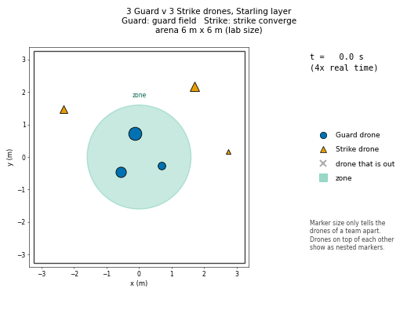 |  | 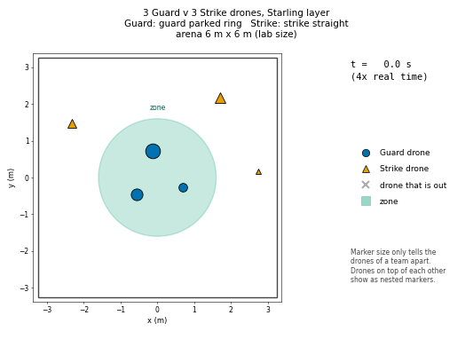 |

Best scripted Guard's worst-case hold (H, blue) and best scripted Strike's worst-case reach (R, orange) per factor:

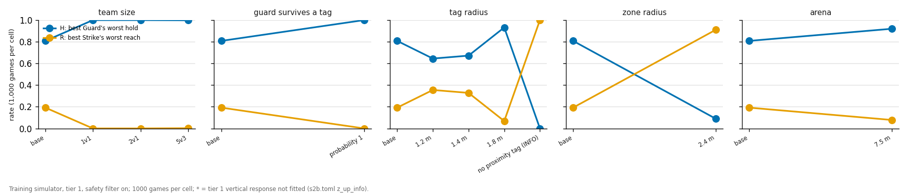

### Phases

| Phase | Status | Math library | Simulator | What |
|---|---|---|---|---|
| NUS port Phases 1–4 | DONE | JAX (NUS), PyTorch | NUS 2-D game (JAX), Copy of NUS 2-D game (PyTorch), tier 2 Isaac Lab | NUS's code installed, game and policies copied to PyTorch, six tests towards STE drones |
| NUS port Phase 5 | PAUSED (lead call D8) | PyTorch | Copy of NUS 2-D game (PyTorch), tier 1 fast engine | 5.1 Method match FAIL (T43); STE Guard policy 829 of 1,000 (T41) |
| NUS port Phase 6 | DONE | none | none | public documents with videos |
| ▶ L0 Game definition and feasibility | RUNNING (approved 20 Nov, cap 19 GPU-h) | PyTorch | tier 1 fast engine, tier 2 Isaac Lab | which game, worth learning, can tier 2 train, is the Crazyflie route sound |
| L1–L8 | NOT STARTED | PyTorch | as ruled at gate G0 | drone model, rules, learner, evaluation, league, export, AirStack side, real flight |
| L9 Documentation | RUNNING | none | none | status, records, results page |

### Phase L0 Game definition and feasibility, task by task

| ID | Plain name | Status | Simulator | Result / ETA |
|---|---|---|---|---|
| L0.1 | Track set-up: config and test skeleton | DONE | none | settings file, loader, tests; independent QC closed all findings |
| L0.7 | Process tooling and drills | RUNNING (laptop part DONE) | none | merged into `development`; laptop: full suite 1,420 passed / 0 failed, wake-up drill and resume drill both as expected (below); DONE when the 5090 has run the same (L07-5090) |
| L0.8 | Game spec sheet | DONE | none | merged into `development`; QC passed; full suite on `development` 1,461 passed / 0 failed (41 min) |
| L0.9 | Tag rule for the study: 1-for-1, nearest pair first | DONE | tier 1 fast engine | merged; QC + re-check passed; full suite on `development` 1,517 passed / 0 failed (31 min); the 5090 records its own tag-off positions (L09-5090) |
| L0.10 | Scripted players for the study | DONE | tier 1 fast engine | merged; QC + 2 re-checks passed; full suite on `development` 1,600 passed / 0 failed (56 min, CPU shared with the L0.11 GPU jobs) |
| L0.11 | Screening sweep (INFO) | DONE | tier 1 fast engine | record T44 (every control PASS; shortlist base (reference), tag 1.2 m, tag 1.4 m; every hold a one-for-one trade) + follow-up checks; merged into `development`; full suite 1,685 passed / 0 failed (27 min) |
| L0.12 | Best-response test: is the game worth learning? | RUNNING (CPU groundwork) | tier 1 fast engine | built on `ste-l0.12`: new exploiter trainer (T41 recipe, 0.6 s decisions); its evaluation replays T44's cells exactly (0 of 1,000 games differ); every control passes; CPU smoke trains both sides end to end. Concern: the Strike side gets almost no reward on the T41 recipe (0 reaches in ~500 CPU games) — pre-registered fallback: the game's distance shaping, else Strike INCONCLUSIVE. Lead's rulings being applied; then QC of the gate, then the GPU pilot |
| L0.2 | Tier 2 speed in contested play | NOT STARTED | tier 2 Isaac Lab | laptop allowed (owner, 21 Nov): runs alone on the GPU, measures what fits in 12 GB; cap 1.5 GPU-h |
| L0.13 | Does tier 2 train at all? | NOT STARTED | tier 2 Isaac Lab | laptop allowed (owner, 21 Nov), after L0.2, at the games-at-once L0.2 shows fits; cap 6 GPU-h |
| L0.3 | STE Guard policy in tier 2 without retraining | NOT STARTED | tier 2 Isaac Lab | unblocked (T41 on both machines); runs on the laptop GPU, taking turns with L0.12's GPU runs (one GPU job at a time); cap 1.5 GPU-h |
| L0.4 | Side-by-side Starling render | NOT STARTED | tier 2 Isaac Lab | laptop GPU, taking turns with L0.12; cap 0.2 GPU-h |
| L0.5 | Starling video look fix | NOT STARTED | tier 2 Isaac Lab | after L0.4; cap 0.3 GPU-h |
| L0.14 | Crazyflie route check | RUNNING (CPU) | tier 1 fast engine (CPU) | builder on `ste-l0.14`: T41 scored with a Crazyflie-like 0.56 s lag beside the Starling's (INFO), the offline-planner team-size check repeated (Crazyflie repository read-only), the adapter spec; one page for G0; 0 GPU-h. Lead's note: it could have run beside lane A since T41 arrived; started now |
| L0.6 | Gate G0 | NOT STARTED | none | after every task above; the owner decides |

GPU-h used in L0 so far: 0.426 of 19 (RTX 5090: 0, from its last status; laptop: 0.426 = L0.11 pilot 0.034 + CUDA smoke 0.087 + sweep 0.305).

Laptop full CPU suite (20 Nov, `development` at 5c5d465, after `scripts/nus_install_provisional.sh`): **1,333 passed, 2 failed, 48 skipped** in 24 min. Both failures repeat when run alone:
- **L07-F1** `test_ste_job.py::test_f_d_a_killed_job…resumes`: CONFIRMED by QC: the tool does not over-report (it measures from the same start; ~0.255 s raw, printed rounded to 0.3); the test compares the rounded text with the exact elapsed time. Fix: allow half a display step.
- **TEST-F2** `test_train_standin.py::test_default_path_bit_identical_after_the_nus_hooks`: FIXED (447b317). Measured on the laptop: the hash repeats (75d2a955…), hold rates equal the recorded [0.25, 0.375], and forcing PyTorch's CPU capability down changes the hash; threads (trainer runs one) and local files (not read on this path) ruled out. The fingerprint is now one hash per CPU capability; hold rates are checked on every machine.

### Usage (laptop session, 20 Nov 22:00 to now)

| What | Agent tokens | Wall time | Note |
|---|---|---|---|
| L0.7 fixes: builder, 7 fixes one at a time | ~400 k | ~51 min | the largest: each fix re-reads the tooling and its tests |
| L0.8 Game spec sheet: builder, build + 2 fix rounds | ~320 k | ~50 min | includes its own 25-min full suite |
| L0.7 independent QC + re-check | ~246 k | ~18 min | reproduced C1 and I1 in a scratch folder |
| L0.8 independent QC + re-check | ~209 k | ~12 min | mutation tests on the sheet |
| L0.9 Tag rule: builder (build + fix round) | ~358 k | ~66 min | the first 50 min slowed by sharing the CPU with the L0.7 suite |
| L0.9 independent QC + re-check | ~239 k | ~31 min | ran its own reference matcher, mutants and old-vs-new games |
| L0.10 Scripted players: builder (build + rulings + 2 QC fix rounds) | ~420 k | ~56 min | |
| L0.10 independent QC (+ 2 re-checks) | ~353 k | ~71 min | 84 deliberate breakages over two rounds; its own geometry probes on 30,000+ starts |
| L0.11 sweep build (CPU, build + rulings + rebase + QC fixes + follow-ups) | ~677 k | ~106 min | the largest single task so far; a fresh builder takes L0.12 to avoid re-reading this context |
| L0.12 groundwork builder | running | ~75 min so far | |
| L0.11 pre-launch QC | ~293 k | ~24 min | broke the code five ways through the real driver |
| L0.11 CUDA smoke | | ~5 min | 0.087 GPU-h |
| L0.11 independent QC (pre-launch, re-check, results read) | ~419 k | ~45 min | |
| L0.11 sweep | | 18 min | 0.305 GPU-h (L0.11 total 0.426 of 3.0) |
| L0.11 GPU pilot | | 2 min | 0.034 GPU-h (first GPU job of the track) |
| Full CPU test suite | none | ~25 min alone; the L0.7 merge run took 61 min (shared the CPU with L0.9's tests) | rule from now: one heavy test run at a time |
| GPU | 0 GPU-h | | nothing has used the GPU |

Sub-agents total about 1.2 M tokens so far; the lead's own context is not measured by the tools here.

Laptop drills (21 Nov, fix branch, shared folder `~/AirStack-starling-max2/svg_training/runs/shared/`, no owner pause open):
- Wake-up: `L0.7 l07_wakeup DONE exit=0 duration=120.4s effective=120.4s`, `waiter exit 0` (the background waiter's end was the wake-up).
- Resume: `alive` → simulated power cut (`kill -KILL` of the process group at step 30) → `dead`; waiter `DIED exit=none duration=31.2s`, `waiter exit 21`; relaunch with `bash cmd.txt` from a shell with a wrong `PYTHONPATH` and `SVG_SHARED_DIR` → `launch=2`, `resumed from step 30 of 120`, `DONE exit=0 duration=90.4s effective=90.4s run_effective=120.3s`, `waiter exit 0`, `{"steps": 120, "total": 7260.0}`; the wrong shared folder was never created.

### Other workstreams

| ID | Plain name | Status |
|---|---|---|
| SYNC-1 | Branch `development` on both machines; laptop worktree `~/AirStack-starling-max2-dev` | DONE |
| SYNC-2 | Status skill `train-status` and the owner's standing rules in CLAUDE.md | DONE |
| SYNC-3 | Root `CLAUDE.md` and every page: training work lands on `development` | DONE |
| SYNC-4 | STE Guard policy (T41 run folder) in the PROVISIONAL bundle | DONE; installed on the laptop (46 files, agent.pt c91bea51…) |
| L07-F1 | Fix: waiter-duration test bound (rounding) (QC I5) | DONE (a4100d0; 30 of 30 runs pass; L0.7 test files 217 passed) |
| L07-C1 | Fix: an open pause takes time off every job, and launch does not check for one: a job launched during a pause runs on the GPU with 0 GPU-h counted and its cap never fires | DONE (79effa0 on branch ste-l0.7-fix; red 48 failed, then L0.7 + NUS pause tests 251 passed). Pauses still always logged; launch refuses while one is open; a pause counts only against the jobs it stopped |
| L07-I1 | Fix: a new run reusing an old job name inherits that job's GPU-hours as credit (task cap can be exceeded) | DONE (05dd547; credit keyed by job name + run folder; red 24 failed, then 256 passed) |
| L07-I2 | Fix: `cmd.txt` relaunch loses the environment (PYTHONPATH, CUDA alloc setting, shared-folder path) | DONE (d0661f4; cmd.txt replays the first launch's environment; a different shared folder is refused; resume drill uses bash cmd.txt; red 3 failed, then 259 passed) |
| L07-I3 | Fix: the launcher's wrapper can die (clock step back, full disk) while the job runs on: GPU time stops being logged | DONE (1ca8a70; every wrapper write survives an error, records a fault and retries; red 8 failed, then 267 passed) |
| L07-I4 | Fix: a job resumed after a reboot is flagged ENDED_EARLY (exit 20) though it finished correctly | DONE (70fc1a3; judged on the trainer's saved progress across launches; red: drill pattern read 20; then 280 passed) |
| L08-F1 | Finding: the hangar's Strike start ring (3.2 m from the zone centre) does not fit the 6.5 m lab arena (drones kept within 3.0 m); a ring for 6.5 m is needed before L0.11's base case | CLOSED (lead's call): Strike start ring 2.75 m for the 6.5 m arena, PROPOSED, ruled at G0 |
| L07-C1b | Fix: our own "pause the siblings, run solo" step (AUTOMATION §2.2) is now refused too; lead's design: pauses the session makes are tagged and do not block launch, your pauses still do | DONE (ef38534; `GPU_PAUSE_BY=lead` tags the session's pauses; a bare `gpu_pause.sh pause` is still yours and still blocks; red 13 failed, then 298 passed) |
| L07-C1c | Fix: a session-tagged resume must refuse while any of your pauses is open (a resume today continues every job and closes your pauses too) | DONE (efa9ec1; a bare resume/stop is unchanged; red 4 failed, then 304 passed) |
| GIT-1 | Fix: my 17 Nov `.gitignore` line `data/` also hid new files in `tests/data/` | DONE (d3572dc: anchored to `/data/`) |
| L011-F1 | Finding: scripted players decide every 0.05 s tick, not at the sheet's 0.6 s decision period; the sweep measures scripted play at 0.05 s; L0.12's trainers must set their decision period explicitly (T41 used 0.6 s) | OPEN: written into the L0.11 gate file and record |
| L07-SUSPEND | Tooling: a laptop sleep during a GPU job is counted as GPU-hours and as time towards the job's cap (wall clock). Rule until fixed: never let the laptop sleep during a GPU job | QUEUED (tooling task); rule in force now |
| L011-G0 | Finding for gate G0 (T44, scripted play): (1) every hold is a one-for-one trade — no tag-on game times out, and at 1v1 and 3v3 a Guard win leaves no Guard — so head-count decides (PLAN F1; bears on what a tag costs, P12); (2) the programme's sizes 2v1 and 5v3, and 1v1, are Guard-trivial with scripted players at the proposed rules; candidate cause: tag radius 1.6 m = zone radius 1.6 m with Guards starting on a circle near the zone centre (not tested). L0.12 measures whether learning changes either | OPEN: reported at G0 |
| L010-G0 | Finding for gate G0 (from L0.10 QC): any safety-filter move near the 1.6 m tag radius can create a tag nobody chose (the filter's 1.10 m keep-out is inside the tag radius). Spaced starts remove it at the start; during play it is part of the game the sweep measures (P1) | OPEN: reported at G0 |
| L09-5090 | On the 5090: record the tag-off golden's positions for its CPU type (AVX512); check the outcome fingerprints there | WAITING: next 5090 session |
| VID-1 | Clips: a height panel on the 2-D top-down clips of every run; 3-D Isaac Lab videos (Starling look, top view + 3-D view, MP4 + GIF) of each result's key games, starting with L0.11's (lead's recommendation adopted, 21 Nov) | QUEUED: after L0.4/L0.5 (the Starling look); laptop GPU |
| L08-M | L0.8 minors left: 3 hangar values unchecked on a clone without the NUS bundle; 3 values whose wrong value still passes; loader refuses some honest wording; tests tied to exact lines and the AirStack fence file | PARKED |
| L07-DISK | Follow-up: the planned disk-space check (a disk full through 10 retries at a job's end reads DIED) | PARKED (stated limit) |
| L07-N | Re-check minors N1–N4: a session pause also lands in the old per-worktree log the NUS reader uses; full disk can hold the wrapper 10 min after the end; AUTOMATION §4 still states the old GPU-hour rule; on the 5090 run `scripts/ste_job.py owner-pauses` before the drills | PARKED (N4 goes into the 5090 note) |
| L07-M | QC's 10 minor findings (+3 from the C1 build: pid-only matching, test pause pattern shared across sessions, pid reuse) (runs/ste_l07/qc_report.md) | PARKED until the six fixes land |
| L07-5090 | L0.7 on the 5090: full CPU suite and the two drills there (L0.7 is DONE only after both machines) | WAITING: next 5090 session |
| TEST-F2 | Fix: bit-level training fingerprint is machine-specific | DONE (447b317; trainer test file 43 passed, 1 skipped) |
| TEST-F2b | On the 5090: confirm its CPU capability is AVX512 (the key its 18 Nov hash is now filed under) | WAITING: next 5090 session runs the test (fails or skips loudly if wrong) |

**Machines (owner, 21 Nov):** no task is 5090-only. The RTX 5090 (32 GB) suits memory-heavy runs; the laptop RTX 5070 Ti (12 GB) runs everything sized to fit, and the record says which machine. Only machine checks stay with their machine: TEST-F2b, L07-5090, L09-5090. **Schedule:** weekends the laptop runs the pipeline (the 5090 is free for gaming); weekdays the 5090 does (the laptop goes to work). **This weekend:** the owner packs the laptop **Mon 23 Nov 10:00**: no GPU job starts unless it can end by **Mon 08:00**; by **09:30** everything is committed, HANDOFF §0 and status written, ready to push.

**GPU queue on the laptop (one at a time for speed measurements):** L0.12 pilot → L0.4 → L0.5 → VID-1 (3-D clips, L0.11 re-rendered) → L0.12 trainings → L0.2 → L0.3 → L0.13.

**Next.** (1) L0.11 follow-up checks (CPU). (2) L0.12 Best-response test: the lead's gate change (advisor, Fable 5.2): T44 already settles the PLAN's 0.2 bands for the tag variants, so the gate will read the better of script and trained exploiter and measure how far the exploiter gets above the script, with Guards-left and game length reported; trainer path verified on CPU first (the tag-on game files, Strike side, a positive control reproducing a T44 cell); reviewer reads the gate before launch. (3) Merge L0.11 after its follow-up checks and its own suite.

**Waiting on you.** Nothing; no GPU job is running.

**Correction.** The 21 Nov question on NUS values listed "speeds 0.6 / 1.2". The L0.8 review reads those two numbers as the decision period (0.6 s) and the flight height (1.2 m); the speeds are 0.5 and 0.333 m/s. Your Yes covers all of them as written on the sheet.

## 2026-11-21 06:08

**Status, 2026-11-21 06:07 (+08:00), event: owner asleep; clips added to the status**                                                        · laptop RTX 5070 Ti · GPU idle except the remote-desktop service · 0 training processes (0 paused)

### Watch (latest clips and figures)

L0.11 Screening sweep (T44), scripted players, training simulator tier 1, top-down view (2-D; the 3-D Isaac Lab videos
of these games come with VID-1). Each ends within about 3 s in a one-for-one trade.

| Guard field v Strike converge (base 3v3) | Guard mark edge v Strike sacrifice (base 3v3) | Parked ring v Strike straight (base 3v3) |
|---|---|---|
|  |  |  |

Best scripted Guard's worst-case hold (H, blue) and best scripted Strike's worst-case reach (R, orange) per factor:

Where phase L0 is (the plan's four lanes ending in gate G0; a version coloured by progress is coming, DOC-1). Done:
L0.1, L0.8, L0.9, L0.10, L0.11; laptop part done: L0.7; running: L0.12, L0.14; queued: L0.2, L0.3, L0.4, L0.5, L0.13.

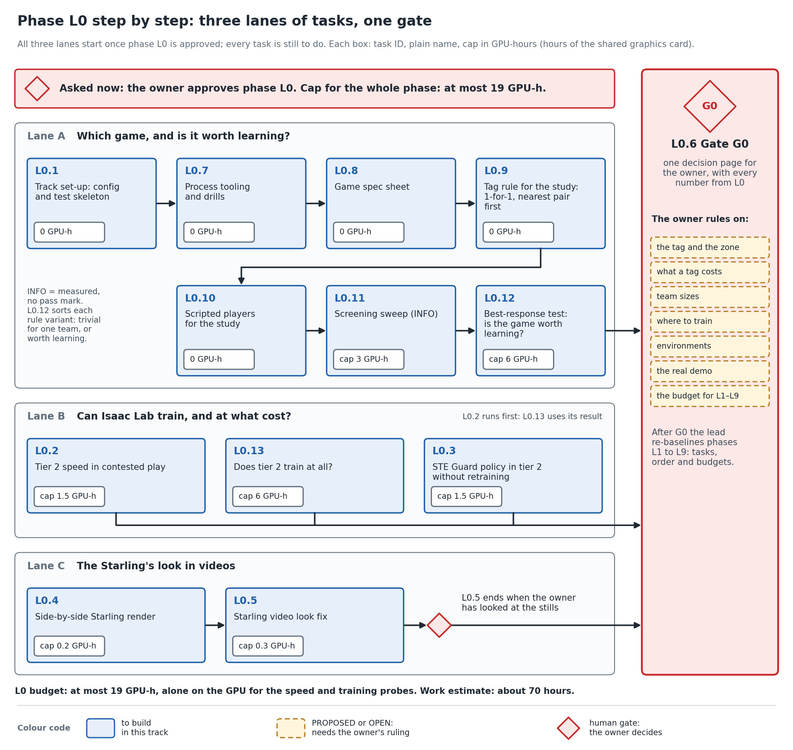

What the drones look like in the 3-D simulator (Isaac Lab Starlings, from S2b; the L0 games get 3-D videos with VID-1):

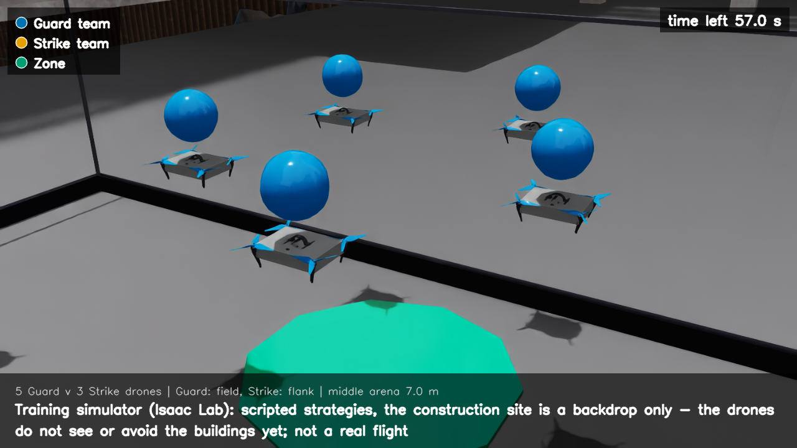

### Phases

| Phase | Status | Math library | Simulator | What |
|---|---|---|---|---|
| NUS port Phases 1–4 | DONE | JAX (NUS), PyTorch | NUS 2-D game (JAX), Copy of NUS 2-D game (PyTorch), tier 2 Isaac Lab | NUS's code installed, game and policies copied to PyTorch, six tests towards STE drones |
| NUS port Phase 5 | PAUSED (lead call D8) | PyTorch | Copy of NUS 2-D game (PyTorch), tier 1 fast engine | 5.1 Method match FAIL (T43); STE Guard policy 829 of 1,000 (T41) |
| NUS port Phase 6 | DONE | none | none | public documents with videos |
| ▶ L0 Game definition and feasibility | RUNNING (approved 20 Nov, cap 19 GPU-h) | PyTorch | tier 1 fast engine, tier 2 Isaac Lab | which game, worth learning, can tier 2 train, is the Crazyflie route sound |
| L1–L8 | NOT STARTED | PyTorch | as ruled at gate G0 | drone model, rules, learner, evaluation, league, export, AirStack side, real flight |
| L9 Documentation | RUNNING | none | none | status, records, results page |

### Phase L0 Game definition and feasibility, task by task

| ID | Plain name | Status | Simulator | Result / ETA |
|---|---|---|---|---|
| L0.1 | Track set-up: config and test skeleton | DONE | none | settings file, loader, tests; independent QC closed all findings |
| L0.7 | Process tooling and drills | RUNNING (laptop part DONE) | none | merged into `development`; laptop: full suite 1,420 passed / 0 failed, wake-up drill and resume drill both as expected (below); DONE when the 5090 has run the same (L07-5090) |
| L0.8 | Game spec sheet | DONE | none | merged into `development`; QC passed; full suite on `development` 1,461 passed / 0 failed (41 min) |
| L0.9 | Tag rule for the study: 1-for-1, nearest pair first | DONE | tier 1 fast engine | merged; QC + re-check passed; full suite on `development` 1,517 passed / 0 failed (31 min); the 5090 records its own tag-off positions (L09-5090) |
| L0.10 | Scripted players for the study | DONE | tier 1 fast engine | merged; QC + 2 re-checks passed; full suite on `development` 1,600 passed / 0 failed (56 min, CPU shared with the L0.11 GPU jobs) |
| L0.11 | Screening sweep (INFO) | DONE | tier 1 fast engine | record T44 (every control PASS; shortlist base (reference), tag 1.2 m, tag 1.4 m; every hold a one-for-one trade) + follow-up checks; merged into `development`; full suite 1,685 passed / 0 failed (27 min) |
| L0.12 | Best-response test: is the game worth learning? | RUNNING (CPU groundwork) | tier 1 fast engine | built on `ste-l0.12`: new exploiter trainer (T41 recipe, 0.6 s decisions); its evaluation replays T44's cells exactly (0 of 1,000 games differ); every control passes; CPU smoke trains both sides end to end. Concern: the Strike side gets almost no reward on the T41 recipe (0 reaches in ~500 CPU games) — pre-registered fallback: the game's distance shaping, else Strike INCONCLUSIVE. Lead's rulings being applied; then QC of the gate, then the GPU pilot |
| L0.2 | Tier 2 speed in contested play | NOT STARTED | tier 2 Isaac Lab | laptop allowed (owner, 21 Nov): runs alone on the GPU, measures what fits in 12 GB; cap 1.5 GPU-h |
| L0.13 | Does tier 2 train at all? | NOT STARTED | tier 2 Isaac Lab | laptop allowed (owner, 21 Nov), after L0.2, at the games-at-once L0.2 shows fits; cap 6 GPU-h |
| L0.3 | STE Guard policy in tier 2 without retraining | NOT STARTED | tier 2 Isaac Lab | unblocked (T41 on both machines); runs on the laptop GPU, taking turns with L0.12's GPU runs (one GPU job at a time); cap 1.5 GPU-h |
| L0.4 | Side-by-side Starling render | NOT STARTED | tier 2 Isaac Lab | laptop GPU, taking turns with L0.12; cap 0.2 GPU-h |
| L0.5 | Starling video look fix | NOT STARTED | tier 2 Isaac Lab | after L0.4; cap 0.3 GPU-h |
| L0.14 | Crazyflie route check | RUNNING (CPU) | tier 1 fast engine (CPU) | builder on `ste-l0.14`: T41 scored with a Crazyflie-like 0.56 s lag beside the Starling's (INFO), the offline-planner team-size check repeated (Crazyflie repository read-only), the adapter spec; one page for G0; 0 GPU-h. Lead's note: it could have run beside lane A since T41 arrived; started now |
| L0.6 | Gate G0 | NOT STARTED | none | after every task above; the owner decides |

GPU-h used in L0 so far: 0.426 of 19 (RTX 5090: 0, from its last status; laptop: 0.426 = L0.11 pilot 0.034 + CUDA smoke 0.087 + sweep 0.305).

Laptop full CPU suite (20 Nov, `development` at 5c5d465, after `scripts/nus_install_provisional.sh`): **1,333 passed, 2 failed, 48 skipped** in 24 min. Both failures repeat when run alone:
- **L07-F1** `test_ste_job.py::test_f_d_a_killed_job…resumes`: CONFIRMED by QC: the tool does not over-report (it measures from the same start; ~0.255 s raw, printed rounded to 0.3); the test compares the rounded text with the exact elapsed time. Fix: allow half a display step.
- **TEST-F2** `test_train_standin.py::test_default_path_bit_identical_after_the_nus_hooks`: FIXED (447b317). Measured on the laptop: the hash repeats (75d2a955…), hold rates equal the recorded [0.25, 0.375], and forcing PyTorch's CPU capability down changes the hash; threads (trainer runs one) and local files (not read on this path) ruled out. The fingerprint is now one hash per CPU capability; hold rates are checked on every machine.

### Usage (laptop session, 20 Nov 22:00 to now)

| What | Agent tokens | Wall time | Note |
|---|---|---|---|
| L0.7 fixes: builder, 7 fixes one at a time | ~400 k | ~51 min | the largest: each fix re-reads the tooling and its tests |
| L0.8 Game spec sheet: builder, build + 2 fix rounds | ~320 k | ~50 min | includes its own 25-min full suite |
| L0.7 independent QC + re-check | ~246 k | ~18 min | reproduced C1 and I1 in a scratch folder |
| L0.8 independent QC + re-check | ~209 k | ~12 min | mutation tests on the sheet |
| L0.9 Tag rule: builder (build + fix round) | ~358 k | ~66 min | the first 50 min slowed by sharing the CPU with the L0.7 suite |
| L0.9 independent QC + re-check | ~239 k | ~31 min | ran its own reference matcher, mutants and old-vs-new games |
| L0.10 Scripted players: builder (build + rulings + 2 QC fix rounds) | ~420 k | ~56 min | |
| L0.10 independent QC (+ 2 re-checks) | ~353 k | ~71 min | 84 deliberate breakages over two rounds; its own geometry probes on 30,000+ starts |
| L0.11 sweep build (CPU, build + rulings + rebase + QC fixes + follow-ups) | ~677 k | ~106 min | the largest single task so far; a fresh builder takes L0.12 to avoid re-reading this context |
| L0.12 groundwork builder | running | ~75 min so far | |
| L0.11 pre-launch QC | ~293 k | ~24 min | broke the code five ways through the real driver |
| L0.11 CUDA smoke | | ~5 min | 0.087 GPU-h |
| L0.11 independent QC (pre-launch, re-check, results read) | ~419 k | ~45 min | |
| L0.11 sweep | | 18 min | 0.305 GPU-h (L0.11 total 0.426 of 3.0) |
| L0.11 GPU pilot | | 2 min | 0.034 GPU-h (first GPU job of the track) |
| Full CPU test suite | none | ~25 min alone; the L0.7 merge run took 61 min (shared the CPU with L0.9's tests) | rule from now: one heavy test run at a time |
| GPU | 0 GPU-h | | nothing has used the GPU |

Sub-agents total about 1.2 M tokens so far; the lead's own context is not measured by the tools here.

Laptop drills (21 Nov, fix branch, shared folder `~/AirStack-starling-max2/svg_training/runs/shared/`, no owner pause open):
- Wake-up: `L0.7 l07_wakeup DONE exit=0 duration=120.4s effective=120.4s`, `waiter exit 0` (the background waiter's end was the wake-up).
- Resume: `alive` → simulated power cut (`kill -KILL` of the process group at step 30) → `dead`; waiter `DIED exit=none duration=31.2s`, `waiter exit 21`; relaunch with `bash cmd.txt` from a shell with a wrong `PYTHONPATH` and `SVG_SHARED_DIR` → `launch=2`, `resumed from step 30 of 120`, `DONE exit=0 duration=90.4s effective=90.4s run_effective=120.3s`, `waiter exit 0`, `{"steps": 120, "total": 7260.0}`; the wrong shared folder was never created.

### Other workstreams

| ID | Plain name | Status |
|---|---|---|
| SYNC-1 | Branch `development` on both machines; laptop worktree `~/AirStack-starling-max2-dev` | DONE |
| SYNC-2 | Status skill `train-status` and the owner's standing rules in CLAUDE.md | DONE |
| SYNC-3 | Root `CLAUDE.md` and every page: training work lands on `development` | DONE |
| SYNC-4 | STE Guard policy (T41 run folder) in the PROVISIONAL bundle | DONE; installed on the laptop (46 files, agent.pt c91bea51…) |
| L07-F1 | Fix: waiter-duration test bound (rounding) (QC I5) | DONE (a4100d0; 30 of 30 runs pass; L0.7 test files 217 passed) |
| L07-C1 | Fix: an open pause takes time off every job, and launch does not check for one: a job launched during a pause runs on the GPU with 0 GPU-h counted and its cap never fires | DONE (79effa0 on branch ste-l0.7-fix; red 48 failed, then L0.7 + NUS pause tests 251 passed). Pauses still always logged; launch refuses while one is open; a pause counts only against the jobs it stopped |
| L07-I1 | Fix: a new run reusing an old job name inherits that job's GPU-hours as credit (task cap can be exceeded) | DONE (05dd547; credit keyed by job name + run folder; red 24 failed, then 256 passed) |
| L07-I2 | Fix: `cmd.txt` relaunch loses the environment (PYTHONPATH, CUDA alloc setting, shared-folder path) | DONE (d0661f4; cmd.txt replays the first launch's environment; a different shared folder is refused; resume drill uses bash cmd.txt; red 3 failed, then 259 passed) |
| L07-I3 | Fix: the launcher's wrapper can die (clock step back, full disk) while the job runs on: GPU time stops being logged | DONE (1ca8a70; every wrapper write survives an error, records a fault and retries; red 8 failed, then 267 passed) |
| L07-I4 | Fix: a job resumed after a reboot is flagged ENDED_EARLY (exit 20) though it finished correctly | DONE (70fc1a3; judged on the trainer's saved progress across launches; red: drill pattern read 20; then 280 passed) |
| L08-F1 | Finding: the hangar's Strike start ring (3.2 m from the zone centre) does not fit the 6.5 m lab arena (drones kept within 3.0 m); a ring for 6.5 m is needed before L0.11's base case | CLOSED (lead's call): Strike start ring 2.75 m for the 6.5 m arena, PROPOSED, ruled at G0 |
| L07-C1b | Fix: our own "pause the siblings, run solo" step (AUTOMATION §2.2) is now refused too; lead's design: pauses the session makes are tagged and do not block launch, your pauses still do | DONE (ef38534; `GPU_PAUSE_BY=lead` tags the session's pauses; a bare `gpu_pause.sh pause` is still yours and still blocks; red 13 failed, then 298 passed) |
| L07-C1c | Fix: a session-tagged resume must refuse while any of your pauses is open (a resume today continues every job and closes your pauses too) | DONE (efa9ec1; a bare resume/stop is unchanged; red 4 failed, then 304 passed) |
| GIT-1 | Fix: my 17 Nov `.gitignore` line `data/` also hid new files in `tests/data/` | DONE (d3572dc: anchored to `/data/`) |
| L011-F1 | Finding: scripted players decide every 0.05 s tick, not at the sheet's 0.6 s decision period; the sweep measures scripted play at 0.05 s; L0.12's trainers must set their decision period explicitly (T41 used 0.6 s) | OPEN: written into the L0.11 gate file and record |
| L07-SUSPEND | Tooling: a laptop sleep during a GPU job is counted as GPU-hours and as time towards the job's cap (wall clock). Rule until fixed: never let the laptop sleep during a GPU job | QUEUED (tooling task); rule in force now |
| L011-G0 | Finding for gate G0 (T44, scripted play): (1) every hold is a one-for-one trade — no tag-on game times out, and at 1v1 and 3v3 a Guard win leaves no Guard — so head-count decides (PLAN F1; bears on what a tag costs, P12); (2) the programme's sizes 2v1 and 5v3, and 1v1, are Guard-trivial with scripted players at the proposed rules; candidate cause: tag radius 1.6 m = zone radius 1.6 m with Guards starting on a circle near the zone centre (not tested). L0.12 measures whether learning changes either | OPEN: reported at G0 |
| L010-G0 | Finding for gate G0 (from L0.10 QC): any safety-filter move near the 1.6 m tag radius can create a tag nobody chose (the filter's 1.10 m keep-out is inside the tag radius). Spaced starts remove it at the start; during play it is part of the game the sweep measures (P1) | OPEN: reported at G0 |
| L09-5090 | On the 5090: record the tag-off golden's positions for its CPU type (AVX512); check the outcome fingerprints there | WAITING: next 5090 session |
| DOC-1 | A phase-L0 flowchart coloured by progress (done / running / queued), regenerated with each status and shown in its Watch section (owner, 21 Nov: "photos or diagram flow charts would be good too") | RUNNING |
| VID-1 | Clips: a height panel on the 2-D top-down clips of every run; 3-D Isaac Lab videos (Starling look, top view + 3-D view, MP4 + GIF) of each result's key games, starting with L0.11's (lead's recommendation adopted, 21 Nov) | QUEUED: after L0.4/L0.5 (the Starling look); laptop GPU |
| L08-M | L0.8 minors left: 3 hangar values unchecked on a clone without the NUS bundle; 3 values whose wrong value still passes; loader refuses some honest wording; tests tied to exact lines and the AirStack fence file | PARKED |
| L07-DISK | Follow-up: the planned disk-space check (a disk full through 10 retries at a job's end reads DIED) | PARKED (stated limit) |
| L07-N | Re-check minors N1–N4: a session pause also lands in the old per-worktree log the NUS reader uses; full disk can hold the wrapper 10 min after the end; AUTOMATION §4 still states the old GPU-hour rule; on the 5090 run `scripts/ste_job.py owner-pauses` before the drills | PARKED (N4 goes into the 5090 note) |
| L07-M | QC's 10 minor findings (+3 from the C1 build: pid-only matching, test pause pattern shared across sessions, pid reuse) (runs/ste_l07/qc_report.md) | PARKED until the six fixes land |
| L07-5090 | L0.7 on the 5090: full CPU suite and the two drills there (L0.7 is DONE only after both machines) | WAITING: next 5090 session |
| TEST-F2 | Fix: bit-level training fingerprint is machine-specific | DONE (447b317; trainer test file 43 passed, 1 skipped) |
| TEST-F2b | On the 5090: confirm its CPU capability is AVX512 (the key its 18 Nov hash is now filed under) | WAITING: next 5090 session runs the test (fails or skips loudly if wrong) |

**Machines (owner, 21 Nov):** no task is 5090-only. The RTX 5090 (32 GB) suits memory-heavy runs; the laptop RTX 5070 Ti (12 GB) runs everything sized to fit, and the record says which machine. Only machine checks stay with their machine: TEST-F2b, L07-5090, L09-5090. **Schedule:** weekends the laptop runs the pipeline (the 5090 is free for gaming); weekdays the 5090 does (the laptop goes to work). **This weekend:** the owner packs the laptop **Mon 23 Nov 10:00**: no GPU job starts unless it can end by **Mon 08:00**; by **09:30** everything is committed, HANDOFF §0 and status written, ready to push.

**GPU queue on the laptop (one at a time for speed measurements):** L0.12 pilot → L0.4 → L0.5 → VID-1 (3-D clips, L0.11 re-rendered) → L0.12 trainings → L0.2 → L0.3 → L0.13.

**Next.** (1) L0.11 follow-up checks (CPU). (2) L0.12 Best-response test: the lead's gate change (advisor, Fable 5.2): T44 already settles the PLAN's 0.2 bands for the tag variants, so the gate will read the better of script and trained exploiter and measure how far the exploiter gets above the script, with Guards-left and game length reported; trainer path verified on CPU first (the tag-on game files, Strike side, a positive control reproducing a T44 cell); reviewer reads the gate before launch. (3) Merge L0.11 after its follow-up checks and its own suite.

**Waiting on you.** Nothing; no GPU job is running.

**Correction.** The 21 Nov question on NUS values listed "speeds 0.6 / 1.2". The L0.8 review reads those two numbers as the decision period (0.6 s) and the flight height (1.2 m); the speeds are 0.5 and 0.333 m/s. Your Yes covers all of them as written on the sheet.

## 2026-11-21 06:10

**Status, 2026-11-21 06:10 (+08:00), event: progress flowchart in the status (DOC-1 done)**                                                         · laptop RTX 5070 Ti · GPU idle except the remote-desktop service · 0 training processes (0 paused)

### Watch (latest clips and figures)

L0.11 Screening sweep (T44), scripted players, training simulator tier 1, top-down view (2-D; the 3-D Isaac Lab videos
of these games come with VID-1). Each ends within about 3 s in a one-for-one trade.

| Guard field v Strike converge (base 3v3) | Guard mark edge v Strike sacrifice (base 3v3) | Parked ring v Strike straight (base 3v3) |
|---|---|---|
|  |  |  |

Best scripted Guard's worst-case hold (H, blue) and best scripted Strike's worst-case reach (R, orange) per factor:

Where phase L0 is: green done, light green laptop part done, amber running, grey queued (state file
`ste_learning/status/l0_progress.toml`, figure by `scripts/make_ste_learning_figures.py l0_progress`).

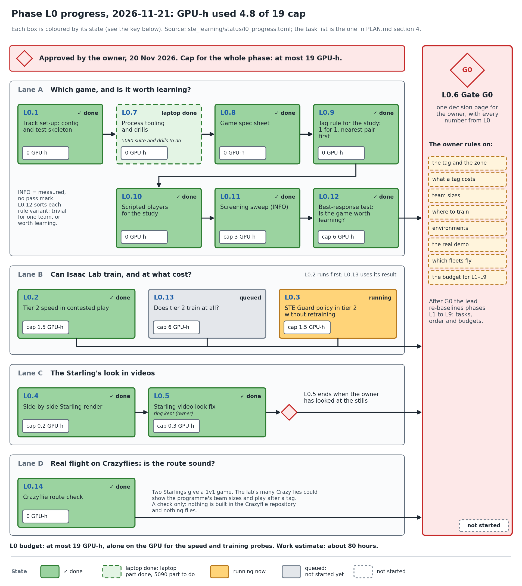

What the drones look like in the 3-D simulator (Isaac Lab Starlings, from S2b; the L0 games get 3-D videos with VID-1):

### Phases

| Phase | Status | Math library | Simulator | What |
|---|---|---|---|---|
| NUS port Phases 1–4 | DONE | JAX (NUS), PyTorch | NUS 2-D game (JAX), Copy of NUS 2-D game (PyTorch), tier 2 Isaac Lab | NUS's code installed, game and policies copied to PyTorch, six tests towards STE drones |
| NUS port Phase 5 | PAUSED (lead call D8) | PyTorch | Copy of NUS 2-D game (PyTorch), tier 1 fast engine | 5.1 Method match FAIL (T43); STE Guard policy 829 of 1,000 (T41) |
| NUS port Phase 6 | DONE | none | none | public documents with videos |
| ▶ L0 Game definition and feasibility | RUNNING (approved 20 Nov, cap 19 GPU-h) | PyTorch | tier 1 fast engine, tier 2 Isaac Lab | which game, worth learning, can tier 2 train, is the Crazyflie route sound |
| L1–L8 | NOT STARTED | PyTorch | as ruled at gate G0 | drone model, rules, learner, evaluation, league, export, AirStack side, real flight |
| L9 Documentation | RUNNING | none | none | status, records, results page |

### Phase L0 Game definition and feasibility, task by task

| ID | Plain name | Status | Simulator | Result / ETA |
|---|---|---|---|---|
| L0.1 | Track set-up: config and test skeleton | DONE | none | settings file, loader, tests; independent QC closed all findings |
| L0.7 | Process tooling and drills | RUNNING (laptop part DONE) | none | merged into `development`; laptop: full suite 1,420 passed / 0 failed, wake-up drill and resume drill both as expected (below); DONE when the 5090 has run the same (L07-5090) |
| L0.8 | Game spec sheet | DONE | none | merged into `development`; QC passed; full suite on `development` 1,461 passed / 0 failed (41 min) |
| L0.9 | Tag rule for the study: 1-for-1, nearest pair first | DONE | tier 1 fast engine | merged; QC + re-check passed; full suite on `development` 1,517 passed / 0 failed (31 min); the 5090 records its own tag-off positions (L09-5090) |
| L0.10 | Scripted players for the study | DONE | tier 1 fast engine | merged; QC + 2 re-checks passed; full suite on `development` 1,600 passed / 0 failed (56 min, CPU shared with the L0.11 GPU jobs) |
| L0.11 | Screening sweep (INFO) | DONE | tier 1 fast engine | record T44 (every control PASS; shortlist base (reference), tag 1.2 m, tag 1.4 m; every hold a one-for-one trade) + follow-up checks; merged into `development`; full suite 1,685 passed / 0 failed (27 min) |
| L0.12 | Best-response test: is the game worth learning? | RUNNING (CPU groundwork) | tier 1 fast engine | built on `ste-l0.12`: new exploiter trainer (T41 recipe, 0.6 s decisions); its evaluation replays T44's cells exactly (0 of 1,000 games differ); every control passes; CPU smoke trains both sides end to end. Concern: the Strike side gets almost no reward on the T41 recipe (0 reaches in ~500 CPU games) — pre-registered fallback: the game's distance shaping, else Strike INCONCLUSIVE. Lead's rulings being applied; then QC of the gate, then the GPU pilot |
| L0.2 | Tier 2 speed in contested play | NOT STARTED | tier 2 Isaac Lab | laptop allowed (owner, 21 Nov): runs alone on the GPU, measures what fits in 12 GB; cap 1.5 GPU-h |
| L0.13 | Does tier 2 train at all? | NOT STARTED | tier 2 Isaac Lab | laptop allowed (owner, 21 Nov), after L0.2, at the games-at-once L0.2 shows fits; cap 6 GPU-h |
| L0.3 | STE Guard policy in tier 2 without retraining | NOT STARTED | tier 2 Isaac Lab | unblocked (T41 on both machines); runs on the laptop GPU, taking turns with L0.12's GPU runs (one GPU job at a time); cap 1.5 GPU-h |
| L0.4 | Side-by-side Starling render | NOT STARTED | tier 2 Isaac Lab | laptop GPU, taking turns with L0.12; cap 0.2 GPU-h |
| L0.5 | Starling video look fix | NOT STARTED | tier 2 Isaac Lab | after L0.4; cap 0.3 GPU-h |
| L0.14 | Crazyflie route check | RUNNING (CPU) | tier 1 fast engine (CPU) | builder on `ste-l0.14`: T41 scored with a Crazyflie-like 0.56 s lag beside the Starling's (INFO), the offline-planner team-size check repeated (Crazyflie repository read-only), the adapter spec; one page for G0; 0 GPU-h. Lead's note: it could have run beside lane A since T41 arrived; started now |
| L0.6 | Gate G0 | NOT STARTED | none | after every task above; the owner decides |

GPU-h used in L0 so far: 0.426 of 19 (RTX 5090: 0, from its last status; laptop: 0.426 = L0.11 pilot 0.034 + CUDA smoke 0.087 + sweep 0.305).

Laptop full CPU suite (20 Nov, `development` at 5c5d465, after `scripts/nus_install_provisional.sh`): **1,333 passed, 2 failed, 48 skipped** in 24 min. Both failures repeat when run alone:
- **L07-F1** `test_ste_job.py::test_f_d_a_killed_job…resumes`: CONFIRMED by QC: the tool does not over-report (it measures from the same start; ~0.255 s raw, printed rounded to 0.3); the test compares the rounded text with the exact elapsed time. Fix: allow half a display step.
- **TEST-F2** `test_train_standin.py::test_default_path_bit_identical_after_the_nus_hooks`: FIXED (447b317). Measured on the laptop: the hash repeats (75d2a955…), hold rates equal the recorded [0.25, 0.375], and forcing PyTorch's CPU capability down changes the hash; threads (trainer runs one) and local files (not read on this path) ruled out. The fingerprint is now one hash per CPU capability; hold rates are checked on every machine.

### Usage (laptop session, 20 Nov 22:00 to now)

| What | Agent tokens | Wall time | Note |
|---|---|---|---|
| L0.7 fixes: builder, 7 fixes one at a time | ~400 k | ~51 min | the largest: each fix re-reads the tooling and its tests |
| L0.8 Game spec sheet: builder, build + 2 fix rounds | ~320 k | ~50 min | includes its own 25-min full suite |
| L0.7 independent QC + re-check | ~246 k | ~18 min | reproduced C1 and I1 in a scratch folder |
| L0.8 independent QC + re-check | ~209 k | ~12 min | mutation tests on the sheet |
| L0.9 Tag rule: builder (build + fix round) | ~358 k | ~66 min | the first 50 min slowed by sharing the CPU with the L0.7 suite |
| L0.9 independent QC + re-check | ~239 k | ~31 min | ran its own reference matcher, mutants and old-vs-new games |
| L0.10 Scripted players: builder (build + rulings + 2 QC fix rounds) | ~420 k | ~56 min | |
| L0.10 independent QC (+ 2 re-checks) | ~353 k | ~71 min | 84 deliberate breakages over two rounds; its own geometry probes on 30,000+ starts |
| L0.11 sweep build (CPU, build + rulings + rebase + QC fixes + follow-ups) | ~677 k | ~106 min | the largest single task so far; a fresh builder takes L0.12 to avoid re-reading this context |
| L0.12 groundwork builder | running | ~75 min so far | |
| L0.11 pre-launch QC | ~293 k | ~24 min | broke the code five ways through the real driver |
| L0.11 CUDA smoke | | ~5 min | 0.087 GPU-h |
| L0.11 independent QC (pre-launch, re-check, results read) | ~419 k | ~45 min | |
| L0.11 sweep | | 18 min | 0.305 GPU-h (L0.11 total 0.426 of 3.0) |
| L0.11 GPU pilot | | 2 min | 0.034 GPU-h (first GPU job of the track) |
| Full CPU test suite | none | ~25 min alone; the L0.7 merge run took 61 min (shared the CPU with L0.9's tests) | rule from now: one heavy test run at a time |
| GPU | 0 GPU-h | | nothing has used the GPU |

Sub-agents total about 1.2 M tokens so far; the lead's own context is not measured by the tools here.

Laptop drills (21 Nov, fix branch, shared folder `~/AirStack-starling-max2/svg_training/runs/shared/`, no owner pause open):
- Wake-up: `L0.7 l07_wakeup DONE exit=0 duration=120.4s effective=120.4s`, `waiter exit 0` (the background waiter's end was the wake-up).
- Resume: `alive` → simulated power cut (`kill -KILL` of the process group at step 30) → `dead`; waiter `DIED exit=none duration=31.2s`, `waiter exit 21`; relaunch with `bash cmd.txt` from a shell with a wrong `PYTHONPATH` and `SVG_SHARED_DIR` → `launch=2`, `resumed from step 30 of 120`, `DONE exit=0 duration=90.4s effective=90.4s run_effective=120.3s`, `waiter exit 0`, `{"steps": 120, "total": 7260.0}`; the wrong shared folder was never created.

### Other workstreams

| ID | Plain name | Status |
|---|---|---|
| SYNC-1 | Branch `development` on both machines; laptop worktree `~/AirStack-starling-max2-dev` | DONE |
| SYNC-2 | Status skill `train-status` and the owner's standing rules in CLAUDE.md | DONE |
| SYNC-3 | Root `CLAUDE.md` and every page: training work lands on `development` | DONE |
| SYNC-4 | STE Guard policy (T41 run folder) in the PROVISIONAL bundle | DONE; installed on the laptop (46 files, agent.pt c91bea51…) |
| L07-F1 | Fix: waiter-duration test bound (rounding) (QC I5) | DONE (a4100d0; 30 of 30 runs pass; L0.7 test files 217 passed) |
| L07-C1 | Fix: an open pause takes time off every job, and launch does not check for one: a job launched during a pause runs on the GPU with 0 GPU-h counted and its cap never fires | DONE (79effa0 on branch ste-l0.7-fix; red 48 failed, then L0.7 + NUS pause tests 251 passed). Pauses still always logged; launch refuses while one is open; a pause counts only against the jobs it stopped |
| L07-I1 | Fix: a new run reusing an old job name inherits that job's GPU-hours as credit (task cap can be exceeded) | DONE (05dd547; credit keyed by job name + run folder; red 24 failed, then 256 passed) |
| L07-I2 | Fix: `cmd.txt` relaunch loses the environment (PYTHONPATH, CUDA alloc setting, shared-folder path) | DONE (d0661f4; cmd.txt replays the first launch's environment; a different shared folder is refused; resume drill uses bash cmd.txt; red 3 failed, then 259 passed) |
| L07-I3 | Fix: the launcher's wrapper can die (clock step back, full disk) while the job runs on: GPU time stops being logged | DONE (1ca8a70; every wrapper write survives an error, records a fault and retries; red 8 failed, then 267 passed) |
| L07-I4 | Fix: a job resumed after a reboot is flagged ENDED_EARLY (exit 20) though it finished correctly | DONE (70fc1a3; judged on the trainer's saved progress across launches; red: drill pattern read 20; then 280 passed) |
| L08-F1 | Finding: the hangar's Strike start ring (3.2 m from the zone centre) does not fit the 6.5 m lab arena (drones kept within 3.0 m); a ring for 6.5 m is needed before L0.11's base case | CLOSED (lead's call): Strike start ring 2.75 m for the 6.5 m arena, PROPOSED, ruled at G0 |
| L07-C1b | Fix: our own "pause the siblings, run solo" step (AUTOMATION §2.2) is now refused too; lead's design: pauses the session makes are tagged and do not block launch, your pauses still do | DONE (ef38534; `GPU_PAUSE_BY=lead` tags the session's pauses; a bare `gpu_pause.sh pause` is still yours and still blocks; red 13 failed, then 298 passed) |
| L07-C1c | Fix: a session-tagged resume must refuse while any of your pauses is open (a resume today continues every job and closes your pauses too) | DONE (efa9ec1; a bare resume/stop is unchanged; red 4 failed, then 304 passed) |
| GIT-1 | Fix: my 17 Nov `.gitignore` line `data/` also hid new files in `tests/data/` | DONE (d3572dc: anchored to `/data/`) |
| L011-F1 | Finding: scripted players decide every 0.05 s tick, not at the sheet's 0.6 s decision period; the sweep measures scripted play at 0.05 s; L0.12's trainers must set their decision period explicitly (T41 used 0.6 s) | OPEN: written into the L0.11 gate file and record |
| L07-SUSPEND | Tooling: a laptop sleep during a GPU job is counted as GPU-hours and as time towards the job's cap (wall clock). Rule until fixed: never let the laptop sleep during a GPU job | QUEUED (tooling task); rule in force now |
| L011-G0 | Finding for gate G0 (T44, scripted play): (1) every hold is a one-for-one trade — no tag-on game times out, and at 1v1 and 3v3 a Guard win leaves no Guard — so head-count decides (PLAN F1; bears on what a tag costs, P12); (2) the programme's sizes 2v1 and 5v3, and 1v1, are Guard-trivial with scripted players at the proposed rules; candidate cause: tag radius 1.6 m = zone radius 1.6 m with Guards starting on a circle near the zone centre (not tested). L0.12 measures whether learning changes either | OPEN: reported at G0 |
| L010-G0 | Finding for gate G0 (from L0.10 QC): any safety-filter move near the 1.6 m tag radius can create a tag nobody chose (the filter's 1.10 m keep-out is inside the tag radius). Spaced starts remove it at the start; during play it is part of the game the sweep measures (P1) | OPEN: reported at G0 |
| L09-5090 | On the 5090: record the tag-off golden's positions for its CPU type (AVX512); check the outcome fingerprints there | WAITING: next 5090 session |
| DOC-1 | A phase-L0 flowchart coloured by progress (done / running / queued), regenerated with each status and shown in its Watch section (owner, 21 Nov: "photos or diagram flow charts would be good too") | DONE (progress flowchart; regenerated with each status) |
| VID-1 | Clips: a height panel on the 2-D top-down clips of every run; 3-D Isaac Lab videos (Starling look, top view + 3-D view, MP4 + GIF) of each result's key games, starting with L0.11's (lead's recommendation adopted, 21 Nov) | QUEUED: after L0.4/L0.5 (the Starling look); laptop GPU |
| L08-M | L0.8 minors left: 3 hangar values unchecked on a clone without the NUS bundle; 3 values whose wrong value still passes; loader refuses some honest wording; tests tied to exact lines and the AirStack fence file | PARKED |
| L07-DISK | Follow-up: the planned disk-space check (a disk full through 10 retries at a job's end reads DIED) | PARKED (stated limit) |
| L07-N | Re-check minors N1–N4: a session pause also lands in the old per-worktree log the NUS reader uses; full disk can hold the wrapper 10 min after the end; AUTOMATION §4 still states the old GPU-hour rule; on the 5090 run `scripts/ste_job.py owner-pauses` before the drills | PARKED (N4 goes into the 5090 note) |
| L07-M | QC's 10 minor findings (+3 from the C1 build: pid-only matching, test pause pattern shared across sessions, pid reuse) (runs/ste_l07/qc_report.md) | PARKED until the six fixes land |
| L07-5090 | L0.7 on the 5090: full CPU suite and the two drills there (L0.7 is DONE only after both machines) | WAITING: next 5090 session |
| TEST-F2 | Fix: bit-level training fingerprint is machine-specific | DONE (447b317; trainer test file 43 passed, 1 skipped) |
| TEST-F2b | On the 5090: confirm its CPU capability is AVX512 (the key its 18 Nov hash is now filed under) | WAITING: next 5090 session runs the test (fails or skips loudly if wrong) |

**Machines (owner, 21 Nov):** no task is 5090-only. The RTX 5090 (32 GB) suits memory-heavy runs; the laptop RTX 5070 Ti (12 GB) runs everything sized to fit, and the record says which machine. Only machine checks stay with their machine: TEST-F2b, L07-5090, L09-5090. **Schedule:** weekends the laptop runs the pipeline (the 5090 is free for gaming); weekdays the 5090 does (the laptop goes to work). **This weekend:** the owner packs the laptop **Mon 23 Nov 10:00**: no GPU job starts unless it can end by **Mon 08:00**; by **09:30** everything is committed, HANDOFF §0 and status written, ready to push.

**GPU queue on the laptop (one at a time for speed measurements):** L0.12 pilot → L0.4 → L0.5 → VID-1 (3-D clips, L0.11 re-rendered) → L0.12 trainings → L0.2 → L0.3 → L0.13.

**Next.** (1) L0.11 follow-up checks (CPU). (2) L0.12 Best-response test: the lead's gate change (advisor, Fable 5.2): T44 already settles the PLAN's 0.2 bands for the tag variants, so the gate will read the better of script and trained exploiter and measure how far the exploiter gets above the script, with Guards-left and game length reported; trainer path verified on CPU first (the tag-on game files, Strike side, a positive control reproducing a T44 cell); reviewer reads the gate before launch. (3) Merge L0.11 after its follow-up checks and its own suite.

**Waiting on you.** Nothing; no GPU job is running.

**Correction.** The 21 Nov question on NUS values listed "speeds 0.6 / 1.2". The L0.8 review reads those two numbers as the decision period (0.6 s) and the flight height (1.2 m); the speeds are 0.5 and 0.333 m/s. Your Yes covers all of them as written on the sheet.

## 2026-11-21 06:12

**Status, 2026-11-21 06:12 (+08:00), event: 30-minute update**                                                          · laptop RTX 5070 Ti · GPU 46 % / 19 W / 1.4 GB of 12 GB · 0 training processes (0 paused)

### Watch (latest clips and figures)

L0.11 Screening sweep (T44), scripted players, training simulator tier 1, top-down view (2-D; the 3-D Isaac Lab videos
of these games come with VID-1). Each ends within about 3 s in a one-for-one trade.

| Guard field v Strike converge (base 3v3) | Guard mark edge v Strike sacrifice (base 3v3) | Parked ring v Strike straight (base 3v3) |
|---|---|---|
|  |  |  |

Best scripted Guard's worst-case hold (H, blue) and best scripted Strike's worst-case reach (R, orange) per factor:

Where phase L0 is: green done, light green laptop part done, amber running, grey queued (state file
`ste_learning/status/l0_progress.toml`, figure by `scripts/make_ste_learning_figures.py l0_progress`).

What the drones look like in the 3-D simulator (Isaac Lab Starlings, from S2b; the L0 games get 3-D videos with VID-1):

### Phases

| Phase | Status | Math library | Simulator | What |
|---|---|---|---|---|
| NUS port Phases 1–4 | DONE | JAX (NUS), PyTorch | NUS 2-D game (JAX), Copy of NUS 2-D game (PyTorch), tier 2 Isaac Lab | NUS's code installed, game and policies copied to PyTorch, six tests towards STE drones |
| NUS port Phase 5 | PAUSED (lead call D8) | PyTorch | Copy of NUS 2-D game (PyTorch), tier 1 fast engine | 5.1 Method match FAIL (T43); STE Guard policy 829 of 1,000 (T41) |
| NUS port Phase 6 | DONE | none | none | public documents with videos |
| ▶ L0 Game definition and feasibility | RUNNING (approved 20 Nov, cap 19 GPU-h) | PyTorch | tier 1 fast engine, tier 2 Isaac Lab | which game, worth learning, can tier 2 train, is the Crazyflie route sound |
| L1–L8 | NOT STARTED | PyTorch | as ruled at gate G0 | drone model, rules, learner, evaluation, league, export, AirStack side, real flight |
| L9 Documentation | RUNNING | none | none | status, records, results page |

### Phase L0 Game definition and feasibility, task by task

| ID | Plain name | Status | Simulator | Result / ETA |
|---|---|---|---|---|
| L0.1 | Track set-up: config and test skeleton | DONE | none | settings file, loader, tests; independent QC closed all findings |
| L0.7 | Process tooling and drills | RUNNING (laptop part DONE) | none | merged into `development`; laptop: full suite 1,420 passed / 0 failed, wake-up drill and resume drill both as expected (below); DONE when the 5090 has run the same (L07-5090) |
| L0.8 | Game spec sheet | DONE | none | merged into `development`; QC passed; full suite on `development` 1,461 passed / 0 failed (41 min) |
| L0.9 | Tag rule for the study: 1-for-1, nearest pair first | DONE | tier 1 fast engine | merged; QC + re-check passed; full suite on `development` 1,517 passed / 0 failed (31 min); the 5090 records its own tag-off positions (L09-5090) |
| L0.10 | Scripted players for the study | DONE | tier 1 fast engine | merged; QC + 2 re-checks passed; full suite on `development` 1,600 passed / 0 failed (56 min, CPU shared with the L0.11 GPU jobs) |
| L0.11 | Screening sweep (INFO) | DONE | tier 1 fast engine | record T44 (every control PASS; shortlist base (reference), tag 1.2 m, tag 1.4 m; every hold a one-for-one trade) + follow-up checks; merged into `development`; full suite 1,685 passed / 0 failed (27 min) |
| L0.12 | Best-response test: is the game worth learning? | RUNNING (CPU groundwork) | tier 1 fast engine | built on `ste-l0.12`: new exploiter trainer (T41 recipe, 0.6 s decisions); its evaluation replays T44's cells exactly (0 of 1,000 games differ); every control passes; CPU smoke trains both sides end to end. Concern: the Strike side gets almost no reward on the T41 recipe (0 reaches in ~500 CPU games) — pre-registered fallback: the game's distance shaping, else Strike INCONCLUSIVE. Lead's rulings being applied; then QC of the gate, then the GPU pilot |
| L0.2 | Tier 2 speed in contested play | NOT STARTED | tier 2 Isaac Lab | laptop allowed (owner, 21 Nov): runs alone on the GPU, measures what fits in 12 GB; cap 1.5 GPU-h |
| L0.13 | Does tier 2 train at all? | NOT STARTED | tier 2 Isaac Lab | laptop allowed (owner, 21 Nov), after L0.2, at the games-at-once L0.2 shows fits; cap 6 GPU-h |
| L0.3 | STE Guard policy in tier 2 without retraining | NOT STARTED | tier 2 Isaac Lab | unblocked (T41 on both machines); runs on the laptop GPU, taking turns with L0.12's GPU runs (one GPU job at a time); cap 1.5 GPU-h |
| L0.4 | Side-by-side Starling render | NOT STARTED | tier 2 Isaac Lab | laptop GPU, taking turns with L0.12; cap 0.2 GPU-h |
| L0.5 | Starling video look fix | NOT STARTED | tier 2 Isaac Lab | after L0.4; cap 0.3 GPU-h |
| L0.14 | Crazyflie route check | RUNNING (CPU) | tier 1 fast engine (CPU) | builder on `ste-l0.14`: T41 scored with a Crazyflie-like 0.56 s lag beside the Starling's (INFO), the offline-planner team-size check repeated (Crazyflie repository read-only), the adapter spec; one page for G0; 0 GPU-h. Lead's note: it could have run beside lane A since T41 arrived; started now |
| L0.6 | Gate G0 | NOT STARTED | none | after every task above; the owner decides |

GPU-h used in L0 so far: 0.426 of 19 (RTX 5090: 0, from its last status; laptop: 0.426 = L0.11 pilot 0.034 + CUDA smoke 0.087 + sweep 0.305).

Laptop full CPU suite (20 Nov, `development` at 5c5d465, after `scripts/nus_install_provisional.sh`): **1,333 passed, 2 failed, 48 skipped** in 24 min. Both failures repeat when run alone:
- **L07-F1** `test_ste_job.py::test_f_d_a_killed_job…resumes`: CONFIRMED by QC: the tool does not over-report (it measures from the same start; ~0.255 s raw, printed rounded to 0.3); the test compares the rounded text with the exact elapsed time. Fix: allow half a display step.
- **TEST-F2** `test_train_standin.py::test_default_path_bit_identical_after_the_nus_hooks`: FIXED (447b317). Measured on the laptop: the hash repeats (75d2a955…), hold rates equal the recorded [0.25, 0.375], and forcing PyTorch's CPU capability down changes the hash; threads (trainer runs one) and local files (not read on this path) ruled out. The fingerprint is now one hash per CPU capability; hold rates are checked on every machine.

### Usage (laptop session, 20 Nov 22:00 to now)

| What | Agent tokens | Wall time | Note |
|---|---|---|---|
| L0.7 fixes: builder, 7 fixes one at a time | ~400 k | ~51 min | the largest: each fix re-reads the tooling and its tests |
| L0.8 Game spec sheet: builder, build + 2 fix rounds | ~320 k | ~50 min | includes its own 25-min full suite |
| L0.7 independent QC + re-check | ~246 k | ~18 min | reproduced C1 and I1 in a scratch folder |
| L0.8 independent QC + re-check | ~209 k | ~12 min | mutation tests on the sheet |
| L0.9 Tag rule: builder (build + fix round) | ~358 k | ~66 min | the first 50 min slowed by sharing the CPU with the L0.7 suite |
| L0.9 independent QC + re-check | ~239 k | ~31 min | ran its own reference matcher, mutants and old-vs-new games |
| L0.10 Scripted players: builder (build + rulings + 2 QC fix rounds) | ~420 k | ~56 min | |
| L0.10 independent QC (+ 2 re-checks) | ~353 k | ~71 min | 84 deliberate breakages over two rounds; its own geometry probes on 30,000+ starts |
| L0.11 sweep build (CPU, build + rulings + rebase + QC fixes + follow-ups) | ~677 k | ~106 min | the largest single task so far; a fresh builder takes L0.12 to avoid re-reading this context |
| L0.12 groundwork builder | running | ~75 min so far | |
| L0.11 pre-launch QC | ~293 k | ~24 min | broke the code five ways through the real driver |
| L0.11 CUDA smoke | | ~5 min | 0.087 GPU-h |
| L0.11 independent QC (pre-launch, re-check, results read) | ~419 k | ~45 min | |
| L0.11 sweep | | 18 min | 0.305 GPU-h (L0.11 total 0.426 of 3.0) |
| L0.11 GPU pilot | | 2 min | 0.034 GPU-h (first GPU job of the track) |
| Full CPU test suite | none | ~25 min alone; the L0.7 merge run took 61 min (shared the CPU with L0.9's tests) | rule from now: one heavy test run at a time |
| GPU | 0 GPU-h | | nothing has used the GPU |

Sub-agents total about 1.2 M tokens so far; the lead's own context is not measured by the tools here.

Laptop drills (21 Nov, fix branch, shared folder `~/AirStack-starling-max2/svg_training/runs/shared/`, no owner pause open):
- Wake-up: `L0.7 l07_wakeup DONE exit=0 duration=120.4s effective=120.4s`, `waiter exit 0` (the background waiter's end was the wake-up).
- Resume: `alive` → simulated power cut (`kill -KILL` of the process group at step 30) → `dead`; waiter `DIED exit=none duration=31.2s`, `waiter exit 21`; relaunch with `bash cmd.txt` from a shell with a wrong `PYTHONPATH` and `SVG_SHARED_DIR` → `launch=2`, `resumed from step 30 of 120`, `DONE exit=0 duration=90.4s effective=90.4s run_effective=120.3s`, `waiter exit 0`, `{"steps": 120, "total": 7260.0}`; the wrong shared folder was never created.

### Other workstreams

| ID | Plain name | Status |
|---|---|---|
| SYNC-1 | Branch `development` on both machines; laptop worktree `~/AirStack-starling-max2-dev` | DONE |
| SYNC-2 | Status skill `train-status` and the owner's standing rules in CLAUDE.md | DONE |
| SYNC-3 | Root `CLAUDE.md` and every page: training work lands on `development` | DONE |
| SYNC-4 | STE Guard policy (T41 run folder) in the PROVISIONAL bundle | DONE; installed on the laptop (46 files, agent.pt c91bea51…) |
| L07-F1 | Fix: waiter-duration test bound (rounding) (QC I5) | DONE (a4100d0; 30 of 30 runs pass; L0.7 test files 217 passed) |
| L07-C1 | Fix: an open pause takes time off every job, and launch does not check for one: a job launched during a pause runs on the GPU with 0 GPU-h counted and its cap never fires | DONE (79effa0 on branch ste-l0.7-fix; red 48 failed, then L0.7 + NUS pause tests 251 passed). Pauses still always logged; launch refuses while one is open; a pause counts only against the jobs it stopped |
| L07-I1 | Fix: a new run reusing an old job name inherits that job's GPU-hours as credit (task cap can be exceeded) | DONE (05dd547; credit keyed by job name + run folder; red 24 failed, then 256 passed) |
| L07-I2 | Fix: `cmd.txt` relaunch loses the environment (PYTHONPATH, CUDA alloc setting, shared-folder path) | DONE (d0661f4; cmd.txt replays the first launch's environment; a different shared folder is refused; resume drill uses bash cmd.txt; red 3 failed, then 259 passed) |
| L07-I3 | Fix: the launcher's wrapper can die (clock step back, full disk) while the job runs on: GPU time stops being logged | DONE (1ca8a70; every wrapper write survives an error, records a fault and retries; red 8 failed, then 267 passed) |
| L07-I4 | Fix: a job resumed after a reboot is flagged ENDED_EARLY (exit 20) though it finished correctly | DONE (70fc1a3; judged on the trainer's saved progress across launches; red: drill pattern read 20; then 280 passed) |
| L08-F1 | Finding: the hangar's Strike start ring (3.2 m from the zone centre) does not fit the 6.5 m lab arena (drones kept within 3.0 m); a ring for 6.5 m is needed before L0.11's base case | CLOSED (lead's call): Strike start ring 2.75 m for the 6.5 m arena, PROPOSED, ruled at G0 |
| L07-C1b | Fix: our own "pause the siblings, run solo" step (AUTOMATION §2.2) is now refused too; lead's design: pauses the session makes are tagged and do not block launch, your pauses still do | DONE (ef38534; `GPU_PAUSE_BY=lead` tags the session's pauses; a bare `gpu_pause.sh pause` is still yours and still blocks; red 13 failed, then 298 passed) |
| L07-C1c | Fix: a session-tagged resume must refuse while any of your pauses is open (a resume today continues every job and closes your pauses too) | DONE (efa9ec1; a bare resume/stop is unchanged; red 4 failed, then 304 passed) |
| GIT-1 | Fix: my 17 Nov `.gitignore` line `data/` also hid new files in `tests/data/` | DONE (d3572dc: anchored to `/data/`) |
| L011-F1 | Finding: scripted players decide every 0.05 s tick, not at the sheet's 0.6 s decision period; the sweep measures scripted play at 0.05 s; L0.12's trainers must set their decision period explicitly (T41 used 0.6 s) | OPEN: written into the L0.11 gate file and record |
| L07-SUSPEND | Tooling: a laptop sleep during a GPU job is counted as GPU-hours and as time towards the job's cap (wall clock). Rule until fixed: never let the laptop sleep during a GPU job | QUEUED (tooling task); rule in force now |
| L011-G0 | Finding for gate G0 (T44, scripted play): (1) every hold is a one-for-one trade — no tag-on game times out, and at 1v1 and 3v3 a Guard win leaves no Guard — so head-count decides (PLAN F1; bears on what a tag costs, P12); (2) the programme's sizes 2v1 and 5v3, and 1v1, are Guard-trivial with scripted players at the proposed rules; candidate cause: tag radius 1.6 m = zone radius 1.6 m with Guards starting on a circle near the zone centre (not tested). L0.12 measures whether learning changes either | OPEN: reported at G0 |
| L010-G0 | Finding for gate G0 (from L0.10 QC): any safety-filter move near the 1.6 m tag radius can create a tag nobody chose (the filter's 1.10 m keep-out is inside the tag radius). Spaced starts remove it at the start; during play it is part of the game the sweep measures (P1) | OPEN: reported at G0 |
| L09-5090 | On the 5090: record the tag-off golden's positions for its CPU type (AVX512); check the outcome fingerprints there | WAITING: next 5090 session |
| DOC-1 | A phase-L0 flowchart coloured by progress (done / running / queued), regenerated with each status and shown in its Watch section (owner, 21 Nov: "photos or diagram flow charts would be good too") | DONE (progress flowchart; regenerated with each status) |
| VID-1 | Clips: a height panel on the 2-D top-down clips of every run; 3-D Isaac Lab videos (Starling look, top view + 3-D view, MP4 + GIF) of each result's key games, starting with L0.11's (lead's recommendation adopted, 21 Nov) | QUEUED: after L0.4/L0.5 (the Starling look); laptop GPU |
| L08-M | L0.8 minors left: 3 hangar values unchecked on a clone without the NUS bundle; 3 values whose wrong value still passes; loader refuses some honest wording; tests tied to exact lines and the AirStack fence file | PARKED |
| L07-DISK | Follow-up: the planned disk-space check (a disk full through 10 retries at a job's end reads DIED) | PARKED (stated limit) |
| L07-N | Re-check minors N1–N4: a session pause also lands in the old per-worktree log the NUS reader uses; full disk can hold the wrapper 10 min after the end; AUTOMATION §4 still states the old GPU-hour rule; on the 5090 run `scripts/ste_job.py owner-pauses` before the drills | PARKED (N4 goes into the 5090 note) |
| L07-M | QC's 10 minor findings (+3 from the C1 build: pid-only matching, test pause pattern shared across sessions, pid reuse) (runs/ste_l07/qc_report.md) | PARKED until the six fixes land |
| L07-5090 | L0.7 on the 5090: full CPU suite and the two drills there (L0.7 is DONE only after both machines) | WAITING: next 5090 session |
| TEST-F2 | Fix: bit-level training fingerprint is machine-specific | DONE (447b317; trainer test file 43 passed, 1 skipped) |
| TEST-F2b | On the 5090: confirm its CPU capability is AVX512 (the key its 18 Nov hash is now filed under) | WAITING: next 5090 session runs the test (fails or skips loudly if wrong) |

**Machines (owner, 21 Nov):** no task is 5090-only. The RTX 5090 (32 GB) suits memory-heavy runs; the laptop RTX 5070 Ti (12 GB) runs everything sized to fit, and the record says which machine. Only machine checks stay with their machine: TEST-F2b, L07-5090, L09-5090. **Schedule:** weekends the laptop runs the pipeline (the 5090 is free for gaming); weekdays the 5090 does (the laptop goes to work). **This weekend:** the owner packs the laptop **Mon 23 Nov 10:00**: no GPU job starts unless it can end by **Mon 08:00**; by **09:30** everything is committed, HANDOFF §0 and status written, ready to push.

**GPU queue on the laptop (one at a time for speed measurements):** L0.12 pilot → L0.4 → L0.5 → VID-1 (3-D clips, L0.11 re-rendered) → L0.12 trainings → L0.2 → L0.3 → L0.13.

**Next.** (1) L0.11 follow-up checks (CPU). (2) L0.12 Best-response test: the lead's gate change (advisor, Fable 5.2): T44 already settles the PLAN's 0.2 bands for the tag variants, so the gate will read the better of script and trained exploiter and measure how far the exploiter gets above the script, with Guards-left and game length reported; trainer path verified on CPU first (the tag-on game files, Strike side, a positive control reproducing a T44 cell); reviewer reads the gate before launch. (3) Merge L0.11 after its follow-up checks and its own suite.

**Waiting on you.** Nothing; no GPU job is running.

**Correction.** The 21 Nov question on NUS values listed "speeds 0.6 / 1.2". The L0.8 review reads those two numbers as the decision period (0.6 s) and the flight height (1.2 m); the speeds are 0.5 and 0.333 m/s. Your Yes covers all of them as written on the sheet.

## 2026-11-21 06:13

**Status, 2026-11-21 06:13 (+08:00), event: L0.12 rulings built in; 2-D clips now carry a height panel**                                                           · laptop RTX 5070 Ti · GPU 46 % / 19 W / 1.4 GB of 12 GB · 0 training processes (0 paused)

### Watch (latest clips and figures)

L0.11 Screening sweep (T44), scripted players, training simulator tier 1, top-down view (2-D; the 3-D Isaac Lab videos
of these games come with VID-1). Each ends within about 3 s in a one-for-one trade.

| Guard field v Strike converge (base 3v3) | Guard mark edge v Strike sacrifice (base 3v3) | Parked ring v Strike straight (base 3v3) |
|---|---|---|
|  |  |  |

Best scripted Guard's worst-case hold (H, blue) and best scripted Strike's worst-case reach (R, orange) per factor:

Where phase L0 is: green done, light green laptop part done, amber running, grey queued (state file
`ste_learning/status/l0_progress.toml`, figure by `scripts/make_ste_learning_figures.py l0_progress`).

What the drones look like in the 3-D simulator (Isaac Lab Starlings, from S2b; the L0 games get 3-D videos with VID-1):

### Phases

| Phase | Status | Math library | Simulator | What |
|---|---|---|---|---|
| NUS port Phases 1–4 | DONE | JAX (NUS), PyTorch | NUS 2-D game (JAX), Copy of NUS 2-D game (PyTorch), tier 2 Isaac Lab | NUS's code installed, game and policies copied to PyTorch, six tests towards STE drones |
| NUS port Phase 5 | PAUSED (lead call D8) | PyTorch | Copy of NUS 2-D game (PyTorch), tier 1 fast engine | 5.1 Method match FAIL (T43); STE Guard policy 829 of 1,000 (T41) |
| NUS port Phase 6 | DONE | none | none | public documents with videos |
| ▶ L0 Game definition and feasibility | RUNNING (approved 20 Nov, cap 19 GPU-h) | PyTorch | tier 1 fast engine, tier 2 Isaac Lab | which game, worth learning, can tier 2 train, is the Crazyflie route sound |
| L1–L8 | NOT STARTED | PyTorch | as ruled at gate G0 | drone model, rules, learner, evaluation, league, export, AirStack side, real flight |
| L9 Documentation | RUNNING | none | none | status, records, results page |

### Phase L0 Game definition and feasibility, task by task

| ID | Plain name | Status | Simulator | Result / ETA |
|---|---|---|---|---|
| L0.1 | Track set-up: config and test skeleton | DONE | none | settings file, loader, tests; independent QC closed all findings |
| L0.7 | Process tooling and drills | RUNNING (laptop part DONE) | none | merged into `development`; laptop: full suite 1,420 passed / 0 failed, wake-up drill and resume drill both as expected (below); DONE when the 5090 has run the same (L07-5090) |
| L0.8 | Game spec sheet | DONE | none | merged into `development`; QC passed; full suite on `development` 1,461 passed / 0 failed (41 min) |
| L0.9 | Tag rule for the study: 1-for-1, nearest pair first | DONE | tier 1 fast engine | merged; QC + re-check passed; full suite on `development` 1,517 passed / 0 failed (31 min); the 5090 records its own tag-off positions (L09-5090) |
| L0.10 | Scripted players for the study | DONE | tier 1 fast engine | merged; QC + 2 re-checks passed; full suite on `development` 1,600 passed / 0 failed (56 min, CPU shared with the L0.11 GPU jobs) |
| L0.11 | Screening sweep (INFO) | DONE | tier 1 fast engine | record T44 (every control PASS; shortlist base (reference), tag 1.2 m, tag 1.4 m; every hold a one-for-one trade) + follow-up checks; merged into `development`; full suite 1,685 passed / 0 failed (27 min) |
| L0.12 | Best-response test: is the game worth learning? | RUNNING (CPU groundwork) | tier 1 fast engine | built on `ste-l0.12`: new exploiter trainer (T41 recipe, 0.6 s decisions); its evaluation replays T44's cells exactly (0 of 1,000 games differ); every control passes; CPU smoke trains both sides end to end. Concern: the Strike side gets almost no reward on the T41 recipe (0 reaches in ~500 CPU games) — pre-registered fallback: the game's distance shaping, else Strike INCONCLUSIVE. Lead's rulings built in (Strike recipe decided on the probe against the training opponent; tag 1.4 m trains against strike_low, labelled, with strike_straight scored too); 2-D clips now carry a height panel (VID-1 part 1); then commit, QC of the gate, the GPU pilot |
| L0.2 | Tier 2 speed in contested play | NOT STARTED | tier 2 Isaac Lab | laptop allowed (owner, 21 Nov): runs alone on the GPU, measures what fits in 12 GB; cap 1.5 GPU-h |
| L0.13 | Does tier 2 train at all? | NOT STARTED | tier 2 Isaac Lab | laptop allowed (owner, 21 Nov), after L0.2, at the games-at-once L0.2 shows fits; cap 6 GPU-h |
| L0.3 | STE Guard policy in tier 2 without retraining | NOT STARTED | tier 2 Isaac Lab | unblocked (T41 on both machines); runs on the laptop GPU, taking turns with L0.12's GPU runs (one GPU job at a time); cap 1.5 GPU-h |
| L0.4 | Side-by-side Starling render | NOT STARTED | tier 2 Isaac Lab | laptop GPU, taking turns with L0.12; cap 0.2 GPU-h |
| L0.5 | Starling video look fix | NOT STARTED | tier 2 Isaac Lab | after L0.4; cap 0.3 GPU-h |
| L0.14 | Crazyflie route check | RUNNING (CPU) | tier 1 fast engine (CPU) | builder on `ste-l0.14`: T41 scored with a Crazyflie-like 0.56 s lag beside the Starling's (INFO), the offline-planner team-size check repeated (Crazyflie repository read-only), the adapter spec; one page for G0; 0 GPU-h. Lead's note: it could have run beside lane A since T41 arrived; started now |
| L0.6 | Gate G0 | NOT STARTED | none | after every task above; the owner decides |

GPU-h used in L0 so far: 0.426 of 19 (RTX 5090: 0, from its last status; laptop: 0.426 = L0.11 pilot 0.034 + CUDA smoke 0.087 + sweep 0.305).

Laptop full CPU suite (20 Nov, `development` at 5c5d465, after `scripts/nus_install_provisional.sh`): **1,333 passed, 2 failed, 48 skipped** in 24 min. Both failures repeat when run alone:
- **L07-F1** `test_ste_job.py::test_f_d_a_killed_job…resumes`: CONFIRMED by QC: the tool does not over-report (it measures from the same start; ~0.255 s raw, printed rounded to 0.3); the test compares the rounded text with the exact elapsed time. Fix: allow half a display step.
- **TEST-F2** `test_train_standin.py::test_default_path_bit_identical_after_the_nus_hooks`: FIXED (447b317). Measured on the laptop: the hash repeats (75d2a955…), hold rates equal the recorded [0.25, 0.375], and forcing PyTorch's CPU capability down changes the hash; threads (trainer runs one) and local files (not read on this path) ruled out. The fingerprint is now one hash per CPU capability; hold rates are checked on every machine.

### Usage (laptop session, 20 Nov 22:00 to now)

| What | Agent tokens | Wall time | Note |
|---|---|---|---|
| L0.7 fixes: builder, 7 fixes one at a time | ~400 k | ~51 min | the largest: each fix re-reads the tooling and its tests |
| L0.8 Game spec sheet: builder, build + 2 fix rounds | ~320 k | ~50 min | includes its own 25-min full suite |
| L0.7 independent QC + re-check | ~246 k | ~18 min | reproduced C1 and I1 in a scratch folder |
| L0.8 independent QC + re-check | ~209 k | ~12 min | mutation tests on the sheet |
| L0.9 Tag rule: builder (build + fix round) | ~358 k | ~66 min | the first 50 min slowed by sharing the CPU with the L0.7 suite |
| L0.9 independent QC + re-check | ~239 k | ~31 min | ran its own reference matcher, mutants and old-vs-new games |
| L0.10 Scripted players: builder (build + rulings + 2 QC fix rounds) | ~420 k | ~56 min | |
| L0.10 independent QC (+ 2 re-checks) | ~353 k | ~71 min | 84 deliberate breakages over two rounds; its own geometry probes on 30,000+ starts |
| L0.11 sweep build (CPU, build + rulings + rebase + QC fixes + follow-ups) | ~677 k | ~106 min | the largest single task so far; a fresh builder takes L0.12 to avoid re-reading this context |
| L0.12 groundwork builder | running | ~75 min so far | |
| L0.11 pre-launch QC | ~293 k | ~24 min | broke the code five ways through the real driver |
| L0.11 CUDA smoke | | ~5 min | 0.087 GPU-h |
| L0.11 independent QC (pre-launch, re-check, results read) | ~419 k | ~45 min | |
| L0.11 sweep | | 18 min | 0.305 GPU-h (L0.11 total 0.426 of 3.0) |
| L0.11 GPU pilot | | 2 min | 0.034 GPU-h (first GPU job of the track) |
| Full CPU test suite | none | ~25 min alone; the L0.7 merge run took 61 min (shared the CPU with L0.9's tests) | rule from now: one heavy test run at a time |
| GPU | 0 GPU-h | | nothing has used the GPU |

Sub-agents total about 1.2 M tokens so far; the lead's own context is not measured by the tools here.

Laptop drills (21 Nov, fix branch, shared folder `~/AirStack-starling-max2/svg_training/runs/shared/`, no owner pause open):
- Wake-up: `L0.7 l07_wakeup DONE exit=0 duration=120.4s effective=120.4s`, `waiter exit 0` (the background waiter's end was the wake-up).
- Resume: `alive` → simulated power cut (`kill -KILL` of the process group at step 30) → `dead`; waiter `DIED exit=none duration=31.2s`, `waiter exit 21`; relaunch with `bash cmd.txt` from a shell with a wrong `PYTHONPATH` and `SVG_SHARED_DIR` → `launch=2`, `resumed from step 30 of 120`, `DONE exit=0 duration=90.4s effective=90.4s run_effective=120.3s`, `waiter exit 0`, `{"steps": 120, "total": 7260.0}`; the wrong shared folder was never created.

### Other workstreams

| ID | Plain name | Status |
|---|---|---|
| SYNC-1 | Branch `development` on both machines; laptop worktree `~/AirStack-starling-max2-dev` | DONE |
| SYNC-2 | Status skill `train-status` and the owner's standing rules in CLAUDE.md | DONE |
| SYNC-3 | Root `CLAUDE.md` and every page: training work lands on `development` | DONE |
| SYNC-4 | STE Guard policy (T41 run folder) in the PROVISIONAL bundle | DONE; installed on the laptop (46 files, agent.pt c91bea51…) |
| L07-F1 | Fix: waiter-duration test bound (rounding) (QC I5) | DONE (a4100d0; 30 of 30 runs pass; L0.7 test files 217 passed) |
| L07-C1 | Fix: an open pause takes time off every job, and launch does not check for one: a job launched during a pause runs on the GPU with 0 GPU-h counted and its cap never fires | DONE (79effa0 on branch ste-l0.7-fix; red 48 failed, then L0.7 + NUS pause tests 251 passed). Pauses still always logged; launch refuses while one is open; a pause counts only against the jobs it stopped |
| L07-I1 | Fix: a new run reusing an old job name inherits that job's GPU-hours as credit (task cap can be exceeded) | DONE (05dd547; credit keyed by job name + run folder; red 24 failed, then 256 passed) |
| L07-I2 | Fix: `cmd.txt` relaunch loses the environment (PYTHONPATH, CUDA alloc setting, shared-folder path) | DONE (d0661f4; cmd.txt replays the first launch's environment; a different shared folder is refused; resume drill uses bash cmd.txt; red 3 failed, then 259 passed) |
| L07-I3 | Fix: the launcher's wrapper can die (clock step back, full disk) while the job runs on: GPU time stops being logged | DONE (1ca8a70; every wrapper write survives an error, records a fault and retries; red 8 failed, then 267 passed) |
| L07-I4 | Fix: a job resumed after a reboot is flagged ENDED_EARLY (exit 20) though it finished correctly | DONE (70fc1a3; judged on the trainer's saved progress across launches; red: drill pattern read 20; then 280 passed) |
| L08-F1 | Finding: the hangar's Strike start ring (3.2 m from the zone centre) does not fit the 6.5 m lab arena (drones kept within 3.0 m); a ring for 6.5 m is needed before L0.11's base case | CLOSED (lead's call): Strike start ring 2.75 m for the 6.5 m arena, PROPOSED, ruled at G0 |
| L07-C1b | Fix: our own "pause the siblings, run solo" step (AUTOMATION §2.2) is now refused too; lead's design: pauses the session makes are tagged and do not block launch, your pauses still do | DONE (ef38534; `GPU_PAUSE_BY=lead` tags the session's pauses; a bare `gpu_pause.sh pause` is still yours and still blocks; red 13 failed, then 298 passed) |
| L07-C1c | Fix: a session-tagged resume must refuse while any of your pauses is open (a resume today continues every job and closes your pauses too) | DONE (efa9ec1; a bare resume/stop is unchanged; red 4 failed, then 304 passed) |
| GIT-1 | Fix: my 17 Nov `.gitignore` line `data/` also hid new files in `tests/data/` | DONE (d3572dc: anchored to `/data/`) |
| L011-F1 | Finding: scripted players decide every 0.05 s tick, not at the sheet's 0.6 s decision period; the sweep measures scripted play at 0.05 s; L0.12's trainers must set their decision period explicitly (T41 used 0.6 s) | OPEN: written into the L0.11 gate file and record |
| L07-SUSPEND | Tooling: a laptop sleep during a GPU job is counted as GPU-hours and as time towards the job's cap (wall clock). Rule until fixed: never let the laptop sleep during a GPU job | QUEUED (tooling task); rule in force now |
| L011-G0 | Finding for gate G0 (T44, scripted play): (1) every hold is a one-for-one trade — no tag-on game times out, and at 1v1 and 3v3 a Guard win leaves no Guard — so head-count decides (PLAN F1; bears on what a tag costs, P12); (2) the programme's sizes 2v1 and 5v3, and 1v1, are Guard-trivial with scripted players at the proposed rules; candidate cause: tag radius 1.6 m = zone radius 1.6 m with Guards starting on a circle near the zone centre (not tested). L0.12 measures whether learning changes either | OPEN: reported at G0 |
| L010-G0 | Finding for gate G0 (from L0.10 QC): any safety-filter move near the 1.6 m tag radius can create a tag nobody chose (the filter's 1.10 m keep-out is inside the tag radius). Spaced starts remove it at the start; during play it is part of the game the sweep measures (P1) | OPEN: reported at G0 |
| L09-5090 | On the 5090: record the tag-off golden's positions for its CPU type (AVX512); check the outcome fingerprints there | WAITING: next 5090 session |
| DOC-1 | A phase-L0 flowchart coloured by progress (done / running / queued), regenerated with each status and shown in its Watch section (owner, 21 Nov: "photos or diagram flow charts would be good too") | DONE (progress flowchart; regenerated with each status) |
| VID-1 | Clips: a height panel on the 2-D top-down clips of every run; 3-D Isaac Lab videos (Starling look, top view + 3-D view, MP4 + GIF) of each result's key games, starting with L0.11's (lead's recommendation adopted, 21 Nov) | QUEUED: after L0.4/L0.5 (the Starling look); laptop GPU |
| L08-M | L0.8 minors left: 3 hangar values unchecked on a clone without the NUS bundle; 3 values whose wrong value still passes; loader refuses some honest wording; tests tied to exact lines and the AirStack fence file | PARKED |
| L07-DISK | Follow-up: the planned disk-space check (a disk full through 10 retries at a job's end reads DIED) | PARKED (stated limit) |
| L07-N | Re-check minors N1–N4: a session pause also lands in the old per-worktree log the NUS reader uses; full disk can hold the wrapper 10 min after the end; AUTOMATION §4 still states the old GPU-hour rule; on the 5090 run `scripts/ste_job.py owner-pauses` before the drills | PARKED (N4 goes into the 5090 note) |
| L07-M | QC's 10 minor findings (+3 from the C1 build: pid-only matching, test pause pattern shared across sessions, pid reuse) (runs/ste_l07/qc_report.md) | PARKED until the six fixes land |
| L07-5090 | L0.7 on the 5090: full CPU suite and the two drills there (L0.7 is DONE only after both machines) | WAITING: next 5090 session |
| TEST-F2 | Fix: bit-level training fingerprint is machine-specific | DONE (447b317; trainer test file 43 passed, 1 skipped) |
| TEST-F2b | On the 5090: confirm its CPU capability is AVX512 (the key its 18 Nov hash is now filed under) | WAITING: next 5090 session runs the test (fails or skips loudly if wrong) |

**Machines (owner, 21 Nov):** no task is 5090-only. The RTX 5090 (32 GB) suits memory-heavy runs; the laptop RTX 5070 Ti (12 GB) runs everything sized to fit, and the record says which machine. Only machine checks stay with their machine: TEST-F2b, L07-5090, L09-5090. **Schedule:** weekends the laptop runs the pipeline (the 5090 is free for gaming); weekdays the 5090 does (the laptop goes to work). **This weekend:** the owner packs the laptop **Mon 23 Nov 10:00**: no GPU job starts unless it can end by **Mon 08:00**; by **09:30** everything is committed, HANDOFF §0 and status written, ready to push.

**GPU queue on the laptop (one at a time for speed measurements):** L0.12 pilot → L0.4 → L0.5 → VID-1 (3-D clips, L0.11 re-rendered) → L0.12 trainings → L0.2 → L0.3 → L0.13.

**Next.** (1) L0.11 follow-up checks (CPU). (2) L0.12 Best-response test: the lead's gate change (advisor, Fable 5.2): T44 already settles the PLAN's 0.2 bands for the tag variants, so the gate will read the better of script and trained exploiter and measure how far the exploiter gets above the script, with Guards-left and game length reported; trainer path verified on CPU first (the tag-on game files, Strike side, a positive control reproducing a T44 cell); reviewer reads the gate before launch. (3) Merge L0.11 after its follow-up checks and its own suite.

**Waiting on you.** Nothing; no GPU job is running.

**Correction.** The 21 Nov question on NUS values listed "speeds 0.6 / 1.2". The L0.8 review reads those two numbers as the decision period (0.6 s) and the flight height (1.2 m); the speeds are 0.5 and 0.333 m/s. Your Yes covers all of them as written on the sheet.

## 2026-11-21 06:17

**Status, 2026-11-21 06:17 (+08:00), event: L0.12 committed on its branch (4 commits); pre-launch QC running**                                                            · laptop RTX 5070 Ti · GPU 46 % / 19 W / 1.4 GB of 12 GB · 0 training processes (0 paused)

### Watch (latest clips and figures)

L0.11 Screening sweep (T44), scripted players, training simulator tier 1, top-down view (2-D; the 3-D Isaac Lab videos
of these games come with VID-1). Each ends within about 3 s in a one-for-one trade.

| Guard field v Strike converge (base 3v3) | Guard mark edge v Strike sacrifice (base 3v3) | Parked ring v Strike straight (base 3v3) |
|---|---|---|
|  |  |  |

Best scripted Guard's worst-case hold (H, blue) and best scripted Strike's worst-case reach (R, orange) per factor:

Where phase L0 is: green done, light green laptop part done, amber running, grey queued (state file
`ste_learning/status/l0_progress.toml`, figure by `scripts/make_ste_learning_figures.py l0_progress`).

What the drones look like in the 3-D simulator (Isaac Lab Starlings, from S2b; the L0 games get 3-D videos with VID-1):

### Phases

| Phase | Status | Math library | Simulator | What |
|---|---|---|---|---|
| NUS port Phases 1–4 | DONE | JAX (NUS), PyTorch | NUS 2-D game (JAX), Copy of NUS 2-D game (PyTorch), tier 2 Isaac Lab | NUS's code installed, game and policies copied to PyTorch, six tests towards STE drones |
| NUS port Phase 5 | PAUSED (lead call D8) | PyTorch | Copy of NUS 2-D game (PyTorch), tier 1 fast engine | 5.1 Method match FAIL (T43); STE Guard policy 829 of 1,000 (T41) |
| NUS port Phase 6 | DONE | none | none | public documents with videos |
| ▶ L0 Game definition and feasibility | RUNNING (approved 20 Nov, cap 19 GPU-h) | PyTorch | tier 1 fast engine, tier 2 Isaac Lab | which game, worth learning, can tier 2 train, is the Crazyflie route sound |
| L1–L8 | NOT STARTED | PyTorch | as ruled at gate G0 | drone model, rules, learner, evaluation, league, export, AirStack side, real flight |
| L9 Documentation | RUNNING | none | none | status, records, results page |

### Phase L0 Game definition and feasibility, task by task

| ID | Plain name | Status | Simulator | Result / ETA |
|---|---|---|---|---|
| L0.1 | Track set-up: config and test skeleton | DONE | none | settings file, loader, tests; independent QC closed all findings |
| L0.7 | Process tooling and drills | RUNNING (laptop part DONE) | none | merged into `development`; laptop: full suite 1,420 passed / 0 failed, wake-up drill and resume drill both as expected (below); DONE when the 5090 has run the same (L07-5090) |
| L0.8 | Game spec sheet | DONE | none | merged into `development`; QC passed; full suite on `development` 1,461 passed / 0 failed (41 min) |
| L0.9 | Tag rule for the study: 1-for-1, nearest pair first | DONE | tier 1 fast engine | merged; QC + re-check passed; full suite on `development` 1,517 passed / 0 failed (31 min); the 5090 records its own tag-off positions (L09-5090) |
| L0.10 | Scripted players for the study | DONE | tier 1 fast engine | merged; QC + 2 re-checks passed; full suite on `development` 1,600 passed / 0 failed (56 min, CPU shared with the L0.11 GPU jobs) |
| L0.11 | Screening sweep (INFO) | DONE | tier 1 fast engine | record T44 (every control PASS; shortlist base (reference), tag 1.2 m, tag 1.4 m; every hold a one-for-one trade) + follow-up checks; merged into `development`; full suite 1,685 passed / 0 failed (27 min) |
| L0.12 | Best-response test: is the game worth learning? | RUNNING (pre-launch QC) | tier 1 fast engine | committed on `ste-l0.12` (4 commits: height panel, core + gate, trainer, driver + docs; 132 tests pass); its evaluation replays T44 exactly; Strike recipe pre-registered (T41 → distance shaping → not launched, decided on the probe against the training opponent); independent pre-launch QC running; then the GPU pilot |
| L0.2 | Tier 2 speed in contested play | NOT STARTED | tier 2 Isaac Lab | laptop allowed (owner, 21 Nov): runs alone on the GPU, measures what fits in 12 GB; cap 1.5 GPU-h |
| L0.13 | Does tier 2 train at all? | NOT STARTED | tier 2 Isaac Lab | laptop allowed (owner, 21 Nov), after L0.2, at the games-at-once L0.2 shows fits; cap 6 GPU-h |
| L0.3 | STE Guard policy in tier 2 without retraining | NOT STARTED | tier 2 Isaac Lab | unblocked (T41 on both machines); runs on the laptop GPU, taking turns with L0.12's GPU runs (one GPU job at a time); cap 1.5 GPU-h |
| L0.4 | Side-by-side Starling render | NOT STARTED | tier 2 Isaac Lab | laptop GPU, taking turns with L0.12; cap 0.2 GPU-h |
| L0.5 | Starling video look fix | NOT STARTED | tier 2 Isaac Lab | after L0.4; cap 0.3 GPU-h |
| L0.14 | Crazyflie route check | RUNNING (CPU) | tier 1 fast engine (CPU) | builder on `ste-l0.14`: T41 scored with a Crazyflie-like 0.56 s lag beside the Starling's (INFO), the offline-planner team-size check repeated (Crazyflie repository read-only), the adapter spec; one page for G0; 0 GPU-h. Lead's note: it could have run beside lane A since T41 arrived; started now |
| L0.6 | Gate G0 | NOT STARTED | none | after every task above; the owner decides |

GPU-h used in L0 so far: 0.426 of 19 (RTX 5090: 0, from its last status; laptop: 0.426 = L0.11 pilot 0.034 + CUDA smoke 0.087 + sweep 0.305).

Laptop full CPU suite (20 Nov, `development` at 5c5d465, after `scripts/nus_install_provisional.sh`): **1,333 passed, 2 failed, 48 skipped** in 24 min. Both failures repeat when run alone:
- **L07-F1** `test_ste_job.py::test_f_d_a_killed_job…resumes`: CONFIRMED by QC: the tool does not over-report (it measures from the same start; ~0.255 s raw, printed rounded to 0.3); the test compares the rounded text with the exact elapsed time. Fix: allow half a display step.
- **TEST-F2** `test_train_standin.py::test_default_path_bit_identical_after_the_nus_hooks`: FIXED (447b317). Measured on the laptop: the hash repeats (75d2a955…), hold rates equal the recorded [0.25, 0.375], and forcing PyTorch's CPU capability down changes the hash; threads (trainer runs one) and local files (not read on this path) ruled out. The fingerprint is now one hash per CPU capability; hold rates are checked on every machine.

### Usage (laptop session, 20 Nov 22:00 to now)

| What | Agent tokens | Wall time | Note |
|---|---|---|---|
| L0.7 fixes: builder, 7 fixes one at a time | ~400 k | ~51 min | the largest: each fix re-reads the tooling and its tests |
| L0.8 Game spec sheet: builder, build + 2 fix rounds | ~320 k | ~50 min | includes its own 25-min full suite |
| L0.7 independent QC + re-check | ~246 k | ~18 min | reproduced C1 and I1 in a scratch folder |
| L0.8 independent QC + re-check | ~209 k | ~12 min | mutation tests on the sheet |
| L0.9 Tag rule: builder (build + fix round) | ~358 k | ~66 min | the first 50 min slowed by sharing the CPU with the L0.7 suite |
| L0.9 independent QC + re-check | ~239 k | ~31 min | ran its own reference matcher, mutants and old-vs-new games |
| L0.10 Scripted players: builder (build + rulings + 2 QC fix rounds) | ~420 k | ~56 min | |
| L0.10 independent QC (+ 2 re-checks) | ~353 k | ~71 min | 84 deliberate breakages over two rounds; its own geometry probes on 30,000+ starts |
| L0.11 sweep build (CPU, build + rulings + rebase + QC fixes + follow-ups) | ~677 k | ~106 min | the largest single task so far; a fresh builder takes L0.12 to avoid re-reading this context |
| L0.12 groundwork builder | ~550 k | ~54 min | |
| L0.12 pre-launch QC | running | running | |
| L0.11 pre-launch QC | ~293 k | ~24 min | broke the code five ways through the real driver |
| L0.11 CUDA smoke | | ~5 min | 0.087 GPU-h |
| L0.11 independent QC (pre-launch, re-check, results read) | ~419 k | ~45 min | |
| L0.11 sweep | | 18 min | 0.305 GPU-h (L0.11 total 0.426 of 3.0) |
| L0.11 GPU pilot | | 2 min | 0.034 GPU-h (first GPU job of the track) |
| Full CPU test suite | none | ~25 min alone; the L0.7 merge run took 61 min (shared the CPU with L0.9's tests) | rule from now: one heavy test run at a time |
| GPU | 0 GPU-h | | nothing has used the GPU |

Sub-agents total about 1.2 M tokens so far; the lead's own context is not measured by the tools here.

Laptop drills (21 Nov, fix branch, shared folder `~/AirStack-starling-max2/svg_training/runs/shared/`, no owner pause open):
- Wake-up: `L0.7 l07_wakeup DONE exit=0 duration=120.4s effective=120.4s`, `waiter exit 0` (the background waiter's end was the wake-up).
- Resume: `alive` → simulated power cut (`kill -KILL` of the process group at step 30) → `dead`; waiter `DIED exit=none duration=31.2s`, `waiter exit 21`; relaunch with `bash cmd.txt` from a shell with a wrong `PYTHONPATH` and `SVG_SHARED_DIR` → `launch=2`, `resumed from step 30 of 120`, `DONE exit=0 duration=90.4s effective=90.4s run_effective=120.3s`, `waiter exit 0`, `{"steps": 120, "total": 7260.0}`; the wrong shared folder was never created.

### Other workstreams

| ID | Plain name | Status |
|---|---|---|
| SYNC-1 | Branch `development` on both machines; laptop worktree `~/AirStack-starling-max2-dev` | DONE |
| SYNC-2 | Status skill `train-status` and the owner's standing rules in CLAUDE.md | DONE |
| SYNC-3 | Root `CLAUDE.md` and every page: training work lands on `development` | DONE |
| SYNC-4 | STE Guard policy (T41 run folder) in the PROVISIONAL bundle | DONE; installed on the laptop (46 files, agent.pt c91bea51…) |
| L07-F1 | Fix: waiter-duration test bound (rounding) (QC I5) | DONE (a4100d0; 30 of 30 runs pass; L0.7 test files 217 passed) |
| L07-C1 | Fix: an open pause takes time off every job, and launch does not check for one: a job launched during a pause runs on the GPU with 0 GPU-h counted and its cap never fires | DONE (79effa0 on branch ste-l0.7-fix; red 48 failed, then L0.7 + NUS pause tests 251 passed). Pauses still always logged; launch refuses while one is open; a pause counts only against the jobs it stopped |
| L07-I1 | Fix: a new run reusing an old job name inherits that job's GPU-hours as credit (task cap can be exceeded) | DONE (05dd547; credit keyed by job name + run folder; red 24 failed, then 256 passed) |
| L07-I2 | Fix: `cmd.txt` relaunch loses the environment (PYTHONPATH, CUDA alloc setting, shared-folder path) | DONE (d0661f4; cmd.txt replays the first launch's environment; a different shared folder is refused; resume drill uses bash cmd.txt; red 3 failed, then 259 passed) |
| L07-I3 | Fix: the launcher's wrapper can die (clock step back, full disk) while the job runs on: GPU time stops being logged | DONE (1ca8a70; every wrapper write survives an error, records a fault and retries; red 8 failed, then 267 passed) |
| L07-I4 | Fix: a job resumed after a reboot is flagged ENDED_EARLY (exit 20) though it finished correctly | DONE (70fc1a3; judged on the trainer's saved progress across launches; red: drill pattern read 20; then 280 passed) |
| L08-F1 | Finding: the hangar's Strike start ring (3.2 m from the zone centre) does not fit the 6.5 m lab arena (drones kept within 3.0 m); a ring for 6.5 m is needed before L0.11's base case | CLOSED (lead's call): Strike start ring 2.75 m for the 6.5 m arena, PROPOSED, ruled at G0 |
| L07-C1b | Fix: our own "pause the siblings, run solo" step (AUTOMATION §2.2) is now refused too; lead's design: pauses the session makes are tagged and do not block launch, your pauses still do | DONE (ef38534; `GPU_PAUSE_BY=lead` tags the session's pauses; a bare `gpu_pause.sh pause` is still yours and still blocks; red 13 failed, then 298 passed) |
| L07-C1c | Fix: a session-tagged resume must refuse while any of your pauses is open (a resume today continues every job and closes your pauses too) | DONE (efa9ec1; a bare resume/stop is unchanged; red 4 failed, then 304 passed) |
| GIT-1 | Fix: my 17 Nov `.gitignore` line `data/` also hid new files in `tests/data/` | DONE (d3572dc: anchored to `/data/`) |
| L011-F1 | Finding: scripted players decide every 0.05 s tick, not at the sheet's 0.6 s decision period; the sweep measures scripted play at 0.05 s; L0.12's trainers must set their decision period explicitly (T41 used 0.6 s) | OPEN: written into the L0.11 gate file and record |
| L07-SUSPEND | Tooling: a laptop sleep during a GPU job is counted as GPU-hours and as time towards the job's cap (wall clock). Rule until fixed: never let the laptop sleep during a GPU job | QUEUED (tooling task); rule in force now |
| L011-G0 | Finding for gate G0 (T44, scripted play): (1) every hold is a one-for-one trade — no tag-on game times out, and at 1v1 and 3v3 a Guard win leaves no Guard — so head-count decides (PLAN F1; bears on what a tag costs, P12); (2) the programme's sizes 2v1 and 5v3, and 1v1, are Guard-trivial with scripted players at the proposed rules; candidate cause: tag radius 1.6 m = zone radius 1.6 m with Guards starting on a circle near the zone centre (not tested). L0.12 measures whether learning changes either | OPEN: reported at G0 |
| L010-G0 | Finding for gate G0 (from L0.10 QC): any safety-filter move near the 1.6 m tag radius can create a tag nobody chose (the filter's 1.10 m keep-out is inside the tag radius). Spaced starts remove it at the start; during play it is part of the game the sweep measures (P1) | OPEN: reported at G0 |
| L09-5090 | On the 5090: record the tag-off golden's positions for its CPU type (AVX512); check the outcome fingerprints there | WAITING: next 5090 session |
| DOC-1 | A phase-L0 flowchart coloured by progress (done / running / queued), regenerated with each status and shown in its Watch section (owner, 21 Nov: "photos or diagram flow charts would be good too") | DONE (progress flowchart; regenerated with each status) |
| VID-1 | Clips: a height panel on the 2-D top-down clips of every run; 3-D Isaac Lab videos (Starling look, top view + 3-D view, MP4 + GIF) of each result's key games, starting with L0.11's (lead's recommendation adopted, 21 Nov) | QUEUED: after L0.4/L0.5 (the Starling look); laptop GPU |
| L08-M | L0.8 minors left: 3 hangar values unchecked on a clone without the NUS bundle; 3 values whose wrong value still passes; loader refuses some honest wording; tests tied to exact lines and the AirStack fence file | PARKED |
| L07-DISK | Follow-up: the planned disk-space check (a disk full through 10 retries at a job's end reads DIED) | PARKED (stated limit) |
| L07-N | Re-check minors N1–N4: a session pause also lands in the old per-worktree log the NUS reader uses; full disk can hold the wrapper 10 min after the end; AUTOMATION §4 still states the old GPU-hour rule; on the 5090 run `scripts/ste_job.py owner-pauses` before the drills | PARKED (N4 goes into the 5090 note) |
| L07-M | QC's 10 minor findings (+3 from the C1 build: pid-only matching, test pause pattern shared across sessions, pid reuse) (runs/ste_l07/qc_report.md) | PARKED until the six fixes land |
| L07-5090 | L0.7 on the 5090: full CPU suite and the two drills there (L0.7 is DONE only after both machines) | WAITING: next 5090 session |
| TEST-F2 | Fix: bit-level training fingerprint is machine-specific | DONE (447b317; trainer test file 43 passed, 1 skipped) |
| TEST-F2b | On the 5090: confirm its CPU capability is AVX512 (the key its 18 Nov hash is now filed under) | WAITING: next 5090 session runs the test (fails or skips loudly if wrong) |

**Machines (owner, 21 Nov):** no task is 5090-only. The RTX 5090 (32 GB) suits memory-heavy runs; the laptop RTX 5070 Ti (12 GB) runs everything sized to fit, and the record says which machine. Only machine checks stay with their machine: TEST-F2b, L07-5090, L09-5090. **Schedule:** weekends the laptop runs the pipeline (the 5090 is free for gaming); weekdays the 5090 does (the laptop goes to work). **This weekend:** the owner packs the laptop **Mon 23 Nov 10:00**: no GPU job starts unless it can end by **Mon 08:00**; by **09:30** everything is committed, HANDOFF §0 and status written, ready to push.

**GPU queue on the laptop (one at a time for speed measurements):** L0.12 pilot → L0.4 → L0.5 → VID-1 (3-D clips, L0.11 re-rendered) → L0.12 trainings → L0.2 → L0.3 → L0.13.

**Next.** (1) L0.11 follow-up checks (CPU). (2) L0.12 Best-response test: the lead's gate change (advisor, Fable 5.2): T44 already settles the PLAN's 0.2 bands for the tag variants, so the gate will read the better of script and trained exploiter and measure how far the exploiter gets above the script, with Guards-left and game length reported; trainer path verified on CPU first (the tag-on game files, Strike side, a positive control reproducing a T44 cell); reviewer reads the gate before launch. (3) Merge L0.11 after its follow-up checks and its own suite.

**Waiting on you.** Nothing; no GPU job is running.

**Correction.** The 21 Nov question on NUS values listed "speeds 0.6 / 1.2". The L0.8 review reads those two numbers as the decision period (0.6 s) and the flight height (1.2 m); the speeds are 0.5 and 0.333 m/s. Your Yes covers all of them as written on the sheet.

## 2026-11-21 06:17

**Status, 2026-11-21 06:17 (+08:00), event: L0.4/L0.5 and the 3-D video renderer (VID-1) started**                                                             · laptop RTX 5070 Ti · GPU 46 % / 19 W / 1.4 GB of 12 GB · 0 training processes (0 paused)

### Watch (latest clips and figures)

L0.11 Screening sweep (T44), scripted players, training simulator tier 1, top-down view (2-D; the 3-D Isaac Lab videos
of these games come with VID-1). Each ends within about 3 s in a one-for-one trade.

| Guard field v Strike converge (base 3v3) | Guard mark edge v Strike sacrifice (base 3v3) | Parked ring v Strike straight (base 3v3) |
|---|---|---|
|  |  |  |

Best scripted Guard's worst-case hold (H, blue) and best scripted Strike's worst-case reach (R, orange) per factor:

Where phase L0 is: green done, light green laptop part done, amber running, grey queued (state file
`ste_learning/status/l0_progress.toml`, figure by `scripts/make_ste_learning_figures.py l0_progress`).

What the drones look like in the 3-D simulator (Isaac Lab Starlings, from S2b; the L0 games get 3-D videos with VID-1):

### Phases

| Phase | Status | Math library | Simulator | What |
|---|---|---|---|---|
| NUS port Phases 1–4 | DONE | JAX (NUS), PyTorch | NUS 2-D game (JAX), Copy of NUS 2-D game (PyTorch), tier 2 Isaac Lab | NUS's code installed, game and policies copied to PyTorch, six tests towards STE drones |
| NUS port Phase 5 | PAUSED (lead call D8) | PyTorch | Copy of NUS 2-D game (PyTorch), tier 1 fast engine | 5.1 Method match FAIL (T43); STE Guard policy 829 of 1,000 (T41) |
| NUS port Phase 6 | DONE | none | none | public documents with videos |
| ▶ L0 Game definition and feasibility | RUNNING (approved 20 Nov, cap 19 GPU-h) | PyTorch | tier 1 fast engine, tier 2 Isaac Lab | which game, worth learning, can tier 2 train, is the Crazyflie route sound |
| L1–L8 | NOT STARTED | PyTorch | as ruled at gate G0 | drone model, rules, learner, evaluation, league, export, AirStack side, real flight |
| L9 Documentation | RUNNING | none | none | status, records, results page |

### Phase L0 Game definition and feasibility, task by task

| ID | Plain name | Status | Simulator | Result / ETA |
|---|---|---|---|---|
| L0.1 | Track set-up: config and test skeleton | DONE | none | settings file, loader, tests; independent QC closed all findings |
| L0.7 | Process tooling and drills | RUNNING (laptop part DONE) | none | merged into `development`; laptop: full suite 1,420 passed / 0 failed, wake-up drill and resume drill both as expected (below); DONE when the 5090 has run the same (L07-5090) |
| L0.8 | Game spec sheet | DONE | none | merged into `development`; QC passed; full suite on `development` 1,461 passed / 0 failed (41 min) |
| L0.9 | Tag rule for the study: 1-for-1, nearest pair first | DONE | tier 1 fast engine | merged; QC + re-check passed; full suite on `development` 1,517 passed / 0 failed (31 min); the 5090 records its own tag-off positions (L09-5090) |
| L0.10 | Scripted players for the study | DONE | tier 1 fast engine | merged; QC + 2 re-checks passed; full suite on `development` 1,600 passed / 0 failed (56 min, CPU shared with the L0.11 GPU jobs) |
| L0.11 | Screening sweep (INFO) | DONE | tier 1 fast engine | record T44 (every control PASS; shortlist base (reference), tag 1.2 m, tag 1.4 m; every hold a one-for-one trade) + follow-up checks; merged into `development`; full suite 1,685 passed / 0 failed (27 min) |
| L0.12 | Best-response test: is the game worth learning? | RUNNING (pre-launch QC) | tier 1 fast engine | committed on `ste-l0.12` (4 commits: height panel, core + gate, trainer, driver + docs; 132 tests pass); its evaluation replays T44 exactly; Strike recipe pre-registered (T41 → distance shaping → not launched, decided on the probe against the training opponent); independent pre-launch QC running; then the GPU pilot |
| L0.2 | Tier 2 speed in contested play | NOT STARTED | tier 2 Isaac Lab | laptop allowed (owner, 21 Nov): runs alone on the GPU, measures what fits in 12 GB; cap 1.5 GPU-h |
| L0.13 | Does tier 2 train at all? | NOT STARTED | tier 2 Isaac Lab | laptop allowed (owner, 21 Nov), after L0.2, at the games-at-once L0.2 shows fits; cap 6 GPU-h |
| L0.3 | STE Guard policy in tier 2 without retraining | NOT STARTED | tier 2 Isaac Lab | unblocked (T41 on both machines); runs on the laptop GPU, taking turns with L0.12's GPU runs (one GPU job at a time); cap 1.5 GPU-h |
| L0.4 | Side-by-side Starling render | RUNNING | tier 2 Isaac Lab | builder on `ste-l0.4`: the AirStack simulator's Starling asset rendered in Isaac Lab beside our clips' look, with and without team paint (stills); cap 0.2 GPU-h |
| L0.5 | Starling video look fix | RUNNING | tier 2 Isaac Lab | same builder: the Starling's own look, team colour as a small marker; stills for your look (D9); cap 0.3 GPU-h |
| L0.14 | Crazyflie route check | RUNNING (CPU) | tier 1 fast engine (CPU) | builder on `ste-l0.14`: T41 scored with a Crazyflie-like 0.56 s lag beside the Starling's (INFO), the offline-planner team-size check repeated (Crazyflie repository read-only), the adapter spec; one page for G0; 0 GPU-h. Lead's note: it could have run beside lane A since T41 arrived; started now |
| L0.6 | Gate G0 | NOT STARTED | none | after every task above; the owner decides |

GPU-h used in L0 so far: 0.426 of 19 (RTX 5090: 0, from its last status; laptop: 0.426 = L0.11 pilot 0.034 + CUDA smoke 0.087 + sweep 0.305).

Laptop full CPU suite (20 Nov, `development` at 5c5d465, after `scripts/nus_install_provisional.sh`): **1,333 passed, 2 failed, 48 skipped** in 24 min. Both failures repeat when run alone:
- **L07-F1** `test_ste_job.py::test_f_d_a_killed_job…resumes`: CONFIRMED by QC: the tool does not over-report (it measures from the same start; ~0.255 s raw, printed rounded to 0.3); the test compares the rounded text with the exact elapsed time. Fix: allow half a display step.
- **TEST-F2** `test_train_standin.py::test_default_path_bit_identical_after_the_nus_hooks`: FIXED (447b317). Measured on the laptop: the hash repeats (75d2a955…), hold rates equal the recorded [0.25, 0.375], and forcing PyTorch's CPU capability down changes the hash; threads (trainer runs one) and local files (not read on this path) ruled out. The fingerprint is now one hash per CPU capability; hold rates are checked on every machine.

### Usage (laptop session, 20 Nov 22:00 to now)

| What | Agent tokens | Wall time | Note |
|---|---|---|---|
| L0.7 fixes: builder, 7 fixes one at a time | ~400 k | ~51 min | the largest: each fix re-reads the tooling and its tests |
| L0.8 Game spec sheet: builder, build + 2 fix rounds | ~320 k | ~50 min | includes its own 25-min full suite |
| L0.7 independent QC + re-check | ~246 k | ~18 min | reproduced C1 and I1 in a scratch folder |
| L0.8 independent QC + re-check | ~209 k | ~12 min | mutation tests on the sheet |
| L0.9 Tag rule: builder (build + fix round) | ~358 k | ~66 min | the first 50 min slowed by sharing the CPU with the L0.7 suite |
| L0.9 independent QC + re-check | ~239 k | ~31 min | ran its own reference matcher, mutants and old-vs-new games |
| L0.10 Scripted players: builder (build + rulings + 2 QC fix rounds) | ~420 k | ~56 min | |
| L0.10 independent QC (+ 2 re-checks) | ~353 k | ~71 min | 84 deliberate breakages over two rounds; its own geometry probes on 30,000+ starts |
| L0.11 sweep build (CPU, build + rulings + rebase + QC fixes + follow-ups) | ~677 k | ~106 min | the largest single task so far; a fresh builder takes L0.12 to avoid re-reading this context |
| L0.12 groundwork builder | ~550 k | ~54 min | |
| L0.12 pre-launch QC | running | running | |
| L0.11 pre-launch QC | ~293 k | ~24 min | broke the code five ways through the real driver |
| L0.11 CUDA smoke | | ~5 min | 0.087 GPU-h |
| L0.11 independent QC (pre-launch, re-check, results read) | ~419 k | ~45 min | |
| L0.11 sweep | | 18 min | 0.305 GPU-h (L0.11 total 0.426 of 3.0) |
| L0.11 GPU pilot | | 2 min | 0.034 GPU-h (first GPU job of the track) |
| Full CPU test suite | none | ~25 min alone; the L0.7 merge run took 61 min (shared the CPU with L0.9's tests) | rule from now: one heavy test run at a time |
| GPU | 0 GPU-h | | nothing has used the GPU |

Sub-agents total about 1.2 M tokens so far; the lead's own context is not measured by the tools here.

Laptop drills (21 Nov, fix branch, shared folder `~/AirStack-starling-max2/svg_training/runs/shared/`, no owner pause open):
- Wake-up: `L0.7 l07_wakeup DONE exit=0 duration=120.4s effective=120.4s`, `waiter exit 0` (the background waiter's end was the wake-up).
- Resume: `alive` → simulated power cut (`kill -KILL` of the process group at step 30) → `dead`; waiter `DIED exit=none duration=31.2s`, `waiter exit 21`; relaunch with `bash cmd.txt` from a shell with a wrong `PYTHONPATH` and `SVG_SHARED_DIR` → `launch=2`, `resumed from step 30 of 120`, `DONE exit=0 duration=90.4s effective=90.4s run_effective=120.3s`, `waiter exit 0`, `{"steps": 120, "total": 7260.0}`; the wrong shared folder was never created.

### Other workstreams

| ID | Plain name | Status |
|---|---|---|
| SYNC-1 | Branch `development` on both machines; laptop worktree `~/AirStack-starling-max2-dev` | DONE |
| SYNC-2 | Status skill `train-status` and the owner's standing rules in CLAUDE.md | DONE |
| SYNC-3 | Root `CLAUDE.md` and every page: training work lands on `development` | DONE |
| SYNC-4 | STE Guard policy (T41 run folder) in the PROVISIONAL bundle | DONE; installed on the laptop (46 files, agent.pt c91bea51…) |
| L07-F1 | Fix: waiter-duration test bound (rounding) (QC I5) | DONE (a4100d0; 30 of 30 runs pass; L0.7 test files 217 passed) |
| L07-C1 | Fix: an open pause takes time off every job, and launch does not check for one: a job launched during a pause runs on the GPU with 0 GPU-h counted and its cap never fires | DONE (79effa0 on branch ste-l0.7-fix; red 48 failed, then L0.7 + NUS pause tests 251 passed). Pauses still always logged; launch refuses while one is open; a pause counts only against the jobs it stopped |
| L07-I1 | Fix: a new run reusing an old job name inherits that job's GPU-hours as credit (task cap can be exceeded) | DONE (05dd547; credit keyed by job name + run folder; red 24 failed, then 256 passed) |
| L07-I2 | Fix: `cmd.txt` relaunch loses the environment (PYTHONPATH, CUDA alloc setting, shared-folder path) | DONE (d0661f4; cmd.txt replays the first launch's environment; a different shared folder is refused; resume drill uses bash cmd.txt; red 3 failed, then 259 passed) |
| L07-I3 | Fix: the launcher's wrapper can die (clock step back, full disk) while the job runs on: GPU time stops being logged | DONE (1ca8a70; every wrapper write survives an error, records a fault and retries; red 8 failed, then 267 passed) |
| L07-I4 | Fix: a job resumed after a reboot is flagged ENDED_EARLY (exit 20) though it finished correctly | DONE (70fc1a3; judged on the trainer's saved progress across launches; red: drill pattern read 20; then 280 passed) |
| L08-F1 | Finding: the hangar's Strike start ring (3.2 m from the zone centre) does not fit the 6.5 m lab arena (drones kept within 3.0 m); a ring for 6.5 m is needed before L0.11's base case | CLOSED (lead's call): Strike start ring 2.75 m for the 6.5 m arena, PROPOSED, ruled at G0 |
| L07-C1b | Fix: our own "pause the siblings, run solo" step (AUTOMATION §2.2) is now refused too; lead's design: pauses the session makes are tagged and do not block launch, your pauses still do | DONE (ef38534; `GPU_PAUSE_BY=lead` tags the session's pauses; a bare `gpu_pause.sh pause` is still yours and still blocks; red 13 failed, then 298 passed) |
| L07-C1c | Fix: a session-tagged resume must refuse while any of your pauses is open (a resume today continues every job and closes your pauses too) | DONE (efa9ec1; a bare resume/stop is unchanged; red 4 failed, then 304 passed) |
| GIT-1 | Fix: my 17 Nov `.gitignore` line `data/` also hid new files in `tests/data/` | DONE (d3572dc: anchored to `/data/`) |
| L011-F1 | Finding: scripted players decide every 0.05 s tick, not at the sheet's 0.6 s decision period; the sweep measures scripted play at 0.05 s; L0.12's trainers must set their decision period explicitly (T41 used 0.6 s) | OPEN: written into the L0.11 gate file and record |
| L07-SUSPEND | Tooling: a laptop sleep during a GPU job is counted as GPU-hours and as time towards the job's cap (wall clock). Rule until fixed: never let the laptop sleep during a GPU job | QUEUED (tooling task); rule in force now |
| L011-G0 | Finding for gate G0 (T44, scripted play): (1) every hold is a one-for-one trade — no tag-on game times out, and at 1v1 and 3v3 a Guard win leaves no Guard — so head-count decides (PLAN F1; bears on what a tag costs, P12); (2) the programme's sizes 2v1 and 5v3, and 1v1, are Guard-trivial with scripted players at the proposed rules; candidate cause: tag radius 1.6 m = zone radius 1.6 m with Guards starting on a circle near the zone centre (not tested). L0.12 measures whether learning changes either | OPEN: reported at G0 |
| L010-G0 | Finding for gate G0 (from L0.10 QC): any safety-filter move near the 1.6 m tag radius can create a tag nobody chose (the filter's 1.10 m keep-out is inside the tag radius). Spaced starts remove it at the start; during play it is part of the game the sweep measures (P1) | OPEN: reported at G0 |
| L09-5090 | On the 5090: record the tag-off golden's positions for its CPU type (AVX512); check the outcome fingerprints there | WAITING: next 5090 session |
| DOC-1 | A phase-L0 flowchart coloured by progress (done / running / queued), regenerated with each status and shown in its Watch section (owner, 21 Nov: "photos or diagram flow charts would be good too") | DONE (progress flowchart; regenerated with each status) |
| VID-1 | Clips: a height panel on the 2-D top-down clips of every run; 3-D Isaac Lab videos (Starling look, top view + 3-D view, MP4 + GIF) of each result's key games, starting with L0.11's (lead's recommendation adopted, 21 Nov) | RUNNING (3-D renderer: replay a recorded game in Isaac Lab, top view + 3-D view; first the L0.11 key games) |
| L08-M | L0.8 minors left: 3 hangar values unchecked on a clone without the NUS bundle; 3 values whose wrong value still passes; loader refuses some honest wording; tests tied to exact lines and the AirStack fence file | PARKED |
| L07-DISK | Follow-up: the planned disk-space check (a disk full through 10 retries at a job's end reads DIED) | PARKED (stated limit) |
| L07-N | Re-check minors N1–N4: a session pause also lands in the old per-worktree log the NUS reader uses; full disk can hold the wrapper 10 min after the end; AUTOMATION §4 still states the old GPU-hour rule; on the 5090 run `scripts/ste_job.py owner-pauses` before the drills | PARKED (N4 goes into the 5090 note) |
| L07-M | QC's 10 minor findings (+3 from the C1 build: pid-only matching, test pause pattern shared across sessions, pid reuse) (runs/ste_l07/qc_report.md) | PARKED until the six fixes land |
| L07-5090 | L0.7 on the 5090: full CPU suite and the two drills there (L0.7 is DONE only after both machines) | WAITING: next 5090 session |
| TEST-F2 | Fix: bit-level training fingerprint is machine-specific | DONE (447b317; trainer test file 43 passed, 1 skipped) |
| TEST-F2b | On the 5090: confirm its CPU capability is AVX512 (the key its 18 Nov hash is now filed under) | WAITING: next 5090 session runs the test (fails or skips loudly if wrong) |

**Machines (owner, 21 Nov):** no task is 5090-only. The RTX 5090 (32 GB) suits memory-heavy runs; the laptop RTX 5070 Ti (12 GB) runs everything sized to fit, and the record says which machine. Only machine checks stay with their machine: TEST-F2b, L07-5090, L09-5090. **Schedule:** weekends the laptop runs the pipeline (the 5090 is free for gaming); weekdays the 5090 does (the laptop goes to work). **This weekend:** the owner packs the laptop **Mon 23 Nov 10:00**: no GPU job starts unless it can end by **Mon 08:00**; by **09:30** everything is committed, HANDOFF §0 and status written, ready to push.

**GPU queue on the laptop (one at a time for speed measurements):** L0.12 pilot → L0.4 → L0.5 → VID-1 (3-D clips, L0.11 re-rendered) → L0.12 trainings → L0.2 → L0.3 → L0.13.

**Next.** (1) L0.11 follow-up checks (CPU). (2) L0.12 Best-response test: the lead's gate change (advisor, Fable 5.2): T44 already settles the PLAN's 0.2 bands for the tag variants, so the gate will read the better of script and trained exploiter and measure how far the exploiter gets above the script, with Guards-left and game length reported; trainer path verified on CPU first (the tag-on game files, Strike side, a positive control reproducing a T44 cell); reviewer reads the gate before launch. (3) Merge L0.11 after its follow-up checks and its own suite.

**Waiting on you.** Nothing; no GPU job is running.

**Correction.** The 21 Nov question on NUS values listed "speeds 0.6 / 1.2". The L0.8 review reads those two numbers as the decision period (0.6 s) and the flight height (1.2 m); the speeds are 0.5 and 0.333 m/s. Your Yes covers all of them as written on the sheet.

## 2026-11-21 06:42

**Status, 2026-11-21 06:42 (+08:00), event: 30-minute update**                                                              · laptop RTX 5070 Ti · GPU 58 % / 23 W / 5.4 GB of 12 GB · 0 training processes (0 paused)

### Watch (latest clips and figures)

L0.11 Screening sweep (T44), scripted players, training simulator tier 1, top-down view (2-D; the 3-D Isaac Lab videos
of these games come with VID-1). Each ends within about 3 s in a one-for-one trade.

| Guard field v Strike converge (base 3v3) | Guard mark edge v Strike sacrifice (base 3v3) | Parked ring v Strike straight (base 3v3) |
|---|---|---|
|  |  |  |

Best scripted Guard's worst-case hold (H, blue) and best scripted Strike's worst-case reach (R, orange) per factor:

Where phase L0 is: green done, light green laptop part done, amber running, grey queued (state file
`ste_learning/status/l0_progress.toml`, figure by `scripts/make_ste_learning_figures.py l0_progress`).

What the drones look like in the 3-D simulator (Isaac Lab Starlings, from S2b; the L0 games get 3-D videos with VID-1):

### Phases

| Phase | Status | Math library | Simulator | What |
|---|---|---|---|---|
| NUS port Phases 1–4 | DONE | JAX (NUS), PyTorch | NUS 2-D game (JAX), Copy of NUS 2-D game (PyTorch), tier 2 Isaac Lab | NUS's code installed, game and policies copied to PyTorch, six tests towards STE drones |
| NUS port Phase 5 | PAUSED (lead call D8) | PyTorch | Copy of NUS 2-D game (PyTorch), tier 1 fast engine | 5.1 Method match FAIL (T43); STE Guard policy 829 of 1,000 (T41) |
| NUS port Phase 6 | DONE | none | none | public documents with videos |
| ▶ L0 Game definition and feasibility | RUNNING (approved 20 Nov, cap 19 GPU-h) | PyTorch | tier 1 fast engine, tier 2 Isaac Lab | which game, worth learning, can tier 2 train, is the Crazyflie route sound |
| L1–L8 | NOT STARTED | PyTorch | as ruled at gate G0 | drone model, rules, learner, evaluation, league, export, AirStack side, real flight |
| L9 Documentation | RUNNING | none | none | status, records, results page |

### Phase L0 Game definition and feasibility, task by task

| ID | Plain name | Status | Simulator | Result / ETA |
|---|---|---|---|---|
| L0.1 | Track set-up: config and test skeleton | DONE | none | settings file, loader, tests; independent QC closed all findings |
| L0.7 | Process tooling and drills | RUNNING (laptop part DONE) | none | merged into `development`; laptop: full suite 1,420 passed / 0 failed, wake-up drill and resume drill both as expected (below); DONE when the 5090 has run the same (L07-5090) |
| L0.8 | Game spec sheet | DONE | none | merged into `development`; QC passed; full suite on `development` 1,461 passed / 0 failed (41 min) |
| L0.9 | Tag rule for the study: 1-for-1, nearest pair first | DONE | tier 1 fast engine | merged; QC + re-check passed; full suite on `development` 1,517 passed / 0 failed (31 min); the 5090 records its own tag-off positions (L09-5090) |
| L0.10 | Scripted players for the study | DONE | tier 1 fast engine | merged; QC + 2 re-checks passed; full suite on `development` 1,600 passed / 0 failed (56 min, CPU shared with the L0.11 GPU jobs) |
| L0.11 | Screening sweep (INFO) | DONE | tier 1 fast engine | record T44 (every control PASS; shortlist base (reference), tag 1.2 m, tag 1.4 m; every hold a one-for-one trade) + follow-up checks; merged into `development`; full suite 1,685 passed / 0 failed (27 min) |
| L0.12 | Best-response test: is the game worth learning? | RUNNING (pre-launch QC) | tier 1 fast engine | committed on `ste-l0.12` (4 commits: height panel, core + gate, trainer, driver + docs; 132 tests pass); its evaluation replays T44 exactly; Strike recipe pre-registered (T41 → distance shaping → not launched, decided on the probe against the training opponent); independent pre-launch QC running; then the GPU pilot |
| L0.2 | Tier 2 speed in contested play | NOT STARTED | tier 2 Isaac Lab | laptop allowed (owner, 21 Nov): runs alone on the GPU, measures what fits in 12 GB; cap 1.5 GPU-h |
| L0.13 | Does tier 2 train at all? | NOT STARTED | tier 2 Isaac Lab | laptop allowed (owner, 21 Nov), after L0.2, at the games-at-once L0.2 shows fits; cap 6 GPU-h |
| L0.3 | STE Guard policy in tier 2 without retraining | NOT STARTED | tier 2 Isaac Lab | unblocked (T41 on both machines); runs on the laptop GPU, taking turns with L0.12's GPU runs (one GPU job at a time); cap 1.5 GPU-h |
| L0.4 | Side-by-side Starling render | RUNNING | tier 2 Isaac Lab | builder on `ste-l0.4`: the AirStack simulator's Starling asset rendered in Isaac Lab beside our clips' look, with and without team paint (stills); cap 0.2 GPU-h |
| L0.5 | Starling video look fix | RUNNING | tier 2 Isaac Lab | same builder: the Starling's own look, team colour as a small marker; stills for your look (D9); cap 0.3 GPU-h |
| L0.14 | Crazyflie route check | RUNNING (CPU) | tier 1 fast engine (CPU) | builder on `ste-l0.14`: T41 scored with a Crazyflie-like 0.56 s lag beside the Starling's (INFO), the offline-planner team-size check repeated (Crazyflie repository read-only), the adapter spec; one page for G0; 0 GPU-h. Lead's note: it could have run beside lane A since T41 arrived; started now |
| L0.6 | Gate G0 | NOT STARTED | none | after every task above; the owner decides |

GPU-h used in L0 so far: 0.426 of 19 (RTX 5090: 0, from its last status; laptop: 0.426 = L0.11 pilot 0.034 + CUDA smoke 0.087 + sweep 0.305).

Laptop full CPU suite (20 Nov, `development` at 5c5d465, after `scripts/nus_install_provisional.sh`): **1,333 passed, 2 failed, 48 skipped** in 24 min. Both failures repeat when run alone:
- **L07-F1** `test_ste_job.py::test_f_d_a_killed_job…resumes`: CONFIRMED by QC: the tool does not over-report (it measures from the same start; ~0.255 s raw, printed rounded to 0.3); the test compares the rounded text with the exact elapsed time. Fix: allow half a display step.
- **TEST-F2** `test_train_standin.py::test_default_path_bit_identical_after_the_nus_hooks`: FIXED (447b317). Measured on the laptop: the hash repeats (75d2a955…), hold rates equal the recorded [0.25, 0.375], and forcing PyTorch's CPU capability down changes the hash; threads (trainer runs one) and local files (not read on this path) ruled out. The fingerprint is now one hash per CPU capability; hold rates are checked on every machine.

### Usage (laptop session, 20 Nov 22:00 to now)

| What | Agent tokens | Wall time | Note |
|---|---|---|---|
| L0.7 fixes: builder, 7 fixes one at a time | ~400 k | ~51 min | the largest: each fix re-reads the tooling and its tests |
| L0.8 Game spec sheet: builder, build + 2 fix rounds | ~320 k | ~50 min | includes its own 25-min full suite |
| L0.7 independent QC + re-check | ~246 k | ~18 min | reproduced C1 and I1 in a scratch folder |
| L0.8 independent QC + re-check | ~209 k | ~12 min | mutation tests on the sheet |
| L0.9 Tag rule: builder (build + fix round) | ~358 k | ~66 min | the first 50 min slowed by sharing the CPU with the L0.7 suite |
| L0.9 independent QC + re-check | ~239 k | ~31 min | ran its own reference matcher, mutants and old-vs-new games |
| L0.10 Scripted players: builder (build + rulings + 2 QC fix rounds) | ~420 k | ~56 min | |
| L0.10 independent QC (+ 2 re-checks) | ~353 k | ~71 min | 84 deliberate breakages over two rounds; its own geometry probes on 30,000+ starts |
| L0.11 sweep build (CPU, build + rulings + rebase + QC fixes + follow-ups) | ~677 k | ~106 min | the largest single task so far; a fresh builder takes L0.12 to avoid re-reading this context |
| L0.12 groundwork builder | ~550 k | ~54 min | |
| L0.12 pre-launch QC | running | running | |
| L0.11 pre-launch QC | ~293 k | ~24 min | broke the code five ways through the real driver |
| L0.11 CUDA smoke | | ~5 min | 0.087 GPU-h |
| L0.11 independent QC (pre-launch, re-check, results read) | ~419 k | ~45 min | |
| L0.11 sweep | | 18 min | 0.305 GPU-h (L0.11 total 0.426 of 3.0) |
| L0.11 GPU pilot | | 2 min | 0.034 GPU-h (first GPU job of the track) |
| Full CPU test suite | none | ~25 min alone; the L0.7 merge run took 61 min (shared the CPU with L0.9's tests) | rule from now: one heavy test run at a time |
| GPU | 0 GPU-h | | nothing has used the GPU |

Sub-agents total about 1.2 M tokens so far; the lead's own context is not measured by the tools here.

Laptop drills (21 Nov, fix branch, shared folder `~/AirStack-starling-max2/svg_training/runs/shared/`, no owner pause open):
- Wake-up: `L0.7 l07_wakeup DONE exit=0 duration=120.4s effective=120.4s`, `waiter exit 0` (the background waiter's end was the wake-up).
- Resume: `alive` → simulated power cut (`kill -KILL` of the process group at step 30) → `dead`; waiter `DIED exit=none duration=31.2s`, `waiter exit 21`; relaunch with `bash cmd.txt` from a shell with a wrong `PYTHONPATH` and `SVG_SHARED_DIR` → `launch=2`, `resumed from step 30 of 120`, `DONE exit=0 duration=90.4s effective=90.4s run_effective=120.3s`, `waiter exit 0`, `{"steps": 120, "total": 7260.0}`; the wrong shared folder was never created.

### Other workstreams

| ID | Plain name | Status |
|---|---|---|
| SYNC-1 | Branch `development` on both machines; laptop worktree `~/AirStack-starling-max2-dev` | DONE |
| SYNC-2 | Status skill `train-status` and the owner's standing rules in CLAUDE.md | DONE |
| SYNC-3 | Root `CLAUDE.md` and every page: training work lands on `development` | DONE |
| SYNC-4 | STE Guard policy (T41 run folder) in the PROVISIONAL bundle | DONE; installed on the laptop (46 files, agent.pt c91bea51…) |
| L07-F1 | Fix: waiter-duration test bound (rounding) (QC I5) | DONE (a4100d0; 30 of 30 runs pass; L0.7 test files 217 passed) |
| L07-C1 | Fix: an open pause takes time off every job, and launch does not check for one: a job launched during a pause runs on the GPU with 0 GPU-h counted and its cap never fires | DONE (79effa0 on branch ste-l0.7-fix; red 48 failed, then L0.7 + NUS pause tests 251 passed). Pauses still always logged; launch refuses while one is open; a pause counts only against the jobs it stopped |
| L07-I1 | Fix: a new run reusing an old job name inherits that job's GPU-hours as credit (task cap can be exceeded) | DONE (05dd547; credit keyed by job name + run folder; red 24 failed, then 256 passed) |
| L07-I2 | Fix: `cmd.txt` relaunch loses the environment (PYTHONPATH, CUDA alloc setting, shared-folder path) | DONE (d0661f4; cmd.txt replays the first launch's environment; a different shared folder is refused; resume drill uses bash cmd.txt; red 3 failed, then 259 passed) |
| L07-I3 | Fix: the launcher's wrapper can die (clock step back, full disk) while the job runs on: GPU time stops being logged | DONE (1ca8a70; every wrapper write survives an error, records a fault and retries; red 8 failed, then 267 passed) |
| L07-I4 | Fix: a job resumed after a reboot is flagged ENDED_EARLY (exit 20) though it finished correctly | DONE (70fc1a3; judged on the trainer's saved progress across launches; red: drill pattern read 20; then 280 passed) |
| L08-F1 | Finding: the hangar's Strike start ring (3.2 m from the zone centre) does not fit the 6.5 m lab arena (drones kept within 3.0 m); a ring for 6.5 m is needed before L0.11's base case | CLOSED (lead's call): Strike start ring 2.75 m for the 6.5 m arena, PROPOSED, ruled at G0 |
| L07-C1b | Fix: our own "pause the siblings, run solo" step (AUTOMATION §2.2) is now refused too; lead's design: pauses the session makes are tagged and do not block launch, your pauses still do | DONE (ef38534; `GPU_PAUSE_BY=lead` tags the session's pauses; a bare `gpu_pause.sh pause` is still yours and still blocks; red 13 failed, then 298 passed) |
| L07-C1c | Fix: a session-tagged resume must refuse while any of your pauses is open (a resume today continues every job and closes your pauses too) | DONE (efa9ec1; a bare resume/stop is unchanged; red 4 failed, then 304 passed) |
| GIT-1 | Fix: my 17 Nov `.gitignore` line `data/` also hid new files in `tests/data/` | DONE (d3572dc: anchored to `/data/`) |
| L011-F1 | Finding: scripted players decide every 0.05 s tick, not at the sheet's 0.6 s decision period; the sweep measures scripted play at 0.05 s; L0.12's trainers must set their decision period explicitly (T41 used 0.6 s) | OPEN: written into the L0.11 gate file and record |
| L07-SUSPEND | Tooling: a laptop sleep during a GPU job is counted as GPU-hours and as time towards the job's cap (wall clock). Rule until fixed: never let the laptop sleep during a GPU job | QUEUED (tooling task); rule in force now |
| L011-G0 | Finding for gate G0 (T44, scripted play): (1) every hold is a one-for-one trade — no tag-on game times out, and at 1v1 and 3v3 a Guard win leaves no Guard — so head-count decides (PLAN F1; bears on what a tag costs, P12); (2) the programme's sizes 2v1 and 5v3, and 1v1, are Guard-trivial with scripted players at the proposed rules; candidate cause: tag radius 1.6 m = zone radius 1.6 m with Guards starting on a circle near the zone centre (not tested). L0.12 measures whether learning changes either | OPEN: reported at G0 |
| L010-G0 | Finding for gate G0 (from L0.10 QC): any safety-filter move near the 1.6 m tag radius can create a tag nobody chose (the filter's 1.10 m keep-out is inside the tag radius). Spaced starts remove it at the start; during play it is part of the game the sweep measures (P1) | OPEN: reported at G0 |
| L09-5090 | On the 5090: record the tag-off golden's positions for its CPU type (AVX512); check the outcome fingerprints there | WAITING: next 5090 session |
| DOC-1 | A phase-L0 flowchart coloured by progress (done / running / queued), regenerated with each status and shown in its Watch section (owner, 21 Nov: "photos or diagram flow charts would be good too") | DONE (progress flowchart; regenerated with each status) |
| VID-1 | Clips: a height panel on the 2-D top-down clips of every run; 3-D Isaac Lab videos (Starling look, top view + 3-D view, MP4 + GIF) of each result's key games, starting with L0.11's (lead's recommendation adopted, 21 Nov) | RUNNING (3-D renderer: replay a recorded game in Isaac Lab, top view + 3-D view; first the L0.11 key games) |
| L08-M | L0.8 minors left: 3 hangar values unchecked on a clone without the NUS bundle; 3 values whose wrong value still passes; loader refuses some honest wording; tests tied to exact lines and the AirStack fence file | PARKED |
| L07-DISK | Follow-up: the planned disk-space check (a disk full through 10 retries at a job's end reads DIED) | PARKED (stated limit) |
| L07-N | Re-check minors N1–N4: a session pause also lands in the old per-worktree log the NUS reader uses; full disk can hold the wrapper 10 min after the end; AUTOMATION §4 still states the old GPU-hour rule; on the 5090 run `scripts/ste_job.py owner-pauses` before the drills | PARKED (N4 goes into the 5090 note) |
| L07-M | QC's 10 minor findings (+3 from the C1 build: pid-only matching, test pause pattern shared across sessions, pid reuse) (runs/ste_l07/qc_report.md) | PARKED until the six fixes land |
| L07-5090 | L0.7 on the 5090: full CPU suite and the two drills there (L0.7 is DONE only after both machines) | WAITING: next 5090 session |
| TEST-F2 | Fix: bit-level training fingerprint is machine-specific | DONE (447b317; trainer test file 43 passed, 1 skipped) |
| TEST-F2b | On the 5090: confirm its CPU capability is AVX512 (the key its 18 Nov hash is now filed under) | WAITING: next 5090 session runs the test (fails or skips loudly if wrong) |

**Machines (owner, 21 Nov):** no task is 5090-only. The RTX 5090 (32 GB) suits memory-heavy runs; the laptop RTX 5070 Ti (12 GB) runs everything sized to fit, and the record says which machine. Only machine checks stay with their machine: TEST-F2b, L07-5090, L09-5090. **Schedule:** weekends the laptop runs the pipeline (the 5090 is free for gaming); weekdays the 5090 does (the laptop goes to work). **This weekend:** the owner packs the laptop **Mon 23 Nov 10:00**: no GPU job starts unless it can end by **Mon 08:00**; by **09:30** everything is committed, HANDOFF §0 and status written, ready to push.

**GPU queue on the laptop (one at a time for speed measurements):** L0.12 pilot → L0.4 → L0.5 → VID-1 (3-D clips, L0.11 re-rendered) → L0.12 trainings → L0.2 → L0.3 → L0.13.

**Next.** (1) L0.11 follow-up checks (CPU). (2) L0.12 Best-response test: the lead's gate change (advisor, Fable 5.2): T44 already settles the PLAN's 0.2 bands for the tag variants, so the gate will read the better of script and trained exploiter and measure how far the exploiter gets above the script, with Guards-left and game length reported; trainer path verified on CPU first (the tag-on game files, Strike side, a positive control reproducing a T44 cell); reviewer reads the gate before launch. (3) Merge L0.11 after its follow-up checks and its own suite.

**Waiting on you.** Nothing; no GPU job is running.

**Correction.** The 21 Nov question on NUS values listed "speeds 0.6 / 1.2". The L0.8 review reads those two numbers as the decision period (0.6 s) and the flight height (1.2 m); the speeds are 0.5 and 0.333 m/s. Your Yes covers all of them as written on the sheet.

## 2026-11-21 07:02

**Status, 2026-11-21 07:02 (+08:00), event: L0.12 pre-launch QC: pilot GO, runs NO-GO until fixes (1 Critical, 8 Important); fix round started**                                                               · laptop RTX 5070 Ti · GPU 58 % / 23 W / 5.4 GB of 12 GB · 0 training processes (0 paused)

### Watch (latest clips and figures)

L0.11 Screening sweep (T44), scripted players, training simulator tier 1, top-down view (2-D; the 3-D Isaac Lab videos
of these games come with VID-1). Each ends within about 3 s in a one-for-one trade.

| Guard field v Strike converge (base 3v3) | Guard mark edge v Strike sacrifice (base 3v3) | Parked ring v Strike straight (base 3v3) |
|---|---|---|
|  |  |  |

Best scripted Guard's worst-case hold (H, blue) and best scripted Strike's worst-case reach (R, orange) per factor:

Where phase L0 is: green done, light green laptop part done, amber running, grey queued (state file
`ste_learning/status/l0_progress.toml`, figure by `scripts/make_ste_learning_figures.py l0_progress`).

What the drones look like in the 3-D simulator (Isaac Lab Starlings, from S2b; the L0 games get 3-D videos with VID-1):

### Phases

| Phase | Status | Math library | Simulator | What |
|---|---|---|---|---|
| NUS port Phases 1–4 | DONE | JAX (NUS), PyTorch | NUS 2-D game (JAX), Copy of NUS 2-D game (PyTorch), tier 2 Isaac Lab | NUS's code installed, game and policies copied to PyTorch, six tests towards STE drones |
| NUS port Phase 5 | PAUSED (lead call D8) | PyTorch | Copy of NUS 2-D game (PyTorch), tier 1 fast engine | 5.1 Method match FAIL (T43); STE Guard policy 829 of 1,000 (T41) |
| NUS port Phase 6 | DONE | none | none | public documents with videos |
| ▶ L0 Game definition and feasibility | RUNNING (approved 20 Nov, cap 19 GPU-h) | PyTorch | tier 1 fast engine, tier 2 Isaac Lab | which game, worth learning, can tier 2 train, is the Crazyflie route sound |
| L1–L8 | NOT STARTED | PyTorch | as ruled at gate G0 | drone model, rules, learner, evaluation, league, export, AirStack side, real flight |
| L9 Documentation | RUNNING | none | none | status, records, results page |

### Phase L0 Game definition and feasibility, task by task

| ID | Plain name | Status | Simulator | Result / ETA |
|---|---|---|---|---|
| L0.1 | Track set-up: config and test skeleton | DONE | none | settings file, loader, tests; independent QC closed all findings |
| L0.7 | Process tooling and drills | RUNNING (laptop part DONE) | none | merged into `development`; laptop: full suite 1,420 passed / 0 failed, wake-up drill and resume drill both as expected (below); DONE when the 5090 has run the same (L07-5090) |
| L0.8 | Game spec sheet | DONE | none | merged into `development`; QC passed; full suite on `development` 1,461 passed / 0 failed (41 min) |
| L0.9 | Tag rule for the study: 1-for-1, nearest pair first | DONE | tier 1 fast engine | merged; QC + re-check passed; full suite on `development` 1,517 passed / 0 failed (31 min); the 5090 records its own tag-off positions (L09-5090) |
| L0.10 | Scripted players for the study | DONE | tier 1 fast engine | merged; QC + 2 re-checks passed; full suite on `development` 1,600 passed / 0 failed (56 min, CPU shared with the L0.11 GPU jobs) |
| L0.11 | Screening sweep (INFO) | DONE | tier 1 fast engine | record T44 (every control PASS; shortlist base (reference), tag 1.2 m, tag 1.4 m; every hold a one-for-one trade) + follow-up checks; merged into `development`; full suite 1,685 passed / 0 failed (27 min) |
| L0.12 | Best-response test: is the game worth learning? | RUNNING (QC fixes) | tier 1 fast engine | pre-launch QC: every verdict branch computes as ruled, but (Critical) results could be published after a failed control, and no control looks at the trained network, so a training bug would read as "no gain"; lead's call: the Strike's training against the parked Guard becomes a must-pass learner check in the pilot; fix round running; pilot after the fixes and once the GPU is free; runs after a re-check |
| L0.2 | Tier 2 speed in contested play | NOT STARTED | tier 2 Isaac Lab | laptop allowed (owner, 21 Nov): runs alone on the GPU, measures what fits in 12 GB; cap 1.5 GPU-h |
| L0.13 | Does tier 2 train at all? | NOT STARTED | tier 2 Isaac Lab | laptop allowed (owner, 21 Nov), after L0.2, at the games-at-once L0.2 shows fits; cap 6 GPU-h |
| L0.3 | STE Guard policy in tier 2 without retraining | NOT STARTED | tier 2 Isaac Lab | unblocked (T41 on both machines); runs on the laptop GPU, taking turns with L0.12's GPU runs (one GPU job at a time); cap 1.5 GPU-h |
| L0.4 | Side-by-side Starling render | RUNNING | tier 2 Isaac Lab | builder on `ste-l0.4`: the AirStack simulator's Starling asset rendered in Isaac Lab beside our clips' look, with and without team paint (stills); cap 0.2 GPU-h |
| L0.5 | Starling video look fix | RUNNING | tier 2 Isaac Lab | same builder: the Starling's own look, team colour as a small marker; stills for your look (D9); cap 0.3 GPU-h |
| L0.14 | Crazyflie route check | RUNNING (CPU) | tier 1 fast engine (CPU) | builder on `ste-l0.14`: T41 scored with a Crazyflie-like 0.56 s lag beside the Starling's (INFO), the offline-planner team-size check repeated (Crazyflie repository read-only), the adapter spec; one page for G0; 0 GPU-h. Lead's note: it could have run beside lane A since T41 arrived; started now |
| L0.6 | Gate G0 | NOT STARTED | none | after every task above; the owner decides |

GPU-h used in L0 so far: 0.426 of 19 (RTX 5090: 0, from its last status; laptop: 0.426 = L0.11 pilot 0.034 + CUDA smoke 0.087 + sweep 0.305).

Laptop full CPU suite (20 Nov, `development` at 5c5d465, after `scripts/nus_install_provisional.sh`): **1,333 passed, 2 failed, 48 skipped** in 24 min. Both failures repeat when run alone:
- **L07-F1** `test_ste_job.py::test_f_d_a_killed_job…resumes`: CONFIRMED by QC: the tool does not over-report (it measures from the same start; ~0.255 s raw, printed rounded to 0.3); the test compares the rounded text with the exact elapsed time. Fix: allow half a display step.
- **TEST-F2** `test_train_standin.py::test_default_path_bit_identical_after_the_nus_hooks`: FIXED (447b317). Measured on the laptop: the hash repeats (75d2a955…), hold rates equal the recorded [0.25, 0.375], and forcing PyTorch's CPU capability down changes the hash; threads (trainer runs one) and local files (not read on this path) ruled out. The fingerprint is now one hash per CPU capability; hold rates are checked on every machine.

### Usage (laptop session, 20 Nov 22:00 to now)

| What | Agent tokens | Wall time | Note |
|---|---|---|---|
| L0.7 fixes: builder, 7 fixes one at a time | ~400 k | ~51 min | the largest: each fix re-reads the tooling and its tests |
| L0.8 Game spec sheet: builder, build + 2 fix rounds | ~320 k | ~50 min | includes its own 25-min full suite |
| L0.7 independent QC + re-check | ~246 k | ~18 min | reproduced C1 and I1 in a scratch folder |
| L0.8 independent QC + re-check | ~209 k | ~12 min | mutation tests on the sheet |
| L0.9 Tag rule: builder (build + fix round) | ~358 k | ~66 min | the first 50 min slowed by sharing the CPU with the L0.7 suite |
| L0.9 independent QC + re-check | ~239 k | ~31 min | ran its own reference matcher, mutants and old-vs-new games |
| L0.10 Scripted players: builder (build + rulings + 2 QC fix rounds) | ~420 k | ~56 min | |
| L0.10 independent QC (+ 2 re-checks) | ~353 k | ~71 min | 84 deliberate breakages over two rounds; its own geometry probes on 30,000+ starts |
| L0.11 sweep build (CPU, build + rulings + rebase + QC fixes + follow-ups) | ~677 k | ~106 min | the largest single task so far; a fresh builder takes L0.12 to avoid re-reading this context |
| L0.12 groundwork builder | ~550 k | ~54 min | |
| L0.12 pre-launch QC | running | ~30 min | 19 deliberate breakages, 8 not caught before the fixes |
| L0.11 pre-launch QC | ~293 k | ~24 min | broke the code five ways through the real driver |
| L0.11 CUDA smoke | | ~5 min | 0.087 GPU-h |
| L0.11 independent QC (pre-launch, re-check, results read) | ~419 k | ~45 min | |
| L0.11 sweep | | 18 min | 0.305 GPU-h (L0.11 total 0.426 of 3.0) |
| L0.11 GPU pilot | | 2 min | 0.034 GPU-h (first GPU job of the track) |
| Full CPU test suite | none | ~25 min alone; the L0.7 merge run took 61 min (shared the CPU with L0.9's tests) | rule from now: one heavy test run at a time |
| GPU | 0 GPU-h | | nothing has used the GPU |

Sub-agents total about 1.2 M tokens so far; the lead's own context is not measured by the tools here.

Laptop drills (21 Nov, fix branch, shared folder `~/AirStack-starling-max2/svg_training/runs/shared/`, no owner pause open):
- Wake-up: `L0.7 l07_wakeup DONE exit=0 duration=120.4s effective=120.4s`, `waiter exit 0` (the background waiter's end was the wake-up).
- Resume: `alive` → simulated power cut (`kill -KILL` of the process group at step 30) → `dead`; waiter `DIED exit=none duration=31.2s`, `waiter exit 21`; relaunch with `bash cmd.txt` from a shell with a wrong `PYTHONPATH` and `SVG_SHARED_DIR` → `launch=2`, `resumed from step 30 of 120`, `DONE exit=0 duration=90.4s effective=90.4s run_effective=120.3s`, `waiter exit 0`, `{"steps": 120, "total": 7260.0}`; the wrong shared folder was never created.

### Other workstreams

| ID | Plain name | Status |
|---|---|---|
| SYNC-1 | Branch `development` on both machines; laptop worktree `~/AirStack-starling-max2-dev` | DONE |
| SYNC-2 | Status skill `train-status` and the owner's standing rules in CLAUDE.md | DONE |
| SYNC-3 | Root `CLAUDE.md` and every page: training work lands on `development` | DONE |
| SYNC-4 | STE Guard policy (T41 run folder) in the PROVISIONAL bundle | DONE; installed on the laptop (46 files, agent.pt c91bea51…) |
| L07-F1 | Fix: waiter-duration test bound (rounding) (QC I5) | DONE (a4100d0; 30 of 30 runs pass; L0.7 test files 217 passed) |
| L07-C1 | Fix: an open pause takes time off every job, and launch does not check for one: a job launched during a pause runs on the GPU with 0 GPU-h counted and its cap never fires | DONE (79effa0 on branch ste-l0.7-fix; red 48 failed, then L0.7 + NUS pause tests 251 passed). Pauses still always logged; launch refuses while one is open; a pause counts only against the jobs it stopped |
| L07-I1 | Fix: a new run reusing an old job name inherits that job's GPU-hours as credit (task cap can be exceeded) | DONE (05dd547; credit keyed by job name + run folder; red 24 failed, then 256 passed) |
| L07-I2 | Fix: `cmd.txt` relaunch loses the environment (PYTHONPATH, CUDA alloc setting, shared-folder path) | DONE (d0661f4; cmd.txt replays the first launch's environment; a different shared folder is refused; resume drill uses bash cmd.txt; red 3 failed, then 259 passed) |
| L07-I3 | Fix: the launcher's wrapper can die (clock step back, full disk) while the job runs on: GPU time stops being logged | DONE (1ca8a70; every wrapper write survives an error, records a fault and retries; red 8 failed, then 267 passed) |
| L07-I4 | Fix: a job resumed after a reboot is flagged ENDED_EARLY (exit 20) though it finished correctly | DONE (70fc1a3; judged on the trainer's saved progress across launches; red: drill pattern read 20; then 280 passed) |
| L08-F1 | Finding: the hangar's Strike start ring (3.2 m from the zone centre) does not fit the 6.5 m lab arena (drones kept within 3.0 m); a ring for 6.5 m is needed before L0.11's base case | CLOSED (lead's call): Strike start ring 2.75 m for the 6.5 m arena, PROPOSED, ruled at G0 |
| L07-C1b | Fix: our own "pause the siblings, run solo" step (AUTOMATION §2.2) is now refused too; lead's design: pauses the session makes are tagged and do not block launch, your pauses still do | DONE (ef38534; `GPU_PAUSE_BY=lead` tags the session's pauses; a bare `gpu_pause.sh pause` is still yours and still blocks; red 13 failed, then 298 passed) |
| L07-C1c | Fix: a session-tagged resume must refuse while any of your pauses is open (a resume today continues every job and closes your pauses too) | DONE (efa9ec1; a bare resume/stop is unchanged; red 4 failed, then 304 passed) |
| GIT-1 | Fix: my 17 Nov `.gitignore` line `data/` also hid new files in `tests/data/` | DONE (d3572dc: anchored to `/data/`) |
| L011-F1 | Finding: scripted players decide every 0.05 s tick, not at the sheet's 0.6 s decision period; the sweep measures scripted play at 0.05 s; L0.12's trainers must set their decision period explicitly (T41 used 0.6 s) | OPEN: written into the L0.11 gate file and record |
| L07-SUSPEND | Tooling: a laptop sleep during a GPU job is counted as GPU-hours and as time towards the job's cap (wall clock). Rule until fixed: never let the laptop sleep during a GPU job | QUEUED (tooling task); rule in force now |
| L011-G0 | Finding for gate G0 (T44, scripted play): (1) every hold is a one-for-one trade — no tag-on game times out, and at 1v1 and 3v3 a Guard win leaves no Guard — so head-count decides (PLAN F1; bears on what a tag costs, P12); (2) the programme's sizes 2v1 and 5v3, and 1v1, are Guard-trivial with scripted players at the proposed rules; candidate cause: tag radius 1.6 m = zone radius 1.6 m with Guards starting on a circle near the zone centre (not tested). L0.12 measures whether learning changes either | OPEN: reported at G0 |
| L010-G0 | Finding for gate G0 (from L0.10 QC): any safety-filter move near the 1.6 m tag radius can create a tag nobody chose (the filter's 1.10 m keep-out is inside the tag radius). Spaced starts remove it at the start; during play it is part of the game the sweep measures (P1) | OPEN: reported at G0 |
| L09-5090 | On the 5090: record the tag-off golden's positions for its CPU type (AVX512); check the outcome fingerprints there | WAITING: next 5090 session |
| DOC-1 | A phase-L0 flowchart coloured by progress (done / running / queued), regenerated with each status and shown in its Watch section (owner, 21 Nov: "photos or diagram flow charts would be good too") | DONE (progress flowchart; regenerated with each status) |
| VID-1 | Clips: a height panel on the 2-D top-down clips of every run; 3-D Isaac Lab videos (Starling look, top view + 3-D view, MP4 + GIF) of each result's key games, starting with L0.11's (lead's recommendation adopted, 21 Nov) | RUNNING (3-D renderer: replay a recorded game in Isaac Lab, top view + 3-D view; first the L0.11 key games) |
| L08-M | L0.8 minors left: 3 hangar values unchecked on a clone without the NUS bundle; 3 values whose wrong value still passes; loader refuses some honest wording; tests tied to exact lines and the AirStack fence file | PARKED |
| L07-DISK | Follow-up: the planned disk-space check (a disk full through 10 retries at a job's end reads DIED) | PARKED (stated limit) |
| L07-N | Re-check minors N1–N4: a session pause also lands in the old per-worktree log the NUS reader uses; full disk can hold the wrapper 10 min after the end; AUTOMATION §4 still states the old GPU-hour rule; on the 5090 run `scripts/ste_job.py owner-pauses` before the drills | PARKED (N4 goes into the 5090 note) |
| L07-M | QC's 10 minor findings (+3 from the C1 build: pid-only matching, test pause pattern shared across sessions, pid reuse) (runs/ste_l07/qc_report.md) | PARKED until the six fixes land |
| L07-5090 | L0.7 on the 5090: full CPU suite and the two drills there (L0.7 is DONE only after both machines) | WAITING: next 5090 session |
| TEST-F2 | Fix: bit-level training fingerprint is machine-specific | DONE (447b317; trainer test file 43 passed, 1 skipped) |
| TEST-F2b | On the 5090: confirm its CPU capability is AVX512 (the key its 18 Nov hash is now filed under) | WAITING: next 5090 session runs the test (fails or skips loudly if wrong) |

**Machines (owner, 21 Nov):** no task is 5090-only. The RTX 5090 (32 GB) suits memory-heavy runs; the laptop RTX 5070 Ti (12 GB) runs everything sized to fit, and the record says which machine. Only machine checks stay with their machine: TEST-F2b, L07-5090, L09-5090. **Schedule:** weekends the laptop runs the pipeline (the 5090 is free for gaming); weekdays the 5090 does (the laptop goes to work). **This weekend:** the owner packs the laptop **Mon 23 Nov 10:00**: no GPU job starts unless it can end by **Mon 08:00**; by **09:30** everything is committed, HANDOFF §0 and status written, ready to push.

**GPU queue on the laptop (one at a time for speed measurements):** L0.12 pilot → L0.4 → L0.5 → VID-1 (3-D clips, L0.11 re-rendered) → L0.12 trainings → L0.2 → L0.3 → L0.13.

**Next.** (1) L0.11 follow-up checks (CPU). (2) L0.12 Best-response test: the lead's gate change (advisor, Fable 5.2): T44 already settles the PLAN's 0.2 bands for the tag variants, so the gate will read the better of script and trained exploiter and measure how far the exploiter gets above the script, with Guards-left and game length reported; trainer path verified on CPU first (the tag-on game files, Strike side, a positive control reproducing a T44 cell); reviewer reads the gate before launch. (3) Merge L0.11 after its follow-up checks and its own suite.

**Waiting on you.** Nothing; no GPU job is running.

**Correction.** The 21 Nov question on NUS values listed "speeds 0.6 / 1.2". The L0.8 review reads those two numbers as the decision period (0.6 s) and the flight height (1.2 m); the speeds are 0.5 and 0.333 m/s. Your Yes covers all of them as written on the sheet.

## 2026-11-21 07:12

**Status, 2026-11-21 07:12 (+08:00), event: 30-minute update**                                                                · laptop RTX 5070 Ti · GPU 39 % / 18 W / 1.4 GB of 12 GB · 0 training processes (0 paused)

### Watch (latest clips and figures)

L0.11 Screening sweep (T44), scripted players, training simulator tier 1, top-down view (2-D; the 3-D Isaac Lab videos
of these games come with VID-1). Each ends within about 3 s in a one-for-one trade.

| Guard field v Strike converge (base 3v3) | Guard mark edge v Strike sacrifice (base 3v3) | Parked ring v Strike straight (base 3v3) |
|---|---|---|
|  |  |  |

Best scripted Guard's worst-case hold (H, blue) and best scripted Strike's worst-case reach (R, orange) per factor:

Where phase L0 is: green done, light green laptop part done, amber running, grey queued (state file
`ste_learning/status/l0_progress.toml`, figure by `scripts/make_ste_learning_figures.py l0_progress`).

What the drones look like in the 3-D simulator (Isaac Lab Starlings, from S2b; the L0 games get 3-D videos with VID-1):

### Phases

| Phase | Status | Math library | Simulator | What |
|---|---|---|---|---|
| NUS port Phases 1–4 | DONE | JAX (NUS), PyTorch | NUS 2-D game (JAX), Copy of NUS 2-D game (PyTorch), tier 2 Isaac Lab | NUS's code installed, game and policies copied to PyTorch, six tests towards STE drones |
| NUS port Phase 5 | PAUSED (lead call D8) | PyTorch | Copy of NUS 2-D game (PyTorch), tier 1 fast engine | 5.1 Method match FAIL (T43); STE Guard policy 829 of 1,000 (T41) |
| NUS port Phase 6 | DONE | none | none | public documents with videos |
| ▶ L0 Game definition and feasibility | RUNNING (approved 20 Nov, cap 19 GPU-h) | PyTorch | tier 1 fast engine, tier 2 Isaac Lab | which game, worth learning, can tier 2 train, is the Crazyflie route sound |
| L1–L8 | NOT STARTED | PyTorch | as ruled at gate G0 | drone model, rules, learner, evaluation, league, export, AirStack side, real flight |
| L9 Documentation | RUNNING | none | none | status, records, results page |

### Phase L0 Game definition and feasibility, task by task

| ID | Plain name | Status | Simulator | Result / ETA |
|---|---|---|---|---|
| L0.1 | Track set-up: config and test skeleton | DONE | none | settings file, loader, tests; independent QC closed all findings |
| L0.7 | Process tooling and drills | RUNNING (laptop part DONE) | none | merged into `development`; laptop: full suite 1,420 passed / 0 failed, wake-up drill and resume drill both as expected (below); DONE when the 5090 has run the same (L07-5090) |
| L0.8 | Game spec sheet | DONE | none | merged into `development`; QC passed; full suite on `development` 1,461 passed / 0 failed (41 min) |
| L0.9 | Tag rule for the study: 1-for-1, nearest pair first | DONE | tier 1 fast engine | merged; QC + re-check passed; full suite on `development` 1,517 passed / 0 failed (31 min); the 5090 records its own tag-off positions (L09-5090) |
| L0.10 | Scripted players for the study | DONE | tier 1 fast engine | merged; QC + 2 re-checks passed; full suite on `development` 1,600 passed / 0 failed (56 min, CPU shared with the L0.11 GPU jobs) |
| L0.11 | Screening sweep (INFO) | DONE | tier 1 fast engine | record T44 (every control PASS; shortlist base (reference), tag 1.2 m, tag 1.4 m; every hold a one-for-one trade) + follow-up checks; merged into `development`; full suite 1,685 passed / 0 failed (27 min) |
| L0.12 | Best-response test: is the game worth learning? | RUNNING (QC fixes) | tier 1 fast engine | pre-launch QC: every verdict branch computes as ruled, but (Critical) results could be published after a failed control, and no control looks at the trained network, so a training bug would read as "no gain"; lead's call: the Strike's training against the parked Guard becomes a must-pass learner check in the pilot; fix round running; pilot after the fixes and once the GPU is free; runs after a re-check |
| L0.2 | Tier 2 speed in contested play | NOT STARTED | tier 2 Isaac Lab | laptop allowed (owner, 21 Nov): runs alone on the GPU, measures what fits in 12 GB; cap 1.5 GPU-h |
| L0.13 | Does tier 2 train at all? | NOT STARTED | tier 2 Isaac Lab | laptop allowed (owner, 21 Nov), after L0.2, at the games-at-once L0.2 shows fits; cap 6 GPU-h |
| L0.3 | STE Guard policy in tier 2 without retraining | NOT STARTED | tier 2 Isaac Lab | unblocked (T41 on both machines); runs on the laptop GPU, taking turns with L0.12's GPU runs (one GPU job at a time); cap 1.5 GPU-h |
| L0.4 | Side-by-side Starling render | RUNNING | tier 2 Isaac Lab | builder on `ste-l0.4`: the AirStack simulator's Starling asset rendered in Isaac Lab beside our clips' look, with and without team paint (stills); cap 0.2 GPU-h |
| L0.5 | Starling video look fix | RUNNING | tier 2 Isaac Lab | same builder: the Starling's own look, team colour as a small marker; stills for your look (D9); cap 0.3 GPU-h |
| L0.14 | Crazyflie route check | RUNNING (CPU) | tier 1 fast engine (CPU) | builder on `ste-l0.14`: T41 scored with a Crazyflie-like 0.56 s lag beside the Starling's (INFO), the offline-planner team-size check repeated (Crazyflie repository read-only), the adapter spec; one page for G0; 0 GPU-h. Lead's note: it could have run beside lane A since T41 arrived; started now |
| L0.6 | Gate G0 | NOT STARTED | none | after every task above; the owner decides |

GPU-h used in L0 so far: 0.426 of 19 (RTX 5090: 0, from its last status; laptop: 0.426 = L0.11 pilot 0.034 + CUDA smoke 0.087 + sweep 0.305).

Laptop full CPU suite (20 Nov, `development` at 5c5d465, after `scripts/nus_install_provisional.sh`): **1,333 passed, 2 failed, 48 skipped** in 24 min. Both failures repeat when run alone:
- **L07-F1** `test_ste_job.py::test_f_d_a_killed_job…resumes`: CONFIRMED by QC: the tool does not over-report (it measures from the same start; ~0.255 s raw, printed rounded to 0.3); the test compares the rounded text with the exact elapsed time. Fix: allow half a display step.
- **TEST-F2** `test_train_standin.py::test_default_path_bit_identical_after_the_nus_hooks`: FIXED (447b317). Measured on the laptop: the hash repeats (75d2a955…), hold rates equal the recorded [0.25, 0.375], and forcing PyTorch's CPU capability down changes the hash; threads (trainer runs one) and local files (not read on this path) ruled out. The fingerprint is now one hash per CPU capability; hold rates are checked on every machine.

### Usage (laptop session, 20 Nov 22:00 to now)

| What | Agent tokens | Wall time | Note |
|---|---|---|---|
| L0.7 fixes: builder, 7 fixes one at a time | ~400 k | ~51 min | the largest: each fix re-reads the tooling and its tests |
| L0.8 Game spec sheet: builder, build + 2 fix rounds | ~320 k | ~50 min | includes its own 25-min full suite |
| L0.7 independent QC + re-check | ~246 k | ~18 min | reproduced C1 and I1 in a scratch folder |
| L0.8 independent QC + re-check | ~209 k | ~12 min | mutation tests on the sheet |
| L0.9 Tag rule: builder (build + fix round) | ~358 k | ~66 min | the first 50 min slowed by sharing the CPU with the L0.7 suite |
| L0.9 independent QC + re-check | ~239 k | ~31 min | ran its own reference matcher, mutants and old-vs-new games |
| L0.10 Scripted players: builder (build + rulings + 2 QC fix rounds) | ~420 k | ~56 min | |
| L0.10 independent QC (+ 2 re-checks) | ~353 k | ~71 min | 84 deliberate breakages over two rounds; its own geometry probes on 30,000+ starts |
| L0.11 sweep build (CPU, build + rulings + rebase + QC fixes + follow-ups) | ~677 k | ~106 min | the largest single task so far; a fresh builder takes L0.12 to avoid re-reading this context |
| L0.12 groundwork builder | ~550 k | ~54 min | |
| L0.12 pre-launch QC | running | ~30 min | 19 deliberate breakages, 8 not caught before the fixes |
| L0.11 pre-launch QC | ~293 k | ~24 min | broke the code five ways through the real driver |
| L0.11 CUDA smoke | | ~5 min | 0.087 GPU-h |
| L0.11 independent QC (pre-launch, re-check, results read) | ~419 k | ~45 min | |
| L0.11 sweep | | 18 min | 0.305 GPU-h (L0.11 total 0.426 of 3.0) |
| L0.11 GPU pilot | | 2 min | 0.034 GPU-h (first GPU job of the track) |
| Full CPU test suite | none | ~25 min alone; the L0.7 merge run took 61 min (shared the CPU with L0.9's tests) | rule from now: one heavy test run at a time |
| GPU | 0 GPU-h | | nothing has used the GPU |

Sub-agents total about 1.2 M tokens so far; the lead's own context is not measured by the tools here.

Laptop drills (21 Nov, fix branch, shared folder `~/AirStack-starling-max2/svg_training/runs/shared/`, no owner pause open):
- Wake-up: `L0.7 l07_wakeup DONE exit=0 duration=120.4s effective=120.4s`, `waiter exit 0` (the background waiter's end was the wake-up).
- Resume: `alive` → simulated power cut (`kill -KILL` of the process group at step 30) → `dead`; waiter `DIED exit=none duration=31.2s`, `waiter exit 21`; relaunch with `bash cmd.txt` from a shell with a wrong `PYTHONPATH` and `SVG_SHARED_DIR` → `launch=2`, `resumed from step 30 of 120`, `DONE exit=0 duration=90.4s effective=90.4s run_effective=120.3s`, `waiter exit 0`, `{"steps": 120, "total": 7260.0}`; the wrong shared folder was never created.

### Other workstreams

| ID | Plain name | Status |
|---|---|---|
| SYNC-1 | Branch `development` on both machines; laptop worktree `~/AirStack-starling-max2-dev` | DONE |
| SYNC-2 | Status skill `train-status` and the owner's standing rules in CLAUDE.md | DONE |
| SYNC-3 | Root `CLAUDE.md` and every page: training work lands on `development` | DONE |
| SYNC-4 | STE Guard policy (T41 run folder) in the PROVISIONAL bundle | DONE; installed on the laptop (46 files, agent.pt c91bea51…) |
| L07-F1 | Fix: waiter-duration test bound (rounding) (QC I5) | DONE (a4100d0; 30 of 30 runs pass; L0.7 test files 217 passed) |
| L07-C1 | Fix: an open pause takes time off every job, and launch does not check for one: a job launched during a pause runs on the GPU with 0 GPU-h counted and its cap never fires | DONE (79effa0 on branch ste-l0.7-fix; red 48 failed, then L0.7 + NUS pause tests 251 passed). Pauses still always logged; launch refuses while one is open; a pause counts only against the jobs it stopped |
| L07-I1 | Fix: a new run reusing an old job name inherits that job's GPU-hours as credit (task cap can be exceeded) | DONE (05dd547; credit keyed by job name + run folder; red 24 failed, then 256 passed) |
| L07-I2 | Fix: `cmd.txt` relaunch loses the environment (PYTHONPATH, CUDA alloc setting, shared-folder path) | DONE (d0661f4; cmd.txt replays the first launch's environment; a different shared folder is refused; resume drill uses bash cmd.txt; red 3 failed, then 259 passed) |
| L07-I3 | Fix: the launcher's wrapper can die (clock step back, full disk) while the job runs on: GPU time stops being logged | DONE (1ca8a70; every wrapper write survives an error, records a fault and retries; red 8 failed, then 267 passed) |
| L07-I4 | Fix: a job resumed after a reboot is flagged ENDED_EARLY (exit 20) though it finished correctly | DONE (70fc1a3; judged on the trainer's saved progress across launches; red: drill pattern read 20; then 280 passed) |
| L08-F1 | Finding: the hangar's Strike start ring (3.2 m from the zone centre) does not fit the 6.5 m lab arena (drones kept within 3.0 m); a ring for 6.5 m is needed before L0.11's base case | CLOSED (lead's call): Strike start ring 2.75 m for the 6.5 m arena, PROPOSED, ruled at G0 |
| L07-C1b | Fix: our own "pause the siblings, run solo" step (AUTOMATION §2.2) is now refused too; lead's design: pauses the session makes are tagged and do not block launch, your pauses still do | DONE (ef38534; `GPU_PAUSE_BY=lead` tags the session's pauses; a bare `gpu_pause.sh pause` is still yours and still blocks; red 13 failed, then 298 passed) |
| L07-C1c | Fix: a session-tagged resume must refuse while any of your pauses is open (a resume today continues every job and closes your pauses too) | DONE (efa9ec1; a bare resume/stop is unchanged; red 4 failed, then 304 passed) |
| GIT-1 | Fix: my 17 Nov `.gitignore` line `data/` also hid new files in `tests/data/` | DONE (d3572dc: anchored to `/data/`) |
| L011-F1 | Finding: scripted players decide every 0.05 s tick, not at the sheet's 0.6 s decision period; the sweep measures scripted play at 0.05 s; L0.12's trainers must set their decision period explicitly (T41 used 0.6 s) | OPEN: written into the L0.11 gate file and record |
| L07-SUSPEND | Tooling: a laptop sleep during a GPU job is counted as GPU-hours and as time towards the job's cap (wall clock). Rule until fixed: never let the laptop sleep during a GPU job | QUEUED (tooling task); rule in force now |
| L011-G0 | Finding for gate G0 (T44, scripted play): (1) every hold is a one-for-one trade — no tag-on game times out, and at 1v1 and 3v3 a Guard win leaves no Guard — so head-count decides (PLAN F1; bears on what a tag costs, P12); (2) the programme's sizes 2v1 and 5v3, and 1v1, are Guard-trivial with scripted players at the proposed rules; candidate cause: tag radius 1.6 m = zone radius 1.6 m with Guards starting on a circle near the zone centre (not tested). L0.12 measures whether learning changes either | OPEN: reported at G0 |
| L010-G0 | Finding for gate G0 (from L0.10 QC): any safety-filter move near the 1.6 m tag radius can create a tag nobody chose (the filter's 1.10 m keep-out is inside the tag radius). Spaced starts remove it at the start; during play it is part of the game the sweep measures (P1) | OPEN: reported at G0 |
| L09-5090 | On the 5090: record the tag-off golden's positions for its CPU type (AVX512); check the outcome fingerprints there | WAITING: next 5090 session |
| DOC-1 | A phase-L0 flowchart coloured by progress (done / running / queued), regenerated with each status and shown in its Watch section (owner, 21 Nov: "photos or diagram flow charts would be good too") | DONE (progress flowchart; regenerated with each status) |
| VID-1 | Clips: a height panel on the 2-D top-down clips of every run; 3-D Isaac Lab videos (Starling look, top view + 3-D view, MP4 + GIF) of each result's key games, starting with L0.11's (lead's recommendation adopted, 21 Nov) | RUNNING (3-D renderer: replay a recorded game in Isaac Lab, top view + 3-D view; first the L0.11 key games) |
| L08-M | L0.8 minors left: 3 hangar values unchecked on a clone without the NUS bundle; 3 values whose wrong value still passes; loader refuses some honest wording; tests tied to exact lines and the AirStack fence file | PARKED |
| L07-DISK | Follow-up: the planned disk-space check (a disk full through 10 retries at a job's end reads DIED) | PARKED (stated limit) |
| L07-N | Re-check minors N1–N4: a session pause also lands in the old per-worktree log the NUS reader uses; full disk can hold the wrapper 10 min after the end; AUTOMATION §4 still states the old GPU-hour rule; on the 5090 run `scripts/ste_job.py owner-pauses` before the drills | PARKED (N4 goes into the 5090 note) |
| L07-M | QC's 10 minor findings (+3 from the C1 build: pid-only matching, test pause pattern shared across sessions, pid reuse) (runs/ste_l07/qc_report.md) | PARKED until the six fixes land |
| L07-5090 | L0.7 on the 5090: full CPU suite and the two drills there (L0.7 is DONE only after both machines) | WAITING: next 5090 session |
| TEST-F2 | Fix: bit-level training fingerprint is machine-specific | DONE (447b317; trainer test file 43 passed, 1 skipped) |
| TEST-F2b | On the 5090: confirm its CPU capability is AVX512 (the key its 18 Nov hash is now filed under) | WAITING: next 5090 session runs the test (fails or skips loudly if wrong) |

**Machines (owner, 21 Nov):** no task is 5090-only. The RTX 5090 (32 GB) suits memory-heavy runs; the laptop RTX 5070 Ti (12 GB) runs everything sized to fit, and the record says which machine. Only machine checks stay with their machine: TEST-F2b, L07-5090, L09-5090. **Schedule:** weekends the laptop runs the pipeline (the 5090 is free for gaming); weekdays the 5090 does (the laptop goes to work). **This weekend:** the owner packs the laptop **Mon 23 Nov 10:00**: no GPU job starts unless it can end by **Mon 08:00**; by **09:30** everything is committed, HANDOFF §0 and status written, ready to push.

**GPU queue on the laptop (one at a time for speed measurements):** L0.12 pilot → L0.4 → L0.5 → VID-1 (3-D clips, L0.11 re-rendered) → L0.12 trainings → L0.2 → L0.3 → L0.13.

**Next.** (1) L0.11 follow-up checks (CPU). (2) L0.12 Best-response test: the lead's gate change (advisor, Fable 5.2): T44 already settles the PLAN's 0.2 bands for the tag variants, so the gate will read the better of script and trained exploiter and measure how far the exploiter gets above the script, with Guards-left and game length reported; trainer path verified on CPU first (the tag-on game files, Strike side, a positive control reproducing a T44 cell); reviewer reads the gate before launch. (3) Merge L0.11 after its follow-up checks and its own suite.

**Waiting on you.** Nothing; no GPU job is running.

**Correction.** The 21 Nov question on NUS values listed "speeds 0.6 / 1.2". The L0.8 review reads those two numbers as the decision period (0.6 s) and the flight height (1.2 m); the speeds are 0.5 and 0.333 m/s. Your Yes covers all of them as written on the sheet.

## 2026-11-21 07:42

**Status, 2026-11-21 07:42 (+08:00), event: 30-minute update**                                                                 · laptop RTX 5070 Ti · GPU 43 % / 19 W / 1.4 GB of 12 GB · 0 training processes (0 paused)

### Watch (latest clips and figures)

L0.11 Screening sweep (T44), scripted players, training simulator tier 1, top-down view (2-D; the 3-D Isaac Lab videos
of these games come with VID-1). Each ends within about 3 s in a one-for-one trade.

| Guard field v Strike converge (base 3v3) | Guard mark edge v Strike sacrifice (base 3v3) | Parked ring v Strike straight (base 3v3) |
|---|---|---|
|  |  |  |

Best scripted Guard's worst-case hold (H, blue) and best scripted Strike's worst-case reach (R, orange) per factor:

Where phase L0 is: green done, light green laptop part done, amber running, grey queued (state file
`ste_learning/status/l0_progress.toml`, figure by `scripts/make_ste_learning_figures.py l0_progress`).

What the drones look like in the 3-D simulator (Isaac Lab Starlings, from S2b; the L0 games get 3-D videos with VID-1):

### Phases

| Phase | Status | Math library | Simulator | What |
|---|---|---|---|---|
| NUS port Phases 1–4 | DONE | JAX (NUS), PyTorch | NUS 2-D game (JAX), Copy of NUS 2-D game (PyTorch), tier 2 Isaac Lab | NUS's code installed, game and policies copied to PyTorch, six tests towards STE drones |
| NUS port Phase 5 | PAUSED (lead call D8) | PyTorch | Copy of NUS 2-D game (PyTorch), tier 1 fast engine | 5.1 Method match FAIL (T43); STE Guard policy 829 of 1,000 (T41) |
| NUS port Phase 6 | DONE | none | none | public documents with videos |
| ▶ L0 Game definition and feasibility | RUNNING (approved 20 Nov, cap 19 GPU-h) | PyTorch | tier 1 fast engine, tier 2 Isaac Lab | which game, worth learning, can tier 2 train, is the Crazyflie route sound |
| L1–L8 | NOT STARTED | PyTorch | as ruled at gate G0 | drone model, rules, learner, evaluation, league, export, AirStack side, real flight |
| L9 Documentation | RUNNING | none | none | status, records, results page |

### Phase L0 Game definition and feasibility, task by task

| ID | Plain name | Status | Simulator | Result / ETA |
|---|---|---|---|---|
| L0.1 | Track set-up: config and test skeleton | DONE | none | settings file, loader, tests; independent QC closed all findings |
| L0.7 | Process tooling and drills | RUNNING (laptop part DONE) | none | merged into `development`; laptop: full suite 1,420 passed / 0 failed, wake-up drill and resume drill both as expected (below); DONE when the 5090 has run the same (L07-5090) |
| L0.8 | Game spec sheet | DONE | none | merged into `development`; QC passed; full suite on `development` 1,461 passed / 0 failed (41 min) |
| L0.9 | Tag rule for the study: 1-for-1, nearest pair first | DONE | tier 1 fast engine | merged; QC + re-check passed; full suite on `development` 1,517 passed / 0 failed (31 min); the 5090 records its own tag-off positions (L09-5090) |
| L0.10 | Scripted players for the study | DONE | tier 1 fast engine | merged; QC + 2 re-checks passed; full suite on `development` 1,600 passed / 0 failed (56 min, CPU shared with the L0.11 GPU jobs) |
| L0.11 | Screening sweep (INFO) | DONE | tier 1 fast engine | record T44 (every control PASS; shortlist base (reference), tag 1.2 m, tag 1.4 m; every hold a one-for-one trade) + follow-up checks; merged into `development`; full suite 1,685 passed / 0 failed (27 min) |
| L0.12 | Best-response test: is the game worth learning? | RUNNING (QC fixes) | tier 1 fast engine | pre-launch QC: every verdict branch computes as ruled, but (Critical) results could be published after a failed control, and no control looks at the trained network, so a training bug would read as "no gain"; lead's call: the Strike's training against the parked Guard becomes a must-pass learner check in the pilot; fix round running; pilot after the fixes and once the GPU is free; runs after a re-check |
| L0.2 | Tier 2 speed in contested play | NOT STARTED | tier 2 Isaac Lab | laptop allowed (owner, 21 Nov): runs alone on the GPU, measures what fits in 12 GB; cap 1.5 GPU-h |
| L0.13 | Does tier 2 train at all? | NOT STARTED | tier 2 Isaac Lab | laptop allowed (owner, 21 Nov), after L0.2, at the games-at-once L0.2 shows fits; cap 6 GPU-h |
| L0.3 | STE Guard policy in tier 2 without retraining | NOT STARTED | tier 2 Isaac Lab | unblocked (T41 on both machines); runs on the laptop GPU, taking turns with L0.12's GPU runs (one GPU job at a time); cap 1.5 GPU-h |
| L0.4 | Side-by-side Starling render | RUNNING | tier 2 Isaac Lab | builder on `ste-l0.4`: the AirStack simulator's Starling asset rendered in Isaac Lab beside our clips' look, with and without team paint (stills); cap 0.2 GPU-h |
| L0.5 | Starling video look fix | RUNNING | tier 2 Isaac Lab | same builder: the Starling's own look, team colour as a small marker; stills for your look (D9); cap 0.3 GPU-h |
| L0.14 | Crazyflie route check | RUNNING (CPU) | tier 1 fast engine (CPU) | builder on `ste-l0.14`: T41 scored with a Crazyflie-like 0.56 s lag beside the Starling's (INFO), the offline-planner team-size check repeated (Crazyflie repository read-only), the adapter spec; one page for G0; 0 GPU-h. Lead's note: it could have run beside lane A since T41 arrived; started now |
| L0.6 | Gate G0 | NOT STARTED | none | after every task above; the owner decides |

GPU-h used in L0 so far: 0.426 of 19 (RTX 5090: 0, from its last status; laptop: 0.426 = L0.11 pilot 0.034 + CUDA smoke 0.087 + sweep 0.305).

Laptop full CPU suite (20 Nov, `development` at 5c5d465, after `scripts/nus_install_provisional.sh`): **1,333 passed, 2 failed, 48 skipped** in 24 min. Both failures repeat when run alone:
- **L07-F1** `test_ste_job.py::test_f_d_a_killed_job…resumes`: CONFIRMED by QC: the tool does not over-report (it measures from the same start; ~0.255 s raw, printed rounded to 0.3); the test compares the rounded text with the exact elapsed time. Fix: allow half a display step.
- **TEST-F2** `test_train_standin.py::test_default_path_bit_identical_after_the_nus_hooks`: FIXED (447b317). Measured on the laptop: the hash repeats (75d2a955…), hold rates equal the recorded [0.25, 0.375], and forcing PyTorch's CPU capability down changes the hash; threads (trainer runs one) and local files (not read on this path) ruled out. The fingerprint is now one hash per CPU capability; hold rates are checked on every machine.

### Usage (laptop session, 20 Nov 22:00 to now)

| What | Agent tokens | Wall time | Note |
|---|---|---|---|
| L0.7 fixes: builder, 7 fixes one at a time | ~400 k | ~51 min | the largest: each fix re-reads the tooling and its tests |
| L0.8 Game spec sheet: builder, build + 2 fix rounds | ~320 k | ~50 min | includes its own 25-min full suite |
| L0.7 independent QC + re-check | ~246 k | ~18 min | reproduced C1 and I1 in a scratch folder |
| L0.8 independent QC + re-check | ~209 k | ~12 min | mutation tests on the sheet |
| L0.9 Tag rule: builder (build + fix round) | ~358 k | ~66 min | the first 50 min slowed by sharing the CPU with the L0.7 suite |
| L0.9 independent QC + re-check | ~239 k | ~31 min | ran its own reference matcher, mutants and old-vs-new games |
| L0.10 Scripted players: builder (build + rulings + 2 QC fix rounds) | ~420 k | ~56 min | |
| L0.10 independent QC (+ 2 re-checks) | ~353 k | ~71 min | 84 deliberate breakages over two rounds; its own geometry probes on 30,000+ starts |
| L0.11 sweep build (CPU, build + rulings + rebase + QC fixes + follow-ups) | ~677 k | ~106 min | the largest single task so far; a fresh builder takes L0.12 to avoid re-reading this context |
| L0.12 groundwork builder | ~550 k | ~54 min | |
| L0.12 pre-launch QC | running | ~30 min | 19 deliberate breakages, 8 not caught before the fixes |
| L0.11 pre-launch QC | ~293 k | ~24 min | broke the code five ways through the real driver |
| L0.11 CUDA smoke | | ~5 min | 0.087 GPU-h |
| L0.11 independent QC (pre-launch, re-check, results read) | ~419 k | ~45 min | |
| L0.11 sweep | | 18 min | 0.305 GPU-h (L0.11 total 0.426 of 3.0) |
| L0.11 GPU pilot | | 2 min | 0.034 GPU-h (first GPU job of the track) |
| Full CPU test suite | none | ~25 min alone; the L0.7 merge run took 61 min (shared the CPU with L0.9's tests) | rule from now: one heavy test run at a time |
| GPU | 0 GPU-h | | nothing has used the GPU |

Sub-agents total about 1.2 M tokens so far; the lead's own context is not measured by the tools here.

Laptop drills (21 Nov, fix branch, shared folder `~/AirStack-starling-max2/svg_training/runs/shared/`, no owner pause open):
- Wake-up: `L0.7 l07_wakeup DONE exit=0 duration=120.4s effective=120.4s`, `waiter exit 0` (the background waiter's end was the wake-up).
- Resume: `alive` → simulated power cut (`kill -KILL` of the process group at step 30) → `dead`; waiter `DIED exit=none duration=31.2s`, `waiter exit 21`; relaunch with `bash cmd.txt` from a shell with a wrong `PYTHONPATH` and `SVG_SHARED_DIR` → `launch=2`, `resumed from step 30 of 120`, `DONE exit=0 duration=90.4s effective=90.4s run_effective=120.3s`, `waiter exit 0`, `{"steps": 120, "total": 7260.0}`; the wrong shared folder was never created.

### Other workstreams

| ID | Plain name | Status |
|---|---|---|
| SYNC-1 | Branch `development` on both machines; laptop worktree `~/AirStack-starling-max2-dev` | DONE |
| SYNC-2 | Status skill `train-status` and the owner's standing rules in CLAUDE.md | DONE |
| SYNC-3 | Root `CLAUDE.md` and every page: training work lands on `development` | DONE |
| SYNC-4 | STE Guard policy (T41 run folder) in the PROVISIONAL bundle | DONE; installed on the laptop (46 files, agent.pt c91bea51…) |
| L07-F1 | Fix: waiter-duration test bound (rounding) (QC I5) | DONE (a4100d0; 30 of 30 runs pass; L0.7 test files 217 passed) |
| L07-C1 | Fix: an open pause takes time off every job, and launch does not check for one: a job launched during a pause runs on the GPU with 0 GPU-h counted and its cap never fires | DONE (79effa0 on branch ste-l0.7-fix; red 48 failed, then L0.7 + NUS pause tests 251 passed). Pauses still always logged; launch refuses while one is open; a pause counts only against the jobs it stopped |
| L07-I1 | Fix: a new run reusing an old job name inherits that job's GPU-hours as credit (task cap can be exceeded) | DONE (05dd547; credit keyed by job name + run folder; red 24 failed, then 256 passed) |
| L07-I2 | Fix: `cmd.txt` relaunch loses the environment (PYTHONPATH, CUDA alloc setting, shared-folder path) | DONE (d0661f4; cmd.txt replays the first launch's environment; a different shared folder is refused; resume drill uses bash cmd.txt; red 3 failed, then 259 passed) |
| L07-I3 | Fix: the launcher's wrapper can die (clock step back, full disk) while the job runs on: GPU time stops being logged | DONE (1ca8a70; every wrapper write survives an error, records a fault and retries; red 8 failed, then 267 passed) |
| L07-I4 | Fix: a job resumed after a reboot is flagged ENDED_EARLY (exit 20) though it finished correctly | DONE (70fc1a3; judged on the trainer's saved progress across launches; red: drill pattern read 20; then 280 passed) |
| L08-F1 | Finding: the hangar's Strike start ring (3.2 m from the zone centre) does not fit the 6.5 m lab arena (drones kept within 3.0 m); a ring for 6.5 m is needed before L0.11's base case | CLOSED (lead's call): Strike start ring 2.75 m for the 6.5 m arena, PROPOSED, ruled at G0 |
| L07-C1b | Fix: our own "pause the siblings, run solo" step (AUTOMATION §2.2) is now refused too; lead's design: pauses the session makes are tagged and do not block launch, your pauses still do | DONE (ef38534; `GPU_PAUSE_BY=lead` tags the session's pauses; a bare `gpu_pause.sh pause` is still yours and still blocks; red 13 failed, then 298 passed) |
| L07-C1c | Fix: a session-tagged resume must refuse while any of your pauses is open (a resume today continues every job and closes your pauses too) | DONE (efa9ec1; a bare resume/stop is unchanged; red 4 failed, then 304 passed) |
| GIT-1 | Fix: my 17 Nov `.gitignore` line `data/` also hid new files in `tests/data/` | DONE (d3572dc: anchored to `/data/`) |
| L011-F1 | Finding: scripted players decide every 0.05 s tick, not at the sheet's 0.6 s decision period; the sweep measures scripted play at 0.05 s; L0.12's trainers must set their decision period explicitly (T41 used 0.6 s) | OPEN: written into the L0.11 gate file and record |
| L07-SUSPEND | Tooling: a laptop sleep during a GPU job is counted as GPU-hours and as time towards the job's cap (wall clock). Rule until fixed: never let the laptop sleep during a GPU job | QUEUED (tooling task); rule in force now |
| L011-G0 | Finding for gate G0 (T44, scripted play): (1) every hold is a one-for-one trade — no tag-on game times out, and at 1v1 and 3v3 a Guard win leaves no Guard — so head-count decides (PLAN F1; bears on what a tag costs, P12); (2) the programme's sizes 2v1 and 5v3, and 1v1, are Guard-trivial with scripted players at the proposed rules; candidate cause: tag radius 1.6 m = zone radius 1.6 m with Guards starting on a circle near the zone centre (not tested). L0.12 measures whether learning changes either | OPEN: reported at G0 |
| L010-G0 | Finding for gate G0 (from L0.10 QC): any safety-filter move near the 1.6 m tag radius can create a tag nobody chose (the filter's 1.10 m keep-out is inside the tag radius). Spaced starts remove it at the start; during play it is part of the game the sweep measures (P1) | OPEN: reported at G0 |
| L09-5090 | On the 5090: record the tag-off golden's positions for its CPU type (AVX512); check the outcome fingerprints there | WAITING: next 5090 session |
| DOC-1 | A phase-L0 flowchart coloured by progress (done / running / queued), regenerated with each status and shown in its Watch section (owner, 21 Nov: "photos or diagram flow charts would be good too") | DONE (progress flowchart; regenerated with each status) |
| VID-1 | Clips: a height panel on the 2-D top-down clips of every run; 3-D Isaac Lab videos (Starling look, top view + 3-D view, MP4 + GIF) of each result's key games, starting with L0.11's (lead's recommendation adopted, 21 Nov) | RUNNING (3-D renderer: replay a recorded game in Isaac Lab, top view + 3-D view; first the L0.11 key games) |
| L08-M | L0.8 minors left: 3 hangar values unchecked on a clone without the NUS bundle; 3 values whose wrong value still passes; loader refuses some honest wording; tests tied to exact lines and the AirStack fence file | PARKED |
| L07-DISK | Follow-up: the planned disk-space check (a disk full through 10 retries at a job's end reads DIED) | PARKED (stated limit) |
| L07-N | Re-check minors N1–N4: a session pause also lands in the old per-worktree log the NUS reader uses; full disk can hold the wrapper 10 min after the end; AUTOMATION §4 still states the old GPU-hour rule; on the 5090 run `scripts/ste_job.py owner-pauses` before the drills | PARKED (N4 goes into the 5090 note) |
| L07-M | QC's 10 minor findings (+3 from the C1 build: pid-only matching, test pause pattern shared across sessions, pid reuse) (runs/ste_l07/qc_report.md) | PARKED until the six fixes land |
| L07-5090 | L0.7 on the 5090: full CPU suite and the two drills there (L0.7 is DONE only after both machines) | WAITING: next 5090 session |
| TEST-F2 | Fix: bit-level training fingerprint is machine-specific | DONE (447b317; trainer test file 43 passed, 1 skipped) |
| TEST-F2b | On the 5090: confirm its CPU capability is AVX512 (the key its 18 Nov hash is now filed under) | WAITING: next 5090 session runs the test (fails or skips loudly if wrong) |

**Machines (owner, 21 Nov):** no task is 5090-only. The RTX 5090 (32 GB) suits memory-heavy runs; the laptop RTX 5070 Ti (12 GB) runs everything sized to fit, and the record says which machine. Only machine checks stay with their machine: TEST-F2b, L07-5090, L09-5090. **Schedule:** weekends the laptop runs the pipeline (the 5090 is free for gaming); weekdays the 5090 does (the laptop goes to work). **This weekend:** the owner packs the laptop **Mon 23 Nov 10:00**: no GPU job starts unless it can end by **Mon 08:00**; by **09:30** everything is committed, HANDOFF §0 and status written, ready to push.

**GPU queue on the laptop (one at a time for speed measurements):** L0.12 pilot → L0.4 → L0.5 → VID-1 (3-D clips, L0.11 re-rendered) → L0.12 trainings → L0.2 → L0.3 → L0.13.

**Next.** (1) L0.11 follow-up checks (CPU). (2) L0.12 Best-response test: the lead's gate change (advisor, Fable 5.2): T44 already settles the PLAN's 0.2 bands for the tag variants, so the gate will read the better of script and trained exploiter and measure how far the exploiter gets above the script, with Guards-left and game length reported; trainer path verified on CPU first (the tag-on game files, Strike side, a positive control reproducing a T44 cell); reviewer reads the gate before launch. (3) Merge L0.11 after its follow-up checks and its own suite.

**Waiting on you.** Nothing; no GPU job is running.

**Correction.** The 21 Nov question on NUS values listed "speeds 0.6 / 1.2". The L0.8 review reads those two numbers as the decision period (0.6 s) and the flight height (1.2 m); the speeds are 0.5 and 0.333 m/s. Your Yes covers all of them as written on the sheet.

## 2026-11-21 07:48

**Status, 2026-11-21 07:48 (+08:00), event: L0.14 Crazyflie route check built and run (CPU); record being drafted**                                                                  · laptop RTX 5070 Ti · GPU 43 % / 19 W / 1.4 GB of 12 GB · 0 training processes (0 paused)

### Watch (latest clips and figures)

L0.11 Screening sweep (T44), scripted players, training simulator tier 1, top-down view (2-D; the 3-D Isaac Lab videos
of these games come with VID-1). Each ends within about 3 s in a one-for-one trade.

| Guard field v Strike converge (base 3v3) | Guard mark edge v Strike sacrifice (base 3v3) | Parked ring v Strike straight (base 3v3) |
|---|---|---|
|  |  |  |

Best scripted Guard's worst-case hold (H, blue) and best scripted Strike's worst-case reach (R, orange) per factor:

Where phase L0 is: green done, light green laptop part done, amber running, grey queued (state file
`ste_learning/status/l0_progress.toml`, figure by `scripts/make_ste_learning_figures.py l0_progress`).

What the drones look like in the 3-D simulator (Isaac Lab Starlings, from S2b; the L0 games get 3-D videos with VID-1):

### Phases

| Phase | Status | Math library | Simulator | What |
|---|---|---|---|---|
| NUS port Phases 1–4 | DONE | JAX (NUS), PyTorch | NUS 2-D game (JAX), Copy of NUS 2-D game (PyTorch), tier 2 Isaac Lab | NUS's code installed, game and policies copied to PyTorch, six tests towards STE drones |
| NUS port Phase 5 | PAUSED (lead call D8) | PyTorch | Copy of NUS 2-D game (PyTorch), tier 1 fast engine | 5.1 Method match FAIL (T43); STE Guard policy 829 of 1,000 (T41) |
| NUS port Phase 6 | DONE | none | none | public documents with videos |
| ▶ L0 Game definition and feasibility | RUNNING (approved 20 Nov, cap 19 GPU-h) | PyTorch | tier 1 fast engine, tier 2 Isaac Lab | which game, worth learning, can tier 2 train, is the Crazyflie route sound |
| L1–L8 | NOT STARTED | PyTorch | as ruled at gate G0 | drone model, rules, learner, evaluation, league, export, AirStack side, real flight |
| L9 Documentation | RUNNING | none | none | status, records, results page |

### Phase L0 Game definition and feasibility, task by task

| ID | Plain name | Status | Simulator | Result / ETA |
|---|---|---|---|---|
| L0.1 | Track set-up: config and test skeleton | DONE | none | settings file, loader, tests; independent QC closed all findings |
| L0.7 | Process tooling and drills | RUNNING (laptop part DONE) | none | merged into `development`; laptop: full suite 1,420 passed / 0 failed, wake-up drill and resume drill both as expected (below); DONE when the 5090 has run the same (L07-5090) |
| L0.8 | Game spec sheet | DONE | none | merged into `development`; QC passed; full suite on `development` 1,461 passed / 0 failed (41 min) |
| L0.9 | Tag rule for the study: 1-for-1, nearest pair first | DONE | tier 1 fast engine | merged; QC + re-check passed; full suite on `development` 1,517 passed / 0 failed (31 min); the 5090 records its own tag-off positions (L09-5090) |
| L0.10 | Scripted players for the study | DONE | tier 1 fast engine | merged; QC + 2 re-checks passed; full suite on `development` 1,600 passed / 0 failed (56 min, CPU shared with the L0.11 GPU jobs) |
| L0.11 | Screening sweep (INFO) | DONE | tier 1 fast engine | record T44 (every control PASS; shortlist base (reference), tag 1.2 m, tag 1.4 m; every hold a one-for-one trade) + follow-up checks; merged into `development`; full suite 1,685 passed / 0 failed (27 min) |
| L0.12 | Best-response test: is the game worth learning? | RUNNING (QC fixes) | tier 1 fast engine | pre-launch QC: every verdict branch computes as ruled, but (Critical) results could be published after a failed control, and no control looks at the trained network, so a training bug would read as "no gain"; lead's call: the Strike's training against the parked Guard becomes a must-pass learner check in the pilot; fix round running; pilot after the fixes and once the GPU is free; runs after a re-check |
| L0.2 | Tier 2 speed in contested play | NOT STARTED | tier 2 Isaac Lab | laptop allowed (owner, 21 Nov): runs alone on the GPU, measures what fits in 12 GB; cap 1.5 GPU-h |
| L0.13 | Does tier 2 train at all? | NOT STARTED | tier 2 Isaac Lab | laptop allowed (owner, 21 Nov), after L0.2, at the games-at-once L0.2 shows fits; cap 6 GPU-h |
| L0.3 | STE Guard policy in tier 2 without retraining | NOT STARTED | tier 2 Isaac Lab | unblocked (T41 on both machines); runs on the laptop GPU, taking turns with L0.12's GPU runs (one GPU job at a time); cap 1.5 GPU-h |
| L0.4 | Side-by-side Starling render | RUNNING | tier 2 Isaac Lab | builder on `ste-l0.4`: the AirStack simulator's Starling asset rendered in Isaac Lab beside our clips' look, with and without team paint (stills); cap 0.2 GPU-h |
| L0.5 | Starling video look fix | RUNNING | tier 2 Isaac Lab | same builder: the Starling's own look, team colour as a small marker; stills for your look (D9); cap 0.3 GPU-h |
| L0.14 | Crazyflie route check | RUNNING (record, then QC) | tier 1 fast engine (CPU) | ran on the CPU, 0 GPU-h: the T41 Guard policy holds 831 of 1,000 at the Starling's lag, **791 at a Crazyflie-like lag**, but games with drones closer than 1.0 m rise from 7 to 101 (contact under 0.5 m: 0 → 2); the Crazyflie planner found 0 safety failures in 2,868 matches (the 20 Nov "5 of 100" emergencies not reproduced); the adapter spec written; page `ste_learning/CRAZYFLIE_ROUTE.md`; record T45 being drafted, then QC |
| L0.6 | Gate G0 | NOT STARTED | none | after every task above; the owner decides |

GPU-h used in L0 so far: 0.426 of 19 (RTX 5090: 0, from its last status; laptop: 0.426 = L0.11 pilot 0.034 + CUDA smoke 0.087 + sweep 0.305).

Laptop full CPU suite (20 Nov, `development` at 5c5d465, after `scripts/nus_install_provisional.sh`): **1,333 passed, 2 failed, 48 skipped** in 24 min. Both failures repeat when run alone:
- **L07-F1** `test_ste_job.py::test_f_d_a_killed_job…resumes`: CONFIRMED by QC: the tool does not over-report (it measures from the same start; ~0.255 s raw, printed rounded to 0.3); the test compares the rounded text with the exact elapsed time. Fix: allow half a display step.
- **TEST-F2** `test_train_standin.py::test_default_path_bit_identical_after_the_nus_hooks`: FIXED (447b317). Measured on the laptop: the hash repeats (75d2a955…), hold rates equal the recorded [0.25, 0.375], and forcing PyTorch's CPU capability down changes the hash; threads (trainer runs one) and local files (not read on this path) ruled out. The fingerprint is now one hash per CPU capability; hold rates are checked on every machine.

### Usage (laptop session, 20 Nov 22:00 to now)

| What | Agent tokens | Wall time | Note |
|---|---|---|---|
| L0.7 fixes: builder, 7 fixes one at a time | ~400 k | ~51 min | the largest: each fix re-reads the tooling and its tests |
| L0.8 Game spec sheet: builder, build + 2 fix rounds | ~320 k | ~50 min | includes its own 25-min full suite |
| L0.7 independent QC + re-check | ~246 k | ~18 min | reproduced C1 and I1 in a scratch folder |
| L0.8 independent QC + re-check | ~209 k | ~12 min | mutation tests on the sheet |
| L0.9 Tag rule: builder (build + fix round) | ~358 k | ~66 min | the first 50 min slowed by sharing the CPU with the L0.7 suite |
| L0.9 independent QC + re-check | ~239 k | ~31 min | ran its own reference matcher, mutants and old-vs-new games |
| L0.10 Scripted players: builder (build + rulings + 2 QC fix rounds) | ~420 k | ~56 min | |
| L0.10 independent QC (+ 2 re-checks) | ~353 k | ~71 min | 84 deliberate breakages over two rounds; its own geometry probes on 30,000+ starts |
| L0.11 sweep build (CPU, build + rulings + rebase + QC fixes + follow-ups) | ~677 k | ~106 min | the largest single task so far; a fresh builder takes L0.12 to avoid re-reading this context |
| L0.12 groundwork builder | ~550 k | ~54 min | |
| L0.12 pre-launch QC | ~322 k | ~48 min | 19 deliberate breakages, 8 not caught before the fixes |
| L0.14 builder | ~368 k | ~118 min | the Crazyflie planner sweep ran on the CPU (2,868 matches) |
| L0.11 pre-launch QC | ~293 k | ~24 min | broke the code five ways through the real driver |
| L0.11 CUDA smoke | | ~5 min | 0.087 GPU-h |
| L0.11 independent QC (pre-launch, re-check, results read) | ~419 k | ~45 min | |
| L0.11 sweep | | 18 min | 0.305 GPU-h (L0.11 total 0.426 of 3.0) |
| L0.11 GPU pilot | | 2 min | 0.034 GPU-h (first GPU job of the track) |
| Full CPU test suite | none | ~25 min alone; the L0.7 merge run took 61 min (shared the CPU with L0.9's tests) | rule from now: one heavy test run at a time |
| GPU | 0 GPU-h | | nothing has used the GPU |

Sub-agents total about 1.2 M tokens so far; the lead's own context is not measured by the tools here.

Laptop drills (21 Nov, fix branch, shared folder `~/AirStack-starling-max2/svg_training/runs/shared/`, no owner pause open):
- Wake-up: `L0.7 l07_wakeup DONE exit=0 duration=120.4s effective=120.4s`, `waiter exit 0` (the background waiter's end was the wake-up).
- Resume: `alive` → simulated power cut (`kill -KILL` of the process group at step 30) → `dead`; waiter `DIED exit=none duration=31.2s`, `waiter exit 21`; relaunch with `bash cmd.txt` from a shell with a wrong `PYTHONPATH` and `SVG_SHARED_DIR` → `launch=2`, `resumed from step 30 of 120`, `DONE exit=0 duration=90.4s effective=90.4s run_effective=120.3s`, `waiter exit 0`, `{"steps": 120, "total": 7260.0}`; the wrong shared folder was never created.

### Other workstreams

| ID | Plain name | Status |
|---|---|---|
| SYNC-1 | Branch `development` on both machines; laptop worktree `~/AirStack-starling-max2-dev` | DONE |
| SYNC-2 | Status skill `train-status` and the owner's standing rules in CLAUDE.md | DONE |
| SYNC-3 | Root `CLAUDE.md` and every page: training work lands on `development` | DONE |
| SYNC-4 | STE Guard policy (T41 run folder) in the PROVISIONAL bundle | DONE; installed on the laptop (46 files, agent.pt c91bea51…) |
| L07-F1 | Fix: waiter-duration test bound (rounding) (QC I5) | DONE (a4100d0; 30 of 30 runs pass; L0.7 test files 217 passed) |
| L07-C1 | Fix: an open pause takes time off every job, and launch does not check for one: a job launched during a pause runs on the GPU with 0 GPU-h counted and its cap never fires | DONE (79effa0 on branch ste-l0.7-fix; red 48 failed, then L0.7 + NUS pause tests 251 passed). Pauses still always logged; launch refuses while one is open; a pause counts only against the jobs it stopped |
| L07-I1 | Fix: a new run reusing an old job name inherits that job's GPU-hours as credit (task cap can be exceeded) | DONE (05dd547; credit keyed by job name + run folder; red 24 failed, then 256 passed) |
| L07-I2 | Fix: `cmd.txt` relaunch loses the environment (PYTHONPATH, CUDA alloc setting, shared-folder path) | DONE (d0661f4; cmd.txt replays the first launch's environment; a different shared folder is refused; resume drill uses bash cmd.txt; red 3 failed, then 259 passed) |
| L07-I3 | Fix: the launcher's wrapper can die (clock step back, full disk) while the job runs on: GPU time stops being logged | DONE (1ca8a70; every wrapper write survives an error, records a fault and retries; red 8 failed, then 267 passed) |
| L07-I4 | Fix: a job resumed after a reboot is flagged ENDED_EARLY (exit 20) though it finished correctly | DONE (70fc1a3; judged on the trainer's saved progress across launches; red: drill pattern read 20; then 280 passed) |
| L08-F1 | Finding: the hangar's Strike start ring (3.2 m from the zone centre) does not fit the 6.5 m lab arena (drones kept within 3.0 m); a ring for 6.5 m is needed before L0.11's base case | CLOSED (lead's call): Strike start ring 2.75 m for the 6.5 m arena, PROPOSED, ruled at G0 |
| L07-C1b | Fix: our own "pause the siblings, run solo" step (AUTOMATION §2.2) is now refused too; lead's design: pauses the session makes are tagged and do not block launch, your pauses still do | DONE (ef38534; `GPU_PAUSE_BY=lead` tags the session's pauses; a bare `gpu_pause.sh pause` is still yours and still blocks; red 13 failed, then 298 passed) |
| L07-C1c | Fix: a session-tagged resume must refuse while any of your pauses is open (a resume today continues every job and closes your pauses too) | DONE (efa9ec1; a bare resume/stop is unchanged; red 4 failed, then 304 passed) |
| GIT-1 | Fix: my 17 Nov `.gitignore` line `data/` also hid new files in `tests/data/` | DONE (d3572dc: anchored to `/data/`) |
| L011-F1 | Finding: scripted players decide every 0.05 s tick, not at the sheet's 0.6 s decision period; the sweep measures scripted play at 0.05 s; L0.12's trainers must set their decision period explicitly (T41 used 0.6 s) | OPEN: written into the L0.11 gate file and record |
| L07-SUSPEND | Tooling: a laptop sleep during a GPU job is counted as GPU-hours and as time towards the job's cap (wall clock). Rule until fixed: never let the laptop sleep during a GPU job | QUEUED (tooling task); rule in force now |
| L011-G0 | Finding for gate G0 (T44, scripted play): (1) every hold is a one-for-one trade — no tag-on game times out, and at 1v1 and 3v3 a Guard win leaves no Guard — so head-count decides (PLAN F1; bears on what a tag costs, P12); (2) the programme's sizes 2v1 and 5v3, and 1v1, are Guard-trivial with scripted players at the proposed rules; candidate cause: tag radius 1.6 m = zone radius 1.6 m with Guards starting on a circle near the zone centre (not tested). L0.12 measures whether learning changes either | OPEN: reported at G0 |
| L010-G0 | Finding for gate G0 (from L0.10 QC): any safety-filter move near the 1.6 m tag radius can create a tag nobody chose (the filter's 1.10 m keep-out is inside the tag radius). Spaced starts remove it at the start; during play it is part of the game the sweep measures (P1) | OPEN: reported at G0 |
| L09-5090 | On the 5090: record the tag-off golden's positions for its CPU type (AVX512); check the outcome fingerprints there | WAITING: next 5090 session |
| DOC-1 | A phase-L0 flowchart coloured by progress (done / running / queued), regenerated with each status and shown in its Watch section (owner, 21 Nov: "photos or diagram flow charts would be good too") | DONE (progress flowchart; regenerated with each status) |
| VID-1 | Clips: a height panel on the 2-D top-down clips of every run; 3-D Isaac Lab videos (Starling look, top view + 3-D view, MP4 + GIF) of each result's key games, starting with L0.11's (lead's recommendation adopted, 21 Nov) | RUNNING (3-D renderer: replay a recorded game in Isaac Lab, top view + 3-D view; first the L0.11 key games) |
| L08-M | L0.8 minors left: 3 hangar values unchecked on a clone without the NUS bundle; 3 values whose wrong value still passes; loader refuses some honest wording; tests tied to exact lines and the AirStack fence file | PARKED |
| L07-DISK | Follow-up: the planned disk-space check (a disk full through 10 retries at a job's end reads DIED) | PARKED (stated limit) |
| L07-N | Re-check minors N1–N4: a session pause also lands in the old per-worktree log the NUS reader uses; full disk can hold the wrapper 10 min after the end; AUTOMATION §4 still states the old GPU-hour rule; on the 5090 run `scripts/ste_job.py owner-pauses` before the drills | PARKED (N4 goes into the 5090 note) |
| L07-M | QC's 10 minor findings (+3 from the C1 build: pid-only matching, test pause pattern shared across sessions, pid reuse) (runs/ste_l07/qc_report.md) | PARKED until the six fixes land |
| L07-5090 | L0.7 on the 5090: full CPU suite and the two drills there (L0.7 is DONE only after both machines) | WAITING: next 5090 session |
| TEST-F2 | Fix: bit-level training fingerprint is machine-specific | DONE (447b317; trainer test file 43 passed, 1 skipped) |
| TEST-F2b | On the 5090: confirm its CPU capability is AVX512 (the key its 18 Nov hash is now filed under) | WAITING: next 5090 session runs the test (fails or skips loudly if wrong) |

**Machines (owner, 21 Nov):** no task is 5090-only. The RTX 5090 (32 GB) suits memory-heavy runs; the laptop RTX 5070 Ti (12 GB) runs everything sized to fit, and the record says which machine. Only machine checks stay with their machine: TEST-F2b, L07-5090, L09-5090. **Schedule:** weekends the laptop runs the pipeline (the 5090 is free for gaming); weekdays the 5090 does (the laptop goes to work). **This weekend:** the owner packs the laptop **Mon 23 Nov 10:00**: no GPU job starts unless it can end by **Mon 08:00**; by **09:30** everything is committed, HANDOFF §0 and status written, ready to push.

**GPU queue on the laptop (one at a time for speed measurements):** L0.12 pilot → L0.4 → L0.5 → VID-1 (3-D clips, L0.11 re-rendered) → L0.12 trainings → L0.2 → L0.3 → L0.13.

**Next.** (1) L0.11 follow-up checks (CPU). (2) L0.12 Best-response test: the lead's gate change (advisor, Fable 5.2): T44 already settles the PLAN's 0.2 bands for the tag variants, so the gate will read the better of script and trained exploiter and measure how far the exploiter gets above the script, with Guards-left and game length reported; trainer path verified on CPU first (the tag-on game files, Strike side, a positive control reproducing a T44 cell); reviewer reads the gate before launch. (3) Merge L0.11 after its follow-up checks and its own suite.

**Waiting on you.** Nothing; no GPU job is running.

**Correction.** The 21 Nov question on NUS values listed "speeds 0.6 / 1.2". The L0.8 review reads those two numbers as the decision period (0.6 s) and the flight height (1.2 m); the speeds are 0.5 and 0.333 m/s. Your Yes covers all of them as written on the sheet.

## 2026-11-21 07:51

**Status, 2026-11-21 07:51 (+08:00), event: L0.14 recorded (T45); L0.12 fixes in (all 8 surviving breakages now caught)**                                                                   · laptop RTX 5070 Ti · GPU 43 % / 19 W / 1.4 GB of 12 GB · 0 training processes (0 paused)

### Watch (latest clips and figures)

L0.11 Screening sweep (T44), scripted players, training simulator tier 1, top-down view (2-D; the 3-D Isaac Lab videos
of these games come with VID-1). Each ends within about 3 s in a one-for-one trade.

| Guard field v Strike converge (base 3v3) | Guard mark edge v Strike sacrifice (base 3v3) | Parked ring v Strike straight (base 3v3) |
|---|---|---|
|  |  |  |

Best scripted Guard's worst-case hold (H, blue) and best scripted Strike's worst-case reach (R, orange) per factor:

Where phase L0 is: green done, light green laptop part done, amber running, grey queued (state file
`ste_learning/status/l0_progress.toml`, figure by `scripts/make_ste_learning_figures.py l0_progress`).

What the drones look like in the 3-D simulator (Isaac Lab Starlings, from S2b; the L0 games get 3-D videos with VID-1):

### Phases

| Phase | Status | Math library | Simulator | What |
|---|---|---|---|---|
| NUS port Phases 1–4 | DONE | JAX (NUS), PyTorch | NUS 2-D game (JAX), Copy of NUS 2-D game (PyTorch), tier 2 Isaac Lab | NUS's code installed, game and policies copied to PyTorch, six tests towards STE drones |
| NUS port Phase 5 | PAUSED (lead call D8) | PyTorch | Copy of NUS 2-D game (PyTorch), tier 1 fast engine | 5.1 Method match FAIL (T43); STE Guard policy 829 of 1,000 (T41) |
| NUS port Phase 6 | DONE | none | none | public documents with videos |
| ▶ L0 Game definition and feasibility | RUNNING (approved 20 Nov, cap 19 GPU-h) | PyTorch | tier 1 fast engine, tier 2 Isaac Lab | which game, worth learning, can tier 2 train, is the Crazyflie route sound |
| L1–L8 | NOT STARTED | PyTorch | as ruled at gate G0 | drone model, rules, learner, evaluation, league, export, AirStack side, real flight |
| L9 Documentation | RUNNING | none | none | status, records, results page |

### Phase L0 Game definition and feasibility, task by task

| ID | Plain name | Status | Simulator | Result / ETA |
|---|---|---|---|---|
| L0.1 | Track set-up: config and test skeleton | DONE | none | settings file, loader, tests; independent QC closed all findings |
| L0.7 | Process tooling and drills | RUNNING (laptop part DONE) | none | merged into `development`; laptop: full suite 1,420 passed / 0 failed, wake-up drill and resume drill both as expected (below); DONE when the 5090 has run the same (L07-5090) |
| L0.8 | Game spec sheet | DONE | none | merged into `development`; QC passed; full suite on `development` 1,461 passed / 0 failed (41 min) |
| L0.9 | Tag rule for the study: 1-for-1, nearest pair first | DONE | tier 1 fast engine | merged; QC + re-check passed; full suite on `development` 1,517 passed / 0 failed (31 min); the 5090 records its own tag-off positions (L09-5090) |
| L0.10 | Scripted players for the study | DONE | tier 1 fast engine | merged; QC + 2 re-checks passed; full suite on `development` 1,600 passed / 0 failed (56 min, CPU shared with the L0.11 GPU jobs) |
| L0.11 | Screening sweep (INFO) | DONE | tier 1 fast engine | record T44 (every control PASS; shortlist base (reference), tag 1.2 m, tag 1.4 m; every hold a one-for-one trade) + follow-up checks; merged into `development`; full suite 1,685 passed / 0 failed (27 min) |
| L0.12 | Best-response test: is the game worth learning? | RUNNING (QC fixes) | tier 1 fast engine | fix round done: nothing is published unless every control passes; a parity test ties training and evaluation; all 8 surviving breakages now caught; lead's call: the learner check runs on one longer probe (10 % of a run, ≤ 0.15 GPU-h), not a 3-update one; then commit, QC re-check, the GPU pilot |
| L0.2 | Tier 2 speed in contested play | NOT STARTED | tier 2 Isaac Lab | laptop allowed (owner, 21 Nov): runs alone on the GPU, measures what fits in 12 GB; cap 1.5 GPU-h |
| L0.13 | Does tier 2 train at all? | NOT STARTED | tier 2 Isaac Lab | laptop allowed (owner, 21 Nov), after L0.2, at the games-at-once L0.2 shows fits; cap 6 GPU-h |
| L0.3 | STE Guard policy in tier 2 without retraining | NOT STARTED | tier 2 Isaac Lab | unblocked (T41 on both machines); runs on the laptop GPU, taking turns with L0.12's GPU runs (one GPU job at a time); cap 1.5 GPU-h |
| L0.4 | Side-by-side Starling render | RUNNING | tier 2 Isaac Lab | builder on `ste-l0.4`: the AirStack simulator's Starling asset rendered in Isaac Lab beside our clips' look, with and without team paint (stills); cap 0.2 GPU-h |
| L0.5 | Starling video look fix | RUNNING | tier 2 Isaac Lab | same builder: the Starling's own look, team colour as a small marker; stills for your look (D9); cap 0.3 GPU-h |
| L0.14 | Crazyflie route check | RUNNING (QC) | tier 1 fast engine (CPU) | ran on the CPU, 0 GPU-h: the T41 Guard policy holds 831 of 1,000 at the Starling's lag, **791 at a Crazyflie-like lag**, but games with drones closer than 1.0 m rise from 7 to 101 (contact under 0.5 m: 0 → 2); the Crazyflie planner found 0 safety failures in 2,868 matches (the 20 Nov "5 of 100" emergencies not reproduced); the adapter spec written; page `ste_learning/CRAZYFLIE_ROUTE.md`; record T45 committed on `ste-l0.14`; independent QC next |
| L0.6 | Gate G0 | NOT STARTED | none | after every task above; the owner decides |

GPU-h used in L0 so far: 0.426 of 19 (RTX 5090: 0, from its last status; laptop: 0.426 = L0.11 pilot 0.034 + CUDA smoke 0.087 + sweep 0.305).

Laptop full CPU suite (20 Nov, `development` at 5c5d465, after `scripts/nus_install_provisional.sh`): **1,333 passed, 2 failed, 48 skipped** in 24 min. Both failures repeat when run alone:
- **L07-F1** `test_ste_job.py::test_f_d_a_killed_job…resumes`: CONFIRMED by QC: the tool does not over-report (it measures from the same start; ~0.255 s raw, printed rounded to 0.3); the test compares the rounded text with the exact elapsed time. Fix: allow half a display step.
- **TEST-F2** `test_train_standin.py::test_default_path_bit_identical_after_the_nus_hooks`: FIXED (447b317). Measured on the laptop: the hash repeats (75d2a955…), hold rates equal the recorded [0.25, 0.375], and forcing PyTorch's CPU capability down changes the hash; threads (trainer runs one) and local files (not read on this path) ruled out. The fingerprint is now one hash per CPU capability; hold rates are checked on every machine.

### Usage (laptop session, 20 Nov 22:00 to now)

| What | Agent tokens | Wall time | Note |
|---|---|---|---|
| L0.7 fixes: builder, 7 fixes one at a time | ~400 k | ~51 min | the largest: each fix re-reads the tooling and its tests |
| L0.8 Game spec sheet: builder, build + 2 fix rounds | ~320 k | ~50 min | includes its own 25-min full suite |
| L0.7 independent QC + re-check | ~246 k | ~18 min | reproduced C1 and I1 in a scratch folder |
| L0.8 independent QC + re-check | ~209 k | ~12 min | mutation tests on the sheet |
| L0.9 Tag rule: builder (build + fix round) | ~358 k | ~66 min | the first 50 min slowed by sharing the CPU with the L0.7 suite |
| L0.9 independent QC + re-check | ~239 k | ~31 min | ran its own reference matcher, mutants and old-vs-new games |
| L0.10 Scripted players: builder (build + rulings + 2 QC fix rounds) | ~420 k | ~56 min | |
| L0.10 independent QC (+ 2 re-checks) | ~353 k | ~71 min | 84 deliberate breakages over two rounds; its own geometry probes on 30,000+ starts |
| L0.11 sweep build (CPU, build + rulings + rebase + QC fixes + follow-ups) | ~677 k | ~106 min | the largest single task so far; a fresh builder takes L0.12 to avoid re-reading this context |
| L0.12 groundwork builder | ~550 k | ~54 min | |
| L0.12 pre-launch QC | ~322 k | ~48 min | 19 deliberate breakages, 8 not caught before the fixes |
| L0.14 builder | ~368 k | ~118 min | the Crazyflie planner sweep ran on the CPU (2,868 matches) |
| L0.11 pre-launch QC | ~293 k | ~24 min | broke the code five ways through the real driver |
| L0.11 CUDA smoke | | ~5 min | 0.087 GPU-h |
| L0.11 independent QC (pre-launch, re-check, results read) | ~419 k | ~45 min | |
| L0.11 sweep | | 18 min | 0.305 GPU-h (L0.11 total 0.426 of 3.0) |
| L0.11 GPU pilot | | 2 min | 0.034 GPU-h (first GPU job of the track) |
| Full CPU test suite | none | ~25 min alone; the L0.7 merge run took 61 min (shared the CPU with L0.9's tests) | rule from now: one heavy test run at a time |
| GPU | 0 GPU-h | | nothing has used the GPU |

Sub-agents total about 1.2 M tokens so far; the lead's own context is not measured by the tools here.

Laptop drills (21 Nov, fix branch, shared folder `~/AirStack-starling-max2/svg_training/runs/shared/`, no owner pause open):
- Wake-up: `L0.7 l07_wakeup DONE exit=0 duration=120.4s effective=120.4s`, `waiter exit 0` (the background waiter's end was the wake-up).
- Resume: `alive` → simulated power cut (`kill -KILL` of the process group at step 30) → `dead`; waiter `DIED exit=none duration=31.2s`, `waiter exit 21`; relaunch with `bash cmd.txt` from a shell with a wrong `PYTHONPATH` and `SVG_SHARED_DIR` → `launch=2`, `resumed from step 30 of 120`, `DONE exit=0 duration=90.4s effective=90.4s run_effective=120.3s`, `waiter exit 0`, `{"steps": 120, "total": 7260.0}`; the wrong shared folder was never created.

### Other workstreams

| ID | Plain name | Status |
|---|---|---|
| SYNC-1 | Branch `development` on both machines; laptop worktree `~/AirStack-starling-max2-dev` | DONE |
| SYNC-2 | Status skill `train-status` and the owner's standing rules in CLAUDE.md | DONE |
| SYNC-3 | Root `CLAUDE.md` and every page: training work lands on `development` | DONE |
| SYNC-4 | STE Guard policy (T41 run folder) in the PROVISIONAL bundle | DONE; installed on the laptop (46 files, agent.pt c91bea51…) |
| L07-F1 | Fix: waiter-duration test bound (rounding) (QC I5) | DONE (a4100d0; 30 of 30 runs pass; L0.7 test files 217 passed) |
| L07-C1 | Fix: an open pause takes time off every job, and launch does not check for one: a job launched during a pause runs on the GPU with 0 GPU-h counted and its cap never fires | DONE (79effa0 on branch ste-l0.7-fix; red 48 failed, then L0.7 + NUS pause tests 251 passed). Pauses still always logged; launch refuses while one is open; a pause counts only against the jobs it stopped |
| L07-I1 | Fix: a new run reusing an old job name inherits that job's GPU-hours as credit (task cap can be exceeded) | DONE (05dd547; credit keyed by job name + run folder; red 24 failed, then 256 passed) |
| L07-I2 | Fix: `cmd.txt` relaunch loses the environment (PYTHONPATH, CUDA alloc setting, shared-folder path) | DONE (d0661f4; cmd.txt replays the first launch's environment; a different shared folder is refused; resume drill uses bash cmd.txt; red 3 failed, then 259 passed) |
| L07-I3 | Fix: the launcher's wrapper can die (clock step back, full disk) while the job runs on: GPU time stops being logged | DONE (1ca8a70; every wrapper write survives an error, records a fault and retries; red 8 failed, then 267 passed) |
| L07-I4 | Fix: a job resumed after a reboot is flagged ENDED_EARLY (exit 20) though it finished correctly | DONE (70fc1a3; judged on the trainer's saved progress across launches; red: drill pattern read 20; then 280 passed) |
| L08-F1 | Finding: the hangar's Strike start ring (3.2 m from the zone centre) does not fit the 6.5 m lab arena (drones kept within 3.0 m); a ring for 6.5 m is needed before L0.11's base case | CLOSED (lead's call): Strike start ring 2.75 m for the 6.5 m arena, PROPOSED, ruled at G0 |
| L07-C1b | Fix: our own "pause the siblings, run solo" step (AUTOMATION §2.2) is now refused too; lead's design: pauses the session makes are tagged and do not block launch, your pauses still do | DONE (ef38534; `GPU_PAUSE_BY=lead` tags the session's pauses; a bare `gpu_pause.sh pause` is still yours and still blocks; red 13 failed, then 298 passed) |
| L07-C1c | Fix: a session-tagged resume must refuse while any of your pauses is open (a resume today continues every job and closes your pauses too) | DONE (efa9ec1; a bare resume/stop is unchanged; red 4 failed, then 304 passed) |
| GIT-1 | Fix: my 17 Nov `.gitignore` line `data/` also hid new files in `tests/data/` | DONE (d3572dc: anchored to `/data/`) |
| L011-F1 | Finding: scripted players decide every 0.05 s tick, not at the sheet's 0.6 s decision period; the sweep measures scripted play at 0.05 s; L0.12's trainers must set their decision period explicitly (T41 used 0.6 s) | OPEN: written into the L0.11 gate file and record |
| L07-SUSPEND | Tooling: a laptop sleep during a GPU job is counted as GPU-hours and as time towards the job's cap (wall clock). Rule until fixed: never let the laptop sleep during a GPU job | QUEUED (tooling task); rule in force now |
| L011-G0 | Finding for gate G0 (T44, scripted play): (1) every hold is a one-for-one trade — no tag-on game times out, and at 1v1 and 3v3 a Guard win leaves no Guard — so head-count decides (PLAN F1; bears on what a tag costs, P12); (2) the programme's sizes 2v1 and 5v3, and 1v1, are Guard-trivial with scripted players at the proposed rules; candidate cause: tag radius 1.6 m = zone radius 1.6 m with Guards starting on a circle near the zone centre (not tested). L0.12 measures whether learning changes either | OPEN: reported at G0 |
| L010-G0 | Finding for gate G0 (from L0.10 QC): any safety-filter move near the 1.6 m tag radius can create a tag nobody chose (the filter's 1.10 m keep-out is inside the tag radius). Spaced starts remove it at the start; during play it is part of the game the sweep measures (P1) | OPEN: reported at G0 |
| L09-5090 | On the 5090: record the tag-off golden's positions for its CPU type (AVX512); check the outcome fingerprints there | WAITING: next 5090 session |
| DOC-1 | A phase-L0 flowchart coloured by progress (done / running / queued), regenerated with each status and shown in its Watch section (owner, 21 Nov: "photos or diagram flow charts would be good too") | DONE (progress flowchart; regenerated with each status) |
| VID-1 | Clips: a height panel on the 2-D top-down clips of every run; 3-D Isaac Lab videos (Starling look, top view + 3-D view, MP4 + GIF) of each result's key games, starting with L0.11's (lead's recommendation adopted, 21 Nov) | RUNNING (3-D renderer: replay a recorded game in Isaac Lab, top view + 3-D view; first the L0.11 key games) |
| L08-M | L0.8 minors left: 3 hangar values unchecked on a clone without the NUS bundle; 3 values whose wrong value still passes; loader refuses some honest wording; tests tied to exact lines and the AirStack fence file | PARKED |
| L07-DISK | Follow-up: the planned disk-space check (a disk full through 10 retries at a job's end reads DIED) | PARKED (stated limit) |
| L07-N | Re-check minors N1–N4: a session pause also lands in the old per-worktree log the NUS reader uses; full disk can hold the wrapper 10 min after the end; AUTOMATION §4 still states the old GPU-hour rule; on the 5090 run `scripts/ste_job.py owner-pauses` before the drills | PARKED (N4 goes into the 5090 note) |
| L07-M | QC's 10 minor findings (+3 from the C1 build: pid-only matching, test pause pattern shared across sessions, pid reuse) (runs/ste_l07/qc_report.md) | PARKED until the six fixes land |
| L07-5090 | L0.7 on the 5090: full CPU suite and the two drills there (L0.7 is DONE only after both machines) | WAITING: next 5090 session |
| TEST-F2 | Fix: bit-level training fingerprint is machine-specific | DONE (447b317; trainer test file 43 passed, 1 skipped) |
| TEST-F2b | On the 5090: confirm its CPU capability is AVX512 (the key its 18 Nov hash is now filed under) | WAITING: next 5090 session runs the test (fails or skips loudly if wrong) |

**Machines (owner, 21 Nov):** no task is 5090-only. The RTX 5090 (32 GB) suits memory-heavy runs; the laptop RTX 5070 Ti (12 GB) runs everything sized to fit, and the record says which machine. Only machine checks stay with their machine: TEST-F2b, L07-5090, L09-5090. **Schedule:** weekends the laptop runs the pipeline (the 5090 is free for gaming); weekdays the 5090 does (the laptop goes to work). **This weekend:** the owner packs the laptop **Mon 23 Nov 10:00**: no GPU job starts unless it can end by **Mon 08:00**; by **09:30** everything is committed, HANDOFF §0 and status written, ready to push.

**GPU queue on the laptop (one at a time for speed measurements):** L0.12 pilot → L0.4 → L0.5 → VID-1 (3-D clips, L0.11 re-rendered) → L0.12 trainings → L0.2 → L0.3 → L0.13.

**Next.** (1) L0.11 follow-up checks (CPU). (2) L0.12 Best-response test: the lead's gate change (advisor, Fable 5.2): T44 already settles the PLAN's 0.2 bands for the tag variants, so the gate will read the better of script and trained exploiter and measure how far the exploiter gets above the script, with Guards-left and game length reported; trainer path verified on CPU first (the tag-on game files, Strike side, a positive control reproducing a T44 cell); reviewer reads the gate before launch. (3) Merge L0.11 after its follow-up checks and its own suite.

**Waiting on you.** Nothing; no GPU job is running.

**Correction.** The 21 Nov question on NUS values listed "speeds 0.6 / 1.2". The L0.8 review reads those two numbers as the decision period (0.6 s) and the flight height (1.2 m); the speeds are 0.5 and 0.333 m/s. Your Yes covers all of them as written on the sheet.

## 2026-11-21 08:12

**Status, 2026-11-21 08:12 (+08:00), event: L0.14 QC wording fixes committed; re-check running**                                                                    · laptop RTX 5070 Ti · GPU 43 % / 19 W / 1.4 GB of 12 GB · 0 training processes (0 paused)

### Watch (latest clips and figures)

L0.11 Screening sweep (T44), scripted players, training simulator tier 1, top-down view (2-D; the 3-D Isaac Lab videos
of these games come with VID-1). Each ends within about 3 s in a one-for-one trade.

| Guard field v Strike converge (base 3v3) | Guard mark edge v Strike sacrifice (base 3v3) | Parked ring v Strike straight (base 3v3) |
|---|---|---|
|  |  |  |

Best scripted Guard's worst-case hold (H, blue) and best scripted Strike's worst-case reach (R, orange) per factor:

Where phase L0 is: green done, light green laptop part done, amber running, grey queued (state file
`ste_learning/status/l0_progress.toml`, figure by `scripts/make_ste_learning_figures.py l0_progress`).

What the drones look like in the 3-D simulator (Isaac Lab Starlings, from S2b; the L0 games get 3-D videos with VID-1):

### Phases

| Phase | Status | Math library | Simulator | What |
|---|---|---|---|---|
| NUS port Phases 1–4 | DONE | JAX (NUS), PyTorch | NUS 2-D game (JAX), Copy of NUS 2-D game (PyTorch), tier 2 Isaac Lab | NUS's code installed, game and policies copied to PyTorch, six tests towards STE drones |
| NUS port Phase 5 | PAUSED (lead call D8) | PyTorch | Copy of NUS 2-D game (PyTorch), tier 1 fast engine | 5.1 Method match FAIL (T43); STE Guard policy 829 of 1,000 (T41) |
| NUS port Phase 6 | DONE | none | none | public documents with videos |
| ▶ L0 Game definition and feasibility | RUNNING (approved 20 Nov, cap 19 GPU-h) | PyTorch | tier 1 fast engine, tier 2 Isaac Lab | which game, worth learning, can tier 2 train, is the Crazyflie route sound |
| L1–L8 | NOT STARTED | PyTorch | as ruled at gate G0 | drone model, rules, learner, evaluation, league, export, AirStack side, real flight |
| L9 Documentation | RUNNING | none | none | status, records, results page |

### Phase L0 Game definition and feasibility, task by task

| ID | Plain name | Status | Simulator | Result / ETA |
|---|---|---|---|---|
| L0.1 | Track set-up: config and test skeleton | DONE | none | settings file, loader, tests; independent QC closed all findings |
| L0.7 | Process tooling and drills | RUNNING (laptop part DONE) | none | merged into `development`; laptop: full suite 1,420 passed / 0 failed, wake-up drill and resume drill both as expected (below); DONE when the 5090 has run the same (L07-5090) |
| L0.8 | Game spec sheet | DONE | none | merged into `development`; QC passed; full suite on `development` 1,461 passed / 0 failed (41 min) |
| L0.9 | Tag rule for the study: 1-for-1, nearest pair first | DONE | tier 1 fast engine | merged; QC + re-check passed; full suite on `development` 1,517 passed / 0 failed (31 min); the 5090 records its own tag-off positions (L09-5090) |
| L0.10 | Scripted players for the study | DONE | tier 1 fast engine | merged; QC + 2 re-checks passed; full suite on `development` 1,600 passed / 0 failed (56 min, CPU shared with the L0.11 GPU jobs) |
| L0.11 | Screening sweep (INFO) | DONE | tier 1 fast engine | record T44 (every control PASS; shortlist base (reference), tag 1.2 m, tag 1.4 m; every hold a one-for-one trade) + follow-up checks; merged into `development`; full suite 1,685 passed / 0 failed (27 min) |
| L0.12 | Best-response test: is the game worth learning? | RUNNING (QC fixes) | tier 1 fast engine | fix round done: nothing is published unless every control passes; a parity test ties training and evaluation; all 8 surviving breakages now caught; lead's call: the learner check runs on one longer probe (10 % of a run, ≤ 0.15 GPU-h), not a 3-update one; then commit, QC re-check, the GPU pilot |
| L0.2 | Tier 2 speed in contested play | NOT STARTED | tier 2 Isaac Lab | laptop allowed (owner, 21 Nov): runs alone on the GPU, measures what fits in 12 GB; cap 1.5 GPU-h |
| L0.13 | Does tier 2 train at all? | NOT STARTED | tier 2 Isaac Lab | laptop allowed (owner, 21 Nov), after L0.2, at the games-at-once L0.2 shows fits; cap 6 GPU-h |
| L0.3 | STE Guard policy in tier 2 without retraining | NOT STARTED | tier 2 Isaac Lab | unblocked (T41 on both machines); runs on the laptop GPU, taking turns with L0.12's GPU runs (one GPU job at a time); cap 1.5 GPU-h |
| L0.4 | Side-by-side Starling render | RUNNING | tier 2 Isaac Lab | builder on `ste-l0.4`: the AirStack simulator's Starling asset rendered in Isaac Lab beside our clips' look, with and without team paint (stills); cap 0.2 GPU-h |
| L0.5 | Starling video look fix | RUNNING | tier 2 Isaac Lab | same builder: the Starling's own look, team colour as a small marker; stills for your look (D9); cap 0.3 GPU-h |
| L0.14 | Crazyflie route check | RUNNING (re-check) | tier 1 fast engine (CPU) | record T45: the T41 Guard policy holds 791–768 of 1,000 in the Crazyflie-like lag band (0.48–0.56 s, every drone slowed) against 831 at the Starling's lag, and drones come closer (games under 1.0 m: 7 → 101–149); planner, like for like: 0 of 100 at 3v3 and 5v3 against 20 Nov's 5 of 100 (not a clear difference; only one rule set run); QC fixes committed (625fda3); re-check running, then merge |
| L0.6 | Gate G0 | NOT STARTED | none | after every task above; the owner decides |

GPU-h used in L0 so far: 0.426 of 19 (RTX 5090: 0, from its last status; laptop: 0.426 = L0.11 pilot 0.034 + CUDA smoke 0.087 + sweep 0.305).

Laptop full CPU suite (20 Nov, `development` at 5c5d465, after `scripts/nus_install_provisional.sh`): **1,333 passed, 2 failed, 48 skipped** in 24 min. Both failures repeat when run alone:
- **L07-F1** `test_ste_job.py::test_f_d_a_killed_job…resumes`: CONFIRMED by QC: the tool does not over-report (it measures from the same start; ~0.255 s raw, printed rounded to 0.3); the test compares the rounded text with the exact elapsed time. Fix: allow half a display step.
- **TEST-F2** `test_train_standin.py::test_default_path_bit_identical_after_the_nus_hooks`: FIXED (447b317). Measured on the laptop: the hash repeats (75d2a955…), hold rates equal the recorded [0.25, 0.375], and forcing PyTorch's CPU capability down changes the hash; threads (trainer runs one) and local files (not read on this path) ruled out. The fingerprint is now one hash per CPU capability; hold rates are checked on every machine.

### Usage (laptop session, 20 Nov 22:00 to now)

| What | Agent tokens | Wall time | Note |
|---|---|---|---|
| L0.7 fixes: builder, 7 fixes one at a time | ~400 k | ~51 min | the largest: each fix re-reads the tooling and its tests |
| L0.8 Game spec sheet: builder, build + 2 fix rounds | ~320 k | ~50 min | includes its own 25-min full suite |
| L0.7 independent QC + re-check | ~246 k | ~18 min | reproduced C1 and I1 in a scratch folder |
| L0.8 independent QC + re-check | ~209 k | ~12 min | mutation tests on the sheet |
| L0.9 Tag rule: builder (build + fix round) | ~358 k | ~66 min | the first 50 min slowed by sharing the CPU with the L0.7 suite |
| L0.9 independent QC + re-check | ~239 k | ~31 min | ran its own reference matcher, mutants and old-vs-new games |
| L0.10 Scripted players: builder (build + rulings + 2 QC fix rounds) | ~420 k | ~56 min | |
| L0.10 independent QC (+ 2 re-checks) | ~353 k | ~71 min | 84 deliberate breakages over two rounds; its own geometry probes on 30,000+ starts |
| L0.11 sweep build (CPU, build + rulings + rebase + QC fixes + follow-ups) | ~677 k | ~106 min | the largest single task so far; a fresh builder takes L0.12 to avoid re-reading this context |
| L0.12 groundwork builder | ~550 k | ~54 min | |
| L0.12 pre-launch QC | ~322 k | ~48 min | 19 deliberate breakages, 8 not caught before the fixes |
| L0.14 builder | ~368 k | ~118 min | the Crazyflie planner sweep ran on the CPU (2,868 matches) |
| L0.11 pre-launch QC | ~293 k | ~24 min | broke the code five ways through the real driver |
| L0.11 CUDA smoke | | ~5 min | 0.087 GPU-h |
| L0.11 independent QC (pre-launch, re-check, results read) | ~419 k | ~45 min | |
| L0.11 sweep | | 18 min | 0.305 GPU-h (L0.11 total 0.426 of 3.0) |
| L0.11 GPU pilot | | 2 min | 0.034 GPU-h (first GPU job of the track) |
| Full CPU test suite | none | ~25 min alone; the L0.7 merge run took 61 min (shared the CPU with L0.9's tests) | rule from now: one heavy test run at a time |
| GPU | 0 GPU-h | | nothing has used the GPU |

Sub-agents total about 1.2 M tokens so far; the lead's own context is not measured by the tools here.

Laptop drills (21 Nov, fix branch, shared folder `~/AirStack-starling-max2/svg_training/runs/shared/`, no owner pause open):
- Wake-up: `L0.7 l07_wakeup DONE exit=0 duration=120.4s effective=120.4s`, `waiter exit 0` (the background waiter's end was the wake-up).
- Resume: `alive` → simulated power cut (`kill -KILL` of the process group at step 30) → `dead`; waiter `DIED exit=none duration=31.2s`, `waiter exit 21`; relaunch with `bash cmd.txt` from a shell with a wrong `PYTHONPATH` and `SVG_SHARED_DIR` → `launch=2`, `resumed from step 30 of 120`, `DONE exit=0 duration=90.4s effective=90.4s run_effective=120.3s`, `waiter exit 0`, `{"steps": 120, "total": 7260.0}`; the wrong shared folder was never created.

### Other workstreams

| ID | Plain name | Status |
|---|---|---|
| SYNC-1 | Branch `development` on both machines; laptop worktree `~/AirStack-starling-max2-dev` | DONE |
| SYNC-2 | Status skill `train-status` and the owner's standing rules in CLAUDE.md | DONE |
| SYNC-3 | Root `CLAUDE.md` and every page: training work lands on `development` | DONE |
| SYNC-4 | STE Guard policy (T41 run folder) in the PROVISIONAL bundle | DONE; installed on the laptop (46 files, agent.pt c91bea51…) |
| L07-F1 | Fix: waiter-duration test bound (rounding) (QC I5) | DONE (a4100d0; 30 of 30 runs pass; L0.7 test files 217 passed) |
| L07-C1 | Fix: an open pause takes time off every job, and launch does not check for one: a job launched during a pause runs on the GPU with 0 GPU-h counted and its cap never fires | DONE (79effa0 on branch ste-l0.7-fix; red 48 failed, then L0.7 + NUS pause tests 251 passed). Pauses still always logged; launch refuses while one is open; a pause counts only against the jobs it stopped |
| L07-I1 | Fix: a new run reusing an old job name inherits that job's GPU-hours as credit (task cap can be exceeded) | DONE (05dd547; credit keyed by job name + run folder; red 24 failed, then 256 passed) |
| L07-I2 | Fix: `cmd.txt` relaunch loses the environment (PYTHONPATH, CUDA alloc setting, shared-folder path) | DONE (d0661f4; cmd.txt replays the first launch's environment; a different shared folder is refused; resume drill uses bash cmd.txt; red 3 failed, then 259 passed) |
| L07-I3 | Fix: the launcher's wrapper can die (clock step back, full disk) while the job runs on: GPU time stops being logged | DONE (1ca8a70; every wrapper write survives an error, records a fault and retries; red 8 failed, then 267 passed) |
| L07-I4 | Fix: a job resumed after a reboot is flagged ENDED_EARLY (exit 20) though it finished correctly | DONE (70fc1a3; judged on the trainer's saved progress across launches; red: drill pattern read 20; then 280 passed) |
| L08-F1 | Finding: the hangar's Strike start ring (3.2 m from the zone centre) does not fit the 6.5 m lab arena (drones kept within 3.0 m); a ring for 6.5 m is needed before L0.11's base case | CLOSED (lead's call): Strike start ring 2.75 m for the 6.5 m arena, PROPOSED, ruled at G0 |
| L07-C1b | Fix: our own "pause the siblings, run solo" step (AUTOMATION §2.2) is now refused too; lead's design: pauses the session makes are tagged and do not block launch, your pauses still do | DONE (ef38534; `GPU_PAUSE_BY=lead` tags the session's pauses; a bare `gpu_pause.sh pause` is still yours and still blocks; red 13 failed, then 298 passed) |
| L07-C1c | Fix: a session-tagged resume must refuse while any of your pauses is open (a resume today continues every job and closes your pauses too) | DONE (efa9ec1; a bare resume/stop is unchanged; red 4 failed, then 304 passed) |
| GIT-1 | Fix: my 17 Nov `.gitignore` line `data/` also hid new files in `tests/data/` | DONE (d3572dc: anchored to `/data/`) |
| L011-F1 | Finding: scripted players decide every 0.05 s tick, not at the sheet's 0.6 s decision period; the sweep measures scripted play at 0.05 s; L0.12's trainers must set their decision period explicitly (T41 used 0.6 s) | OPEN: written into the L0.11 gate file and record |
| L07-SUSPEND | Tooling: a laptop sleep during a GPU job is counted as GPU-hours and as time towards the job's cap (wall clock). Rule until fixed: never let the laptop sleep during a GPU job | QUEUED (tooling task); rule in force now |
| L011-G0 | Finding for gate G0 (T44, scripted play): (1) every hold is a one-for-one trade — no tag-on game times out, and at 1v1 and 3v3 a Guard win leaves no Guard — so head-count decides (PLAN F1; bears on what a tag costs, P12); (2) the programme's sizes 2v1 and 5v3, and 1v1, are Guard-trivial with scripted players at the proposed rules; candidate cause: tag radius 1.6 m = zone radius 1.6 m with Guards starting on a circle near the zone centre (not tested). L0.12 measures whether learning changes either | OPEN: reported at G0 |
| L010-G0 | Finding for gate G0 (from L0.10 QC): any safety-filter move near the 1.6 m tag radius can create a tag nobody chose (the filter's 1.10 m keep-out is inside the tag radius). Spaced starts remove it at the start; during play it is part of the game the sweep measures (P1) | OPEN: reported at G0 |
| L09-5090 | On the 5090: record the tag-off golden's positions for its CPU type (AVX512); check the outcome fingerprints there | WAITING: next 5090 session |
| DOC-1 | A phase-L0 flowchart coloured by progress (done / running / queued), regenerated with each status and shown in its Watch section (owner, 21 Nov: "photos or diagram flow charts would be good too") | DONE (progress flowchart; regenerated with each status) |
| VID-1 | Clips: a height panel on the 2-D top-down clips of every run; 3-D Isaac Lab videos (Starling look, top view + 3-D view, MP4 + GIF) of each result's key games, starting with L0.11's (lead's recommendation adopted, 21 Nov) | RUNNING (3-D renderer: replay a recorded game in Isaac Lab, top view + 3-D view; first the L0.11 key games) |
| L08-M | L0.8 minors left: 3 hangar values unchecked on a clone without the NUS bundle; 3 values whose wrong value still passes; loader refuses some honest wording; tests tied to exact lines and the AirStack fence file | PARKED |
| L07-DISK | Follow-up: the planned disk-space check (a disk full through 10 retries at a job's end reads DIED) | PARKED (stated limit) |
| L07-N | Re-check minors N1–N4: a session pause also lands in the old per-worktree log the NUS reader uses; full disk can hold the wrapper 10 min after the end; AUTOMATION §4 still states the old GPU-hour rule; on the 5090 run `scripts/ste_job.py owner-pauses` before the drills | PARKED (N4 goes into the 5090 note) |
| L07-M | QC's 10 minor findings (+3 from the C1 build: pid-only matching, test pause pattern shared across sessions, pid reuse) (runs/ste_l07/qc_report.md) | PARKED until the six fixes land |
| L07-5090 | L0.7 on the 5090: full CPU suite and the two drills there (L0.7 is DONE only after both machines) | WAITING: next 5090 session |
| TEST-F2 | Fix: bit-level training fingerprint is machine-specific | DONE (447b317; trainer test file 43 passed, 1 skipped) |
| TEST-F2b | On the 5090: confirm its CPU capability is AVX512 (the key its 18 Nov hash is now filed under) | WAITING: next 5090 session runs the test (fails or skips loudly if wrong) |

**Machines (owner, 21 Nov):** no task is 5090-only. The RTX 5090 (32 GB) suits memory-heavy runs; the laptop RTX 5070 Ti (12 GB) runs everything sized to fit, and the record says which machine. Only machine checks stay with their machine: TEST-F2b, L07-5090, L09-5090. **Schedule:** weekends the laptop runs the pipeline (the 5090 is free for gaming); weekdays the 5090 does (the laptop goes to work). **This weekend:** the owner packs the laptop **Mon 23 Nov 10:00**: no GPU job starts unless it can end by **Mon 08:00**; by **09:30** everything is committed, HANDOFF §0 and status written, ready to push.

**GPU queue on the laptop (one at a time for speed measurements):** L0.12 pilot → L0.4 → L0.5 → VID-1 (3-D clips, L0.11 re-rendered) → L0.12 trainings → L0.2 → L0.3 → L0.13.

**Next.** (1) L0.11 follow-up checks (CPU). (2) L0.12 Best-response test: the lead's gate change (advisor, Fable 5.2): T44 already settles the PLAN's 0.2 bands for the tag variants, so the gate will read the better of script and trained exploiter and measure how far the exploiter gets above the script, with Guards-left and game length reported; trainer path verified on CPU first (the tag-on game files, Strike side, a positive control reproducing a T44 cell); reviewer reads the gate before launch. (3) Merge L0.11 after its follow-up checks and its own suite.

**Waiting on you.** Nothing; no GPU job is running.

**Correction.** The 21 Nov question on NUS values listed "speeds 0.6 / 1.2". The L0.8 review reads those two numbers as the decision period (0.6 s) and the flight height (1.2 m); the speeds are 0.5 and 0.333 m/s. Your Yes covers all of them as written on the sheet.

## 2026-11-21 08:12

**Status, 2026-11-21 08:12 (+08:00), event: 30-minute update**                                                                     · laptop RTX 5070 Ti · GPU 40 % / 18 W / 1.4 GB of 12 GB · 0 training processes (0 paused)

### Watch (latest clips and figures)

L0.11 Screening sweep (T44), scripted players, training simulator tier 1, top-down view (2-D; the 3-D Isaac Lab videos
of these games come with VID-1). Each ends within about 3 s in a one-for-one trade.

| Guard field v Strike converge (base 3v3) | Guard mark edge v Strike sacrifice (base 3v3) | Parked ring v Strike straight (base 3v3) |
|---|---|---|
|  |  |  |

Best scripted Guard's worst-case hold (H, blue) and best scripted Strike's worst-case reach (R, orange) per factor:

Where phase L0 is: green done, light green laptop part done, amber running, grey queued (state file
`ste_learning/status/l0_progress.toml`, figure by `scripts/make_ste_learning_figures.py l0_progress`).

What the drones look like in the 3-D simulator (Isaac Lab Starlings, from S2b; the L0 games get 3-D videos with VID-1):

### Phases

| Phase | Status | Math library | Simulator | What |
|---|---|---|---|---|
| NUS port Phases 1–4 | DONE | JAX (NUS), PyTorch | NUS 2-D game (JAX), Copy of NUS 2-D game (PyTorch), tier 2 Isaac Lab | NUS's code installed, game and policies copied to PyTorch, six tests towards STE drones |
| NUS port Phase 5 | PAUSED (lead call D8) | PyTorch | Copy of NUS 2-D game (PyTorch), tier 1 fast engine | 5.1 Method match FAIL (T43); STE Guard policy 829 of 1,000 (T41) |
| NUS port Phase 6 | DONE | none | none | public documents with videos |
| ▶ L0 Game definition and feasibility | RUNNING (approved 20 Nov, cap 19 GPU-h) | PyTorch | tier 1 fast engine, tier 2 Isaac Lab | which game, worth learning, can tier 2 train, is the Crazyflie route sound |
| L1–L8 | NOT STARTED | PyTorch | as ruled at gate G0 | drone model, rules, learner, evaluation, league, export, AirStack side, real flight |
| L9 Documentation | RUNNING | none | none | status, records, results page |

### Phase L0 Game definition and feasibility, task by task

| ID | Plain name | Status | Simulator | Result / ETA |
|---|---|---|---|---|
| L0.1 | Track set-up: config and test skeleton | DONE | none | settings file, loader, tests; independent QC closed all findings |
| L0.7 | Process tooling and drills | RUNNING (laptop part DONE) | none | merged into `development`; laptop: full suite 1,420 passed / 0 failed, wake-up drill and resume drill both as expected (below); DONE when the 5090 has run the same (L07-5090) |
| L0.8 | Game spec sheet | DONE | none | merged into `development`; QC passed; full suite on `development` 1,461 passed / 0 failed (41 min) |
| L0.9 | Tag rule for the study: 1-for-1, nearest pair first | DONE | tier 1 fast engine | merged; QC + re-check passed; full suite on `development` 1,517 passed / 0 failed (31 min); the 5090 records its own tag-off positions (L09-5090) |
| L0.10 | Scripted players for the study | DONE | tier 1 fast engine | merged; QC + 2 re-checks passed; full suite on `development` 1,600 passed / 0 failed (56 min, CPU shared with the L0.11 GPU jobs) |
| L0.11 | Screening sweep (INFO) | DONE | tier 1 fast engine | record T44 (every control PASS; shortlist base (reference), tag 1.2 m, tag 1.4 m; every hold a one-for-one trade) + follow-up checks; merged into `development`; full suite 1,685 passed / 0 failed (27 min) |
| L0.12 | Best-response test: is the game worth learning? | RUNNING (QC fixes) | tier 1 fast engine | fix round done: nothing is published unless every control passes; a parity test ties training and evaluation; all 8 surviving breakages now caught; lead's call: the learner check runs on one longer probe (10 % of a run, ≤ 0.15 GPU-h), not a 3-update one; then commit, QC re-check, the GPU pilot |
| L0.2 | Tier 2 speed in contested play | NOT STARTED | tier 2 Isaac Lab | laptop allowed (owner, 21 Nov): runs alone on the GPU, measures what fits in 12 GB; cap 1.5 GPU-h |
| L0.13 | Does tier 2 train at all? | NOT STARTED | tier 2 Isaac Lab | laptop allowed (owner, 21 Nov), after L0.2, at the games-at-once L0.2 shows fits; cap 6 GPU-h |
| L0.3 | STE Guard policy in tier 2 without retraining | NOT STARTED | tier 2 Isaac Lab | unblocked (T41 on both machines); runs on the laptop GPU, taking turns with L0.12's GPU runs (one GPU job at a time); cap 1.5 GPU-h |
| L0.4 | Side-by-side Starling render | RUNNING | tier 2 Isaac Lab | builder on `ste-l0.4`: the AirStack simulator's Starling asset rendered in Isaac Lab beside our clips' look, with and without team paint (stills); cap 0.2 GPU-h |
| L0.5 | Starling video look fix | RUNNING | tier 2 Isaac Lab | same builder: the Starling's own look, team colour as a small marker; stills for your look (D9); cap 0.3 GPU-h |
| L0.14 | Crazyflie route check | RUNNING (re-check) | tier 1 fast engine (CPU) | record T45: the T41 Guard policy holds 791–768 of 1,000 in the Crazyflie-like lag band (0.48–0.56 s, every drone slowed) against 831 at the Starling's lag, and drones come closer (games under 1.0 m: 7 → 101–149); planner, like for like: 0 of 100 at 3v3 and 5v3 against 20 Nov's 5 of 100 (not a clear difference; only one rule set run); QC fixes committed (625fda3); re-check running, then merge |
| L0.6 | Gate G0 | NOT STARTED | none | after every task above; the owner decides |

GPU-h used in L0 so far: 0.426 of 19 (RTX 5090: 0, from its last status; laptop: 0.426 = L0.11 pilot 0.034 + CUDA smoke 0.087 + sweep 0.305).

Laptop full CPU suite (20 Nov, `development` at 5c5d465, after `scripts/nus_install_provisional.sh`): **1,333 passed, 2 failed, 48 skipped** in 24 min. Both failures repeat when run alone:
- **L07-F1** `test_ste_job.py::test_f_d_a_killed_job…resumes`: CONFIRMED by QC: the tool does not over-report (it measures from the same start; ~0.255 s raw, printed rounded to 0.3); the test compares the rounded text with the exact elapsed time. Fix: allow half a display step.
- **TEST-F2** `test_train_standin.py::test_default_path_bit_identical_after_the_nus_hooks`: FIXED (447b317). Measured on the laptop: the hash repeats (75d2a955…), hold rates equal the recorded [0.25, 0.375], and forcing PyTorch's CPU capability down changes the hash; threads (trainer runs one) and local files (not read on this path) ruled out. The fingerprint is now one hash per CPU capability; hold rates are checked on every machine.

### Usage (laptop session, 20 Nov 22:00 to now)

| What | Agent tokens | Wall time | Note |
|---|---|---|---|
| L0.7 fixes: builder, 7 fixes one at a time | ~400 k | ~51 min | the largest: each fix re-reads the tooling and its tests |
| L0.8 Game spec sheet: builder, build + 2 fix rounds | ~320 k | ~50 min | includes its own 25-min full suite |
| L0.7 independent QC + re-check | ~246 k | ~18 min | reproduced C1 and I1 in a scratch folder |
| L0.8 independent QC + re-check | ~209 k | ~12 min | mutation tests on the sheet |
| L0.9 Tag rule: builder (build + fix round) | ~358 k | ~66 min | the first 50 min slowed by sharing the CPU with the L0.7 suite |
| L0.9 independent QC + re-check | ~239 k | ~31 min | ran its own reference matcher, mutants and old-vs-new games |
| L0.10 Scripted players: builder (build + rulings + 2 QC fix rounds) | ~420 k | ~56 min | |
| L0.10 independent QC (+ 2 re-checks) | ~353 k | ~71 min | 84 deliberate breakages over two rounds; its own geometry probes on 30,000+ starts |
| L0.11 sweep build (CPU, build + rulings + rebase + QC fixes + follow-ups) | ~677 k | ~106 min | the largest single task so far; a fresh builder takes L0.12 to avoid re-reading this context |
| L0.12 groundwork builder | ~550 k | ~54 min | |
| L0.12 pre-launch QC | ~322 k | ~48 min | 19 deliberate breakages, 8 not caught before the fixes |
| L0.14 builder | ~368 k | ~118 min | the Crazyflie planner sweep ran on the CPU (2,868 matches) |
| L0.11 pre-launch QC | ~293 k | ~24 min | broke the code five ways through the real driver |
| L0.11 CUDA smoke | | ~5 min | 0.087 GPU-h |
| L0.11 independent QC (pre-launch, re-check, results read) | ~419 k | ~45 min | |
| L0.11 sweep | | 18 min | 0.305 GPU-h (L0.11 total 0.426 of 3.0) |
| L0.11 GPU pilot | | 2 min | 0.034 GPU-h (first GPU job of the track) |
| Full CPU test suite | none | ~25 min alone; the L0.7 merge run took 61 min (shared the CPU with L0.9's tests) | rule from now: one heavy test run at a time |
| GPU | 0 GPU-h | | nothing has used the GPU |

Sub-agents total about 1.2 M tokens so far; the lead's own context is not measured by the tools here.

Laptop drills (21 Nov, fix branch, shared folder `~/AirStack-starling-max2/svg_training/runs/shared/`, no owner pause open):
- Wake-up: `L0.7 l07_wakeup DONE exit=0 duration=120.4s effective=120.4s`, `waiter exit 0` (the background waiter's end was the wake-up).
- Resume: `alive` → simulated power cut (`kill -KILL` of the process group at step 30) → `dead`; waiter `DIED exit=none duration=31.2s`, `waiter exit 21`; relaunch with `bash cmd.txt` from a shell with a wrong `PYTHONPATH` and `SVG_SHARED_DIR` → `launch=2`, `resumed from step 30 of 120`, `DONE exit=0 duration=90.4s effective=90.4s run_effective=120.3s`, `waiter exit 0`, `{"steps": 120, "total": 7260.0}`; the wrong shared folder was never created.

### Other workstreams

| ID | Plain name | Status |
|---|---|---|
| SYNC-1 | Branch `development` on both machines; laptop worktree `~/AirStack-starling-max2-dev` | DONE |
| SYNC-2 | Status skill `train-status` and the owner's standing rules in CLAUDE.md | DONE |
| SYNC-3 | Root `CLAUDE.md` and every page: training work lands on `development` | DONE |
| SYNC-4 | STE Guard policy (T41 run folder) in the PROVISIONAL bundle | DONE; installed on the laptop (46 files, agent.pt c91bea51…) |
| L07-F1 | Fix: waiter-duration test bound (rounding) (QC I5) | DONE (a4100d0; 30 of 30 runs pass; L0.7 test files 217 passed) |
| L07-C1 | Fix: an open pause takes time off every job, and launch does not check for one: a job launched during a pause runs on the GPU with 0 GPU-h counted and its cap never fires | DONE (79effa0 on branch ste-l0.7-fix; red 48 failed, then L0.7 + NUS pause tests 251 passed). Pauses still always logged; launch refuses while one is open; a pause counts only against the jobs it stopped |
| L07-I1 | Fix: a new run reusing an old job name inherits that job's GPU-hours as credit (task cap can be exceeded) | DONE (05dd547; credit keyed by job name + run folder; red 24 failed, then 256 passed) |
| L07-I2 | Fix: `cmd.txt` relaunch loses the environment (PYTHONPATH, CUDA alloc setting, shared-folder path) | DONE (d0661f4; cmd.txt replays the first launch's environment; a different shared folder is refused; resume drill uses bash cmd.txt; red 3 failed, then 259 passed) |
| L07-I3 | Fix: the launcher's wrapper can die (clock step back, full disk) while the job runs on: GPU time stops being logged | DONE (1ca8a70; every wrapper write survives an error, records a fault and retries; red 8 failed, then 267 passed) |
| L07-I4 | Fix: a job resumed after a reboot is flagged ENDED_EARLY (exit 20) though it finished correctly | DONE (70fc1a3; judged on the trainer's saved progress across launches; red: drill pattern read 20; then 280 passed) |
| L08-F1 | Finding: the hangar's Strike start ring (3.2 m from the zone centre) does not fit the 6.5 m lab arena (drones kept within 3.0 m); a ring for 6.5 m is needed before L0.11's base case | CLOSED (lead's call): Strike start ring 2.75 m for the 6.5 m arena, PROPOSED, ruled at G0 |
| L07-C1b | Fix: our own "pause the siblings, run solo" step (AUTOMATION §2.2) is now refused too; lead's design: pauses the session makes are tagged and do not block launch, your pauses still do | DONE (ef38534; `GPU_PAUSE_BY=lead` tags the session's pauses; a bare `gpu_pause.sh pause` is still yours and still blocks; red 13 failed, then 298 passed) |
| L07-C1c | Fix: a session-tagged resume must refuse while any of your pauses is open (a resume today continues every job and closes your pauses too) | DONE (efa9ec1; a bare resume/stop is unchanged; red 4 failed, then 304 passed) |
| GIT-1 | Fix: my 17 Nov `.gitignore` line `data/` also hid new files in `tests/data/` | DONE (d3572dc: anchored to `/data/`) |
| L011-F1 | Finding: scripted players decide every 0.05 s tick, not at the sheet's 0.6 s decision period; the sweep measures scripted play at 0.05 s; L0.12's trainers must set their decision period explicitly (T41 used 0.6 s) | OPEN: written into the L0.11 gate file and record |
| L07-SUSPEND | Tooling: a laptop sleep during a GPU job is counted as GPU-hours and as time towards the job's cap (wall clock). Rule until fixed: never let the laptop sleep during a GPU job | QUEUED (tooling task); rule in force now |
| L011-G0 | Finding for gate G0 (T44, scripted play): (1) every hold is a one-for-one trade — no tag-on game times out, and at 1v1 and 3v3 a Guard win leaves no Guard — so head-count decides (PLAN F1; bears on what a tag costs, P12); (2) the programme's sizes 2v1 and 5v3, and 1v1, are Guard-trivial with scripted players at the proposed rules; candidate cause: tag radius 1.6 m = zone radius 1.6 m with Guards starting on a circle near the zone centre (not tested). L0.12 measures whether learning changes either | OPEN: reported at G0 |
| L010-G0 | Finding for gate G0 (from L0.10 QC): any safety-filter move near the 1.6 m tag radius can create a tag nobody chose (the filter's 1.10 m keep-out is inside the tag radius). Spaced starts remove it at the start; during play it is part of the game the sweep measures (P1) | OPEN: reported at G0 |
| L09-5090 | On the 5090: record the tag-off golden's positions for its CPU type (AVX512); check the outcome fingerprints there | WAITING: next 5090 session |
| DOC-1 | A phase-L0 flowchart coloured by progress (done / running / queued), regenerated with each status and shown in its Watch section (owner, 21 Nov: "photos or diagram flow charts would be good too") | DONE (progress flowchart; regenerated with each status) |
| VID-1 | Clips: a height panel on the 2-D top-down clips of every run; 3-D Isaac Lab videos (Starling look, top view + 3-D view, MP4 + GIF) of each result's key games, starting with L0.11's (lead's recommendation adopted, 21 Nov) | RUNNING (3-D renderer: replay a recorded game in Isaac Lab, top view + 3-D view; first the L0.11 key games) |
| L08-M | L0.8 minors left: 3 hangar values unchecked on a clone without the NUS bundle; 3 values whose wrong value still passes; loader refuses some honest wording; tests tied to exact lines and the AirStack fence file | PARKED |
| L07-DISK | Follow-up: the planned disk-space check (a disk full through 10 retries at a job's end reads DIED) | PARKED (stated limit) |
| L07-N | Re-check minors N1–N4: a session pause also lands in the old per-worktree log the NUS reader uses; full disk can hold the wrapper 10 min after the end; AUTOMATION §4 still states the old GPU-hour rule; on the 5090 run `scripts/ste_job.py owner-pauses` before the drills | PARKED (N4 goes into the 5090 note) |
| L07-M | QC's 10 minor findings (+3 from the C1 build: pid-only matching, test pause pattern shared across sessions, pid reuse) (runs/ste_l07/qc_report.md) | PARKED until the six fixes land |
| L07-5090 | L0.7 on the 5090: full CPU suite and the two drills there (L0.7 is DONE only after both machines) | WAITING: next 5090 session |
| TEST-F2 | Fix: bit-level training fingerprint is machine-specific | DONE (447b317; trainer test file 43 passed, 1 skipped) |
| TEST-F2b | On the 5090: confirm its CPU capability is AVX512 (the key its 18 Nov hash is now filed under) | WAITING: next 5090 session runs the test (fails or skips loudly if wrong) |

**Machines (owner, 21 Nov):** no task is 5090-only. The RTX 5090 (32 GB) suits memory-heavy runs; the laptop RTX 5070 Ti (12 GB) runs everything sized to fit, and the record says which machine. Only machine checks stay with their machine: TEST-F2b, L07-5090, L09-5090. **Schedule:** weekends the laptop runs the pipeline (the 5090 is free for gaming); weekdays the 5090 does (the laptop goes to work). **This weekend:** the owner packs the laptop **Mon 23 Nov 10:00**: no GPU job starts unless it can end by **Mon 08:00**; by **09:30** everything is committed, HANDOFF §0 and status written, ready to push.

**GPU queue on the laptop (one at a time for speed measurements):** L0.12 pilot → L0.4 → L0.5 → VID-1 (3-D clips, L0.11 re-rendered) → L0.12 trainings → L0.2 → L0.3 → L0.13.

**Next.** (1) L0.11 follow-up checks (CPU). (2) L0.12 Best-response test: the lead's gate change (advisor, Fable 5.2): T44 already settles the PLAN's 0.2 bands for the tag variants, so the gate will read the better of script and trained exploiter and measure how far the exploiter gets above the script, with Guards-left and game length reported; trainer path verified on CPU first (the tag-on game files, Strike side, a positive control reproducing a T44 cell); reviewer reads the gate before launch. (3) Merge L0.11 after its follow-up checks and its own suite.

**Waiting on you.** Nothing; no GPU job is running.

**Correction.** The 21 Nov question on NUS values listed "speeds 0.6 / 1.2". The L0.8 review reads those two numbers as the decision period (0.6 s) and the flight height (1.2 m); the speeds are 0.5 and 0.333 m/s. Your Yes covers all of them as written on the sheet.

## 2026-11-21 08:15

**Status, 2026-11-21 08:15 (+08:00), event: L0.12 fixes committed, re-check running; L0.2 and L0.3 started (tier 2)**                                                                      · laptop RTX 5070 Ti · GPU 40 % / 18 W / 1.4 GB of 12 GB · 0 training processes (0 paused)

### Watch (latest clips and figures)

L0.11 Screening sweep (T44), scripted players, training simulator tier 1, top-down view (2-D; the 3-D Isaac Lab videos
of these games come with VID-1). Each ends within about 3 s in a one-for-one trade.

| Guard field v Strike converge (base 3v3) | Guard mark edge v Strike sacrifice (base 3v3) | Parked ring v Strike straight (base 3v3) |
|---|---|---|
|  |  |  |

Best scripted Guard's worst-case hold (H, blue) and best scripted Strike's worst-case reach (R, orange) per factor:

Where phase L0 is: green done, light green laptop part done, amber running, grey queued (state file
`ste_learning/status/l0_progress.toml`, figure by `scripts/make_ste_learning_figures.py l0_progress`).

What the drones look like in the 3-D simulator (Isaac Lab Starlings, from S2b; the L0 games get 3-D videos with VID-1):

### Phases

| Phase | Status | Math library | Simulator | What |
|---|---|---|---|---|
| NUS port Phases 1–4 | DONE | JAX (NUS), PyTorch | NUS 2-D game (JAX), Copy of NUS 2-D game (PyTorch), tier 2 Isaac Lab | NUS's code installed, game and policies copied to PyTorch, six tests towards STE drones |
| NUS port Phase 5 | PAUSED (lead call D8) | PyTorch | Copy of NUS 2-D game (PyTorch), tier 1 fast engine | 5.1 Method match FAIL (T43); STE Guard policy 829 of 1,000 (T41) |
| NUS port Phase 6 | DONE | none | none | public documents with videos |
| ▶ L0 Game definition and feasibility | RUNNING (approved 20 Nov, cap 19 GPU-h) | PyTorch | tier 1 fast engine, tier 2 Isaac Lab | which game, worth learning, can tier 2 train, is the Crazyflie route sound |
| L1–L8 | NOT STARTED | PyTorch | as ruled at gate G0 | drone model, rules, learner, evaluation, league, export, AirStack side, real flight |
| L9 Documentation | RUNNING | none | none | status, records, results page |

### Phase L0 Game definition and feasibility, task by task

| ID | Plain name | Status | Simulator | Result / ETA |
|---|---|---|---|---|
| L0.1 | Track set-up: config and test skeleton | DONE | none | settings file, loader, tests; independent QC closed all findings |
| L0.7 | Process tooling and drills | RUNNING (laptop part DONE) | none | merged into `development`; laptop: full suite 1,420 passed / 0 failed, wake-up drill and resume drill both as expected (below); DONE when the 5090 has run the same (L07-5090) |
| L0.8 | Game spec sheet | DONE | none | merged into `development`; QC passed; full suite on `development` 1,461 passed / 0 failed (41 min) |
| L0.9 | Tag rule for the study: 1-for-1, nearest pair first | DONE | tier 1 fast engine | merged; QC + re-check passed; full suite on `development` 1,517 passed / 0 failed (31 min); the 5090 records its own tag-off positions (L09-5090) |
| L0.10 | Scripted players for the study | DONE | tier 1 fast engine | merged; QC + 2 re-checks passed; full suite on `development` 1,600 passed / 0 failed (56 min, CPU shared with the L0.11 GPU jobs) |
| L0.11 | Screening sweep (INFO) | DONE | tier 1 fast engine | record T44 (every control PASS; shortlist base (reference), tag 1.2 m, tag 1.4 m; every hold a one-for-one trade) + follow-up checks; merged into `development`; full suite 1,685 passed / 0 failed (27 min) |
| L0.12 | Best-response test: is the game worth learning? | RUNNING (QC re-check) | tier 1 fast engine | fix round done: nothing is published unless every control passes; a parity test ties training and evaluation; all 8 surviving breakages now caught; lead's call: the learner check runs on one longer probe (10 % of a run, ≤ 0.15 GPU-h), not a 3-update one; committed (79d8ab6; gate 1c6d2481); QC re-check running, then the GPU pilot (cap 0.95 GPU-h), then 6 runs at 0.84 GPU-h each |
| L0.2 | Tier 2 speed in contested play | RUNNING (build) | tier 2 Isaac Lab | builder on `ste-l0.2`: speed of the Isaac Lab drones with a learner in the loop, both teams playing, 1v1–5v3, up to what fits in 12 GB; cap 1.5 GPU-h |
| L0.13 | Does tier 2 train at all? | NOT STARTED | tier 2 Isaac Lab | laptop allowed (owner, 21 Nov), after L0.2, at the games-at-once L0.2 shows fits; cap 6 GPU-h |
| L0.3 | STE Guard policy in tier 2 without retraining | RUNNING (build) | tier 2 Isaac Lab | same builder: T41 scored on the Isaac Lab drone on its own 1,000 starts, parked Guard as control; cap 1.5 GPU-h |
| L0.4 | Side-by-side Starling render | RUNNING | tier 2 Isaac Lab | builder on `ste-l0.4`: the AirStack simulator's Starling asset rendered in Isaac Lab beside our clips' look, with and without team paint (stills); cap 0.2 GPU-h |
| L0.5 | Starling video look fix | RUNNING | tier 2 Isaac Lab | same builder: the Starling's own look, team colour as a small marker; stills for your look (D9); cap 0.3 GPU-h |
| L0.14 | Crazyflie route check | RUNNING (re-check) | tier 1 fast engine (CPU) | record T45: the T41 Guard policy holds 791–768 of 1,000 in the Crazyflie-like lag band (0.48–0.56 s, every drone slowed) against 831 at the Starling's lag, and drones come closer (games under 1.0 m: 7 → 101–149); planner, like for like: 0 of 100 at 3v3 and 5v3 against 20 Nov's 5 of 100 (not a clear difference; only one rule set run); QC fixes committed (625fda3); re-check running, then merge |
| L0.6 | Gate G0 | NOT STARTED | none | after every task above; the owner decides |

GPU-h used in L0 so far: 0.426 of 19 (RTX 5090: 0, from its last status; laptop: 0.426 = L0.11 pilot 0.034 + CUDA smoke 0.087 + sweep 0.305).

Laptop full CPU suite (20 Nov, `development` at 5c5d465, after `scripts/nus_install_provisional.sh`): **1,333 passed, 2 failed, 48 skipped** in 24 min. Both failures repeat when run alone:
- **L07-F1** `test_ste_job.py::test_f_d_a_killed_job…resumes`: CONFIRMED by QC: the tool does not over-report (it measures from the same start; ~0.255 s raw, printed rounded to 0.3); the test compares the rounded text with the exact elapsed time. Fix: allow half a display step.
- **TEST-F2** `test_train_standin.py::test_default_path_bit_identical_after_the_nus_hooks`: FIXED (447b317). Measured on the laptop: the hash repeats (75d2a955…), hold rates equal the recorded [0.25, 0.375], and forcing PyTorch's CPU capability down changes the hash; threads (trainer runs one) and local files (not read on this path) ruled out. The fingerprint is now one hash per CPU capability; hold rates are checked on every machine.

### Usage (laptop session, 20 Nov 22:00 to now)

| What | Agent tokens | Wall time | Note |
|---|---|---|---|
| L0.7 fixes: builder, 7 fixes one at a time | ~400 k | ~51 min | the largest: each fix re-reads the tooling and its tests |
| L0.8 Game spec sheet: builder, build + 2 fix rounds | ~320 k | ~50 min | includes its own 25-min full suite |
| L0.7 independent QC + re-check | ~246 k | ~18 min | reproduced C1 and I1 in a scratch folder |
| L0.8 independent QC + re-check | ~209 k | ~12 min | mutation tests on the sheet |
| L0.9 Tag rule: builder (build + fix round) | ~358 k | ~66 min | the first 50 min slowed by sharing the CPU with the L0.7 suite |
| L0.9 independent QC + re-check | ~239 k | ~31 min | ran its own reference matcher, mutants and old-vs-new games |
| L0.10 Scripted players: builder (build + rulings + 2 QC fix rounds) | ~420 k | ~56 min | |
| L0.10 independent QC (+ 2 re-checks) | ~353 k | ~71 min | 84 deliberate breakages over two rounds; its own geometry probes on 30,000+ starts |
| L0.11 sweep build (CPU, build + rulings + rebase + QC fixes + follow-ups) | ~677 k | ~106 min | the largest single task so far; a fresh builder takes L0.12 to avoid re-reading this context |
| L0.12 groundwork builder | ~550 k | ~54 min | |
| L0.12 pre-launch QC | ~322 k | ~48 min | 19 deliberate breakages, 8 not caught before the fixes |
| L0.14 builder | ~368 k | ~118 min | the Crazyflie planner sweep ran on the CPU (2,868 matches) |
| L0.11 pre-launch QC | ~293 k | ~24 min | broke the code five ways through the real driver |
| L0.11 CUDA smoke | | ~5 min | 0.087 GPU-h |
| L0.11 independent QC (pre-launch, re-check, results read) | ~419 k | ~45 min | |
| L0.11 sweep | | 18 min | 0.305 GPU-h (L0.11 total 0.426 of 3.0) |
| L0.11 GPU pilot | | 2 min | 0.034 GPU-h (first GPU job of the track) |
| Full CPU test suite | none | ~25 min alone; the L0.7 merge run took 61 min (shared the CPU with L0.9's tests) | rule from now: one heavy test run at a time |
| GPU | 0 GPU-h | | nothing has used the GPU |

Sub-agents total about 1.2 M tokens so far; the lead's own context is not measured by the tools here.

Laptop drills (21 Nov, fix branch, shared folder `~/AirStack-starling-max2/svg_training/runs/shared/`, no owner pause open):
- Wake-up: `L0.7 l07_wakeup DONE exit=0 duration=120.4s effective=120.4s`, `waiter exit 0` (the background waiter's end was the wake-up).
- Resume: `alive` → simulated power cut (`kill -KILL` of the process group at step 30) → `dead`; waiter `DIED exit=none duration=31.2s`, `waiter exit 21`; relaunch with `bash cmd.txt` from a shell with a wrong `PYTHONPATH` and `SVG_SHARED_DIR` → `launch=2`, `resumed from step 30 of 120`, `DONE exit=0 duration=90.4s effective=90.4s run_effective=120.3s`, `waiter exit 0`, `{"steps": 120, "total": 7260.0}`; the wrong shared folder was never created.

### Other workstreams

| ID | Plain name | Status |
|---|---|---|
| SYNC-1 | Branch `development` on both machines; laptop worktree `~/AirStack-starling-max2-dev` | DONE |
| SYNC-2 | Status skill `train-status` and the owner's standing rules in CLAUDE.md | DONE |
| SYNC-3 | Root `CLAUDE.md` and every page: training work lands on `development` | DONE |
| SYNC-4 | STE Guard policy (T41 run folder) in the PROVISIONAL bundle | DONE; installed on the laptop (46 files, agent.pt c91bea51…) |
| L07-F1 | Fix: waiter-duration test bound (rounding) (QC I5) | DONE (a4100d0; 30 of 30 runs pass; L0.7 test files 217 passed) |
| L07-C1 | Fix: an open pause takes time off every job, and launch does not check for one: a job launched during a pause runs on the GPU with 0 GPU-h counted and its cap never fires | DONE (79effa0 on branch ste-l0.7-fix; red 48 failed, then L0.7 + NUS pause tests 251 passed). Pauses still always logged; launch refuses while one is open; a pause counts only against the jobs it stopped |
| L07-I1 | Fix: a new run reusing an old job name inherits that job's GPU-hours as credit (task cap can be exceeded) | DONE (05dd547; credit keyed by job name + run folder; red 24 failed, then 256 passed) |
| L07-I2 | Fix: `cmd.txt` relaunch loses the environment (PYTHONPATH, CUDA alloc setting, shared-folder path) | DONE (d0661f4; cmd.txt replays the first launch's environment; a different shared folder is refused; resume drill uses bash cmd.txt; red 3 failed, then 259 passed) |
| L07-I3 | Fix: the launcher's wrapper can die (clock step back, full disk) while the job runs on: GPU time stops being logged | DONE (1ca8a70; every wrapper write survives an error, records a fault and retries; red 8 failed, then 267 passed) |
| L07-I4 | Fix: a job resumed after a reboot is flagged ENDED_EARLY (exit 20) though it finished correctly | DONE (70fc1a3; judged on the trainer's saved progress across launches; red: drill pattern read 20; then 280 passed) |
| L08-F1 | Finding: the hangar's Strike start ring (3.2 m from the zone centre) does not fit the 6.5 m lab arena (drones kept within 3.0 m); a ring for 6.5 m is needed before L0.11's base case | CLOSED (lead's call): Strike start ring 2.75 m for the 6.5 m arena, PROPOSED, ruled at G0 |
| L07-C1b | Fix: our own "pause the siblings, run solo" step (AUTOMATION §2.2) is now refused too; lead's design: pauses the session makes are tagged and do not block launch, your pauses still do | DONE (ef38534; `GPU_PAUSE_BY=lead` tags the session's pauses; a bare `gpu_pause.sh pause` is still yours and still blocks; red 13 failed, then 298 passed) |
| L07-C1c | Fix: a session-tagged resume must refuse while any of your pauses is open (a resume today continues every job and closes your pauses too) | DONE (efa9ec1; a bare resume/stop is unchanged; red 4 failed, then 304 passed) |
| GIT-1 | Fix: my 17 Nov `.gitignore` line `data/` also hid new files in `tests/data/` | DONE (d3572dc: anchored to `/data/`) |
| L011-F1 | Finding: scripted players decide every 0.05 s tick, not at the sheet's 0.6 s decision period; the sweep measures scripted play at 0.05 s; L0.12's trainers must set their decision period explicitly (T41 used 0.6 s) | OPEN: written into the L0.11 gate file and record |
| L07-SUSPEND | Tooling: a laptop sleep during a GPU job is counted as GPU-hours and as time towards the job's cap (wall clock). Rule until fixed: never let the laptop sleep during a GPU job | QUEUED (tooling task); rule in force now |
| L011-G0 | Finding for gate G0 (T44, scripted play): (1) every hold is a one-for-one trade — no tag-on game times out, and at 1v1 and 3v3 a Guard win leaves no Guard — so head-count decides (PLAN F1; bears on what a tag costs, P12); (2) the programme's sizes 2v1 and 5v3, and 1v1, are Guard-trivial with scripted players at the proposed rules; candidate cause: tag radius 1.6 m = zone radius 1.6 m with Guards starting on a circle near the zone centre (not tested). L0.12 measures whether learning changes either | OPEN: reported at G0 |
| L010-G0 | Finding for gate G0 (from L0.10 QC): any safety-filter move near the 1.6 m tag radius can create a tag nobody chose (the filter's 1.10 m keep-out is inside the tag radius). Spaced starts remove it at the start; during play it is part of the game the sweep measures (P1) | OPEN: reported at G0 |
| L09-5090 | On the 5090: record the tag-off golden's positions for its CPU type (AVX512); check the outcome fingerprints there | WAITING: next 5090 session |
| DOC-1 | A phase-L0 flowchart coloured by progress (done / running / queued), regenerated with each status and shown in its Watch section (owner, 21 Nov: "photos or diagram flow charts would be good too") | DONE (progress flowchart; regenerated with each status) |
| VID-1 | Clips: a height panel on the 2-D top-down clips of every run; 3-D Isaac Lab videos (Starling look, top view + 3-D view, MP4 + GIF) of each result's key games, starting with L0.11's (lead's recommendation adopted, 21 Nov) | RUNNING (3-D renderer: replay a recorded game in Isaac Lab, top view + 3-D view; first the L0.11 key games) |
| L08-M | L0.8 minors left: 3 hangar values unchecked on a clone without the NUS bundle; 3 values whose wrong value still passes; loader refuses some honest wording; tests tied to exact lines and the AirStack fence file | PARKED |
| L07-DISK | Follow-up: the planned disk-space check (a disk full through 10 retries at a job's end reads DIED) | PARKED (stated limit) |
| L07-N | Re-check minors N1–N4: a session pause also lands in the old per-worktree log the NUS reader uses; full disk can hold the wrapper 10 min after the end; AUTOMATION §4 still states the old GPU-hour rule; on the 5090 run `scripts/ste_job.py owner-pauses` before the drills | PARKED (N4 goes into the 5090 note) |
| L07-M | QC's 10 minor findings (+3 from the C1 build: pid-only matching, test pause pattern shared across sessions, pid reuse) (runs/ste_l07/qc_report.md) | PARKED until the six fixes land |
| L07-5090 | L0.7 on the 5090: full CPU suite and the two drills there (L0.7 is DONE only after both machines) | WAITING: next 5090 session |
| TEST-F2 | Fix: bit-level training fingerprint is machine-specific | DONE (447b317; trainer test file 43 passed, 1 skipped) |
| TEST-F2b | On the 5090: confirm its CPU capability is AVX512 (the key its 18 Nov hash is now filed under) | WAITING: next 5090 session runs the test (fails or skips loudly if wrong) |

**Machines (owner, 21 Nov):** no task is 5090-only. The RTX 5090 (32 GB) suits memory-heavy runs; the laptop RTX 5070 Ti (12 GB) runs everything sized to fit, and the record says which machine. Only machine checks stay with their machine: TEST-F2b, L07-5090, L09-5090. **Schedule:** weekends the laptop runs the pipeline (the 5090 is free for gaming); weekdays the 5090 does (the laptop goes to work). **This weekend:** the owner packs the laptop **Mon 23 Nov 10:00**: no GPU job starts unless it can end by **Mon 08:00**; by **09:30** everything is committed, HANDOFF §0 and status written, ready to push.

**GPU queue on the laptop (one at a time for speed measurements):** L0.12 pilot → L0.4 → L0.5 → VID-1 (3-D clips, L0.11 re-rendered) → L0.12 trainings → L0.2 → L0.3 → L0.13.

**Next.** (1) L0.11 follow-up checks (CPU). (2) L0.12 Best-response test: the lead's gate change (advisor, Fable 5.2): T44 already settles the PLAN's 0.2 bands for the tag variants, so the gate will read the better of script and trained exploiter and measure how far the exploiter gets above the script, with Guards-left and game length reported; trainer path verified on CPU first (the tag-on game files, Strike side, a positive control reproducing a T44 cell); reviewer reads the gate before launch. (3) Merge L0.11 after its follow-up checks and its own suite.

**Waiting on you.** Nothing; no GPU job is running.

**Correction.** The 21 Nov question on NUS values listed "speeds 0.6 / 1.2". The L0.8 review reads those two numbers as the decision period (0.6 s) and the flight height (1.2 m); the speeds are 0.5 and 0.333 m/s. Your Yes covers all of them as written on the sheet.

## 2026-11-21 08:16

**Status, 2026-11-21 08:16 (+08:00), event: L0.14 DONE and merged (record T45)**                                                                       · laptop RTX 5070 Ti · GPU 40 % / 18 W / 1.4 GB of 12 GB · 0 training processes (0 paused)

### Watch (latest clips and figures)

L0.11 Screening sweep (T44), scripted players, training simulator tier 1, top-down view (2-D; the 3-D Isaac Lab videos
of these games come with VID-1). Each ends within about 3 s in a one-for-one trade.

| Guard field v Strike converge (base 3v3) | Guard mark edge v Strike sacrifice (base 3v3) | Parked ring v Strike straight (base 3v3) |
|---|---|---|
|  |  |  |

Best scripted Guard's worst-case hold (H, blue) and best scripted Strike's worst-case reach (R, orange) per factor:

Where phase L0 is: green done, light green laptop part done, amber running, grey queued (state file
`ste_learning/status/l0_progress.toml`, figure by `scripts/make_ste_learning_figures.py l0_progress`).

What the drones look like in the 3-D simulator (Isaac Lab Starlings, from S2b; the L0 games get 3-D videos with VID-1):

### Phases

| Phase | Status | Math library | Simulator | What |
|---|---|---|---|---|
| NUS port Phases 1–4 | DONE | JAX (NUS), PyTorch | NUS 2-D game (JAX), Copy of NUS 2-D game (PyTorch), tier 2 Isaac Lab | NUS's code installed, game and policies copied to PyTorch, six tests towards STE drones |
| NUS port Phase 5 | PAUSED (lead call D8) | PyTorch | Copy of NUS 2-D game (PyTorch), tier 1 fast engine | 5.1 Method match FAIL (T43); STE Guard policy 829 of 1,000 (T41) |
| NUS port Phase 6 | DONE | none | none | public documents with videos |
| ▶ L0 Game definition and feasibility | RUNNING (approved 20 Nov, cap 19 GPU-h) | PyTorch | tier 1 fast engine, tier 2 Isaac Lab | which game, worth learning, can tier 2 train, is the Crazyflie route sound |
| L1–L8 | NOT STARTED | PyTorch | as ruled at gate G0 | drone model, rules, learner, evaluation, league, export, AirStack side, real flight |
| L9 Documentation | RUNNING | none | none | status, records, results page |

### Phase L0 Game definition and feasibility, task by task

| ID | Plain name | Status | Simulator | Result / ETA |
|---|---|---|---|---|
| L0.1 | Track set-up: config and test skeleton | DONE | none | settings file, loader, tests; independent QC closed all findings |
| L0.7 | Process tooling and drills | RUNNING (laptop part DONE) | none | merged into `development`; laptop: full suite 1,420 passed / 0 failed, wake-up drill and resume drill both as expected (below); DONE when the 5090 has run the same (L07-5090) |
| L0.8 | Game spec sheet | DONE | none | merged into `development`; QC passed; full suite on `development` 1,461 passed / 0 failed (41 min) |
| L0.9 | Tag rule for the study: 1-for-1, nearest pair first | DONE | tier 1 fast engine | merged; QC + re-check passed; full suite on `development` 1,517 passed / 0 failed (31 min); the 5090 records its own tag-off positions (L09-5090) |
| L0.10 | Scripted players for the study | DONE | tier 1 fast engine | merged; QC + 2 re-checks passed; full suite on `development` 1,600 passed / 0 failed (56 min, CPU shared with the L0.11 GPU jobs) |
| L0.11 | Screening sweep (INFO) | DONE | tier 1 fast engine | record T44 (every control PASS; shortlist base (reference), tag 1.2 m, tag 1.4 m; every hold a one-for-one trade) + follow-up checks; merged into `development`; full suite 1,685 passed / 0 failed (27 min) |
| L0.12 | Best-response test: is the game worth learning? | RUNNING (QC re-check) | tier 1 fast engine | fix round done: nothing is published unless every control passes; a parity test ties training and evaluation; all 8 surviving breakages now caught; lead's call: the learner check runs on one longer probe (10 % of a run, ≤ 0.15 GPU-h), not a 3-update one; committed (79d8ab6; gate 1c6d2481); QC re-check running, then the GPU pilot (cap 0.95 GPU-h), then 6 runs at 0.84 GPU-h each |
| L0.2 | Tier 2 speed in contested play | RUNNING (build) | tier 2 Isaac Lab | builder on `ste-l0.2`: speed of the Isaac Lab drones with a learner in the loop, both teams playing, 1v1–5v3, up to what fits in 12 GB; cap 1.5 GPU-h |
| L0.13 | Does tier 2 train at all? | NOT STARTED | tier 2 Isaac Lab | laptop allowed (owner, 21 Nov), after L0.2, at the games-at-once L0.2 shows fits; cap 6 GPU-h |
| L0.3 | STE Guard policy in tier 2 without retraining | RUNNING (build) | tier 2 Isaac Lab | same builder: T41 scored on the Isaac Lab drone on its own 1,000 starts, parked Guard as control; cap 1.5 GPU-h |
| L0.4 | Side-by-side Starling render | RUNNING | tier 2 Isaac Lab | builder on `ste-l0.4`: the AirStack simulator's Starling asset rendered in Isaac Lab beside our clips' look, with and without team paint (stills); cap 0.2 GPU-h |
| L0.5 | Starling video look fix | RUNNING | tier 2 Isaac Lab | same builder: the Starling's own look, team colour as a small marker; stills for your look (D9); cap 0.3 GPU-h |
| L0.14 | Crazyflie route check | DONE | tier 1 fast engine (CPU) | record T45: the T41 Guard policy holds 791–768 of 1,000 in the Crazyflie-like lag band (0.48–0.56 s, every drone slowed) against 831 at the Starling's lag, and drones come closer (games under 1.0 m: 7 → 101–149); planner, like for like: 0 of 100 at 3v3 and 5v3 against 20 Nov's 5 of 100 (not a clear difference; only one rule set run); QC + re-check passed; merged into `development` (targeted tests 76 passed; the full suite runs with the next merge — lead's call, the CPU is shared now); page `ste_learning/CRAZYFLIE_ROUTE.md` |
| L0.6 | Gate G0 | NOT STARTED | none | after every task above; the owner decides |

GPU-h used in L0 so far: 0.426 of 19 (RTX 5090: 0, from its last status; laptop: 0.426 = L0.11 pilot 0.034 + CUDA smoke 0.087 + sweep 0.305).

Laptop full CPU suite (20 Nov, `development` at 5c5d465, after `scripts/nus_install_provisional.sh`): **1,333 passed, 2 failed, 48 skipped** in 24 min. Both failures repeat when run alone:
- **L07-F1** `test_ste_job.py::test_f_d_a_killed_job…resumes`: CONFIRMED by QC: the tool does not over-report (it measures from the same start; ~0.255 s raw, printed rounded to 0.3); the test compares the rounded text with the exact elapsed time. Fix: allow half a display step.
- **TEST-F2** `test_train_standin.py::test_default_path_bit_identical_after_the_nus_hooks`: FIXED (447b317). Measured on the laptop: the hash repeats (75d2a955…), hold rates equal the recorded [0.25, 0.375], and forcing PyTorch's CPU capability down changes the hash; threads (trainer runs one) and local files (not read on this path) ruled out. The fingerprint is now one hash per CPU capability; hold rates are checked on every machine.

### Usage (laptop session, 20 Nov 22:00 to now)

| What | Agent tokens | Wall time | Note |
|---|---|---|---|
| L0.7 fixes: builder, 7 fixes one at a time | ~400 k | ~51 min | the largest: each fix re-reads the tooling and its tests |
| L0.8 Game spec sheet: builder, build + 2 fix rounds | ~320 k | ~50 min | includes its own 25-min full suite |
| L0.7 independent QC + re-check | ~246 k | ~18 min | reproduced C1 and I1 in a scratch folder |
| L0.8 independent QC + re-check | ~209 k | ~12 min | mutation tests on the sheet |
| L0.9 Tag rule: builder (build + fix round) | ~358 k | ~66 min | the first 50 min slowed by sharing the CPU with the L0.7 suite |
| L0.9 independent QC + re-check | ~239 k | ~31 min | ran its own reference matcher, mutants and old-vs-new games |
| L0.10 Scripted players: builder (build + rulings + 2 QC fix rounds) | ~420 k | ~56 min | |
| L0.10 independent QC (+ 2 re-checks) | ~353 k | ~71 min | 84 deliberate breakages over two rounds; its own geometry probes on 30,000+ starts |
| L0.11 sweep build (CPU, build + rulings + rebase + QC fixes + follow-ups) | ~677 k | ~106 min | the largest single task so far; a fresh builder takes L0.12 to avoid re-reading this context |
| L0.12 groundwork builder | ~550 k | ~54 min | |
| L0.12 pre-launch QC | ~322 k | ~48 min | 19 deliberate breakages, 8 not caught before the fixes |
| L0.14 builder | ~368 k | ~118 min | the Crazyflie planner sweep ran on the CPU (2,868 matches) |
| L0.11 pre-launch QC | ~293 k | ~24 min | broke the code five ways through the real driver |
| L0.11 CUDA smoke | | ~5 min | 0.087 GPU-h |
| L0.11 independent QC (pre-launch, re-check, results read) | ~419 k | ~45 min | |
| L0.11 sweep | | 18 min | 0.305 GPU-h (L0.11 total 0.426 of 3.0) |
| L0.11 GPU pilot | | 2 min | 0.034 GPU-h (first GPU job of the track) |
| Full CPU test suite | none | ~25 min alone; the L0.7 merge run took 61 min (shared the CPU with L0.9's tests) | rule from now: one heavy test run at a time |
| GPU | 0 GPU-h | | nothing has used the GPU |

Sub-agents total about 1.2 M tokens so far; the lead's own context is not measured by the tools here.

Laptop drills (21 Nov, fix branch, shared folder `~/AirStack-starling-max2/svg_training/runs/shared/`, no owner pause open):
- Wake-up: `L0.7 l07_wakeup DONE exit=0 duration=120.4s effective=120.4s`, `waiter exit 0` (the background waiter's end was the wake-up).
- Resume: `alive` → simulated power cut (`kill -KILL` of the process group at step 30) → `dead`; waiter `DIED exit=none duration=31.2s`, `waiter exit 21`; relaunch with `bash cmd.txt` from a shell with a wrong `PYTHONPATH` and `SVG_SHARED_DIR` → `launch=2`, `resumed from step 30 of 120`, `DONE exit=0 duration=90.4s effective=90.4s run_effective=120.3s`, `waiter exit 0`, `{"steps": 120, "total": 7260.0}`; the wrong shared folder was never created.

### Other workstreams

| ID | Plain name | Status |
|---|---|---|
| SYNC-1 | Branch `development` on both machines; laptop worktree `~/AirStack-starling-max2-dev` | DONE |
| SYNC-2 | Status skill `train-status` and the owner's standing rules in CLAUDE.md | DONE |
| SYNC-3 | Root `CLAUDE.md` and every page: training work lands on `development` | DONE |
| SYNC-4 | STE Guard policy (T41 run folder) in the PROVISIONAL bundle | DONE; installed on the laptop (46 files, agent.pt c91bea51…) |
| L07-F1 | Fix: waiter-duration test bound (rounding) (QC I5) | DONE (a4100d0; 30 of 30 runs pass; L0.7 test files 217 passed) |
| L07-C1 | Fix: an open pause takes time off every job, and launch does not check for one: a job launched during a pause runs on the GPU with 0 GPU-h counted and its cap never fires | DONE (79effa0 on branch ste-l0.7-fix; red 48 failed, then L0.7 + NUS pause tests 251 passed). Pauses still always logged; launch refuses while one is open; a pause counts only against the jobs it stopped |
| L07-I1 | Fix: a new run reusing an old job name inherits that job's GPU-hours as credit (task cap can be exceeded) | DONE (05dd547; credit keyed by job name + run folder; red 24 failed, then 256 passed) |
| L07-I2 | Fix: `cmd.txt` relaunch loses the environment (PYTHONPATH, CUDA alloc setting, shared-folder path) | DONE (d0661f4; cmd.txt replays the first launch's environment; a different shared folder is refused; resume drill uses bash cmd.txt; red 3 failed, then 259 passed) |
| L07-I3 | Fix: the launcher's wrapper can die (clock step back, full disk) while the job runs on: GPU time stops being logged | DONE (1ca8a70; every wrapper write survives an error, records a fault and retries; red 8 failed, then 267 passed) |
| L07-I4 | Fix: a job resumed after a reboot is flagged ENDED_EARLY (exit 20) though it finished correctly | DONE (70fc1a3; judged on the trainer's saved progress across launches; red: drill pattern read 20; then 280 passed) |
| L08-F1 | Finding: the hangar's Strike start ring (3.2 m from the zone centre) does not fit the 6.5 m lab arena (drones kept within 3.0 m); a ring for 6.5 m is needed before L0.11's base case | CLOSED (lead's call): Strike start ring 2.75 m for the 6.5 m arena, PROPOSED, ruled at G0 |
| L07-C1b | Fix: our own "pause the siblings, run solo" step (AUTOMATION §2.2) is now refused too; lead's design: pauses the session makes are tagged and do not block launch, your pauses still do | DONE (ef38534; `GPU_PAUSE_BY=lead` tags the session's pauses; a bare `gpu_pause.sh pause` is still yours and still blocks; red 13 failed, then 298 passed) |
| L07-C1c | Fix: a session-tagged resume must refuse while any of your pauses is open (a resume today continues every job and closes your pauses too) | DONE (efa9ec1; a bare resume/stop is unchanged; red 4 failed, then 304 passed) |
| GIT-1 | Fix: my 17 Nov `.gitignore` line `data/` also hid new files in `tests/data/` | DONE (d3572dc: anchored to `/data/`) |
| L011-F1 | Finding: scripted players decide every 0.05 s tick, not at the sheet's 0.6 s decision period; the sweep measures scripted play at 0.05 s; L0.12's trainers must set their decision period explicitly (T41 used 0.6 s) | OPEN: written into the L0.11 gate file and record |
| L07-SUSPEND | Tooling: a laptop sleep during a GPU job is counted as GPU-hours and as time towards the job's cap (wall clock). Rule until fixed: never let the laptop sleep during a GPU job | QUEUED (tooling task); rule in force now |
| L011-G0 | Finding for gate G0 (T44, scripted play): (1) every hold is a one-for-one trade — no tag-on game times out, and at 1v1 and 3v3 a Guard win leaves no Guard — so head-count decides (PLAN F1; bears on what a tag costs, P12); (2) the programme's sizes 2v1 and 5v3, and 1v1, are Guard-trivial with scripted players at the proposed rules; candidate cause: tag radius 1.6 m = zone radius 1.6 m with Guards starting on a circle near the zone centre (not tested). L0.12 measures whether learning changes either | OPEN: reported at G0 |
| L010-G0 | Finding for gate G0 (from L0.10 QC): any safety-filter move near the 1.6 m tag radius can create a tag nobody chose (the filter's 1.10 m keep-out is inside the tag radius). Spaced starts remove it at the start; during play it is part of the game the sweep measures (P1) | OPEN: reported at G0 |
| L09-5090 | On the 5090: record the tag-off golden's positions for its CPU type (AVX512); check the outcome fingerprints there | WAITING: next 5090 session |
| DOC-1 | A phase-L0 flowchart coloured by progress (done / running / queued), regenerated with each status and shown in its Watch section (owner, 21 Nov: "photos or diagram flow charts would be good too") | DONE (progress flowchart; regenerated with each status) |
| VID-1 | Clips: a height panel on the 2-D top-down clips of every run; 3-D Isaac Lab videos (Starling look, top view + 3-D view, MP4 + GIF) of each result's key games, starting with L0.11's (lead's recommendation adopted, 21 Nov) | RUNNING (3-D renderer: replay a recorded game in Isaac Lab, top view + 3-D view; first the L0.11 key games) |
| L08-M | L0.8 minors left: 3 hangar values unchecked on a clone without the NUS bundle; 3 values whose wrong value still passes; loader refuses some honest wording; tests tied to exact lines and the AirStack fence file | PARKED |
| L07-DISK | Follow-up: the planned disk-space check (a disk full through 10 retries at a job's end reads DIED) | PARKED (stated limit) |
| L07-N | Re-check minors N1–N4: a session pause also lands in the old per-worktree log the NUS reader uses; full disk can hold the wrapper 10 min after the end; AUTOMATION §4 still states the old GPU-hour rule; on the 5090 run `scripts/ste_job.py owner-pauses` before the drills | PARKED (N4 goes into the 5090 note) |
| L07-M | QC's 10 minor findings (+3 from the C1 build: pid-only matching, test pause pattern shared across sessions, pid reuse) (runs/ste_l07/qc_report.md) | PARKED until the six fixes land |
| L07-5090 | L0.7 on the 5090: full CPU suite and the two drills there (L0.7 is DONE only after both machines) | WAITING: next 5090 session |
| TEST-F2 | Fix: bit-level training fingerprint is machine-specific | DONE (447b317; trainer test file 43 passed, 1 skipped) |
| TEST-F2b | On the 5090: confirm its CPU capability is AVX512 (the key its 18 Nov hash is now filed under) | WAITING: next 5090 session runs the test (fails or skips loudly if wrong) |

**Machines (owner, 21 Nov):** no task is 5090-only. The RTX 5090 (32 GB) suits memory-heavy runs; the laptop RTX 5070 Ti (12 GB) runs everything sized to fit, and the record says which machine. Only machine checks stay with their machine: TEST-F2b, L07-5090, L09-5090. **Schedule:** weekends the laptop runs the pipeline (the 5090 is free for gaming); weekdays the 5090 does (the laptop goes to work). **This weekend:** the owner packs the laptop **Mon 23 Nov 10:00**: no GPU job starts unless it can end by **Mon 08:00**; by **09:30** everything is committed, HANDOFF §0 and status written, ready to push.

**GPU queue on the laptop (one at a time for speed measurements):** L0.12 pilot → L0.4 → L0.5 → VID-1 (3-D clips, L0.11 re-rendered) → L0.12 trainings → L0.2 → L0.3 → L0.13.

**Next.** (1) L0.11 follow-up checks (CPU). (2) L0.12 Best-response test: the lead's gate change (advisor, Fable 5.2): T44 already settles the PLAN's 0.2 bands for the tag variants, so the gate will read the better of script and trained exploiter and measure how far the exploiter gets above the script, with Guards-left and game length reported; trainer path verified on CPU first (the tag-on game files, Strike side, a positive control reproducing a T44 cell); reviewer reads the gate before launch. (3) Merge L0.11 after its follow-up checks and its own suite.

**Waiting on you.** Nothing; no GPU job is running.

**Correction.** The 21 Nov question on NUS values listed "speeds 0.6 / 1.2". The L0.8 review reads those two numbers as the decision period (0.6 s) and the flight height (1.2 m); the speeds are 0.5 and 0.333 m/s. Your Yes covers all of them as written on the sheet.

## 2026-11-21 09:17

**Status, 2026-11-21 09:18 (+08:00), 30-minute update** · laptop RTX 5070 Ti · GPU: L0.2 Isaac smoke · 1 GPU job (0 paused)

### Watch (latest clips and figures)

**Coming with the next status:** the first 3-D videos of the L0.11 games (Isaac Lab, the AirStack Starling, top and
3-D views), the look pick for you (D9), and before/after stills of a drawing bug found and fixed. They are committed on
their branch; they appear here once the full test suite passes and the branch merges (about 30–60 min).

Where phase L0 is: green done, light green laptop part done, amber running, grey queued (state file
`ste_learning/status/l0_progress.toml`, figure by `scripts/make_ste_learning_figures.py l0_progress`).

Earlier: L0.11 top-down clips and the factor chart are in the [T44 record](../../records/2026-11-21_ste_l011_screen_record.md).

### Phases

| Phase | Status | Math library | Simulator | What |
|---|---|---|---|---|
| NUS port Phases 1–4 | DONE | JAX (NUS), PyTorch | NUS 2-D game (JAX), Copy of NUS 2-D game (PyTorch), tier 2 Isaac Lab | NUS's code installed, game and policies copied to PyTorch, six tests towards STE drones |
| NUS port Phase 5 | PAUSED (lead call D8) | PyTorch | Copy of NUS 2-D game (PyTorch), tier 1 fast engine | 5.1 Method match FAIL (T43); STE Guard policy 829 of 1,000 (T41) |
| NUS port Phase 6 | DONE | none | none | public documents with videos |
| ▶ L0 Game definition and feasibility | RUNNING (approved 20 Nov, cap 19 GPU-h) | PyTorch | tier 1 fast engine, tier 2 Isaac Lab | which game, worth learning, can tier 2 train, is the Crazyflie route sound |
| L1–L8 | NOT STARTED | PyTorch | as ruled at gate G0 | drone model, rules, learner, evaluation, league, export, AirStack side, real flight |
| L9 Documentation | RUNNING | none | none | status, records, results page |

### Phase L0 Game definition and feasibility, task by task

| ID | Plain name | Status | Simulator | Result / ETA |
|---|---|---|---|---|
| L0.1 | Track set-up: config and test skeleton | DONE | none | settings file, loader, tests; independent QC closed all findings |
| L0.7 | Process tooling and drills | RUNNING (laptop part DONE) | none | merged into `development`; laptop: full suite 1,420 passed / 0 failed, wake-up drill and resume drill both as expected (below); DONE when the 5090 has run the same (L07-5090) |
| L0.8 | Game spec sheet | DONE | none | merged into `development`; QC passed; full suite on `development` 1,461 passed / 0 failed (41 min) |
| L0.9 | Tag rule for the study: 1-for-1, nearest pair first | DONE | tier 1 fast engine | merged; QC + re-check passed; full suite on `development` 1,517 passed / 0 failed (31 min); the 5090 records its own tag-off positions (L09-5090) |
| L0.10 | Scripted players for the study | DONE | tier 1 fast engine | merged; QC + 2 re-checks passed; full suite on `development` 1,600 passed / 0 failed (56 min, CPU shared with the L0.11 GPU jobs) |
| L0.11 | Screening sweep (INFO) | DONE | tier 1 fast engine | record T44 (every control PASS; shortlist base (reference), tag 1.2 m, tag 1.4 m; every hold a one-for-one trade) + follow-up checks; merged into `development`; full suite 1,685 passed / 0 failed (27 min) |
| L0.12 | Best-response test: is the game worth learning? | RUNNING (gate fix; then QC reads it; then the pilot) | tier 1 fast engine | QC re-check: GO for the pilot. QC also showed the learner check could not work (25 M game-steps is far too short; T41 needed ~300 M). Fixed (6e7d194): the check is now "run 0", the Strike trained against the parked Guard at a full run's budget, stopping once it passes; Strike runs only if it passes; proven able to fail on CPU (a standing Strike reads FAIL, a wrong opponent stops the run). Small follow-up running, then QC reads the gate, then the GPU pilot (~0.6 GPU-h) |
| L0.2 | Tier 2 speed in contested play | RUNNING (Isaac smoke) | tier 2 Isaac Lab | built (driver, gate file, record writer; 72 CPU tests pass; not yet committed, QC next): times both teams playing with a learner in the loop at 1v1–5v3 and 1,024–8,192 games, plus an out-of-memory probe; first Isaac smoke running now (cap 0.25 GPU-h); run of record ~0.9 of 1.5 GPU-h |
| L0.13 | Does tier 2 train at all? | NOT STARTED | tier 2 Isaac Lab | laptop allowed (owner, 21 Nov), after L0.2, at the games-at-once L0.2 shows fits; cap 6 GPU-h |
| L0.3 | STE Guard policy in tier 2 without retraining | RUNNING (built) | tier 2 Isaac Lab | built with L0.2 (CPU tests pass): exact control = T45's 831 of 1,000 on the CPU path; parked-Guard control must land in T24's interval [493, 555]; smoke after L0.2's; run of record ~0.6 of 1.5 GPU-h |
| L0.4 | Side-by-side Starling render | DONE (QC running) | tier 2 Isaac Lab | found why our clips never looked like the Starling: a grey physics box was drawn over every drone since S2b (the hide call missed it); one-line fix, re-render shows the Starling (before/after in Watch); committed on `ste-l0.4`; 0.028 of 0.2 GPU-h |
| L0.5 | Starling video look fix | WAITING ON YOU (D9) | tier 2 Isaac Lab | the drone left unpainted, team shown by a ring or a small dot that casts no shadow; stills in Watch; 0.154 of 0.3 GPU-h (with VID-1) |
| L0.14 | Crazyflie route check | DONE | tier 1 fast engine (CPU) | record T45: the T41 Guard policy holds 791–768 of 1,000 in the Crazyflie-like lag band (0.48–0.56 s, every drone slowed) against 831 at the Starling's lag, and drones come closer (games under 1.0 m: 7 → 101–149); planner, like for like: 0 of 100 at 3v3 and 5v3 against 20 Nov's 5 of 100 (not a clear difference; only one rule set run); QC + re-check passed; merged into `development` (targeted tests 76 passed; the full suite runs with the next merge — lead's call, the CPU is shared now); page `ste_learning/CRAZYFLIE_ROUTE.md` |
| L0.6 | Gate G0 | NOT STARTED | none | after every task above; the owner decides |

GPU-h used in L0 so far: 0.608 of 19 (RTX 5090: 0; laptop: L0.11 0.426 (pilot 0.034 + CUDA smoke 0.087 + sweep 0.305), L0.4 0.028, L0.5 + VID-1 0.154 incl. a 0.041 re-check of the clips after review).

Laptop full CPU suite (20 Nov, `development` at 5c5d465, after `scripts/nus_install_provisional.sh`): **1,333 passed, 2 failed, 48 skipped** in 24 min. Both failures repeat when run alone:
- **L07-F1** `test_ste_job.py::test_f_d_a_killed_job…resumes`: CONFIRMED by QC: the tool does not over-report (it measures from the same start; ~0.255 s raw, printed rounded to 0.3); the test compares the rounded text with the exact elapsed time. Fix: allow half a display step.
- **TEST-F2** `test_train_standin.py::test_default_path_bit_identical_after_the_nus_hooks`: FIXED (447b317). Measured on the laptop: the hash repeats (75d2a955…), hold rates equal the recorded [0.25, 0.375], and forcing PyTorch's CPU capability down changes the hash; threads (trainer runs one) and local files (not read on this path) ruled out. The fingerprint is now one hash per CPU capability; hold rates are checked on every machine.

### Usage (laptop session, 20 Nov 22:00 to now)

| What | Agent tokens | Wall time | Note |
|---|---|---|---|
| L0.7 fixes: builder, 7 fixes one at a time | ~400 k | ~51 min | the largest: each fix re-reads the tooling and its tests |
| L0.8 Game spec sheet: builder, build + 2 fix rounds | ~320 k | ~50 min | includes its own 25-min full suite |
| L0.7 independent QC + re-check | ~246 k | ~18 min | reproduced C1 and I1 in a scratch folder |
| L0.8 independent QC + re-check | ~209 k | ~12 min | mutation tests on the sheet |
| L0.9 Tag rule: builder (build + fix round) | ~358 k | ~66 min | the first 50 min slowed by sharing the CPU with the L0.7 suite |
| L0.9 independent QC + re-check | ~239 k | ~31 min | ran its own reference matcher, mutants and old-vs-new games |
| L0.10 Scripted players: builder (build + rulings + 2 QC fix rounds) | ~420 k | ~56 min | |
| L0.10 independent QC (+ 2 re-checks) | ~353 k | ~71 min | 84 deliberate breakages over two rounds; its own geometry probes on 30,000+ starts |
| L0.11 sweep build (CPU, build + rulings + rebase + QC fixes + follow-ups) | ~677 k | ~106 min | the largest single task so far; a fresh builder takes L0.12 to avoid re-reading this context |
| L0.12 groundwork builder | ~550 k | ~54 min | |
| L0.12 pre-launch QC | ~322 k | ~48 min | 19 deliberate breakages, 8 not caught before the fixes |
| L0.14 builder | ~368 k | ~118 min | the Crazyflie planner sweep ran on the CPU (2,868 matches) |
| L0.11 pre-launch QC | ~293 k | ~24 min | broke the code five ways through the real driver |
| L0.11 CUDA smoke | | ~5 min | 0.087 GPU-h |
| L0.11 independent QC (pre-launch, re-check, results read) | ~419 k | ~45 min | |
| L0.11 sweep | | 18 min | 0.305 GPU-h (L0.11 total 0.426 of 3.0) |
| L0.4 + L0.5 + VID-1 builder (stills, box bug, replay check, 3-D renderer) | ~410 k | ~3 h incl. the 08:30 limit stop | 0.141 GPU-h; the account hit its 5-hour token limit at about 07:30 (three agents at once); resumed 08:44 |
| L0.11 GPU pilot | | 2 min | 0.034 GPU-h (first GPU job of the track) |
| Full CPU test suite | none | ~25 min alone; the L0.7 merge run took 61 min (shared the CPU with L0.9's tests) | rule from now: one heavy test run at a time |
| GPU | 0 GPU-h | | nothing has used the GPU |

Sub-agents total about 1.2 M tokens so far; the lead's own context is not measured by the tools here.

Laptop drills (21 Nov, fix branch, shared folder `~/AirStack-starling-max2/svg_training/runs/shared/`, no owner pause open):
- Wake-up: `L0.7 l07_wakeup DONE exit=0 duration=120.4s effective=120.4s`, `waiter exit 0` (the background waiter's end was the wake-up).
- Resume: `alive` → simulated power cut (`kill -KILL` of the process group at step 30) → `dead`; waiter `DIED exit=none duration=31.2s`, `waiter exit 21`; relaunch with `bash cmd.txt` from a shell with a wrong `PYTHONPATH` and `SVG_SHARED_DIR` → `launch=2`, `resumed from step 30 of 120`, `DONE exit=0 duration=90.4s effective=90.4s run_effective=120.3s`, `waiter exit 0`, `{"steps": 120, "total": 7260.0}`; the wrong shared folder was never created.

### Other workstreams

| ID | Plain name | Status |
|---|---|---|
| SYNC-1 | Branch `development` on both machines; laptop worktree `~/AirStack-starling-max2-dev` | DONE |
| SYNC-2 | Status skill `train-status` and the owner's standing rules in CLAUDE.md | DONE |
| SYNC-3 | Root `CLAUDE.md` and every page: training work lands on `development` | DONE |
| SYNC-4 | STE Guard policy (T41 run folder) in the PROVISIONAL bundle | DONE; installed on the laptop (46 files, agent.pt c91bea51…) |
| L07-F1 | Fix: waiter-duration test bound (rounding) (QC I5) | DONE (a4100d0; 30 of 30 runs pass; L0.7 test files 217 passed) |
| L07-C1 | Fix: an open pause takes time off every job, and launch does not check for one: a job launched during a pause runs on the GPU with 0 GPU-h counted and its cap never fires | DONE (79effa0 on branch ste-l0.7-fix; red 48 failed, then L0.7 + NUS pause tests 251 passed). Pauses still always logged; launch refuses while one is open; a pause counts only against the jobs it stopped |
| L07-I1 | Fix: a new run reusing an old job name inherits that job's GPU-hours as credit (task cap can be exceeded) | DONE (05dd547; credit keyed by job name + run folder; red 24 failed, then 256 passed) |
| L07-I2 | Fix: `cmd.txt` relaunch loses the environment (PYTHONPATH, CUDA alloc setting, shared-folder path) | DONE (d0661f4; cmd.txt replays the first launch's environment; a different shared folder is refused; resume drill uses bash cmd.txt; red 3 failed, then 259 passed) |
| L07-I3 | Fix: the launcher's wrapper can die (clock step back, full disk) while the job runs on: GPU time stops being logged | DONE (1ca8a70; every wrapper write survives an error, records a fault and retries; red 8 failed, then 267 passed) |
| L07-I4 | Fix: a job resumed after a reboot is flagged ENDED_EARLY (exit 20) though it finished correctly | DONE (70fc1a3; judged on the trainer's saved progress across launches; red: drill pattern read 20; then 280 passed) |
| L08-F1 | Finding: the hangar's Strike start ring (3.2 m from the zone centre) does not fit the 6.5 m lab arena (drones kept within 3.0 m); a ring for 6.5 m is needed before L0.11's base case | CLOSED (lead's call): Strike start ring 2.75 m for the 6.5 m arena, PROPOSED, ruled at G0 |
| L07-C1b | Fix: our own "pause the siblings, run solo" step (AUTOMATION §2.2) is now refused too; lead's design: pauses the session makes are tagged and do not block launch, your pauses still do | DONE (ef38534; `GPU_PAUSE_BY=lead` tags the session's pauses; a bare `gpu_pause.sh pause` is still yours and still blocks; red 13 failed, then 298 passed) |
| L07-C1c | Fix: a session-tagged resume must refuse while any of your pauses is open (a resume today continues every job and closes your pauses too) | DONE (efa9ec1; a bare resume/stop is unchanged; red 4 failed, then 304 passed) |
| GIT-1 | Fix: my 17 Nov `.gitignore` line `data/` also hid new files in `tests/data/` | DONE (d3572dc: anchored to `/data/`) |
| L011-F1 | Finding: scripted players decide every 0.05 s tick, not at the sheet's 0.6 s decision period; the sweep measures scripted play at 0.05 s; L0.12's trainers must set their decision period explicitly (T41 used 0.6 s) | OPEN: written into the L0.11 gate file and record |
| L07-SUSPEND | Tooling: a laptop sleep during a GPU job is counted as GPU-hours and as time towards the job's cap (wall clock). Rule until fixed: never let the laptop sleep during a GPU job | QUEUED (tooling task); rule in force now |
| L011-G0 | Finding for gate G0 (T44, scripted play): (1) every hold is a one-for-one trade — no tag-on game times out, and at 1v1 and 3v3 a Guard win leaves no Guard — so head-count decides (PLAN F1; bears on what a tag costs, P12); (2) the programme's sizes 2v1 and 5v3, and 1v1, are Guard-trivial with scripted players at the proposed rules; candidate cause: tag radius 1.6 m = zone radius 1.6 m with Guards starting on a circle near the zone centre (not tested). L0.12 measures whether learning changes either | OPEN: reported at G0 |
| L010-G0 | Finding for gate G0 (from L0.10 QC): any safety-filter move near the 1.6 m tag radius can create a tag nobody chose (the filter's 1.10 m keep-out is inside the tag radius). Spaced starts remove it at the start; during play it is part of the game the sweep measures (P1) | OPEN: reported at G0 |
| L09-5090 | On the 5090: record the tag-off golden's positions for its CPU type (AVX512); check the outcome fingerprints there | WAITING: next 5090 session |
| DOC-1 | A phase-L0 flowchart coloured by progress (done / running / queued), regenerated with each status and shown in its Watch section (owner, 21 Nov: "photos or diagram flow charts would be good too") | DONE (progress flowchart; regenerated with each status) |
| VID-1 | Clips: a height panel on the 2-D top-down clips of every run; 3-D Isaac Lab videos (Starling look, top view + 3-D view, MP4 + GIF) of each result's key games | L0.11 DONE (QC running): 6 key games (base, tag 1.2 m, tag 1.4 m × hold, reach) × top + 3-D, MP4 + GIF; every replayed game checked equal to T44 (90,000 of 90,000) before drawing; independent review: 1 important bug (old files could be drawn after a failed check; never happened) + minors, fixed and re-reviewed; the published games re-checked with the stricter check: identical; next: L0.12 results |
| L08-M | L0.8 minors left: 3 hangar values unchecked on a clone without the NUS bundle; 3 values whose wrong value still passes; loader refuses some honest wording; tests tied to exact lines and the AirStack fence file | PARKED |
| L07-DISK | Follow-up: the planned disk-space check (a disk full through 10 retries at a job's end reads DIED) | PARKED (stated limit) |
| L07-N | Re-check minors N1–N4: a session pause also lands in the old per-worktree log the NUS reader uses; full disk can hold the wrapper 10 min after the end; AUTOMATION §4 still states the old GPU-hour rule; on the 5090 run `scripts/ste_job.py owner-pauses` before the drills | PARKED (N4 goes into the 5090 note) |
| L07-M | QC's 10 minor findings (+3 from the C1 build: pid-only matching, test pause pattern shared across sessions, pid reuse) (runs/ste_l07/qc_report.md) | PARKED until the six fixes land |
| L07-5090 | L0.7 on the 5090: full CPU suite and the two drills there (L0.7 is DONE only after both machines) | WAITING: next 5090 session |
| TEST-F2 | Fix: bit-level training fingerprint is machine-specific | DONE (447b317; trainer test file 43 passed, 1 skipped) |
| TEST-F2b | On the 5090: confirm its CPU capability is AVX512 (the key its 18 Nov hash is now filed under) | WAITING: next 5090 session runs the test (fails or skips loudly if wrong) |

**Machines (owner, 21 Nov):** no task is 5090-only. The RTX 5090 (32 GB) suits memory-heavy runs; the laptop RTX 5070 Ti (12 GB) runs everything sized to fit, and the record says which machine. Only machine checks stay with their machine: TEST-F2b, L07-5090, L09-5090. **Schedule:** weekends the laptop runs the pipeline (the 5090 is free for gaming); weekdays the 5090 does (the laptop goes to work). **This weekend:** the owner packs the laptop **Mon 23 Nov 10:00**: no GPU job starts unless it can end by **Mon 08:00**; by **09:30** everything is committed, HANDOFF §0 and status written, ready to push.

**GPU queue on the laptop (one at a time for speed measurements):** L0.12 pilot → L0.12 trainings → L0.2 → L0.3 → L0.13 (L0.4, L0.5, VID-1 for L0.11 done).

**Next.** (1) L0.4/L0.5/VID-1: code review running, then merge into `development` with a full suite. (2) L0.12: QC re-check running; on GO, the GPU pilot (cap 0.95 GPU-h). (3) L0.2/L0.3: builder continuing (no GPU until built and checked).

**Waiting on you.** (1) D9: ring, dot, or neither (Watch); not urgent, the clips use the ring until you say. Optional: one screenshot of a drone in the AirStack simulator's own window would confirm the lights and colour match. (2) **L0.12 GPU-hours, needed before the last runs (about this evening):** pilot ~0.6 + run 0 ≤ 0.84 + six runs × 0.84 = about **6.6–6.7 GPU-h against the approved 6**. My recommendation: raise L0.12 to **7 GPU-h** (L0 total stays near 8 of 19). The alternative is shorter runs (0.75 h each, about 270 M game-steps instead of the 300 M where T41's Guard got good), which weakens the main measurement. If run 0 fails, only the Guard runs go and L0.12 uses about 4.3. (3) If run 0 hits its cap before finishing (INCONCLUSIVE), whether the Strike runs go ahead is yours; I will bring it with the numbers.

**Correction.** The 21 Nov question on NUS values listed "speeds 0.6 / 1.2". The L0.8 review reads those two numbers as the decision period (0.6 s) and the flight height (1.2 m); the speeds are 0.5 and 0.333 m/s. Your Yes covers all of them as written on the sheet.

## 2026-11-21 09:29

**Status, 2026-11-21 09:29 (+08:00), event: L0.4 + VID-1 merged — first 3-D videos; your look pick (D9)** · laptop RTX 5070 Ti · GPU: L0.2 Isaac smoke · 1 GPU job (0 paused)

**Plain summary (L0.4 / VID-1).** Tested: the AirStack Starling drawn in Isaac Lab, and the L0.11 games replayed in 3-D.
Happened: our clips had a grey box drawn over every drone since S2b (fixed), and the first 3-D videos are in (below).
Why it matters: you can now watch the games as drones, not dots; every replayed game was checked equal to its record first.

### Watch (latest clips and figures)

**New: the L0.11 games in 3-D** (VID-1). The same recorded games, replayed and checked equal to record T44 on all
90,000 games, then drawn in Isaac Lab with the AirStack simulator's Starling. Base 3v3, best scripted Guard v best
scripted Strike, half real time. Training simulator tier 1 replayed for drawing only (drones drawn level); not a flight.

| Guard holds (3-D view) | Strike reaches (3-D view) |
|---|---|
| 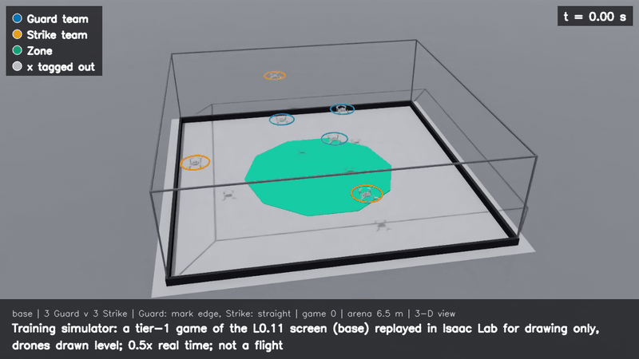 | 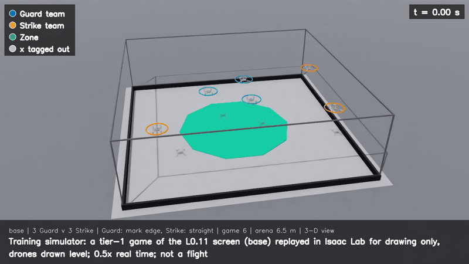 |

Top views and the tag 1.2 m / 1.4 m games: [docs/media/ste_l011/3d/](../../docs/media/ste_l011/3d/README.md).

**Your pick (D9): how should a team show on the drone?** Left: the Starling as the AirStack file draws it. Then a ring
around the drone, or a small dot on top. The 3-D clips above use the ring for now.

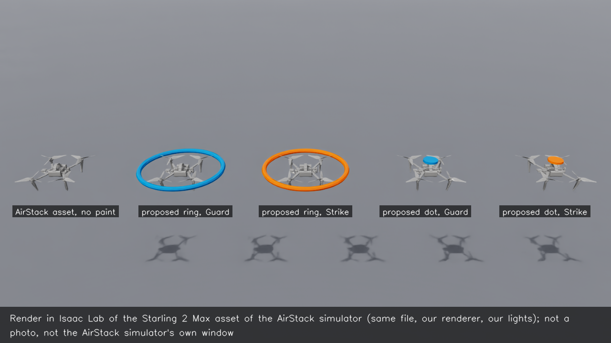

**Bug found and fixed (L0.4):** every Isaac clip since S2b drew a grey physics box over the drone (the hide call
missed it). Before / after:

| Before | After |
|---|---|
| 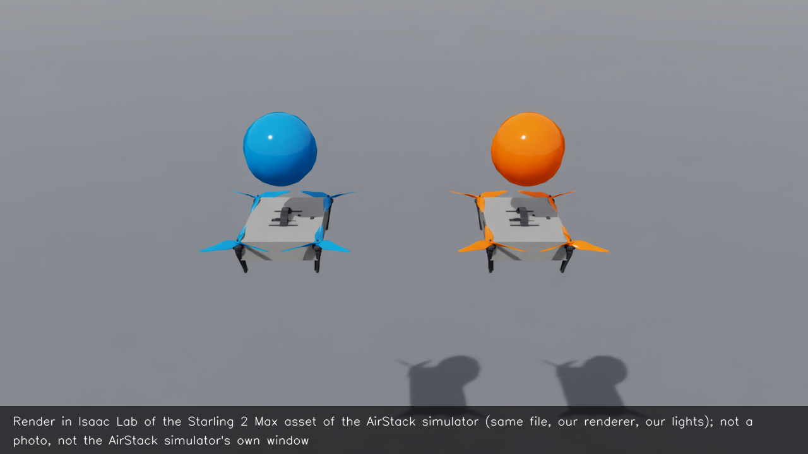 | 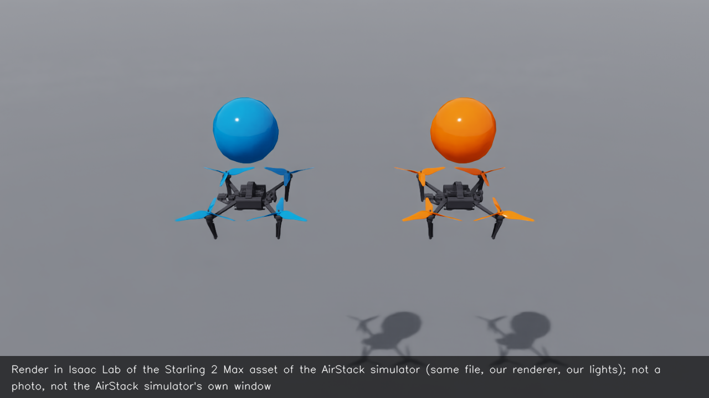 |

Where phase L0 is: green done, light green laptop part done, amber running, grey queued (state file
`ste_learning/status/l0_progress.toml`, figure by `scripts/make_ste_learning_figures.py l0_progress`).

Earlier: L0.11 top-down clips and the factor chart are in the [T44 record](../../records/2026-11-21_ste_l011_screen_record.md).

### Phases

| Phase | Status | Math library | Simulator | What |
|---|---|---|---|---|
| NUS port Phases 1–4 | DONE | JAX (NUS), PyTorch | NUS 2-D game (JAX), Copy of NUS 2-D game (PyTorch), tier 2 Isaac Lab | NUS's code installed, game and policies copied to PyTorch, six tests towards STE drones |
| NUS port Phase 5 | PAUSED (lead call D8) | PyTorch | Copy of NUS 2-D game (PyTorch), tier 1 fast engine | 5.1 Method match FAIL (T43); STE Guard policy 829 of 1,000 (T41) |
| NUS port Phase 6 | DONE | none | none | public documents with videos |
| ▶ L0 Game definition and feasibility | RUNNING (approved 20 Nov, cap 19 GPU-h) | PyTorch | tier 1 fast engine, tier 2 Isaac Lab | which game, worth learning, can tier 2 train, is the Crazyflie route sound |
| L1–L8 | NOT STARTED | PyTorch | as ruled at gate G0 | drone model, rules, learner, evaluation, league, export, AirStack side, real flight |
| L9 Documentation | RUNNING | none | none | status, records, results page |

### Phase L0 Game definition and feasibility, task by task

| ID | Plain name | Status | Simulator | Result / ETA |
|---|---|---|---|---|
| L0.1 | Track set-up: config and test skeleton | DONE | none | settings file, loader, tests; independent QC closed all findings |
| L0.7 | Process tooling and drills | RUNNING (laptop part DONE) | none | merged into `development`; laptop: full suite 1,420 passed / 0 failed, wake-up drill and resume drill both as expected (below); DONE when the 5090 has run the same (L07-5090) |
| L0.8 | Game spec sheet | DONE | none | merged into `development`; QC passed; full suite on `development` 1,461 passed / 0 failed (41 min) |
| L0.9 | Tag rule for the study: 1-for-1, nearest pair first | DONE | tier 1 fast engine | merged; QC + re-check passed; full suite on `development` 1,517 passed / 0 failed (31 min); the 5090 records its own tag-off positions (L09-5090) |
| L0.10 | Scripted players for the study | DONE | tier 1 fast engine | merged; QC + 2 re-checks passed; full suite on `development` 1,600 passed / 0 failed (56 min, CPU shared with the L0.11 GPU jobs) |
| L0.11 | Screening sweep (INFO) | DONE | tier 1 fast engine | record T44 (every control PASS; shortlist base (reference), tag 1.2 m, tag 1.4 m; every hold a one-for-one trade) + follow-up checks; merged into `development`; full suite 1,685 passed / 0 failed (27 min) |
| L0.12 | Best-response test: is the game worth learning? | RUNNING (gate fix; then QC reads it; then the pilot) | tier 1 fast engine | QC re-check: GO for the pilot. QC also showed the learner check could not work (25 M game-steps is far too short; T41 needed ~300 M). Fixed (6e7d194): the check is now "run 0", the Strike trained against the parked Guard at a full run's budget, stopping once it passes; Strike runs only if it passes; proven able to fail on CPU (a standing Strike reads FAIL, a wrong opponent stops the run). Small follow-up running, then QC reads the gate, then the GPU pilot (~0.6 GPU-h) |
| L0.2 | Tier 2 speed in contested play | RUNNING (Isaac smoke) | tier 2 Isaac Lab | built (driver, gate file, record writer; 72 CPU tests pass; not yet committed, QC next): times both teams playing with a learner in the loop at 1v1–5v3 and 1,024–8,192 games, plus an out-of-memory probe; first Isaac smoke running now (cap 0.25 GPU-h); run of record ~0.9 of 1.5 GPU-h |
| L0.13 | Does tier 2 train at all? | NOT STARTED | tier 2 Isaac Lab | laptop allowed (owner, 21 Nov), after L0.2, at the games-at-once L0.2 shows fits; cap 6 GPU-h |
| L0.3 | STE Guard policy in tier 2 without retraining | RUNNING (built) | tier 2 Isaac Lab | built with L0.2 (CPU tests pass): exact control = T45's 831 of 1,000 on the CPU path; parked-Guard control must land in T24's interval [493, 555]; smoke after L0.2's; run of record ~0.6 of 1.5 GPU-h |
| L0.4 | Side-by-side Starling render | DONE | tier 2 Isaac Lab | found why our clips never looked like the Starling: a grey physics box was drawn over every drone since S2b (the hide call missed it); one-line fix, re-render shows the Starling (before/after in Watch); merged into `development` after independent review; 0.028 of 0.2 GPU-h |
| L0.5 | Starling video look fix | WAITING ON YOU (D9) | tier 2 Isaac Lab | the drone left unpainted, team shown by a ring or a small dot that casts no shadow; stills in Watch; 0.154 of 0.3 GPU-h (with VID-1) |
| L0.14 | Crazyflie route check | DONE | tier 1 fast engine (CPU) | record T45: the T41 Guard policy holds 791–768 of 1,000 in the Crazyflie-like lag band (0.48–0.56 s, every drone slowed) against 831 at the Starling's lag, and drones come closer (games under 1.0 m: 7 → 101–149); planner, like for like: 0 of 100 at 3v3 and 5v3 against 20 Nov's 5 of 100 (not a clear difference; only one rule set run); QC + re-check passed; merged into `development` (targeted tests 76 passed; the full suite runs with the next merge — lead's call, the CPU is shared now); page `ste_learning/CRAZYFLIE_ROUTE.md` |
| L0.6 | Gate G0 | NOT STARTED | none | after every task above; the owner decides |

GPU-h used in L0 so far: 0.608 of 19 (RTX 5090: 0; laptop: L0.11 0.426 (pilot 0.034 + CUDA smoke 0.087 + sweep 0.305), L0.4 0.028, L0.5 + VID-1 0.154 incl. a 0.041 re-check of the clips after review).

Laptop full CPU suite (20 Nov, `development` at 5c5d465, after `scripts/nus_install_provisional.sh`): **1,333 passed, 2 failed, 48 skipped** in 24 min. Both failures repeat when run alone:
- **L07-F1** `test_ste_job.py::test_f_d_a_killed_job…resumes`: CONFIRMED by QC: the tool does not over-report (it measures from the same start; ~0.255 s raw, printed rounded to 0.3); the test compares the rounded text with the exact elapsed time. Fix: allow half a display step.
- **TEST-F2** `test_train_standin.py::test_default_path_bit_identical_after_the_nus_hooks`: FIXED (447b317). Measured on the laptop: the hash repeats (75d2a955…), hold rates equal the recorded [0.25, 0.375], and forcing PyTorch's CPU capability down changes the hash; threads (trainer runs one) and local files (not read on this path) ruled out. The fingerprint is now one hash per CPU capability; hold rates are checked on every machine.

### Usage (laptop session, 20 Nov 22:00 to now)

| What | Agent tokens | Wall time | Note |
|---|---|---|---|
| L0.7 fixes: builder, 7 fixes one at a time | ~400 k | ~51 min | the largest: each fix re-reads the tooling and its tests |
| L0.8 Game spec sheet: builder, build + 2 fix rounds | ~320 k | ~50 min | includes its own 25-min full suite |
| L0.7 independent QC + re-check | ~246 k | ~18 min | reproduced C1 and I1 in a scratch folder |
| L0.8 independent QC + re-check | ~209 k | ~12 min | mutation tests on the sheet |
| L0.9 Tag rule: builder (build + fix round) | ~358 k | ~66 min | the first 50 min slowed by sharing the CPU with the L0.7 suite |
| L0.9 independent QC + re-check | ~239 k | ~31 min | ran its own reference matcher, mutants and old-vs-new games |
| L0.10 Scripted players: builder (build + rulings + 2 QC fix rounds) | ~420 k | ~56 min | |
| L0.10 independent QC (+ 2 re-checks) | ~353 k | ~71 min | 84 deliberate breakages over two rounds; its own geometry probes on 30,000+ starts |
| L0.11 sweep build (CPU, build + rulings + rebase + QC fixes + follow-ups) | ~677 k | ~106 min | the largest single task so far; a fresh builder takes L0.12 to avoid re-reading this context |
| L0.12 groundwork builder | ~550 k | ~54 min | |
| L0.12 pre-launch QC | ~322 k | ~48 min | 19 deliberate breakages, 8 not caught before the fixes |
| L0.14 builder | ~368 k | ~118 min | the Crazyflie planner sweep ran on the CPU (2,868 matches) |
| L0.11 pre-launch QC | ~293 k | ~24 min | broke the code five ways through the real driver |
| L0.11 CUDA smoke | | ~5 min | 0.087 GPU-h |
| L0.11 independent QC (pre-launch, re-check, results read) | ~419 k | ~45 min | |
| L0.11 sweep | | 18 min | 0.305 GPU-h (L0.11 total 0.426 of 3.0) |
| L0.4 + L0.5 + VID-1 builder (stills, box bug, replay check, 3-D renderer) | ~410 k | ~3 h incl. the 08:30 limit stop | 0.141 GPU-h; the account hit its 5-hour token limit at about 07:30 (three agents at once); resumed 08:44 |
| L0.11 GPU pilot | | 2 min | 0.034 GPU-h (first GPU job of the track) |
| Full CPU test suite | none | ~25 min alone; the L0.7 merge run took 61 min (shared the CPU with L0.9's tests) | rule from now: one heavy test run at a time |
| GPU | 0 GPU-h | | nothing has used the GPU |

Sub-agents total about 1.2 M tokens so far; the lead's own context is not measured by the tools here.

Laptop drills (21 Nov, fix branch, shared folder `~/AirStack-starling-max2/svg_training/runs/shared/`, no owner pause open):
- Wake-up: `L0.7 l07_wakeup DONE exit=0 duration=120.4s effective=120.4s`, `waiter exit 0` (the background waiter's end was the wake-up).
- Resume: `alive` → simulated power cut (`kill -KILL` of the process group at step 30) → `dead`; waiter `DIED exit=none duration=31.2s`, `waiter exit 21`; relaunch with `bash cmd.txt` from a shell with a wrong `PYTHONPATH` and `SVG_SHARED_DIR` → `launch=2`, `resumed from step 30 of 120`, `DONE exit=0 duration=90.4s effective=90.4s run_effective=120.3s`, `waiter exit 0`, `{"steps": 120, "total": 7260.0}`; the wrong shared folder was never created.

### Other workstreams

| ID | Plain name | Status |
|---|---|---|
| SYNC-1 | Branch `development` on both machines; laptop worktree `~/AirStack-starling-max2-dev` | DONE |
| SYNC-2 | Status skill `train-status` and the owner's standing rules in CLAUDE.md | DONE |
| SYNC-3 | Root `CLAUDE.md` and every page: training work lands on `development` | DONE |
| SYNC-4 | STE Guard policy (T41 run folder) in the PROVISIONAL bundle | DONE; installed on the laptop (46 files, agent.pt c91bea51…) |
| L07-F1 | Fix: waiter-duration test bound (rounding) (QC I5) | DONE (a4100d0; 30 of 30 runs pass; L0.7 test files 217 passed) |
| L07-C1 | Fix: an open pause takes time off every job, and launch does not check for one: a job launched during a pause runs on the GPU with 0 GPU-h counted and its cap never fires | DONE (79effa0 on branch ste-l0.7-fix; red 48 failed, then L0.7 + NUS pause tests 251 passed). Pauses still always logged; launch refuses while one is open; a pause counts only against the jobs it stopped |
| L07-I1 | Fix: a new run reusing an old job name inherits that job's GPU-hours as credit (task cap can be exceeded) | DONE (05dd547; credit keyed by job name + run folder; red 24 failed, then 256 passed) |
| L07-I2 | Fix: `cmd.txt` relaunch loses the environment (PYTHONPATH, CUDA alloc setting, shared-folder path) | DONE (d0661f4; cmd.txt replays the first launch's environment; a different shared folder is refused; resume drill uses bash cmd.txt; red 3 failed, then 259 passed) |
| L07-I3 | Fix: the launcher's wrapper can die (clock step back, full disk) while the job runs on: GPU time stops being logged | DONE (1ca8a70; every wrapper write survives an error, records a fault and retries; red 8 failed, then 267 passed) |
| L07-I4 | Fix: a job resumed after a reboot is flagged ENDED_EARLY (exit 20) though it finished correctly | DONE (70fc1a3; judged on the trainer's saved progress across launches; red: drill pattern read 20; then 280 passed) |
| L08-F1 | Finding: the hangar's Strike start ring (3.2 m from the zone centre) does not fit the 6.5 m lab arena (drones kept within 3.0 m); a ring for 6.5 m is needed before L0.11's base case | CLOSED (lead's call): Strike start ring 2.75 m for the 6.5 m arena, PROPOSED, ruled at G0 |
| L07-C1b | Fix: our own "pause the siblings, run solo" step (AUTOMATION §2.2) is now refused too; lead's design: pauses the session makes are tagged and do not block launch, your pauses still do | DONE (ef38534; `GPU_PAUSE_BY=lead` tags the session's pauses; a bare `gpu_pause.sh pause` is still yours and still blocks; red 13 failed, then 298 passed) |
| L07-C1c | Fix: a session-tagged resume must refuse while any of your pauses is open (a resume today continues every job and closes your pauses too) | DONE (efa9ec1; a bare resume/stop is unchanged; red 4 failed, then 304 passed) |
| GIT-1 | Fix: my 17 Nov `.gitignore` line `data/` also hid new files in `tests/data/` | DONE (d3572dc: anchored to `/data/`) |
| L011-F1 | Finding: scripted players decide every 0.05 s tick, not at the sheet's 0.6 s decision period; the sweep measures scripted play at 0.05 s; L0.12's trainers must set their decision period explicitly (T41 used 0.6 s) | OPEN: written into the L0.11 gate file and record |
| L07-SUSPEND | Tooling: a laptop sleep during a GPU job is counted as GPU-hours and as time towards the job's cap (wall clock). Rule until fixed: never let the laptop sleep during a GPU job | QUEUED (tooling task); rule in force now |
| L011-G0 | Finding for gate G0 (T44, scripted play): (1) every hold is a one-for-one trade — no tag-on game times out, and at 1v1 and 3v3 a Guard win leaves no Guard — so head-count decides (PLAN F1; bears on what a tag costs, P12); (2) the programme's sizes 2v1 and 5v3, and 1v1, are Guard-trivial with scripted players at the proposed rules; candidate cause: tag radius 1.6 m = zone radius 1.6 m with Guards starting on a circle near the zone centre (not tested). L0.12 measures whether learning changes either | OPEN: reported at G0 |
| L010-G0 | Finding for gate G0 (from L0.10 QC): any safety-filter move near the 1.6 m tag radius can create a tag nobody chose (the filter's 1.10 m keep-out is inside the tag radius). Spaced starts remove it at the start; during play it is part of the game the sweep measures (P1) | OPEN: reported at G0 |
| L09-5090 | On the 5090: record the tag-off golden's positions for its CPU type (AVX512); check the outcome fingerprints there | WAITING: next 5090 session |
| DOC-1 | A phase-L0 flowchart coloured by progress (done / running / queued), regenerated with each status and shown in its Watch section (owner, 21 Nov: "photos or diagram flow charts would be good too") | DONE (progress flowchart; regenerated with each status) |
| VID-1 | Clips: a height panel on the 2-D top-down clips of every run; 3-D Isaac Lab videos (Starling look, top view + 3-D view, MP4 + GIF) of each result's key games | L0.11 DONE, merged: 6 key games (base, tag 1.2 m, tag 1.4 m × hold, reach) × top + 3-D, MP4 + GIF; every replayed game checked equal to T44 (90,000 of 90,000) before drawing; independent review: 1 important bug (old files could be drawn after a failed check; never happened) + minors, fixed and re-reviewed; the published games re-checked with the stricter check: identical; full suite on the merge 1,751 passed (the 2 failures it found are fixed: an unlisted Crazyflie import from L0.14, and my progress-chart test reading the live file); next: L0.12 results |
| L08-M | L0.8 minors left: 3 hangar values unchecked on a clone without the NUS bundle; 3 values whose wrong value still passes; loader refuses some honest wording; tests tied to exact lines and the AirStack fence file | PARKED |
| L07-DISK | Follow-up: the planned disk-space check (a disk full through 10 retries at a job's end reads DIED) | PARKED (stated limit) |
| L07-N | Re-check minors N1–N4: a session pause also lands in the old per-worktree log the NUS reader uses; full disk can hold the wrapper 10 min after the end; AUTOMATION §4 still states the old GPU-hour rule; on the 5090 run `scripts/ste_job.py owner-pauses` before the drills | PARKED (N4 goes into the 5090 note) |
| L07-M | QC's 10 minor findings (+3 from the C1 build: pid-only matching, test pause pattern shared across sessions, pid reuse) (runs/ste_l07/qc_report.md) | PARKED until the six fixes land |
| L07-5090 | L0.7 on the 5090: full CPU suite and the two drills there (L0.7 is DONE only after both machines) | WAITING: next 5090 session |
| TEST-F2 | Fix: bit-level training fingerprint is machine-specific | DONE (447b317; trainer test file 43 passed, 1 skipped) |
| TEST-F2b | On the 5090: confirm its CPU capability is AVX512 (the key its 18 Nov hash is now filed under) | WAITING: next 5090 session runs the test (fails or skips loudly if wrong) |

**Machines (owner, 21 Nov):** no task is 5090-only. The RTX 5090 (32 GB) suits memory-heavy runs; the laptop RTX 5070 Ti (12 GB) runs everything sized to fit, and the record says which machine. Only machine checks stay with their machine: TEST-F2b, L07-5090, L09-5090. **Schedule:** weekends the laptop runs the pipeline (the 5090 is free for gaming); weekdays the 5090 does (the laptop goes to work). **This weekend:** the owner packs the laptop **Mon 23 Nov 10:00**: no GPU job starts unless it can end by **Mon 08:00**; by **09:30** everything is committed, HANDOFF §0 and status written, ready to push.

**GPU queue on the laptop (one at a time for speed measurements):** L0.12 pilot → L0.12 trainings → L0.2 → L0.3 → L0.13 (L0.4, L0.5, VID-1 for L0.11 done).

**Next.** (1) L0.12: QC re-reads the fixed gate; on GO, the GPU pilot (~0.6 GPU-h), alone on the GPU. (2) L0.2: Isaac smoke running; then QC (running) → commit → the run of record (~0.9 GPU-h). (3) L0.3 after L0.2.

**Waiting on you.** (1) D9: ring, dot, or neither (Watch); not urgent, the clips use the ring until you say. Optional: one screenshot of a drone in the AirStack simulator's own window would confirm the lights and colour match. (2) **L0.12 GPU-hours, needed before the last runs (about this evening):** pilot ~0.6 + run 0 ≤ 0.84 + six runs × 0.84 = about **6.6–6.7 GPU-h against the approved 6**. My recommendation: raise L0.12 to **7 GPU-h** (L0 total stays near 8 of 19). The alternative is shorter runs (0.75 h each, about 270 M game-steps instead of the 300 M where T41's Guard got good), which weakens the main measurement. If run 0 fails, only the Guard runs go and L0.12 uses about 4.3. (3) If run 0 hits its cap before finishing (INCONCLUSIVE), whether the Strike runs go ahead is yours; I will bring it with the numbers.

**Correction.** The 21 Nov question on NUS values listed "speeds 0.6 / 1.2". The L0.8 review reads those two numbers as the decision period (0.6 s) and the flight height (1.2 m); the speeds are 0.5 and 0.333 m/s. Your Yes covers all of them as written on the sheet.

## 2026-11-21 09:50

**Status, 2026-11-21 09:52 (+08:00), event: L0.12 GPU pilot DONE (all controls PASS); L0.2 smoke stopped on a control → fix round** · laptop RTX 5070 Ti · GPU idle (run 0 next) · 0 training processes

**Plain summary (L0.12 pilot).** Tested: training speed, memory and every replay control on the GPU before the real runs.
Happened: all controls PASS (the trainer replays T44 game for game), speed 340–530 k game-steps/s — about 4× the estimate — so
each run gets 550 M game-steps (1.8× where T41's Guard got good) and all of L0.12 fits in its 6 GPU-h; the Strike side takes the
pre-registered "shaped" recipe (the bare one never reached the zone against the best Guard in 3 rounds). Next: run 0.

### Watch (latest clips and figures)

**New: the L0.11 games in 3-D** (VID-1). The same recorded games, replayed and checked equal to record T44 on all
90,000 games, then drawn in Isaac Lab with the AirStack simulator's Starling. Base 3v3, best scripted Guard v best
scripted Strike, half real time. Training simulator tier 1 replayed for drawing only (drones drawn level); not a flight.

| Guard holds (3-D view) | Strike reaches (3-D view) |
|---|---|
|  |  |

Top views and the tag 1.2 m / 1.4 m games: [docs/media/ste_l011/3d/](../../docs/media/ste_l011/3d/README.md).

**Your pick (D9): how should a team show on the drone?** Left: the Starling as the AirStack file draws it. Then a ring
around the drone, or a small dot on top. The 3-D clips above use the ring for now.

**Bug found and fixed (L0.4):** every Isaac clip since S2b drew a grey physics box over the drone (the hide call
missed it). Before / after:

| Before | After |
|---|---|
|  |  |

Where phase L0 is: green done, light green laptop part done, amber running, grey queued (state file
`ste_learning/status/l0_progress.toml`, figure by `scripts/make_ste_learning_figures.py l0_progress`).

Earlier: L0.11 top-down clips and the factor chart are in the [T44 record](../../records/2026-11-21_ste_l011_screen_record.md).

### Phases

| Phase | Status | Math library | Simulator | What |
|---|---|---|---|---|
| NUS port Phases 1–4 | DONE | JAX (NUS), PyTorch | NUS 2-D game (JAX), Copy of NUS 2-D game (PyTorch), tier 2 Isaac Lab | NUS's code installed, game and policies copied to PyTorch, six tests towards STE drones |
| NUS port Phase 5 | PAUSED (lead call D8) | PyTorch | Copy of NUS 2-D game (PyTorch), tier 1 fast engine | 5.1 Method match FAIL (T43); STE Guard policy 829 of 1,000 (T41) |
| NUS port Phase 6 | DONE | none | none | public documents with videos |
| ▶ L0 Game definition and feasibility | RUNNING (approved 20 Nov, cap 19 GPU-h) | PyTorch | tier 1 fast engine, tier 2 Isaac Lab | which game, worth learning, can tier 2 train, is the Crazyflie route sound |
| L1–L8 | NOT STARTED | PyTorch | as ruled at gate G0 | drone model, rules, learner, evaluation, league, export, AirStack side, real flight |
| L9 Documentation | RUNNING | none | none | status, records, results page |

### Phase L0 Game definition and feasibility, task by task

| ID | Plain name | Status | Simulator | Result / ETA |
|---|---|---|---|---|
| L0.1 | Track set-up: config and test skeleton | DONE | none | settings file, loader, tests; independent QC closed all findings |
| L0.7 | Process tooling and drills | RUNNING (laptop part DONE) | none | merged into `development`; laptop: full suite 1,420 passed / 0 failed, wake-up drill and resume drill both as expected (below); DONE when the 5090 has run the same (L07-5090) |
| L0.8 | Game spec sheet | DONE | none | merged into `development`; QC passed; full suite on `development` 1,461 passed / 0 failed (41 min) |
| L0.9 | Tag rule for the study: 1-for-1, nearest pair first | DONE | tier 1 fast engine | merged; QC + re-check passed; full suite on `development` 1,517 passed / 0 failed (31 min); the 5090 records its own tag-off positions (L09-5090) |
| L0.10 | Scripted players for the study | DONE | tier 1 fast engine | merged; QC + 2 re-checks passed; full suite on `development` 1,600 passed / 0 failed (56 min, CPU shared with the L0.11 GPU jobs) |
| L0.11 | Screening sweep (INFO) | DONE | tier 1 fast engine | record T44 (every control PASS; shortlist base (reference), tag 1.2 m, tag 1.4 m; every hold a one-for-one trade) + follow-up checks; merged into `development`; full suite 1,685 passed / 0 failed (27 min) |
| L0.12 | Best-response test: is the game worth learning? | RUNNING (run 0 next) | tier 1 fast engine | gate fix QC-passed (run 0 = learner check at a full run's budget; 7 of 8 breakages caught); GPU pilot DONE: 0.18 GPU-h, every control PASS, 340–530 k game-steps/s; gate filled: 16,384 games, 550 M game-steps per run, run cap 0.75 GPU-h → pilot + run 0 + 6 runs = 5.43 of 6 GPU-h; Strike recipe = shaped (pre-registered); QC checks the fill, then run 0 (~0.6 h) |
| L0.2 | Tier 2 speed in contested play | RUNNING (fix round) | tier 2 Isaac Lab | Isaac smoke stopped on its own check (exit 6, 0.044 GPU-h): a drone out in one simulator and flying in the other read as 1,730 m apart (out drones are parked 1,000 m away); the game counts agree within 1 %. QC: NO-GO, 3 critical + 8 important (a crashed run could restart and publish a clean result; out-of-memory mis-read; 11 of 20 breakages not caught). Lead's calls: the check splits into a gated physics check (same commands, no game rules, 2 cm, as T10) and an in-game comparison as INFO; every hole closed with a test first; builder on it. The smoke's speed numbers are void |
| L0.13 | Does tier 2 train at all? | NOT STARTED | tier 2 Isaac Lab | laptop allowed (owner, 21 Nov), after L0.2, at the games-at-once L0.2 shows fits; cap 6 GPU-h |
| L0.3 | STE Guard policy in tier 2 without retraining | RUNNING (fix round, with L0.2) | tier 2 Isaac Lab | QC: same flawed check as L0.2, and a non-finite crash could skip a control and still read "every control PASS"; fixed in the same round. Controls as ruled: exact 831 of 1,000 (T45, CPU path), parked Guard in [493, 555] |
| L0.4 | Side-by-side Starling render | DONE | tier 2 Isaac Lab | found why our clips never looked like the Starling: a grey physics box was drawn over every drone since S2b (the hide call missed it); one-line fix, re-render shows the Starling (before/after in Watch); merged into `development` after independent review; 0.028 of 0.2 GPU-h |
| L0.5 | Starling video look fix | WAITING ON YOU (D9) | tier 2 Isaac Lab | the drone left unpainted, team shown by a ring or a small dot that casts no shadow; stills in Watch; 0.154 of 0.3 GPU-h (with VID-1) |
| L0.14 | Crazyflie route check | DONE | tier 1 fast engine (CPU) | record T45: the T41 Guard policy holds 791–768 of 1,000 in the Crazyflie-like lag band (0.48–0.56 s, every drone slowed) against 831 at the Starling's lag, and drones come closer (games under 1.0 m: 7 → 101–149); planner, like for like: 0 of 100 at 3v3 and 5v3 against 20 Nov's 5 of 100 (not a clear difference; only one rule set run); QC + re-check passed; merged into `development` (targeted tests 76 passed; the full suite runs with the next merge — lead's call, the CPU is shared now); page `ste_learning/CRAZYFLIE_ROUTE.md` |
| L0.6 | Gate G0 | NOT STARTED | none | after every task above; the owner decides |

GPU-h used in L0 so far: 0.830 of 19 (RTX 5090: 0; laptop: L0.11 0.426, L0.4 0.028, L0.5 + VID-1 0.154, L0.2 smoke 0.044, L0.12 pilot 0.178).

Laptop full CPU suite (20 Nov, `development` at 5c5d465, after `scripts/nus_install_provisional.sh`): **1,333 passed, 2 failed, 48 skipped** in 24 min. Both failures repeat when run alone:
- **L07-F1** `test_ste_job.py::test_f_d_a_killed_job…resumes`: CONFIRMED by QC: the tool does not over-report (it measures from the same start; ~0.255 s raw, printed rounded to 0.3); the test compares the rounded text with the exact elapsed time. Fix: allow half a display step.
- **TEST-F2** `test_train_standin.py::test_default_path_bit_identical_after_the_nus_hooks`: FIXED (447b317). Measured on the laptop: the hash repeats (75d2a955…), hold rates equal the recorded [0.25, 0.375], and forcing PyTorch's CPU capability down changes the hash; threads (trainer runs one) and local files (not read on this path) ruled out. The fingerprint is now one hash per CPU capability; hold rates are checked on every machine.

### Usage (laptop session, 20 Nov 22:00 to now)

| What | Agent tokens | Wall time | Note |
|---|---|---|---|
| L0.7 fixes: builder, 7 fixes one at a time | ~400 k | ~51 min | the largest: each fix re-reads the tooling and its tests |
| L0.8 Game spec sheet: builder, build + 2 fix rounds | ~320 k | ~50 min | includes its own 25-min full suite |
| L0.7 independent QC + re-check | ~246 k | ~18 min | reproduced C1 and I1 in a scratch folder |
| L0.8 independent QC + re-check | ~209 k | ~12 min | mutation tests on the sheet |
| L0.9 Tag rule: builder (build + fix round) | ~358 k | ~66 min | the first 50 min slowed by sharing the CPU with the L0.7 suite |
| L0.9 independent QC + re-check | ~239 k | ~31 min | ran its own reference matcher, mutants and old-vs-new games |
| L0.10 Scripted players: builder (build + rulings + 2 QC fix rounds) | ~420 k | ~56 min | |
| L0.10 independent QC (+ 2 re-checks) | ~353 k | ~71 min | 84 deliberate breakages over two rounds; its own geometry probes on 30,000+ starts |
| L0.11 sweep build (CPU, build + rulings + rebase + QC fixes + follow-ups) | ~677 k | ~106 min | the largest single task so far; a fresh builder takes L0.12 to avoid re-reading this context |
| L0.12 groundwork builder | ~550 k | ~54 min | |
| L0.12 pre-launch QC | ~322 k | ~48 min | 19 deliberate breakages, 8 not caught before the fixes |
| L0.14 builder | ~368 k | ~118 min | the Crazyflie planner sweep ran on the CPU (2,868 matches) |
| L0.11 pre-launch QC | ~293 k | ~24 min | broke the code five ways through the real driver |
| L0.11 CUDA smoke | | ~5 min | 0.087 GPU-h |
| L0.11 independent QC (pre-launch, re-check, results read) | ~419 k | ~45 min | |
| L0.11 sweep | | 18 min | 0.305 GPU-h (L0.11 total 0.426 of 3.0) |
| L0.4 + L0.5 + VID-1 builder (stills, box bug, replay check, 3-D renderer) | ~410 k | ~3 h incl. the 08:30 limit stop | 0.141 GPU-h; the account hit its 5-hour token limit at about 07:30 (three agents at once); resumed 08:44 |
| L0.12 gate fix + follow-up builder | ~280 k | ~55 min | run 0 design, N-2/N-4, tests |
| L0.12 QC re-checks 1–2 | ~450 k | ~30 min | 8 breakages tried on run 0 |
| L0.2/L0.3 builder | ~410 k | ~30 min | + fix round now |
| L0.2/L0.3 pre-launch QC | ~240 k | ~22 min | 20 breakages, 9 caught |
| L0.12 GPU pilot | | 11 min | 0.178 GPU-h |
| L0.11 GPU pilot | | 2 min | 0.034 GPU-h (first GPU job of the track) |
| Full CPU test suite | none | ~25 min alone; the L0.7 merge run took 61 min (shared the CPU with L0.9's tests) | rule from now: one heavy test run at a time |
| GPU | 0 GPU-h | | nothing has used the GPU |

Sub-agents total about 1.2 M tokens so far; the lead's own context is not measured by the tools here.

Laptop drills (21 Nov, fix branch, shared folder `~/AirStack-starling-max2/svg_training/runs/shared/`, no owner pause open):
- Wake-up: `L0.7 l07_wakeup DONE exit=0 duration=120.4s effective=120.4s`, `waiter exit 0` (the background waiter's end was the wake-up).
- Resume: `alive` → simulated power cut (`kill -KILL` of the process group at step 30) → `dead`; waiter `DIED exit=none duration=31.2s`, `waiter exit 21`; relaunch with `bash cmd.txt` from a shell with a wrong `PYTHONPATH` and `SVG_SHARED_DIR` → `launch=2`, `resumed from step 30 of 120`, `DONE exit=0 duration=90.4s effective=90.4s run_effective=120.3s`, `waiter exit 0`, `{"steps": 120, "total": 7260.0}`; the wrong shared folder was never created.

### Other workstreams

| ID | Plain name | Status |
|---|---|---|
| SYNC-1 | Branch `development` on both machines; laptop worktree `~/AirStack-starling-max2-dev` | DONE |
| SYNC-2 | Status skill `train-status` and the owner's standing rules in CLAUDE.md | DONE |
| SYNC-3 | Root `CLAUDE.md` and every page: training work lands on `development` | DONE |
| SYNC-4 | STE Guard policy (T41 run folder) in the PROVISIONAL bundle | DONE; installed on the laptop (46 files, agent.pt c91bea51…) |
| L07-F1 | Fix: waiter-duration test bound (rounding) (QC I5) | DONE (a4100d0; 30 of 30 runs pass; L0.7 test files 217 passed) |
| L07-C1 | Fix: an open pause takes time off every job, and launch does not check for one: a job launched during a pause runs on the GPU with 0 GPU-h counted and its cap never fires | DONE (79effa0 on branch ste-l0.7-fix; red 48 failed, then L0.7 + NUS pause tests 251 passed). Pauses still always logged; launch refuses while one is open; a pause counts only against the jobs it stopped |
| L07-I1 | Fix: a new run reusing an old job name inherits that job's GPU-hours as credit (task cap can be exceeded) | DONE (05dd547; credit keyed by job name + run folder; red 24 failed, then 256 passed) |
| L07-I2 | Fix: `cmd.txt` relaunch loses the environment (PYTHONPATH, CUDA alloc setting, shared-folder path) | DONE (d0661f4; cmd.txt replays the first launch's environment; a different shared folder is refused; resume drill uses bash cmd.txt; red 3 failed, then 259 passed) |
| L07-I3 | Fix: the launcher's wrapper can die (clock step back, full disk) while the job runs on: GPU time stops being logged | DONE (1ca8a70; every wrapper write survives an error, records a fault and retries; red 8 failed, then 267 passed) |
| L07-I4 | Fix: a job resumed after a reboot is flagged ENDED_EARLY (exit 20) though it finished correctly | DONE (70fc1a3; judged on the trainer's saved progress across launches; red: drill pattern read 20; then 280 passed) |
| L08-F1 | Finding: the hangar's Strike start ring (3.2 m from the zone centre) does not fit the 6.5 m lab arena (drones kept within 3.0 m); a ring for 6.5 m is needed before L0.11's base case | CLOSED (lead's call): Strike start ring 2.75 m for the 6.5 m arena, PROPOSED, ruled at G0 |
| L07-C1b | Fix: our own "pause the siblings, run solo" step (AUTOMATION §2.2) is now refused too; lead's design: pauses the session makes are tagged and do not block launch, your pauses still do | DONE (ef38534; `GPU_PAUSE_BY=lead` tags the session's pauses; a bare `gpu_pause.sh pause` is still yours and still blocks; red 13 failed, then 298 passed) |
| L07-C1c | Fix: a session-tagged resume must refuse while any of your pauses is open (a resume today continues every job and closes your pauses too) | DONE (efa9ec1; a bare resume/stop is unchanged; red 4 failed, then 304 passed) |
| GIT-1 | Fix: my 17 Nov `.gitignore` line `data/` also hid new files in `tests/data/` | DONE (d3572dc: anchored to `/data/`) |
| L011-F1 | Finding: scripted players decide every 0.05 s tick, not at the sheet's 0.6 s decision period; the sweep measures scripted play at 0.05 s; L0.12's trainers must set their decision period explicitly (T41 used 0.6 s) | OPEN: written into the L0.11 gate file and record |
| L07-SUSPEND | Tooling: a laptop sleep during a GPU job is counted as GPU-hours and as time towards the job's cap (wall clock). Rule until fixed: never let the laptop sleep during a GPU job | QUEUED (tooling task); rule in force now |
| L011-G0 | Finding for gate G0 (T44, scripted play): (1) every hold is a one-for-one trade — no tag-on game times out, and at 1v1 and 3v3 a Guard win leaves no Guard — so head-count decides (PLAN F1; bears on what a tag costs, P12); (2) the programme's sizes 2v1 and 5v3, and 1v1, are Guard-trivial with scripted players at the proposed rules; candidate cause: tag radius 1.6 m = zone radius 1.6 m with Guards starting on a circle near the zone centre (not tested). L0.12 measures whether learning changes either | OPEN: reported at G0 |
| L010-G0 | Finding for gate G0 (from L0.10 QC): any safety-filter move near the 1.6 m tag radius can create a tag nobody chose (the filter's 1.10 m keep-out is inside the tag radius). Spaced starts remove it at the start; during play it is part of the game the sweep measures (P1) | OPEN: reported at G0 |
| L09-5090 | On the 5090: record the tag-off golden's positions for its CPU type (AVX512); check the outcome fingerprints there | WAITING: next 5090 session |
| DOC-1 | A phase-L0 flowchart coloured by progress (done / running / queued), regenerated with each status and shown in its Watch section (owner, 21 Nov: "photos or diagram flow charts would be good too") | DONE (progress flowchart; regenerated with each status) |
| VID-1 | Clips: a height panel on the 2-D top-down clips of every run; 3-D Isaac Lab videos (Starling look, top view + 3-D view, MP4 + GIF) of each result's key games | L0.11 DONE, merged: 6 key games (base, tag 1.2 m, tag 1.4 m × hold, reach) × top + 3-D, MP4 + GIF; every replayed game checked equal to T44 (90,000 of 90,000) before drawing; independent review: 1 important bug (old files could be drawn after a failed check; never happened) + minors, fixed and re-reviewed; the published games re-checked with the stricter check: identical; full suite on the merge 1,751 passed (the 2 failures it found are fixed: an unlisted Crazyflie import from L0.14, and my progress-chart test reading the live file); next: L0.12 results |
| L08-M | L0.8 minors left: 3 hangar values unchecked on a clone without the NUS bundle; 3 values whose wrong value still passes; loader refuses some honest wording; tests tied to exact lines and the AirStack fence file | PARKED |
| L07-DISK | Follow-up: the planned disk-space check (a disk full through 10 retries at a job's end reads DIED) | PARKED (stated limit) |
| L07-N | Re-check minors N1–N4: a session pause also lands in the old per-worktree log the NUS reader uses; full disk can hold the wrapper 10 min after the end; AUTOMATION §4 still states the old GPU-hour rule; on the 5090 run `scripts/ste_job.py owner-pauses` before the drills | PARKED (N4 goes into the 5090 note) |
| L07-M | QC's 10 minor findings (+3 from the C1 build: pid-only matching, test pause pattern shared across sessions, pid reuse) (runs/ste_l07/qc_report.md) | PARKED until the six fixes land |
| L07-5090 | L0.7 on the 5090: full CPU suite and the two drills there (L0.7 is DONE only after both machines) | WAITING: next 5090 session |
| TEST-F2 | Fix: bit-level training fingerprint is machine-specific | DONE (447b317; trainer test file 43 passed, 1 skipped) |
| TEST-F2b | On the 5090: confirm its CPU capability is AVX512 (the key its 18 Nov hash is now filed under) | WAITING: next 5090 session runs the test (fails or skips loudly if wrong) |

**Machines (owner, 21 Nov):** no task is 5090-only. The RTX 5090 (32 GB) suits memory-heavy runs; the laptop RTX 5070 Ti (12 GB) runs everything sized to fit, and the record says which machine. Only machine checks stay with their machine: TEST-F2b, L07-5090, L09-5090. **Schedule:** weekends the laptop runs the pipeline (the 5090 is free for gaming); weekdays the 5090 does (the laptop goes to work). **This weekend:** the owner packs the laptop **Mon 23 Nov 10:00**: no GPU job starts unless it can end by **Mon 08:00**; by **09:30** everything is committed, HANDOFF §0 and status written, ready to push.

**GPU queue on the laptop (one at a time for speed measurements):** L0.12 pilot → L0.12 trainings → L0.2 → L0.3 → L0.13 (L0.4, L0.5, VID-1 for L0.11 done).

**Next.** (1) L0.12: QC checks the gate fill (minutes), then run 0 (~0.6 GPU-h, ~40 min), then the six runs (3 Guard, 3 Strike if run 0 passes), one at a time, ~4.5 h. (2) L0.2/L0.3: fix round, then QC re-check, then commit, then a new smoke. (3) L0.13 after L0.2.

**Waiting on you.** (1) D9: ring, dot, or neither (Watch); not urgent. (2) ~~L0.12 GPU-hours~~: no longer needed — the pilot was 4× faster than estimated, so everything fits in the approved 6 GPU-h. (3) Only if run 0 runs out of time before passing or failing: whether the Strike runs go ahead.

**Correction.** The 21 Nov question on NUS values listed "speeds 0.6 / 1.2". The L0.8 review reads those two numbers as the decision period (0.6 s) and the flight height (1.2 m); the speeds are 0.5 and 0.333 m/s. Your Yes covers all of them as written on the sheet.

## 2026-11-21 10:21

**Status, 2026-11-21 10:23 (+08:00), 30-minute update: run 0 PASS; first L0.12 run done (base, Guard)** · laptop RTX 5070 Ti · GPU 93 % / 2.8 GB · 1 training process (L0.12 base Strike)

**Plain summary (L0.12, first results).** Tested: can our trainer learn at all (run 0), and can a trained Guard beat the
best hand-written Guard (base rules, 3v3)? Happened: run 0 PASS at its first check (trained Strike reached a parked Guard's
zone 478 of 1,000, pass mark 416); the trained Guard holds **913 of 1,000** against the straight Strike, against 808 for the
best script (gain +0.105, intervals apart). Why it matters: learning beats scripts here, so the base game is not settled by
scripts alone — but every hold is still a one-for-one trade (0 Guards left). Five runs to go (~2 h).

### Watch (latest clips and figures)

**New: the L0.11 games in 3-D** (VID-1). The same recorded games, replayed and checked equal to record T44 on all
90,000 games, then drawn in Isaac Lab with the AirStack simulator's Starling. Base 3v3, best scripted Guard v best
scripted Strike, half real time. Training simulator tier 1 replayed for drawing only (drones drawn level); not a flight.

| Guard holds (3-D view) | Strike reaches (3-D view) |
|---|---|
|  |  |

Top views and the tag 1.2 m / 1.4 m games: [docs/media/ste_l011/3d/](../../docs/media/ste_l011/3d/README.md).

**Your pick (D9): how should a team show on the drone?** Left: the Starling as the AirStack file draws it. Then a ring
around the drone, or a small dot on top. The 3-D clips above use the ring for now.

**Bug found and fixed (L0.4):** every Isaac clip since S2b drew a grey physics box over the drone (the hide call
missed it). Before / after:

| Before | After |
|---|---|
|  |  |

Where phase L0 is: green done, light green laptop part done, amber running, grey queued (state file
`ste_learning/status/l0_progress.toml`, figure by `scripts/make_ste_learning_figures.py l0_progress`).

Earlier: L0.11 top-down clips and the factor chart are in the [T44 record](../../records/2026-11-21_ste_l011_screen_record.md).

### Phases

| Phase | Status | Math library | Simulator | What |
|---|---|---|---|---|
| NUS port Phases 1–4 | DONE | JAX (NUS), PyTorch | NUS 2-D game (JAX), Copy of NUS 2-D game (PyTorch), tier 2 Isaac Lab | NUS's code installed, game and policies copied to PyTorch, six tests towards STE drones |
| NUS port Phase 5 | PAUSED (lead call D8) | PyTorch | Copy of NUS 2-D game (PyTorch), tier 1 fast engine | 5.1 Method match FAIL (T43); STE Guard policy 829 of 1,000 (T41) |
| NUS port Phase 6 | DONE | none | none | public documents with videos |
| ▶ L0 Game definition and feasibility | RUNNING (approved 20 Nov, cap 19 GPU-h) | PyTorch | tier 1 fast engine, tier 2 Isaac Lab | which game, worth learning, can tier 2 train, is the Crazyflie route sound |
| L1–L8 | NOT STARTED | PyTorch | as ruled at gate G0 | drone model, rules, learner, evaluation, league, export, AirStack side, real flight |
| L9 Documentation | RUNNING | none | none | status, records, results page |

### Phase L0 Game definition and feasibility, task by task

| ID | Plain name | Status | Simulator | Result / ETA |
|---|---|---|---|---|
| L0.1 | Track set-up: config and test skeleton | DONE | none | settings file, loader, tests; independent QC closed all findings |
| L0.7 | Process tooling and drills | RUNNING (laptop part DONE) | none | merged into `development`; laptop: full suite 1,420 passed / 0 failed, wake-up drill and resume drill both as expected (below); DONE when the 5090 has run the same (L07-5090) |
| L0.8 | Game spec sheet | DONE | none | merged into `development`; QC passed; full suite on `development` 1,461 passed / 0 failed (41 min) |
| L0.9 | Tag rule for the study: 1-for-1, nearest pair first | DONE | tier 1 fast engine | merged; QC + re-check passed; full suite on `development` 1,517 passed / 0 failed (31 min); the 5090 records its own tag-off positions (L09-5090) |
| L0.10 | Scripted players for the study | DONE | tier 1 fast engine | merged; QC + 2 re-checks passed; full suite on `development` 1,600 passed / 0 failed (56 min, CPU shared with the L0.11 GPU jobs) |
| L0.11 | Screening sweep (INFO) | DONE | tier 1 fast engine | record T44 (every control PASS; shortlist base (reference), tag 1.2 m, tag 1.4 m; every hold a one-for-one trade) + follow-up checks; merged into `development`; full suite 1,685 passed / 0 failed (27 min) |
| L0.12 | Best-response test: is the game worth learning? | RUNNING (run 2 of 6) | tier 1 fast engine | pilot PASS (0.18 GPU-h); run 0 learner check **PASS** at update 10 (478/1000 v 416, 0.06 GPU-h); run 1 base Guard DONE: trained 913/1000 v best script 808/1000, gain +0.105 (real), every control PASS, 554 M game-steps in 24 min; Guards left in holds still 0 (one-for-one trades); now base Strike, then tag 1.2 m and 1.4 m (Guard, Strike); ~2 h left |
| L0.2 | Tier 2 speed in contested play | RUNNING (fix round) | tier 2 Isaac Lab | Isaac smoke stopped on its own check (exit 6, 0.044 GPU-h): a drone out in one simulator and flying in the other read as 1,730 m apart (out drones are parked 1,000 m away); the game counts agree within 1 %. QC: NO-GO, 3 critical + 8 important (a crashed run could restart and publish a clean result; out-of-memory mis-read; 11 of 20 breakages not caught). Lead's calls: the check splits into a gated physics check (same commands, no game rules, 2 cm, as T10) and an in-game comparison as INFO; every hole closed with a test first; builder on it. The smoke's speed numbers are void |
| L0.13 | Does tier 2 train at all? | NOT STARTED | tier 2 Isaac Lab | laptop allowed (owner, 21 Nov), after L0.2, at the games-at-once L0.2 shows fits; cap 6 GPU-h |
| L0.3 | STE Guard policy in tier 2 without retraining | RUNNING (fix round, with L0.2) | tier 2 Isaac Lab | QC: same flawed check as L0.2, and a non-finite crash could skip a control and still read "every control PASS"; fixed in the same round. Controls as ruled: exact 831 of 1,000 (T45, CPU path), parked Guard in [493, 555] |
| L0.4 | Side-by-side Starling render | DONE | tier 2 Isaac Lab | found why our clips never looked like the Starling: a grey physics box was drawn over every drone since S2b (the hide call missed it); one-line fix, re-render shows the Starling (before/after in Watch); merged into `development` after independent review; 0.028 of 0.2 GPU-h |
| L0.5 | Starling video look fix | WAITING ON YOU (D9) | tier 2 Isaac Lab | the drone left unpainted, team shown by a ring or a small dot that casts no shadow; stills in Watch; 0.154 of 0.3 GPU-h (with VID-1) |
| L0.14 | Crazyflie route check | DONE | tier 1 fast engine (CPU) | record T45: the T41 Guard policy holds 791–768 of 1,000 in the Crazyflie-like lag band (0.48–0.56 s, every drone slowed) against 831 at the Starling's lag, and drones come closer (games under 1.0 m: 7 → 101–149); planner, like for like: 0 of 100 at 3v3 and 5v3 against 20 Nov's 5 of 100 (not a clear difference; only one rule set run); QC + re-check passed; merged into `development` (targeted tests 76 passed; the full suite runs with the next merge — lead's call, the CPU is shared now); page `ste_learning/CRAZYFLIE_ROUTE.md` |
| L0.6 | Gate G0 | NOT STARTED | none | after every task above; the owner decides |

GPU-h used in L0 so far: about 1.35 of 19 (laptop: L0.11 0.426, L0.4 0.028, L0.5 + VID-1 0.154, L0.2 smoke 0.044, L0.12 pilot 0.178 + run 0 0.061 + base Guard 0.404).

Laptop full CPU suite (20 Nov, `development` at 5c5d465, after `scripts/nus_install_provisional.sh`): **1,333 passed, 2 failed, 48 skipped** in 24 min. Both failures repeat when run alone:
- **L07-F1** `test_ste_job.py::test_f_d_a_killed_job…resumes`: CONFIRMED by QC: the tool does not over-report (it measures from the same start; ~0.255 s raw, printed rounded to 0.3); the test compares the rounded text with the exact elapsed time. Fix: allow half a display step.
- **TEST-F2** `test_train_standin.py::test_default_path_bit_identical_after_the_nus_hooks`: FIXED (447b317). Measured on the laptop: the hash repeats (75d2a955…), hold rates equal the recorded [0.25, 0.375], and forcing PyTorch's CPU capability down changes the hash; threads (trainer runs one) and local files (not read on this path) ruled out. The fingerprint is now one hash per CPU capability; hold rates are checked on every machine.

### Usage (laptop session, 20 Nov 22:00 to now)

| What | Agent tokens | Wall time | Note |
|---|---|---|---|
| L0.7 fixes: builder, 7 fixes one at a time | ~400 k | ~51 min | the largest: each fix re-reads the tooling and its tests |
| L0.8 Game spec sheet: builder, build + 2 fix rounds | ~320 k | ~50 min | includes its own 25-min full suite |
| L0.7 independent QC + re-check | ~246 k | ~18 min | reproduced C1 and I1 in a scratch folder |
| L0.8 independent QC + re-check | ~209 k | ~12 min | mutation tests on the sheet |
| L0.9 Tag rule: builder (build + fix round) | ~358 k | ~66 min | the first 50 min slowed by sharing the CPU with the L0.7 suite |
| L0.9 independent QC + re-check | ~239 k | ~31 min | ran its own reference matcher, mutants and old-vs-new games |
| L0.10 Scripted players: builder (build + rulings + 2 QC fix rounds) | ~420 k | ~56 min | |
| L0.10 independent QC (+ 2 re-checks) | ~353 k | ~71 min | 84 deliberate breakages over two rounds; its own geometry probes on 30,000+ starts |
| L0.11 sweep build (CPU, build + rulings + rebase + QC fixes + follow-ups) | ~677 k | ~106 min | the largest single task so far; a fresh builder takes L0.12 to avoid re-reading this context |
| L0.12 groundwork builder | ~550 k | ~54 min | |
| L0.12 pre-launch QC | ~322 k | ~48 min | 19 deliberate breakages, 8 not caught before the fixes |
| L0.14 builder | ~368 k | ~118 min | the Crazyflie planner sweep ran on the CPU (2,868 matches) |
| L0.11 pre-launch QC | ~293 k | ~24 min | broke the code five ways through the real driver |
| L0.11 CUDA smoke | | ~5 min | 0.087 GPU-h |
| L0.11 independent QC (pre-launch, re-check, results read) | ~419 k | ~45 min | |
| L0.11 sweep | | 18 min | 0.305 GPU-h (L0.11 total 0.426 of 3.0) |
| L0.4 + L0.5 + VID-1 builder (stills, box bug, replay check, 3-D renderer) | ~410 k | ~3 h incl. the 08:30 limit stop | 0.141 GPU-h; the account hit its 5-hour token limit at about 07:30 (three agents at once); resumed 08:44 |
| L0.12 gate fix + follow-up builder | ~280 k | ~55 min | run 0 design, N-2/N-4, tests |
| L0.12 QC re-checks 1–2 | ~450 k | ~30 min | 8 breakages tried on run 0 |
| L0.2/L0.3 builder | ~410 k | ~30 min | + fix round now |
| L0.2/L0.3 pre-launch QC | ~240 k | ~22 min | 20 breakages, 9 caught |
| L0.12 GPU pilot | | 11 min | 0.178 GPU-h |
| L0.11 GPU pilot | | 2 min | 0.034 GPU-h (first GPU job of the track) |
| Full CPU test suite | none | ~25 min alone; the L0.7 merge run took 61 min (shared the CPU with L0.9's tests) | rule from now: one heavy test run at a time |
| GPU | 0 GPU-h | | nothing has used the GPU |

Sub-agents total about 1.2 M tokens so far; the lead's own context is not measured by the tools here.

Laptop drills (21 Nov, fix branch, shared folder `~/AirStack-starling-max2/svg_training/runs/shared/`, no owner pause open):
- Wake-up: `L0.7 l07_wakeup DONE exit=0 duration=120.4s effective=120.4s`, `waiter exit 0` (the background waiter's end was the wake-up).
- Resume: `alive` → simulated power cut (`kill -KILL` of the process group at step 30) → `dead`; waiter `DIED exit=none duration=31.2s`, `waiter exit 21`; relaunch with `bash cmd.txt` from a shell with a wrong `PYTHONPATH` and `SVG_SHARED_DIR` → `launch=2`, `resumed from step 30 of 120`, `DONE exit=0 duration=90.4s effective=90.4s run_effective=120.3s`, `waiter exit 0`, `{"steps": 120, "total": 7260.0}`; the wrong shared folder was never created.

### Other workstreams

| ID | Plain name | Status |
|---|---|---|
| SYNC-1 | Branch `development` on both machines; laptop worktree `~/AirStack-starling-max2-dev` | DONE |
| SYNC-2 | Status skill `train-status` and the owner's standing rules in CLAUDE.md | DONE |
| SYNC-3 | Root `CLAUDE.md` and every page: training work lands on `development` | DONE |
| SYNC-4 | STE Guard policy (T41 run folder) in the PROVISIONAL bundle | DONE; installed on the laptop (46 files, agent.pt c91bea51…) |
| L07-F1 | Fix: waiter-duration test bound (rounding) (QC I5) | DONE (a4100d0; 30 of 30 runs pass; L0.7 test files 217 passed) |
| L07-C1 | Fix: an open pause takes time off every job, and launch does not check for one: a job launched during a pause runs on the GPU with 0 GPU-h counted and its cap never fires | DONE (79effa0 on branch ste-l0.7-fix; red 48 failed, then L0.7 + NUS pause tests 251 passed). Pauses still always logged; launch refuses while one is open; a pause counts only against the jobs it stopped |
| L07-I1 | Fix: a new run reusing an old job name inherits that job's GPU-hours as credit (task cap can be exceeded) | DONE (05dd547; credit keyed by job name + run folder; red 24 failed, then 256 passed) |
| L07-I2 | Fix: `cmd.txt` relaunch loses the environment (PYTHONPATH, CUDA alloc setting, shared-folder path) | DONE (d0661f4; cmd.txt replays the first launch's environment; a different shared folder is refused; resume drill uses bash cmd.txt; red 3 failed, then 259 passed) |
| L07-I3 | Fix: the launcher's wrapper can die (clock step back, full disk) while the job runs on: GPU time stops being logged | DONE (1ca8a70; every wrapper write survives an error, records a fault and retries; red 8 failed, then 267 passed) |
| L07-I4 | Fix: a job resumed after a reboot is flagged ENDED_EARLY (exit 20) though it finished correctly | DONE (70fc1a3; judged on the trainer's saved progress across launches; red: drill pattern read 20; then 280 passed) |
| L08-F1 | Finding: the hangar's Strike start ring (3.2 m from the zone centre) does not fit the 6.5 m lab arena (drones kept within 3.0 m); a ring for 6.5 m is needed before L0.11's base case | CLOSED (lead's call): Strike start ring 2.75 m for the 6.5 m arena, PROPOSED, ruled at G0 |
| L07-C1b | Fix: our own "pause the siblings, run solo" step (AUTOMATION §2.2) is now refused too; lead's design: pauses the session makes are tagged and do not block launch, your pauses still do | DONE (ef38534; `GPU_PAUSE_BY=lead` tags the session's pauses; a bare `gpu_pause.sh pause` is still yours and still blocks; red 13 failed, then 298 passed) |
| L07-C1c | Fix: a session-tagged resume must refuse while any of your pauses is open (a resume today continues every job and closes your pauses too) | DONE (efa9ec1; a bare resume/stop is unchanged; red 4 failed, then 304 passed) |
| GIT-1 | Fix: my 17 Nov `.gitignore` line `data/` also hid new files in `tests/data/` | DONE (d3572dc: anchored to `/data/`) |
| L011-F1 | Finding: scripted players decide every 0.05 s tick, not at the sheet's 0.6 s decision period; the sweep measures scripted play at 0.05 s; L0.12's trainers must set their decision period explicitly (T41 used 0.6 s) | OPEN: written into the L0.11 gate file and record |
| L07-SUSPEND | Tooling: a laptop sleep during a GPU job is counted as GPU-hours and as time towards the job's cap (wall clock). Rule until fixed: never let the laptop sleep during a GPU job | QUEUED (tooling task); rule in force now |
| L011-G0 | Finding for gate G0 (T44, scripted play): (1) every hold is a one-for-one trade — no tag-on game times out, and at 1v1 and 3v3 a Guard win leaves no Guard — so head-count decides (PLAN F1; bears on what a tag costs, P12); (2) the programme's sizes 2v1 and 5v3, and 1v1, are Guard-trivial with scripted players at the proposed rules; candidate cause: tag radius 1.6 m = zone radius 1.6 m with Guards starting on a circle near the zone centre (not tested). L0.12 measures whether learning changes either | OPEN: reported at G0 |
| L010-G0 | Finding for gate G0 (from L0.10 QC): any safety-filter move near the 1.6 m tag radius can create a tag nobody chose (the filter's 1.10 m keep-out is inside the tag radius). Spaced starts remove it at the start; during play it is part of the game the sweep measures (P1) | OPEN: reported at G0 |
| L09-5090 | On the 5090: record the tag-off golden's positions for its CPU type (AVX512); check the outcome fingerprints there | WAITING: next 5090 session |
| DOC-1 | A phase-L0 flowchart coloured by progress (done / running / queued), regenerated with each status and shown in its Watch section (owner, 21 Nov: "photos or diagram flow charts would be good too") | DONE (progress flowchart; regenerated with each status) |
| VID-1 | Clips: a height panel on the 2-D top-down clips of every run; 3-D Isaac Lab videos (Starling look, top view + 3-D view, MP4 + GIF) of each result's key games | L0.11 DONE, merged: 6 key games (base, tag 1.2 m, tag 1.4 m × hold, reach) × top + 3-D, MP4 + GIF; every replayed game checked equal to T44 (90,000 of 90,000) before drawing; independent review: 1 important bug (old files could be drawn after a failed check; never happened) + minors, fixed and re-reviewed; the published games re-checked with the stricter check: identical; full suite on the merge 1,751 passed (the 2 failures it found are fixed: an unlisted Crazyflie import from L0.14, and my progress-chart test reading the live file); next: L0.12 results |
| L08-M | L0.8 minors left: 3 hangar values unchecked on a clone without the NUS bundle; 3 values whose wrong value still passes; loader refuses some honest wording; tests tied to exact lines and the AirStack fence file | PARKED |
| L07-DISK | Follow-up: the planned disk-space check (a disk full through 10 retries at a job's end reads DIED) | PARKED (stated limit) |
| L07-N | Re-check minors N1–N4: a session pause also lands in the old per-worktree log the NUS reader uses; full disk can hold the wrapper 10 min after the end; AUTOMATION §4 still states the old GPU-hour rule; on the 5090 run `scripts/ste_job.py owner-pauses` before the drills | PARKED (N4 goes into the 5090 note) |
| L07-M | QC's 10 minor findings (+3 from the C1 build: pid-only matching, test pause pattern shared across sessions, pid reuse) (runs/ste_l07/qc_report.md) | PARKED until the six fixes land |
| L07-5090 | L0.7 on the 5090: full CPU suite and the two drills there (L0.7 is DONE only after both machines) | WAITING: next 5090 session |
| TEST-F2 | Fix: bit-level training fingerprint is machine-specific | DONE (447b317; trainer test file 43 passed, 1 skipped) |
| TEST-F2b | On the 5090: confirm its CPU capability is AVX512 (the key its 18 Nov hash is now filed under) | WAITING: next 5090 session runs the test (fails or skips loudly if wrong) |

**Machines (owner, 21 Nov):** no task is 5090-only. The RTX 5090 (32 GB) suits memory-heavy runs; the laptop RTX 5070 Ti (12 GB) runs everything sized to fit, and the record says which machine. Only machine checks stay with their machine: TEST-F2b, L07-5090, L09-5090. **Schedule:** weekends the laptop runs the pipeline (the 5090 is free for gaming); weekdays the 5090 does (the laptop goes to work). **This weekend:** the owner packs the laptop **Mon 23 Nov 10:00**: no GPU job starts unless it can end by **Mon 08:00**; by **09:30** everything is committed, HANDOFF §0 and status written, ready to push.

**GPU queue on the laptop (one at a time for speed measurements):** L0.12 pilot → L0.12 trainings → L0.2 → L0.3 → L0.13 (L0.4, L0.5, VID-1 for L0.11 done).

**Next.** (1) L0.12: QC checks the gate fill (minutes), then run 0 (~0.6 GPU-h, ~40 min), then the six runs (3 Guard, 3 Strike if run 0 passes), one at a time, ~4.5 h. (2) L0.2/L0.3: fix round, then QC re-check, then commit, then a new smoke. (3) L0.13 after L0.2.

**Waiting on you.** (1) D9: ring, dot, or neither (Watch); not urgent. (2) ~~L0.12 GPU-hours~~: no longer needed — the pilot was 4× faster than estimated, so everything fits in the approved 6 GPU-h. (3) Only if run 0 runs out of time before passing or failing: whether the Strike runs go ahead.

**Correction.** The 21 Nov question on NUS values listed "speeds 0.6 / 1.2". The L0.8 review reads those two numbers as the decision period (0.6 s) and the flight height (1.2 m); the speeds are 0.5 and 0.333 m/s. Your Yes covers all of them as written on the sheet.

## 2026-11-21 10:51

**Status, 2026-11-21 10:23 (+08:00), 30-minute update: run 0 PASS; first L0.12 run done (base, Guard)** · laptop RTX 5070 Ti · GPU 93 % / 2.8 GB · 1 training process (L0.12 base Strike)

**Plain summary (L0.12, first results).** Tested: can our trainer learn at all (run 0), and can a trained Guard beat the
best hand-written Guard (base rules, 3v3)? Happened: run 0 PASS at its first check (trained Strike reached a parked Guard's
zone 478 of 1,000, pass mark 416); the trained Guard holds **913 of 1,000** against the straight Strike, against 808 for the
best script (gain +0.105, intervals apart). Why it matters: learning beats scripts here, so the base game is not settled by
scripts alone — but every hold is still a one-for-one trade (0 Guards left). Five runs to go (~2 h).

### Watch (latest clips and figures)

**New: the L0.11 games in 3-D** (VID-1). The same recorded games, replayed and checked equal to record T44 on all
90,000 games, then drawn in Isaac Lab with the AirStack simulator's Starling. Base 3v3, best scripted Guard v best
scripted Strike, half real time. Training simulator tier 1 replayed for drawing only (drones drawn level); not a flight.

| Guard holds (3-D view) | Strike reaches (3-D view) |
|---|---|
|  |  |

Top views and the tag 1.2 m / 1.4 m games: [docs/media/ste_l011/3d/](../../docs/media/ste_l011/3d/README.md).

**Your pick (D9): how should a team show on the drone?** Left: the Starling as the AirStack file draws it. Then a ring
around the drone, or a small dot on top. The 3-D clips above use the ring for now.

**Bug found and fixed (L0.4):** every Isaac clip since S2b drew a grey physics box over the drone (the hide call
missed it). Before / after:

| Before | After |
|---|---|
|  |  |

Where phase L0 is: green done, light green laptop part done, amber running, grey queued (state file
`ste_learning/status/l0_progress.toml`, figure by `scripts/make_ste_learning_figures.py l0_progress`).

Earlier: L0.11 top-down clips and the factor chart are in the [T44 record](../../records/2026-11-21_ste_l011_screen_record.md).

### Phases

| Phase | Status | Math library | Simulator | What |
|---|---|---|---|---|
| NUS port Phases 1–4 | DONE | JAX (NUS), PyTorch | NUS 2-D game (JAX), Copy of NUS 2-D game (PyTorch), tier 2 Isaac Lab | NUS's code installed, game and policies copied to PyTorch, six tests towards STE drones |
| NUS port Phase 5 | PAUSED (lead call D8) | PyTorch | Copy of NUS 2-D game (PyTorch), tier 1 fast engine | 5.1 Method match FAIL (T43); STE Guard policy 829 of 1,000 (T41) |
| NUS port Phase 6 | DONE | none | none | public documents with videos |
| ▶ L0 Game definition and feasibility | RUNNING (approved 20 Nov, cap 19 GPU-h) | PyTorch | tier 1 fast engine, tier 2 Isaac Lab | which game, worth learning, can tier 2 train, is the Crazyflie route sound |
| L1–L8 | NOT STARTED | PyTorch | as ruled at gate G0 | drone model, rules, learner, evaluation, league, export, AirStack side, real flight |
| L9 Documentation | RUNNING | none | none | status, records, results page |

### Phase L0 Game definition and feasibility, task by task

| ID | Plain name | Status | Simulator | Result / ETA |
|---|---|---|---|---|
| L0.1 | Track set-up: config and test skeleton | DONE | none | settings file, loader, tests; independent QC closed all findings |
| L0.7 | Process tooling and drills | RUNNING (laptop part DONE) | none | merged into `development`; laptop: full suite 1,420 passed / 0 failed, wake-up drill and resume drill both as expected (below); DONE when the 5090 has run the same (L07-5090) |
| L0.8 | Game spec sheet | DONE | none | merged into `development`; QC passed; full suite on `development` 1,461 passed / 0 failed (41 min) |
| L0.9 | Tag rule for the study: 1-for-1, nearest pair first | DONE | tier 1 fast engine | merged; QC + re-check passed; full suite on `development` 1,517 passed / 0 failed (31 min); the 5090 records its own tag-off positions (L09-5090) |
| L0.10 | Scripted players for the study | DONE | tier 1 fast engine | merged; QC + 2 re-checks passed; full suite on `development` 1,600 passed / 0 failed (56 min, CPU shared with the L0.11 GPU jobs) |
| L0.11 | Screening sweep (INFO) | DONE | tier 1 fast engine | record T44 (every control PASS; shortlist base (reference), tag 1.2 m, tag 1.4 m; every hold a one-for-one trade) + follow-up checks; merged into `development`; full suite 1,685 passed / 0 failed (27 min) |
| L0.12 | Best-response test: is the game worth learning? | RUNNING (run 2 of 6) | tier 1 fast engine | pilot PASS (0.18 GPU-h); run 0 learner check **PASS** at update 10 (478/1000 v 416, 0.06 GPU-h); run 1 base Guard DONE: trained 913/1000 v best script 808/1000, gain +0.105 (real), every control PASS, 554 M game-steps in 24 min; Guards left in holds still 0 (one-for-one trades); now base Strike, then tag 1.2 m and 1.4 m (Guard, Strike); ~2 h left |
| L0.2 | Tier 2 speed in contested play | RUNNING (fix round) | tier 2 Isaac Lab | Isaac smoke stopped on its own check (exit 6, 0.044 GPU-h): a drone out in one simulator and flying in the other read as 1,730 m apart (out drones are parked 1,000 m away); the game counts agree within 1 %. QC: NO-GO, 3 critical + 8 important (a crashed run could restart and publish a clean result; out-of-memory mis-read; 11 of 20 breakages not caught). Lead's calls: the check splits into a gated physics check (same commands, no game rules, 2 cm, as T10) and an in-game comparison as INFO; every hole closed with a test first; builder on it. The smoke's speed numbers are void |
| L0.13 | Does tier 2 train at all? | NOT STARTED | tier 2 Isaac Lab | laptop allowed (owner, 21 Nov), after L0.2, at the games-at-once L0.2 shows fits; cap 6 GPU-h |
| L0.3 | STE Guard policy in tier 2 without retraining | RUNNING (fix round, with L0.2) | tier 2 Isaac Lab | QC: same flawed check as L0.2, and a non-finite crash could skip a control and still read "every control PASS"; fixed in the same round. Controls as ruled: exact 831 of 1,000 (T45, CPU path), parked Guard in [493, 555] |
| L0.4 | Side-by-side Starling render | DONE | tier 2 Isaac Lab | found why our clips never looked like the Starling: a grey physics box was drawn over every drone since S2b (the hide call missed it); one-line fix, re-render shows the Starling (before/after in Watch); merged into `development` after independent review; 0.028 of 0.2 GPU-h |
| L0.5 | Starling video look fix | WAITING ON YOU (D9) | tier 2 Isaac Lab | the drone left unpainted, team shown by a ring or a small dot that casts no shadow; stills in Watch; 0.154 of 0.3 GPU-h (with VID-1) |
| L0.14 | Crazyflie route check | DONE | tier 1 fast engine (CPU) | record T45: the T41 Guard policy holds 791–768 of 1,000 in the Crazyflie-like lag band (0.48–0.56 s, every drone slowed) against 831 at the Starling's lag, and drones come closer (games under 1.0 m: 7 → 101–149); planner, like for like: 0 of 100 at 3v3 and 5v3 against 20 Nov's 5 of 100 (not a clear difference; only one rule set run); QC + re-check passed; merged into `development` (targeted tests 76 passed; the full suite runs with the next merge — lead's call, the CPU is shared now); page `ste_learning/CRAZYFLIE_ROUTE.md` |
| L0.6 | Gate G0 | NOT STARTED | none | after every task above; the owner decides |

GPU-h used in L0 so far: about 1.35 of 19 (laptop: L0.11 0.426, L0.4 0.028, L0.5 + VID-1 0.154, L0.2 smoke 0.044, L0.12 pilot 0.178 + run 0 0.061 + base Guard 0.404).

Laptop full CPU suite (20 Nov, `development` at 5c5d465, after `scripts/nus_install_provisional.sh`): **1,333 passed, 2 failed, 48 skipped** in 24 min. Both failures repeat when run alone:
- **L07-F1** `test_ste_job.py::test_f_d_a_killed_job…resumes`: CONFIRMED by QC: the tool does not over-report (it measures from the same start; ~0.255 s raw, printed rounded to 0.3); the test compares the rounded text with the exact elapsed time. Fix: allow half a display step.
- **TEST-F2** `test_train_standin.py::test_default_path_bit_identical_after_the_nus_hooks`: FIXED (447b317). Measured on the laptop: the hash repeats (75d2a955…), hold rates equal the recorded [0.25, 0.375], and forcing PyTorch's CPU capability down changes the hash; threads (trainer runs one) and local files (not read on this path) ruled out. The fingerprint is now one hash per CPU capability; hold rates are checked on every machine.

### Usage (laptop session, 20 Nov 22:00 to now)

| What | Agent tokens | Wall time | Note |
|---|---|---|---|
| L0.7 fixes: builder, 7 fixes one at a time | ~400 k | ~51 min | the largest: each fix re-reads the tooling and its tests |
| L0.8 Game spec sheet: builder, build + 2 fix rounds | ~320 k | ~50 min | includes its own 25-min full suite |
| L0.7 independent QC + re-check | ~246 k | ~18 min | reproduced C1 and I1 in a scratch folder |
| L0.8 independent QC + re-check | ~209 k | ~12 min | mutation tests on the sheet |
| L0.9 Tag rule: builder (build + fix round) | ~358 k | ~66 min | the first 50 min slowed by sharing the CPU with the L0.7 suite |
| L0.9 independent QC + re-check | ~239 k | ~31 min | ran its own reference matcher, mutants and old-vs-new games |
| L0.10 Scripted players: builder (build + rulings + 2 QC fix rounds) | ~420 k | ~56 min | |
| L0.10 independent QC (+ 2 re-checks) | ~353 k | ~71 min | 84 deliberate breakages over two rounds; its own geometry probes on 30,000+ starts |
| L0.11 sweep build (CPU, build + rulings + rebase + QC fixes + follow-ups) | ~677 k | ~106 min | the largest single task so far; a fresh builder takes L0.12 to avoid re-reading this context |
| L0.12 groundwork builder | ~550 k | ~54 min | |
| L0.12 pre-launch QC | ~322 k | ~48 min | 19 deliberate breakages, 8 not caught before the fixes |
| L0.14 builder | ~368 k | ~118 min | the Crazyflie planner sweep ran on the CPU (2,868 matches) |
| L0.11 pre-launch QC | ~293 k | ~24 min | broke the code five ways through the real driver |
| L0.11 CUDA smoke | | ~5 min | 0.087 GPU-h |
| L0.11 independent QC (pre-launch, re-check, results read) | ~419 k | ~45 min | |
| L0.11 sweep | | 18 min | 0.305 GPU-h (L0.11 total 0.426 of 3.0) |
| L0.4 + L0.5 + VID-1 builder (stills, box bug, replay check, 3-D renderer) | ~410 k | ~3 h incl. the 08:30 limit stop | 0.141 GPU-h; the account hit its 5-hour token limit at about 07:30 (three agents at once); resumed 08:44 |
| L0.12 gate fix + follow-up builder | ~280 k | ~55 min | run 0 design, N-2/N-4, tests |
| L0.12 QC re-checks 1–2 | ~450 k | ~30 min | 8 breakages tried on run 0 |
| L0.2/L0.3 builder | ~410 k | ~30 min | + fix round now |
| L0.2/L0.3 pre-launch QC | ~240 k | ~22 min | 20 breakages, 9 caught |
| L0.12 GPU pilot | | 11 min | 0.178 GPU-h |
| L0.11 GPU pilot | | 2 min | 0.034 GPU-h (first GPU job of the track) |
| Full CPU test suite | none | ~25 min alone; the L0.7 merge run took 61 min (shared the CPU with L0.9's tests) | rule from now: one heavy test run at a time |
| GPU | 0 GPU-h | | nothing has used the GPU |

Sub-agents total about 1.2 M tokens so far; the lead's own context is not measured by the tools here.

Laptop drills (21 Nov, fix branch, shared folder `~/AirStack-starling-max2/svg_training/runs/shared/`, no owner pause open):
- Wake-up: `L0.7 l07_wakeup DONE exit=0 duration=120.4s effective=120.4s`, `waiter exit 0` (the background waiter's end was the wake-up).
- Resume: `alive` → simulated power cut (`kill -KILL` of the process group at step 30) → `dead`; waiter `DIED exit=none duration=31.2s`, `waiter exit 21`; relaunch with `bash cmd.txt` from a shell with a wrong `PYTHONPATH` and `SVG_SHARED_DIR` → `launch=2`, `resumed from step 30 of 120`, `DONE exit=0 duration=90.4s effective=90.4s run_effective=120.3s`, `waiter exit 0`, `{"steps": 120, "total": 7260.0}`; the wrong shared folder was never created.

### Other workstreams

| ID | Plain name | Status |
|---|---|---|
| SYNC-1 | Branch `development` on both machines; laptop worktree `~/AirStack-starling-max2-dev` | DONE |
| SYNC-2 | Status skill `train-status` and the owner's standing rules in CLAUDE.md | DONE |
| SYNC-3 | Root `CLAUDE.md` and every page: training work lands on `development` | DONE |
| SYNC-4 | STE Guard policy (T41 run folder) in the PROVISIONAL bundle | DONE; installed on the laptop (46 files, agent.pt c91bea51…) |
| L07-F1 | Fix: waiter-duration test bound (rounding) (QC I5) | DONE (a4100d0; 30 of 30 runs pass; L0.7 test files 217 passed) |
| L07-C1 | Fix: an open pause takes time off every job, and launch does not check for one: a job launched during a pause runs on the GPU with 0 GPU-h counted and its cap never fires | DONE (79effa0 on branch ste-l0.7-fix; red 48 failed, then L0.7 + NUS pause tests 251 passed). Pauses still always logged; launch refuses while one is open; a pause counts only against the jobs it stopped |
| L07-I1 | Fix: a new run reusing an old job name inherits that job's GPU-hours as credit (task cap can be exceeded) | DONE (05dd547; credit keyed by job name + run folder; red 24 failed, then 256 passed) |
| L07-I2 | Fix: `cmd.txt` relaunch loses the environment (PYTHONPATH, CUDA alloc setting, shared-folder path) | DONE (d0661f4; cmd.txt replays the first launch's environment; a different shared folder is refused; resume drill uses bash cmd.txt; red 3 failed, then 259 passed) |
| L07-I3 | Fix: the launcher's wrapper can die (clock step back, full disk) while the job runs on: GPU time stops being logged | DONE (1ca8a70; every wrapper write survives an error, records a fault and retries; red 8 failed, then 267 passed) |
| L07-I4 | Fix: a job resumed after a reboot is flagged ENDED_EARLY (exit 20) though it finished correctly | DONE (70fc1a3; judged on the trainer's saved progress across launches; red: drill pattern read 20; then 280 passed) |
| L08-F1 | Finding: the hangar's Strike start ring (3.2 m from the zone centre) does not fit the 6.5 m lab arena (drones kept within 3.0 m); a ring for 6.5 m is needed before L0.11's base case | CLOSED (lead's call): Strike start ring 2.75 m for the 6.5 m arena, PROPOSED, ruled at G0 |
| L07-C1b | Fix: our own "pause the siblings, run solo" step (AUTOMATION §2.2) is now refused too; lead's design: pauses the session makes are tagged and do not block launch, your pauses still do | DONE (ef38534; `GPU_PAUSE_BY=lead` tags the session's pauses; a bare `gpu_pause.sh pause` is still yours and still blocks; red 13 failed, then 298 passed) |
| L07-C1c | Fix: a session-tagged resume must refuse while any of your pauses is open (a resume today continues every job and closes your pauses too) | DONE (efa9ec1; a bare resume/stop is unchanged; red 4 failed, then 304 passed) |
| GIT-1 | Fix: my 17 Nov `.gitignore` line `data/` also hid new files in `tests/data/` | DONE (d3572dc: anchored to `/data/`) |
| L011-F1 | Finding: scripted players decide every 0.05 s tick, not at the sheet's 0.6 s decision period; the sweep measures scripted play at 0.05 s; L0.12's trainers must set their decision period explicitly (T41 used 0.6 s) | OPEN: written into the L0.11 gate file and record |
| L07-SUSPEND | Tooling: a laptop sleep during a GPU job is counted as GPU-hours and as time towards the job's cap (wall clock). Rule until fixed: never let the laptop sleep during a GPU job | QUEUED (tooling task); rule in force now |
| L011-G0 | Finding for gate G0 (T44, scripted play): (1) every hold is a one-for-one trade — no tag-on game times out, and at 1v1 and 3v3 a Guard win leaves no Guard — so head-count decides (PLAN F1; bears on what a tag costs, P12); (2) the programme's sizes 2v1 and 5v3, and 1v1, are Guard-trivial with scripted players at the proposed rules; candidate cause: tag radius 1.6 m = zone radius 1.6 m with Guards starting on a circle near the zone centre (not tested). L0.12 measures whether learning changes either | OPEN: reported at G0 |
| L010-G0 | Finding for gate G0 (from L0.10 QC): any safety-filter move near the 1.6 m tag radius can create a tag nobody chose (the filter's 1.10 m keep-out is inside the tag radius). Spaced starts remove it at the start; during play it is part of the game the sweep measures (P1) | OPEN: reported at G0 |
| L09-5090 | On the 5090: record the tag-off golden's positions for its CPU type (AVX512); check the outcome fingerprints there | WAITING: next 5090 session |
| DOC-1 | A phase-L0 flowchart coloured by progress (done / running / queued), regenerated with each status and shown in its Watch section (owner, 21 Nov: "photos or diagram flow charts would be good too") | DONE (progress flowchart; regenerated with each status) |
| VID-1 | Clips: a height panel on the 2-D top-down clips of every run; 3-D Isaac Lab videos (Starling look, top view + 3-D view, MP4 + GIF) of each result's key games | L0.11 DONE, merged: 6 key games (base, tag 1.2 m, tag 1.4 m × hold, reach) × top + 3-D, MP4 + GIF; every replayed game checked equal to T44 (90,000 of 90,000) before drawing; independent review: 1 important bug (old files could be drawn after a failed check; never happened) + minors, fixed and re-reviewed; the published games re-checked with the stricter check: identical; full suite on the merge 1,751 passed (the 2 failures it found are fixed: an unlisted Crazyflie import from L0.14, and my progress-chart test reading the live file); next: L0.12 results |
| L08-M | L0.8 minors left: 3 hangar values unchecked on a clone without the NUS bundle; 3 values whose wrong value still passes; loader refuses some honest wording; tests tied to exact lines and the AirStack fence file | PARKED |
| L07-DISK | Follow-up: the planned disk-space check (a disk full through 10 retries at a job's end reads DIED) | PARKED (stated limit) |
| L07-N | Re-check minors N1–N4: a session pause also lands in the old per-worktree log the NUS reader uses; full disk can hold the wrapper 10 min after the end; AUTOMATION §4 still states the old GPU-hour rule; on the 5090 run `scripts/ste_job.py owner-pauses` before the drills | PARKED (N4 goes into the 5090 note) |
| L07-M | QC's 10 minor findings (+3 from the C1 build: pid-only matching, test pause pattern shared across sessions, pid reuse) (runs/ste_l07/qc_report.md) | PARKED until the six fixes land |
| L07-5090 | L0.7 on the 5090: full CPU suite and the two drills there (L0.7 is DONE only after both machines) | WAITING: next 5090 session |
| TEST-F2 | Fix: bit-level training fingerprint is machine-specific | DONE (447b317; trainer test file 43 passed, 1 skipped) |
| TEST-F2b | On the 5090: confirm its CPU capability is AVX512 (the key its 18 Nov hash is now filed under) | WAITING: next 5090 session runs the test (fails or skips loudly if wrong) |

**Machines (owner, 21 Nov):** no task is 5090-only. The RTX 5090 (32 GB) suits memory-heavy runs; the laptop RTX 5070 Ti (12 GB) runs everything sized to fit, and the record says which machine. Only machine checks stay with their machine: TEST-F2b, L07-5090, L09-5090. **Schedule:** weekends the laptop runs the pipeline (the 5090 is free for gaming); weekdays the 5090 does (the laptop goes to work). **This weekend:** the owner packs the laptop **Mon 23 Nov 10:00**: no GPU job starts unless it can end by **Mon 08:00**; by **09:30** everything is committed, HANDOFF §0 and status written, ready to push.

**GPU queue on the laptop (one at a time for speed measurements):** L0.12 pilot → L0.12 trainings → L0.2 → L0.3 → L0.13 (L0.4, L0.5, VID-1 for L0.11 done).

**Next.** (1) L0.12: QC checks the gate fill (minutes), then run 0 (~0.6 GPU-h, ~40 min), then the six runs (3 Guard, 3 Strike if run 0 passes), one at a time, ~4.5 h. (2) L0.2/L0.3: fix round, then QC re-check, then commit, then a new smoke. (3) L0.13 after L0.2.

**Waiting on you.** (1) D9: ring, dot, or neither (Watch); not urgent. (2) ~~L0.12 GPU-hours~~: no longer needed — the pilot was 4× faster than estimated, so everything fits in the approved 6 GPU-h. (3) Only if run 0 runs out of time before passing or failing: whether the Strike runs go ahead.

**Correction.** The 21 Nov question on NUS values listed "speeds 0.6 / 1.2". The L0.8 review reads those two numbers as the decision period (0.6 s) and the flight height (1.2 m); the speeds are 0.5 and 0.333 m/s. Your Yes covers all of them as written on the sheet.

## 2026-11-21 10:51

**Status, 2026-11-21 10:53 (+08:00), 30-minute update: L0.12 run 2 (base, Strike) finishing; L0.2/L0.3 fix round 2 under QC** · laptop RTX 5070 Ti · GPU busy · 1 training process (L0.12 base Strike)

**Plain summary (L0.12, first results).** Tested: can our trainer learn at all (run 0), and can a trained Guard beat the
best hand-written Guard (base rules, 3v3)? Happened: run 0 PASS at its first check (trained Strike reached a parked Guard's
zone 478 of 1,000, pass mark 416); the trained Guard holds **913 of 1,000** against the straight Strike, against 808 for the
best script (gain +0.105, intervals apart). Why it matters: learning beats scripts here, so the base game is not settled by
scripts alone — but every hold is still a one-for-one trade (0 Guards left). Five runs to go (~2 h).

### Watch (latest clips and figures)

**New: the L0.11 games in 3-D** (VID-1). The same recorded games, replayed and checked equal to record T44 on all
90,000 games, then drawn in Isaac Lab with the AirStack simulator's Starling. Base 3v3, best scripted Guard v best
scripted Strike, half real time. Training simulator tier 1 replayed for drawing only (drones drawn level); not a flight.

| Guard holds (3-D view) | Strike reaches (3-D view) |
|---|---|
|  |  |

Top views and the tag 1.2 m / 1.4 m games: [docs/media/ste_l011/3d/](../../docs/media/ste_l011/3d/README.md).

**Your pick (D9): how should a team show on the drone?** Left: the Starling as the AirStack file draws it. Then a ring
around the drone, or a small dot on top. The 3-D clips above use the ring for now.

**Bug found and fixed (L0.4):** every Isaac clip since S2b drew a grey physics box over the drone (the hide call
missed it). Before / after:

| Before | After |
|---|---|
|  |  |

Where phase L0 is: green done, light green laptop part done, amber running, grey queued (state file
`ste_learning/status/l0_progress.toml`, figure by `scripts/make_ste_learning_figures.py l0_progress`).

Earlier: L0.11 top-down clips and the factor chart are in the [T44 record](../../records/2026-11-21_ste_l011_screen_record.md).

### Phases

| Phase | Status | Math library | Simulator | What |
|---|---|---|---|---|
| NUS port Phases 1–4 | DONE | JAX (NUS), PyTorch | NUS 2-D game (JAX), Copy of NUS 2-D game (PyTorch), tier 2 Isaac Lab | NUS's code installed, game and policies copied to PyTorch, six tests towards STE drones |
| NUS port Phase 5 | PAUSED (lead call D8) | PyTorch | Copy of NUS 2-D game (PyTorch), tier 1 fast engine | 5.1 Method match FAIL (T43); STE Guard policy 829 of 1,000 (T41) |
| NUS port Phase 6 | DONE | none | none | public documents with videos |
| ▶ L0 Game definition and feasibility | RUNNING (approved 20 Nov, cap 19 GPU-h) | PyTorch | tier 1 fast engine, tier 2 Isaac Lab | which game, worth learning, can tier 2 train, is the Crazyflie route sound |
| L1–L8 | NOT STARTED | PyTorch | as ruled at gate G0 | drone model, rules, learner, evaluation, league, export, AirStack side, real flight |
| L9 Documentation | RUNNING | none | none | status, records, results page |

### Phase L0 Game definition and feasibility, task by task

| ID | Plain name | Status | Simulator | Result / ETA |
|---|---|---|---|---|
| L0.1 | Track set-up: config and test skeleton | DONE | none | settings file, loader, tests; independent QC closed all findings |
| L0.7 | Process tooling and drills | RUNNING (laptop part DONE) | none | merged into `development`; laptop: full suite 1,420 passed / 0 failed, wake-up drill and resume drill both as expected (below); DONE when the 5090 has run the same (L07-5090) |
| L0.8 | Game spec sheet | DONE | none | merged into `development`; QC passed; full suite on `development` 1,461 passed / 0 failed (41 min) |
| L0.9 | Tag rule for the study: 1-for-1, nearest pair first | DONE | tier 1 fast engine | merged; QC + re-check passed; full suite on `development` 1,517 passed / 0 failed (31 min); the 5090 records its own tag-off positions (L09-5090) |
| L0.10 | Scripted players for the study | DONE | tier 1 fast engine | merged; QC + 2 re-checks passed; full suite on `development` 1,600 passed / 0 failed (56 min, CPU shared with the L0.11 GPU jobs) |
| L0.11 | Screening sweep (INFO) | DONE | tier 1 fast engine | record T44 (every control PASS; shortlist base (reference), tag 1.2 m, tag 1.4 m; every hold a one-for-one trade) + follow-up checks; merged into `development`; full suite 1,685 passed / 0 failed (27 min) |
| L0.12 | Best-response test: is the game worth learning? | RUNNING (run 2 of 6) | tier 1 fast engine | pilot PASS (0.18 GPU-h); run 0 learner check **PASS** at update 10 (478/1000 v 416, 0.06 GPU-h); run 1 base Guard DONE: trained 913/1000 v best script 808/1000, gain +0.105 (real), every control PASS, 554 M game-steps in 24 min; Guards left in holds still 0 (one-for-one trades); base Strike nearly done (training games reaching the zone at update 84: 14,848 of 25,641 against the best Guard, which the best script reaches 192 of 1,000 times; evaluation pending), then tag 1.2 m and 1.4 m (Guard, Strike); ~2 h left |
| L0.2 | Tier 2 speed in contested play | RUNNING (fix round 2 under QC) | tier 2 Isaac Lab | smoke exit 6 (parked drones 1,730 m apart; rates void). Fix round 1: check split into gated physics + INFO game; crashed runs can no longer publish; OOM read per attempt; 20 of 20 breakages caught. QC re-check: the physics check was blind to the game's own per-drone moves (parking, restarts, wall clamps), so fix round 2 replays them too; QC's faulty world now fails. Lead's rule: real runs only if the physics check passes and the game counts agree within 2 %. Then commit, then a new Isaac smoke after the L0.12 runs (~12:30) |
| L0.13 | Does tier 2 train at all? | NOT STARTED | tier 2 Isaac Lab | laptop allowed (owner, 21 Nov), after L0.2, at the games-at-once L0.2 shows fits; cap 6 GPU-h |
| L0.3 | STE Guard policy in tier 2 without retraining | RUNNING (fix round, with L0.2) | tier 2 Isaac Lab | QC: same flawed check as L0.2, and a non-finite crash could skip a control and still read "every control PASS"; fixed in the same round. Controls as ruled: exact 831 of 1,000 (T45, CPU path), parked Guard in [493, 555] |
| L0.4 | Side-by-side Starling render | DONE | tier 2 Isaac Lab | found why our clips never looked like the Starling: a grey physics box was drawn over every drone since S2b (the hide call missed it); one-line fix, re-render shows the Starling (before/after in Watch); merged into `development` after independent review; 0.028 of 0.2 GPU-h |
| L0.5 | Starling video look fix | WAITING ON YOU (D9) | tier 2 Isaac Lab | the drone left unpainted, team shown by a ring or a small dot that casts no shadow; stills in Watch; 0.154 of 0.3 GPU-h (with VID-1) |
| L0.14 | Crazyflie route check | DONE | tier 1 fast engine (CPU) | record T45: the T41 Guard policy holds 791–768 of 1,000 in the Crazyflie-like lag band (0.48–0.56 s, every drone slowed) against 831 at the Starling's lag, and drones come closer (games under 1.0 m: 7 → 101–149); planner, like for like: 0 of 100 at 3v3 and 5v3 against 20 Nov's 5 of 100 (not a clear difference; only one rule set run); QC + re-check passed; merged into `development` (targeted tests 76 passed; the full suite runs with the next merge — lead's call, the CPU is shared now); page `ste_learning/CRAZYFLIE_ROUTE.md` |
| L0.6 | Gate G0 | NOT STARTED | none | after every task above; the owner decides |

GPU-h used in L0 so far: about 1.35 of 19 (laptop: L0.11 0.426, L0.4 0.028, L0.5 + VID-1 0.154, L0.2 smoke 0.044, L0.12 pilot 0.178 + run 0 0.061 + base Guard 0.404).

Laptop full CPU suite (20 Nov, `development` at 5c5d465, after `scripts/nus_install_provisional.sh`): **1,333 passed, 2 failed, 48 skipped** in 24 min. Both failures repeat when run alone:
- **L07-F1** `test_ste_job.py::test_f_d_a_killed_job…resumes`: CONFIRMED by QC: the tool does not over-report (it measures from the same start; ~0.255 s raw, printed rounded to 0.3); the test compares the rounded text with the exact elapsed time. Fix: allow half a display step.
- **TEST-F2** `test_train_standin.py::test_default_path_bit_identical_after_the_nus_hooks`: FIXED (447b317). Measured on the laptop: the hash repeats (75d2a955…), hold rates equal the recorded [0.25, 0.375], and forcing PyTorch's CPU capability down changes the hash; threads (trainer runs one) and local files (not read on this path) ruled out. The fingerprint is now one hash per CPU capability; hold rates are checked on every machine.

### Usage (laptop session, 20 Nov 22:00 to now)

| What | Agent tokens | Wall time | Note |
|---|---|---|---|
| L0.7 fixes: builder, 7 fixes one at a time | ~400 k | ~51 min | the largest: each fix re-reads the tooling and its tests |
| L0.8 Game spec sheet: builder, build + 2 fix rounds | ~320 k | ~50 min | includes its own 25-min full suite |
| L0.7 independent QC + re-check | ~246 k | ~18 min | reproduced C1 and I1 in a scratch folder |
| L0.8 independent QC + re-check | ~209 k | ~12 min | mutation tests on the sheet |
| L0.9 Tag rule: builder (build + fix round) | ~358 k | ~66 min | the first 50 min slowed by sharing the CPU with the L0.7 suite |
| L0.9 independent QC + re-check | ~239 k | ~31 min | ran its own reference matcher, mutants and old-vs-new games |
| L0.10 Scripted players: builder (build + rulings + 2 QC fix rounds) | ~420 k | ~56 min | |
| L0.10 independent QC (+ 2 re-checks) | ~353 k | ~71 min | 84 deliberate breakages over two rounds; its own geometry probes on 30,000+ starts |
| L0.11 sweep build (CPU, build + rulings + rebase + QC fixes + follow-ups) | ~677 k | ~106 min | the largest single task so far; a fresh builder takes L0.12 to avoid re-reading this context |
| L0.12 groundwork builder | ~550 k | ~54 min | |
| L0.12 pre-launch QC | ~322 k | ~48 min | 19 deliberate breakages, 8 not caught before the fixes |
| L0.14 builder | ~368 k | ~118 min | the Crazyflie planner sweep ran on the CPU (2,868 matches) |
| L0.11 pre-launch QC | ~293 k | ~24 min | broke the code five ways through the real driver |
| L0.11 CUDA smoke | | ~5 min | 0.087 GPU-h |
| L0.11 independent QC (pre-launch, re-check, results read) | ~419 k | ~45 min | |
| L0.11 sweep | | 18 min | 0.305 GPU-h (L0.11 total 0.426 of 3.0) |
| L0.4 + L0.5 + VID-1 builder (stills, box bug, replay check, 3-D renderer) | ~410 k | ~3 h incl. the 08:30 limit stop | 0.141 GPU-h; the account hit its 5-hour token limit at about 07:30 (three agents at once); resumed 08:44 |
| L0.12 gate fix + follow-up builder | ~280 k | ~55 min | run 0 design, N-2/N-4, tests |
| L0.12 QC re-checks 1–2 | ~450 k | ~30 min | 8 breakages tried on run 0 |
| L0.2/L0.3 builder | ~410 k | ~30 min | + fix round now |
| L0.2/L0.3 pre-launch QC + 2 re-checks | ~650 k | ~60 min | 39 + 6 breakages tried |
| L0.2/L0.3 fix rounds 1-2 | ~1.1 M | ~41 min | **the costliest task today**: each round re-reads the code; narrow rounds from here |
| L0.12 GPU pilot | | 11 min | 0.178 GPU-h |
| L0.11 GPU pilot | | 2 min | 0.034 GPU-h (first GPU job of the track) |
| Full CPU test suite | none | ~25 min alone; the L0.7 merge run took 61 min (shared the CPU with L0.9's tests) | rule from now: one heavy test run at a time |
| GPU | 0 GPU-h | | nothing has used the GPU |

Sub-agents total about 1.2 M tokens so far; the lead's own context is not measured by the tools here.

Laptop drills (21 Nov, fix branch, shared folder `~/AirStack-starling-max2/svg_training/runs/shared/`, no owner pause open):
- Wake-up: `L0.7 l07_wakeup DONE exit=0 duration=120.4s effective=120.4s`, `waiter exit 0` (the background waiter's end was the wake-up).
- Resume: `alive` → simulated power cut (`kill -KILL` of the process group at step 30) → `dead`; waiter `DIED exit=none duration=31.2s`, `waiter exit 21`; relaunch with `bash cmd.txt` from a shell with a wrong `PYTHONPATH` and `SVG_SHARED_DIR` → `launch=2`, `resumed from step 30 of 120`, `DONE exit=0 duration=90.4s effective=90.4s run_effective=120.3s`, `waiter exit 0`, `{"steps": 120, "total": 7260.0}`; the wrong shared folder was never created.

### Other workstreams

| ID | Plain name | Status |
|---|---|---|
| SYNC-1 | Branch `development` on both machines; laptop worktree `~/AirStack-starling-max2-dev` | DONE |
| SYNC-2 | Status skill `train-status` and the owner's standing rules in CLAUDE.md | DONE |
| SYNC-3 | Root `CLAUDE.md` and every page: training work lands on `development` | DONE |
| SYNC-4 | STE Guard policy (T41 run folder) in the PROVISIONAL bundle | DONE; installed on the laptop (46 files, agent.pt c91bea51…) |
| L07-F1 | Fix: waiter-duration test bound (rounding) (QC I5) | DONE (a4100d0; 30 of 30 runs pass; L0.7 test files 217 passed) |
| L07-C1 | Fix: an open pause takes time off every job, and launch does not check for one: a job launched during a pause runs on the GPU with 0 GPU-h counted and its cap never fires | DONE (79effa0 on branch ste-l0.7-fix; red 48 failed, then L0.7 + NUS pause tests 251 passed). Pauses still always logged; launch refuses while one is open; a pause counts only against the jobs it stopped |
| L07-I1 | Fix: a new run reusing an old job name inherits that job's GPU-hours as credit (task cap can be exceeded) | DONE (05dd547; credit keyed by job name + run folder; red 24 failed, then 256 passed) |
| L07-I2 | Fix: `cmd.txt` relaunch loses the environment (PYTHONPATH, CUDA alloc setting, shared-folder path) | DONE (d0661f4; cmd.txt replays the first launch's environment; a different shared folder is refused; resume drill uses bash cmd.txt; red 3 failed, then 259 passed) |
| L07-I3 | Fix: the launcher's wrapper can die (clock step back, full disk) while the job runs on: GPU time stops being logged | DONE (1ca8a70; every wrapper write survives an error, records a fault and retries; red 8 failed, then 267 passed) |
| L07-I4 | Fix: a job resumed after a reboot is flagged ENDED_EARLY (exit 20) though it finished correctly | DONE (70fc1a3; judged on the trainer's saved progress across launches; red: drill pattern read 20; then 280 passed) |
| L08-F1 | Finding: the hangar's Strike start ring (3.2 m from the zone centre) does not fit the 6.5 m lab arena (drones kept within 3.0 m); a ring for 6.5 m is needed before L0.11's base case | CLOSED (lead's call): Strike start ring 2.75 m for the 6.5 m arena, PROPOSED, ruled at G0 |
| L07-C1b | Fix: our own "pause the siblings, run solo" step (AUTOMATION §2.2) is now refused too; lead's design: pauses the session makes are tagged and do not block launch, your pauses still do | DONE (ef38534; `GPU_PAUSE_BY=lead` tags the session's pauses; a bare `gpu_pause.sh pause` is still yours and still blocks; red 13 failed, then 298 passed) |
| L07-C1c | Fix: a session-tagged resume must refuse while any of your pauses is open (a resume today continues every job and closes your pauses too) | DONE (efa9ec1; a bare resume/stop is unchanged; red 4 failed, then 304 passed) |
| GIT-1 | Fix: my 17 Nov `.gitignore` line `data/` also hid new files in `tests/data/` | DONE (d3572dc: anchored to `/data/`) |
| L011-F1 | Finding: scripted players decide every 0.05 s tick, not at the sheet's 0.6 s decision period; the sweep measures scripted play at 0.05 s; L0.12's trainers must set their decision period explicitly (T41 used 0.6 s) | OPEN: written into the L0.11 gate file and record |
| L07-SUSPEND | Tooling: a laptop sleep during a GPU job is counted as GPU-hours and as time towards the job's cap (wall clock). Rule until fixed: never let the laptop sleep during a GPU job | QUEUED (tooling task); rule in force now |
| L011-G0 | Finding for gate G0 (T44, scripted play): (1) every hold is a one-for-one trade — no tag-on game times out, and at 1v1 and 3v3 a Guard win leaves no Guard — so head-count decides (PLAN F1; bears on what a tag costs, P12); (2) the programme's sizes 2v1 and 5v3, and 1v1, are Guard-trivial with scripted players at the proposed rules; candidate cause: tag radius 1.6 m = zone radius 1.6 m with Guards starting on a circle near the zone centre (not tested). L0.12 measures whether learning changes either | OPEN: reported at G0 |
| L010-G0 | Finding for gate G0 (from L0.10 QC): any safety-filter move near the 1.6 m tag radius can create a tag nobody chose (the filter's 1.10 m keep-out is inside the tag radius). Spaced starts remove it at the start; during play it is part of the game the sweep measures (P1) | OPEN: reported at G0 |
| L09-5090 | On the 5090: record the tag-off golden's positions for its CPU type (AVX512); check the outcome fingerprints there | WAITING: next 5090 session |
| DOC-1 | A phase-L0 flowchart coloured by progress (done / running / queued), regenerated with each status and shown in its Watch section (owner, 21 Nov: "photos or diagram flow charts would be good too") | DONE (progress flowchart; regenerated with each status) |
| VID-1 | Clips: a height panel on the 2-D top-down clips of every run; 3-D Isaac Lab videos (Starling look, top view + 3-D view, MP4 + GIF) of each result's key games | L0.11 DONE, merged: 6 key games (base, tag 1.2 m, tag 1.4 m × hold, reach) × top + 3-D, MP4 + GIF; every replayed game checked equal to T44 (90,000 of 90,000) before drawing; independent review: 1 important bug (old files could be drawn after a failed check; never happened) + minors, fixed and re-reviewed; the published games re-checked with the stricter check: identical; full suite on the merge 1,751 passed (the 2 failures it found are fixed: an unlisted Crazyflie import from L0.14, and my progress-chart test reading the live file); next: L0.12 results |
| L08-M | L0.8 minors left: 3 hangar values unchecked on a clone without the NUS bundle; 3 values whose wrong value still passes; loader refuses some honest wording; tests tied to exact lines and the AirStack fence file | PARKED |
| L07-DISK | Follow-up: the planned disk-space check (a disk full through 10 retries at a job's end reads DIED) | PARKED (stated limit) |
| L07-N | Re-check minors N1–N4: a session pause also lands in the old per-worktree log the NUS reader uses; full disk can hold the wrapper 10 min after the end; AUTOMATION §4 still states the old GPU-hour rule; on the 5090 run `scripts/ste_job.py owner-pauses` before the drills | PARKED (N4 goes into the 5090 note) |
| L07-M | QC's 10 minor findings (+3 from the C1 build: pid-only matching, test pause pattern shared across sessions, pid reuse) (runs/ste_l07/qc_report.md) | PARKED until the six fixes land |
| L07-5090 | L0.7 on the 5090: full CPU suite and the two drills there (L0.7 is DONE only after both machines) | WAITING: next 5090 session |
| TEST-F2 | Fix: bit-level training fingerprint is machine-specific | DONE (447b317; trainer test file 43 passed, 1 skipped) |
| TEST-F2b | On the 5090: confirm its CPU capability is AVX512 (the key its 18 Nov hash is now filed under) | WAITING: next 5090 session runs the test (fails or skips loudly if wrong) |

**Machines (owner, 21 Nov):** no task is 5090-only. The RTX 5090 (32 GB) suits memory-heavy runs; the laptop RTX 5070 Ti (12 GB) runs everything sized to fit, and the record says which machine. Only machine checks stay with their machine: TEST-F2b, L07-5090, L09-5090. **Schedule:** weekends the laptop runs the pipeline (the 5090 is free for gaming); weekdays the 5090 does (the laptop goes to work). **This weekend:** the owner packs the laptop **Mon 23 Nov 10:00**: no GPU job starts unless it can end by **Mon 08:00**; by **09:30** everything is committed, HANDOFF §0 and status written, ready to push.

**GPU queue on the laptop (one at a time for speed measurements):** L0.12 pilot → L0.12 trainings → L0.2 → L0.3 → L0.13 (L0.4, L0.5, VID-1 for L0.11 done).

**Next.** (1) L0.12: QC checks the gate fill (minutes), then run 0 (~0.6 GPU-h, ~40 min), then the six runs (3 Guard, 3 Strike if run 0 passes), one at a time, ~4.5 h. (2) L0.2/L0.3: fix round, then QC re-check, then commit, then a new smoke. (3) L0.13 after L0.2.

**Waiting on you.** (1) D9: ring, dot, or neither (Watch); not urgent. (2) ~~L0.12 GPU-hours~~: no longer needed — the pilot was 4× faster than estimated, so everything fits in the approved 6 GPU-h. (3) Only if run 0 runs out of time before passing or failing: whether the Strike runs go ahead.

**Correction.** The 21 Nov question on NUS values listed "speeds 0.6 / 1.2". The L0.8 review reads those two numbers as the decision period (0.6 s) and the flight height (1.2 m); the speeds are 0.5 and 0.333 m/s. Your Yes covers all of them as written on the sheet.

## 2026-11-21 11:22

**Status, 2026-11-21 11:24 (+08:00), 30-minute update: L0.12 base game done on both sides; tag 1.2 m runs going; L0.2/L0.3 committed** · laptop RTX 5070 Ti · GPU busy · 1 training process (L0.12 tag 1.2 m Guard)

**Plain summary (L0.12, base game, both sides).** Tested: can a trained team beat the best hand-written team, base rules,
3v3? Happened: trained Guard holds **913/1000** v the best script's 808; trained Strike reaches the zone **636/1000** v the best
script's 192 against the best scripted Guard (gains +0.105 and +0.444, both real; every control PASS). The trained Strikes
climb to the height limit (1.8 m, the Guards fly at 1.2 m), trade two drones, and the last one waits at the edge and slips in
(games run 7.5 s instead of 2.4 s). Why it matters: the base game is worth learning on both sides; the scripted Guard is easy
to beat by height and patience. Training simulator only. Four runs to go (~1.5 h).

### Watch (latest clips and figures)

**New: the L0.11 games in 3-D** (VID-1). The same recorded games, replayed and checked equal to record T44 on all
90,000 games, then drawn in Isaac Lab with the AirStack simulator's Starling. Base 3v3, best scripted Guard v best
scripted Strike, half real time. Training simulator tier 1 replayed for drawing only (drones drawn level); not a flight.

| Guard holds (3-D view) | Strike reaches (3-D view) |
|---|---|
|  |  |

Top views and the tag 1.2 m / 1.4 m games: [docs/media/ste_l011/3d/](../../docs/media/ste_l011/3d/README.md).

**Your pick (D9): how should a team show on the drone?** Left: the Starling as the AirStack file draws it. Then a ring
around the drone, or a small dot on top. The 3-D clips above use the ring for now.

**Bug found and fixed (L0.4):** every Isaac clip since S2b drew a grey physics box over the drone (the hide call
missed it). Before / after:

| Before | After |
|---|---|
|  |  |

Where phase L0 is: green done, light green laptop part done, amber running, grey queued (state file
`ste_learning/status/l0_progress.toml`, figure by `scripts/make_ste_learning_figures.py l0_progress`).

Earlier: L0.11 top-down clips and the factor chart are in the [T44 record](../../records/2026-11-21_ste_l011_screen_record.md).

### Phases

| Phase | Status | Math library | Simulator | What |
|---|---|---|---|---|
| NUS port Phases 1–4 | DONE | JAX (NUS), PyTorch | NUS 2-D game (JAX), Copy of NUS 2-D game (PyTorch), tier 2 Isaac Lab | NUS's code installed, game and policies copied to PyTorch, six tests towards STE drones |
| NUS port Phase 5 | PAUSED (lead call D8) | PyTorch | Copy of NUS 2-D game (PyTorch), tier 1 fast engine | 5.1 Method match FAIL (T43); STE Guard policy 829 of 1,000 (T41) |
| NUS port Phase 6 | DONE | none | none | public documents with videos |
| ▶ L0 Game definition and feasibility | RUNNING (approved 20 Nov, cap 19 GPU-h) | PyTorch | tier 1 fast engine, tier 2 Isaac Lab | which game, worth learning, can tier 2 train, is the Crazyflie route sound |
| L1–L8 | NOT STARTED | PyTorch | as ruled at gate G0 | drone model, rules, learner, evaluation, league, export, AirStack side, real flight |
| L9 Documentation | RUNNING | none | none | status, records, results page |

### Phase L0 Game definition and feasibility, task by task

| ID | Plain name | Status | Simulator | Result / ETA |
|---|---|---|---|---|
| L0.1 | Track set-up: config and test skeleton | DONE | none | settings file, loader, tests; independent QC closed all findings |
| L0.7 | Process tooling and drills | RUNNING (laptop part DONE) | none | merged into `development`; laptop: full suite 1,420 passed / 0 failed, wake-up drill and resume drill both as expected (below); DONE when the 5090 has run the same (L07-5090) |
| L0.8 | Game spec sheet | DONE | none | merged into `development`; QC passed; full suite on `development` 1,461 passed / 0 failed (41 min) |
| L0.9 | Tag rule for the study: 1-for-1, nearest pair first | DONE | tier 1 fast engine | merged; QC + re-check passed; full suite on `development` 1,517 passed / 0 failed (31 min); the 5090 records its own tag-off positions (L09-5090) |
| L0.10 | Scripted players for the study | DONE | tier 1 fast engine | merged; QC + 2 re-checks passed; full suite on `development` 1,600 passed / 0 failed (56 min, CPU shared with the L0.11 GPU jobs) |
| L0.11 | Screening sweep (INFO) | DONE | tier 1 fast engine | record T44 (every control PASS; shortlist base (reference), tag 1.2 m, tag 1.4 m; every hold a one-for-one trade) + follow-up checks; merged into `development`; full suite 1,685 passed / 0 failed (27 min) |
| L0.12 | Best-response test: is the game worth learning? | RUNNING (run 3 of 6) | tier 1 fast engine | pilot PASS; run 0 PASS; **base: Guard 913 v script 808 (+0.105), Strike 636 v script 192 (+0.444), both real, every control PASS**; trained Strikes use height (1.8 m v the Guards' 1.2 m) and patience; now tag 1.2 m Guard, then tag 1.2 m Strike, tag 1.4 m Guard and Strike (~1.5 h); then the verdict, the record with clips, and 3-D clips of the key games |
| L0.2 | Tier 2 speed in contested play | RUNNING (committed; Isaac re-smoke next) | tier 2 Isaac Lab | QC re-check 2: GO (its faulty-physics world now fails the check at 0.38 m; 10 of 11 breakages caught); lead's agreement rule written into the gate files before any result; committed on `ste-l0.2` (b4e7bc4); new Isaac smoke when the L0.12 runs end (~12:45), then the run of record (~0.9 GPU-h) |
| L0.13 | Does tier 2 train at all? | NOT STARTED | tier 2 Isaac Lab | laptop allowed (owner, 21 Nov), after L0.2, at the games-at-once L0.2 shows fits; cap 6 GPU-h |
| L0.3 | STE Guard policy in tier 2 without retraining | RUNNING (committed) | tier 2 Isaac Lab | committed (06436e9) with L0.2's fixes; smoke after L0.2's, then the run (~0.6 GPU-h) |
| L0.4 | Side-by-side Starling render | DONE | tier 2 Isaac Lab | found why our clips never looked like the Starling: a grey physics box was drawn over every drone since S2b (the hide call missed it); one-line fix, re-render shows the Starling (before/after in Watch); merged into `development` after independent review; 0.028 of 0.2 GPU-h |
| L0.5 | Starling video look fix | WAITING ON YOU (D9) | tier 2 Isaac Lab | the drone left unpainted, team shown by a ring or a small dot that casts no shadow; stills in Watch; 0.154 of 0.3 GPU-h (with VID-1) |
| L0.14 | Crazyflie route check | DONE | tier 1 fast engine (CPU) | record T45: the T41 Guard policy holds 791–768 of 1,000 in the Crazyflie-like lag band (0.48–0.56 s, every drone slowed) against 831 at the Starling's lag, and drones come closer (games under 1.0 m: 7 → 101–149); planner, like for like: 0 of 100 at 3v3 and 5v3 against 20 Nov's 5 of 100 (not a clear difference; only one rule set run); QC + re-check passed; merged into `development` (targeted tests 76 passed; the full suite runs with the next merge — lead's call, the CPU is shared now); page `ste_learning/CRAZYFLIE_ROUTE.md` |
| L0.6 | Gate G0 | NOT STARTED | none | after every task above; the owner decides |

GPU-h used in L0 so far: about 1.95 of 19 (laptop: L0.11 0.426, L0.4 0.028, L0.5 + VID-1 0.154, L0.2 smoke 0.044, L0.12 pilot 0.178 + run 0 0.061 + base Guard 0.404 + base Strike 0.594).

Laptop full CPU suite (20 Nov, `development` at 5c5d465, after `scripts/nus_install_provisional.sh`): **1,333 passed, 2 failed, 48 skipped** in 24 min. Both failures repeat when run alone:
- **L07-F1** `test_ste_job.py::test_f_d_a_killed_job…resumes`: CONFIRMED by QC: the tool does not over-report (it measures from the same start; ~0.255 s raw, printed rounded to 0.3); the test compares the rounded text with the exact elapsed time. Fix: allow half a display step.
- **TEST-F2** `test_train_standin.py::test_default_path_bit_identical_after_the_nus_hooks`: FIXED (447b317). Measured on the laptop: the hash repeats (75d2a955…), hold rates equal the recorded [0.25, 0.375], and forcing PyTorch's CPU capability down changes the hash; threads (trainer runs one) and local files (not read on this path) ruled out. The fingerprint is now one hash per CPU capability; hold rates are checked on every machine.

### Usage (laptop session, 20 Nov 22:00 to now)

| What | Agent tokens | Wall time | Note |
|---|---|---|---|
| L0.7 fixes: builder, 7 fixes one at a time | ~400 k | ~51 min | the largest: each fix re-reads the tooling and its tests |
| L0.8 Game spec sheet: builder, build + 2 fix rounds | ~320 k | ~50 min | includes its own 25-min full suite |
| L0.7 independent QC + re-check | ~246 k | ~18 min | reproduced C1 and I1 in a scratch folder |
| L0.8 independent QC + re-check | ~209 k | ~12 min | mutation tests on the sheet |
| L0.9 Tag rule: builder (build + fix round) | ~358 k | ~66 min | the first 50 min slowed by sharing the CPU with the L0.7 suite |
| L0.9 independent QC + re-check | ~239 k | ~31 min | ran its own reference matcher, mutants and old-vs-new games |
| L0.10 Scripted players: builder (build + rulings + 2 QC fix rounds) | ~420 k | ~56 min | |
| L0.10 independent QC (+ 2 re-checks) | ~353 k | ~71 min | 84 deliberate breakages over two rounds; its own geometry probes on 30,000+ starts |
| L0.11 sweep build (CPU, build + rulings + rebase + QC fixes + follow-ups) | ~677 k | ~106 min | the largest single task so far; a fresh builder takes L0.12 to avoid re-reading this context |
| L0.12 groundwork builder | ~550 k | ~54 min | |
| L0.12 pre-launch QC | ~322 k | ~48 min | 19 deliberate breakages, 8 not caught before the fixes |
| L0.14 builder | ~368 k | ~118 min | the Crazyflie planner sweep ran on the CPU (2,868 matches) |
| L0.11 pre-launch QC | ~293 k | ~24 min | broke the code five ways through the real driver |
| L0.11 CUDA smoke | | ~5 min | 0.087 GPU-h |
| L0.11 independent QC (pre-launch, re-check, results read) | ~419 k | ~45 min | |
| L0.11 sweep | | 18 min | 0.305 GPU-h (L0.11 total 0.426 of 3.0) |
| L0.4 + L0.5 + VID-1 builder (stills, box bug, replay check, 3-D renderer) | ~410 k | ~3 h incl. the 08:30 limit stop | 0.141 GPU-h; the account hit its 5-hour token limit at about 07:30 (three agents at once); resumed 08:44 |
| L0.12 gate fix + follow-up builder | ~280 k | ~55 min | run 0 design, N-2/N-4, tests |
| L0.12 QC re-checks 1–2 | ~450 k | ~30 min | 8 breakages tried on run 0 |
| L0.2/L0.3 builder | ~410 k | ~30 min | + fix round now |
| L0.2/L0.3 pre-launch QC + 2 re-checks | ~650 k | ~60 min | 39 + 6 breakages tried |
| L0.2/L0.3 fix rounds 1-2 | ~1.1 M | ~41 min | **the costliest task today**: each round re-reads the code; narrow rounds from here |
| L0.12 GPU pilot | | 11 min | 0.178 GPU-h |
| L0.11 GPU pilot | | 2 min | 0.034 GPU-h (first GPU job of the track) |
| Full CPU test suite | none | ~25 min alone; the L0.7 merge run took 61 min (shared the CPU with L0.9's tests) | rule from now: one heavy test run at a time |
| GPU | 0 GPU-h | | nothing has used the GPU |

Sub-agents total about 1.2 M tokens so far; the lead's own context is not measured by the tools here.

Laptop drills (21 Nov, fix branch, shared folder `~/AirStack-starling-max2/svg_training/runs/shared/`, no owner pause open):
- Wake-up: `L0.7 l07_wakeup DONE exit=0 duration=120.4s effective=120.4s`, `waiter exit 0` (the background waiter's end was the wake-up).
- Resume: `alive` → simulated power cut (`kill -KILL` of the process group at step 30) → `dead`; waiter `DIED exit=none duration=31.2s`, `waiter exit 21`; relaunch with `bash cmd.txt` from a shell with a wrong `PYTHONPATH` and `SVG_SHARED_DIR` → `launch=2`, `resumed from step 30 of 120`, `DONE exit=0 duration=90.4s effective=90.4s run_effective=120.3s`, `waiter exit 0`, `{"steps": 120, "total": 7260.0}`; the wrong shared folder was never created.

### Other workstreams

| ID | Plain name | Status |
|---|---|---|
| SYNC-1 | Branch `development` on both machines; laptop worktree `~/AirStack-starling-max2-dev` | DONE |
| SYNC-2 | Status skill `train-status` and the owner's standing rules in CLAUDE.md | DONE |
| SYNC-3 | Root `CLAUDE.md` and every page: training work lands on `development` | DONE |
| SYNC-4 | STE Guard policy (T41 run folder) in the PROVISIONAL bundle | DONE; installed on the laptop (46 files, agent.pt c91bea51…) |
| L07-F1 | Fix: waiter-duration test bound (rounding) (QC I5) | DONE (a4100d0; 30 of 30 runs pass; L0.7 test files 217 passed) |
| L07-C1 | Fix: an open pause takes time off every job, and launch does not check for one: a job launched during a pause runs on the GPU with 0 GPU-h counted and its cap never fires | DONE (79effa0 on branch ste-l0.7-fix; red 48 failed, then L0.7 + NUS pause tests 251 passed). Pauses still always logged; launch refuses while one is open; a pause counts only against the jobs it stopped |
| L07-I1 | Fix: a new run reusing an old job name inherits that job's GPU-hours as credit (task cap can be exceeded) | DONE (05dd547; credit keyed by job name + run folder; red 24 failed, then 256 passed) |
| L07-I2 | Fix: `cmd.txt` relaunch loses the environment (PYTHONPATH, CUDA alloc setting, shared-folder path) | DONE (d0661f4; cmd.txt replays the first launch's environment; a different shared folder is refused; resume drill uses bash cmd.txt; red 3 failed, then 259 passed) |
| L07-I3 | Fix: the launcher's wrapper can die (clock step back, full disk) while the job runs on: GPU time stops being logged | DONE (1ca8a70; every wrapper write survives an error, records a fault and retries; red 8 failed, then 267 passed) |
| L07-I4 | Fix: a job resumed after a reboot is flagged ENDED_EARLY (exit 20) though it finished correctly | DONE (70fc1a3; judged on the trainer's saved progress across launches; red: drill pattern read 20; then 280 passed) |
| L08-F1 | Finding: the hangar's Strike start ring (3.2 m from the zone centre) does not fit the 6.5 m lab arena (drones kept within 3.0 m); a ring for 6.5 m is needed before L0.11's base case | CLOSED (lead's call): Strike start ring 2.75 m for the 6.5 m arena, PROPOSED, ruled at G0 |
| L07-C1b | Fix: our own "pause the siblings, run solo" step (AUTOMATION §2.2) is now refused too; lead's design: pauses the session makes are tagged and do not block launch, your pauses still do | DONE (ef38534; `GPU_PAUSE_BY=lead` tags the session's pauses; a bare `gpu_pause.sh pause` is still yours and still blocks; red 13 failed, then 298 passed) |
| L07-C1c | Fix: a session-tagged resume must refuse while any of your pauses is open (a resume today continues every job and closes your pauses too) | DONE (efa9ec1; a bare resume/stop is unchanged; red 4 failed, then 304 passed) |
| GIT-1 | Fix: my 17 Nov `.gitignore` line `data/` also hid new files in `tests/data/` | DONE (d3572dc: anchored to `/data/`) |
| L011-F1 | Finding: scripted players decide every 0.05 s tick, not at the sheet's 0.6 s decision period; the sweep measures scripted play at 0.05 s; L0.12's trainers must set their decision period explicitly (T41 used 0.6 s) | OPEN: written into the L0.11 gate file and record |
| L07-SUSPEND | Tooling: a laptop sleep during a GPU job is counted as GPU-hours and as time towards the job's cap (wall clock). Rule until fixed: never let the laptop sleep during a GPU job | QUEUED (tooling task); rule in force now |
| L011-G0 | Finding for gate G0 (T44, scripted play): (1) every hold is a one-for-one trade — no tag-on game times out, and at 1v1 and 3v3 a Guard win leaves no Guard — so head-count decides (PLAN F1; bears on what a tag costs, P12); (2) the programme's sizes 2v1 and 5v3, and 1v1, are Guard-trivial with scripted players at the proposed rules; candidate cause: tag radius 1.6 m = zone radius 1.6 m with Guards starting on a circle near the zone centre (not tested). L0.12 measures whether learning changes either | OPEN: reported at G0 |
| L010-G0 | Finding for gate G0 (from L0.10 QC): any safety-filter move near the 1.6 m tag radius can create a tag nobody chose (the filter's 1.10 m keep-out is inside the tag radius). Spaced starts remove it at the start; during play it is part of the game the sweep measures (P1) | OPEN: reported at G0 |
| L09-5090 | On the 5090: record the tag-off golden's positions for its CPU type (AVX512); check the outcome fingerprints there | WAITING: next 5090 session |
| DOC-1 | A phase-L0 flowchart coloured by progress (done / running / queued), regenerated with each status and shown in its Watch section (owner, 21 Nov: "photos or diagram flow charts would be good too") | DONE (progress flowchart; regenerated with each status) |
| VID-1 | Clips: a height panel on the 2-D top-down clips of every run; 3-D Isaac Lab videos (Starling look, top view + 3-D view, MP4 + GIF) of each result's key games | L0.11 DONE, merged: 6 key games (base, tag 1.2 m, tag 1.4 m × hold, reach) × top + 3-D, MP4 + GIF; every replayed game checked equal to T44 (90,000 of 90,000) before drawing; independent review: 1 important bug (old files could be drawn after a failed check; never happened) + minors, fixed and re-reviewed; the published games re-checked with the stricter check: identical; full suite on the merge 1,751 passed (the 2 failures it found are fixed: an unlisted Crazyflie import from L0.14, and my progress-chart test reading the live file); next: L0.12 results |
| L08-M | L0.8 minors left: 3 hangar values unchecked on a clone without the NUS bundle; 3 values whose wrong value still passes; loader refuses some honest wording; tests tied to exact lines and the AirStack fence file | PARKED |
| L07-DISK | Follow-up: the planned disk-space check (a disk full through 10 retries at a job's end reads DIED) | PARKED (stated limit) |
| L07-N | Re-check minors N1–N4: a session pause also lands in the old per-worktree log the NUS reader uses; full disk can hold the wrapper 10 min after the end; AUTOMATION §4 still states the old GPU-hour rule; on the 5090 run `scripts/ste_job.py owner-pauses` before the drills | PARKED (N4 goes into the 5090 note) |
| L07-M | QC's 10 minor findings (+3 from the C1 build: pid-only matching, test pause pattern shared across sessions, pid reuse) (runs/ste_l07/qc_report.md) | PARKED until the six fixes land |
| L07-5090 | L0.7 on the 5090: full CPU suite and the two drills there (L0.7 is DONE only after both machines) | WAITING: next 5090 session |
| TEST-F2 | Fix: bit-level training fingerprint is machine-specific | DONE (447b317; trainer test file 43 passed, 1 skipped) |
| TEST-F2b | On the 5090: confirm its CPU capability is AVX512 (the key its 18 Nov hash is now filed under) | WAITING: next 5090 session runs the test (fails or skips loudly if wrong) |

**Machines (owner, 21 Nov):** no task is 5090-only. The RTX 5090 (32 GB) suits memory-heavy runs; the laptop RTX 5070 Ti (12 GB) runs everything sized to fit, and the record says which machine. Only machine checks stay with their machine: TEST-F2b, L07-5090, L09-5090. **Schedule:** weekends the laptop runs the pipeline (the 5090 is free for gaming); weekdays the 5090 does (the laptop goes to work). **This weekend:** the owner packs the laptop **Mon 23 Nov 10:00**: no GPU job starts unless it can end by **Mon 08:00**; by **09:30** everything is committed, HANDOFF §0 and status written, ready to push.

**GPU queue on the laptop (one at a time for speed measurements):** L0.12 pilot → L0.12 trainings → L0.2 → L0.3 → L0.13 (L0.4, L0.5, VID-1 for L0.11 done).

**Next.** (1) L0.12: QC checks the gate fill (minutes), then run 0 (~0.6 GPU-h, ~40 min), then the six runs (3 Guard, 3 Strike if run 0 passes), one at a time, ~4.5 h. (2) L0.2/L0.3: fix round, then QC re-check, then commit, then a new smoke. (3) L0.13 after L0.2.

**Waiting on you.** (1) D9: ring, dot, or neither (Watch); not urgent. (2) ~~L0.12 GPU-hours~~: no longer needed — the pilot was 4× faster than estimated, so everything fits in the approved 6 GPU-h. (3) Only if run 0 runs out of time before passing or failing: whether the Strike runs go ahead.

**Correction.** The 21 Nov question on NUS values listed "speeds 0.6 / 1.2". The L0.8 review reads those two numbers as the decision period (0.6 s) and the flight height (1.2 m); the speeds are 0.5 and 0.333 m/s. Your Yes covers all of them as written on the sheet.

## 2026-11-21 11:52

**Status, 2026-11-21 11:54 (+08:00), 30-minute update: L0.12 run 4 of 6 (tag 1.2 m, Strike)** · laptop RTX 5070 Ti · GPU busy · 1 training process

**Plain summary (L0.12, base game, both sides).** Tested: can a trained team beat the best hand-written team, base rules,
3v3? Happened: trained Guard holds **913/1000** v the best script's 808; trained Strike reaches the zone **636/1000** v the best
script's 192 against the best scripted Guard (gains +0.105 and +0.444, both real; every control PASS). The trained Strikes
climb to the height limit (1.8 m, the Guards fly at 1.2 m), trade two drones, and the last one waits at the edge and slips in
(games run 7.5 s instead of 2.4 s). Why it matters: the base game is worth learning on both sides; the scripted Guard is easy
to beat by height and patience. Training simulator only. Four runs to go (~1.5 h).

### Watch (latest clips and figures)

**New: the L0.11 games in 3-D** (VID-1). The same recorded games, replayed and checked equal to record T44 on all
90,000 games, then drawn in Isaac Lab with the AirStack simulator's Starling. Base 3v3, best scripted Guard v best
scripted Strike, half real time. Training simulator tier 1 replayed for drawing only (drones drawn level); not a flight.

| Guard holds (3-D view) | Strike reaches (3-D view) |
|---|---|
|  |  |

Top views and the tag 1.2 m / 1.4 m games: [docs/media/ste_l011/3d/](../../docs/media/ste_l011/3d/README.md).

**Your pick (D9): how should a team show on the drone?** Left: the Starling as the AirStack file draws it. Then a ring
around the drone, or a small dot on top. The 3-D clips above use the ring for now.

**Bug found and fixed (L0.4):** every Isaac clip since S2b drew a grey physics box over the drone (the hide call
missed it). Before / after:

| Before | After |
|---|---|
|  |  |

Where phase L0 is: green done, light green laptop part done, amber running, grey queued (state file
`ste_learning/status/l0_progress.toml`, figure by `scripts/make_ste_learning_figures.py l0_progress`).

Earlier: L0.11 top-down clips and the factor chart are in the [T44 record](../../records/2026-11-21_ste_l011_screen_record.md).

### Phases

| Phase | Status | Math library | Simulator | What |
|---|---|---|---|---|
| NUS port Phases 1–4 | DONE | JAX (NUS), PyTorch | NUS 2-D game (JAX), Copy of NUS 2-D game (PyTorch), tier 2 Isaac Lab | NUS's code installed, game and policies copied to PyTorch, six tests towards STE drones |
| NUS port Phase 5 | PAUSED (lead call D8) | PyTorch | Copy of NUS 2-D game (PyTorch), tier 1 fast engine | 5.1 Method match FAIL (T43); STE Guard policy 829 of 1,000 (T41) |
| NUS port Phase 6 | DONE | none | none | public documents with videos |
| ▶ L0 Game definition and feasibility | RUNNING (approved 20 Nov, cap 19 GPU-h) | PyTorch | tier 1 fast engine, tier 2 Isaac Lab | which game, worth learning, can tier 2 train, is the Crazyflie route sound |
| L1–L8 | NOT STARTED | PyTorch | as ruled at gate G0 | drone model, rules, learner, evaluation, league, export, AirStack side, real flight |
| L9 Documentation | RUNNING | none | none | status, records, results page |

### Phase L0 Game definition and feasibility, task by task

| ID | Plain name | Status | Simulator | Result / ETA |
|---|---|---|---|---|
| L0.1 | Track set-up: config and test skeleton | DONE | none | settings file, loader, tests; independent QC closed all findings |
| L0.7 | Process tooling and drills | RUNNING (laptop part DONE) | none | merged into `development`; laptop: full suite 1,420 passed / 0 failed, wake-up drill and resume drill both as expected (below); DONE when the 5090 has run the same (L07-5090) |
| L0.8 | Game spec sheet | DONE | none | merged into `development`; QC passed; full suite on `development` 1,461 passed / 0 failed (41 min) |
| L0.9 | Tag rule for the study: 1-for-1, nearest pair first | DONE | tier 1 fast engine | merged; QC + re-check passed; full suite on `development` 1,517 passed / 0 failed (31 min); the 5090 records its own tag-off positions (L09-5090) |
| L0.10 | Scripted players for the study | DONE | tier 1 fast engine | merged; QC + 2 re-checks passed; full suite on `development` 1,600 passed / 0 failed (56 min, CPU shared with the L0.11 GPU jobs) |
| L0.11 | Screening sweep (INFO) | DONE | tier 1 fast engine | record T44 (every control PASS; shortlist base (reference), tag 1.2 m, tag 1.4 m; every hold a one-for-one trade) + follow-up checks; merged into `development`; full suite 1,685 passed / 0 failed (27 min) |
| L0.12 | Best-response test: is the game worth learning? | RUNNING (run 4 of 6) | tier 1 fast engine | pilot PASS; run 0 PASS; **base: Guard 913 v script 808 (+0.105), Strike 636 v script 192 (+0.444)**; **tag 1.2 m, Guard: trained 503 v the best script 645** (learned from 144 untrained, but stays below the script at this budget; the gate reads the better of the two, so this side reads from the script); now tag 1.2 m Strike, then tag 1.4 m Guard and Strike (~1 h); then the verdict, the record with clips, 3-D clips of the key games |
| L0.2 | Tier 2 speed in contested play | RUNNING (committed; Isaac re-smoke next) | tier 2 Isaac Lab | QC re-check 2: GO (its faulty-physics world now fails the check at 0.38 m; 10 of 11 breakages caught); lead's agreement rule written into the gate files before any result; committed on `ste-l0.2` (b4e7bc4); new Isaac smoke when the L0.12 runs end (~12:45), then the run of record (~0.9 GPU-h) |
| L0.13 | Does tier 2 train at all? | NOT STARTED | tier 2 Isaac Lab | laptop allowed (owner, 21 Nov), after L0.2, at the games-at-once L0.2 shows fits; cap 6 GPU-h |
| L0.3 | STE Guard policy in tier 2 without retraining | RUNNING (committed) | tier 2 Isaac Lab | committed (06436e9) with L0.2's fixes; smoke after L0.2's, then the run (~0.6 GPU-h) |
| L0.4 | Side-by-side Starling render | DONE | tier 2 Isaac Lab | found why our clips never looked like the Starling: a grey physics box was drawn over every drone since S2b (the hide call missed it); one-line fix, re-render shows the Starling (before/after in Watch); merged into `development` after independent review; 0.028 of 0.2 GPU-h |
| L0.5 | Starling video look fix | WAITING ON YOU (D9) | tier 2 Isaac Lab | the drone left unpainted, team shown by a ring or a small dot that casts no shadow; stills in Watch; 0.154 of 0.3 GPU-h (with VID-1) |
| L0.14 | Crazyflie route check | DONE | tier 1 fast engine (CPU) | record T45: the T41 Guard policy holds 791–768 of 1,000 in the Crazyflie-like lag band (0.48–0.56 s, every drone slowed) against 831 at the Starling's lag, and drones come closer (games under 1.0 m: 7 → 101–149); planner, like for like: 0 of 100 at 3v3 and 5v3 against 20 Nov's 5 of 100 (not a clear difference; only one rule set run); QC + re-check passed; merged into `development` (targeted tests 76 passed; the full suite runs with the next merge — lead's call, the CPU is shared now); page `ste_learning/CRAZYFLIE_ROUTE.md` |
| L0.6 | Gate G0 | NOT STARTED | none | after every task above; the owner decides |

GPU-h used in L0 so far: about 2.43 of 19 (laptop: L0.11 0.426, L0.4 0.028, L0.5 + VID-1 0.154, L0.2 smoke 0.044, L0.12 pilot 0.178 + run 0 0.061 + base Guard 0.404 + base Strike 0.594 + tag 1.2 m Guard 0.481).

Laptop full CPU suite (20 Nov, `development` at 5c5d465, after `scripts/nus_install_provisional.sh`): **1,333 passed, 2 failed, 48 skipped** in 24 min. Both failures repeat when run alone:
- **L07-F1** `test_ste_job.py::test_f_d_a_killed_job…resumes`: CONFIRMED by QC: the tool does not over-report (it measures from the same start; ~0.255 s raw, printed rounded to 0.3); the test compares the rounded text with the exact elapsed time. Fix: allow half a display step.
- **TEST-F2** `test_train_standin.py::test_default_path_bit_identical_after_the_nus_hooks`: FIXED (447b317). Measured on the laptop: the hash repeats (75d2a955…), hold rates equal the recorded [0.25, 0.375], and forcing PyTorch's CPU capability down changes the hash; threads (trainer runs one) and local files (not read on this path) ruled out. The fingerprint is now one hash per CPU capability; hold rates are checked on every machine.

### Usage (laptop session, 20 Nov 22:00 to now)

| What | Agent tokens | Wall time | Note |
|---|---|---|---|
| L0.7 fixes: builder, 7 fixes one at a time | ~400 k | ~51 min | the largest: each fix re-reads the tooling and its tests |
| L0.8 Game spec sheet: builder, build + 2 fix rounds | ~320 k | ~50 min | includes its own 25-min full suite |
| L0.7 independent QC + re-check | ~246 k | ~18 min | reproduced C1 and I1 in a scratch folder |
| L0.8 independent QC + re-check | ~209 k | ~12 min | mutation tests on the sheet |
| L0.9 Tag rule: builder (build + fix round) | ~358 k | ~66 min | the first 50 min slowed by sharing the CPU with the L0.7 suite |
| L0.9 independent QC + re-check | ~239 k | ~31 min | ran its own reference matcher, mutants and old-vs-new games |
| L0.10 Scripted players: builder (build + rulings + 2 QC fix rounds) | ~420 k | ~56 min | |
| L0.10 independent QC (+ 2 re-checks) | ~353 k | ~71 min | 84 deliberate breakages over two rounds; its own geometry probes on 30,000+ starts |
| L0.11 sweep build (CPU, build + rulings + rebase + QC fixes + follow-ups) | ~677 k | ~106 min | the largest single task so far; a fresh builder takes L0.12 to avoid re-reading this context |
| L0.12 groundwork builder | ~550 k | ~54 min | |
| L0.12 pre-launch QC | ~322 k | ~48 min | 19 deliberate breakages, 8 not caught before the fixes |
| L0.14 builder | ~368 k | ~118 min | the Crazyflie planner sweep ran on the CPU (2,868 matches) |
| L0.11 pre-launch QC | ~293 k | ~24 min | broke the code five ways through the real driver |
| L0.11 CUDA smoke | | ~5 min | 0.087 GPU-h |
| L0.11 independent QC (pre-launch, re-check, results read) | ~419 k | ~45 min | |
| L0.11 sweep | | 18 min | 0.305 GPU-h (L0.11 total 0.426 of 3.0) |
| L0.4 + L0.5 + VID-1 builder (stills, box bug, replay check, 3-D renderer) | ~410 k | ~3 h incl. the 08:30 limit stop | 0.141 GPU-h; the account hit its 5-hour token limit at about 07:30 (three agents at once); resumed 08:44 |
| L0.12 gate fix + follow-up builder | ~280 k | ~55 min | run 0 design, N-2/N-4, tests |
| L0.12 QC re-checks 1–2 | ~450 k | ~30 min | 8 breakages tried on run 0 |
| L0.2/L0.3 builder | ~410 k | ~30 min | + fix round now |
| L0.2/L0.3 pre-launch QC + 2 re-checks | ~650 k | ~60 min | 39 + 6 breakages tried |
| L0.2/L0.3 fix rounds 1-2 | ~1.1 M | ~41 min | **the costliest task today**: each round re-reads the code; narrow rounds from here |
| L0.12 GPU pilot | | 11 min | 0.178 GPU-h |
| L0.11 GPU pilot | | 2 min | 0.034 GPU-h (first GPU job of the track) |
| Full CPU test suite | none | ~25 min alone; the L0.7 merge run took 61 min (shared the CPU with L0.9's tests) | rule from now: one heavy test run at a time |
| GPU | 0 GPU-h | | nothing has used the GPU |

Sub-agents total about 1.2 M tokens so far; the lead's own context is not measured by the tools here.

Laptop drills (21 Nov, fix branch, shared folder `~/AirStack-starling-max2/svg_training/runs/shared/`, no owner pause open):
- Wake-up: `L0.7 l07_wakeup DONE exit=0 duration=120.4s effective=120.4s`, `waiter exit 0` (the background waiter's end was the wake-up).
- Resume: `alive` → simulated power cut (`kill -KILL` of the process group at step 30) → `dead`; waiter `DIED exit=none duration=31.2s`, `waiter exit 21`; relaunch with `bash cmd.txt` from a shell with a wrong `PYTHONPATH` and `SVG_SHARED_DIR` → `launch=2`, `resumed from step 30 of 120`, `DONE exit=0 duration=90.4s effective=90.4s run_effective=120.3s`, `waiter exit 0`, `{"steps": 120, "total": 7260.0}`; the wrong shared folder was never created.

### Other workstreams

| ID | Plain name | Status |
|---|---|---|
| SYNC-1 | Branch `development` on both machines; laptop worktree `~/AirStack-starling-max2-dev` | DONE |
| SYNC-2 | Status skill `train-status` and the owner's standing rules in CLAUDE.md | DONE |
| SYNC-3 | Root `CLAUDE.md` and every page: training work lands on `development` | DONE |
| SYNC-4 | STE Guard policy (T41 run folder) in the PROVISIONAL bundle | DONE; installed on the laptop (46 files, agent.pt c91bea51…) |
| L07-F1 | Fix: waiter-duration test bound (rounding) (QC I5) | DONE (a4100d0; 30 of 30 runs pass; L0.7 test files 217 passed) |
| L07-C1 | Fix: an open pause takes time off every job, and launch does not check for one: a job launched during a pause runs on the GPU with 0 GPU-h counted and its cap never fires | DONE (79effa0 on branch ste-l0.7-fix; red 48 failed, then L0.7 + NUS pause tests 251 passed). Pauses still always logged; launch refuses while one is open; a pause counts only against the jobs it stopped |
| L07-I1 | Fix: a new run reusing an old job name inherits that job's GPU-hours as credit (task cap can be exceeded) | DONE (05dd547; credit keyed by job name + run folder; red 24 failed, then 256 passed) |
| L07-I2 | Fix: `cmd.txt` relaunch loses the environment (PYTHONPATH, CUDA alloc setting, shared-folder path) | DONE (d0661f4; cmd.txt replays the first launch's environment; a different shared folder is refused; resume drill uses bash cmd.txt; red 3 failed, then 259 passed) |
| L07-I3 | Fix: the launcher's wrapper can die (clock step back, full disk) while the job runs on: GPU time stops being logged | DONE (1ca8a70; every wrapper write survives an error, records a fault and retries; red 8 failed, then 267 passed) |
| L07-I4 | Fix: a job resumed after a reboot is flagged ENDED_EARLY (exit 20) though it finished correctly | DONE (70fc1a3; judged on the trainer's saved progress across launches; red: drill pattern read 20; then 280 passed) |
| L08-F1 | Finding: the hangar's Strike start ring (3.2 m from the zone centre) does not fit the 6.5 m lab arena (drones kept within 3.0 m); a ring for 6.5 m is needed before L0.11's base case | CLOSED (lead's call): Strike start ring 2.75 m for the 6.5 m arena, PROPOSED, ruled at G0 |
| L07-C1b | Fix: our own "pause the siblings, run solo" step (AUTOMATION §2.2) is now refused too; lead's design: pauses the session makes are tagged and do not block launch, your pauses still do | DONE (ef38534; `GPU_PAUSE_BY=lead` tags the session's pauses; a bare `gpu_pause.sh pause` is still yours and still blocks; red 13 failed, then 298 passed) |
| L07-C1c | Fix: a session-tagged resume must refuse while any of your pauses is open (a resume today continues every job and closes your pauses too) | DONE (efa9ec1; a bare resume/stop is unchanged; red 4 failed, then 304 passed) |
| GIT-1 | Fix: my 17 Nov `.gitignore` line `data/` also hid new files in `tests/data/` | DONE (d3572dc: anchored to `/data/`) |
| L011-F1 | Finding: scripted players decide every 0.05 s tick, not at the sheet's 0.6 s decision period; the sweep measures scripted play at 0.05 s; L0.12's trainers must set their decision period explicitly (T41 used 0.6 s) | OPEN: written into the L0.11 gate file and record |
| L07-SUSPEND | Tooling: a laptop sleep during a GPU job is counted as GPU-hours and as time towards the job's cap (wall clock). Rule until fixed: never let the laptop sleep during a GPU job | QUEUED (tooling task); rule in force now |
| L011-G0 | Finding for gate G0 (T44, scripted play): (1) every hold is a one-for-one trade — no tag-on game times out, and at 1v1 and 3v3 a Guard win leaves no Guard — so head-count decides (PLAN F1; bears on what a tag costs, P12); (2) the programme's sizes 2v1 and 5v3, and 1v1, are Guard-trivial with scripted players at the proposed rules; candidate cause: tag radius 1.6 m = zone radius 1.6 m with Guards starting on a circle near the zone centre (not tested). L0.12 measures whether learning changes either | OPEN: reported at G0 |
| L010-G0 | Finding for gate G0 (from L0.10 QC): any safety-filter move near the 1.6 m tag radius can create a tag nobody chose (the filter's 1.10 m keep-out is inside the tag radius). Spaced starts remove it at the start; during play it is part of the game the sweep measures (P1) | OPEN: reported at G0 |
| L09-5090 | On the 5090: record the tag-off golden's positions for its CPU type (AVX512); check the outcome fingerprints there | WAITING: next 5090 session |
| DOC-1 | A phase-L0 flowchart coloured by progress (done / running / queued), regenerated with each status and shown in its Watch section (owner, 21 Nov: "photos or diagram flow charts would be good too") | DONE (progress flowchart; regenerated with each status) |
| VID-1 | Clips: a height panel on the 2-D top-down clips of every run; 3-D Isaac Lab videos (Starling look, top view + 3-D view, MP4 + GIF) of each result's key games | L0.11 DONE, merged: 6 key games (base, tag 1.2 m, tag 1.4 m × hold, reach) × top + 3-D, MP4 + GIF; every replayed game checked equal to T44 (90,000 of 90,000) before drawing; independent review: 1 important bug (old files could be drawn after a failed check; never happened) + minors, fixed and re-reviewed; the published games re-checked with the stricter check: identical; full suite on the merge 1,751 passed (the 2 failures it found are fixed: an unlisted Crazyflie import from L0.14, and my progress-chart test reading the live file); next: L0.12 results |
| L08-M | L0.8 minors left: 3 hangar values unchecked on a clone without the NUS bundle; 3 values whose wrong value still passes; loader refuses some honest wording; tests tied to exact lines and the AirStack fence file | PARKED |
| L07-DISK | Follow-up: the planned disk-space check (a disk full through 10 retries at a job's end reads DIED) | PARKED (stated limit) |
| L07-N | Re-check minors N1–N4: a session pause also lands in the old per-worktree log the NUS reader uses; full disk can hold the wrapper 10 min after the end; AUTOMATION §4 still states the old GPU-hour rule; on the 5090 run `scripts/ste_job.py owner-pauses` before the drills | PARKED (N4 goes into the 5090 note) |
| L07-M | QC's 10 minor findings (+3 from the C1 build: pid-only matching, test pause pattern shared across sessions, pid reuse) (runs/ste_l07/qc_report.md) | PARKED until the six fixes land |
| L07-5090 | L0.7 on the 5090: full CPU suite and the two drills there (L0.7 is DONE only after both machines) | WAITING: next 5090 session |
| TEST-F2 | Fix: bit-level training fingerprint is machine-specific | DONE (447b317; trainer test file 43 passed, 1 skipped) |
| TEST-F2b | On the 5090: confirm its CPU capability is AVX512 (the key its 18 Nov hash is now filed under) | WAITING: next 5090 session runs the test (fails or skips loudly if wrong) |

**Machines (owner, 21 Nov):** no task is 5090-only. The RTX 5090 (32 GB) suits memory-heavy runs; the laptop RTX 5070 Ti (12 GB) runs everything sized to fit, and the record says which machine. Only machine checks stay with their machine: TEST-F2b, L07-5090, L09-5090. **Schedule:** weekends the laptop runs the pipeline (the 5090 is free for gaming); weekdays the 5090 does (the laptop goes to work). **This weekend:** the owner packs the laptop **Mon 23 Nov 10:00**: no GPU job starts unless it can end by **Mon 08:00**; by **09:30** everything is committed, HANDOFF §0 and status written, ready to push.

**GPU queue on the laptop (one at a time for speed measurements):** L0.12 pilot → L0.12 trainings → L0.2 → L0.3 → L0.13 (L0.4, L0.5, VID-1 for L0.11 done).

**Next.** (1) L0.12: QC checks the gate fill (minutes), then run 0 (~0.6 GPU-h, ~40 min), then the six runs (3 Guard, 3 Strike if run 0 passes), one at a time, ~4.5 h. (2) L0.2/L0.3: fix round, then QC re-check, then commit, then a new smoke. (3) L0.13 after L0.2.

**Waiting on you.** (1) D9: ring, dot, or neither (Watch); not urgent. (2) ~~L0.12 GPU-hours~~: no longer needed — the pilot was 4× faster than estimated, so everything fits in the approved 6 GPU-h. (3) Only if run 0 runs out of time before passing or failing: whether the Strike runs go ahead.

**Correction.** The 21 Nov question on NUS values listed "speeds 0.6 / 1.2". The L0.8 review reads those two numbers as the decision period (0.6 s) and the flight height (1.2 m); the speeds are 0.5 and 0.333 m/s. Your Yes covers all of them as written on the sheet.

## 2026-11-21 12:23

**Status, 2026-11-21 12:25 (+08:00), 30-minute update: L0.12 run 5 of 6 (tag 1.4 m, Guard); tag 1.2 m Strike run ABORTED by its own time rule** · laptop RTX 5070 Ti · GPU busy · 1 training process

**Plain summary (L0.12, base game, both sides).** Tested: can a trained team beat the best hand-written team, base rules,
3v3? Happened: trained Guard holds **913/1000** v the best script's 808; trained Strike reaches the zone **636/1000** v the best
script's 192 against the best scripted Guard (gains +0.105 and +0.444, both real; every control PASS). The trained Strikes
climb to the height limit (1.8 m, the Guards fly at 1.2 m), trade two drones, and the last one waits at the edge and slips in
(games run 7.5 s instead of 2.4 s). Why it matters: the base game is worth learning on both sides; the scripted Guard is easy
to beat by height and patience. Training simulator only. Four runs to go (~1.5 h).

### Watch (latest clips and figures)

**New: the L0.11 games in 3-D** (VID-1). The same recorded games, replayed and checked equal to record T44 on all
90,000 games, then drawn in Isaac Lab with the AirStack simulator's Starling. Base 3v3, best scripted Guard v best
scripted Strike, half real time. Training simulator tier 1 replayed for drawing only (drones drawn level); not a flight.

| Guard holds (3-D view) | Strike reaches (3-D view) |
|---|---|
|  |  |

Top views and the tag 1.2 m / 1.4 m games: [docs/media/ste_l011/3d/](../../docs/media/ste_l011/3d/README.md).

**Your pick (D9): how should a team show on the drone?** Left: the Starling as the AirStack file draws it. Then a ring
around the drone, or a small dot on top. The 3-D clips above use the ring for now.

**Bug found and fixed (L0.4):** every Isaac clip since S2b drew a grey physics box over the drone (the hide call
missed it). Before / after:

| Before | After |
|---|---|
|  |  |

Where phase L0 is: green done, light green laptop part done, amber running, grey queued (state file
`ste_learning/status/l0_progress.toml`, figure by `scripts/make_ste_learning_figures.py l0_progress`).

Earlier: L0.11 top-down clips and the factor chart are in the [T44 record](../../records/2026-11-21_ste_l011_screen_record.md).

### Phases

| Phase | Status | Math library | Simulator | What |
|---|---|---|---|---|
| NUS port Phases 1–4 | DONE | JAX (NUS), PyTorch | NUS 2-D game (JAX), Copy of NUS 2-D game (PyTorch), tier 2 Isaac Lab | NUS's code installed, game and policies copied to PyTorch, six tests towards STE drones |
| NUS port Phase 5 | PAUSED (lead call D8) | PyTorch | Copy of NUS 2-D game (PyTorch), tier 1 fast engine | 5.1 Method match FAIL (T43); STE Guard policy 829 of 1,000 (T41) |
| NUS port Phase 6 | DONE | none | none | public documents with videos |
| ▶ L0 Game definition and feasibility | RUNNING (approved 20 Nov, cap 19 GPU-h) | PyTorch | tier 1 fast engine, tier 2 Isaac Lab | which game, worth learning, can tier 2 train, is the Crazyflie route sound |
| L1–L8 | NOT STARTED | PyTorch | as ruled at gate G0 | drone model, rules, learner, evaluation, league, export, AirStack side, real flight |
| L9 Documentation | RUNNING | none | none | status, records, results page |

### Phase L0 Game definition and feasibility, task by task

| ID | Plain name | Status | Simulator | Result / ETA |
|---|---|---|---|---|
| L0.1 | Track set-up: config and test skeleton | DONE | none | settings file, loader, tests; independent QC closed all findings |
| L0.7 | Process tooling and drills | RUNNING (laptop part DONE) | none | merged into `development`; laptop: full suite 1,420 passed / 0 failed, wake-up drill and resume drill both as expected (below); DONE when the 5090 has run the same (L07-5090) |
| L0.8 | Game spec sheet | DONE | none | merged into `development`; QC passed; full suite on `development` 1,461 passed / 0 failed (41 min) |
| L0.9 | Tag rule for the study: 1-for-1, nearest pair first | DONE | tier 1 fast engine | merged; QC + re-check passed; full suite on `development` 1,517 passed / 0 failed (31 min); the 5090 records its own tag-off positions (L09-5090) |
| L0.10 | Scripted players for the study | DONE | tier 1 fast engine | merged; QC + 2 re-checks passed; full suite on `development` 1,600 passed / 0 failed (56 min, CPU shared with the L0.11 GPU jobs) |
| L0.11 | Screening sweep (INFO) | DONE | tier 1 fast engine | record T44 (every control PASS; shortlist base (reference), tag 1.2 m, tag 1.4 m; every hold a one-for-one trade) + follow-up checks; merged into `development`; full suite 1,685 passed / 0 failed (27 min) |
| L0.12 | Best-response test: is the game worth learning? | RUNNING (run 5 of 6) | tier 1 fast engine | pilot PASS; run 0 PASS; **base: Guard 913 v script 808 (+0.105), Strike 636 v script 192 (+0.444)**; **tag 1.2 m: Guard 503 v script 645** (learned, below the script); **tag 1.2 m Strike: ABORTED** by the pre-registered rule: it stopped at update 87 of 88 to keep time for its final evaluation (602 s left v 620 s needed), so no side status is read from it. Its trained Strikes mostly wait out the 120 s clock (median game 120 s), reaching 114/1000 v the script's 355; their training reach rate was flat at about 11 % from update 41, so the missing update would not have changed that. Cause: games that run to the clock make the final evaluation longer than the pilot measured with untrained players. Now tag 1.4 m Guard, then tag 1.4 m Strike (may hit the same rule); then the verdict |
| L0.2 | Tier 2 speed in contested play | RUNNING (committed; Isaac re-smoke next) | tier 2 Isaac Lab | QC re-check 2: GO (its faulty-physics world now fails the check at 0.38 m; 10 of 11 breakages caught); lead's agreement rule written into the gate files before any result; committed on `ste-l0.2` (b4e7bc4); new Isaac smoke when the L0.12 runs end (~12:45), then the run of record (~0.9 GPU-h) |
| L0.13 | Does tier 2 train at all? | NOT STARTED | tier 2 Isaac Lab | laptop allowed (owner, 21 Nov), after L0.2, at the games-at-once L0.2 shows fits; cap 6 GPU-h |
| L0.3 | STE Guard policy in tier 2 without retraining | RUNNING (committed) | tier 2 Isaac Lab | committed (06436e9) with L0.2's fixes; smoke after L0.2's, then the run (~0.6 GPU-h) |
| L0.4 | Side-by-side Starling render | DONE | tier 2 Isaac Lab | found why our clips never looked like the Starling: a grey physics box was drawn over every drone since S2b (the hide call missed it); one-line fix, re-render shows the Starling (before/after in Watch); merged into `development` after independent review; 0.028 of 0.2 GPU-h |
| L0.5 | Starling video look fix | WAITING ON YOU (D9) | tier 2 Isaac Lab | the drone left unpainted, team shown by a ring or a small dot that casts no shadow; stills in Watch; 0.154 of 0.3 GPU-h (with VID-1) |
| L0.14 | Crazyflie route check | DONE | tier 1 fast engine (CPU) | record T45: the T41 Guard policy holds 791–768 of 1,000 in the Crazyflie-like lag band (0.48–0.56 s, every drone slowed) against 831 at the Starling's lag, and drones come closer (games under 1.0 m: 7 → 101–149); planner, like for like: 0 of 100 at 3v3 and 5v3 against 20 Nov's 5 of 100 (not a clear difference; only one rule set run); QC + re-check passed; merged into `development` (targeted tests 76 passed; the full suite runs with the next merge — lead's call, the CPU is shared now); page `ste_learning/CRAZYFLIE_ROUTE.md` |
| L0.6 | Gate G0 | NOT STARTED | none | after every task above; the owner decides |

GPU-h used in L0 so far: about 3.09 of 19 (laptop: L0.11 0.426, L0.4 0.028, L0.5 + VID-1 0.154, L0.2 smoke 0.044, L0.12 pilot 0.178 + run 0 0.061 + base Guard 0.404 + base Strike 0.594 + tag 1.2 m Guard 0.481 + tag 1.2 m Strike 0.659).

Laptop full CPU suite (20 Nov, `development` at 5c5d465, after `scripts/nus_install_provisional.sh`): **1,333 passed, 2 failed, 48 skipped** in 24 min. Both failures repeat when run alone:
- **L07-F1** `test_ste_job.py::test_f_d_a_killed_job…resumes`: CONFIRMED by QC: the tool does not over-report (it measures from the same start; ~0.255 s raw, printed rounded to 0.3); the test compares the rounded text with the exact elapsed time. Fix: allow half a display step.
- **TEST-F2** `test_train_standin.py::test_default_path_bit_identical_after_the_nus_hooks`: FIXED (447b317). Measured on the laptop: the hash repeats (75d2a955…), hold rates equal the recorded [0.25, 0.375], and forcing PyTorch's CPU capability down changes the hash; threads (trainer runs one) and local files (not read on this path) ruled out. The fingerprint is now one hash per CPU capability; hold rates are checked on every machine.

### Usage (laptop session, 20 Nov 22:00 to now)

| What | Agent tokens | Wall time | Note |
|---|---|---|---|
| L0.7 fixes: builder, 7 fixes one at a time | ~400 k | ~51 min | the largest: each fix re-reads the tooling and its tests |
| L0.8 Game spec sheet: builder, build + 2 fix rounds | ~320 k | ~50 min | includes its own 25-min full suite |
| L0.7 independent QC + re-check | ~246 k | ~18 min | reproduced C1 and I1 in a scratch folder |
| L0.8 independent QC + re-check | ~209 k | ~12 min | mutation tests on the sheet |
| L0.9 Tag rule: builder (build + fix round) | ~358 k | ~66 min | the first 50 min slowed by sharing the CPU with the L0.7 suite |
| L0.9 independent QC + re-check | ~239 k | ~31 min | ran its own reference matcher, mutants and old-vs-new games |
| L0.10 Scripted players: builder (build + rulings + 2 QC fix rounds) | ~420 k | ~56 min | |
| L0.10 independent QC (+ 2 re-checks) | ~353 k | ~71 min | 84 deliberate breakages over two rounds; its own geometry probes on 30,000+ starts |
| L0.11 sweep build (CPU, build + rulings + rebase + QC fixes + follow-ups) | ~677 k | ~106 min | the largest single task so far; a fresh builder takes L0.12 to avoid re-reading this context |
| L0.12 groundwork builder | ~550 k | ~54 min | |
| L0.12 pre-launch QC | ~322 k | ~48 min | 19 deliberate breakages, 8 not caught before the fixes |
| L0.14 builder | ~368 k | ~118 min | the Crazyflie planner sweep ran on the CPU (2,868 matches) |
| L0.11 pre-launch QC | ~293 k | ~24 min | broke the code five ways through the real driver |
| L0.11 CUDA smoke | | ~5 min | 0.087 GPU-h |
| L0.11 independent QC (pre-launch, re-check, results read) | ~419 k | ~45 min | |
| L0.11 sweep | | 18 min | 0.305 GPU-h (L0.11 total 0.426 of 3.0) |
| L0.4 + L0.5 + VID-1 builder (stills, box bug, replay check, 3-D renderer) | ~410 k | ~3 h incl. the 08:30 limit stop | 0.141 GPU-h; the account hit its 5-hour token limit at about 07:30 (three agents at once); resumed 08:44 |
| L0.12 gate fix + follow-up builder | ~280 k | ~55 min | run 0 design, N-2/N-4, tests |
| L0.12 QC re-checks 1–2 | ~450 k | ~30 min | 8 breakages tried on run 0 |
| L0.2/L0.3 builder | ~410 k | ~30 min | + fix round now |
| L0.2/L0.3 pre-launch QC + 2 re-checks | ~650 k | ~60 min | 39 + 6 breakages tried |
| L0.2/L0.3 fix rounds 1-2 | ~1.1 M | ~41 min | **the costliest task today**: each round re-reads the code; narrow rounds from here |
| L0.12 GPU pilot | | 11 min | 0.178 GPU-h |
| L0.11 GPU pilot | | 2 min | 0.034 GPU-h (first GPU job of the track) |
| Full CPU test suite | none | ~25 min alone; the L0.7 merge run took 61 min (shared the CPU with L0.9's tests) | rule from now: one heavy test run at a time |
| GPU | 0 GPU-h | | nothing has used the GPU |

Sub-agents total about 1.2 M tokens so far; the lead's own context is not measured by the tools here.

Laptop drills (21 Nov, fix branch, shared folder `~/AirStack-starling-max2/svg_training/runs/shared/`, no owner pause open):
- Wake-up: `L0.7 l07_wakeup DONE exit=0 duration=120.4s effective=120.4s`, `waiter exit 0` (the background waiter's end was the wake-up).
- Resume: `alive` → simulated power cut (`kill -KILL` of the process group at step 30) → `dead`; waiter `DIED exit=none duration=31.2s`, `waiter exit 21`; relaunch with `bash cmd.txt` from a shell with a wrong `PYTHONPATH` and `SVG_SHARED_DIR` → `launch=2`, `resumed from step 30 of 120`, `DONE exit=0 duration=90.4s effective=90.4s run_effective=120.3s`, `waiter exit 0`, `{"steps": 120, "total": 7260.0}`; the wrong shared folder was never created.

### Other workstreams

| ID | Plain name | Status |
|---|---|---|
| SYNC-1 | Branch `development` on both machines; laptop worktree `~/AirStack-starling-max2-dev` | DONE |
| SYNC-2 | Status skill `train-status` and the owner's standing rules in CLAUDE.md | DONE |
| SYNC-3 | Root `CLAUDE.md` and every page: training work lands on `development` | DONE |
| SYNC-4 | STE Guard policy (T41 run folder) in the PROVISIONAL bundle | DONE; installed on the laptop (46 files, agent.pt c91bea51…) |
| L07-F1 | Fix: waiter-duration test bound (rounding) (QC I5) | DONE (a4100d0; 30 of 30 runs pass; L0.7 test files 217 passed) |
| L07-C1 | Fix: an open pause takes time off every job, and launch does not check for one: a job launched during a pause runs on the GPU with 0 GPU-h counted and its cap never fires | DONE (79effa0 on branch ste-l0.7-fix; red 48 failed, then L0.7 + NUS pause tests 251 passed). Pauses still always logged; launch refuses while one is open; a pause counts only against the jobs it stopped |
| L07-I1 | Fix: a new run reusing an old job name inherits that job's GPU-hours as credit (task cap can be exceeded) | DONE (05dd547; credit keyed by job name + run folder; red 24 failed, then 256 passed) |
| L07-I2 | Fix: `cmd.txt` relaunch loses the environment (PYTHONPATH, CUDA alloc setting, shared-folder path) | DONE (d0661f4; cmd.txt replays the first launch's environment; a different shared folder is refused; resume drill uses bash cmd.txt; red 3 failed, then 259 passed) |
| L07-I3 | Fix: the launcher's wrapper can die (clock step back, full disk) while the job runs on: GPU time stops being logged | DONE (1ca8a70; every wrapper write survives an error, records a fault and retries; red 8 failed, then 267 passed) |
| L07-I4 | Fix: a job resumed after a reboot is flagged ENDED_EARLY (exit 20) though it finished correctly | DONE (70fc1a3; judged on the trainer's saved progress across launches; red: drill pattern read 20; then 280 passed) |
| L08-F1 | Finding: the hangar's Strike start ring (3.2 m from the zone centre) does not fit the 6.5 m lab arena (drones kept within 3.0 m); a ring for 6.5 m is needed before L0.11's base case | CLOSED (lead's call): Strike start ring 2.75 m for the 6.5 m arena, PROPOSED, ruled at G0 |
| L07-C1b | Fix: our own "pause the siblings, run solo" step (AUTOMATION §2.2) is now refused too; lead's design: pauses the session makes are tagged and do not block launch, your pauses still do | DONE (ef38534; `GPU_PAUSE_BY=lead` tags the session's pauses; a bare `gpu_pause.sh pause` is still yours and still blocks; red 13 failed, then 298 passed) |
| L07-C1c | Fix: a session-tagged resume must refuse while any of your pauses is open (a resume today continues every job and closes your pauses too) | DONE (efa9ec1; a bare resume/stop is unchanged; red 4 failed, then 304 passed) |
| GIT-1 | Fix: my 17 Nov `.gitignore` line `data/` also hid new files in `tests/data/` | DONE (d3572dc: anchored to `/data/`) |
| L011-F1 | Finding: scripted players decide every 0.05 s tick, not at the sheet's 0.6 s decision period; the sweep measures scripted play at 0.05 s; L0.12's trainers must set their decision period explicitly (T41 used 0.6 s) | OPEN: written into the L0.11 gate file and record |
| L07-SUSPEND | Tooling: a laptop sleep during a GPU job is counted as GPU-hours and as time towards the job's cap (wall clock). Rule until fixed: never let the laptop sleep during a GPU job | QUEUED (tooling task); rule in force now |
| L011-G0 | Finding for gate G0 (T44, scripted play): (1) every hold is a one-for-one trade — no tag-on game times out, and at 1v1 and 3v3 a Guard win leaves no Guard — so head-count decides (PLAN F1; bears on what a tag costs, P12); (2) the programme's sizes 2v1 and 5v3, and 1v1, are Guard-trivial with scripted players at the proposed rules; candidate cause: tag radius 1.6 m = zone radius 1.6 m with Guards starting on a circle near the zone centre (not tested). L0.12 measures whether learning changes either | OPEN: reported at G0 |
| L010-G0 | Finding for gate G0 (from L0.10 QC): any safety-filter move near the 1.6 m tag radius can create a tag nobody chose (the filter's 1.10 m keep-out is inside the tag radius). Spaced starts remove it at the start; during play it is part of the game the sweep measures (P1) | OPEN: reported at G0 |
| L09-5090 | On the 5090: record the tag-off golden's positions for its CPU type (AVX512); check the outcome fingerprints there | WAITING: next 5090 session |
| DOC-1 | A phase-L0 flowchart coloured by progress (done / running / queued), regenerated with each status and shown in its Watch section (owner, 21 Nov: "photos or diagram flow charts would be good too") | DONE (progress flowchart; regenerated with each status) |
| VID-1 | Clips: a height panel on the 2-D top-down clips of every run; 3-D Isaac Lab videos (Starling look, top view + 3-D view, MP4 + GIF) of each result's key games | L0.11 DONE, merged: 6 key games (base, tag 1.2 m, tag 1.4 m × hold, reach) × top + 3-D, MP4 + GIF; every replayed game checked equal to T44 (90,000 of 90,000) before drawing; independent review: 1 important bug (old files could be drawn after a failed check; never happened) + minors, fixed and re-reviewed; the published games re-checked with the stricter check: identical; full suite on the merge 1,751 passed (the 2 failures it found are fixed: an unlisted Crazyflie import from L0.14, and my progress-chart test reading the live file); next: L0.12 results |
| L08-M | L0.8 minors left: 3 hangar values unchecked on a clone without the NUS bundle; 3 values whose wrong value still passes; loader refuses some honest wording; tests tied to exact lines and the AirStack fence file | PARKED |
| L07-DISK | Follow-up: the planned disk-space check (a disk full through 10 retries at a job's end reads DIED) | PARKED (stated limit) |
| L07-N | Re-check minors N1–N4: a session pause also lands in the old per-worktree log the NUS reader uses; full disk can hold the wrapper 10 min after the end; AUTOMATION §4 still states the old GPU-hour rule; on the 5090 run `scripts/ste_job.py owner-pauses` before the drills | PARKED (N4 goes into the 5090 note) |
| L07-M | QC's 10 minor findings (+3 from the C1 build: pid-only matching, test pause pattern shared across sessions, pid reuse) (runs/ste_l07/qc_report.md) | PARKED until the six fixes land |
| L07-5090 | L0.7 on the 5090: full CPU suite and the two drills there (L0.7 is DONE only after both machines) | WAITING: next 5090 session |
| TEST-F2 | Fix: bit-level training fingerprint is machine-specific | DONE (447b317; trainer test file 43 passed, 1 skipped) |
| TEST-F2b | On the 5090: confirm its CPU capability is AVX512 (the key its 18 Nov hash is now filed under) | WAITING: next 5090 session runs the test (fails or skips loudly if wrong) |

**Machines (owner, 21 Nov):** no task is 5090-only. The RTX 5090 (32 GB) suits memory-heavy runs; the laptop RTX 5070 Ti (12 GB) runs everything sized to fit, and the record says which machine. Only machine checks stay with their machine: TEST-F2b, L07-5090, L09-5090. **Schedule:** weekends the laptop runs the pipeline (the 5090 is free for gaming); weekdays the 5090 does (the laptop goes to work). **This weekend:** the owner packs the laptop **Mon 23 Nov 10:00**: no GPU job starts unless it can end by **Mon 08:00**; by **09:30** everything is committed, HANDOFF §0 and status written, ready to push.

**GPU queue on the laptop (one at a time for speed measurements):** L0.12 pilot → L0.12 trainings → L0.2 → L0.3 → L0.13 (L0.4, L0.5, VID-1 for L0.11 done).

**Next.** (1) L0.12: QC checks the gate fill (minutes), then run 0 (~0.6 GPU-h, ~40 min), then the six runs (3 Guard, 3 Strike if run 0 passes), one at a time, ~4.5 h. (2) L0.2/L0.3: fix round, then QC re-check, then commit, then a new smoke. (3) L0.13 after L0.2.

**Waiting on you.** (1) D9: ring, dot, or neither (Watch); not urgent. (2) ~~L0.12 GPU-hours~~: no longer needed — the pilot was 4× faster than estimated, so everything fits in the approved 6 GPU-h. (3) Possibly, after the last run: whether to re-run any ABORTED Strike run with a longer time cap (it would need run 0 again at the same cap; about 0.9–1.8 GPU-h, which would take L0.12 above its 6 GPU-h). I will bring numbers.

**Correction.** The 21 Nov question on NUS values listed "speeds 0.6 / 1.2". The L0.8 review reads those two numbers as the decision period (0.6 s) and the flight height (1.2 m); the speeds are 0.5 and 0.333 m/s. Your Yes covers all of them as written on the sheet.

## 2026-11-21 12:53

**Status, 2026-11-21 12:55 (+08:00), 30-minute update: L0.12 last run (tag 1.4 m, Strike) running** · laptop RTX 5070 Ti · GPU busy · 1 training process

**Plain summary (L0.12, base game, both sides).** Tested: can a trained team beat the best hand-written team, base rules,
3v3? Happened: trained Guard holds **913/1000** v the best script's 808; trained Strike reaches the zone **636/1000** v the best
script's 192 against the best scripted Guard (gains +0.105 and +0.444, both real; every control PASS). The trained Strikes
climb to the height limit (1.8 m, the Guards fly at 1.2 m), trade two drones, and the last one waits at the edge and slips in
(games run 7.5 s instead of 2.4 s). Why it matters: the base game is worth learning on both sides; the scripted Guard is easy
to beat by height and patience. Training simulator only. Four runs to go (~1.5 h).

### Watch (latest clips and figures)

**New: the L0.11 games in 3-D** (VID-1). The same recorded games, replayed and checked equal to record T44 on all
90,000 games, then drawn in Isaac Lab with the AirStack simulator's Starling. Base 3v3, best scripted Guard v best
scripted Strike, half real time. Training simulator tier 1 replayed for drawing only (drones drawn level); not a flight.

| Guard holds (3-D view) | Strike reaches (3-D view) |
|---|---|
|  |  |

Top views and the tag 1.2 m / 1.4 m games: [docs/media/ste_l011/3d/](../../docs/media/ste_l011/3d/README.md).

**Your pick (D9): how should a team show on the drone?** Left: the Starling as the AirStack file draws it. Then a ring
around the drone, or a small dot on top. The 3-D clips above use the ring for now.

**Bug found and fixed (L0.4):** every Isaac clip since S2b drew a grey physics box over the drone (the hide call
missed it). Before / after:

| Before | After |
|---|---|
|  |  |

Where phase L0 is: green done, light green laptop part done, amber running, grey queued (state file
`ste_learning/status/l0_progress.toml`, figure by `scripts/make_ste_learning_figures.py l0_progress`).

Earlier: L0.11 top-down clips and the factor chart are in the [T44 record](../../records/2026-11-21_ste_l011_screen_record.md).

### Phases

| Phase | Status | Math library | Simulator | What |
|---|---|---|---|---|
| NUS port Phases 1–4 | DONE | JAX (NUS), PyTorch | NUS 2-D game (JAX), Copy of NUS 2-D game (PyTorch), tier 2 Isaac Lab | NUS's code installed, game and policies copied to PyTorch, six tests towards STE drones |
| NUS port Phase 5 | PAUSED (lead call D8) | PyTorch | Copy of NUS 2-D game (PyTorch), tier 1 fast engine | 5.1 Method match FAIL (T43); STE Guard policy 829 of 1,000 (T41) |
| NUS port Phase 6 | DONE | none | none | public documents with videos |
| ▶ L0 Game definition and feasibility | RUNNING (approved 20 Nov, cap 19 GPU-h) | PyTorch | tier 1 fast engine, tier 2 Isaac Lab | which game, worth learning, can tier 2 train, is the Crazyflie route sound |
| L1–L8 | NOT STARTED | PyTorch | as ruled at gate G0 | drone model, rules, learner, evaluation, league, export, AirStack side, real flight |
| L9 Documentation | RUNNING | none | none | status, records, results page |

### Phase L0 Game definition and feasibility, task by task

| ID | Plain name | Status | Simulator | Result / ETA |
|---|---|---|---|---|
| L0.1 | Track set-up: config and test skeleton | DONE | none | settings file, loader, tests; independent QC closed all findings |
| L0.7 | Process tooling and drills | RUNNING (laptop part DONE) | none | merged into `development`; laptop: full suite 1,420 passed / 0 failed, wake-up drill and resume drill both as expected (below); DONE when the 5090 has run the same (L07-5090) |
| L0.8 | Game spec sheet | DONE | none | merged into `development`; QC passed; full suite on `development` 1,461 passed / 0 failed (41 min) |
| L0.9 | Tag rule for the study: 1-for-1, nearest pair first | DONE | tier 1 fast engine | merged; QC + re-check passed; full suite on `development` 1,517 passed / 0 failed (31 min); the 5090 records its own tag-off positions (L09-5090) |
| L0.10 | Scripted players for the study | DONE | tier 1 fast engine | merged; QC + 2 re-checks passed; full suite on `development` 1,600 passed / 0 failed (56 min, CPU shared with the L0.11 GPU jobs) |
| L0.11 | Screening sweep (INFO) | DONE | tier 1 fast engine | record T44 (every control PASS; shortlist base (reference), tag 1.2 m, tag 1.4 m; every hold a one-for-one trade) + follow-up checks; merged into `development`; full suite 1,685 passed / 0 failed (27 min) |
| L0.12 | Best-response test: is the game worth learning? | RUNNING (run 6 of 6) | tier 1 fast engine | pilot PASS; run 0 PASS; **base: Guard 913 v script 808 (+0.105), Strike 636 v script 192 (+0.444)**; **tag 1.2 m: Guard 503 v script 645** (learned, below the script); **tag 1.2 m Strike: ABORTED** by the pre-registered rule: it stopped at update 87 of 88 to keep time for its final evaluation (602 s left v 620 s needed), so no side status is read from it. Its trained Strikes mostly wait out the 120 s clock (median game 120 s), reaching 114/1000 v the script's 355; their training reach rate was flat at about 11 % from update 41, so the missing update would not have changed that. Cause: games that run to the clock make the final evaluation longer than the pilot measured with untrained players. **tag 1.4 m Guard: 747 v script 672 (+0.075, real)**; now tag 1.4 m Strike (attacking, not waiting: 61 % of training games reach the zone at update 61; ~15 min left); then the verdict |
| L0.2 | Tier 2 speed in contested play | RUNNING (committed; Isaac re-smoke next) | tier 2 Isaac Lab | QC re-check 2: GO (its faulty-physics world now fails the check at 0.38 m; 10 of 11 breakages caught); lead's agreement rule written into the gate files before any result; committed on `ste-l0.2` (b4e7bc4); new Isaac smoke when the L0.12 runs end (~12:45), then the run of record (~0.9 GPU-h) |
| L0.13 | Does tier 2 train at all? | NOT STARTED | tier 2 Isaac Lab | laptop allowed (owner, 21 Nov), after L0.2, at the games-at-once L0.2 shows fits; cap 6 GPU-h |
| L0.3 | STE Guard policy in tier 2 without retraining | RUNNING (committed) | tier 2 Isaac Lab | committed (06436e9) with L0.2's fixes; smoke after L0.2's, then the run (~0.6 GPU-h) |
| L0.4 | Side-by-side Starling render | DONE | tier 2 Isaac Lab | found why our clips never looked like the Starling: a grey physics box was drawn over every drone since S2b (the hide call missed it); one-line fix, re-render shows the Starling (before/after in Watch); merged into `development` after independent review; 0.028 of 0.2 GPU-h |
| L0.5 | Starling video look fix | WAITING ON YOU (D9) | tier 2 Isaac Lab | the drone left unpainted, team shown by a ring or a small dot that casts no shadow; stills in Watch; 0.154 of 0.3 GPU-h (with VID-1) |
| L0.14 | Crazyflie route check | DONE | tier 1 fast engine (CPU) | record T45: the T41 Guard policy holds 791–768 of 1,000 in the Crazyflie-like lag band (0.48–0.56 s, every drone slowed) against 831 at the Starling's lag, and drones come closer (games under 1.0 m: 7 → 101–149); planner, like for like: 0 of 100 at 3v3 and 5v3 against 20 Nov's 5 of 100 (not a clear difference; only one rule set run); QC + re-check passed; merged into `development` (targeted tests 76 passed; the full suite runs with the next merge — lead's call, the CPU is shared now); page `ste_learning/CRAZYFLIE_ROUTE.md` |
| L0.6 | Gate G0 | NOT STARTED | none | after every task above; the owner decides |

GPU-h used in L0 so far: about 3.51 of 19 (laptop: L0.11 0.426, L0.4 0.028, L0.5 + VID-1 0.154, L0.2 smoke 0.044, L0.12 pilot 0.178 + run 0 0.061 + base Guard 0.404 + base Strike 0.594 + tag 1.2 m Guard 0.481 + tag 1.2 m Strike 0.659 + tag 1.4 m Guard 0.425).

Laptop full CPU suite (20 Nov, `development` at 5c5d465, after `scripts/nus_install_provisional.sh`): **1,333 passed, 2 failed, 48 skipped** in 24 min. Both failures repeat when run alone:
- **L07-F1** `test_ste_job.py::test_f_d_a_killed_job…resumes`: CONFIRMED by QC: the tool does not over-report (it measures from the same start; ~0.255 s raw, printed rounded to 0.3); the test compares the rounded text with the exact elapsed time. Fix: allow half a display step.
- **TEST-F2** `test_train_standin.py::test_default_path_bit_identical_after_the_nus_hooks`: FIXED (447b317). Measured on the laptop: the hash repeats (75d2a955…), hold rates equal the recorded [0.25, 0.375], and forcing PyTorch's CPU capability down changes the hash; threads (trainer runs one) and local files (not read on this path) ruled out. The fingerprint is now one hash per CPU capability; hold rates are checked on every machine.

### Usage (laptop session, 20 Nov 22:00 to now)

| What | Agent tokens | Wall time | Note |
|---|---|---|---|
| L0.7 fixes: builder, 7 fixes one at a time | ~400 k | ~51 min | the largest: each fix re-reads the tooling and its tests |
| L0.8 Game spec sheet: builder, build + 2 fix rounds | ~320 k | ~50 min | includes its own 25-min full suite |
| L0.7 independent QC + re-check | ~246 k | ~18 min | reproduced C1 and I1 in a scratch folder |
| L0.8 independent QC + re-check | ~209 k | ~12 min | mutation tests on the sheet |
| L0.9 Tag rule: builder (build + fix round) | ~358 k | ~66 min | the first 50 min slowed by sharing the CPU with the L0.7 suite |
| L0.9 independent QC + re-check | ~239 k | ~31 min | ran its own reference matcher, mutants and old-vs-new games |
| L0.10 Scripted players: builder (build + rulings + 2 QC fix rounds) | ~420 k | ~56 min | |
| L0.10 independent QC (+ 2 re-checks) | ~353 k | ~71 min | 84 deliberate breakages over two rounds; its own geometry probes on 30,000+ starts |
| L0.11 sweep build (CPU, build + rulings + rebase + QC fixes + follow-ups) | ~677 k | ~106 min | the largest single task so far; a fresh builder takes L0.12 to avoid re-reading this context |
| L0.12 groundwork builder | ~550 k | ~54 min | |
| L0.12 pre-launch QC | ~322 k | ~48 min | 19 deliberate breakages, 8 not caught before the fixes |
| L0.14 builder | ~368 k | ~118 min | the Crazyflie planner sweep ran on the CPU (2,868 matches) |
| L0.11 pre-launch QC | ~293 k | ~24 min | broke the code five ways through the real driver |
| L0.11 CUDA smoke | | ~5 min | 0.087 GPU-h |
| L0.11 independent QC (pre-launch, re-check, results read) | ~419 k | ~45 min | |
| L0.11 sweep | | 18 min | 0.305 GPU-h (L0.11 total 0.426 of 3.0) |
| L0.4 + L0.5 + VID-1 builder (stills, box bug, replay check, 3-D renderer) | ~410 k | ~3 h incl. the 08:30 limit stop | 0.141 GPU-h; the account hit its 5-hour token limit at about 07:30 (three agents at once); resumed 08:44 |
| L0.12 gate fix + follow-up builder | ~280 k | ~55 min | run 0 design, N-2/N-4, tests |
| L0.12 QC re-checks 1–2 | ~450 k | ~30 min | 8 breakages tried on run 0 |
| L0.2/L0.3 builder | ~410 k | ~30 min | + fix round now |
| L0.2/L0.3 pre-launch QC + 2 re-checks | ~650 k | ~60 min | 39 + 6 breakages tried |
| L0.2/L0.3 fix rounds 1-2 | ~1.1 M | ~41 min | **the costliest task today**: each round re-reads the code; narrow rounds from here |
| L0.12 GPU pilot | | 11 min | 0.178 GPU-h |
| L0.11 GPU pilot | | 2 min | 0.034 GPU-h (first GPU job of the track) |
| Full CPU test suite | none | ~25 min alone; the L0.7 merge run took 61 min (shared the CPU with L0.9's tests) | rule from now: one heavy test run at a time |
| GPU | 0 GPU-h | | nothing has used the GPU |

Sub-agents total about 1.2 M tokens so far; the lead's own context is not measured by the tools here.

Laptop drills (21 Nov, fix branch, shared folder `~/AirStack-starling-max2/svg_training/runs/shared/`, no owner pause open):
- Wake-up: `L0.7 l07_wakeup DONE exit=0 duration=120.4s effective=120.4s`, `waiter exit 0` (the background waiter's end was the wake-up).
- Resume: `alive` → simulated power cut (`kill -KILL` of the process group at step 30) → `dead`; waiter `DIED exit=none duration=31.2s`, `waiter exit 21`; relaunch with `bash cmd.txt` from a shell with a wrong `PYTHONPATH` and `SVG_SHARED_DIR` → `launch=2`, `resumed from step 30 of 120`, `DONE exit=0 duration=90.4s effective=90.4s run_effective=120.3s`, `waiter exit 0`, `{"steps": 120, "total": 7260.0}`; the wrong shared folder was never created.

### Other workstreams

| ID | Plain name | Status |
|---|---|---|
| SYNC-1 | Branch `development` on both machines; laptop worktree `~/AirStack-starling-max2-dev` | DONE |
| SYNC-2 | Status skill `train-status` and the owner's standing rules in CLAUDE.md | DONE |
| SYNC-3 | Root `CLAUDE.md` and every page: training work lands on `development` | DONE |
| SYNC-4 | STE Guard policy (T41 run folder) in the PROVISIONAL bundle | DONE; installed on the laptop (46 files, agent.pt c91bea51…) |
| L07-F1 | Fix: waiter-duration test bound (rounding) (QC I5) | DONE (a4100d0; 30 of 30 runs pass; L0.7 test files 217 passed) |
| L07-C1 | Fix: an open pause takes time off every job, and launch does not check for one: a job launched during a pause runs on the GPU with 0 GPU-h counted and its cap never fires | DONE (79effa0 on branch ste-l0.7-fix; red 48 failed, then L0.7 + NUS pause tests 251 passed). Pauses still always logged; launch refuses while one is open; a pause counts only against the jobs it stopped |
| L07-I1 | Fix: a new run reusing an old job name inherits that job's GPU-hours as credit (task cap can be exceeded) | DONE (05dd547; credit keyed by job name + run folder; red 24 failed, then 256 passed) |
| L07-I2 | Fix: `cmd.txt` relaunch loses the environment (PYTHONPATH, CUDA alloc setting, shared-folder path) | DONE (d0661f4; cmd.txt replays the first launch's environment; a different shared folder is refused; resume drill uses bash cmd.txt; red 3 failed, then 259 passed) |
| L07-I3 | Fix: the launcher's wrapper can die (clock step back, full disk) while the job runs on: GPU time stops being logged | DONE (1ca8a70; every wrapper write survives an error, records a fault and retries; red 8 failed, then 267 passed) |
| L07-I4 | Fix: a job resumed after a reboot is flagged ENDED_EARLY (exit 20) though it finished correctly | DONE (70fc1a3; judged on the trainer's saved progress across launches; red: drill pattern read 20; then 280 passed) |
| L08-F1 | Finding: the hangar's Strike start ring (3.2 m from the zone centre) does not fit the 6.5 m lab arena (drones kept within 3.0 m); a ring for 6.5 m is needed before L0.11's base case | CLOSED (lead's call): Strike start ring 2.75 m for the 6.5 m arena, PROPOSED, ruled at G0 |
| L07-C1b | Fix: our own "pause the siblings, run solo" step (AUTOMATION §2.2) is now refused too; lead's design: pauses the session makes are tagged and do not block launch, your pauses still do | DONE (ef38534; `GPU_PAUSE_BY=lead` tags the session's pauses; a bare `gpu_pause.sh pause` is still yours and still blocks; red 13 failed, then 298 passed) |
| L07-C1c | Fix: a session-tagged resume must refuse while any of your pauses is open (a resume today continues every job and closes your pauses too) | DONE (efa9ec1; a bare resume/stop is unchanged; red 4 failed, then 304 passed) |
| GIT-1 | Fix: my 17 Nov `.gitignore` line `data/` also hid new files in `tests/data/` | DONE (d3572dc: anchored to `/data/`) |
| L011-F1 | Finding: scripted players decide every 0.05 s tick, not at the sheet's 0.6 s decision period; the sweep measures scripted play at 0.05 s; L0.12's trainers must set their decision period explicitly (T41 used 0.6 s) | OPEN: written into the L0.11 gate file and record |
| L07-SUSPEND | Tooling: a laptop sleep during a GPU job is counted as GPU-hours and as time towards the job's cap (wall clock). Rule until fixed: never let the laptop sleep during a GPU job | QUEUED (tooling task); rule in force now |
| L011-G0 | Finding for gate G0 (T44, scripted play): (1) every hold is a one-for-one trade — no tag-on game times out, and at 1v1 and 3v3 a Guard win leaves no Guard — so head-count decides (PLAN F1; bears on what a tag costs, P12); (2) the programme's sizes 2v1 and 5v3, and 1v1, are Guard-trivial with scripted players at the proposed rules; candidate cause: tag radius 1.6 m = zone radius 1.6 m with Guards starting on a circle near the zone centre (not tested). L0.12 measures whether learning changes either | OPEN: reported at G0 |
| L010-G0 | Finding for gate G0 (from L0.10 QC): any safety-filter move near the 1.6 m tag radius can create a tag nobody chose (the filter's 1.10 m keep-out is inside the tag radius). Spaced starts remove it at the start; during play it is part of the game the sweep measures (P1) | OPEN: reported at G0 |
| L09-5090 | On the 5090: record the tag-off golden's positions for its CPU type (AVX512); check the outcome fingerprints there | WAITING: next 5090 session |
| DOC-1 | A phase-L0 flowchart coloured by progress (done / running / queued), regenerated with each status and shown in its Watch section (owner, 21 Nov: "photos or diagram flow charts would be good too") | DONE (progress flowchart; regenerated with each status) |
| VID-1 | Clips: a height panel on the 2-D top-down clips of every run; 3-D Isaac Lab videos (Starling look, top view + 3-D view, MP4 + GIF) of each result's key games | L0.11 DONE, merged: 6 key games (base, tag 1.2 m, tag 1.4 m × hold, reach) × top + 3-D, MP4 + GIF; every replayed game checked equal to T44 (90,000 of 90,000) before drawing; independent review: 1 important bug (old files could be drawn after a failed check; never happened) + minors, fixed and re-reviewed; the published games re-checked with the stricter check: identical; full suite on the merge 1,751 passed (the 2 failures it found are fixed: an unlisted Crazyflie import from L0.14, and my progress-chart test reading the live file); next: L0.12 results |
| L08-M | L0.8 minors left: 3 hangar values unchecked on a clone without the NUS bundle; 3 values whose wrong value still passes; loader refuses some honest wording; tests tied to exact lines and the AirStack fence file | PARKED |
| L07-DISK | Follow-up: the planned disk-space check (a disk full through 10 retries at a job's end reads DIED) | PARKED (stated limit) |
| L07-N | Re-check minors N1–N4: a session pause also lands in the old per-worktree log the NUS reader uses; full disk can hold the wrapper 10 min after the end; AUTOMATION §4 still states the old GPU-hour rule; on the 5090 run `scripts/ste_job.py owner-pauses` before the drills | PARKED (N4 goes into the 5090 note) |
| L07-M | QC's 10 minor findings (+3 from the C1 build: pid-only matching, test pause pattern shared across sessions, pid reuse) (runs/ste_l07/qc_report.md) | PARKED until the six fixes land |
| L07-5090 | L0.7 on the 5090: full CPU suite and the two drills there (L0.7 is DONE only after both machines) | WAITING: next 5090 session |
| TEST-F2 | Fix: bit-level training fingerprint is machine-specific | DONE (447b317; trainer test file 43 passed, 1 skipped) |
| TEST-F2b | On the 5090: confirm its CPU capability is AVX512 (the key its 18 Nov hash is now filed under) | WAITING: next 5090 session runs the test (fails or skips loudly if wrong) |

**Machines (owner, 21 Nov):** no task is 5090-only. The RTX 5090 (32 GB) suits memory-heavy runs; the laptop RTX 5070 Ti (12 GB) runs everything sized to fit, and the record says which machine. Only machine checks stay with their machine: TEST-F2b, L07-5090, L09-5090. **Schedule:** weekends the laptop runs the pipeline (the 5090 is free for gaming); weekdays the 5090 does (the laptop goes to work). **This weekend:** the owner packs the laptop **Mon 23 Nov 10:00**: no GPU job starts unless it can end by **Mon 08:00**; by **09:30** everything is committed, HANDOFF §0 and status written, ready to push.

**GPU queue on the laptop (one at a time for speed measurements):** L0.12 pilot → L0.12 trainings → L0.2 → L0.3 → L0.13 (L0.4, L0.5, VID-1 for L0.11 done).

**Next.** (1) L0.12: QC checks the gate fill (minutes), then run 0 (~0.6 GPU-h, ~40 min), then the six runs (3 Guard, 3 Strike if run 0 passes), one at a time, ~4.5 h. (2) L0.2/L0.3: fix round, then QC re-check, then commit, then a new smoke. (3) L0.13 after L0.2.

**Waiting on you.** (1) D9: ring, dot, or neither (Watch); not urgent. (2) ~~L0.12 GPU-hours~~: no longer needed — the pilot was 4× faster than estimated, so everything fits in the approved 6 GPU-h. (3) Possibly, after the last run: whether to re-run any ABORTED Strike run with a longer time cap (it would need run 0 again at the same cap; about 0.9–1.8 GPU-h, which would take L0.12 above its 6 GPU-h). I will bring numbers.

**Correction.** The 21 Nov question on NUS values listed "speeds 0.6 / 1.2". The L0.8 review reads those two numbers as the decision period (0.6 s) and the flight height (1.2 m); the speeds are 0.5 and 0.333 m/s. Your Yes covers all of them as written on the sheet.

## 2026-11-21 13:24

**Status, 2026-11-21 13:25 (+08:00), event: L0.12 all runs done (base and tag 1.4 m worth learning); L0.2 run of record running** · laptop RTX 5070 Ti · GPU: L0.2 · 1 job

**Plain summary (L0.12 Best-response test, all runs done).** Tested: can a trained team beat the best hand-written team, three
rule sets, both sides. Happened (training simulator): base and tag 1.4 m are **worth learning** on both sides (base Guard 913 v
808, Strike 636 v 192; tag 1.4 m Guard 747 v 672, Strike 740 v 328, all gains real); tag 1.2 m is **incomplete**: the trained
Guard stayed below its script (503 v 645) and the Strike run was ABORTED by its own time rule (87 of 88 updates). The scripts
alone already put both sides above the 0.2 band there, so no side is trivial; no re-run (owner agreed). Record T46/T47 being
written. Why it matters: this is the main input to gate G0 — the game is worth learning.

### Watch (latest clips and figures)

**New: the L0.11 games in 3-D** (VID-1). The same recorded games, replayed and checked equal to record T44 on all
90,000 games, then drawn in Isaac Lab with the AirStack simulator's Starling. Base 3v3, best scripted Guard v best
scripted Strike, half real time. Training simulator tier 1 replayed for drawing only (drones drawn level); not a flight.

| Guard holds (3-D view) | Strike reaches (3-D view) |
|---|---|
|  |  |

Top views and the tag 1.2 m / 1.4 m games: [docs/media/ste_l011/3d/](../../docs/media/ste_l011/3d/README.md).

**Your pick (D9): how should a team show on the drone?** Left: the Starling as the AirStack file draws it. Then a ring
around the drone, or a small dot on top. The 3-D clips above use the ring for now.

**Bug found and fixed (L0.4):** every Isaac clip since S2b drew a grey physics box over the drone (the hide call
missed it). Before / after:

| Before | After |
|---|---|
|  |  |

Where phase L0 is: green done, light green laptop part done, amber running, grey queued (state file
`ste_learning/status/l0_progress.toml`, figure by `scripts/make_ste_learning_figures.py l0_progress`).

Earlier: L0.11 top-down clips and the factor chart are in the [T44 record](../../records/2026-11-21_ste_l011_screen_record.md).

### Phases

| Phase | Status | Math library | Simulator | What |
|---|---|---|---|---|
| NUS port Phases 1–4 | DONE | JAX (NUS), PyTorch | NUS 2-D game (JAX), Copy of NUS 2-D game (PyTorch), tier 2 Isaac Lab | NUS's code installed, game and policies copied to PyTorch, six tests towards STE drones |
| NUS port Phase 5 | PAUSED (lead call D8) | PyTorch | Copy of NUS 2-D game (PyTorch), tier 1 fast engine | 5.1 Method match FAIL (T43); STE Guard policy 829 of 1,000 (T41) |
| NUS port Phase 6 | DONE | none | none | public documents with videos |
| ▶ L0 Game definition and feasibility | RUNNING (approved 20 Nov, cap 19 GPU-h) | PyTorch | tier 1 fast engine, tier 2 Isaac Lab | which game, worth learning, can tier 2 train, is the Crazyflie route sound |
| L1–L8 | NOT STARTED | PyTorch | as ruled at gate G0 | drone model, rules, learner, evaluation, league, export, AirStack side, real flight |
| L9 Documentation | RUNNING | none | none | status, records, results page |

### Phase L0 Game definition and feasibility, task by task

| ID | Plain name | Status | Simulator | Result / ETA |
|---|---|---|---|---|
| L0.1 | Track set-up: config and test skeleton | DONE | none | settings file, loader, tests; independent QC closed all findings |
| L0.7 | Process tooling and drills | RUNNING (laptop part DONE) | none | merged into `development`; laptop: full suite 1,420 passed / 0 failed, wake-up drill and resume drill both as expected (below); DONE when the 5090 has run the same (L07-5090) |
| L0.8 | Game spec sheet | DONE | none | merged into `development`; QC passed; full suite on `development` 1,461 passed / 0 failed (41 min) |
| L0.9 | Tag rule for the study: 1-for-1, nearest pair first | DONE | tier 1 fast engine | merged; QC + re-check passed; full suite on `development` 1,517 passed / 0 failed (31 min); the 5090 records its own tag-off positions (L09-5090) |
| L0.10 | Scripted players for the study | DONE | tier 1 fast engine | merged; QC + 2 re-checks passed; full suite on `development` 1,600 passed / 0 failed (56 min, CPU shared with the L0.11 GPU jobs) |
| L0.11 | Screening sweep (INFO) | DONE | tier 1 fast engine | record T44 (every control PASS; shortlist base (reference), tag 1.2 m, tag 1.4 m; every hold a one-for-one trade) + follow-up checks; merged into `development`; full suite 1,685 passed / 0 failed (27 min) |
| L0.12 | Best-response test: is the game worth learning? | DONE (record being written) | tier 1 fast engine | pilot PASS; run 0 PASS; **base: worth learning** (Guard 913 v 808, Strike 636 v 192); **tag 1.4 m: worth learning** (Guard 747 v 672, Strike 740 v 328); **tag 1.2 m: incomplete** (Guard 503 v script 645; Strike ABORTED, 87/88 updates, trained Strikes wait out the clock); every control PASS; 3.86 GPU-h of 6; record T46 (verdict) + T47 (aborted run) being written; 3-D clips of the key games need VID-1b (the 3-D tool replays scripted players only) |
| L0.2 | Tier 2 speed in contested play | RUNNING (run of record) | tier 2 Isaac Lab | re-smoke PASS: physics check 0.0036 m (limit 0.02), game counts identical in both worlds; smoke speed at 1,024 games: Isaac 9,800 v fast engine 51,000 training game-steps/s; run of record started 13:13, cap lowered 1.5 → 1.4 GPU-h before it (smokes used 0.096); now at 5v3, 4,096 games (~0.9 GPU-h expected) |
| L0.13 | Does tier 2 train at all? | NOT STARTED | tier 2 Isaac Lab | laptop allowed (owner, 21 Nov), after L0.2, at the games-at-once L0.2 shows fits; cap 6 GPU-h |
| L0.3 | STE Guard policy in tier 2 without retraining | RUNNING (committed) | tier 2 Isaac Lab | committed (06436e9) with L0.2's fixes; smoke after L0.2's, then the run (~0.6 GPU-h) |
| L0.4 | Side-by-side Starling render | DONE | tier 2 Isaac Lab | found why our clips never looked like the Starling: a grey physics box was drawn over every drone since S2b (the hide call missed it); one-line fix, re-render shows the Starling (before/after in Watch); merged into `development` after independent review; 0.028 of 0.2 GPU-h |
| L0.5 | Starling video look fix | WAITING ON YOU (D9) | tier 2 Isaac Lab | the drone left unpainted, team shown by a ring or a small dot that casts no shadow; stills in Watch; 0.154 of 0.3 GPU-h (with VID-1) |
| L0.14 | Crazyflie route check | DONE | tier 1 fast engine (CPU) | record T45: the T41 Guard policy holds 791–768 of 1,000 in the Crazyflie-like lag band (0.48–0.56 s, every drone slowed) against 831 at the Starling's lag, and drones come closer (games under 1.0 m: 7 → 101–149); planner, like for like: 0 of 100 at 3v3 and 5v3 against 20 Nov's 5 of 100 (not a clear difference; only one rule set run); QC + re-check passed; merged into `development` (targeted tests 76 passed; the full suite runs with the next merge — lead's call, the CPU is shared now); page `ste_learning/CRAZYFLIE_ROUTE.md` |
| L0.6 | Gate G0 | NOT STARTED | none | after every task above; the owner decides |

GPU-h used in L0 so far: about 4.45 of 19 (laptop: L0.11 0.426, L0.4 0.028, L0.5 + VID-1 0.154, L0.2 smokes 0.096, L0.12 3.86 (pilot 0.178, run 0 0.061, six runs 3.62)); L0.2 run of record in progress.

Laptop full CPU suite (20 Nov, `development` at 5c5d465, after `scripts/nus_install_provisional.sh`): **1,333 passed, 2 failed, 48 skipped** in 24 min. Both failures repeat when run alone:
- **L07-F1** `test_ste_job.py::test_f_d_a_killed_job…resumes`: CONFIRMED by QC: the tool does not over-report (it measures from the same start; ~0.255 s raw, printed rounded to 0.3); the test compares the rounded text with the exact elapsed time. Fix: allow half a display step.
- **TEST-F2** `test_train_standin.py::test_default_path_bit_identical_after_the_nus_hooks`: FIXED (447b317). Measured on the laptop: the hash repeats (75d2a955…), hold rates equal the recorded [0.25, 0.375], and forcing PyTorch's CPU capability down changes the hash; threads (trainer runs one) and local files (not read on this path) ruled out. The fingerprint is now one hash per CPU capability; hold rates are checked on every machine.

### Usage (laptop session, 20 Nov 22:00 to now)

| What | Agent tokens | Wall time | Note |
|---|---|---|---|
| L0.7 fixes: builder, 7 fixes one at a time | ~400 k | ~51 min | the largest: each fix re-reads the tooling and its tests |
| L0.8 Game spec sheet: builder, build + 2 fix rounds | ~320 k | ~50 min | includes its own 25-min full suite |
| L0.7 independent QC + re-check | ~246 k | ~18 min | reproduced C1 and I1 in a scratch folder |
| L0.8 independent QC + re-check | ~209 k | ~12 min | mutation tests on the sheet |
| L0.9 Tag rule: builder (build + fix round) | ~358 k | ~66 min | the first 50 min slowed by sharing the CPU with the L0.7 suite |
| L0.9 independent QC + re-check | ~239 k | ~31 min | ran its own reference matcher, mutants and old-vs-new games |
| L0.10 Scripted players: builder (build + rulings + 2 QC fix rounds) | ~420 k | ~56 min | |
| L0.10 independent QC (+ 2 re-checks) | ~353 k | ~71 min | 84 deliberate breakages over two rounds; its own geometry probes on 30,000+ starts |
| L0.11 sweep build (CPU, build + rulings + rebase + QC fixes + follow-ups) | ~677 k | ~106 min | the largest single task so far; a fresh builder takes L0.12 to avoid re-reading this context |
| L0.12 groundwork builder | ~550 k | ~54 min | |
| L0.12 pre-launch QC | ~322 k | ~48 min | 19 deliberate breakages, 8 not caught before the fixes |
| L0.14 builder | ~368 k | ~118 min | the Crazyflie planner sweep ran on the CPU (2,868 matches) |
| L0.11 pre-launch QC | ~293 k | ~24 min | broke the code five ways through the real driver |
| L0.11 CUDA smoke | | ~5 min | 0.087 GPU-h |
| L0.11 independent QC (pre-launch, re-check, results read) | ~419 k | ~45 min | |
| L0.11 sweep | | 18 min | 0.305 GPU-h (L0.11 total 0.426 of 3.0) |
| L0.4 + L0.5 + VID-1 builder (stills, box bug, replay check, 3-D renderer) | ~410 k | ~3 h incl. the 08:30 limit stop | 0.141 GPU-h; the account hit its 5-hour token limit at about 07:30 (three agents at once); resumed 08:44 |
| L0.12 gate fix + follow-up builder | ~280 k | ~55 min | run 0 design, N-2/N-4, tests |
| L0.12 QC re-checks 1–2 | ~450 k | ~30 min | 8 breakages tried on run 0 |
| L0.2/L0.3 builder | ~410 k | ~30 min | + fix round now |
| L0.2/L0.3 pre-launch QC + 2 re-checks | ~650 k | ~60 min | 39 + 6 breakages tried |
| L0.2/L0.3 fix rounds 1-2 | ~1.1 M | ~41 min | **the costliest task today**: each round re-reads the code; narrow rounds from here |
| L0.12 GPU pilot | | 11 min | 0.178 GPU-h |
| L0.11 GPU pilot | | 2 min | 0.034 GPU-h (first GPU job of the track) |
| Full CPU test suite | none | ~25 min alone; the L0.7 merge run took 61 min (shared the CPU with L0.9's tests) | rule from now: one heavy test run at a time |
| GPU | 0 GPU-h | | nothing has used the GPU |

Sub-agents total about 1.2 M tokens so far; the lead's own context is not measured by the tools here.

Laptop drills (21 Nov, fix branch, shared folder `~/AirStack-starling-max2/svg_training/runs/shared/`, no owner pause open):
- Wake-up: `L0.7 l07_wakeup DONE exit=0 duration=120.4s effective=120.4s`, `waiter exit 0` (the background waiter's end was the wake-up).
- Resume: `alive` → simulated power cut (`kill -KILL` of the process group at step 30) → `dead`; waiter `DIED exit=none duration=31.2s`, `waiter exit 21`; relaunch with `bash cmd.txt` from a shell with a wrong `PYTHONPATH` and `SVG_SHARED_DIR` → `launch=2`, `resumed from step 30 of 120`, `DONE exit=0 duration=90.4s effective=90.4s run_effective=120.3s`, `waiter exit 0`, `{"steps": 120, "total": 7260.0}`; the wrong shared folder was never created.

### Other workstreams

| ID | Plain name | Status |
|---|---|---|
| SYNC-1 | Branch `development` on both machines; laptop worktree `~/AirStack-starling-max2-dev` | DONE |
| SYNC-2 | Status skill `train-status` and the owner's standing rules in CLAUDE.md | DONE |
| SYNC-3 | Root `CLAUDE.md` and every page: training work lands on `development` | DONE |
| SYNC-4 | STE Guard policy (T41 run folder) in the PROVISIONAL bundle | DONE; installed on the laptop (46 files, agent.pt c91bea51…) |
| L07-F1 | Fix: waiter-duration test bound (rounding) (QC I5) | DONE (a4100d0; 30 of 30 runs pass; L0.7 test files 217 passed) |
| L07-C1 | Fix: an open pause takes time off every job, and launch does not check for one: a job launched during a pause runs on the GPU with 0 GPU-h counted and its cap never fires | DONE (79effa0 on branch ste-l0.7-fix; red 48 failed, then L0.7 + NUS pause tests 251 passed). Pauses still always logged; launch refuses while one is open; a pause counts only against the jobs it stopped |
| L07-I1 | Fix: a new run reusing an old job name inherits that job's GPU-hours as credit (task cap can be exceeded) | DONE (05dd547; credit keyed by job name + run folder; red 24 failed, then 256 passed) |
| L07-I2 | Fix: `cmd.txt` relaunch loses the environment (PYTHONPATH, CUDA alloc setting, shared-folder path) | DONE (d0661f4; cmd.txt replays the first launch's environment; a different shared folder is refused; resume drill uses bash cmd.txt; red 3 failed, then 259 passed) |
| L07-I3 | Fix: the launcher's wrapper can die (clock step back, full disk) while the job runs on: GPU time stops being logged | DONE (1ca8a70; every wrapper write survives an error, records a fault and retries; red 8 failed, then 267 passed) |
| L07-I4 | Fix: a job resumed after a reboot is flagged ENDED_EARLY (exit 20) though it finished correctly | DONE (70fc1a3; judged on the trainer's saved progress across launches; red: drill pattern read 20; then 280 passed) |
| L08-F1 | Finding: the hangar's Strike start ring (3.2 m from the zone centre) does not fit the 6.5 m lab arena (drones kept within 3.0 m); a ring for 6.5 m is needed before L0.11's base case | CLOSED (lead's call): Strike start ring 2.75 m for the 6.5 m arena, PROPOSED, ruled at G0 |
| L07-C1b | Fix: our own "pause the siblings, run solo" step (AUTOMATION §2.2) is now refused too; lead's design: pauses the session makes are tagged and do not block launch, your pauses still do | DONE (ef38534; `GPU_PAUSE_BY=lead` tags the session's pauses; a bare `gpu_pause.sh pause` is still yours and still blocks; red 13 failed, then 298 passed) |
| L07-C1c | Fix: a session-tagged resume must refuse while any of your pauses is open (a resume today continues every job and closes your pauses too) | DONE (efa9ec1; a bare resume/stop is unchanged; red 4 failed, then 304 passed) |
| GIT-1 | Fix: my 17 Nov `.gitignore` line `data/` also hid new files in `tests/data/` | DONE (d3572dc: anchored to `/data/`) |
| L011-F1 | Finding: scripted players decide every 0.05 s tick, not at the sheet's 0.6 s decision period; the sweep measures scripted play at 0.05 s; L0.12's trainers must set their decision period explicitly (T41 used 0.6 s) | OPEN: written into the L0.11 gate file and record |
| L07-SUSPEND | Tooling: a laptop sleep during a GPU job is counted as GPU-hours and as time towards the job's cap (wall clock). Rule until fixed: never let the laptop sleep during a GPU job | QUEUED (tooling task); rule in force now |
| L011-G0 | Finding for gate G0 (T44, scripted play): (1) every hold is a one-for-one trade — no tag-on game times out, and at 1v1 and 3v3 a Guard win leaves no Guard — so head-count decides (PLAN F1; bears on what a tag costs, P12); (2) the programme's sizes 2v1 and 5v3, and 1v1, are Guard-trivial with scripted players at the proposed rules; candidate cause: tag radius 1.6 m = zone radius 1.6 m with Guards starting on a circle near the zone centre (not tested). L0.12 measures whether learning changes either | OPEN: reported at G0 |
| L010-G0 | Finding for gate G0 (from L0.10 QC): any safety-filter move near the 1.6 m tag radius can create a tag nobody chose (the filter's 1.10 m keep-out is inside the tag radius). Spaced starts remove it at the start; during play it is part of the game the sweep measures (P1) | OPEN: reported at G0 |
| L09-5090 | On the 5090: record the tag-off golden's positions for its CPU type (AVX512); check the outcome fingerprints there | WAITING: next 5090 session |
| DOC-1 | A phase-L0 flowchart coloured by progress (done / running / queued), regenerated with each status and shown in its Watch section (owner, 21 Nov: "photos or diagram flow charts would be good too") | DONE (progress flowchart; regenerated with each status) |
| VID-1 | Clips: a height panel on the 2-D top-down clips of every run; 3-D Isaac Lab videos (Starling look, top view + 3-D view, MP4 + GIF) of each result's key games | L0.11 DONE, merged: 6 key games (base, tag 1.2 m, tag 1.4 m × hold, reach) × top + 3-D, MP4 + GIF; every replayed game checked equal to T44 (90,000 of 90,000) before drawing; independent review: 1 important bug (old files could be drawn after a failed check; never happened) + minors, fixed and re-reviewed; the published games re-checked with the stricter check: identical; full suite on the merge 1,751 passed (the 2 failures it found are fixed: an unlisted Crazyflie import from L0.14, and my progress-chart test reading the live file); next: L0.12 results |
| L08-M | L0.8 minors left: 3 hangar values unchecked on a clone without the NUS bundle; 3 values whose wrong value still passes; loader refuses some honest wording; tests tied to exact lines and the AirStack fence file | PARKED |
| L07-DISK | Follow-up: the planned disk-space check (a disk full through 10 retries at a job's end reads DIED) | PARKED (stated limit) |
| L07-N | Re-check minors N1–N4: a session pause also lands in the old per-worktree log the NUS reader uses; full disk can hold the wrapper 10 min after the end; AUTOMATION §4 still states the old GPU-hour rule; on the 5090 run `scripts/ste_job.py owner-pauses` before the drills | PARKED (N4 goes into the 5090 note) |
| L07-M | QC's 10 minor findings (+3 from the C1 build: pid-only matching, test pause pattern shared across sessions, pid reuse) (runs/ste_l07/qc_report.md) | PARKED until the six fixes land |
| L07-5090 | L0.7 on the 5090: full CPU suite and the two drills there (L0.7 is DONE only after both machines) | WAITING: next 5090 session |
| TEST-F2 | Fix: bit-level training fingerprint is machine-specific | DONE (447b317; trainer test file 43 passed, 1 skipped) |
| TEST-F2b | On the 5090: confirm its CPU capability is AVX512 (the key its 18 Nov hash is now filed under) | WAITING: next 5090 session runs the test (fails or skips loudly if wrong) |

**Machines (owner, 21 Nov):** no task is 5090-only. The RTX 5090 (32 GB) suits memory-heavy runs; the laptop RTX 5070 Ti (12 GB) runs everything sized to fit, and the record says which machine. Only machine checks stay with their machine: TEST-F2b, L07-5090, L09-5090. **Schedule:** weekends the laptop runs the pipeline (the 5090 is free for gaming); weekdays the 5090 does (the laptop goes to work). **This weekend:** the owner packs the laptop **Mon 23 Nov 10:00**: no GPU job starts unless it can end by **Mon 08:00**; by **09:30** everything is committed, HANDOFF §0 and status written, ready to push.

**GPU queue on the laptop (one at a time for speed measurements):** L0.12 pilot → L0.12 trainings → L0.2 → L0.3 → L0.13 (L0.4, L0.5, VID-1 for L0.11 done).

**Next.** (1) L0.2 run of record (~14:30), then its record. (2) L0.12 records T46/T47 → QC read → merge. (3) L0.3 smoke then run (~0.6 GPU-h). (4) Plan and build L0.13 (does tier 2 train at all?). (5) VID-1b: 3-D clips of trained players.

**Waiting on you.** (1) D9: ring, dot, or neither — clips with the ring: `docs/media/ste_l011/3d/base_reach_3d.gif`; dot only as a still (`docs/media/ste_l05/arena_own_dot_3d.png`); I can render a dot clip (~0.05 GPU-h) if you want to compare moving. (2) Done: no re-run of tag 1.2 m Strike (you agreed). (3) Done: the AirStack sim video (`videos/random_CBF_sim_edited.mp4`) shows the same unpainted grey Starling; only the floor differs (blue grid there, grey here).

**Correction.** The 21 Nov question on NUS values listed "speeds 0.6 / 1.2". The L0.8 review reads those two numbers as the decision period (0.6 s) and the flight height (1.2 m); the speeds are 0.5 and 0.333 m/s. Your Yes covers all of them as written on the sheet.

## 2026-11-21 13:54

**Status, 2026-11-21 13:55 (+08:00), 30-minute update: L0.2 DONE; L0.3 running; your decisions recorded; bubble-tag test approved** · laptop RTX 5070 Ti · L0.3 CPU part · 1 job

**Plain summary (L0.2 Tier 2 speed).** Tested: how fast the Isaac Lab drones play with both teams and a learner in the
loop. Happened: every control PASS; 3v3 at 16,384 games at once fits (4.7 GB) at 67 k training game-steps/s, against 208 k
for the fast engine at 8,192 (Isaac Lab is 3–6× slower). Why it matters: Isaac Lab training is affordable — 300 M game-steps
is about 1.3 h — so L0.13 (can it train at all?) runs tonight.

**Your decisions today (recorded):** D9 ring kept as the team marker; no re-run of the tag 1.2 m Strike run; **test the
"touch the safety bubble" tag at 1.15 m** (about 1.3 GPU-h beyond L0.12's 6, approved); real demo = proximity tag, physical
interdiction shown in simulation (a proposal for G0).

### Watch (latest clips and figures)

**New: the L0.11 games in 3-D** (VID-1). The same recorded games, replayed and checked equal to record T44 on all
90,000 games, then drawn in Isaac Lab with the AirStack simulator's Starling. Base 3v3, best scripted Guard v best
scripted Strike, half real time. Training simulator tier 1 replayed for drawing only (drones drawn level); not a flight.

| Guard holds (3-D view) | Strike reaches (3-D view) |
|---|---|
|  |  |

Top views and the tag 1.2 m / 1.4 m games: [docs/media/ste_l011/3d/](../../docs/media/ste_l011/3d/README.md).

**Your pick (D9): how should a team show on the drone?** Left: the Starling as the AirStack file draws it. Then a ring
around the drone, or a small dot on top. The 3-D clips above use the ring for now.

**Bug found and fixed (L0.4):** every Isaac clip since S2b drew a grey physics box over the drone (the hide call
missed it). Before / after:

| Before | After |
|---|---|
|  |  |

Where phase L0 is: green done, light green laptop part done, amber running, grey queued (state file
`ste_learning/status/l0_progress.toml`, figure by `scripts/make_ste_learning_figures.py l0_progress`).

Earlier: L0.11 top-down clips and the factor chart are in the [T44 record](../../records/2026-11-21_ste_l011_screen_record.md).

### Phases

| Phase | Status | Math library | Simulator | What |
|---|---|---|---|---|
| NUS port Phases 1–4 | DONE | JAX (NUS), PyTorch | NUS 2-D game (JAX), Copy of NUS 2-D game (PyTorch), tier 2 Isaac Lab | NUS's code installed, game and policies copied to PyTorch, six tests towards STE drones |
| NUS port Phase 5 | PAUSED (lead call D8) | PyTorch | Copy of NUS 2-D game (PyTorch), tier 1 fast engine | 5.1 Method match FAIL (T43); STE Guard policy 829 of 1,000 (T41) |
| NUS port Phase 6 | DONE | none | none | public documents with videos |
| ▶ L0 Game definition and feasibility | RUNNING (approved 20 Nov, cap 19 GPU-h) | PyTorch | tier 1 fast engine, tier 2 Isaac Lab | which game, worth learning, can tier 2 train, is the Crazyflie route sound |
| L1–L8 | NOT STARTED | PyTorch | as ruled at gate G0 | drone model, rules, learner, evaluation, league, export, AirStack side, real flight |
| L9 Documentation | RUNNING | none | none | status, records, results page |

### Phase L0 Game definition and feasibility, task by task

| ID | Plain name | Status | Simulator | Result / ETA |
|---|---|---|---|---|
| L0.1 | Track set-up: config and test skeleton | DONE | none | settings file, loader, tests; independent QC closed all findings |
| L0.7 | Process tooling and drills | RUNNING (laptop part DONE) | none | merged into `development`; laptop: full suite 1,420 passed / 0 failed, wake-up drill and resume drill both as expected (below); DONE when the 5090 has run the same (L07-5090) |
| L0.8 | Game spec sheet | DONE | none | merged into `development`; QC passed; full suite on `development` 1,461 passed / 0 failed (41 min) |
| L0.9 | Tag rule for the study: 1-for-1, nearest pair first | DONE | tier 1 fast engine | merged; QC + re-check passed; full suite on `development` 1,517 passed / 0 failed (31 min); the 5090 records its own tag-off positions (L09-5090) |
| L0.10 | Scripted players for the study | DONE | tier 1 fast engine | merged; QC + 2 re-checks passed; full suite on `development` 1,600 passed / 0 failed (56 min, CPU shared with the L0.11 GPU jobs) |
| L0.11 | Screening sweep (INFO) | DONE | tier 1 fast engine | record T44 (every control PASS; shortlist base (reference), tag 1.2 m, tag 1.4 m; every hold a one-for-one trade) + follow-up checks; merged into `development`; full suite 1,685 passed / 0 failed (27 min) |
| L0.12 | Best-response test: is the game worth learning? | DONE (records T46/T47 written, QC PASS; merging) | tier 1 fast engine | pilot PASS; run 0 PASS; **base: worth learning** (Guard 913 v 808, Strike 636 v 192); **tag 1.4 m: worth learning** (Guard 747 v 672, Strike 740 v 328); **tag 1.2 m: incomplete** (Guard 503 v script 645; Strike ABORTED, 87/88 updates, trained Strikes wait out the clock); every control PASS; 3.86 GPU-h of 6; record T46 (verdict) + T47 (aborted run) being written; 3-D clips of the key games need VID-1b (the 3-D tool replays scripted players only) |
| L0.2 | Tier 2 speed in contested play | DONE (record next) | tier 2 Isaac Lab | every control PASS (physics check 0.0036 m, game counts identical); 3v3: Isaac Lab 9.8 k (1,024 games) → 67 k (16,384 games) training game-steps/s v fast engine 51 k → 208 k (8,192); 16,384 Isaac games use 4.7 GB; 5v3, 2v1, 1v1 at 4,096 measured; 0.29 GPU-h (+0.10 smokes) |
| L0.13 | Does tier 2 train at all? | NOT STARTED | tier 2 Isaac Lab | laptop allowed (owner, 21 Nov), after L0.2, at the games-at-once L0.2 shows fits; cap 6 GPU-h |
| L0.3 | STE Guard policy in tier 2 without retraining | RUNNING | tier 2 Isaac Lab | smoke PASS (physics check 0.00008 m); cap 1.4 GPU-h (smokes used ~0.04); CPU reference part running, Isaac part follows automatically |
| L0.4 | Side-by-side Starling render | DONE | tier 2 Isaac Lab | found why our clips never looked like the Starling: a grey physics box was drawn over every drone since S2b (the hide call missed it); one-line fix, re-render shows the Starling (before/after in Watch); merged into `development` after independent review; 0.028 of 0.2 GPU-h |
| L0.5 | Starling video look fix | WAITING ON YOU (D9) | tier 2 Isaac Lab | the drone left unpainted, team shown by a ring or a small dot that casts no shadow; stills in Watch; 0.154 of 0.3 GPU-h (with VID-1) |
| L0.14 | Crazyflie route check | DONE | tier 1 fast engine (CPU) | record T45: the T41 Guard policy holds 791–768 of 1,000 in the Crazyflie-like lag band (0.48–0.56 s, every drone slowed) against 831 at the Starling's lag, and drones come closer (games under 1.0 m: 7 → 101–149); planner, like for like: 0 of 100 at 3v3 and 5v3 against 20 Nov's 5 of 100 (not a clear difference; only one rule set run); QC + re-check passed; merged into `development` (targeted tests 76 passed; the full suite runs with the next merge — lead's call, the CPU is shared now); page `ste_learning/CRAZYFLIE_ROUTE.md` |
| L0.6 | Gate G0 | NOT STARTED | none | after every task above; the owner decides |

GPU-h used in L0 so far: about 4.8 of 19 (L0.11 0.43, L0.4 0.03, L0.5 + VID-1 0.15, L0.2 0.39, L0.12 3.86); L0.3 running. Expected at the end of L0: about 13–14.

Laptop full CPU suite (20 Nov, `development` at 5c5d465, after `scripts/nus_install_provisional.sh`): **1,333 passed, 2 failed, 48 skipped** in 24 min. Both failures repeat when run alone:
- **L07-F1** `test_ste_job.py::test_f_d_a_killed_job…resumes`: CONFIRMED by QC: the tool does not over-report (it measures from the same start; ~0.255 s raw, printed rounded to 0.3); the test compares the rounded text with the exact elapsed time. Fix: allow half a display step.
- **TEST-F2** `test_train_standin.py::test_default_path_bit_identical_after_the_nus_hooks`: FIXED (447b317). Measured on the laptop: the hash repeats (75d2a955…), hold rates equal the recorded [0.25, 0.375], and forcing PyTorch's CPU capability down changes the hash; threads (trainer runs one) and local files (not read on this path) ruled out. The fingerprint is now one hash per CPU capability; hold rates are checked on every machine.

### Usage (laptop session, 20 Nov 22:00 to now)

| What | Agent tokens | Wall time | Note |
|---|---|---|---|
| L0.7 fixes: builder, 7 fixes one at a time | ~400 k | ~51 min | the largest: each fix re-reads the tooling and its tests |
| L0.8 Game spec sheet: builder, build + 2 fix rounds | ~320 k | ~50 min | includes its own 25-min full suite |
| L0.7 independent QC + re-check | ~246 k | ~18 min | reproduced C1 and I1 in a scratch folder |
| L0.8 independent QC + re-check | ~209 k | ~12 min | mutation tests on the sheet |
| L0.9 Tag rule: builder (build + fix round) | ~358 k | ~66 min | the first 50 min slowed by sharing the CPU with the L0.7 suite |
| L0.9 independent QC + re-check | ~239 k | ~31 min | ran its own reference matcher, mutants and old-vs-new games |
| L0.10 Scripted players: builder (build + rulings + 2 QC fix rounds) | ~420 k | ~56 min | |
| L0.10 independent QC (+ 2 re-checks) | ~353 k | ~71 min | 84 deliberate breakages over two rounds; its own geometry probes on 30,000+ starts |
| L0.11 sweep build (CPU, build + rulings + rebase + QC fixes + follow-ups) | ~677 k | ~106 min | the largest single task so far; a fresh builder takes L0.12 to avoid re-reading this context |
| L0.12 groundwork builder | ~550 k | ~54 min | |
| L0.12 pre-launch QC | ~322 k | ~48 min | 19 deliberate breakages, 8 not caught before the fixes |
| L0.14 builder | ~368 k | ~118 min | the Crazyflie planner sweep ran on the CPU (2,868 matches) |
| L0.11 pre-launch QC | ~293 k | ~24 min | broke the code five ways through the real driver |
| L0.11 CUDA smoke | | ~5 min | 0.087 GPU-h |
| L0.11 independent QC (pre-launch, re-check, results read) | ~419 k | ~45 min | |
| L0.11 sweep | | 18 min | 0.305 GPU-h (L0.11 total 0.426 of 3.0) |
| L0.4 + L0.5 + VID-1 builder (stills, box bug, replay check, 3-D renderer) | ~410 k | ~3 h incl. the 08:30 limit stop | 0.141 GPU-h; the account hit its 5-hour token limit at about 07:30 (three agents at once); resumed 08:44 |
| L0.12 gate fix + follow-up builder | ~280 k | ~55 min | run 0 design, N-2/N-4, tests |
| L0.12 QC re-checks 1–2 | ~450 k | ~30 min | 8 breakages tried on run 0 |
| L0.2/L0.3 builder | ~410 k | ~30 min | + fix round now |
| L0.2/L0.3 pre-launch QC + 2 re-checks | ~650 k | ~60 min | 39 + 6 breakages tried |
| L0.2/L0.3 fix rounds 1-2 | ~1.1 M | ~41 min | **the costliest task today**: each round re-reads the code; narrow rounds from here |
| L0.12 GPU pilot | | 11 min | 0.178 GPU-h |
| L0.11 GPU pilot | | 2 min | 0.034 GPU-h (first GPU job of the track) |
| Full CPU test suite | none | ~25 min alone; the L0.7 merge run took 61 min (shared the CPU with L0.9's tests) | rule from now: one heavy test run at a time |
| GPU | 0 GPU-h | | nothing has used the GPU |

Sub-agents total about 1.2 M tokens so far; the lead's own context is not measured by the tools here.

Laptop drills (21 Nov, fix branch, shared folder `~/AirStack-starling-max2/svg_training/runs/shared/`, no owner pause open):
- Wake-up: `L0.7 l07_wakeup DONE exit=0 duration=120.4s effective=120.4s`, `waiter exit 0` (the background waiter's end was the wake-up).
- Resume: `alive` → simulated power cut (`kill -KILL` of the process group at step 30) → `dead`; waiter `DIED exit=none duration=31.2s`, `waiter exit 21`; relaunch with `bash cmd.txt` from a shell with a wrong `PYTHONPATH` and `SVG_SHARED_DIR` → `launch=2`, `resumed from step 30 of 120`, `DONE exit=0 duration=90.4s effective=90.4s run_effective=120.3s`, `waiter exit 0`, `{"steps": 120, "total": 7260.0}`; the wrong shared folder was never created.

### Other workstreams

| ID | Plain name | Status |
|---|---|---|
| SYNC-1 | Branch `development` on both machines; laptop worktree `~/AirStack-starling-max2-dev` | DONE |
| SYNC-2 | Status skill `train-status` and the owner's standing rules in CLAUDE.md | DONE |
| SYNC-3 | Root `CLAUDE.md` and every page: training work lands on `development` | DONE |
| SYNC-4 | STE Guard policy (T41 run folder) in the PROVISIONAL bundle | DONE; installed on the laptop (46 files, agent.pt c91bea51…) |
| L07-F1 | Fix: waiter-duration test bound (rounding) (QC I5) | DONE (a4100d0; 30 of 30 runs pass; L0.7 test files 217 passed) |
| L07-C1 | Fix: an open pause takes time off every job, and launch does not check for one: a job launched during a pause runs on the GPU with 0 GPU-h counted and its cap never fires | DONE (79effa0 on branch ste-l0.7-fix; red 48 failed, then L0.7 + NUS pause tests 251 passed). Pauses still always logged; launch refuses while one is open; a pause counts only against the jobs it stopped |
| L07-I1 | Fix: a new run reusing an old job name inherits that job's GPU-hours as credit (task cap can be exceeded) | DONE (05dd547; credit keyed by job name + run folder; red 24 failed, then 256 passed) |
| L07-I2 | Fix: `cmd.txt` relaunch loses the environment (PYTHONPATH, CUDA alloc setting, shared-folder path) | DONE (d0661f4; cmd.txt replays the first launch's environment; a different shared folder is refused; resume drill uses bash cmd.txt; red 3 failed, then 259 passed) |
| L07-I3 | Fix: the launcher's wrapper can die (clock step back, full disk) while the job runs on: GPU time stops being logged | DONE (1ca8a70; every wrapper write survives an error, records a fault and retries; red 8 failed, then 267 passed) |
| L07-I4 | Fix: a job resumed after a reboot is flagged ENDED_EARLY (exit 20) though it finished correctly | DONE (70fc1a3; judged on the trainer's saved progress across launches; red: drill pattern read 20; then 280 passed) |
| L08-F1 | Finding: the hangar's Strike start ring (3.2 m from the zone centre) does not fit the 6.5 m lab arena (drones kept within 3.0 m); a ring for 6.5 m is needed before L0.11's base case | CLOSED (lead's call): Strike start ring 2.75 m for the 6.5 m arena, PROPOSED, ruled at G0 |
| L07-C1b | Fix: our own "pause the siblings, run solo" step (AUTOMATION §2.2) is now refused too; lead's design: pauses the session makes are tagged and do not block launch, your pauses still do | DONE (ef38534; `GPU_PAUSE_BY=lead` tags the session's pauses; a bare `gpu_pause.sh pause` is still yours and still blocks; red 13 failed, then 298 passed) |
| L07-C1c | Fix: a session-tagged resume must refuse while any of your pauses is open (a resume today continues every job and closes your pauses too) | DONE (efa9ec1; a bare resume/stop is unchanged; red 4 failed, then 304 passed) |
| GIT-1 | Fix: my 17 Nov `.gitignore` line `data/` also hid new files in `tests/data/` | DONE (d3572dc: anchored to `/data/`) |
| L011-F1 | Finding: scripted players decide every 0.05 s tick, not at the sheet's 0.6 s decision period; the sweep measures scripted play at 0.05 s; L0.12's trainers must set their decision period explicitly (T41 used 0.6 s) | OPEN: written into the L0.11 gate file and record |
| L07-SUSPEND | Tooling: a laptop sleep during a GPU job is counted as GPU-hours and as time towards the job's cap (wall clock). Rule until fixed: never let the laptop sleep during a GPU job | QUEUED (tooling task); rule in force now |
| L011-G0 | Finding for gate G0 (T44, scripted play): (1) every hold is a one-for-one trade — no tag-on game times out, and at 1v1 and 3v3 a Guard win leaves no Guard — so head-count decides (PLAN F1; bears on what a tag costs, P12); (2) the programme's sizes 2v1 and 5v3, and 1v1, are Guard-trivial with scripted players at the proposed rules; candidate cause: tag radius 1.6 m = zone radius 1.6 m with Guards starting on a circle near the zone centre (not tested). L0.12 measures whether learning changes either | OPEN: reported at G0 |
| L010-G0 | Finding for gate G0 (from L0.10 QC): any safety-filter move near the 1.6 m tag radius can create a tag nobody chose (the filter's 1.10 m keep-out is inside the tag radius). Spaced starts remove it at the start; during play it is part of the game the sweep measures (P1) | OPEN: reported at G0 |
| L09-5090 | On the 5090: record the tag-off golden's positions for its CPU type (AVX512); check the outcome fingerprints there | WAITING: next 5090 session |
| DOC-1 | A phase-L0 flowchart coloured by progress (done / running / queued), regenerated with each status and shown in its Watch section (owner, 21 Nov: "photos or diagram flow charts would be good too") | DONE (progress flowchart; regenerated with each status) |
| VID-1 | Clips: a height panel on the 2-D top-down clips of every run; 3-D Isaac Lab videos (Starling look, top view + 3-D view, MP4 + GIF) of each result's key games | L0.11 DONE, merged: 6 key games (base, tag 1.2 m, tag 1.4 m × hold, reach) × top + 3-D, MP4 + GIF; every replayed game checked equal to T44 (90,000 of 90,000) before drawing; independent review: 1 important bug (old files could be drawn after a failed check; never happened) + minors, fixed and re-reviewed; the published games re-checked with the stricter check: identical; full suite on the merge 1,751 passed (the 2 failures it found are fixed: an unlisted Crazyflie import from L0.14, and my progress-chart test reading the live file); next: L0.12 results |
| L08-M | L0.8 minors left: 3 hangar values unchecked on a clone without the NUS bundle; 3 values whose wrong value still passes; loader refuses some honest wording; tests tied to exact lines and the AirStack fence file | PARKED |
| L07-DISK | Follow-up: the planned disk-space check (a disk full through 10 retries at a job's end reads DIED) | PARKED (stated limit) |
| L07-N | Re-check minors N1–N4: a session pause also lands in the old per-worktree log the NUS reader uses; full disk can hold the wrapper 10 min after the end; AUTOMATION §4 still states the old GPU-hour rule; on the 5090 run `scripts/ste_job.py owner-pauses` before the drills | PARKED (N4 goes into the 5090 note) |
| L07-M | QC's 10 minor findings (+3 from the C1 build: pid-only matching, test pause pattern shared across sessions, pid reuse) (runs/ste_l07/qc_report.md) | PARKED until the six fixes land |
| L07-5090 | L0.7 on the 5090: full CPU suite and the two drills there (L0.7 is DONE only after both machines) | WAITING: next 5090 session |
| TEST-F2 | Fix: bit-level training fingerprint is machine-specific | DONE (447b317; trainer test file 43 passed, 1 skipped) |
| TEST-F2b | On the 5090: confirm its CPU capability is AVX512 (the key its 18 Nov hash is now filed under) | WAITING: next 5090 session runs the test (fails or skips loudly if wrong) |

**Machines (owner, 21 Nov):** no task is 5090-only. The RTX 5090 (32 GB) suits memory-heavy runs; the laptop RTX 5070 Ti (12 GB) runs everything sized to fit, and the record says which machine. Only machine checks stay with their machine: TEST-F2b, L07-5090, L09-5090. **Schedule:** weekends the laptop runs the pipeline (the 5090 is free for gaming); weekdays the 5090 does (the laptop goes to work). **This weekend:** the owner packs the laptop **Mon 23 Nov 10:00**: no GPU job starts unless it can end by **Mon 08:00**; by **09:30** everything is committed, HANDOFF §0 and status written, ready to push.

**GPU queue on the laptop (one at a time for speed measurements):** L0.12 pilot → L0.12 trainings → L0.2 → L0.3 → L0.13 (L0.4, L0.5, VID-1 for L0.11 done).

**Next.** (1) L0.3 (running). (2) Merge L0.12 (suite running), L0.2 record. (3) Bubble-tag test at 1.15 m: rules written first, scripted screen, then a trained Guard and Strike (~1.3 GPU-h, this evening). (4) L0.13 overnight (≤ 6 GPU-h). (5) 3-D clips of trained players with a visible tag circle (VID-1b). (6) The G0 page, Sunday. Hard stop: GPU jobs end Mon 08:00, wrap-up 09:30.

**Waiting on you.** Nothing now. At gate G0: tag rule (1.15 m bubble or 1.4 m), varied tag distance in training, what a tag costs, zone size, team sizes, where to train, the real demo, the physical-intercept study, the L1–L9 budget.

**Correction.** The 21 Nov question on NUS values listed "speeds 0.6 / 1.2". The L0.8 review reads those two numbers as the decision period (0.6 s) and the flight height (1.2 m); the speeds are 0.5 and 0.333 m/s. Your Yes covers all of them as written on the sheet.

## 2026-11-21 14:24

**Status, 2026-11-21 14:26 (+08:00), 30-minute update: L0.12 merged; L0.3 every control PASS so far, T41 arm on Isaac Lab running; bubble-tag test being built** · laptop RTX 5070 Ti · GPU 94 % / 4.3 GB · 1 job (L0.3)

**Plain summary (L0.2 Tier 2 speed).** Tested: how fast the Isaac Lab drones play with both teams and a learner in the
loop. Happened: every control PASS; 3v3 at 16,384 games at once fits (4.7 GB) at 67 k training game-steps/s, against 208 k
for the fast engine at 8,192 (Isaac Lab is 3–6× slower). Why it matters: Isaac Lab training is affordable — 300 M game-steps
is about 1.3 h — so L0.13 (can it train at all?) runs tonight.

**Your decisions today (recorded):** D9 ring kept as the team marker; no re-run of the tag 1.2 m Strike run; **test the
"touch the safety bubble" tag at 1.15 m** (about 1.3 GPU-h beyond L0.12's 6, approved); real demo = proximity tag, physical
interdiction shown in simulation (a proposal for G0).

### Watch (latest clips and figures)

**New: the L0.11 games in 3-D** (VID-1). The same recorded games, replayed and checked equal to record T44 on all
90,000 games, then drawn in Isaac Lab with the AirStack simulator's Starling. Base 3v3, best scripted Guard v best
scripted Strike, half real time. Training simulator tier 1 replayed for drawing only (drones drawn level); not a flight.

| Guard holds (3-D view) | Strike reaches (3-D view) |
|---|---|
|  |  |

Top views and the tag 1.2 m / 1.4 m games: [docs/media/ste_l011/3d/](../../docs/media/ste_l011/3d/README.md).

**Your pick (D9): how should a team show on the drone?** Left: the Starling as the AirStack file draws it. Then a ring
around the drone, or a small dot on top. The 3-D clips above use the ring for now.

**Bug found and fixed (L0.4):** every Isaac clip since S2b drew a grey physics box over the drone (the hide call
missed it). Before / after:

| Before | After |
|---|---|
|  |  |

Where phase L0 is: green done, light green laptop part done, amber running, grey queued (state file
`ste_learning/status/l0_progress.toml`, figure by `scripts/make_ste_learning_figures.py l0_progress`).

Earlier: L0.11 top-down clips and the factor chart are in the [T44 record](../../records/2026-11-21_ste_l011_screen_record.md).

### Phases

| Phase | Status | Math library | Simulator | What |
|---|---|---|---|---|
| NUS port Phases 1–4 | DONE | JAX (NUS), PyTorch | NUS 2-D game (JAX), Copy of NUS 2-D game (PyTorch), tier 2 Isaac Lab | NUS's code installed, game and policies copied to PyTorch, six tests towards STE drones |
| NUS port Phase 5 | PAUSED (lead call D8) | PyTorch | Copy of NUS 2-D game (PyTorch), tier 1 fast engine | 5.1 Method match FAIL (T43); STE Guard policy 829 of 1,000 (T41) |
| NUS port Phase 6 | DONE | none | none | public documents with videos |
| ▶ L0 Game definition and feasibility | RUNNING (approved 20 Nov, cap 19 GPU-h) | PyTorch | tier 1 fast engine, tier 2 Isaac Lab | which game, worth learning, can tier 2 train, is the Crazyflie route sound |
| L1–L8 | NOT STARTED | PyTorch | as ruled at gate G0 | drone model, rules, learner, evaluation, league, export, AirStack side, real flight |
| L9 Documentation | RUNNING | none | none | status, records, results page |

### Phase L0 Game definition and feasibility, task by task

| ID | Plain name | Status | Simulator | Result / ETA |
|---|---|---|---|---|
| L0.1 | Track set-up: config and test skeleton | DONE | none | settings file, loader, tests; independent QC closed all findings |
| L0.7 | Process tooling and drills | RUNNING (laptop part DONE) | none | merged into `development`; laptop: full suite 1,420 passed / 0 failed, wake-up drill and resume drill both as expected (below); DONE when the 5090 has run the same (L07-5090) |
| L0.8 | Game spec sheet | DONE | none | merged into `development`; QC passed; full suite on `development` 1,461 passed / 0 failed (41 min) |
| L0.9 | Tag rule for the study: 1-for-1, nearest pair first | DONE | tier 1 fast engine | merged; QC + re-check passed; full suite on `development` 1,517 passed / 0 failed (31 min); the 5090 records its own tag-off positions (L09-5090) |
| L0.10 | Scripted players for the study | DONE | tier 1 fast engine | merged; QC + 2 re-checks passed; full suite on `development` 1,600 passed / 0 failed (56 min, CPU shared with the L0.11 GPU jobs) |
| L0.11 | Screening sweep (INFO) | DONE | tier 1 fast engine | record T44 (every control PASS; shortlist base (reference), tag 1.2 m, tag 1.4 m; every hold a one-for-one trade) + follow-up checks; merged into `development`; full suite 1,685 passed / 0 failed (27 min) |
| L0.12 | Best-response test: is the game worth learning? | DONE, merged (T46 INFO, T47 ABORTED; full suite 1,838 passed, its 6 failures fixed before merge) | tier 1 fast engine | pilot PASS; run 0 PASS; **base: worth learning** (Guard 913 v 808, Strike 636 v 192); **tag 1.4 m: worth learning** (Guard 747 v 672, Strike 740 v 328); **tag 1.2 m: incomplete** (Guard 503 v script 645; Strike ABORTED, 87/88 updates, trained Strikes wait out the clock); every control PASS; 3.86 GPU-h of 6; record T46 (verdict) + T47 (aborted run) being written; 3-D clips of the key games need VID-1b (the 3-D tool replays scripted players only) |
| L0.2 | Tier 2 speed in contested play | DONE (record next) | tier 2 Isaac Lab | every control PASS (physics check 0.0036 m, game counts identical); 3v3: Isaac Lab 9.8 k (1,024 games) → 67 k (16,384 games) training game-steps/s v fast engine 51 k → 208 k (8,192); 16,384 Isaac games use 4.7 GB; 5v3, 2v1, 1v1 at 4,096 measured; 0.29 GPU-h (+0.10 smokes) |
| L0.13 | Does tier 2 train at all? | NOT STARTED | tier 2 Isaac Lab | laptop allowed (owner, 21 Nov), after L0.2, at the games-at-once L0.2 shows fits; cap 6 GPU-h |
| L0.3 | STE Guard policy in tier 2 without retraining | RUNNING (last arm) | tier 2 Isaac Lab | fast-engine reference C-1 PASS: T41 holds 831/1000 exactly as T45 (0 games differ); physics check C-3 PASS (0.0028 m over 1,000 games); parked-Guard control C-2 PASS (Strike reaches 525, band [493, 555]); now T41 on the Isaac Lab drone (~25 min) |
| L0.4 | Side-by-side Starling render | DONE | tier 2 Isaac Lab | found why our clips never looked like the Starling: a grey physics box was drawn over every drone since S2b (the hide call missed it); one-line fix, re-render shows the Starling (before/after in Watch); merged into `development` after independent review; 0.028 of 0.2 GPU-h |
| L0.5 | Starling video look fix | WAITING ON YOU (D9) | tier 2 Isaac Lab | the drone left unpainted, team shown by a ring or a small dot that casts no shadow; stills in Watch; 0.154 of 0.3 GPU-h (with VID-1) |
| L0.14 | Crazyflie route check | DONE | tier 1 fast engine (CPU) | record T45: the T41 Guard policy holds 791–768 of 1,000 in the Crazyflie-like lag band (0.48–0.56 s, every drone slowed) against 831 at the Starling's lag, and drones come closer (games under 1.0 m: 7 → 101–149); planner, like for like: 0 of 100 at 3v3 and 5v3 against 20 Nov's 5 of 100 (not a clear difference; only one rule set run); QC + re-check passed; merged into `development` (targeted tests 76 passed; the full suite runs with the next merge — lead's call, the CPU is shared now); page `ste_learning/CRAZYFLIE_ROUTE.md` |
| L0.6 | Gate G0 | NOT STARTED | none | after every task above; the owner decides |

GPU-h used in L0 so far: about 4.8 of 19 (L0.11 0.43, L0.4 0.03, L0.5 + VID-1 0.15, L0.2 0.39, L0.12 3.86); L0.3 running. Expected at the end of L0: about 13–14.

Laptop full CPU suite (20 Nov, `development` at 5c5d465, after `scripts/nus_install_provisional.sh`): **1,333 passed, 2 failed, 48 skipped** in 24 min. Both failures repeat when run alone:
- **L07-F1** `test_ste_job.py::test_f_d_a_killed_job…resumes`: CONFIRMED by QC: the tool does not over-report (it measures from the same start; ~0.255 s raw, printed rounded to 0.3); the test compares the rounded text with the exact elapsed time. Fix: allow half a display step.
- **TEST-F2** `test_train_standin.py::test_default_path_bit_identical_after_the_nus_hooks`: FIXED (447b317). Measured on the laptop: the hash repeats (75d2a955…), hold rates equal the recorded [0.25, 0.375], and forcing PyTorch's CPU capability down changes the hash; threads (trainer runs one) and local files (not read on this path) ruled out. The fingerprint is now one hash per CPU capability; hold rates are checked on every machine.

### Usage (laptop session, 20 Nov 22:00 to now)

| What | Agent tokens | Wall time | Note |
|---|---|---|---|
| L0.7 fixes: builder, 7 fixes one at a time | ~400 k | ~51 min | the largest: each fix re-reads the tooling and its tests |
| L0.8 Game spec sheet: builder, build + 2 fix rounds | ~320 k | ~50 min | includes its own 25-min full suite |
| L0.7 independent QC + re-check | ~246 k | ~18 min | reproduced C1 and I1 in a scratch folder |
| L0.8 independent QC + re-check | ~209 k | ~12 min | mutation tests on the sheet |
| L0.9 Tag rule: builder (build + fix round) | ~358 k | ~66 min | the first 50 min slowed by sharing the CPU with the L0.7 suite |
| L0.9 independent QC + re-check | ~239 k | ~31 min | ran its own reference matcher, mutants and old-vs-new games |
| L0.10 Scripted players: builder (build + rulings + 2 QC fix rounds) | ~420 k | ~56 min | |
| L0.10 independent QC (+ 2 re-checks) | ~353 k | ~71 min | 84 deliberate breakages over two rounds; its own geometry probes on 30,000+ starts |
| L0.11 sweep build (CPU, build + rulings + rebase + QC fixes + follow-ups) | ~677 k | ~106 min | the largest single task so far; a fresh builder takes L0.12 to avoid re-reading this context |
| L0.12 groundwork builder | ~550 k | ~54 min | |
| L0.12 pre-launch QC | ~322 k | ~48 min | 19 deliberate breakages, 8 not caught before the fixes |
| L0.14 builder | ~368 k | ~118 min | the Crazyflie planner sweep ran on the CPU (2,868 matches) |
| L0.11 pre-launch QC | ~293 k | ~24 min | broke the code five ways through the real driver |
| L0.11 CUDA smoke | | ~5 min | 0.087 GPU-h |
| L0.11 independent QC (pre-launch, re-check, results read) | ~419 k | ~45 min | |
| L0.11 sweep | | 18 min | 0.305 GPU-h (L0.11 total 0.426 of 3.0) |
| L0.4 + L0.5 + VID-1 builder (stills, box bug, replay check, 3-D renderer) | ~410 k | ~3 h incl. the 08:30 limit stop | 0.141 GPU-h; the account hit its 5-hour token limit at about 07:30 (three agents at once); resumed 08:44 |
| L0.12 gate fix + follow-up builder | ~280 k | ~55 min | run 0 design, N-2/N-4, tests |
| L0.12 QC re-checks 1–2 | ~450 k | ~30 min | 8 breakages tried on run 0 |
| L0.2/L0.3 builder | ~410 k | ~30 min | + fix round now |
| L0.2/L0.3 pre-launch QC + 2 re-checks | ~650 k | ~60 min | 39 + 6 breakages tried |
| L0.2/L0.3 fix rounds 1-2 | ~1.1 M | ~41 min | **the costliest task today**: each round re-reads the code; narrow rounds from here |
| L0.12 GPU pilot | | 11 min | 0.178 GPU-h |
| L0.11 GPU pilot | | 2 min | 0.034 GPU-h (first GPU job of the track) |
| Full CPU test suite | none | ~25 min alone; the L0.7 merge run took 61 min (shared the CPU with L0.9's tests) | rule from now: one heavy test run at a time |
| GPU | 0 GPU-h | | nothing has used the GPU |

Sub-agents total about 1.2 M tokens so far; the lead's own context is not measured by the tools here.

Laptop drills (21 Nov, fix branch, shared folder `~/AirStack-starling-max2/svg_training/runs/shared/`, no owner pause open):
- Wake-up: `L0.7 l07_wakeup DONE exit=0 duration=120.4s effective=120.4s`, `waiter exit 0` (the background waiter's end was the wake-up).
- Resume: `alive` → simulated power cut (`kill -KILL` of the process group at step 30) → `dead`; waiter `DIED exit=none duration=31.2s`, `waiter exit 21`; relaunch with `bash cmd.txt` from a shell with a wrong `PYTHONPATH` and `SVG_SHARED_DIR` → `launch=2`, `resumed from step 30 of 120`, `DONE exit=0 duration=90.4s effective=90.4s run_effective=120.3s`, `waiter exit 0`, `{"steps": 120, "total": 7260.0}`; the wrong shared folder was never created.

### Other workstreams

| ID | Plain name | Status |
|---|---|---|
| L012-B | Bubble-tag test (tag 1.15 m = the safety distance 1.10 m + 0.05 m; owner approved 21 Nov) | BUILDING (CPU) | scripted screen + "unchosen tag" count (tags made while the filter pushes the pair) + trained Guard and Strike as L0.12; ~1.3–1.8 GPU-h this evening after QC |
| SYNC-1 | Branch `development` on both machines; laptop worktree `~/AirStack-starling-max2-dev` | DONE |
| SYNC-2 | Status skill `train-status` and the owner's standing rules in CLAUDE.md | DONE |
| SYNC-3 | Root `CLAUDE.md` and every page: training work lands on `development` | DONE |
| SYNC-4 | STE Guard policy (T41 run folder) in the PROVISIONAL bundle | DONE; installed on the laptop (46 files, agent.pt c91bea51…) |
| L07-F1 | Fix: waiter-duration test bound (rounding) (QC I5) | DONE (a4100d0; 30 of 30 runs pass; L0.7 test files 217 passed) |
| L07-C1 | Fix: an open pause takes time off every job, and launch does not check for one: a job launched during a pause runs on the GPU with 0 GPU-h counted and its cap never fires | DONE (79effa0 on branch ste-l0.7-fix; red 48 failed, then L0.7 + NUS pause tests 251 passed). Pauses still always logged; launch refuses while one is open; a pause counts only against the jobs it stopped |
| L07-I1 | Fix: a new run reusing an old job name inherits that job's GPU-hours as credit (task cap can be exceeded) | DONE (05dd547; credit keyed by job name + run folder; red 24 failed, then 256 passed) |
| L07-I2 | Fix: `cmd.txt` relaunch loses the environment (PYTHONPATH, CUDA alloc setting, shared-folder path) | DONE (d0661f4; cmd.txt replays the first launch's environment; a different shared folder is refused; resume drill uses bash cmd.txt; red 3 failed, then 259 passed) |
| L07-I3 | Fix: the launcher's wrapper can die (clock step back, full disk) while the job runs on: GPU time stops being logged | DONE (1ca8a70; every wrapper write survives an error, records a fault and retries; red 8 failed, then 267 passed) |
| L07-I4 | Fix: a job resumed after a reboot is flagged ENDED_EARLY (exit 20) though it finished correctly | DONE (70fc1a3; judged on the trainer's saved progress across launches; red: drill pattern read 20; then 280 passed) |
| L08-F1 | Finding: the hangar's Strike start ring (3.2 m from the zone centre) does not fit the 6.5 m lab arena (drones kept within 3.0 m); a ring for 6.5 m is needed before L0.11's base case | CLOSED (lead's call): Strike start ring 2.75 m for the 6.5 m arena, PROPOSED, ruled at G0 |
| L07-C1b | Fix: our own "pause the siblings, run solo" step (AUTOMATION §2.2) is now refused too; lead's design: pauses the session makes are tagged and do not block launch, your pauses still do | DONE (ef38534; `GPU_PAUSE_BY=lead` tags the session's pauses; a bare `gpu_pause.sh pause` is still yours and still blocks; red 13 failed, then 298 passed) |
| L07-C1c | Fix: a session-tagged resume must refuse while any of your pauses is open (a resume today continues every job and closes your pauses too) | DONE (efa9ec1; a bare resume/stop is unchanged; red 4 failed, then 304 passed) |
| GIT-1 | Fix: my 17 Nov `.gitignore` line `data/` also hid new files in `tests/data/` | DONE (d3572dc: anchored to `/data/`) |
| L011-F1 | Finding: scripted players decide every 0.05 s tick, not at the sheet's 0.6 s decision period; the sweep measures scripted play at 0.05 s; L0.12's trainers must set their decision period explicitly (T41 used 0.6 s) | OPEN: written into the L0.11 gate file and record |
| L07-SUSPEND | Tooling: a laptop sleep during a GPU job is counted as GPU-hours and as time towards the job's cap (wall clock). Rule until fixed: never let the laptop sleep during a GPU job | QUEUED (tooling task); rule in force now |
| L011-G0 | Finding for gate G0 (T44, scripted play): (1) every hold is a one-for-one trade — no tag-on game times out, and at 1v1 and 3v3 a Guard win leaves no Guard — so head-count decides (PLAN F1; bears on what a tag costs, P12); (2) the programme's sizes 2v1 and 5v3, and 1v1, are Guard-trivial with scripted players at the proposed rules; candidate cause: tag radius 1.6 m = zone radius 1.6 m with Guards starting on a circle near the zone centre (not tested). L0.12 measures whether learning changes either | OPEN: reported at G0 |
| L010-G0 | Finding for gate G0 (from L0.10 QC): any safety-filter move near the 1.6 m tag radius can create a tag nobody chose (the filter's 1.10 m keep-out is inside the tag radius). Spaced starts remove it at the start; during play it is part of the game the sweep measures (P1) | OPEN: reported at G0 |
| L09-5090 | On the 5090: record the tag-off golden's positions for its CPU type (AVX512); check the outcome fingerprints there | WAITING: next 5090 session |
| DOC-1 | A phase-L0 flowchart coloured by progress (done / running / queued), regenerated with each status and shown in its Watch section (owner, 21 Nov: "photos or diagram flow charts would be good too") | DONE (progress flowchart; regenerated with each status) |
| VID-1 | Clips: a height panel on the 2-D top-down clips of every run; 3-D Isaac Lab videos (Starling look, top view + 3-D view, MP4 + GIF) of each result's key games | L0.11 DONE, merged: 6 key games (base, tag 1.2 m, tag 1.4 m × hold, reach) × top + 3-D, MP4 + GIF; every replayed game checked equal to T44 (90,000 of 90,000) before drawing; independent review: 1 important bug (old files could be drawn after a failed check; never happened) + minors, fixed and re-reviewed; the published games re-checked with the stricter check: identical; full suite on the merge 1,751 passed (the 2 failures it found are fixed: an unlisted Crazyflie import from L0.14, and my progress-chart test reading the live file); next: L0.12 results |
| L08-M | L0.8 minors left: 3 hangar values unchecked on a clone without the NUS bundle; 3 values whose wrong value still passes; loader refuses some honest wording; tests tied to exact lines and the AirStack fence file | PARKED |
| L07-DISK | Follow-up: the planned disk-space check (a disk full through 10 retries at a job's end reads DIED) | PARKED (stated limit) |
| L07-N | Re-check minors N1–N4: a session pause also lands in the old per-worktree log the NUS reader uses; full disk can hold the wrapper 10 min after the end; AUTOMATION §4 still states the old GPU-hour rule; on the 5090 run `scripts/ste_job.py owner-pauses` before the drills | PARKED (N4 goes into the 5090 note) |
| L07-M | QC's 10 minor findings (+3 from the C1 build: pid-only matching, test pause pattern shared across sessions, pid reuse) (runs/ste_l07/qc_report.md) | PARKED until the six fixes land |
| L07-5090 | L0.7 on the 5090: full CPU suite and the two drills there (L0.7 is DONE only after both machines) | WAITING: next 5090 session |
| TEST-F2 | Fix: bit-level training fingerprint is machine-specific | DONE (447b317; trainer test file 43 passed, 1 skipped) |
| TEST-F2b | On the 5090: confirm its CPU capability is AVX512 (the key its 18 Nov hash is now filed under) | WAITING: next 5090 session runs the test (fails or skips loudly if wrong) |

**Machines (owner, 21 Nov):** no task is 5090-only. The RTX 5090 (32 GB) suits memory-heavy runs; the laptop RTX 5070 Ti (12 GB) runs everything sized to fit, and the record says which machine. Only machine checks stay with their machine: TEST-F2b, L07-5090, L09-5090. **Schedule:** weekends the laptop runs the pipeline (the 5090 is free for gaming); weekdays the 5090 does (the laptop goes to work). **This weekend:** the owner packs the laptop **Mon 23 Nov 10:00**: no GPU job starts unless it can end by **Mon 08:00**; by **09:30** everything is committed, HANDOFF §0 and status written, ready to push.

**GPU queue on the laptop (one at a time for speed measurements):** L0.12 pilot → L0.12 trainings → L0.2 → L0.3 → L0.13 (L0.4, L0.5, VID-1 for L0.11 done).

**Next.** (1) L0.3 (running). (2) Merge L0.12 (suite running), L0.2 record. (3) Bubble-tag test at 1.15 m: rules written first, scripted screen, then a trained Guard and Strike (~1.3 GPU-h, this evening). (4) L0.13 overnight (≤ 6 GPU-h). (5) 3-D clips of trained players with a visible tag circle (VID-1b). (6) The G0 page, Sunday. Hard stop: GPU jobs end Mon 08:00, wrap-up 09:30.

**Waiting on you.** Nothing now. At gate G0: tag rule (1.15 m bubble or 1.4 m), varied tag distance in training, what a tag costs, zone size, team sizes, where to train, the real demo, the physical-intercept study, the L1–L9 budget.

**Correction.** The 21 Nov question on NUS values listed "speeds 0.6 / 1.2". The L0.8 review reads those two numbers as the decision period (0.6 s) and the flight height (1.2 m); the speeds are 0.5 and 0.333 m/s. Your Yes covers all of them as written on the sheet.

## 2026-11-21 14:55

**Status, 2026-11-21 14:56 (+08:00), 30-minute update: L0.3 main result in — T41 holds 856/1000 on the Isaac Lab drone (831 in the fast engine)** · laptop RTX 5070 Ti · GPU: L0.3 last (INFO) arm · 1 job

**Plain summary (L0.2 Tier 2 speed).** Tested: how fast the Isaac Lab drones play with both teams and a learner in the
loop. Happened: every control PASS; 3v3 at 16,384 games at once fits (4.7 GB) at 67 k training game-steps/s, against 208 k
for the fast engine at 8,192 (Isaac Lab is 3–6× slower). Why it matters: Isaac Lab training is affordable — 300 M game-steps
is about 1.3 h — so L0.13 (can it train at all?) runs tonight.

**Your decisions today (recorded):** D9 ring kept as the team marker; no re-run of the tag 1.2 m Strike run; **test the
"touch the safety bubble" tag at 1.15 m** (about 1.3 GPU-h beyond L0.12's 6, approved); real demo = proximity tag, physical
interdiction shown in simulation (a proposal for G0).

### Watch (latest clips and figures)

**New: the L0.11 games in 3-D** (VID-1). The same recorded games, replayed and checked equal to record T44 on all
90,000 games, then drawn in Isaac Lab with the AirStack simulator's Starling. Base 3v3, best scripted Guard v best
scripted Strike, half real time. Training simulator tier 1 replayed for drawing only (drones drawn level); not a flight.

| Guard holds (3-D view) | Strike reaches (3-D view) |
|---|---|
|  |  |

Top views and the tag 1.2 m / 1.4 m games: [docs/media/ste_l011/3d/](../../docs/media/ste_l011/3d/README.md).

**Your pick (D9): how should a team show on the drone?** Left: the Starling as the AirStack file draws it. Then a ring
around the drone, or a small dot on top. The 3-D clips above use the ring for now.

**Bug found and fixed (L0.4):** every Isaac clip since S2b drew a grey physics box over the drone (the hide call
missed it). Before / after:

| Before | After |
|---|---|
|  |  |

Where phase L0 is: green done, light green laptop part done, amber running, grey queued (state file
`ste_learning/status/l0_progress.toml`, figure by `scripts/make_ste_learning_figures.py l0_progress`).

Earlier: L0.11 top-down clips and the factor chart are in the [T44 record](../../records/2026-11-21_ste_l011_screen_record.md).

### Phases

| Phase | Status | Math library | Simulator | What |
|---|---|---|---|---|
| NUS port Phases 1–4 | DONE | JAX (NUS), PyTorch | NUS 2-D game (JAX), Copy of NUS 2-D game (PyTorch), tier 2 Isaac Lab | NUS's code installed, game and policies copied to PyTorch, six tests towards STE drones |
| NUS port Phase 5 | PAUSED (lead call D8) | PyTorch | Copy of NUS 2-D game (PyTorch), tier 1 fast engine | 5.1 Method match FAIL (T43); STE Guard policy 829 of 1,000 (T41) |
| NUS port Phase 6 | DONE | none | none | public documents with videos |
| ▶ L0 Game definition and feasibility | RUNNING (approved 20 Nov, cap 19 GPU-h) | PyTorch | tier 1 fast engine, tier 2 Isaac Lab | which game, worth learning, can tier 2 train, is the Crazyflie route sound |
| L1–L8 | NOT STARTED | PyTorch | as ruled at gate G0 | drone model, rules, learner, evaluation, league, export, AirStack side, real flight |
| L9 Documentation | RUNNING | none | none | status, records, results page |

### Phase L0 Game definition and feasibility, task by task

| ID | Plain name | Status | Simulator | Result / ETA |
|---|---|---|---|---|
| L0.1 | Track set-up: config and test skeleton | DONE | none | settings file, loader, tests; independent QC closed all findings |
| L0.7 | Process tooling and drills | RUNNING (laptop part DONE) | none | merged into `development`; laptop: full suite 1,420 passed / 0 failed, wake-up drill and resume drill both as expected (below); DONE when the 5090 has run the same (L07-5090) |
| L0.8 | Game spec sheet | DONE | none | merged into `development`; QC passed; full suite on `development` 1,461 passed / 0 failed (41 min) |
| L0.9 | Tag rule for the study: 1-for-1, nearest pair first | DONE | tier 1 fast engine | merged; QC + re-check passed; full suite on `development` 1,517 passed / 0 failed (31 min); the 5090 records its own tag-off positions (L09-5090) |
| L0.10 | Scripted players for the study | DONE | tier 1 fast engine | merged; QC + 2 re-checks passed; full suite on `development` 1,600 passed / 0 failed (56 min, CPU shared with the L0.11 GPU jobs) |
| L0.11 | Screening sweep (INFO) | DONE | tier 1 fast engine | record T44 (every control PASS; shortlist base (reference), tag 1.2 m, tag 1.4 m; every hold a one-for-one trade) + follow-up checks; merged into `development`; full suite 1,685 passed / 0 failed (27 min) |
| L0.12 | Best-response test: is the game worth learning? | DONE, merged (T46 INFO, T47 ABORTED; full suite 1,838 passed, its 6 failures fixed before merge) | tier 1 fast engine | pilot PASS; run 0 PASS; **base: worth learning** (Guard 913 v 808, Strike 636 v 192); **tag 1.4 m: worth learning** (Guard 747 v 672, Strike 740 v 328); **tag 1.2 m: incomplete** (Guard 503 v script 645; Strike ABORTED, 87/88 updates, trained Strikes wait out the clock); every control PASS; 3.86 GPU-h of 6; record T46 (verdict) + T47 (aborted run) being written; 3-D clips of the key games need VID-1b (the 3-D tool replays scripted players only) |
| L0.2 | Tier 2 speed in contested play | DONE (record next) | tier 2 Isaac Lab | every control PASS (physics check 0.0036 m, game counts identical); 3v3: Isaac Lab 9.8 k (1,024 games) → 67 k (16,384 games) training game-steps/s v fast engine 51 k → 208 k (8,192); 16,384 Isaac games use 4.7 GB; 5v3, 2v1, 1v1 at 4,096 measured; 0.29 GPU-h (+0.10 smokes) |
| L0.13 | Does tier 2 train at all? | NOT STARTED | tier 2 Isaac Lab | laptop allowed (owner, 21 Nov), after L0.2, at the games-at-once L0.2 shows fits; cap 6 GPU-h |
| L0.3 | STE Guard policy in tier 2 without retraining | RUNNING (last INFO arm) | tier 2 Isaac Lab | every control PASS (C-1 831 exact; C-3 physics 0.0028 m; C-2 parked 525 in [493, 555]); **T41 on the Isaac Lab drone, no retraining: 856/1000 holds (Wilson 0.833–0.876) v 831 in the fast engine** — the Guard policy carries over to the more realistic drone; record after the last arm |
| L0.4 | Side-by-side Starling render | DONE | tier 2 Isaac Lab | found why our clips never looked like the Starling: a grey physics box was drawn over every drone since S2b (the hide call missed it); one-line fix, re-render shows the Starling (before/after in Watch); merged into `development` after independent review; 0.028 of 0.2 GPU-h |
| L0.5 | Starling video look fix | WAITING ON YOU (D9) | tier 2 Isaac Lab | the drone left unpainted, team shown by a ring or a small dot that casts no shadow; stills in Watch; 0.154 of 0.3 GPU-h (with VID-1) |
| L0.14 | Crazyflie route check | DONE | tier 1 fast engine (CPU) | record T45: the T41 Guard policy holds 791–768 of 1,000 in the Crazyflie-like lag band (0.48–0.56 s, every drone slowed) against 831 at the Starling's lag, and drones come closer (games under 1.0 m: 7 → 101–149); planner, like for like: 0 of 100 at 3v3 and 5v3 against 20 Nov's 5 of 100 (not a clear difference; only one rule set run); QC + re-check passed; merged into `development` (targeted tests 76 passed; the full suite runs with the next merge — lead's call, the CPU is shared now); page `ste_learning/CRAZYFLIE_ROUTE.md` |
| L0.6 | Gate G0 | NOT STARTED | none | after every task above; the owner decides |

GPU-h used in L0 so far: about 4.8 of 19 (L0.11 0.43, L0.4 0.03, L0.5 + VID-1 0.15, L0.2 0.39, L0.12 3.86); L0.3 running. Expected at the end of L0: about 13–14.

Laptop full CPU suite (20 Nov, `development` at 5c5d465, after `scripts/nus_install_provisional.sh`): **1,333 passed, 2 failed, 48 skipped** in 24 min. Both failures repeat when run alone:
- **L07-F1** `test_ste_job.py::test_f_d_a_killed_job…resumes`: CONFIRMED by QC: the tool does not over-report (it measures from the same start; ~0.255 s raw, printed rounded to 0.3); the test compares the rounded text with the exact elapsed time. Fix: allow half a display step.
- **TEST-F2** `test_train_standin.py::test_default_path_bit_identical_after_the_nus_hooks`: FIXED (447b317). Measured on the laptop: the hash repeats (75d2a955…), hold rates equal the recorded [0.25, 0.375], and forcing PyTorch's CPU capability down changes the hash; threads (trainer runs one) and local files (not read on this path) ruled out. The fingerprint is now one hash per CPU capability; hold rates are checked on every machine.

### Usage (laptop session, 20 Nov 22:00 to now)

| What | Agent tokens | Wall time | Note |
|---|---|---|---|
| L0.7 fixes: builder, 7 fixes one at a time | ~400 k | ~51 min | the largest: each fix re-reads the tooling and its tests |
| L0.8 Game spec sheet: builder, build + 2 fix rounds | ~320 k | ~50 min | includes its own 25-min full suite |
| L0.7 independent QC + re-check | ~246 k | ~18 min | reproduced C1 and I1 in a scratch folder |
| L0.8 independent QC + re-check | ~209 k | ~12 min | mutation tests on the sheet |
| L0.9 Tag rule: builder (build + fix round) | ~358 k | ~66 min | the first 50 min slowed by sharing the CPU with the L0.7 suite |
| L0.9 independent QC + re-check | ~239 k | ~31 min | ran its own reference matcher, mutants and old-vs-new games |
| L0.10 Scripted players: builder (build + rulings + 2 QC fix rounds) | ~420 k | ~56 min | |
| L0.10 independent QC (+ 2 re-checks) | ~353 k | ~71 min | 84 deliberate breakages over two rounds; its own geometry probes on 30,000+ starts |
| L0.11 sweep build (CPU, build + rulings + rebase + QC fixes + follow-ups) | ~677 k | ~106 min | the largest single task so far; a fresh builder takes L0.12 to avoid re-reading this context |
| L0.12 groundwork builder | ~550 k | ~54 min | |
| L0.12 pre-launch QC | ~322 k | ~48 min | 19 deliberate breakages, 8 not caught before the fixes |
| L0.14 builder | ~368 k | ~118 min | the Crazyflie planner sweep ran on the CPU (2,868 matches) |
| L0.11 pre-launch QC | ~293 k | ~24 min | broke the code five ways through the real driver |
| L0.11 CUDA smoke | | ~5 min | 0.087 GPU-h |
| L0.11 independent QC (pre-launch, re-check, results read) | ~419 k | ~45 min | |
| L0.11 sweep | | 18 min | 0.305 GPU-h (L0.11 total 0.426 of 3.0) |
| L0.4 + L0.5 + VID-1 builder (stills, box bug, replay check, 3-D renderer) | ~410 k | ~3 h incl. the 08:30 limit stop | 0.141 GPU-h; the account hit its 5-hour token limit at about 07:30 (three agents at once); resumed 08:44 |
| L0.12 gate fix + follow-up builder | ~280 k | ~55 min | run 0 design, N-2/N-4, tests |
| L0.12 QC re-checks 1–2 | ~450 k | ~30 min | 8 breakages tried on run 0 |
| L0.2/L0.3 builder | ~410 k | ~30 min | + fix round now |
| L0.2/L0.3 pre-launch QC + 2 re-checks | ~650 k | ~60 min | 39 + 6 breakages tried |
| L0.2/L0.3 fix rounds 1-2 | ~1.1 M | ~41 min | **the costliest task today**: each round re-reads the code; narrow rounds from here |
| L0.12 GPU pilot | | 11 min | 0.178 GPU-h |
| L0.11 GPU pilot | | 2 min | 0.034 GPU-h (first GPU job of the track) |
| Full CPU test suite | none | ~25 min alone; the L0.7 merge run took 61 min (shared the CPU with L0.9's tests) | rule from now: one heavy test run at a time |
| GPU | 0 GPU-h | | nothing has used the GPU |

Sub-agents total about 1.2 M tokens so far; the lead's own context is not measured by the tools here.

Laptop drills (21 Nov, fix branch, shared folder `~/AirStack-starling-max2/svg_training/runs/shared/`, no owner pause open):
- Wake-up: `L0.7 l07_wakeup DONE exit=0 duration=120.4s effective=120.4s`, `waiter exit 0` (the background waiter's end was the wake-up).
- Resume: `alive` → simulated power cut (`kill -KILL` of the process group at step 30) → `dead`; waiter `DIED exit=none duration=31.2s`, `waiter exit 21`; relaunch with `bash cmd.txt` from a shell with a wrong `PYTHONPATH` and `SVG_SHARED_DIR` → `launch=2`, `resumed from step 30 of 120`, `DONE exit=0 duration=90.4s effective=90.4s run_effective=120.3s`, `waiter exit 0`, `{"steps": 120, "total": 7260.0}`; the wrong shared folder was never created.

### Other workstreams

| ID | Plain name | Status |
|---|---|---|
| L012-B | Bubble-tag test (tag 1.15 m = the safety distance 1.10 m + 0.05 m; owner approved 21 Nov) | BUILT, fix round | built (407 tests pass); lead's calls: keep 550 M game-steps like L0.12 at a 0.85 h run cap; add a strict "the filter pushed them together" tag count (the loose count is ~100 % at 1.15 m by construction); then QC, screen (~0.15 GPU-h), runs if the screen supports them |
| SYNC-1 | Branch `development` on both machines; laptop worktree `~/AirStack-starling-max2-dev` | DONE |
| SYNC-2 | Status skill `train-status` and the owner's standing rules in CLAUDE.md | DONE |
| SYNC-3 | Root `CLAUDE.md` and every page: training work lands on `development` | DONE |
| SYNC-4 | STE Guard policy (T41 run folder) in the PROVISIONAL bundle | DONE; installed on the laptop (46 files, agent.pt c91bea51…) |
| L07-F1 | Fix: waiter-duration test bound (rounding) (QC I5) | DONE (a4100d0; 30 of 30 runs pass; L0.7 test files 217 passed) |
| L07-C1 | Fix: an open pause takes time off every job, and launch does not check for one: a job launched during a pause runs on the GPU with 0 GPU-h counted and its cap never fires | DONE (79effa0 on branch ste-l0.7-fix; red 48 failed, then L0.7 + NUS pause tests 251 passed). Pauses still always logged; launch refuses while one is open; a pause counts only against the jobs it stopped |
| L07-I1 | Fix: a new run reusing an old job name inherits that job's GPU-hours as credit (task cap can be exceeded) | DONE (05dd547; credit keyed by job name + run folder; red 24 failed, then 256 passed) |
| L07-I2 | Fix: `cmd.txt` relaunch loses the environment (PYTHONPATH, CUDA alloc setting, shared-folder path) | DONE (d0661f4; cmd.txt replays the first launch's environment; a different shared folder is refused; resume drill uses bash cmd.txt; red 3 failed, then 259 passed) |
| L07-I3 | Fix: the launcher's wrapper can die (clock step back, full disk) while the job runs on: GPU time stops being logged | DONE (1ca8a70; every wrapper write survives an error, records a fault and retries; red 8 failed, then 267 passed) |
| L07-I4 | Fix: a job resumed after a reboot is flagged ENDED_EARLY (exit 20) though it finished correctly | DONE (70fc1a3; judged on the trainer's saved progress across launches; red: drill pattern read 20; then 280 passed) |
| L08-F1 | Finding: the hangar's Strike start ring (3.2 m from the zone centre) does not fit the 6.5 m lab arena (drones kept within 3.0 m); a ring for 6.5 m is needed before L0.11's base case | CLOSED (lead's call): Strike start ring 2.75 m for the 6.5 m arena, PROPOSED, ruled at G0 |
| L07-C1b | Fix: our own "pause the siblings, run solo" step (AUTOMATION §2.2) is now refused too; lead's design: pauses the session makes are tagged and do not block launch, your pauses still do | DONE (ef38534; `GPU_PAUSE_BY=lead` tags the session's pauses; a bare `gpu_pause.sh pause` is still yours and still blocks; red 13 failed, then 298 passed) |
| L07-C1c | Fix: a session-tagged resume must refuse while any of your pauses is open (a resume today continues every job and closes your pauses too) | DONE (efa9ec1; a bare resume/stop is unchanged; red 4 failed, then 304 passed) |
| GIT-1 | Fix: my 17 Nov `.gitignore` line `data/` also hid new files in `tests/data/` | DONE (d3572dc: anchored to `/data/`) |
| L011-F1 | Finding: scripted players decide every 0.05 s tick, not at the sheet's 0.6 s decision period; the sweep measures scripted play at 0.05 s; L0.12's trainers must set their decision period explicitly (T41 used 0.6 s) | OPEN: written into the L0.11 gate file and record |
| L07-SUSPEND | Tooling: a laptop sleep during a GPU job is counted as GPU-hours and as time towards the job's cap (wall clock). Rule until fixed: never let the laptop sleep during a GPU job | QUEUED (tooling task); rule in force now |
| L011-G0 | Finding for gate G0 (T44, scripted play): (1) every hold is a one-for-one trade — no tag-on game times out, and at 1v1 and 3v3 a Guard win leaves no Guard — so head-count decides (PLAN F1; bears on what a tag costs, P12); (2) the programme's sizes 2v1 and 5v3, and 1v1, are Guard-trivial with scripted players at the proposed rules; candidate cause: tag radius 1.6 m = zone radius 1.6 m with Guards starting on a circle near the zone centre (not tested). L0.12 measures whether learning changes either | OPEN: reported at G0 |
| L010-G0 | Finding for gate G0 (from L0.10 QC): any safety-filter move near the 1.6 m tag radius can create a tag nobody chose (the filter's 1.10 m keep-out is inside the tag radius). Spaced starts remove it at the start; during play it is part of the game the sweep measures (P1) | OPEN: reported at G0 |
| L09-5090 | On the 5090: record the tag-off golden's positions for its CPU type (AVX512); check the outcome fingerprints there | WAITING: next 5090 session |
| DOC-1 | A phase-L0 flowchart coloured by progress (done / running / queued), regenerated with each status and shown in its Watch section (owner, 21 Nov: "photos or diagram flow charts would be good too") | DONE (progress flowchart; regenerated with each status) |
| VID-1 | Clips: a height panel on the 2-D top-down clips of every run; 3-D Isaac Lab videos (Starling look, top view + 3-D view, MP4 + GIF) of each result's key games | L0.11 DONE, merged: 6 key games (base, tag 1.2 m, tag 1.4 m × hold, reach) × top + 3-D, MP4 + GIF; every replayed game checked equal to T44 (90,000 of 90,000) before drawing; independent review: 1 important bug (old files could be drawn after a failed check; never happened) + minors, fixed and re-reviewed; the published games re-checked with the stricter check: identical; full suite on the merge 1,751 passed (the 2 failures it found are fixed: an unlisted Crazyflie import from L0.14, and my progress-chart test reading the live file); next: L0.12 results |
| L08-M | L0.8 minors left: 3 hangar values unchecked on a clone without the NUS bundle; 3 values whose wrong value still passes; loader refuses some honest wording; tests tied to exact lines and the AirStack fence file | PARKED |
| L07-DISK | Follow-up: the planned disk-space check (a disk full through 10 retries at a job's end reads DIED) | PARKED (stated limit) |
| L07-N | Re-check minors N1–N4: a session pause also lands in the old per-worktree log the NUS reader uses; full disk can hold the wrapper 10 min after the end; AUTOMATION §4 still states the old GPU-hour rule; on the 5090 run `scripts/ste_job.py owner-pauses` before the drills | PARKED (N4 goes into the 5090 note) |
| L07-M | QC's 10 minor findings (+3 from the C1 build: pid-only matching, test pause pattern shared across sessions, pid reuse) (runs/ste_l07/qc_report.md) | PARKED until the six fixes land |
| L07-5090 | L0.7 on the 5090: full CPU suite and the two drills there (L0.7 is DONE only after both machines) | WAITING: next 5090 session |
| TEST-F2 | Fix: bit-level training fingerprint is machine-specific | DONE (447b317; trainer test file 43 passed, 1 skipped) |
| TEST-F2b | On the 5090: confirm its CPU capability is AVX512 (the key its 18 Nov hash is now filed under) | WAITING: next 5090 session runs the test (fails or skips loudly if wrong) |

**Machines (owner, 21 Nov):** no task is 5090-only. The RTX 5090 (32 GB) suits memory-heavy runs; the laptop RTX 5070 Ti (12 GB) runs everything sized to fit, and the record says which machine. Only machine checks stay with their machine: TEST-F2b, L07-5090, L09-5090. **Schedule:** weekends the laptop runs the pipeline (the 5090 is free for gaming); weekdays the 5090 does (the laptop goes to work). **This weekend:** the owner packs the laptop **Mon 23 Nov 10:00**: no GPU job starts unless it can end by **Mon 08:00**; by **09:30** everything is committed, HANDOFF §0 and status written, ready to push.

**GPU queue on the laptop (one at a time for speed measurements):** L0.12 pilot → L0.12 trainings → L0.2 → L0.3 → L0.13 (L0.4, L0.5, VID-1 for L0.11 done).

**Next.** (1) L0.3 (running). (2) Merge L0.12 (suite running), L0.2 record. (3) Bubble-tag test at 1.15 m: rules written first, scripted screen, then a trained Guard and Strike (~1.3 GPU-h, this evening). (4) L0.13 overnight (≤ 6 GPU-h). (5) 3-D clips of trained players with a visible tag circle (VID-1b). (6) The G0 page, Sunday. Hard stop: GPU jobs end Mon 08:00, wrap-up 09:30.

**Waiting on you.** Nothing now. At gate G0: tag rule (1.15 m bubble or 1.4 m), varied tag distance in training, what a tag costs, zone size, team sizes, where to train, the real demo, the physical-intercept study, the L1–L9 budget.

**Correction.** The 21 Nov question on NUS values listed "speeds 0.6 / 1.2". The L0.8 review reads those two numbers as the decision period (0.6 s) and the flight height (1.2 m); the speeds are 0.5 and 0.333 m/s. Your Yes covers all of them as written on the sheet.

## 2026-11-21 15:25

**Status, 2026-11-21 15:26 (+08:00), 30-minute update: L0.2 and L0.3 DONE (records T48, T49 in QC fixes); bubble-tag test in QC; L0.13 building** · laptop RTX 5070 Ti · GPU idle (waiting on QC) · 0 jobs

**Plain summary (L0.3 Guard policy on the Isaac Lab drone).** Tested: does the Guard policy trained in the fast engine
(T41) still work on the more realistic Isaac Lab drone, without retraining? Happened: every control PASS; it holds **856 of
1,000** on the Isaac Lab drone v 831 in the fast engine, same starts (higher in this set; not a general claim). Why it matters:
a policy trained in the fast engine carries over to the drone model closer to the real one — the fast engine is a fair place
to train. Clips: `docs/media/ste_l03/` (on its branch until merge).

**Your decisions today (recorded):** D9 ring kept as the team marker; no re-run of the tag 1.2 m Strike run; **test the
"touch the safety bubble" tag at 1.15 m** (about 1.3 GPU-h beyond L0.12's 6, approved); real demo = proximity tag, physical
interdiction shown in simulation (a proposal for G0).

### Watch (latest clips and figures)

**New: the L0.11 games in 3-D** (VID-1). The same recorded games, replayed and checked equal to record T44 on all
90,000 games, then drawn in Isaac Lab with the AirStack simulator's Starling. Base 3v3, best scripted Guard v best
scripted Strike, half real time. Training simulator tier 1 replayed for drawing only (drones drawn level); not a flight.

| Guard holds (3-D view) | Strike reaches (3-D view) |
|---|---|
|  |  |

Top views and the tag 1.2 m / 1.4 m games: [docs/media/ste_l011/3d/](../../docs/media/ste_l011/3d/README.md).

**Your pick (D9): how should a team show on the drone?** Left: the Starling as the AirStack file draws it. Then a ring
around the drone, or a small dot on top. The 3-D clips above use the ring for now.

**Bug found and fixed (L0.4):** every Isaac clip since S2b drew a grey physics box over the drone (the hide call
missed it). Before / after:

| Before | After |
|---|---|
|  |  |

Where phase L0 is: green done, light green laptop part done, amber running, grey queued (state file
`ste_learning/status/l0_progress.toml`, figure by `scripts/make_ste_learning_figures.py l0_progress`).

Earlier: L0.11 top-down clips and the factor chart are in the [T44 record](../../records/2026-11-21_ste_l011_screen_record.md).

### Phases

| Phase | Status | Math library | Simulator | What |
|---|---|---|---|---|
| NUS port Phases 1–4 | DONE | JAX (NUS), PyTorch | NUS 2-D game (JAX), Copy of NUS 2-D game (PyTorch), tier 2 Isaac Lab | NUS's code installed, game and policies copied to PyTorch, six tests towards STE drones |
| NUS port Phase 5 | PAUSED (lead call D8) | PyTorch | Copy of NUS 2-D game (PyTorch), tier 1 fast engine | 5.1 Method match FAIL (T43); STE Guard policy 829 of 1,000 (T41) |
| NUS port Phase 6 | DONE | none | none | public documents with videos |
| ▶ L0 Game definition and feasibility | RUNNING (approved 20 Nov, cap 19 GPU-h) | PyTorch | tier 1 fast engine, tier 2 Isaac Lab | which game, worth learning, can tier 2 train, is the Crazyflie route sound |
| L1–L8 | NOT STARTED | PyTorch | as ruled at gate G0 | drone model, rules, learner, evaluation, league, export, AirStack side, real flight |
| L9 Documentation | RUNNING | none | none | status, records, results page |

### Phase L0 Game definition and feasibility, task by task

| ID | Plain name | Status | Simulator | Result / ETA |
|---|---|---|---|---|
| L0.1 | Track set-up: config and test skeleton | DONE | none | settings file, loader, tests; independent QC closed all findings |
| L0.7 | Process tooling and drills | RUNNING (laptop part DONE) | none | merged into `development`; laptop: full suite 1,420 passed / 0 failed, wake-up drill and resume drill both as expected (below); DONE when the 5090 has run the same (L07-5090) |
| L0.8 | Game spec sheet | DONE | none | merged into `development`; QC passed; full suite on `development` 1,461 passed / 0 failed (41 min) |
| L0.9 | Tag rule for the study: 1-for-1, nearest pair first | DONE | tier 1 fast engine | merged; QC + re-check passed; full suite on `development` 1,517 passed / 0 failed (31 min); the 5090 records its own tag-off positions (L09-5090) |
| L0.10 | Scripted players for the study | DONE | tier 1 fast engine | merged; QC + 2 re-checks passed; full suite on `development` 1,600 passed / 0 failed (56 min, CPU shared with the L0.11 GPU jobs) |
| L0.11 | Screening sweep (INFO) | DONE | tier 1 fast engine | record T44 (every control PASS; shortlist base (reference), tag 1.2 m, tag 1.4 m; every hold a one-for-one trade) + follow-up checks; merged into `development`; full suite 1,685 passed / 0 failed (27 min) |
| L0.12 | Best-response test: is the game worth learning? | DONE, merged (T46 INFO, T47 ABORTED; full suite 1,838 passed, its 6 failures fixed before merge) | tier 1 fast engine | pilot PASS; run 0 PASS; **base: worth learning** (Guard 913 v 808, Strike 636 v 192); **tag 1.4 m: worth learning** (Guard 747 v 672, Strike 740 v 328); **tag 1.2 m: incomplete** (Guard 503 v script 645; Strike ABORTED, 87/88 updates, trained Strikes wait out the clock); every control PASS; 3.86 GPU-h of 6; record T46 (verdict) + T47 (aborted run) being written; 3-D clips of the key games need VID-1b (the 3-D tool replays scripted players only) |
| L0.2 | Tier 2 speed in contested play | DONE (record T48; QC wording fixes; merge next) | tier 2 Isaac Lab | every control PASS; Isaac Lab 3v3: 10 k → 67 k training game-steps/s (1,024 → 16,384 games, 4.7 GB); the fast engine is 4–10× faster per game-step (5× at 3v3); 0.29 GPU-h (+0.10 smokes) |
| L0.13 | Does tier 2 train at all? | BUILDING | tier 2 Isaac Lab | lead's call: same game and Guard recipe as L0.12's base Guard run (913/1000 in the fast engine), so it compares directly; Isaac Lab and fast-engine arms at 16,384 games and 300 M game-steps each; pass = clearly above a still Guard on Isaac Lab; ~1.6 GPU-h; overnight |
| L0.3 | STE Guard policy in tier 2 without retraining | DONE (record T49; QC wording fixes; merge next) | tier 2 Isaac Lab | every control PASS; T41 holds 856/1000 on Isaac Lab v 831 fast engine (paired: 76 gained, 51 lost, sign test p = 0.033; higher in this set, no general claim); 1.24 GPU-h |
| L0.4 | Side-by-side Starling render | DONE | tier 2 Isaac Lab | found why our clips never looked like the Starling: a grey physics box was drawn over every drone since S2b (the hide call missed it); one-line fix, re-render shows the Starling (before/after in Watch); merged into `development` after independent review; 0.028 of 0.2 GPU-h |
| L0.5 | Starling video look fix | WAITING ON YOU (D9) | tier 2 Isaac Lab | the drone left unpainted, team shown by a ring or a small dot that casts no shadow; stills in Watch; 0.154 of 0.3 GPU-h (with VID-1) |
| L0.14 | Crazyflie route check | DONE | tier 1 fast engine (CPU) | record T45: the T41 Guard policy holds 791–768 of 1,000 in the Crazyflie-like lag band (0.48–0.56 s, every drone slowed) against 831 at the Starling's lag, and drones come closer (games under 1.0 m: 7 → 101–149); planner, like for like: 0 of 100 at 3v3 and 5v3 against 20 Nov's 5 of 100 (not a clear difference; only one rule set run); QC + re-check passed; merged into `development` (targeted tests 76 passed; the full suite runs with the next merge — lead's call, the CPU is shared now); page `ste_learning/CRAZYFLIE_ROUTE.md` |
| L0.6 | Gate G0 | NOT STARTED | none | after every task above; the owner decides |

GPU-h used in L0 so far: about 6.1 of 19 (L0.11 0.43, L0.4 0.03, L0.5 + VID-1 0.15, L0.2 0.39, L0.3 1.28, L0.12 3.86). Expected at the end of L0: about 10–11.

Laptop full CPU suite (20 Nov, `development` at 5c5d465, after `scripts/nus_install_provisional.sh`): **1,333 passed, 2 failed, 48 skipped** in 24 min. Both failures repeat when run alone:
- **L07-F1** `test_ste_job.py::test_f_d_a_killed_job…resumes`: CONFIRMED by QC: the tool does not over-report (it measures from the same start; ~0.255 s raw, printed rounded to 0.3); the test compares the rounded text with the exact elapsed time. Fix: allow half a display step.
- **TEST-F2** `test_train_standin.py::test_default_path_bit_identical_after_the_nus_hooks`: FIXED (447b317). Measured on the laptop: the hash repeats (75d2a955…), hold rates equal the recorded [0.25, 0.375], and forcing PyTorch's CPU capability down changes the hash; threads (trainer runs one) and local files (not read on this path) ruled out. The fingerprint is now one hash per CPU capability; hold rates are checked on every machine.

### Usage (laptop session, 20 Nov 22:00 to now)

| What | Agent tokens | Wall time | Note |
|---|---|---|---|
| L0.7 fixes: builder, 7 fixes one at a time | ~400 k | ~51 min | the largest: each fix re-reads the tooling and its tests |
| L0.8 Game spec sheet: builder, build + 2 fix rounds | ~320 k | ~50 min | includes its own 25-min full suite |
| L0.7 independent QC + re-check | ~246 k | ~18 min | reproduced C1 and I1 in a scratch folder |
| L0.8 independent QC + re-check | ~209 k | ~12 min | mutation tests on the sheet |
| L0.9 Tag rule: builder (build + fix round) | ~358 k | ~66 min | the first 50 min slowed by sharing the CPU with the L0.7 suite |
| L0.9 independent QC + re-check | ~239 k | ~31 min | ran its own reference matcher, mutants and old-vs-new games |
| L0.10 Scripted players: builder (build + rulings + 2 QC fix rounds) | ~420 k | ~56 min | |
| L0.10 independent QC (+ 2 re-checks) | ~353 k | ~71 min | 84 deliberate breakages over two rounds; its own geometry probes on 30,000+ starts |
| L0.11 sweep build (CPU, build + rulings + rebase + QC fixes + follow-ups) | ~677 k | ~106 min | the largest single task so far; a fresh builder takes L0.12 to avoid re-reading this context |
| L0.12 groundwork builder | ~550 k | ~54 min | |
| L0.12 pre-launch QC | ~322 k | ~48 min | 19 deliberate breakages, 8 not caught before the fixes |
| L0.14 builder | ~368 k | ~118 min | the Crazyflie planner sweep ran on the CPU (2,868 matches) |
| L0.11 pre-launch QC | ~293 k | ~24 min | broke the code five ways through the real driver |
| L0.11 CUDA smoke | | ~5 min | 0.087 GPU-h |
| L0.11 independent QC (pre-launch, re-check, results read) | ~419 k | ~45 min | |
| L0.11 sweep | | 18 min | 0.305 GPU-h (L0.11 total 0.426 of 3.0) |
| L0.4 + L0.5 + VID-1 builder (stills, box bug, replay check, 3-D renderer) | ~410 k | ~3 h incl. the 08:30 limit stop | 0.141 GPU-h; the account hit its 5-hour token limit at about 07:30 (three agents at once); resumed 08:44 |
| L0.12 gate fix + follow-up builder | ~280 k | ~55 min | run 0 design, N-2/N-4, tests |
| L0.12 QC re-checks 1–2 | ~450 k | ~30 min | 8 breakages tried on run 0 |
| L0.2/L0.3 builder | ~410 k | ~30 min | + fix round now |
| L0.2/L0.3 pre-launch QC + 2 re-checks | ~650 k | ~60 min | 39 + 6 breakages tried |
| L0.2/L0.3 fix rounds 1-2 | ~1.1 M | ~41 min | **the costliest task today**: each round re-reads the code; narrow rounds from here |
| L0.12 GPU pilot | | 11 min | 0.178 GPU-h |
| L0.11 GPU pilot | | 2 min | 0.034 GPU-h (first GPU job of the track) |
| Full CPU test suite | none | ~25 min alone; the L0.7 merge run took 61 min (shared the CPU with L0.9's tests) | rule from now: one heavy test run at a time |
| GPU | 0 GPU-h | | nothing has used the GPU |

Sub-agents total about 1.2 M tokens so far; the lead's own context is not measured by the tools here.

Laptop drills (21 Nov, fix branch, shared folder `~/AirStack-starling-max2/svg_training/runs/shared/`, no owner pause open):
- Wake-up: `L0.7 l07_wakeup DONE exit=0 duration=120.4s effective=120.4s`, `waiter exit 0` (the background waiter's end was the wake-up).
- Resume: `alive` → simulated power cut (`kill -KILL` of the process group at step 30) → `dead`; waiter `DIED exit=none duration=31.2s`, `waiter exit 21`; relaunch with `bash cmd.txt` from a shell with a wrong `PYTHONPATH` and `SVG_SHARED_DIR` → `launch=2`, `resumed from step 30 of 120`, `DONE exit=0 duration=90.4s effective=90.4s run_effective=120.3s`, `waiter exit 0`, `{"steps": 120, "total": 7260.0}`; the wrong shared folder was never created.

### Other workstreams

| ID | Plain name | Status |
|---|---|---|
| L012-B | Bubble-tag test (tag 1.15 m = the safety distance 1.10 m + 0.05 m; owner approved 21 Nov) | BUILT, fix round | built (407 tests pass); lead's calls: keep 550 M game-steps like L0.12 at a 0.85 h run cap; add a strict "the filter pushed them together" tag count (the loose count is ~100 % at 1.15 m by construction); then QC, screen (~0.15 GPU-h), runs if the screen supports them |
| VID-1c | Re-draw the L0.2 and L0.3 2-D clips with the height panel (the standing rule; those drivers used the older clip drawer) | QUEUED (CPU) | from the saved run data |
| SYNC-1 | Branch `development` on both machines; laptop worktree `~/AirStack-starling-max2-dev` | DONE |
| SYNC-2 | Status skill `train-status` and the owner's standing rules in CLAUDE.md | DONE |
| SYNC-3 | Root `CLAUDE.md` and every page: training work lands on `development` | DONE |
| SYNC-4 | STE Guard policy (T41 run folder) in the PROVISIONAL bundle | DONE; installed on the laptop (46 files, agent.pt c91bea51…) |
| L07-F1 | Fix: waiter-duration test bound (rounding) (QC I5) | DONE (a4100d0; 30 of 30 runs pass; L0.7 test files 217 passed) |
| L07-C1 | Fix: an open pause takes time off every job, and launch does not check for one: a job launched during a pause runs on the GPU with 0 GPU-h counted and its cap never fires | DONE (79effa0 on branch ste-l0.7-fix; red 48 failed, then L0.7 + NUS pause tests 251 passed). Pauses still always logged; launch refuses while one is open; a pause counts only against the jobs it stopped |
| L07-I1 | Fix: a new run reusing an old job name inherits that job's GPU-hours as credit (task cap can be exceeded) | DONE (05dd547; credit keyed by job name + run folder; red 24 failed, then 256 passed) |
| L07-I2 | Fix: `cmd.txt` relaunch loses the environment (PYTHONPATH, CUDA alloc setting, shared-folder path) | DONE (d0661f4; cmd.txt replays the first launch's environment; a different shared folder is refused; resume drill uses bash cmd.txt; red 3 failed, then 259 passed) |
| L07-I3 | Fix: the launcher's wrapper can die (clock step back, full disk) while the job runs on: GPU time stops being logged | DONE (1ca8a70; every wrapper write survives an error, records a fault and retries; red 8 failed, then 267 passed) |
| L07-I4 | Fix: a job resumed after a reboot is flagged ENDED_EARLY (exit 20) though it finished correctly | DONE (70fc1a3; judged on the trainer's saved progress across launches; red: drill pattern read 20; then 280 passed) |
| L08-F1 | Finding: the hangar's Strike start ring (3.2 m from the zone centre) does not fit the 6.5 m lab arena (drones kept within 3.0 m); a ring for 6.5 m is needed before L0.11's base case | CLOSED (lead's call): Strike start ring 2.75 m for the 6.5 m arena, PROPOSED, ruled at G0 |
| L07-C1b | Fix: our own "pause the siblings, run solo" step (AUTOMATION §2.2) is now refused too; lead's design: pauses the session makes are tagged and do not block launch, your pauses still do | DONE (ef38534; `GPU_PAUSE_BY=lead` tags the session's pauses; a bare `gpu_pause.sh pause` is still yours and still blocks; red 13 failed, then 298 passed) |
| L07-C1c | Fix: a session-tagged resume must refuse while any of your pauses is open (a resume today continues every job and closes your pauses too) | DONE (efa9ec1; a bare resume/stop is unchanged; red 4 failed, then 304 passed) |
| GIT-1 | Fix: my 17 Nov `.gitignore` line `data/` also hid new files in `tests/data/` | DONE (d3572dc: anchored to `/data/`) |
| L011-F1 | Finding: scripted players decide every 0.05 s tick, not at the sheet's 0.6 s decision period; the sweep measures scripted play at 0.05 s; L0.12's trainers must set their decision period explicitly (T41 used 0.6 s) | OPEN: written into the L0.11 gate file and record |
| L07-SUSPEND | Tooling: a laptop sleep during a GPU job is counted as GPU-hours and as time towards the job's cap (wall clock). Rule until fixed: never let the laptop sleep during a GPU job | QUEUED (tooling task); rule in force now |
| L011-G0 | Finding for gate G0 (T44, scripted play): (1) every hold is a one-for-one trade — no tag-on game times out, and at 1v1 and 3v3 a Guard win leaves no Guard — so head-count decides (PLAN F1; bears on what a tag costs, P12); (2) the programme's sizes 2v1 and 5v3, and 1v1, are Guard-trivial with scripted players at the proposed rules; candidate cause: tag radius 1.6 m = zone radius 1.6 m with Guards starting on a circle near the zone centre (not tested). L0.12 measures whether learning changes either | OPEN: reported at G0 |
| L010-G0 | Finding for gate G0 (from L0.10 QC): any safety-filter move near the 1.6 m tag radius can create a tag nobody chose (the filter's 1.10 m keep-out is inside the tag radius). Spaced starts remove it at the start; during play it is part of the game the sweep measures (P1) | OPEN: reported at G0 |
| L09-5090 | On the 5090: record the tag-off golden's positions for its CPU type (AVX512); check the outcome fingerprints there | WAITING: next 5090 session |
| DOC-1 | A phase-L0 flowchart coloured by progress (done / running / queued), regenerated with each status and shown in its Watch section (owner, 21 Nov: "photos or diagram flow charts would be good too") | DONE (progress flowchart; regenerated with each status) |
| VID-1 | Clips: a height panel on the 2-D top-down clips of every run; 3-D Isaac Lab videos (Starling look, top view + 3-D view, MP4 + GIF) of each result's key games | L0.11 DONE, merged: 6 key games (base, tag 1.2 m, tag 1.4 m × hold, reach) × top + 3-D, MP4 + GIF; every replayed game checked equal to T44 (90,000 of 90,000) before drawing; independent review: 1 important bug (old files could be drawn after a failed check; never happened) + minors, fixed and re-reviewed; the published games re-checked with the stricter check: identical; full suite on the merge 1,751 passed (the 2 failures it found are fixed: an unlisted Crazyflie import from L0.14, and my progress-chart test reading the live file); next: L0.12 results |
| L08-M | L0.8 minors left: 3 hangar values unchecked on a clone without the NUS bundle; 3 values whose wrong value still passes; loader refuses some honest wording; tests tied to exact lines and the AirStack fence file | PARKED |
| L07-DISK | Follow-up: the planned disk-space check (a disk full through 10 retries at a job's end reads DIED) | PARKED (stated limit) |
| L07-N | Re-check minors N1–N4: a session pause also lands in the old per-worktree log the NUS reader uses; full disk can hold the wrapper 10 min after the end; AUTOMATION §4 still states the old GPU-hour rule; on the 5090 run `scripts/ste_job.py owner-pauses` before the drills | PARKED (N4 goes into the 5090 note) |
| L07-M | QC's 10 minor findings (+3 from the C1 build: pid-only matching, test pause pattern shared across sessions, pid reuse) (runs/ste_l07/qc_report.md) | PARKED until the six fixes land |
| L07-5090 | L0.7 on the 5090: full CPU suite and the two drills there (L0.7 is DONE only after both machines) | WAITING: next 5090 session |
| TEST-F2 | Fix: bit-level training fingerprint is machine-specific | DONE (447b317; trainer test file 43 passed, 1 skipped) |
| TEST-F2b | On the 5090: confirm its CPU capability is AVX512 (the key its 18 Nov hash is now filed under) | WAITING: next 5090 session runs the test (fails or skips loudly if wrong) |

**Machines (owner, 21 Nov):** no task is 5090-only. The RTX 5090 (32 GB) suits memory-heavy runs; the laptop RTX 5070 Ti (12 GB) runs everything sized to fit, and the record says which machine. Only machine checks stay with their machine: TEST-F2b, L07-5090, L09-5090. **Schedule:** weekends the laptop runs the pipeline (the 5090 is free for gaming); weekdays the 5090 does (the laptop goes to work). **This weekend:** the owner packs the laptop **Mon 23 Nov 10:00**: no GPU job starts unless it can end by **Mon 08:00**; by **09:30** everything is committed, HANDOFF §0 and status written, ready to push.

**GPU queue on the laptop (one at a time for speed measurements):** L0.12 pilot → L0.12 trainings → L0.2 → L0.3 → L0.13 (L0.4, L0.5, VID-1 for L0.11 done).

**Next.** (1) L0.3 (running). (2) Merge L0.12 (suite running), L0.2 record. (3) Bubble-tag test at 1.15 m: rules written first, scripted screen, then a trained Guard and Strike (~1.3 GPU-h, this evening). (4) L0.13 overnight (≤ 6 GPU-h). (5) 3-D clips of trained players with a visible tag circle (VID-1b). (6) The G0 page, Sunday. Hard stop: GPU jobs end Mon 08:00, wrap-up 09:30.

**Waiting on you.** Nothing now. At gate G0: tag rule (1.15 m bubble or 1.4 m), varied tag distance in training, what a tag costs, zone size, team sizes, where to train, the real demo, the physical-intercept study, the L1–L9 budget.

**Correction.** The 21 Nov question on NUS values listed "speeds 0.6 / 1.2". The L0.8 review reads those two numbers as the decision period (0.6 s) and the flight height (1.2 m); the speeds are 0.5 and 0.333 m/s. Your Yes covers all of them as written on the sheet.

## 2026-11-21 15:57

**Status, 2026-11-21 16:00 (+08:00), event: L0.2 and L0.3 merged; bubble-tag test (1.15 m) training; L0.13 under QC** · laptop RTX 5070 Ti · GPU: L0.12b run 0 · 1 job

**Plain summary (L0.3 Guard policy on the Isaac Lab drone).** Tested: does the Guard policy trained in the fast engine
(T41) still work on the more realistic Isaac Lab drone, without retraining? Happened: every control PASS; it holds **856 of
1,000** on the Isaac Lab drone v 831 in the fast engine, same starts (higher in this set; not a general claim). Why it matters:
a policy trained in the fast engine carries over to the drone model closer to the real one — the fast engine is a fair place
to train. Clips: `docs/media/ste_l03/` (on its branch until merge).

**Your decisions today (recorded):** D9 ring kept as the team marker; no re-run of the tag 1.2 m Strike run; **test the
"touch the safety bubble" tag at 1.15 m** (about 1.3 GPU-h beyond L0.12's 6, approved); real demo = proximity tag, physical
interdiction shown in simulation (a proposal for G0).

### Watch (latest clips and figures)

**L0.12 — can a trained team beat the best hand-written one?** Filled dot = trained, hollow = best script, x = untrained:

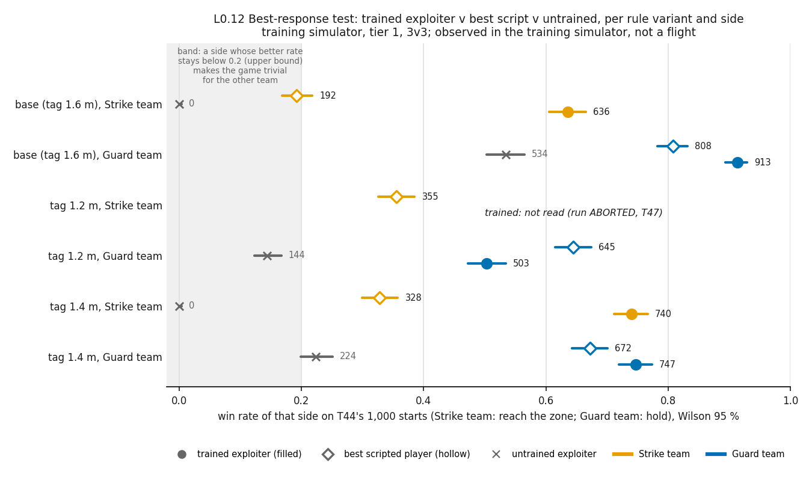

| Trained Strikes v the best scripted Guard (base): climb, trade two, the last one slips in | Trained Guards v the straight Strike (base) |
|---|---|
|  |  |

**L0.3 — the fast-engine Guard (T41) on the Isaac Lab drone, no retraining** (856 v 831 holds; reaches for the parked control):

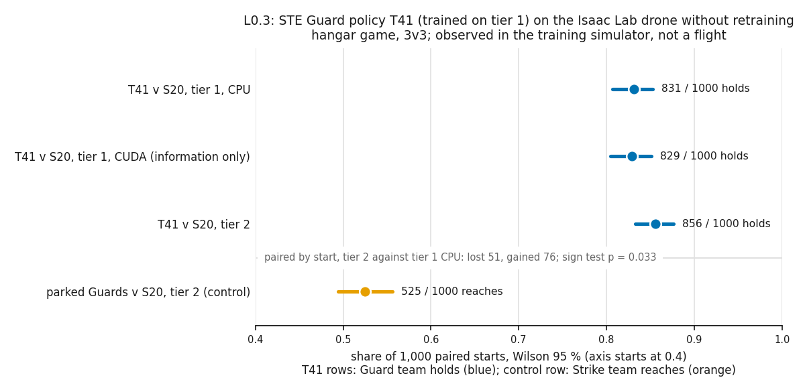

**L0.2 — training speed, Isaac Lab v the fast engine:**

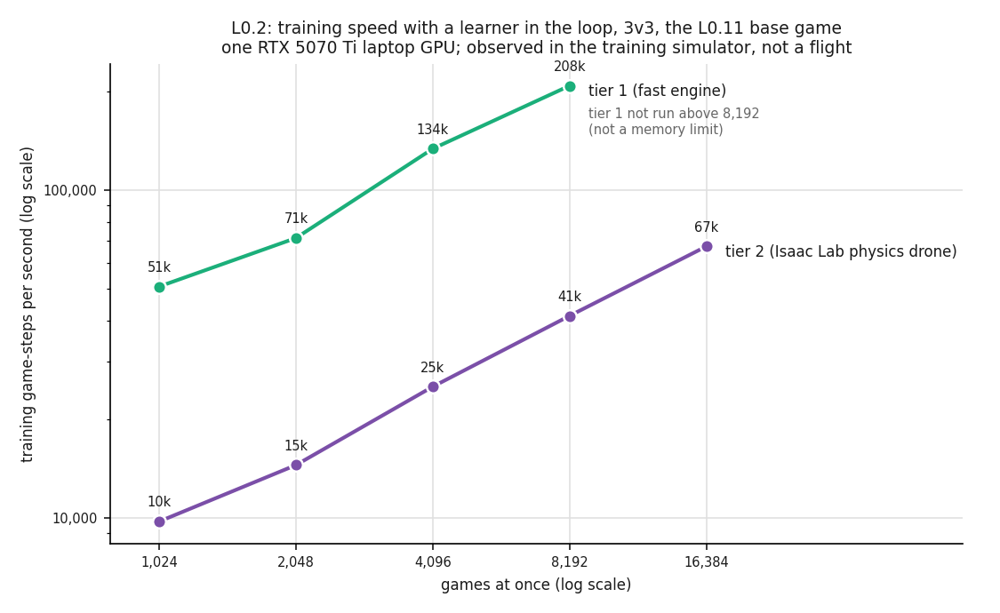

**The 3-D videos** (L0.11 games, Isaac Lab, ring = team): [base_reach_3d.gif](../../docs/media/ste_l011/3d/base_reach_3d.gif), [all](../../docs/media/ste_l011/3d/README.md).

Where phase L0 is: green done, light green laptop part done, amber running, grey queued (state file
`ste_learning/status/l0_progress.toml`, figure by `scripts/make_ste_learning_figures.py l0_progress`).

Earlier: L0.11 top-down clips and the factor chart are in the [T44 record](../../records/2026-11-21_ste_l011_screen_record.md).

### Phases

| Phase | Status | Math library | Simulator | What |
|---|---|---|---|---|
| NUS port Phases 1–4 | DONE | JAX (NUS), PyTorch | NUS 2-D game (JAX), Copy of NUS 2-D game (PyTorch), tier 2 Isaac Lab | NUS's code installed, game and policies copied to PyTorch, six tests towards STE drones |
| NUS port Phase 5 | PAUSED (lead call D8) | PyTorch | Copy of NUS 2-D game (PyTorch), tier 1 fast engine | 5.1 Method match FAIL (T43); STE Guard policy 829 of 1,000 (T41) |
| NUS port Phase 6 | DONE | none | none | public documents with videos |
| ▶ L0 Game definition and feasibility | RUNNING (approved 20 Nov, cap 19 GPU-h) | PyTorch | tier 1 fast engine, tier 2 Isaac Lab | which game, worth learning, can tier 2 train, is the Crazyflie route sound |
| L1–L8 | NOT STARTED | PyTorch | as ruled at gate G0 | drone model, rules, learner, evaluation, league, export, AirStack side, real flight |
| L9 Documentation | RUNNING | none | none | status, records, results page |

### Phase L0 Game definition and feasibility, task by task

| ID | Plain name | Status | Simulator | Result / ETA |
|---|---|---|---|---|
| L0.1 | Track set-up: config and test skeleton | DONE | none | settings file, loader, tests; independent QC closed all findings |
| L0.7 | Process tooling and drills | RUNNING (laptop part DONE) | none | merged into `development`; laptop: full suite 1,420 passed / 0 failed, wake-up drill and resume drill both as expected (below); DONE when the 5090 has run the same (L07-5090) |
| L0.8 | Game spec sheet | DONE | none | merged into `development`; QC passed; full suite on `development` 1,461 passed / 0 failed (41 min) |
| L0.9 | Tag rule for the study: 1-for-1, nearest pair first | DONE | tier 1 fast engine | merged; QC + re-check passed; full suite on `development` 1,517 passed / 0 failed (31 min); the 5090 records its own tag-off positions (L09-5090) |
| L0.10 | Scripted players for the study | DONE | tier 1 fast engine | merged; QC + 2 re-checks passed; full suite on `development` 1,600 passed / 0 failed (56 min, CPU shared with the L0.11 GPU jobs) |
| L0.11 | Screening sweep (INFO) | DONE | tier 1 fast engine | record T44 (every control PASS; shortlist base (reference), tag 1.2 m, tag 1.4 m; every hold a one-for-one trade) + follow-up checks; merged into `development`; full suite 1,685 passed / 0 failed (27 min) |
| L0.12 | Best-response test: is the game worth learning? | DONE, merged (T46 INFO, T47 ABORTED; full suite 1,838 passed, its 6 failures fixed before merge) | tier 1 fast engine | pilot PASS; run 0 PASS; **base: worth learning** (Guard 913 v 808, Strike 636 v 192); **tag 1.4 m: worth learning** (Guard 747 v 672, Strike 740 v 328); **tag 1.2 m: incomplete** (Guard 503 v script 645; Strike ABORTED, 87/88 updates, trained Strikes wait out the clock); every control PASS; 3.86 GPU-h of 6; record T46 (verdict) + T47 (aborted run) being written; 3-D clips of the key games need VID-1b (the 3-D tool replays scripted players only) |
| L0.2 | Tier 2 speed in contested play | DONE (T48, merged) | tier 2 Isaac Lab | every control PASS; Isaac Lab 3v3: 10 k → 67 k training game-steps/s (1,024 → 16,384 games, 4.7 GB); the fast engine is 4–10× faster per game-step (5× at 3v3); 0.29 GPU-h (+0.10 smokes) |
| L0.13 | Does tier 2 train at all? | BUILT, under QC | tier 2 Isaac Lab | built (236 tests); both arms 16,384 games, 302 M game-steps, identical start networks; pass = clearly above a still Guard on Isaac Lab; smoke first (C-1a at full size never measured); ~2.2 GPU-h; overnight after the bubble-tag runs |
| L0.3 | STE Guard policy in tier 2 without retraining | DONE (T49, merged) | tier 2 Isaac Lab | every control PASS; T41 holds 856/1000 on Isaac Lab v 831 fast engine (paired: 76 gained, 51 lost, sign test p = 0.033; higher in this set, no general claim); 1.24 GPU-h |
| L0.4 | Side-by-side Starling render | DONE | tier 2 Isaac Lab | found why our clips never looked like the Starling: a grey physics box was drawn over every drone since S2b (the hide call missed it); one-line fix, re-render shows the Starling (before/after in Watch); merged into `development` after independent review; 0.028 of 0.2 GPU-h |
| L0.5 | Starling video look fix | WAITING ON YOU (D9) | tier 2 Isaac Lab | the drone left unpainted, team shown by a ring or a small dot that casts no shadow; stills in Watch; 0.154 of 0.3 GPU-h (with VID-1) |
| L0.14 | Crazyflie route check | DONE | tier 1 fast engine (CPU) | record T45: the T41 Guard policy holds 791–768 of 1,000 in the Crazyflie-like lag band (0.48–0.56 s, every drone slowed) against 831 at the Starling's lag, and drones come closer (games under 1.0 m: 7 → 101–149); planner, like for like: 0 of 100 at 3v3 and 5v3 against 20 Nov's 5 of 100 (not a clear difference; only one rule set run); QC + re-check passed; merged into `development` (targeted tests 76 passed; the full suite runs with the next merge — lead's call, the CPU is shared now); page `ste_learning/CRAZYFLIE_ROUTE.md` |
| L0.6 | Gate G0 | NOT STARTED | none | after every task above; the owner decides |

GPU-h used in L0 so far: about 6.1 of 19 (L0.11 0.43, L0.4 0.03, L0.5 + VID-1 0.15, L0.2 0.39, L0.3 1.28, L0.12 3.86). Expected at the end of L0: about 10–11.

Laptop full CPU suite (20 Nov, `development` at 5c5d465, after `scripts/nus_install_provisional.sh`): **1,333 passed, 2 failed, 48 skipped** in 24 min. Both failures repeat when run alone:
- **L07-F1** `test_ste_job.py::test_f_d_a_killed_job…resumes`: CONFIRMED by QC: the tool does not over-report (it measures from the same start; ~0.255 s raw, printed rounded to 0.3); the test compares the rounded text with the exact elapsed time. Fix: allow half a display step.
- **TEST-F2** `test_train_standin.py::test_default_path_bit_identical_after_the_nus_hooks`: FIXED (447b317). Measured on the laptop: the hash repeats (75d2a955…), hold rates equal the recorded [0.25, 0.375], and forcing PyTorch's CPU capability down changes the hash; threads (trainer runs one) and local files (not read on this path) ruled out. The fingerprint is now one hash per CPU capability; hold rates are checked on every machine.

### Usage (laptop session, 20 Nov 22:00 to now)

| What | Agent tokens | Wall time | Note |
|---|---|---|---|
| L0.7 fixes: builder, 7 fixes one at a time | ~400 k | ~51 min | the largest: each fix re-reads the tooling and its tests |
| L0.8 Game spec sheet: builder, build + 2 fix rounds | ~320 k | ~50 min | includes its own 25-min full suite |
| L0.7 independent QC + re-check | ~246 k | ~18 min | reproduced C1 and I1 in a scratch folder |
| L0.8 independent QC + re-check | ~209 k | ~12 min | mutation tests on the sheet |
| L0.9 Tag rule: builder (build + fix round) | ~358 k | ~66 min | the first 50 min slowed by sharing the CPU with the L0.7 suite |
| L0.9 independent QC + re-check | ~239 k | ~31 min | ran its own reference matcher, mutants and old-vs-new games |
| L0.10 Scripted players: builder (build + rulings + 2 QC fix rounds) | ~420 k | ~56 min | |
| L0.10 independent QC (+ 2 re-checks) | ~353 k | ~71 min | 84 deliberate breakages over two rounds; its own geometry probes on 30,000+ starts |
| L0.11 sweep build (CPU, build + rulings + rebase + QC fixes + follow-ups) | ~677 k | ~106 min | the largest single task so far; a fresh builder takes L0.12 to avoid re-reading this context |
| L0.12 groundwork builder | ~550 k | ~54 min | |
| L0.12 pre-launch QC | ~322 k | ~48 min | 19 deliberate breakages, 8 not caught before the fixes |
| L0.14 builder | ~368 k | ~118 min | the Crazyflie planner sweep ran on the CPU (2,868 matches) |
| L0.11 pre-launch QC | ~293 k | ~24 min | broke the code five ways through the real driver |
| L0.11 CUDA smoke | | ~5 min | 0.087 GPU-h |
| L0.11 independent QC (pre-launch, re-check, results read) | ~419 k | ~45 min | |
| L0.11 sweep | | 18 min | 0.305 GPU-h (L0.11 total 0.426 of 3.0) |
| L0.4 + L0.5 + VID-1 builder (stills, box bug, replay check, 3-D renderer) | ~410 k | ~3 h incl. the 08:30 limit stop | 0.141 GPU-h; the account hit its 5-hour token limit at about 07:30 (three agents at once); resumed 08:44 |
| L0.12 gate fix + follow-up builder | ~280 k | ~55 min | run 0 design, N-2/N-4, tests |
| L0.12 QC re-checks 1–2 | ~450 k | ~30 min | 8 breakages tried on run 0 |
| L0.2/L0.3 builder | ~410 k | ~30 min | + fix round now |
| L0.2/L0.3 pre-launch QC + 2 re-checks | ~650 k | ~60 min | 39 + 6 breakages tried |
| L0.2/L0.3 fix rounds 1-2 | ~1.1 M | ~41 min | **the costliest task today**: each round re-reads the code; narrow rounds from here |
| L0.12 GPU pilot | | 11 min | 0.178 GPU-h |
| L0.11 GPU pilot | | 2 min | 0.034 GPU-h (first GPU job of the track) |
| Full CPU test suite | none | ~25 min alone; the L0.7 merge run took 61 min (shared the CPU with L0.9's tests) | rule from now: one heavy test run at a time |
| GPU | 0 GPU-h | | nothing has used the GPU |

Sub-agents total about 1.2 M tokens so far; the lead's own context is not measured by the tools here.

Laptop drills (21 Nov, fix branch, shared folder `~/AirStack-starling-max2/svg_training/runs/shared/`, no owner pause open):
- Wake-up: `L0.7 l07_wakeup DONE exit=0 duration=120.4s effective=120.4s`, `waiter exit 0` (the background waiter's end was the wake-up).
- Resume: `alive` → simulated power cut (`kill -KILL` of the process group at step 30) → `dead`; waiter `DIED exit=none duration=31.2s`, `waiter exit 21`; relaunch with `bash cmd.txt` from a shell with a wrong `PYTHONPATH` and `SVG_SHARED_DIR` → `launch=2`, `resumed from step 30 of 120`, `DONE exit=0 duration=90.4s effective=90.4s run_effective=120.3s`, `waiter exit 0`, `{"steps": 120, "total": 7260.0}`; the wrong shared folder was never created.

### Other workstreams

| ID | Plain name | Status |
|---|---|---|
| L012-B | Bubble-tag test (tag 1.15 m = the safety distance 1.10 m + 0.05 m; owner approved 21 Nov) | RUNNING (run 0) | screen DONE (every control PASS): best scripts hold 645 / reach 355, the same as tag 1.2 m — neither side trivial; tags the filter pushed together: 0–10 % of tags per cell (0 % for the best pair) — nearly every tag is chosen by the players; QC + fixes + re-check GO; run 0 bar is high (scripted straight Strike reaches a parked Guard 899/1000 at 1.15 m, so the trained Strike needs ≥ 849); then Strike (if run 0 PASS) and Guard, ~1.5 GPU-h, done ~18:30 |
| VID-1c | Re-draw the L0.2 and L0.3 2-D clips with the height panel (the standing rule; those drivers used the older clip drawer) | QUEUED (CPU) | from the saved run data |
| SYNC-1 | Branch `development` on both machines; laptop worktree `~/AirStack-starling-max2-dev` | DONE |
| SYNC-2 | Status skill `train-status` and the owner's standing rules in CLAUDE.md | DONE |
| SYNC-3 | Root `CLAUDE.md` and every page: training work lands on `development` | DONE |
| SYNC-4 | STE Guard policy (T41 run folder) in the PROVISIONAL bundle | DONE; installed on the laptop (46 files, agent.pt c91bea51…) |
| L07-F1 | Fix: waiter-duration test bound (rounding) (QC I5) | DONE (a4100d0; 30 of 30 runs pass; L0.7 test files 217 passed) |
| L07-C1 | Fix: an open pause takes time off every job, and launch does not check for one: a job launched during a pause runs on the GPU with 0 GPU-h counted and its cap never fires | DONE (79effa0 on branch ste-l0.7-fix; red 48 failed, then L0.7 + NUS pause tests 251 passed). Pauses still always logged; launch refuses while one is open; a pause counts only against the jobs it stopped |
| L07-I1 | Fix: a new run reusing an old job name inherits that job's GPU-hours as credit (task cap can be exceeded) | DONE (05dd547; credit keyed by job name + run folder; red 24 failed, then 256 passed) |
| L07-I2 | Fix: `cmd.txt` relaunch loses the environment (PYTHONPATH, CUDA alloc setting, shared-folder path) | DONE (d0661f4; cmd.txt replays the first launch's environment; a different shared folder is refused; resume drill uses bash cmd.txt; red 3 failed, then 259 passed) |
| L07-I3 | Fix: the launcher's wrapper can die (clock step back, full disk) while the job runs on: GPU time stops being logged | DONE (1ca8a70; every wrapper write survives an error, records a fault and retries; red 8 failed, then 267 passed) |
| L07-I4 | Fix: a job resumed after a reboot is flagged ENDED_EARLY (exit 20) though it finished correctly | DONE (70fc1a3; judged on the trainer's saved progress across launches; red: drill pattern read 20; then 280 passed) |
| L08-F1 | Finding: the hangar's Strike start ring (3.2 m from the zone centre) does not fit the 6.5 m lab arena (drones kept within 3.0 m); a ring for 6.5 m is needed before L0.11's base case | CLOSED (lead's call): Strike start ring 2.75 m for the 6.5 m arena, PROPOSED, ruled at G0 |
| L07-C1b | Fix: our own "pause the siblings, run solo" step (AUTOMATION §2.2) is now refused too; lead's design: pauses the session makes are tagged and do not block launch, your pauses still do | DONE (ef38534; `GPU_PAUSE_BY=lead` tags the session's pauses; a bare `gpu_pause.sh pause` is still yours and still blocks; red 13 failed, then 298 passed) |
| L07-C1c | Fix: a session-tagged resume must refuse while any of your pauses is open (a resume today continues every job and closes your pauses too) | DONE (efa9ec1; a bare resume/stop is unchanged; red 4 failed, then 304 passed) |
| GIT-1 | Fix: my 17 Nov `.gitignore` line `data/` also hid new files in `tests/data/` | DONE (d3572dc: anchored to `/data/`) |
| L011-F1 | Finding: scripted players decide every 0.05 s tick, not at the sheet's 0.6 s decision period; the sweep measures scripted play at 0.05 s; L0.12's trainers must set their decision period explicitly (T41 used 0.6 s) | OPEN: written into the L0.11 gate file and record |
| L07-SUSPEND | Tooling: a laptop sleep during a GPU job is counted as GPU-hours and as time towards the job's cap (wall clock). Rule until fixed: never let the laptop sleep during a GPU job | QUEUED (tooling task); rule in force now |
| L011-G0 | Finding for gate G0 (T44, scripted play): (1) every hold is a one-for-one trade — no tag-on game times out, and at 1v1 and 3v3 a Guard win leaves no Guard — so head-count decides (PLAN F1; bears on what a tag costs, P12); (2) the programme's sizes 2v1 and 5v3, and 1v1, are Guard-trivial with scripted players at the proposed rules; candidate cause: tag radius 1.6 m = zone radius 1.6 m with Guards starting on a circle near the zone centre (not tested). L0.12 measures whether learning changes either | OPEN: reported at G0 |
| L010-G0 | Finding for gate G0 (from L0.10 QC): any safety-filter move near the 1.6 m tag radius can create a tag nobody chose (the filter's 1.10 m keep-out is inside the tag radius). Spaced starts remove it at the start; during play it is part of the game the sweep measures (P1) | OPEN: reported at G0 |
| L09-5090 | On the 5090: record the tag-off golden's positions for its CPU type (AVX512); check the outcome fingerprints there | WAITING: next 5090 session |
| DOC-1 | A phase-L0 flowchart coloured by progress (done / running / queued), regenerated with each status and shown in its Watch section (owner, 21 Nov: "photos or diagram flow charts would be good too") | DONE (progress flowchart; regenerated with each status) |
| VID-1 | Clips: a height panel on the 2-D top-down clips of every run; 3-D Isaac Lab videos (Starling look, top view + 3-D view, MP4 + GIF) of each result's key games | L0.11 DONE, merged: 6 key games (base, tag 1.2 m, tag 1.4 m × hold, reach) × top + 3-D, MP4 + GIF; every replayed game checked equal to T44 (90,000 of 90,000) before drawing; independent review: 1 important bug (old files could be drawn after a failed check; never happened) + minors, fixed and re-reviewed; the published games re-checked with the stricter check: identical; full suite on the merge 1,751 passed (the 2 failures it found are fixed: an unlisted Crazyflie import from L0.14, and my progress-chart test reading the live file); next: L0.12 results |
| L08-M | L0.8 minors left: 3 hangar values unchecked on a clone without the NUS bundle; 3 values whose wrong value still passes; loader refuses some honest wording; tests tied to exact lines and the AirStack fence file | PARKED |
| L07-DISK | Follow-up: the planned disk-space check (a disk full through 10 retries at a job's end reads DIED) | PARKED (stated limit) |
| L07-N | Re-check minors N1–N4: a session pause also lands in the old per-worktree log the NUS reader uses; full disk can hold the wrapper 10 min after the end; AUTOMATION §4 still states the old GPU-hour rule; on the 5090 run `scripts/ste_job.py owner-pauses` before the drills | PARKED (N4 goes into the 5090 note) |
| L07-M | QC's 10 minor findings (+3 from the C1 build: pid-only matching, test pause pattern shared across sessions, pid reuse) (runs/ste_l07/qc_report.md) | PARKED until the six fixes land |
| L07-5090 | L0.7 on the 5090: full CPU suite and the two drills there (L0.7 is DONE only after both machines) | WAITING: next 5090 session |
| TEST-F2 | Fix: bit-level training fingerprint is machine-specific | DONE (447b317; trainer test file 43 passed, 1 skipped) |
| TEST-F2b | On the 5090: confirm its CPU capability is AVX512 (the key its 18 Nov hash is now filed under) | WAITING: next 5090 session runs the test (fails or skips loudly if wrong) |

**Machines (owner, 21 Nov):** no task is 5090-only. The RTX 5090 (32 GB) suits memory-heavy runs; the laptop RTX 5070 Ti (12 GB) runs everything sized to fit, and the record says which machine. Only machine checks stay with their machine: TEST-F2b, L07-5090, L09-5090. **Schedule:** weekends the laptop runs the pipeline (the 5090 is free for gaming); weekdays the 5090 does (the laptop goes to work). **This weekend:** the owner packs the laptop **Mon 23 Nov 10:00**: no GPU job starts unless it can end by **Mon 08:00**; by **09:30** everything is committed, HANDOFF §0 and status written, ready to push.

**GPU queue on the laptop (one at a time for speed measurements):** L0.12 pilot → L0.12 trainings → L0.2 → L0.3 → L0.13 (L0.4, L0.5, VID-1 for L0.11 done).

**Next.** (1) L0.3 (running). (2) Merge L0.12 (suite running), L0.2 record. (3) Bubble-tag test at 1.15 m: rules written first, scripted screen, then a trained Guard and Strike (~1.3 GPU-h, this evening). (4) L0.13 overnight (≤ 6 GPU-h). (5) 3-D clips of trained players with a visible tag circle (VID-1b). (6) The G0 page, Sunday. Hard stop: GPU jobs end Mon 08:00, wrap-up 09:30.

**Waiting on you.** Nothing now. At gate G0: tag rule (1.15 m bubble or 1.4 m), varied tag distance in training, what a tag costs, zone size, team sizes, where to train, the real demo, the physical-intercept study, the L1–L9 budget.

**Correction.** The 21 Nov question on NUS values listed "speeds 0.6 / 1.2". The L0.8 review reads those two numbers as the decision period (0.6 s) and the flight height (1.2 m); the speeds are 0.5 and 0.333 m/s. Your Yes covers all of them as written on the sheet.

## 2026-11-21 16:28

**Status, 2026-11-21 16:29 (+08:00), 30-minute update: bubble-tag run 0 PASS; trained Strike at 1.15 m training; L0.13 fix round** · laptop RTX 5070 Ti · GPU: L0.12b Strike run · 1 job

**Plain summary (L0.3 Guard policy on the Isaac Lab drone).** Tested: does the Guard policy trained in the fast engine
(T41) still work on the more realistic Isaac Lab drone, without retraining? Happened: every control PASS; it holds **856 of
1,000** on the Isaac Lab drone v 831 in the fast engine, same starts (higher in this set; not a general claim). Why it matters:
a policy trained in the fast engine carries over to the drone model closer to the real one — the fast engine is a fair place
to train. Clips: `docs/media/ste_l03/` (on its branch until merge).

**Your decisions today (recorded):** D9 ring kept as the team marker; no re-run of the tag 1.2 m Strike run; **test the
"touch the safety bubble" tag at 1.15 m** (about 1.3 GPU-h beyond L0.12's 6, approved); real demo = proximity tag, physical
interdiction shown in simulation (a proposal for G0).

### Watch (latest clips and figures)

**L0.12 — can a trained team beat the best hand-written one?** Filled dot = trained, hollow = best script, x = untrained:

| Trained Strikes v the best scripted Guard (base): climb, trade two, the last one slips in | Trained Guards v the straight Strike (base) |
|---|---|
|  |  |

**L0.3 — the fast-engine Guard (T41) on the Isaac Lab drone, no retraining** (856 v 831 holds; reaches for the parked control):

**L0.2 — training speed, Isaac Lab v the fast engine:**

**The 3-D videos** (L0.11 games, Isaac Lab, ring = team): [base_reach_3d.gif](../../docs/media/ste_l011/3d/base_reach_3d.gif), [all](../../docs/media/ste_l011/3d/README.md).

Where phase L0 is: green done, light green laptop part done, amber running, grey queued (state file
`ste_learning/status/l0_progress.toml`, figure by `scripts/make_ste_learning_figures.py l0_progress`).

Earlier: L0.11 top-down clips and the factor chart are in the [T44 record](../../records/2026-11-21_ste_l011_screen_record.md).

### Phases

| Phase | Status | Math library | Simulator | What |
|---|---|---|---|---|
| NUS port Phases 1–4 | DONE | JAX (NUS), PyTorch | NUS 2-D game (JAX), Copy of NUS 2-D game (PyTorch), tier 2 Isaac Lab | NUS's code installed, game and policies copied to PyTorch, six tests towards STE drones |
| NUS port Phase 5 | PAUSED (lead call D8) | PyTorch | Copy of NUS 2-D game (PyTorch), tier 1 fast engine | 5.1 Method match FAIL (T43); STE Guard policy 829 of 1,000 (T41) |
| NUS port Phase 6 | DONE | none | none | public documents with videos |
| ▶ L0 Game definition and feasibility | RUNNING (approved 20 Nov, cap 19 GPU-h) | PyTorch | tier 1 fast engine, tier 2 Isaac Lab | which game, worth learning, can tier 2 train, is the Crazyflie route sound |
| L1–L8 | NOT STARTED | PyTorch | as ruled at gate G0 | drone model, rules, learner, evaluation, league, export, AirStack side, real flight |
| L9 Documentation | RUNNING | none | none | status, records, results page |

### Phase L0 Game definition and feasibility, task by task

| ID | Plain name | Status | Simulator | Result / ETA |
|---|---|---|---|---|
| L0.1 | Track set-up: config and test skeleton | DONE | none | settings file, loader, tests; independent QC closed all findings |
| L0.7 | Process tooling and drills | RUNNING (laptop part DONE) | none | merged into `development`; laptop: full suite 1,420 passed / 0 failed, wake-up drill and resume drill both as expected (below); DONE when the 5090 has run the same (L07-5090) |
| L0.8 | Game spec sheet | DONE | none | merged into `development`; QC passed; full suite on `development` 1,461 passed / 0 failed (41 min) |
| L0.9 | Tag rule for the study: 1-for-1, nearest pair first | DONE | tier 1 fast engine | merged; QC + re-check passed; full suite on `development` 1,517 passed / 0 failed (31 min); the 5090 records its own tag-off positions (L09-5090) |
| L0.10 | Scripted players for the study | DONE | tier 1 fast engine | merged; QC + 2 re-checks passed; full suite on `development` 1,600 passed / 0 failed (56 min, CPU shared with the L0.11 GPU jobs) |
| L0.11 | Screening sweep (INFO) | DONE | tier 1 fast engine | record T44 (every control PASS; shortlist base (reference), tag 1.2 m, tag 1.4 m; every hold a one-for-one trade) + follow-up checks; merged into `development`; full suite 1,685 passed / 0 failed (27 min) |
| L0.12 | Best-response test: is the game worth learning? | DONE, merged (T46 INFO, T47 ABORTED; full suite 1,838 passed, its 6 failures fixed before merge) | tier 1 fast engine | pilot PASS; run 0 PASS; **base: worth learning** (Guard 913 v 808, Strike 636 v 192); **tag 1.4 m: worth learning** (Guard 747 v 672, Strike 740 v 328); **tag 1.2 m: incomplete** (Guard 503 v script 645; Strike ABORTED, 87/88 updates, trained Strikes wait out the clock); every control PASS; 3.86 GPU-h of 6; record T46 (verdict) + T47 (aborted run) being written; 3-D clips of the key games need VID-1b (the 3-D tool replays scripted players only) |
| L0.2 | Tier 2 speed in contested play | DONE (T48, merged) | tier 2 Isaac Lab | every control PASS; Isaac Lab 3v3: 10 k → 67 k training game-steps/s (1,024 → 16,384 games, 4.7 GB); the fast engine is 4–10× faster per game-step (5× at 3v3); 0.29 GPU-h (+0.10 smokes) |
| L0.13 | Does tier 2 train at all? | FIX ROUND | tier 2 Isaac Lab | QC: smoke GO, runs NO-GO — a drone that tumbles on Isaac Lab was not counted (could inflate holds); tests missed 16 of 27 deliberate breakages (e.g. Isaac Lab scores taken from the fast engine). Fixing: count tumbles and physics errors (stop on the latter), tests for each, smoke can never be a result, "too slow" approved as a verdict word; target ≥ 25 of 27 breakages caught |
| L0.3 | STE Guard policy in tier 2 without retraining | DONE (T49, merged) | tier 2 Isaac Lab | every control PASS; T41 holds 856/1000 on Isaac Lab v 831 fast engine (paired: 76 gained, 51 lost, sign test p = 0.033; higher in this set, no general claim); 1.24 GPU-h |
| L0.4 | Side-by-side Starling render | DONE | tier 2 Isaac Lab | found why our clips never looked like the Starling: a grey physics box was drawn over every drone since S2b (the hide call missed it); one-line fix, re-render shows the Starling (before/after in Watch); merged into `development` after independent review; 0.028 of 0.2 GPU-h |
| L0.5 | Starling video look fix | WAITING ON YOU (D9) | tier 2 Isaac Lab | the drone left unpainted, team shown by a ring or a small dot that casts no shadow; stills in Watch; 0.154 of 0.3 GPU-h (with VID-1) |
| L0.14 | Crazyflie route check | DONE | tier 1 fast engine (CPU) | record T45: the T41 Guard policy holds 791–768 of 1,000 in the Crazyflie-like lag band (0.48–0.56 s, every drone slowed) against 831 at the Starling's lag, and drones come closer (games under 1.0 m: 7 → 101–149); planner, like for like: 0 of 100 at 3v3 and 5v3 against 20 Nov's 5 of 100 (not a clear difference; only one rule set run); QC + re-check passed; merged into `development` (targeted tests 76 passed; the full suite runs with the next merge — lead's call, the CPU is shared now); page `ste_learning/CRAZYFLIE_ROUTE.md` |
| L0.6 | Gate G0 | NOT STARTED | none | after every task above; the owner decides |

GPU-h used in L0 so far: about 6.1 of 19 (L0.11 0.43, L0.4 0.03, L0.5 + VID-1 0.15, L0.2 0.39, L0.3 1.28, L0.12 3.86). Expected at the end of L0: about 10–11.

Laptop full CPU suite (20 Nov, `development` at 5c5d465, after `scripts/nus_install_provisional.sh`): **1,333 passed, 2 failed, 48 skipped** in 24 min. Both failures repeat when run alone:
- **L07-F1** `test_ste_job.py::test_f_d_a_killed_job…resumes`: CONFIRMED by QC: the tool does not over-report (it measures from the same start; ~0.255 s raw, printed rounded to 0.3); the test compares the rounded text with the exact elapsed time. Fix: allow half a display step.
- **TEST-F2** `test_train_standin.py::test_default_path_bit_identical_after_the_nus_hooks`: FIXED (447b317). Measured on the laptop: the hash repeats (75d2a955…), hold rates equal the recorded [0.25, 0.375], and forcing PyTorch's CPU capability down changes the hash; threads (trainer runs one) and local files (not read on this path) ruled out. The fingerprint is now one hash per CPU capability; hold rates are checked on every machine.

### Usage (laptop session, 20 Nov 22:00 to now)

| What | Agent tokens | Wall time | Note |
|---|---|---|---|
| L0.7 fixes: builder, 7 fixes one at a time | ~400 k | ~51 min | the largest: each fix re-reads the tooling and its tests |
| L0.8 Game spec sheet: builder, build + 2 fix rounds | ~320 k | ~50 min | includes its own 25-min full suite |
| L0.7 independent QC + re-check | ~246 k | ~18 min | reproduced C1 and I1 in a scratch folder |
| L0.8 independent QC + re-check | ~209 k | ~12 min | mutation tests on the sheet |
| L0.9 Tag rule: builder (build + fix round) | ~358 k | ~66 min | the first 50 min slowed by sharing the CPU with the L0.7 suite |
| L0.9 independent QC + re-check | ~239 k | ~31 min | ran its own reference matcher, mutants and old-vs-new games |
| L0.10 Scripted players: builder (build + rulings + 2 QC fix rounds) | ~420 k | ~56 min | |
| L0.10 independent QC (+ 2 re-checks) | ~353 k | ~71 min | 84 deliberate breakages over two rounds; its own geometry probes on 30,000+ starts |
| L0.11 sweep build (CPU, build + rulings + rebase + QC fixes + follow-ups) | ~677 k | ~106 min | the largest single task so far; a fresh builder takes L0.12 to avoid re-reading this context |
| L0.12 groundwork builder | ~550 k | ~54 min | |
| L0.12 pre-launch QC | ~322 k | ~48 min | 19 deliberate breakages, 8 not caught before the fixes |
| L0.14 builder | ~368 k | ~118 min | the Crazyflie planner sweep ran on the CPU (2,868 matches) |
| L0.11 pre-launch QC | ~293 k | ~24 min | broke the code five ways through the real driver |
| L0.11 CUDA smoke | | ~5 min | 0.087 GPU-h |
| L0.11 independent QC (pre-launch, re-check, results read) | ~419 k | ~45 min | |
| L0.11 sweep | | 18 min | 0.305 GPU-h (L0.11 total 0.426 of 3.0) |
| L0.4 + L0.5 + VID-1 builder (stills, box bug, replay check, 3-D renderer) | ~410 k | ~3 h incl. the 08:30 limit stop | 0.141 GPU-h; the account hit its 5-hour token limit at about 07:30 (three agents at once); resumed 08:44 |
| L0.12 gate fix + follow-up builder | ~280 k | ~55 min | run 0 design, N-2/N-4, tests |
| L0.12 QC re-checks 1–2 | ~450 k | ~30 min | 8 breakages tried on run 0 |
| L0.2/L0.3 builder | ~410 k | ~30 min | + fix round now |
| L0.2/L0.3 pre-launch QC + 2 re-checks | ~650 k | ~60 min | 39 + 6 breakages tried |
| L0.12b bubble-tag build + 2 fix rounds | ~490 k | ~95 min | |
| L0.12b QC + re-checks | ~210 k | ~40 min | |
| L0.13 build + QC (+ fix round now) | ~650 k + | ~60 min | |
| L0.2/L0.3 fix rounds 1-2 | ~1.1 M | ~41 min | **the costliest task today**: each round re-reads the code; narrow rounds from here |
| L0.12 GPU pilot | | 11 min | 0.178 GPU-h |
| L0.11 GPU pilot | | 2 min | 0.034 GPU-h (first GPU job of the track) |
| Full CPU test suite | none | ~25 min alone; the L0.7 merge run took 61 min (shared the CPU with L0.9's tests) | rule from now: one heavy test run at a time |
| GPU | 0 GPU-h | | nothing has used the GPU |

Sub-agents total about 1.2 M tokens so far; the lead's own context is not measured by the tools here.

Laptop drills (21 Nov, fix branch, shared folder `~/AirStack-starling-max2/svg_training/runs/shared/`, no owner pause open):
- Wake-up: `L0.7 l07_wakeup DONE exit=0 duration=120.4s effective=120.4s`, `waiter exit 0` (the background waiter's end was the wake-up).
- Resume: `alive` → simulated power cut (`kill -KILL` of the process group at step 30) → `dead`; waiter `DIED exit=none duration=31.2s`, `waiter exit 21`; relaunch with `bash cmd.txt` from a shell with a wrong `PYTHONPATH` and `SVG_SHARED_DIR` → `launch=2`, `resumed from step 30 of 120`, `DONE exit=0 duration=90.4s effective=90.4s run_effective=120.3s`, `waiter exit 0`, `{"steps": 120, "total": 7260.0}`; the wrong shared folder was never created.

### Other workstreams

| ID | Plain name | Status |
|---|---|---|
| L012-B | Bubble-tag test (tag 1.15 m = the safety distance 1.10 m + 0.05 m; owner approved 21 Nov) | RUNNING (Strike run) | screen DONE (best scripts 645 / 355, the same as 1.2 m; tags the filter pushed together 0–10 %); **run 0 PASS**: the trained Strike reached a parked Guard's zone 909/1000 at its first read (bar 849); now the trained Strike v the field Guard (update 60 of 88; training reach ~12 %, like the 1.2 m Strikes that waited out the clock), then the trained Guard; ~18:15 |
| VID-1c | Re-draw the L0.2 and L0.3 2-D clips with the height panel (the standing rule; those drivers used the older clip drawer) | QUEUED (CPU) | from the saved run data |
| SYNC-1 | Branch `development` on both machines; laptop worktree `~/AirStack-starling-max2-dev` | DONE |
| SYNC-2 | Status skill `train-status` and the owner's standing rules in CLAUDE.md | DONE |
| SYNC-3 | Root `CLAUDE.md` and every page: training work lands on `development` | DONE |
| SYNC-4 | STE Guard policy (T41 run folder) in the PROVISIONAL bundle | DONE; installed on the laptop (46 files, agent.pt c91bea51…) |
| L07-F1 | Fix: waiter-duration test bound (rounding) (QC I5) | DONE (a4100d0; 30 of 30 runs pass; L0.7 test files 217 passed) |
| L07-C1 | Fix: an open pause takes time off every job, and launch does not check for one: a job launched during a pause runs on the GPU with 0 GPU-h counted and its cap never fires | DONE (79effa0 on branch ste-l0.7-fix; red 48 failed, then L0.7 + NUS pause tests 251 passed). Pauses still always logged; launch refuses while one is open; a pause counts only against the jobs it stopped |
| L07-I1 | Fix: a new run reusing an old job name inherits that job's GPU-hours as credit (task cap can be exceeded) | DONE (05dd547; credit keyed by job name + run folder; red 24 failed, then 256 passed) |
| L07-I2 | Fix: `cmd.txt` relaunch loses the environment (PYTHONPATH, CUDA alloc setting, shared-folder path) | DONE (d0661f4; cmd.txt replays the first launch's environment; a different shared folder is refused; resume drill uses bash cmd.txt; red 3 failed, then 259 passed) |
| L07-I3 | Fix: the launcher's wrapper can die (clock step back, full disk) while the job runs on: GPU time stops being logged | DONE (1ca8a70; every wrapper write survives an error, records a fault and retries; red 8 failed, then 267 passed) |
| L07-I4 | Fix: a job resumed after a reboot is flagged ENDED_EARLY (exit 20) though it finished correctly | DONE (70fc1a3; judged on the trainer's saved progress across launches; red: drill pattern read 20; then 280 passed) |
| L08-F1 | Finding: the hangar's Strike start ring (3.2 m from the zone centre) does not fit the 6.5 m lab arena (drones kept within 3.0 m); a ring for 6.5 m is needed before L0.11's base case | CLOSED (lead's call): Strike start ring 2.75 m for the 6.5 m arena, PROPOSED, ruled at G0 |
| L07-C1b | Fix: our own "pause the siblings, run solo" step (AUTOMATION §2.2) is now refused too; lead's design: pauses the session makes are tagged and do not block launch, your pauses still do | DONE (ef38534; `GPU_PAUSE_BY=lead` tags the session's pauses; a bare `gpu_pause.sh pause` is still yours and still blocks; red 13 failed, then 298 passed) |
| L07-C1c | Fix: a session-tagged resume must refuse while any of your pauses is open (a resume today continues every job and closes your pauses too) | DONE (efa9ec1; a bare resume/stop is unchanged; red 4 failed, then 304 passed) |
| GIT-1 | Fix: my 17 Nov `.gitignore` line `data/` also hid new files in `tests/data/` | DONE (d3572dc: anchored to `/data/`) |
| L011-F1 | Finding: scripted players decide every 0.05 s tick, not at the sheet's 0.6 s decision period; the sweep measures scripted play at 0.05 s; L0.12's trainers must set their decision period explicitly (T41 used 0.6 s) | OPEN: written into the L0.11 gate file and record |
| L07-SUSPEND | Tooling: a laptop sleep during a GPU job is counted as GPU-hours and as time towards the job's cap (wall clock). Rule until fixed: never let the laptop sleep during a GPU job | QUEUED (tooling task); rule in force now |
| L011-G0 | Finding for gate G0 (T44, scripted play): (1) every hold is a one-for-one trade — no tag-on game times out, and at 1v1 and 3v3 a Guard win leaves no Guard — so head-count decides (PLAN F1; bears on what a tag costs, P12); (2) the programme's sizes 2v1 and 5v3, and 1v1, are Guard-trivial with scripted players at the proposed rules; candidate cause: tag radius 1.6 m = zone radius 1.6 m with Guards starting on a circle near the zone centre (not tested). L0.12 measures whether learning changes either | OPEN: reported at G0 |
| L010-G0 | Finding for gate G0 (from L0.10 QC): any safety-filter move near the 1.6 m tag radius can create a tag nobody chose (the filter's 1.10 m keep-out is inside the tag radius). Spaced starts remove it at the start; during play it is part of the game the sweep measures (P1) | OPEN: reported at G0 |
| L09-5090 | On the 5090: record the tag-off golden's positions for its CPU type (AVX512); check the outcome fingerprints there | WAITING: next 5090 session |
| DOC-1 | A phase-L0 flowchart coloured by progress (done / running / queued), regenerated with each status and shown in its Watch section (owner, 21 Nov: "photos or diagram flow charts would be good too") | DONE (progress flowchart; regenerated with each status) |
| VID-1 | Clips: a height panel on the 2-D top-down clips of every run; 3-D Isaac Lab videos (Starling look, top view + 3-D view, MP4 + GIF) of each result's key games | L0.11 DONE, merged: 6 key games (base, tag 1.2 m, tag 1.4 m × hold, reach) × top + 3-D, MP4 + GIF; every replayed game checked equal to T44 (90,000 of 90,000) before drawing; independent review: 1 important bug (old files could be drawn after a failed check; never happened) + minors, fixed and re-reviewed; the published games re-checked with the stricter check: identical; full suite on the merge 1,751 passed (the 2 failures it found are fixed: an unlisted Crazyflie import from L0.14, and my progress-chart test reading the live file); next: L0.12 results |
| L08-M | L0.8 minors left: 3 hangar values unchecked on a clone without the NUS bundle; 3 values whose wrong value still passes; loader refuses some honest wording; tests tied to exact lines and the AirStack fence file | PARKED |
| L07-DISK | Follow-up: the planned disk-space check (a disk full through 10 retries at a job's end reads DIED) | PARKED (stated limit) |
| L07-N | Re-check minors N1–N4: a session pause also lands in the old per-worktree log the NUS reader uses; full disk can hold the wrapper 10 min after the end; AUTOMATION §4 still states the old GPU-hour rule; on the 5090 run `scripts/ste_job.py owner-pauses` before the drills | PARKED (N4 goes into the 5090 note) |
| L07-M | QC's 10 minor findings (+3 from the C1 build: pid-only matching, test pause pattern shared across sessions, pid reuse) (runs/ste_l07/qc_report.md) | PARKED until the six fixes land |
| L07-5090 | L0.7 on the 5090: full CPU suite and the two drills there (L0.7 is DONE only after both machines) | WAITING: next 5090 session |
| TEST-F2 | Fix: bit-level training fingerprint is machine-specific | DONE (447b317; trainer test file 43 passed, 1 skipped) |
| TEST-F2b | On the 5090: confirm its CPU capability is AVX512 (the key its 18 Nov hash is now filed under) | WAITING: next 5090 session runs the test (fails or skips loudly if wrong) |

**Machines (owner, 21 Nov):** no task is 5090-only. The RTX 5090 (32 GB) suits memory-heavy runs; the laptop RTX 5070 Ti (12 GB) runs everything sized to fit, and the record says which machine. Only machine checks stay with their machine: TEST-F2b, L07-5090, L09-5090. **Schedule:** weekends the laptop runs the pipeline (the 5090 is free for gaming); weekdays the 5090 does (the laptop goes to work). **This weekend:** the owner packs the laptop **Mon 23 Nov 10:00**: no GPU job starts unless it can end by **Mon 08:00**; by **09:30** everything is committed, HANDOFF §0 and status written, ready to push.

**GPU queue on the laptop (one at a time for speed measurements):** L0.12 pilot → L0.12 trainings → L0.2 → L0.3 → L0.13 (L0.4, L0.5, VID-1 for L0.11 done).

**Next.** (1) L0.3 (running). (2) Merge L0.12 (suite running), L0.2 record. (3) Bubble-tag test at 1.15 m: rules written first, scripted screen, then a trained Guard and Strike (~1.3 GPU-h, this evening). (4) L0.13 overnight (≤ 6 GPU-h). (5) 3-D clips of trained players with a visible tag circle (VID-1b). (6) The G0 page, Sunday. Hard stop: GPU jobs end Mon 08:00, wrap-up 09:30.

**Waiting on you.** Nothing now. At gate G0: tag rule (1.15 m bubble or 1.4 m), varied tag distance in training, what a tag costs, zone size, team sizes, where to train, the real demo, the physical-intercept study, the L1–L9 budget.

**Correction.** The 21 Nov question on NUS values listed "speeds 0.6 / 1.2". The L0.8 review reads those two numbers as the decision period (0.6 s) and the flight height (1.2 m); the speeds are 0.5 and 0.333 m/s. Your Yes covers all of them as written on the sheet.

## 2026-11-21 16:58

**Status, 2026-11-21 17:00 (+08:00), 30-minute update: bubble-tag Strike run ABORTED by its time rule again (86 of 88 updates); Guard run training; L0.13 QC GO** · laptop RTX 5070 Ti · GPU: L0.12b Guard run · 1 job

**Plain summary (L0.3 Guard policy on the Isaac Lab drone).** Tested: does the Guard policy trained in the fast engine
(T41) still work on the more realistic Isaac Lab drone, without retraining? Happened: every control PASS; it holds **856 of
1,000** on the Isaac Lab drone v 831 in the fast engine, same starts (higher in this set; not a general claim). Why it matters:
a policy trained in the fast engine carries over to the drone model closer to the real one — the fast engine is a fair place
to train. Clips: `docs/media/ste_l03/` (on its branch until merge).

**Your decisions today (recorded):** D9 ring kept as the team marker; no re-run of the tag 1.2 m Strike run; **test the
"touch the safety bubble" tag at 1.15 m** (about 1.3 GPU-h beyond L0.12's 6, approved); real demo = proximity tag, physical
interdiction shown in simulation (a proposal for G0).

### Watch (latest clips and figures)

**L0.12 — can a trained team beat the best hand-written one?** Filled dot = trained, hollow = best script, x = untrained:

| Trained Strikes v the best scripted Guard (base): climb, trade two, the last one slips in | Trained Guards v the straight Strike (base) |
|---|---|
|  |  |

**L0.3 — the fast-engine Guard (T41) on the Isaac Lab drone, no retraining** (856 v 831 holds; reaches for the parked control):

**L0.2 — training speed, Isaac Lab v the fast engine:**

**The 3-D videos** (L0.11 games, Isaac Lab, ring = team): [base_reach_3d.gif](../../docs/media/ste_l011/3d/base_reach_3d.gif), [all](../../docs/media/ste_l011/3d/README.md).

Where phase L0 is: green done, light green laptop part done, amber running, grey queued (state file
`ste_learning/status/l0_progress.toml`, figure by `scripts/make_ste_learning_figures.py l0_progress`).

Earlier: L0.11 top-down clips and the factor chart are in the [T44 record](../../records/2026-11-21_ste_l011_screen_record.md).

### Phases

| Phase | Status | Math library | Simulator | What |
|---|---|---|---|---|
| NUS port Phases 1–4 | DONE | JAX (NUS), PyTorch | NUS 2-D game (JAX), Copy of NUS 2-D game (PyTorch), tier 2 Isaac Lab | NUS's code installed, game and policies copied to PyTorch, six tests towards STE drones |
| NUS port Phase 5 | PAUSED (lead call D8) | PyTorch | Copy of NUS 2-D game (PyTorch), tier 1 fast engine | 5.1 Method match FAIL (T43); STE Guard policy 829 of 1,000 (T41) |
| NUS port Phase 6 | DONE | none | none | public documents with videos |
| ▶ L0 Game definition and feasibility | RUNNING (approved 20 Nov, cap 19 GPU-h) | PyTorch | tier 1 fast engine, tier 2 Isaac Lab | which game, worth learning, can tier 2 train, is the Crazyflie route sound |
| L1–L8 | NOT STARTED | PyTorch | as ruled at gate G0 | drone model, rules, learner, evaluation, league, export, AirStack side, real flight |
| L9 Documentation | RUNNING | none | none | status, records, results page |

### Phase L0 Game definition and feasibility, task by task

| ID | Plain name | Status | Simulator | Result / ETA |
|---|---|---|---|---|
| L0.1 | Track set-up: config and test skeleton | DONE | none | settings file, loader, tests; independent QC closed all findings |
| L0.7 | Process tooling and drills | RUNNING (laptop part DONE) | none | merged into `development`; laptop: full suite 1,420 passed / 0 failed, wake-up drill and resume drill both as expected (below); DONE when the 5090 has run the same (L07-5090) |
| L0.8 | Game spec sheet | DONE | none | merged into `development`; QC passed; full suite on `development` 1,461 passed / 0 failed (41 min) |
| L0.9 | Tag rule for the study: 1-for-1, nearest pair first | DONE | tier 1 fast engine | merged; QC + re-check passed; full suite on `development` 1,517 passed / 0 failed (31 min); the 5090 records its own tag-off positions (L09-5090) |
| L0.10 | Scripted players for the study | DONE | tier 1 fast engine | merged; QC + 2 re-checks passed; full suite on `development` 1,600 passed / 0 failed (56 min, CPU shared with the L0.11 GPU jobs) |
| L0.11 | Screening sweep (INFO) | DONE | tier 1 fast engine | record T44 (every control PASS; shortlist base (reference), tag 1.2 m, tag 1.4 m; every hold a one-for-one trade) + follow-up checks; merged into `development`; full suite 1,685 passed / 0 failed (27 min) |
| L0.12 | Best-response test: is the game worth learning? | DONE, merged (T46 INFO, T47 ABORTED; full suite 1,838 passed, its 6 failures fixed before merge) | tier 1 fast engine | pilot PASS; run 0 PASS; **base: worth learning** (Guard 913 v 808, Strike 636 v 192); **tag 1.4 m: worth learning** (Guard 747 v 672, Strike 740 v 328); **tag 1.2 m: incomplete** (Guard 503 v script 645; Strike ABORTED, 87/88 updates, trained Strikes wait out the clock); every control PASS; 3.86 GPU-h of 6; record T46 (verdict) + T47 (aborted run) being written; 3-D clips of the key games need VID-1b (the 3-D tool replays scripted players only) |
| L0.2 | Tier 2 speed in contested play | DONE (T48, merged) | tier 2 Isaac Lab | every control PASS; Isaac Lab 3v3: 10 k → 67 k training game-steps/s (1,024 → 16,384 games, 4.7 GB); the fast engine is 4–10× faster per game-step (5× at 3v3); 0.29 GPU-h (+0.10 smokes) |
| L0.13 | Does tier 2 train at all? | READY (QC GO) | tier 2 Isaac Lab | fix round: tumbles and physics errors counted/gated, each score tagged with where it ran, smoke labelled SMOKE; QC re-check: 40 of 44 deliberate breakages caught (4 survivors are test gaps checkable from the run's own files); smoke after the bubble-tag Guard run, then the runs overnight |
| L0.3 | STE Guard policy in tier 2 without retraining | DONE (T49, merged) | tier 2 Isaac Lab | every control PASS; T41 holds 856/1000 on Isaac Lab v 831 fast engine (paired: 76 gained, 51 lost, sign test p = 0.033; higher in this set, no general claim); 1.24 GPU-h |
| L0.4 | Side-by-side Starling render | DONE | tier 2 Isaac Lab | found why our clips never looked like the Starling: a grey physics box was drawn over every drone since S2b (the hide call missed it); one-line fix, re-render shows the Starling (before/after in Watch); merged into `development` after independent review; 0.028 of 0.2 GPU-h |
| L0.5 | Starling video look fix | WAITING ON YOU (D9) | tier 2 Isaac Lab | the drone left unpainted, team shown by a ring or a small dot that casts no shadow; stills in Watch; 0.154 of 0.3 GPU-h (with VID-1) |
| L0.14 | Crazyflie route check | DONE | tier 1 fast engine (CPU) | record T45: the T41 Guard policy holds 791–768 of 1,000 in the Crazyflie-like lag band (0.48–0.56 s, every drone slowed) against 831 at the Starling's lag, and drones come closer (games under 1.0 m: 7 → 101–149); planner, like for like: 0 of 100 at 3v3 and 5v3 against 20 Nov's 5 of 100 (not a clear difference; only one rule set run); QC + re-check passed; merged into `development` (targeted tests 76 passed; the full suite runs with the next merge — lead's call, the CPU is shared now); page `ste_learning/CRAZYFLIE_ROUTE.md` |
| L0.6 | Gate G0 | NOT STARTED | none | after every task above; the owner decides |

GPU-h used in L0 so far: about 6.1 of 19 (L0.11 0.43, L0.4 0.03, L0.5 + VID-1 0.15, L0.2 0.39, L0.3 1.28, L0.12 3.86). Expected at the end of L0: about 10–11.

Laptop full CPU suite (20 Nov, `development` at 5c5d465, after `scripts/nus_install_provisional.sh`): **1,333 passed, 2 failed, 48 skipped** in 24 min. Both failures repeat when run alone:
- **L07-F1** `test_ste_job.py::test_f_d_a_killed_job…resumes`: CONFIRMED by QC: the tool does not over-report (it measures from the same start; ~0.255 s raw, printed rounded to 0.3); the test compares the rounded text with the exact elapsed time. Fix: allow half a display step.
- **TEST-F2** `test_train_standin.py::test_default_path_bit_identical_after_the_nus_hooks`: FIXED (447b317). Measured on the laptop: the hash repeats (75d2a955…), hold rates equal the recorded [0.25, 0.375], and forcing PyTorch's CPU capability down changes the hash; threads (trainer runs one) and local files (not read on this path) ruled out. The fingerprint is now one hash per CPU capability; hold rates are checked on every machine.

### Usage (laptop session, 20 Nov 22:00 to now)

| What | Agent tokens | Wall time | Note |
|---|---|---|---|
| L0.7 fixes: builder, 7 fixes one at a time | ~400 k | ~51 min | the largest: each fix re-reads the tooling and its tests |
| L0.8 Game spec sheet: builder, build + 2 fix rounds | ~320 k | ~50 min | includes its own 25-min full suite |
| L0.7 independent QC + re-check | ~246 k | ~18 min | reproduced C1 and I1 in a scratch folder |
| L0.8 independent QC + re-check | ~209 k | ~12 min | mutation tests on the sheet |
| L0.9 Tag rule: builder (build + fix round) | ~358 k | ~66 min | the first 50 min slowed by sharing the CPU with the L0.7 suite |
| L0.9 independent QC + re-check | ~239 k | ~31 min | ran its own reference matcher, mutants and old-vs-new games |
| L0.10 Scripted players: builder (build + rulings + 2 QC fix rounds) | ~420 k | ~56 min | |
| L0.10 independent QC (+ 2 re-checks) | ~353 k | ~71 min | 84 deliberate breakages over two rounds; its own geometry probes on 30,000+ starts |
| L0.11 sweep build (CPU, build + rulings + rebase + QC fixes + follow-ups) | ~677 k | ~106 min | the largest single task so far; a fresh builder takes L0.12 to avoid re-reading this context |
| L0.12 groundwork builder | ~550 k | ~54 min | |
| L0.12 pre-launch QC | ~322 k | ~48 min | 19 deliberate breakages, 8 not caught before the fixes |
| L0.14 builder | ~368 k | ~118 min | the Crazyflie planner sweep ran on the CPU (2,868 matches) |
| L0.11 pre-launch QC | ~293 k | ~24 min | broke the code five ways through the real driver |
| L0.11 CUDA smoke | | ~5 min | 0.087 GPU-h |
| L0.11 independent QC (pre-launch, re-check, results read) | ~419 k | ~45 min | |
| L0.11 sweep | | 18 min | 0.305 GPU-h (L0.11 total 0.426 of 3.0) |
| L0.4 + L0.5 + VID-1 builder (stills, box bug, replay check, 3-D renderer) | ~410 k | ~3 h incl. the 08:30 limit stop | 0.141 GPU-h; the account hit its 5-hour token limit at about 07:30 (three agents at once); resumed 08:44 |
| L0.12 gate fix + follow-up builder | ~280 k | ~55 min | run 0 design, N-2/N-4, tests |
| L0.12 QC re-checks 1–2 | ~450 k | ~30 min | 8 breakages tried on run 0 |
| L0.2/L0.3 builder | ~410 k | ~30 min | + fix round now |
| L0.2/L0.3 pre-launch QC + 2 re-checks | ~650 k | ~60 min | 39 + 6 breakages tried |
| L0.12b bubble-tag build + 2 fix rounds | ~490 k | ~95 min | |
| L0.12b QC + re-checks | ~210 k | ~40 min | |
| L0.13 build + QC (+ fix round now) | ~650 k + | ~60 min | |
| L0.2/L0.3 fix rounds 1-2 | ~1.1 M | ~41 min | **the costliest task today**: each round re-reads the code; narrow rounds from here |
| L0.12 GPU pilot | | 11 min | 0.178 GPU-h |
| L0.11 GPU pilot | | 2 min | 0.034 GPU-h (first GPU job of the track) |
| Full CPU test suite | none | ~25 min alone; the L0.7 merge run took 61 min (shared the CPU with L0.9's tests) | rule from now: one heavy test run at a time |
| GPU | 0 GPU-h | | nothing has used the GPU |

Sub-agents total about 1.2 M tokens so far; the lead's own context is not measured by the tools here.

Laptop drills (21 Nov, fix branch, shared folder `~/AirStack-starling-max2/svg_training/runs/shared/`, no owner pause open):
- Wake-up: `L0.7 l07_wakeup DONE exit=0 duration=120.4s effective=120.4s`, `waiter exit 0` (the background waiter's end was the wake-up).
- Resume: `alive` → simulated power cut (`kill -KILL` of the process group at step 30) → `dead`; waiter `DIED exit=none duration=31.2s`, `waiter exit 21`; relaunch with `bash cmd.txt` from a shell with a wrong `PYTHONPATH` and `SVG_SHARED_DIR` → `launch=2`, `resumed from step 30 of 120`, `DONE exit=0 duration=90.4s effective=90.4s run_effective=120.3s`, `waiter exit 0`, `{"steps": 120, "total": 7260.0}`; the wrong shared folder was never created.

### Other workstreams

| ID | Plain name | Status |
|---|---|---|
| L012-B | Bubble-tag test (tag 1.15 m; owner approved 21 Nov) | RUNNING (Guard run) | screen DONE (best scripts 645 / 355, same as 1.2 m; filter-pushed tags 0–10 %); run 0 PASS (909 v bar 849); **trained Strike run ABORTED** by the pre-registered time rule at update 86 of 88 (649 s left v 664 s needed): training at 1.15 m ran ~20 % slower than the L0.12 timings the cap was sized on (the filter works harder), so my 0.85 h cap was still short. Information only: its Strikes again wait out the 120 s clock (103/1000 v the script's 355; training reach flat at ~11–13 % from update 41), as at 1.2 m. Guard run training now (~17:30) |
| VID-1c | Re-draw the L0.2 and L0.3 2-D clips with the height panel (the standing rule; those drivers used the older clip drawer) | QUEUED (CPU) | from the saved run data |
| SYNC-1 | Branch `development` on both machines; laptop worktree `~/AirStack-starling-max2-dev` | DONE |
| SYNC-2 | Status skill `train-status` and the owner's standing rules in CLAUDE.md | DONE |
| SYNC-3 | Root `CLAUDE.md` and every page: training work lands on `development` | DONE |
| SYNC-4 | STE Guard policy (T41 run folder) in the PROVISIONAL bundle | DONE; installed on the laptop (46 files, agent.pt c91bea51…) |
| L07-F1 | Fix: waiter-duration test bound (rounding) (QC I5) | DONE (a4100d0; 30 of 30 runs pass; L0.7 test files 217 passed) |
| L07-C1 | Fix: an open pause takes time off every job, and launch does not check for one: a job launched during a pause runs on the GPU with 0 GPU-h counted and its cap never fires | DONE (79effa0 on branch ste-l0.7-fix; red 48 failed, then L0.7 + NUS pause tests 251 passed). Pauses still always logged; launch refuses while one is open; a pause counts only against the jobs it stopped |
| L07-I1 | Fix: a new run reusing an old job name inherits that job's GPU-hours as credit (task cap can be exceeded) | DONE (05dd547; credit keyed by job name + run folder; red 24 failed, then 256 passed) |
| L07-I2 | Fix: `cmd.txt` relaunch loses the environment (PYTHONPATH, CUDA alloc setting, shared-folder path) | DONE (d0661f4; cmd.txt replays the first launch's environment; a different shared folder is refused; resume drill uses bash cmd.txt; red 3 failed, then 259 passed) |
| L07-I3 | Fix: the launcher's wrapper can die (clock step back, full disk) while the job runs on: GPU time stops being logged | DONE (1ca8a70; every wrapper write survives an error, records a fault and retries; red 8 failed, then 267 passed) |
| L07-I4 | Fix: a job resumed after a reboot is flagged ENDED_EARLY (exit 20) though it finished correctly | DONE (70fc1a3; judged on the trainer's saved progress across launches; red: drill pattern read 20; then 280 passed) |
| L08-F1 | Finding: the hangar's Strike start ring (3.2 m from the zone centre) does not fit the 6.5 m lab arena (drones kept within 3.0 m); a ring for 6.5 m is needed before L0.11's base case | CLOSED (lead's call): Strike start ring 2.75 m for the 6.5 m arena, PROPOSED, ruled at G0 |
| L07-C1b | Fix: our own "pause the siblings, run solo" step (AUTOMATION §2.2) is now refused too; lead's design: pauses the session makes are tagged and do not block launch, your pauses still do | DONE (ef38534; `GPU_PAUSE_BY=lead` tags the session's pauses; a bare `gpu_pause.sh pause` is still yours and still blocks; red 13 failed, then 298 passed) |
| L07-C1c | Fix: a session-tagged resume must refuse while any of your pauses is open (a resume today continues every job and closes your pauses too) | DONE (efa9ec1; a bare resume/stop is unchanged; red 4 failed, then 304 passed) |
| GIT-1 | Fix: my 17 Nov `.gitignore` line `data/` also hid new files in `tests/data/` | DONE (d3572dc: anchored to `/data/`) |
| L011-F1 | Finding: scripted players decide every 0.05 s tick, not at the sheet's 0.6 s decision period; the sweep measures scripted play at 0.05 s; L0.12's trainers must set their decision period explicitly (T41 used 0.6 s) | OPEN: written into the L0.11 gate file and record |
| L07-SUSPEND | Tooling: a laptop sleep during a GPU job is counted as GPU-hours and as time towards the job's cap (wall clock). Rule until fixed: never let the laptop sleep during a GPU job | QUEUED (tooling task); rule in force now |
| L011-G0 | Finding for gate G0 (T44, scripted play): (1) every hold is a one-for-one trade — no tag-on game times out, and at 1v1 and 3v3 a Guard win leaves no Guard — so head-count decides (PLAN F1; bears on what a tag costs, P12); (2) the programme's sizes 2v1 and 5v3, and 1v1, are Guard-trivial with scripted players at the proposed rules; candidate cause: tag radius 1.6 m = zone radius 1.6 m with Guards starting on a circle near the zone centre (not tested). L0.12 measures whether learning changes either | OPEN: reported at G0 |
| L010-G0 | Finding for gate G0 (from L0.10 QC): any safety-filter move near the 1.6 m tag radius can create a tag nobody chose (the filter's 1.10 m keep-out is inside the tag radius). Spaced starts remove it at the start; during play it is part of the game the sweep measures (P1) | OPEN: reported at G0 |
| L09-5090 | On the 5090: record the tag-off golden's positions for its CPU type (AVX512); check the outcome fingerprints there | WAITING: next 5090 session |
| DOC-1 | A phase-L0 flowchart coloured by progress (done / running / queued), regenerated with each status and shown in its Watch section (owner, 21 Nov: "photos or diagram flow charts would be good too") | DONE (progress flowchart; regenerated with each status) |
| VID-1 | Clips: a height panel on the 2-D top-down clips of every run; 3-D Isaac Lab videos (Starling look, top view + 3-D view, MP4 + GIF) of each result's key games | L0.11 DONE, merged: 6 key games (base, tag 1.2 m, tag 1.4 m × hold, reach) × top + 3-D, MP4 + GIF; every replayed game checked equal to T44 (90,000 of 90,000) before drawing; independent review: 1 important bug (old files could be drawn after a failed check; never happened) + minors, fixed and re-reviewed; the published games re-checked with the stricter check: identical; full suite on the merge 1,751 passed (the 2 failures it found are fixed: an unlisted Crazyflie import from L0.14, and my progress-chart test reading the live file); next: L0.12 results |
| L08-M | L0.8 minors left: 3 hangar values unchecked on a clone without the NUS bundle; 3 values whose wrong value still passes; loader refuses some honest wording; tests tied to exact lines and the AirStack fence file | PARKED |
| L07-DISK | Follow-up: the planned disk-space check (a disk full through 10 retries at a job's end reads DIED) | PARKED (stated limit) |
| L07-N | Re-check minors N1–N4: a session pause also lands in the old per-worktree log the NUS reader uses; full disk can hold the wrapper 10 min after the end; AUTOMATION §4 still states the old GPU-hour rule; on the 5090 run `scripts/ste_job.py owner-pauses` before the drills | PARKED (N4 goes into the 5090 note) |
| L07-M | QC's 10 minor findings (+3 from the C1 build: pid-only matching, test pause pattern shared across sessions, pid reuse) (runs/ste_l07/qc_report.md) | PARKED until the six fixes land |
| L07-5090 | L0.7 on the 5090: full CPU suite and the two drills there (L0.7 is DONE only after both machines) | WAITING: next 5090 session |
| TEST-F2 | Fix: bit-level training fingerprint is machine-specific | DONE (447b317; trainer test file 43 passed, 1 skipped) |
| TEST-F2b | On the 5090: confirm its CPU capability is AVX512 (the key its 18 Nov hash is now filed under) | WAITING: next 5090 session runs the test (fails or skips loudly if wrong) |

**Machines (owner, 21 Nov):** no task is 5090-only. The RTX 5090 (32 GB) suits memory-heavy runs; the laptop RTX 5070 Ti (12 GB) runs everything sized to fit, and the record says which machine. Only machine checks stay with their machine: TEST-F2b, L07-5090, L09-5090. **Schedule:** weekends the laptop runs the pipeline (the 5090 is free for gaming); weekdays the 5090 does (the laptop goes to work). **This weekend:** the owner packs the laptop **Mon 23 Nov 10:00**: no GPU job starts unless it can end by **Mon 08:00**; by **09:30** everything is committed, HANDOFF §0 and status written, ready to push.

**GPU queue on the laptop (one at a time for speed measurements):** L0.12 pilot → L0.12 trainings → L0.2 → L0.3 → L0.13 (L0.4, L0.5, VID-1 for L0.11 done).

**Next.** (1) L0.3 (running). (2) Merge L0.12 (suite running), L0.2 record. (3) Bubble-tag test at 1.15 m: rules written first, scripted screen, then a trained Guard and Strike (~1.3 GPU-h, this evening). (4) L0.13 overnight (≤ 6 GPU-h). (5) 3-D clips of trained players with a visible tag circle (VID-1b). (6) The G0 page, Sunday. Hard stop: GPU jobs end Mon 08:00, wrap-up 09:30.

**Waiting on you.** One question (not urgent, by Sunday): **re-run the 1.15 m Strike run with a longer time cap?** It needs run 0 again at the same cap: about 1.1 GPU-h more, beyond the ~1.3 you approved (the test has used ~1.9 by tonight). My recommendation: **no** — the Strike reach rate was flat at ~11–13 % for the last 45 updates, the same waiting-out-the-clock play as at 1.2 m, so two more updates would not change the reading; G0 can use the ABORTED run as information. At G0: tag rule, varied tag distance, tag cost, zone size, team sizes, where to train, the real demo, the physical-intercept study, the L1–L9 budget.

**Correction.** The 21 Nov question on NUS values listed "speeds 0.6 / 1.2". The L0.8 review reads those two numbers as the decision period (0.6 s) and the flight height (1.2 m); the speeds are 0.5 and 0.333 m/s. Your Yes covers all of them as written on the sheet.

## 2026-11-21 17:29

**Status, 2026-11-21 17:30 (+08:00), 30-minute update: bubble-tag runs done (1.15 m behaves like 1.2 m); L0.13 runs of record started** · laptop RTX 5070 Ti · GPU: L0.13 t1 · 1 job

**Plain summary (L0.12b bubble tag, 1.15 m).** Tested: is "touch the safety bubble" (tag at 1.15 m) a game worth learning?
Happened (training simulator): the scripts alone make it a two-sided game (best Guard holds 645, best Strike reaches 355,
the same as 1.2 m), and almost every tag is chosen by the players, not made by the filter (0–10 %); but training did not beat
the scripts — the trained Guard held 466 v 645, and the trained Strikes hid until the clock ran out (run ABORTED by its time
rule, information only). Why it matters: across 1.6 / 1.4 / 1.2 / 1.15 m, training beats the scripts only at 1.4 m and wider —
1.4 m is the closest tag where learning clearly pays off (input to your G0 tag decision).

**Your decisions today (recorded):** D9 ring kept as the team marker; no re-run of the tag 1.2 m Strike run; **test the
"touch the safety bubble" tag at 1.15 m** (about 1.3 GPU-h beyond L0.12's 6, approved); real demo = proximity tag, physical
interdiction shown in simulation (a proposal for G0).

### Watch (latest clips and figures)

**L0.12 — can a trained team beat the best hand-written one?** Filled dot = trained, hollow = best script, x = untrained:

| Trained Strikes v the best scripted Guard (base): climb, trade two, the last one slips in | Trained Guards v the straight Strike (base) |
|---|---|
|  |  |

**L0.3 — the fast-engine Guard (T41) on the Isaac Lab drone, no retraining** (856 v 831 holds; reaches for the parked control):

**L0.2 — training speed, Isaac Lab v the fast engine:**

**The 3-D videos** (L0.11 games, Isaac Lab, ring = team): [base_reach_3d.gif](../../docs/media/ste_l011/3d/base_reach_3d.gif), [all](../../docs/media/ste_l011/3d/README.md).

Where phase L0 is: green done, light green laptop part done, amber running, grey queued (state file
`ste_learning/status/l0_progress.toml`, figure by `scripts/make_ste_learning_figures.py l0_progress`).

Earlier: L0.11 top-down clips and the factor chart are in the [T44 record](../../records/2026-11-21_ste_l011_screen_record.md).

### Phases

| Phase | Status | Math library | Simulator | What |
|---|---|---|---|---|
| NUS port Phases 1–4 | DONE | JAX (NUS), PyTorch | NUS 2-D game (JAX), Copy of NUS 2-D game (PyTorch), tier 2 Isaac Lab | NUS's code installed, game and policies copied to PyTorch, six tests towards STE drones |
| NUS port Phase 5 | PAUSED (lead call D8) | PyTorch | Copy of NUS 2-D game (PyTorch), tier 1 fast engine | 5.1 Method match FAIL (T43); STE Guard policy 829 of 1,000 (T41) |
| NUS port Phase 6 | DONE | none | none | public documents with videos |
| ▶ L0 Game definition and feasibility | RUNNING (approved 20 Nov, cap 19 GPU-h) | PyTorch | tier 1 fast engine, tier 2 Isaac Lab | which game, worth learning, can tier 2 train, is the Crazyflie route sound |
| L1–L8 | NOT STARTED | PyTorch | as ruled at gate G0 | drone model, rules, learner, evaluation, league, export, AirStack side, real flight |
| L9 Documentation | RUNNING | none | none | status, records, results page |

### Phase L0 Game definition and feasibility, task by task

| ID | Plain name | Status | Simulator | Result / ETA |
|---|---|---|---|---|
| L0.1 | Track set-up: config and test skeleton | DONE | none | settings file, loader, tests; independent QC closed all findings |
| L0.7 | Process tooling and drills | RUNNING (laptop part DONE) | none | merged into `development`; laptop: full suite 1,420 passed / 0 failed, wake-up drill and resume drill both as expected (below); DONE when the 5090 has run the same (L07-5090) |
| L0.8 | Game spec sheet | DONE | none | merged into `development`; QC passed; full suite on `development` 1,461 passed / 0 failed (41 min) |
| L0.9 | Tag rule for the study: 1-for-1, nearest pair first | DONE | tier 1 fast engine | merged; QC + re-check passed; full suite on `development` 1,517 passed / 0 failed (31 min); the 5090 records its own tag-off positions (L09-5090) |
| L0.10 | Scripted players for the study | DONE | tier 1 fast engine | merged; QC + 2 re-checks passed; full suite on `development` 1,600 passed / 0 failed (56 min, CPU shared with the L0.11 GPU jobs) |
| L0.11 | Screening sweep (INFO) | DONE | tier 1 fast engine | record T44 (every control PASS; shortlist base (reference), tag 1.2 m, tag 1.4 m; every hold a one-for-one trade) + follow-up checks; merged into `development`; full suite 1,685 passed / 0 failed (27 min) |
| L0.12 | Best-response test: is the game worth learning? | DONE, merged (T46 INFO, T47 ABORTED; full suite 1,838 passed, its 6 failures fixed before merge) | tier 1 fast engine | pilot PASS; run 0 PASS; **base: worth learning** (Guard 913 v 808, Strike 636 v 192); **tag 1.4 m: worth learning** (Guard 747 v 672, Strike 740 v 328); **tag 1.2 m: incomplete** (Guard 503 v script 645; Strike ABORTED, 87/88 updates, trained Strikes wait out the clock); every control PASS; 3.86 GPU-h of 6; record T46 (verdict) + T47 (aborted run) being written; 3-D clips of the key games need VID-1b (the 3-D tool replays scripted players only) |
| L0.2 | Tier 2 speed in contested play | DONE (T48, merged) | tier 2 Isaac Lab | every control PASS; Isaac Lab 3v3: 10 k → 67 k training game-steps/s (1,024 → 16,384 games, 4.7 GB); the fast engine is 4–10× faster per game-step (5× at 3v3); 0.29 GPU-h (+0.10 smokes) |
| L0.13 | Does tier 2 train at all? | RUNNING (runs of record) | tier 2 Isaac Lab | smoke: every control PASS; physics check at 16,384 games 0.0166 m (limit 0.02); Isaac Lab 70 k game-steps/s, time margin +2,811 s; now the fast-engine arm (update 20 of 48; its curve reads climbing 145 → 176 of 256 holds), then the Isaac Lab arm (~1.3 h); verdict ~19:30 |
| L0.3 | STE Guard policy in tier 2 without retraining | DONE (T49, merged) | tier 2 Isaac Lab | every control PASS; T41 holds 856/1000 on Isaac Lab v 831 fast engine (paired: 76 gained, 51 lost, sign test p = 0.033; higher in this set, no general claim); 1.24 GPU-h |
| L0.4 | Side-by-side Starling render | DONE | tier 2 Isaac Lab | found why our clips never looked like the Starling: a grey physics box was drawn over every drone since S2b (the hide call missed it); one-line fix, re-render shows the Starling (before/after in Watch); merged into `development` after independent review; 0.028 of 0.2 GPU-h |
| L0.5 | Starling video look fix | WAITING ON YOU (D9) | tier 2 Isaac Lab | the drone left unpainted, team shown by a ring or a small dot that casts no shadow; stills in Watch; 0.154 of 0.3 GPU-h (with VID-1) |
| L0.14 | Crazyflie route check | DONE | tier 1 fast engine (CPU) | record T45: the T41 Guard policy holds 791–768 of 1,000 in the Crazyflie-like lag band (0.48–0.56 s, every drone slowed) against 831 at the Starling's lag, and drones come closer (games under 1.0 m: 7 → 101–149); planner, like for like: 0 of 100 at 3v3 and 5v3 against 20 Nov's 5 of 100 (not a clear difference; only one rule set run); QC + re-check passed; merged into `development` (targeted tests 76 passed; the full suite runs with the next merge — lead's call, the CPU is shared now); page `ste_learning/CRAZYFLIE_ROUTE.md` |
| L0.6 | Gate G0 | NOT STARTED | none | after every task above; the owner decides |

GPU-h used in L0 so far: about 8.3 of 19 (L0.11 0.43, L0.4 0.03, L0.5 + VID-1 0.15, L0.2 0.39, L0.3 1.28, L0.12 3.86, L0.12b 1.95, L0.13 smoke 0.06); L0.13 runs in progress (~2 more).

Laptop full CPU suite (20 Nov, `development` at 5c5d465, after `scripts/nus_install_provisional.sh`): **1,333 passed, 2 failed, 48 skipped** in 24 min. Both failures repeat when run alone:
- **L07-F1** `test_ste_job.py::test_f_d_a_killed_job…resumes`: CONFIRMED by QC: the tool does not over-report (it measures from the same start; ~0.255 s raw, printed rounded to 0.3); the test compares the rounded text with the exact elapsed time. Fix: allow half a display step.
- **TEST-F2** `test_train_standin.py::test_default_path_bit_identical_after_the_nus_hooks`: FIXED (447b317). Measured on the laptop: the hash repeats (75d2a955…), hold rates equal the recorded [0.25, 0.375], and forcing PyTorch's CPU capability down changes the hash; threads (trainer runs one) and local files (not read on this path) ruled out. The fingerprint is now one hash per CPU capability; hold rates are checked on every machine.

### Usage (laptop session, 20 Nov 22:00 to now)

| What | Agent tokens | Wall time | Note |
|---|---|---|---|
| L0.7 fixes: builder, 7 fixes one at a time | ~400 k | ~51 min | the largest: each fix re-reads the tooling and its tests |
| L0.8 Game spec sheet: builder, build + 2 fix rounds | ~320 k | ~50 min | includes its own 25-min full suite |
| L0.7 independent QC + re-check | ~246 k | ~18 min | reproduced C1 and I1 in a scratch folder |
| L0.8 independent QC + re-check | ~209 k | ~12 min | mutation tests on the sheet |
| L0.9 Tag rule: builder (build + fix round) | ~358 k | ~66 min | the first 50 min slowed by sharing the CPU with the L0.7 suite |
| L0.9 independent QC + re-check | ~239 k | ~31 min | ran its own reference matcher, mutants and old-vs-new games |
| L0.10 Scripted players: builder (build + rulings + 2 QC fix rounds) | ~420 k | ~56 min | |
| L0.10 independent QC (+ 2 re-checks) | ~353 k | ~71 min | 84 deliberate breakages over two rounds; its own geometry probes on 30,000+ starts |
| L0.11 sweep build (CPU, build + rulings + rebase + QC fixes + follow-ups) | ~677 k | ~106 min | the largest single task so far; a fresh builder takes L0.12 to avoid re-reading this context |
| L0.12 groundwork builder | ~550 k | ~54 min | |
| L0.12 pre-launch QC | ~322 k | ~48 min | 19 deliberate breakages, 8 not caught before the fixes |
| L0.14 builder | ~368 k | ~118 min | the Crazyflie planner sweep ran on the CPU (2,868 matches) |
| L0.11 pre-launch QC | ~293 k | ~24 min | broke the code five ways through the real driver |
| L0.11 CUDA smoke | | ~5 min | 0.087 GPU-h |
| L0.11 independent QC (pre-launch, re-check, results read) | ~419 k | ~45 min | |
| L0.11 sweep | | 18 min | 0.305 GPU-h (L0.11 total 0.426 of 3.0) |
| L0.4 + L0.5 + VID-1 builder (stills, box bug, replay check, 3-D renderer) | ~410 k | ~3 h incl. the 08:30 limit stop | 0.141 GPU-h; the account hit its 5-hour token limit at about 07:30 (three agents at once); resumed 08:44 |
| L0.12 gate fix + follow-up builder | ~280 k | ~55 min | run 0 design, N-2/N-4, tests |
| L0.12 QC re-checks 1–2 | ~450 k | ~30 min | 8 breakages tried on run 0 |
| L0.2/L0.3 builder | ~410 k | ~30 min | + fix round now |
| L0.2/L0.3 pre-launch QC + 2 re-checks | ~650 k | ~60 min | 39 + 6 breakages tried |
| L0.12b bubble-tag build + 2 fix rounds | ~490 k | ~95 min | |
| L0.12b QC + re-checks | ~210 k | ~40 min | |
| L0.13 build + QC (+ fix round now) | ~650 k + | ~60 min | |
| L0.2/L0.3 fix rounds 1-2 | ~1.1 M | ~41 min | **the costliest task today**: each round re-reads the code; narrow rounds from here |
| L0.12 GPU pilot | | 11 min | 0.178 GPU-h |
| L0.11 GPU pilot | | 2 min | 0.034 GPU-h (first GPU job of the track) |
| Full CPU test suite | none | ~25 min alone; the L0.7 merge run took 61 min (shared the CPU with L0.9's tests) | rule from now: one heavy test run at a time |
| GPU | 0 GPU-h | | nothing has used the GPU |

Sub-agents total about 1.2 M tokens so far; the lead's own context is not measured by the tools here.

Laptop drills (21 Nov, fix branch, shared folder `~/AirStack-starling-max2/svg_training/runs/shared/`, no owner pause open):
- Wake-up: `L0.7 l07_wakeup DONE exit=0 duration=120.4s effective=120.4s`, `waiter exit 0` (the background waiter's end was the wake-up).
- Resume: `alive` → simulated power cut (`kill -KILL` of the process group at step 30) → `dead`; waiter `DIED exit=none duration=31.2s`, `waiter exit 21`; relaunch with `bash cmd.txt` from a shell with a wrong `PYTHONPATH` and `SVG_SHARED_DIR` → `launch=2`, `resumed from step 30 of 120`, `DONE exit=0 duration=90.4s effective=90.4s run_effective=120.3s`, `waiter exit 0`, `{"steps": 120, "total": 7260.0}`; the wrong shared folder was never created.

### Other workstreams

| ID | Plain name | Status |
|---|---|---|
| L012-B | Bubble-tag test (tag 1.15 m; owner approved 21 Nov) | DONE (records being written) | screen: best scripts 645 / 355 (same as 1.2 m), filter-pushed tags 0–10 %; run 0 PASS (909 v bar 849); trained Guard 466 v script 645 (weak); trained Strike ABORTED (time rule, 86/88; info: 103 v 355, waits out the clock); verdict incomplete (one side); ~1.95 GPU-h |
| VID-1c | Re-draw the L0.2 and L0.3 2-D clips with the height panel (the standing rule; those drivers used the older clip drawer) | QUEUED (CPU) | from the saved run data |
| SYNC-1 | Branch `development` on both machines; laptop worktree `~/AirStack-starling-max2-dev` | DONE |
| SYNC-2 | Status skill `train-status` and the owner's standing rules in CLAUDE.md | DONE |
| SYNC-3 | Root `CLAUDE.md` and every page: training work lands on `development` | DONE |
| SYNC-4 | STE Guard policy (T41 run folder) in the PROVISIONAL bundle | DONE; installed on the laptop (46 files, agent.pt c91bea51…) |
| L07-F1 | Fix: waiter-duration test bound (rounding) (QC I5) | DONE (a4100d0; 30 of 30 runs pass; L0.7 test files 217 passed) |
| L07-C1 | Fix: an open pause takes time off every job, and launch does not check for one: a job launched during a pause runs on the GPU with 0 GPU-h counted and its cap never fires | DONE (79effa0 on branch ste-l0.7-fix; red 48 failed, then L0.7 + NUS pause tests 251 passed). Pauses still always logged; launch refuses while one is open; a pause counts only against the jobs it stopped |
| L07-I1 | Fix: a new run reusing an old job name inherits that job's GPU-hours as credit (task cap can be exceeded) | DONE (05dd547; credit keyed by job name + run folder; red 24 failed, then 256 passed) |
| L07-I2 | Fix: `cmd.txt` relaunch loses the environment (PYTHONPATH, CUDA alloc setting, shared-folder path) | DONE (d0661f4; cmd.txt replays the first launch's environment; a different shared folder is refused; resume drill uses bash cmd.txt; red 3 failed, then 259 passed) |
| L07-I3 | Fix: the launcher's wrapper can die (clock step back, full disk) while the job runs on: GPU time stops being logged | DONE (1ca8a70; every wrapper write survives an error, records a fault and retries; red 8 failed, then 267 passed) |
| L07-I4 | Fix: a job resumed after a reboot is flagged ENDED_EARLY (exit 20) though it finished correctly | DONE (70fc1a3; judged on the trainer's saved progress across launches; red: drill pattern read 20; then 280 passed) |
| L08-F1 | Finding: the hangar's Strike start ring (3.2 m from the zone centre) does not fit the 6.5 m lab arena (drones kept within 3.0 m); a ring for 6.5 m is needed before L0.11's base case | CLOSED (lead's call): Strike start ring 2.75 m for the 6.5 m arena, PROPOSED, ruled at G0 |
| L07-C1b | Fix: our own "pause the siblings, run solo" step (AUTOMATION §2.2) is now refused too; lead's design: pauses the session makes are tagged and do not block launch, your pauses still do | DONE (ef38534; `GPU_PAUSE_BY=lead` tags the session's pauses; a bare `gpu_pause.sh pause` is still yours and still blocks; red 13 failed, then 298 passed) |
| L07-C1c | Fix: a session-tagged resume must refuse while any of your pauses is open (a resume today continues every job and closes your pauses too) | DONE (efa9ec1; a bare resume/stop is unchanged; red 4 failed, then 304 passed) |
| GIT-1 | Fix: my 17 Nov `.gitignore` line `data/` also hid new files in `tests/data/` | DONE (d3572dc: anchored to `/data/`) |
| L011-F1 | Finding: scripted players decide every 0.05 s tick, not at the sheet's 0.6 s decision period; the sweep measures scripted play at 0.05 s; L0.12's trainers must set their decision period explicitly (T41 used 0.6 s) | OPEN: written into the L0.11 gate file and record |
| L07-SUSPEND | Tooling: a laptop sleep during a GPU job is counted as GPU-hours and as time towards the job's cap (wall clock). Rule until fixed: never let the laptop sleep during a GPU job | QUEUED (tooling task); rule in force now |
| L011-G0 | Finding for gate G0 (T44, scripted play): (1) every hold is a one-for-one trade — no tag-on game times out, and at 1v1 and 3v3 a Guard win leaves no Guard — so head-count decides (PLAN F1; bears on what a tag costs, P12); (2) the programme's sizes 2v1 and 5v3, and 1v1, are Guard-trivial with scripted players at the proposed rules; candidate cause: tag radius 1.6 m = zone radius 1.6 m with Guards starting on a circle near the zone centre (not tested). L0.12 measures whether learning changes either | OPEN: reported at G0 |
| L010-G0 | Finding for gate G0 (from L0.10 QC): any safety-filter move near the 1.6 m tag radius can create a tag nobody chose (the filter's 1.10 m keep-out is inside the tag radius). Spaced starts remove it at the start; during play it is part of the game the sweep measures (P1) | OPEN: reported at G0 |
| L09-5090 | On the 5090: record the tag-off golden's positions for its CPU type (AVX512); check the outcome fingerprints there | WAITING: next 5090 session |
| DOC-1 | A phase-L0 flowchart coloured by progress (done / running / queued), regenerated with each status and shown in its Watch section (owner, 21 Nov: "photos or diagram flow charts would be good too") | DONE (progress flowchart; regenerated with each status) |
| VID-1 | Clips: a height panel on the 2-D top-down clips of every run; 3-D Isaac Lab videos (Starling look, top view + 3-D view, MP4 + GIF) of each result's key games | L0.11 DONE, merged: 6 key games (base, tag 1.2 m, tag 1.4 m × hold, reach) × top + 3-D, MP4 + GIF; every replayed game checked equal to T44 (90,000 of 90,000) before drawing; independent review: 1 important bug (old files could be drawn after a failed check; never happened) + minors, fixed and re-reviewed; the published games re-checked with the stricter check: identical; full suite on the merge 1,751 passed (the 2 failures it found are fixed: an unlisted Crazyflie import from L0.14, and my progress-chart test reading the live file); next: L0.12 results |
| L08-M | L0.8 minors left: 3 hangar values unchecked on a clone without the NUS bundle; 3 values whose wrong value still passes; loader refuses some honest wording; tests tied to exact lines and the AirStack fence file | PARKED |
| L07-DISK | Follow-up: the planned disk-space check (a disk full through 10 retries at a job's end reads DIED) | PARKED (stated limit) |
| L07-N | Re-check minors N1–N4: a session pause also lands in the old per-worktree log the NUS reader uses; full disk can hold the wrapper 10 min after the end; AUTOMATION §4 still states the old GPU-hour rule; on the 5090 run `scripts/ste_job.py owner-pauses` before the drills | PARKED (N4 goes into the 5090 note) |
| L07-M | QC's 10 minor findings (+3 from the C1 build: pid-only matching, test pause pattern shared across sessions, pid reuse) (runs/ste_l07/qc_report.md) | PARKED until the six fixes land |
| L07-5090 | L0.7 on the 5090: full CPU suite and the two drills there (L0.7 is DONE only after both machines) | WAITING: next 5090 session |
| TEST-F2 | Fix: bit-level training fingerprint is machine-specific | DONE (447b317; trainer test file 43 passed, 1 skipped) |
| TEST-F2b | On the 5090: confirm its CPU capability is AVX512 (the key its 18 Nov hash is now filed under) | WAITING: next 5090 session runs the test (fails or skips loudly if wrong) |

**Machines (owner, 21 Nov):** no task is 5090-only. The RTX 5090 (32 GB) suits memory-heavy runs; the laptop RTX 5070 Ti (12 GB) runs everything sized to fit, and the record says which machine. Only machine checks stay with their machine: TEST-F2b, L07-5090, L09-5090. **Schedule:** weekends the laptop runs the pipeline (the 5090 is free for gaming); weekdays the 5090 does (the laptop goes to work). **This weekend:** the owner packs the laptop **Mon 23 Nov 10:00**: no GPU job starts unless it can end by **Mon 08:00**; by **09:30** everything is committed, HANDOFF §0 and status written, ready to push.

**GPU queue on the laptop (one at a time for speed measurements):** L0.12 pilot → L0.12 trainings → L0.2 → L0.3 → L0.13 (L0.4, L0.5, VID-1 for L0.11 done).

**Next.** (1) L0.3 (running). (2) Merge L0.12 (suite running), L0.2 record. (3) Bubble-tag test at 1.15 m: rules written first, scripted screen, then a trained Guard and Strike (~1.3 GPU-h, this evening). (4) L0.13 overnight (≤ 6 GPU-h). (5) 3-D clips of trained players with a visible tag circle (VID-1b). (6) The G0 page, Sunday. Hard stop: GPU jobs end Mon 08:00, wrap-up 09:30.

**Waiting on you.** One question (not urgent, by Sunday): **re-run the 1.15 m Strike run with a longer time cap?** It needs run 0 again at the same cap: about 1.1 GPU-h more, beyond the ~1.3 you approved (the test has used ~1.9 by tonight). My recommendation: **no** — the Strike reach rate was flat at ~11–13 % for the last 45 updates, the same waiting-out-the-clock play as at 1.2 m, so two more updates would not change the reading; G0 can use the ABORTED run as information. At G0: tag rule, varied tag distance, tag cost, zone size, team sizes, where to train, the real demo, the physical-intercept study, the L1–L9 budget.

**Correction.** The 21 Nov question on NUS values listed "speeds 0.6 / 1.2". The L0.8 review reads those two numbers as the decision period (0.6 s) and the flight height (1.2 m); the speeds are 0.5 and 0.333 m/s. Your Yes covers all of them as written on the sheet.

## 2026-11-21 17:59

**Status, 2026-11-21 18:00 (+08:00), 30-minute update: L0.13 fast-engine arm done (836/1000); Isaac Lab arm learning** · laptop RTX 5070 Ti · GPU: L0.13 Isaac Lab arm · 1 job

**Plain summary (L0.12b bubble tag, 1.15 m).** Tested: is "touch the safety bubble" (tag at 1.15 m) a game worth learning?
Happened (training simulator): the scripts alone make it a two-sided game (best Guard holds 645, best Strike reaches 355,
the same as 1.2 m), and almost every tag is chosen by the players, not made by the filter (0–10 %); but training did not beat
the scripts — the trained Guard held 466 v 645, and the trained Strikes hid until the clock ran out (run ABORTED by its time
rule, information only). Why it matters: across 1.6 / 1.4 / 1.2 / 1.15 m, training beats the scripts only at 1.4 m and wider —
1.4 m is the closest tag where learning clearly pays off (input to your G0 tag decision).

**Your decisions today (recorded):** D9 ring kept as the team marker; no re-run of the tag 1.2 m Strike run; **test the
"touch the safety bubble" tag at 1.15 m** (about 1.3 GPU-h beyond L0.12's 6, approved); real demo = proximity tag, physical
interdiction shown in simulation (a proposal for G0).

### Watch (latest clips and figures)

**L0.12 — can a trained team beat the best hand-written one?** Filled dot = trained, hollow = best script, x = untrained:

| Trained Strikes v the best scripted Guard (base): climb, trade two, the last one slips in | Trained Guards v the straight Strike (base) |
|---|---|
|  |  |

**L0.3 — the fast-engine Guard (T41) on the Isaac Lab drone, no retraining** (856 v 831 holds; reaches for the parked control):

**L0.2 — training speed, Isaac Lab v the fast engine:**

**The 3-D videos** (L0.11 games, Isaac Lab, ring = team): [base_reach_3d.gif](../../docs/media/ste_l011/3d/base_reach_3d.gif), [all](../../docs/media/ste_l011/3d/README.md).

Where phase L0 is: green done, light green laptop part done, amber running, grey queued (state file
`ste_learning/status/l0_progress.toml`, figure by `scripts/make_ste_learning_figures.py l0_progress`).

Earlier: L0.11 top-down clips and the factor chart are in the [T44 record](../../records/2026-11-21_ste_l011_screen_record.md).

### Phases

| Phase | Status | Math library | Simulator | What |
|---|---|---|---|---|
| NUS port Phases 1–4 | DONE | JAX (NUS), PyTorch | NUS 2-D game (JAX), Copy of NUS 2-D game (PyTorch), tier 2 Isaac Lab | NUS's code installed, game and policies copied to PyTorch, six tests towards STE drones |
| NUS port Phase 5 | PAUSED (lead call D8) | PyTorch | Copy of NUS 2-D game (PyTorch), tier 1 fast engine | 5.1 Method match FAIL (T43); STE Guard policy 829 of 1,000 (T41) |
| NUS port Phase 6 | DONE | none | none | public documents with videos |
| ▶ L0 Game definition and feasibility | RUNNING (approved 20 Nov, cap 19 GPU-h) | PyTorch | tier 1 fast engine, tier 2 Isaac Lab | which game, worth learning, can tier 2 train, is the Crazyflie route sound |
| L1–L8 | NOT STARTED | PyTorch | as ruled at gate G0 | drone model, rules, learner, evaluation, league, export, AirStack side, real flight |
| L9 Documentation | RUNNING | none | none | status, records, results page |

### Phase L0 Game definition and feasibility, task by task

| ID | Plain name | Status | Simulator | Result / ETA |
|---|---|---|---|---|
| L0.1 | Track set-up: config and test skeleton | DONE | none | settings file, loader, tests; independent QC closed all findings |
| L0.7 | Process tooling and drills | RUNNING (laptop part DONE) | none | merged into `development`; laptop: full suite 1,420 passed / 0 failed, wake-up drill and resume drill both as expected (below); DONE when the 5090 has run the same (L07-5090) |
| L0.8 | Game spec sheet | DONE | none | merged into `development`; QC passed; full suite on `development` 1,461 passed / 0 failed (41 min) |
| L0.9 | Tag rule for the study: 1-for-1, nearest pair first | DONE | tier 1 fast engine | merged; QC + re-check passed; full suite on `development` 1,517 passed / 0 failed (31 min); the 5090 records its own tag-off positions (L09-5090) |
| L0.10 | Scripted players for the study | DONE | tier 1 fast engine | merged; QC + 2 re-checks passed; full suite on `development` 1,600 passed / 0 failed (56 min, CPU shared with the L0.11 GPU jobs) |
| L0.11 | Screening sweep (INFO) | DONE | tier 1 fast engine | record T44 (every control PASS; shortlist base (reference), tag 1.2 m, tag 1.4 m; every hold a one-for-one trade) + follow-up checks; merged into `development`; full suite 1,685 passed / 0 failed (27 min) |
| L0.12 | Best-response test: is the game worth learning? | DONE, merged (T46 INFO, T47 ABORTED; full suite 1,838 passed, its 6 failures fixed before merge) | tier 1 fast engine | pilot PASS; run 0 PASS; **base: worth learning** (Guard 913 v 808, Strike 636 v 192); **tag 1.4 m: worth learning** (Guard 747 v 672, Strike 740 v 328); **tag 1.2 m: incomplete** (Guard 503 v script 645; Strike ABORTED, 87/88 updates, trained Strikes wait out the clock); every control PASS; 3.86 GPU-h of 6; record T46 (verdict) + T47 (aborted run) being written; 3-D clips of the key games need VID-1b (the 3-D tool replays scripted players only) |
| L0.2 | Tier 2 speed in contested play | DONE (T48, merged) | tier 2 Isaac Lab | every control PASS; Isaac Lab 3v3: 10 k → 67 k training game-steps/s (1,024 → 16,384 games, 4.7 GB); the fast engine is 4–10× faster per game-step (5× at 3v3); 0.29 GPU-h (+0.10 smokes) |
| L0.13 | Does tier 2 train at all? | RUNNING (Isaac Lab arm) | tier 2 Isaac Lab | fast-engine arm DONE: trained Guard holds 836/1000 at 302 M game-steps v still Guard 534 (its own bar cleared); Isaac Lab arm: every control PASS, update 13 of 48 at 70.6 k game-steps/s; its curve reads on Isaac Lab climb 143 → 159 of 256 (learning); verdict ~19:00 |
| L0.3 | STE Guard policy in tier 2 without retraining | DONE (T49, merged) | tier 2 Isaac Lab | every control PASS; T41 holds 856/1000 on Isaac Lab v 831 fast engine (paired: 76 gained, 51 lost, sign test p = 0.033; higher in this set, no general claim); 1.24 GPU-h |
| L0.4 | Side-by-side Starling render | DONE | tier 2 Isaac Lab | found why our clips never looked like the Starling: a grey physics box was drawn over every drone since S2b (the hide call missed it); one-line fix, re-render shows the Starling (before/after in Watch); merged into `development` after independent review; 0.028 of 0.2 GPU-h |
| L0.5 | Starling video look fix | WAITING ON YOU (D9) | tier 2 Isaac Lab | the drone left unpainted, team shown by a ring or a small dot that casts no shadow; stills in Watch; 0.154 of 0.3 GPU-h (with VID-1) |
| L0.14 | Crazyflie route check | DONE | tier 1 fast engine (CPU) | record T45: the T41 Guard policy holds 791–768 of 1,000 in the Crazyflie-like lag band (0.48–0.56 s, every drone slowed) against 831 at the Starling's lag, and drones come closer (games under 1.0 m: 7 → 101–149); planner, like for like: 0 of 100 at 3v3 and 5v3 against 20 Nov's 5 of 100 (not a clear difference; only one rule set run); QC + re-check passed; merged into `development` (targeted tests 76 passed; the full suite runs with the next merge — lead's call, the CPU is shared now); page `ste_learning/CRAZYFLIE_ROUTE.md` |
| L0.6 | Gate G0 | NOT STARTED | none | after every task above; the owner decides |

GPU-h used in L0 so far: about 8.3 of 19 (L0.11 0.43, L0.4 0.03, L0.5 + VID-1 0.15, L0.2 0.39, L0.3 1.28, L0.12 3.86, L0.12b 1.95, L0.13 smoke 0.06); L0.13 runs in progress (~2 more).

Laptop full CPU suite (20 Nov, `development` at 5c5d465, after `scripts/nus_install_provisional.sh`): **1,333 passed, 2 failed, 48 skipped** in 24 min. Both failures repeat when run alone:
- **L07-F1** `test_ste_job.py::test_f_d_a_killed_job…resumes`: CONFIRMED by QC: the tool does not over-report (it measures from the same start; ~0.255 s raw, printed rounded to 0.3); the test compares the rounded text with the exact elapsed time. Fix: allow half a display step.
- **TEST-F2** `test_train_standin.py::test_default_path_bit_identical_after_the_nus_hooks`: FIXED (447b317). Measured on the laptop: the hash repeats (75d2a955…), hold rates equal the recorded [0.25, 0.375], and forcing PyTorch's CPU capability down changes the hash; threads (trainer runs one) and local files (not read on this path) ruled out. The fingerprint is now one hash per CPU capability; hold rates are checked on every machine.

### Usage (laptop session, 20 Nov 22:00 to now)

| What | Agent tokens | Wall time | Note |
|---|---|---|---|
| L0.7 fixes: builder, 7 fixes one at a time | ~400 k | ~51 min | the largest: each fix re-reads the tooling and its tests |
| L0.8 Game spec sheet: builder, build + 2 fix rounds | ~320 k | ~50 min | includes its own 25-min full suite |
| L0.7 independent QC + re-check | ~246 k | ~18 min | reproduced C1 and I1 in a scratch folder |
| L0.8 independent QC + re-check | ~209 k | ~12 min | mutation tests on the sheet |
| L0.9 Tag rule: builder (build + fix round) | ~358 k | ~66 min | the first 50 min slowed by sharing the CPU with the L0.7 suite |
| L0.9 independent QC + re-check | ~239 k | ~31 min | ran its own reference matcher, mutants and old-vs-new games |
| L0.10 Scripted players: builder (build + rulings + 2 QC fix rounds) | ~420 k | ~56 min | |
| L0.10 independent QC (+ 2 re-checks) | ~353 k | ~71 min | 84 deliberate breakages over two rounds; its own geometry probes on 30,000+ starts |
| L0.11 sweep build (CPU, build + rulings + rebase + QC fixes + follow-ups) | ~677 k | ~106 min | the largest single task so far; a fresh builder takes L0.12 to avoid re-reading this context |
| L0.12 groundwork builder | ~550 k | ~54 min | |
| L0.12 pre-launch QC | ~322 k | ~48 min | 19 deliberate breakages, 8 not caught before the fixes |
| L0.14 builder | ~368 k | ~118 min | the Crazyflie planner sweep ran on the CPU (2,868 matches) |
| L0.11 pre-launch QC | ~293 k | ~24 min | broke the code five ways through the real driver |
| L0.11 CUDA smoke | | ~5 min | 0.087 GPU-h |
| L0.11 independent QC (pre-launch, re-check, results read) | ~419 k | ~45 min | |
| L0.11 sweep | | 18 min | 0.305 GPU-h (L0.11 total 0.426 of 3.0) |
| L0.4 + L0.5 + VID-1 builder (stills, box bug, replay check, 3-D renderer) | ~410 k | ~3 h incl. the 08:30 limit stop | 0.141 GPU-h; the account hit its 5-hour token limit at about 07:30 (three agents at once); resumed 08:44 |
| L0.12 gate fix + follow-up builder | ~280 k | ~55 min | run 0 design, N-2/N-4, tests |
| L0.12 QC re-checks 1–2 | ~450 k | ~30 min | 8 breakages tried on run 0 |
| L0.2/L0.3 builder | ~410 k | ~30 min | + fix round now |
| L0.2/L0.3 pre-launch QC + 2 re-checks | ~650 k | ~60 min | 39 + 6 breakages tried |
| L0.12b bubble-tag build + 2 fix rounds | ~490 k | ~95 min | |
| L0.12b QC + re-checks | ~210 k | ~40 min | |
| L0.13 build + QC (+ fix round now) | ~650 k + | ~60 min | |
| L0.2/L0.3 fix rounds 1-2 | ~1.1 M | ~41 min | **the costliest task today**: each round re-reads the code; narrow rounds from here |
| L0.12 GPU pilot | | 11 min | 0.178 GPU-h |
| L0.11 GPU pilot | | 2 min | 0.034 GPU-h (first GPU job of the track) |
| Full CPU test suite | none | ~25 min alone; the L0.7 merge run took 61 min (shared the CPU with L0.9's tests) | rule from now: one heavy test run at a time |
| GPU | 0 GPU-h | | nothing has used the GPU |

Sub-agents total about 1.2 M tokens so far; the lead's own context is not measured by the tools here.

Laptop drills (21 Nov, fix branch, shared folder `~/AirStack-starling-max2/svg_training/runs/shared/`, no owner pause open):
- Wake-up: `L0.7 l07_wakeup DONE exit=0 duration=120.4s effective=120.4s`, `waiter exit 0` (the background waiter's end was the wake-up).
- Resume: `alive` → simulated power cut (`kill -KILL` of the process group at step 30) → `dead`; waiter `DIED exit=none duration=31.2s`, `waiter exit 21`; relaunch with `bash cmd.txt` from a shell with a wrong `PYTHONPATH` and `SVG_SHARED_DIR` → `launch=2`, `resumed from step 30 of 120`, `DONE exit=0 duration=90.4s effective=90.4s run_effective=120.3s`, `waiter exit 0`, `{"steps": 120, "total": 7260.0}`; the wrong shared folder was never created.

### Other workstreams

| ID | Plain name | Status |
|---|---|---|
| L012-B | Bubble-tag test (tag 1.15 m; owner approved 21 Nov) | DONE (T50 screen, T51 INFO, T52 ABORTED; QC PASS; merge after L0.13) | screen: best scripts 645 / 355 (same as 1.2 m), filter-pushed tags 0–10 %; run 0 PASS (909 v bar 849); trained Guard 466 v script 645 (weak); trained Strike ABORTED (time rule, 86/88; info: 103 v 355, waits out the clock); verdict incomplete (one side); ~1.95 GPU-h |
| VID-1c | Re-draw the L0.2 and L0.3 2-D clips with the height panel (the standing rule; those drivers used the older clip drawer) | QUEUED (CPU) | from the saved run data |
| SYNC-1 | Branch `development` on both machines; laptop worktree `~/AirStack-starling-max2-dev` | DONE |
| SYNC-2 | Status skill `train-status` and the owner's standing rules in CLAUDE.md | DONE |
| SYNC-3 | Root `CLAUDE.md` and every page: training work lands on `development` | DONE |
| SYNC-4 | STE Guard policy (T41 run folder) in the PROVISIONAL bundle | DONE; installed on the laptop (46 files, agent.pt c91bea51…) |
| L07-F1 | Fix: waiter-duration test bound (rounding) (QC I5) | DONE (a4100d0; 30 of 30 runs pass; L0.7 test files 217 passed) |
| L07-C1 | Fix: an open pause takes time off every job, and launch does not check for one: a job launched during a pause runs on the GPU with 0 GPU-h counted and its cap never fires | DONE (79effa0 on branch ste-l0.7-fix; red 48 failed, then L0.7 + NUS pause tests 251 passed). Pauses still always logged; launch refuses while one is open; a pause counts only against the jobs it stopped |
| L07-I1 | Fix: a new run reusing an old job name inherits that job's GPU-hours as credit (task cap can be exceeded) | DONE (05dd547; credit keyed by job name + run folder; red 24 failed, then 256 passed) |
| L07-I2 | Fix: `cmd.txt` relaunch loses the environment (PYTHONPATH, CUDA alloc setting, shared-folder path) | DONE (d0661f4; cmd.txt replays the first launch's environment; a different shared folder is refused; resume drill uses bash cmd.txt; red 3 failed, then 259 passed) |
| L07-I3 | Fix: the launcher's wrapper can die (clock step back, full disk) while the job runs on: GPU time stops being logged | DONE (1ca8a70; every wrapper write survives an error, records a fault and retries; red 8 failed, then 267 passed) |
| L07-I4 | Fix: a job resumed after a reboot is flagged ENDED_EARLY (exit 20) though it finished correctly | DONE (70fc1a3; judged on the trainer's saved progress across launches; red: drill pattern read 20; then 280 passed) |
| L08-F1 | Finding: the hangar's Strike start ring (3.2 m from the zone centre) does not fit the 6.5 m lab arena (drones kept within 3.0 m); a ring for 6.5 m is needed before L0.11's base case | CLOSED (lead's call): Strike start ring 2.75 m for the 6.5 m arena, PROPOSED, ruled at G0 |
| L07-C1b | Fix: our own "pause the siblings, run solo" step (AUTOMATION §2.2) is now refused too; lead's design: pauses the session makes are tagged and do not block launch, your pauses still do | DONE (ef38534; `GPU_PAUSE_BY=lead` tags the session's pauses; a bare `gpu_pause.sh pause` is still yours and still blocks; red 13 failed, then 298 passed) |
| L07-C1c | Fix: a session-tagged resume must refuse while any of your pauses is open (a resume today continues every job and closes your pauses too) | DONE (efa9ec1; a bare resume/stop is unchanged; red 4 failed, then 304 passed) |
| GIT-1 | Fix: my 17 Nov `.gitignore` line `data/` also hid new files in `tests/data/` | DONE (d3572dc: anchored to `/data/`) |
| L011-F1 | Finding: scripted players decide every 0.05 s tick, not at the sheet's 0.6 s decision period; the sweep measures scripted play at 0.05 s; L0.12's trainers must set their decision period explicitly (T41 used 0.6 s) | OPEN: written into the L0.11 gate file and record |
| L07-SUSPEND | Tooling: a laptop sleep during a GPU job is counted as GPU-hours and as time towards the job's cap (wall clock). Rule until fixed: never let the laptop sleep during a GPU job | QUEUED (tooling task); rule in force now |
| L011-G0 | Finding for gate G0 (T44, scripted play): (1) every hold is a one-for-one trade — no tag-on game times out, and at 1v1 and 3v3 a Guard win leaves no Guard — so head-count decides (PLAN F1; bears on what a tag costs, P12); (2) the programme's sizes 2v1 and 5v3, and 1v1, are Guard-trivial with scripted players at the proposed rules; candidate cause: tag radius 1.6 m = zone radius 1.6 m with Guards starting on a circle near the zone centre (not tested). L0.12 measures whether learning changes either | OPEN: reported at G0 |
| L010-G0 | Finding for gate G0 (from L0.10 QC): any safety-filter move near the 1.6 m tag radius can create a tag nobody chose (the filter's 1.10 m keep-out is inside the tag radius). Spaced starts remove it at the start; during play it is part of the game the sweep measures (P1) | OPEN: reported at G0 |
| L09-5090 | On the 5090: record the tag-off golden's positions for its CPU type (AVX512); check the outcome fingerprints there | WAITING: next 5090 session |
| DOC-1 | A phase-L0 flowchart coloured by progress (done / running / queued), regenerated with each status and shown in its Watch section (owner, 21 Nov: "photos or diagram flow charts would be good too") | DONE (progress flowchart; regenerated with each status) |
| VID-1 | Clips: a height panel on the 2-D top-down clips of every run; 3-D Isaac Lab videos (Starling look, top view + 3-D view, MP4 + GIF) of each result's key games | L0.11 DONE, merged: 6 key games (base, tag 1.2 m, tag 1.4 m × hold, reach) × top + 3-D, MP4 + GIF; every replayed game checked equal to T44 (90,000 of 90,000) before drawing; independent review: 1 important bug (old files could be drawn after a failed check; never happened) + minors, fixed and re-reviewed; the published games re-checked with the stricter check: identical; full suite on the merge 1,751 passed (the 2 failures it found are fixed: an unlisted Crazyflie import from L0.14, and my progress-chart test reading the live file); next: L0.12 results |
| L08-M | L0.8 minors left: 3 hangar values unchecked on a clone without the NUS bundle; 3 values whose wrong value still passes; loader refuses some honest wording; tests tied to exact lines and the AirStack fence file | PARKED |
| L07-DISK | Follow-up: the planned disk-space check (a disk full through 10 retries at a job's end reads DIED) | PARKED (stated limit) |
| L07-N | Re-check minors N1–N4: a session pause also lands in the old per-worktree log the NUS reader uses; full disk can hold the wrapper 10 min after the end; AUTOMATION §4 still states the old GPU-hour rule; on the 5090 run `scripts/ste_job.py owner-pauses` before the drills | PARKED (N4 goes into the 5090 note) |
| L07-M | QC's 10 minor findings (+3 from the C1 build: pid-only matching, test pause pattern shared across sessions, pid reuse) (runs/ste_l07/qc_report.md) | PARKED until the six fixes land |
| L07-5090 | L0.7 on the 5090: full CPU suite and the two drills there (L0.7 is DONE only after both machines) | WAITING: next 5090 session |
| TEST-F2 | Fix: bit-level training fingerprint is machine-specific | DONE (447b317; trainer test file 43 passed, 1 skipped) |
| TEST-F2b | On the 5090: confirm its CPU capability is AVX512 (the key its 18 Nov hash is now filed under) | WAITING: next 5090 session runs the test (fails or skips loudly if wrong) |

**Machines (owner, 21 Nov):** no task is 5090-only. The RTX 5090 (32 GB) suits memory-heavy runs; the laptop RTX 5070 Ti (12 GB) runs everything sized to fit, and the record says which machine. Only machine checks stay with their machine: TEST-F2b, L07-5090, L09-5090. **Schedule:** weekends the laptop runs the pipeline (the 5090 is free for gaming); weekdays the 5090 does (the laptop goes to work). **This weekend:** the owner packs the laptop **Mon 23 Nov 10:00**: no GPU job starts unless it can end by **Mon 08:00**; by **09:30** everything is committed, HANDOFF §0 and status written, ready to push.

**GPU queue on the laptop (one at a time for speed measurements):** L0.12 pilot → L0.12 trainings → L0.2 → L0.3 → L0.13 (L0.4, L0.5, VID-1 for L0.11 done).

**Next.** (1) L0.3 (running). (2) Merge L0.12 (suite running), L0.2 record. (3) Bubble-tag test at 1.15 m: rules written first, scripted screen, then a trained Guard and Strike (~1.3 GPU-h, this evening). (4) L0.13 overnight (≤ 6 GPU-h). (5) 3-D clips of trained players with a visible tag circle (VID-1b). (6) The G0 page, Sunday. Hard stop: GPU jobs end Mon 08:00, wrap-up 09:30.

**Waiting on you.** One question (not urgent, by Sunday): **re-run the 1.15 m Strike run with a longer time cap?** It needs run 0 again at the same cap: about 1.1 GPU-h more, beyond the ~1.3 you approved (the test has used ~1.9 by tonight). My recommendation: **no** — the Strike reach rate was flat at ~11–13 % for the last 45 updates, the same waiting-out-the-clock play as at 1.2 m, so two more updates would not change the reading; G0 can use the ABORTED run as information. At G0: tag rule, varied tag distance, tag cost, zone size, team sizes, where to train, the real demo, the physical-intercept study, the L1–L9 budget.

**Correction.** The 21 Nov question on NUS values listed "speeds 0.6 / 1.2". The L0.8 review reads those two numbers as the decision period (0.6 s) and the flight height (1.2 m); the speeds are 0.5 and 0.333 m/s. Your Yes covers all of them as written on the sheet.

## 2026-11-21 18:29

**Status, 2026-11-21 18:30 (+08:00), 30-minute update: L0.13 Isaac Lab arm at update 32 of 48, still learning** · laptop RTX 5070 Ti · GPU: L0.13 Isaac Lab arm · 1 job

**Plain summary (L0.12b bubble tag, 1.15 m).** Tested: is "touch the safety bubble" (tag at 1.15 m) a game worth learning?
Happened (training simulator): the scripts alone make it a two-sided game (best Guard holds 645, best Strike reaches 355,
the same as 1.2 m), and almost every tag is chosen by the players, not made by the filter (0–10 %); but training did not beat
the scripts — the trained Guard held 466 v 645, and the trained Strikes hid until the clock ran out (run ABORTED by its time
rule, information only). Why it matters: across 1.6 / 1.4 / 1.2 / 1.15 m, training beats the scripts only at 1.4 m and wider —
1.4 m is the closest tag where learning clearly pays off (input to your G0 tag decision).

**Your decisions today (recorded):** D9 ring kept as the team marker; no re-run of the tag 1.2 m Strike run; **test the
"touch the safety bubble" tag at 1.15 m** (about 1.3 GPU-h beyond L0.12's 6, approved); real demo = proximity tag, physical
interdiction shown in simulation (a proposal for G0).

### Watch (latest clips and figures)

**L0.12 — can a trained team beat the best hand-written one?** Filled dot = trained, hollow = best script, x = untrained:

| Trained Strikes v the best scripted Guard (base): climb, trade two, the last one slips in | Trained Guards v the straight Strike (base) |
|---|---|
|  |  |

**L0.3 — the fast-engine Guard (T41) on the Isaac Lab drone, no retraining** (856 v 831 holds; reaches for the parked control):

**L0.2 — training speed, Isaac Lab v the fast engine:**

**The 3-D videos** (L0.11 games, Isaac Lab, ring = team): [base_reach_3d.gif](../../docs/media/ste_l011/3d/base_reach_3d.gif), [all](../../docs/media/ste_l011/3d/README.md).

Where phase L0 is: green done, light green laptop part done, amber running, grey queued (state file
`ste_learning/status/l0_progress.toml`, figure by `scripts/make_ste_learning_figures.py l0_progress`).

Earlier: L0.11 top-down clips and the factor chart are in the [T44 record](../../records/2026-11-21_ste_l011_screen_record.md).

### Phases

| Phase | Status | Math library | Simulator | What |
|---|---|---|---|---|
| NUS port Phases 1–4 | DONE | JAX (NUS), PyTorch | NUS 2-D game (JAX), Copy of NUS 2-D game (PyTorch), tier 2 Isaac Lab | NUS's code installed, game and policies copied to PyTorch, six tests towards STE drones |
| NUS port Phase 5 | PAUSED (lead call D8) | PyTorch | Copy of NUS 2-D game (PyTorch), tier 1 fast engine | 5.1 Method match FAIL (T43); STE Guard policy 829 of 1,000 (T41) |
| NUS port Phase 6 | DONE | none | none | public documents with videos |
| ▶ L0 Game definition and feasibility | RUNNING (approved 20 Nov, cap 19 GPU-h) | PyTorch | tier 1 fast engine, tier 2 Isaac Lab | which game, worth learning, can tier 2 train, is the Crazyflie route sound |
| L1–L8 | NOT STARTED | PyTorch | as ruled at gate G0 | drone model, rules, learner, evaluation, league, export, AirStack side, real flight |
| L9 Documentation | RUNNING | none | none | status, records, results page |

### Phase L0 Game definition and feasibility, task by task

| ID | Plain name | Status | Simulator | Result / ETA |
|---|---|---|---|---|
| L0.1 | Track set-up: config and test skeleton | DONE | none | settings file, loader, tests; independent QC closed all findings |
| L0.7 | Process tooling and drills | RUNNING (laptop part DONE) | none | merged into `development`; laptop: full suite 1,420 passed / 0 failed, wake-up drill and resume drill both as expected (below); DONE when the 5090 has run the same (L07-5090) |
| L0.8 | Game spec sheet | DONE | none | merged into `development`; QC passed; full suite on `development` 1,461 passed / 0 failed (41 min) |
| L0.9 | Tag rule for the study: 1-for-1, nearest pair first | DONE | tier 1 fast engine | merged; QC + re-check passed; full suite on `development` 1,517 passed / 0 failed (31 min); the 5090 records its own tag-off positions (L09-5090) |
| L0.10 | Scripted players for the study | DONE | tier 1 fast engine | merged; QC + 2 re-checks passed; full suite on `development` 1,600 passed / 0 failed (56 min, CPU shared with the L0.11 GPU jobs) |
| L0.11 | Screening sweep (INFO) | DONE | tier 1 fast engine | record T44 (every control PASS; shortlist base (reference), tag 1.2 m, tag 1.4 m; every hold a one-for-one trade) + follow-up checks; merged into `development`; full suite 1,685 passed / 0 failed (27 min) |
| L0.12 | Best-response test: is the game worth learning? | DONE, merged (T46 INFO, T47 ABORTED; full suite 1,838 passed, its 6 failures fixed before merge) | tier 1 fast engine | pilot PASS; run 0 PASS; **base: worth learning** (Guard 913 v 808, Strike 636 v 192); **tag 1.4 m: worth learning** (Guard 747 v 672, Strike 740 v 328); **tag 1.2 m: incomplete** (Guard 503 v script 645; Strike ABORTED, 87/88 updates, trained Strikes wait out the clock); every control PASS; 3.86 GPU-h of 6; record T46 (verdict) + T47 (aborted run) being written; 3-D clips of the key games need VID-1b (the 3-D tool replays scripted players only) |
| L0.2 | Tier 2 speed in contested play | DONE (T48, merged) | tier 2 Isaac Lab | every control PASS; Isaac Lab 3v3: 10 k → 67 k training game-steps/s (1,024 → 16,384 games, 4.7 GB); the fast engine is 4–10× faster per game-step (5× at 3v3); 0.29 GPU-h (+0.10 smokes) |
| L0.13 | Does tier 2 train at all? | RUNNING (Isaac Lab arm) | tier 2 Isaac Lab | fast-engine arm DONE: 836/1000 v still Guard 534; Isaac Lab arm at update 32 of 48 (70.5 k game-steps/s); its curve reads on Isaac Lab: 143 → 159 → … → 190 of 256 (the fast-engine arm's networks read 185 on Isaac Lab at the same point) — it is learning at a similar pace; verdict ~19:00 |
| L0.3 | STE Guard policy in tier 2 without retraining | DONE (T49, merged) | tier 2 Isaac Lab | every control PASS; T41 holds 856/1000 on Isaac Lab v 831 fast engine (paired: 76 gained, 51 lost, sign test p = 0.033; higher in this set, no general claim); 1.24 GPU-h |
| L0.4 | Side-by-side Starling render | DONE | tier 2 Isaac Lab | found why our clips never looked like the Starling: a grey physics box was drawn over every drone since S2b (the hide call missed it); one-line fix, re-render shows the Starling (before/after in Watch); merged into `development` after independent review; 0.028 of 0.2 GPU-h |
| L0.5 | Starling video look fix | WAITING ON YOU (D9) | tier 2 Isaac Lab | the drone left unpainted, team shown by a ring or a small dot that casts no shadow; stills in Watch; 0.154 of 0.3 GPU-h (with VID-1) |
| L0.14 | Crazyflie route check | DONE | tier 1 fast engine (CPU) | record T45: the T41 Guard policy holds 791–768 of 1,000 in the Crazyflie-like lag band (0.48–0.56 s, every drone slowed) against 831 at the Starling's lag, and drones come closer (games under 1.0 m: 7 → 101–149); planner, like for like: 0 of 100 at 3v3 and 5v3 against 20 Nov's 5 of 100 (not a clear difference; only one rule set run); QC + re-check passed; merged into `development` (targeted tests 76 passed; the full suite runs with the next merge — lead's call, the CPU is shared now); page `ste_learning/CRAZYFLIE_ROUTE.md` |
| L0.6 | Gate G0 | NOT STARTED | none | after every task above; the owner decides |

GPU-h used in L0 so far: about 8.3 of 19 (L0.11 0.43, L0.4 0.03, L0.5 + VID-1 0.15, L0.2 0.39, L0.3 1.28, L0.12 3.86, L0.12b 1.95, L0.13 smoke 0.06); L0.13 runs in progress (~2 more).

Laptop full CPU suite (20 Nov, `development` at 5c5d465, after `scripts/nus_install_provisional.sh`): **1,333 passed, 2 failed, 48 skipped** in 24 min. Both failures repeat when run alone:
- **L07-F1** `test_ste_job.py::test_f_d_a_killed_job…resumes`: CONFIRMED by QC: the tool does not over-report (it measures from the same start; ~0.255 s raw, printed rounded to 0.3); the test compares the rounded text with the exact elapsed time. Fix: allow half a display step.
- **TEST-F2** `test_train_standin.py::test_default_path_bit_identical_after_the_nus_hooks`: FIXED (447b317). Measured on the laptop: the hash repeats (75d2a955…), hold rates equal the recorded [0.25, 0.375], and forcing PyTorch's CPU capability down changes the hash; threads (trainer runs one) and local files (not read on this path) ruled out. The fingerprint is now one hash per CPU capability; hold rates are checked on every machine.

### Usage (laptop session, 20 Nov 22:00 to now)

| What | Agent tokens | Wall time | Note |
|---|---|---|---|
| L0.7 fixes: builder, 7 fixes one at a time | ~400 k | ~51 min | the largest: each fix re-reads the tooling and its tests |
| L0.8 Game spec sheet: builder, build + 2 fix rounds | ~320 k | ~50 min | includes its own 25-min full suite |
| L0.7 independent QC + re-check | ~246 k | ~18 min | reproduced C1 and I1 in a scratch folder |
| L0.8 independent QC + re-check | ~209 k | ~12 min | mutation tests on the sheet |
| L0.9 Tag rule: builder (build + fix round) | ~358 k | ~66 min | the first 50 min slowed by sharing the CPU with the L0.7 suite |
| L0.9 independent QC + re-check | ~239 k | ~31 min | ran its own reference matcher, mutants and old-vs-new games |
| L0.10 Scripted players: builder (build + rulings + 2 QC fix rounds) | ~420 k | ~56 min | |
| L0.10 independent QC (+ 2 re-checks) | ~353 k | ~71 min | 84 deliberate breakages over two rounds; its own geometry probes on 30,000+ starts |
| L0.11 sweep build (CPU, build + rulings + rebase + QC fixes + follow-ups) | ~677 k | ~106 min | the largest single task so far; a fresh builder takes L0.12 to avoid re-reading this context |
| L0.12 groundwork builder | ~550 k | ~54 min | |
| L0.12 pre-launch QC | ~322 k | ~48 min | 19 deliberate breakages, 8 not caught before the fixes |
| L0.14 builder | ~368 k | ~118 min | the Crazyflie planner sweep ran on the CPU (2,868 matches) |
| L0.11 pre-launch QC | ~293 k | ~24 min | broke the code five ways through the real driver |
| L0.11 CUDA smoke | | ~5 min | 0.087 GPU-h |
| L0.11 independent QC (pre-launch, re-check, results read) | ~419 k | ~45 min | |
| L0.11 sweep | | 18 min | 0.305 GPU-h (L0.11 total 0.426 of 3.0) |
| L0.4 + L0.5 + VID-1 builder (stills, box bug, replay check, 3-D renderer) | ~410 k | ~3 h incl. the 08:30 limit stop | 0.141 GPU-h; the account hit its 5-hour token limit at about 07:30 (three agents at once); resumed 08:44 |
| L0.12 gate fix + follow-up builder | ~280 k | ~55 min | run 0 design, N-2/N-4, tests |
| L0.12 QC re-checks 1–2 | ~450 k | ~30 min | 8 breakages tried on run 0 |
| L0.2/L0.3 builder | ~410 k | ~30 min | + fix round now |
| L0.2/L0.3 pre-launch QC + 2 re-checks | ~650 k | ~60 min | 39 + 6 breakages tried |
| L0.12b bubble-tag build + 2 fix rounds | ~490 k | ~95 min | |
| L0.12b QC + re-checks | ~210 k | ~40 min | |
| L0.13 build + QC (+ fix round now) | ~650 k + | ~60 min | |
| L0.2/L0.3 fix rounds 1-2 | ~1.1 M | ~41 min | **the costliest task today**: each round re-reads the code; narrow rounds from here |
| L0.12 GPU pilot | | 11 min | 0.178 GPU-h |
| L0.11 GPU pilot | | 2 min | 0.034 GPU-h (first GPU job of the track) |
| Full CPU test suite | none | ~25 min alone; the L0.7 merge run took 61 min (shared the CPU with L0.9's tests) | rule from now: one heavy test run at a time |
| GPU | 0 GPU-h | | nothing has used the GPU |

Sub-agents total about 1.2 M tokens so far; the lead's own context is not measured by the tools here.

Laptop drills (21 Nov, fix branch, shared folder `~/AirStack-starling-max2/svg_training/runs/shared/`, no owner pause open):
- Wake-up: `L0.7 l07_wakeup DONE exit=0 duration=120.4s effective=120.4s`, `waiter exit 0` (the background waiter's end was the wake-up).
- Resume: `alive` → simulated power cut (`kill -KILL` of the process group at step 30) → `dead`; waiter `DIED exit=none duration=31.2s`, `waiter exit 21`; relaunch with `bash cmd.txt` from a shell with a wrong `PYTHONPATH` and `SVG_SHARED_DIR` → `launch=2`, `resumed from step 30 of 120`, `DONE exit=0 duration=90.4s effective=90.4s run_effective=120.3s`, `waiter exit 0`, `{"steps": 120, "total": 7260.0}`; the wrong shared folder was never created.

### Other workstreams

| ID | Plain name | Status |
|---|---|---|
| L012-B | Bubble-tag test (tag 1.15 m; owner approved 21 Nov) | DONE (T50 screen, T51 INFO, T52 ABORTED; QC PASS; merge after L0.13) | screen: best scripts 645 / 355 (same as 1.2 m), filter-pushed tags 0–10 %; run 0 PASS (909 v bar 849); trained Guard 466 v script 645 (weak); trained Strike ABORTED (time rule, 86/88; info: 103 v 355, waits out the clock); verdict incomplete (one side); ~1.95 GPU-h |
| VID-1c | Re-draw the L0.2 and L0.3 2-D clips with the height panel (the standing rule; those drivers used the older clip drawer) | QUEUED (CPU) | from the saved run data |
| SYNC-1 | Branch `development` on both machines; laptop worktree `~/AirStack-starling-max2-dev` | DONE |
| SYNC-2 | Status skill `train-status` and the owner's standing rules in CLAUDE.md | DONE |
| SYNC-3 | Root `CLAUDE.md` and every page: training work lands on `development` | DONE |
| SYNC-4 | STE Guard policy (T41 run folder) in the PROVISIONAL bundle | DONE; installed on the laptop (46 files, agent.pt c91bea51…) |
| L07-F1 | Fix: waiter-duration test bound (rounding) (QC I5) | DONE (a4100d0; 30 of 30 runs pass; L0.7 test files 217 passed) |
| L07-C1 | Fix: an open pause takes time off every job, and launch does not check for one: a job launched during a pause runs on the GPU with 0 GPU-h counted and its cap never fires | DONE (79effa0 on branch ste-l0.7-fix; red 48 failed, then L0.7 + NUS pause tests 251 passed). Pauses still always logged; launch refuses while one is open; a pause counts only against the jobs it stopped |
| L07-I1 | Fix: a new run reusing an old job name inherits that job's GPU-hours as credit (task cap can be exceeded) | DONE (05dd547; credit keyed by job name + run folder; red 24 failed, then 256 passed) |
| L07-I2 | Fix: `cmd.txt` relaunch loses the environment (PYTHONPATH, CUDA alloc setting, shared-folder path) | DONE (d0661f4; cmd.txt replays the first launch's environment; a different shared folder is refused; resume drill uses bash cmd.txt; red 3 failed, then 259 passed) |
| L07-I3 | Fix: the launcher's wrapper can die (clock step back, full disk) while the job runs on: GPU time stops being logged | DONE (1ca8a70; every wrapper write survives an error, records a fault and retries; red 8 failed, then 267 passed) |
| L07-I4 | Fix: a job resumed after a reboot is flagged ENDED_EARLY (exit 20) though it finished correctly | DONE (70fc1a3; judged on the trainer's saved progress across launches; red: drill pattern read 20; then 280 passed) |
| L08-F1 | Finding: the hangar's Strike start ring (3.2 m from the zone centre) does not fit the 6.5 m lab arena (drones kept within 3.0 m); a ring for 6.5 m is needed before L0.11's base case | CLOSED (lead's call): Strike start ring 2.75 m for the 6.5 m arena, PROPOSED, ruled at G0 |
| L07-C1b | Fix: our own "pause the siblings, run solo" step (AUTOMATION §2.2) is now refused too; lead's design: pauses the session makes are tagged and do not block launch, your pauses still do | DONE (ef38534; `GPU_PAUSE_BY=lead` tags the session's pauses; a bare `gpu_pause.sh pause` is still yours and still blocks; red 13 failed, then 298 passed) |
| L07-C1c | Fix: a session-tagged resume must refuse while any of your pauses is open (a resume today continues every job and closes your pauses too) | DONE (efa9ec1; a bare resume/stop is unchanged; red 4 failed, then 304 passed) |
| GIT-1 | Fix: my 17 Nov `.gitignore` line `data/` also hid new files in `tests/data/` | DONE (d3572dc: anchored to `/data/`) |
| L011-F1 | Finding: scripted players decide every 0.05 s tick, not at the sheet's 0.6 s decision period; the sweep measures scripted play at 0.05 s; L0.12's trainers must set their decision period explicitly (T41 used 0.6 s) | OPEN: written into the L0.11 gate file and record |
| L07-SUSPEND | Tooling: a laptop sleep during a GPU job is counted as GPU-hours and as time towards the job's cap (wall clock). Rule until fixed: never let the laptop sleep during a GPU job | QUEUED (tooling task); rule in force now |
| L011-G0 | Finding for gate G0 (T44, scripted play): (1) every hold is a one-for-one trade — no tag-on game times out, and at 1v1 and 3v3 a Guard win leaves no Guard — so head-count decides (PLAN F1; bears on what a tag costs, P12); (2) the programme's sizes 2v1 and 5v3, and 1v1, are Guard-trivial with scripted players at the proposed rules; candidate cause: tag radius 1.6 m = zone radius 1.6 m with Guards starting on a circle near the zone centre (not tested). L0.12 measures whether learning changes either | OPEN: reported at G0 |
| L010-G0 | Finding for gate G0 (from L0.10 QC): any safety-filter move near the 1.6 m tag radius can create a tag nobody chose (the filter's 1.10 m keep-out is inside the tag radius). Spaced starts remove it at the start; during play it is part of the game the sweep measures (P1) | OPEN: reported at G0 |
| L09-5090 | On the 5090: record the tag-off golden's positions for its CPU type (AVX512); check the outcome fingerprints there | WAITING: next 5090 session |
| DOC-1 | A phase-L0 flowchart coloured by progress (done / running / queued), regenerated with each status and shown in its Watch section (owner, 21 Nov: "photos or diagram flow charts would be good too") | DONE (progress flowchart; regenerated with each status) |
| VID-1 | Clips: a height panel on the 2-D top-down clips of every run; 3-D Isaac Lab videos (Starling look, top view + 3-D view, MP4 + GIF) of each result's key games | L0.11 DONE, merged: 6 key games (base, tag 1.2 m, tag 1.4 m × hold, reach) × top + 3-D, MP4 + GIF; every replayed game checked equal to T44 (90,000 of 90,000) before drawing; independent review: 1 important bug (old files could be drawn after a failed check; never happened) + minors, fixed and re-reviewed; the published games re-checked with the stricter check: identical; full suite on the merge 1,751 passed (the 2 failures it found are fixed: an unlisted Crazyflie import from L0.14, and my progress-chart test reading the live file); next: L0.12 results |
| L08-M | L0.8 minors left: 3 hangar values unchecked on a clone without the NUS bundle; 3 values whose wrong value still passes; loader refuses some honest wording; tests tied to exact lines and the AirStack fence file | PARKED |
| L07-DISK | Follow-up: the planned disk-space check (a disk full through 10 retries at a job's end reads DIED) | PARKED (stated limit) |
| L07-N | Re-check minors N1–N4: a session pause also lands in the old per-worktree log the NUS reader uses; full disk can hold the wrapper 10 min after the end; AUTOMATION §4 still states the old GPU-hour rule; on the 5090 run `scripts/ste_job.py owner-pauses` before the drills | PARKED (N4 goes into the 5090 note) |
| L07-M | QC's 10 minor findings (+3 from the C1 build: pid-only matching, test pause pattern shared across sessions, pid reuse) (runs/ste_l07/qc_report.md) | PARKED until the six fixes land |
| L07-5090 | L0.7 on the 5090: full CPU suite and the two drills there (L0.7 is DONE only after both machines) | WAITING: next 5090 session |
| TEST-F2 | Fix: bit-level training fingerprint is machine-specific | DONE (447b317; trainer test file 43 passed, 1 skipped) |
| TEST-F2b | On the 5090: confirm its CPU capability is AVX512 (the key its 18 Nov hash is now filed under) | WAITING: next 5090 session runs the test (fails or skips loudly if wrong) |

**Machines (owner, 21 Nov):** no task is 5090-only. The RTX 5090 (32 GB) suits memory-heavy runs; the laptop RTX 5070 Ti (12 GB) runs everything sized to fit, and the record says which machine. Only machine checks stay with their machine: TEST-F2b, L07-5090, L09-5090. **Schedule:** weekends the laptop runs the pipeline (the 5090 is free for gaming); weekdays the 5090 does (the laptop goes to work). **This weekend:** the owner packs the laptop **Mon 23 Nov 10:00**: no GPU job starts unless it can end by **Mon 08:00**; by **09:30** everything is committed, HANDOFF §0 and status written, ready to push.

**GPU queue on the laptop (one at a time for speed measurements):** L0.12 pilot → L0.12 trainings → L0.2 → L0.3 → L0.13 (L0.4, L0.5, VID-1 for L0.11 done).

**Next.** (1) L0.3 (running). (2) Merge L0.12 (suite running), L0.2 record. (3) Bubble-tag test at 1.15 m: rules written first, scripted screen, then a trained Guard and Strike (~1.3 GPU-h, this evening). (4) L0.13 overnight (≤ 6 GPU-h). (5) 3-D clips of trained players with a visible tag circle (VID-1b). (6) The G0 page, Sunday. Hard stop: GPU jobs end Mon 08:00, wrap-up 09:30.

**Waiting on you.** One question (not urgent, by Sunday): **re-run the 1.15 m Strike run with a longer time cap?** It needs run 0 again at the same cap: about 1.1 GPU-h more, beyond the ~1.3 you approved (the test has used ~1.9 by tonight). My recommendation: **no** — the Strike reach rate was flat at ~11–13 % for the last 45 updates, the same waiting-out-the-clock play as at 1.2 m, so two more updates would not change the reading; G0 can use the ABORTED run as information. At G0: tag rule, varied tag distance, tag cost, zone size, team sizes, where to train, the real demo, the physical-intercept study, the L1–L9 budget.

**Correction.** The 21 Nov question on NUS values listed "speeds 0.6 / 1.2". The L0.8 review reads those two numbers as the decision period (0.6 s) and the flight height (1.2 m); the speeds are 0.5 and 0.333 m/s. Your Yes covers all of them as written on the sheet.

## 2026-11-21 18:56

**Status, 2026-11-21 18:58 (+08:00), event: L0.13 PASS — Isaac Lab trains (832 v the fast engine's 836)** · laptop RTX 5070 Ti · GPU idle · 0 jobs

**Plain summary (L0.13 Does Isaac Lab train at all?).** Tested: the same Guard recipe trained on the Isaac Lab drone and in
the fast engine, same game, same 302 M game-steps, same starting networks. Happened (training simulator): **PASS** — the Isaac
Lab Guard holds **832/1000** v 538 for a still Guard; the fast-engine Guard holds 836; each one's networks work on the other
drone too (814–846). Isaac Lab is ~5× slower (1.3 h v 15 min). Why it matters: training can move to the more realistic drone
when it counts, at a known cost — a key input for "where to train" at G0.

**Earlier today (L0.12b bubble tag, 1.15 m):** scripts make a two-sided game; training did not beat the scripts (Guard 466 v
645; Strikes hid, run ABORTED); training beats the scripts only at tag 1.4 m and wider.

**Your decisions today (recorded):** D9 ring kept as the team marker; no re-run of the tag 1.2 m Strike run; **test the
"touch the safety bubble" tag at 1.15 m** (about 1.3 GPU-h beyond L0.12's 6, approved); real demo = proximity tag, physical
interdiction shown in simulation (a proposal for G0).

### Watch (latest clips and figures)

**L0.12 — can a trained team beat the best hand-written one?** Filled dot = trained, hollow = best script, x = untrained:

| Trained Strikes v the best scripted Guard (base): climb, trade two, the last one slips in | Trained Guards v the straight Strike (base) |
|---|---|
|  |  |

**L0.3 — the fast-engine Guard (T41) on the Isaac Lab drone, no retraining** (856 v 831 holds; reaches for the parked control):

**L0.2 — training speed, Isaac Lab v the fast engine:**

**The 3-D videos** (L0.11 games, Isaac Lab, ring = team): [base_reach_3d.gif](../../docs/media/ste_l011/3d/base_reach_3d.gif), [all](../../docs/media/ste_l011/3d/README.md).

Where phase L0 is: green done, light green laptop part done, amber running, grey queued (state file
`ste_learning/status/l0_progress.toml`, figure by `scripts/make_ste_learning_figures.py l0_progress`).

Earlier: L0.11 top-down clips and the factor chart are in the [T44 record](../../records/2026-11-21_ste_l011_screen_record.md).

### Phases

| Phase | Status | Math library | Simulator | What |
|---|---|---|---|---|
| NUS port Phases 1–4 | DONE | JAX (NUS), PyTorch | NUS 2-D game (JAX), Copy of NUS 2-D game (PyTorch), tier 2 Isaac Lab | NUS's code installed, game and policies copied to PyTorch, six tests towards STE drones |
| NUS port Phase 5 | PAUSED (lead call D8) | PyTorch | Copy of NUS 2-D game (PyTorch), tier 1 fast engine | 5.1 Method match FAIL (T43); STE Guard policy 829 of 1,000 (T41) |
| NUS port Phase 6 | DONE | none | none | public documents with videos |
| ▶ L0 Game definition and feasibility | RUNNING (approved 20 Nov, cap 19 GPU-h) | PyTorch | tier 1 fast engine, tier 2 Isaac Lab | which game, worth learning, can tier 2 train, is the Crazyflie route sound |
| L1–L8 | NOT STARTED | PyTorch | as ruled at gate G0 | drone model, rules, learner, evaluation, league, export, AirStack side, real flight |
| L9 Documentation | RUNNING | none | none | status, records, results page |

### Phase L0 Game definition and feasibility, task by task

| ID | Plain name | Status | Simulator | Result / ETA |
|---|---|---|---|---|
| L0.1 | Track set-up: config and test skeleton | DONE | none | settings file, loader, tests; independent QC closed all findings |
| L0.7 | Process tooling and drills | RUNNING (laptop part DONE) | none | merged into `development`; laptop: full suite 1,420 passed / 0 failed, wake-up drill and resume drill both as expected (below); DONE when the 5090 has run the same (L07-5090) |
| L0.8 | Game spec sheet | DONE | none | merged into `development`; QC passed; full suite on `development` 1,461 passed / 0 failed (41 min) |
| L0.9 | Tag rule for the study: 1-for-1, nearest pair first | DONE | tier 1 fast engine | merged; QC + re-check passed; full suite on `development` 1,517 passed / 0 failed (31 min); the 5090 records its own tag-off positions (L09-5090) |
| L0.10 | Scripted players for the study | DONE | tier 1 fast engine | merged; QC + 2 re-checks passed; full suite on `development` 1,600 passed / 0 failed (56 min, CPU shared with the L0.11 GPU jobs) |
| L0.11 | Screening sweep (INFO) | DONE | tier 1 fast engine | record T44 (every control PASS; shortlist base (reference), tag 1.2 m, tag 1.4 m; every hold a one-for-one trade) + follow-up checks; merged into `development`; full suite 1,685 passed / 0 failed (27 min) |
| L0.12 | Best-response test: is the game worth learning? | DONE, merged (T46 INFO, T47 ABORTED; full suite 1,838 passed, its 6 failures fixed before merge) | tier 1 fast engine | pilot PASS; run 0 PASS; **base: worth learning** (Guard 913 v 808, Strike 636 v 192); **tag 1.4 m: worth learning** (Guard 747 v 672, Strike 740 v 328); **tag 1.2 m: incomplete** (Guard 503 v script 645; Strike ABORTED, 87/88 updates, trained Strikes wait out the clock); every control PASS; 3.86 GPU-h of 6; record T46 (verdict) + T47 (aborted run) being written; 3-D clips of the key games need VID-1b (the 3-D tool replays scripted players only) |
| L0.2 | Tier 2 speed in contested play | DONE (T48, merged) | tier 2 Isaac Lab | every control PASS; Isaac Lab 3v3: 10 k → 67 k training game-steps/s (1,024 → 16,384 games, 4.7 GB); the fast engine is 4–10× faster per game-step (5× at 3v3); 0.29 GPU-h (+0.10 smokes) |
| L0.13 | Does tier 2 train at all? | DONE (PASS; record T53 being written) | tier 2 Isaac Lab | Isaac Lab Guard 832/1000 (Wilson 0.808–0.854) v still Guard 538 on Isaac Lab; fast-engine control 836 at the same 302 M game-steps; networks swap tiers within 22 games; every control PASS; 70.5 k v 360 k game-steps/s; ~1.6 GPU-h |
| L0.3 | STE Guard policy in tier 2 without retraining | DONE (T49, merged) | tier 2 Isaac Lab | every control PASS; T41 holds 856/1000 on Isaac Lab v 831 fast engine (paired: 76 gained, 51 lost, sign test p = 0.033; higher in this set, no general claim); 1.24 GPU-h |
| L0.4 | Side-by-side Starling render | DONE | tier 2 Isaac Lab | found why our clips never looked like the Starling: a grey physics box was drawn over every drone since S2b (the hide call missed it); one-line fix, re-render shows the Starling (before/after in Watch); merged into `development` after independent review; 0.028 of 0.2 GPU-h |
| L0.5 | Starling video look fix | WAITING ON YOU (D9) | tier 2 Isaac Lab | the drone left unpainted, team shown by a ring or a small dot that casts no shadow; stills in Watch; 0.154 of 0.3 GPU-h (with VID-1) |
| L0.14 | Crazyflie route check | DONE | tier 1 fast engine (CPU) | record T45: the T41 Guard policy holds 791–768 of 1,000 in the Crazyflie-like lag band (0.48–0.56 s, every drone slowed) against 831 at the Starling's lag, and drones come closer (games under 1.0 m: 7 → 101–149); planner, like for like: 0 of 100 at 3v3 and 5v3 against 20 Nov's 5 of 100 (not a clear difference; only one rule set run); QC + re-check passed; merged into `development` (targeted tests 76 passed; the full suite runs with the next merge — lead's call, the CPU is shared now); page `ste_learning/CRAZYFLIE_ROUTE.md` |
| L0.6 | Gate G0 | NOT STARTED | none | after every task above; the owner decides |

GPU-h used in L0: about 9.9 of 19 (L0.11 0.43, L0.4 0.03, L0.5 + VID-1 0.15, L0.2 0.39, L0.3 1.28, L0.12 3.86, L0.12b 1.59, L0.13 1.6 + smoke 0.06). All L0 measurement tasks are done; left: 3-D clips (VID-1b), height-panel re-draw (VID-1c), the G0 page.

Laptop full CPU suite (20 Nov, `development` at 5c5d465, after `scripts/nus_install_provisional.sh`): **1,333 passed, 2 failed, 48 skipped** in 24 min. Both failures repeat when run alone:
- **L07-F1** `test_ste_job.py::test_f_d_a_killed_job…resumes`: CONFIRMED by QC: the tool does not over-report (it measures from the same start; ~0.255 s raw, printed rounded to 0.3); the test compares the rounded text with the exact elapsed time. Fix: allow half a display step.
- **TEST-F2** `test_train_standin.py::test_default_path_bit_identical_after_the_nus_hooks`: FIXED (447b317). Measured on the laptop: the hash repeats (75d2a955…), hold rates equal the recorded [0.25, 0.375], and forcing PyTorch's CPU capability down changes the hash; threads (trainer runs one) and local files (not read on this path) ruled out. The fingerprint is now one hash per CPU capability; hold rates are checked on every machine.

### Usage (laptop session, 20 Nov 22:00 to now)

| What | Agent tokens | Wall time | Note |
|---|---|---|---|
| L0.7 fixes: builder, 7 fixes one at a time | ~400 k | ~51 min | the largest: each fix re-reads the tooling and its tests |
| L0.8 Game spec sheet: builder, build + 2 fix rounds | ~320 k | ~50 min | includes its own 25-min full suite |
| L0.7 independent QC + re-check | ~246 k | ~18 min | reproduced C1 and I1 in a scratch folder |
| L0.8 independent QC + re-check | ~209 k | ~12 min | mutation tests on the sheet |
| L0.9 Tag rule: builder (build + fix round) | ~358 k | ~66 min | the first 50 min slowed by sharing the CPU with the L0.7 suite |
| L0.9 independent QC + re-check | ~239 k | ~31 min | ran its own reference matcher, mutants and old-vs-new games |
| L0.10 Scripted players: builder (build + rulings + 2 QC fix rounds) | ~420 k | ~56 min | |
| L0.10 independent QC (+ 2 re-checks) | ~353 k | ~71 min | 84 deliberate breakages over two rounds; its own geometry probes on 30,000+ starts |
| L0.11 sweep build (CPU, build + rulings + rebase + QC fixes + follow-ups) | ~677 k | ~106 min | the largest single task so far; a fresh builder takes L0.12 to avoid re-reading this context |
| L0.12 groundwork builder | ~550 k | ~54 min | |
| L0.12 pre-launch QC | ~322 k | ~48 min | 19 deliberate breakages, 8 not caught before the fixes |
| L0.14 builder | ~368 k | ~118 min | the Crazyflie planner sweep ran on the CPU (2,868 matches) |
| L0.11 pre-launch QC | ~293 k | ~24 min | broke the code five ways through the real driver |
| L0.11 CUDA smoke | | ~5 min | 0.087 GPU-h |
| L0.11 independent QC (pre-launch, re-check, results read) | ~419 k | ~45 min | |
| L0.11 sweep | | 18 min | 0.305 GPU-h (L0.11 total 0.426 of 3.0) |
| L0.4 + L0.5 + VID-1 builder (stills, box bug, replay check, 3-D renderer) | ~410 k | ~3 h incl. the 08:30 limit stop | 0.141 GPU-h; the account hit its 5-hour token limit at about 07:30 (three agents at once); resumed 08:44 |
| L0.12 gate fix + follow-up builder | ~280 k | ~55 min | run 0 design, N-2/N-4, tests |
| L0.12 QC re-checks 1–2 | ~450 k | ~30 min | 8 breakages tried on run 0 |
| L0.2/L0.3 builder | ~410 k | ~30 min | + fix round now |
| L0.2/L0.3 pre-launch QC + 2 re-checks | ~650 k | ~60 min | 39 + 6 breakages tried |
| L0.12b bubble-tag build + 2 fix rounds | ~490 k | ~95 min | |
| L0.12b QC + re-checks | ~210 k | ~40 min | |
| L0.13 build + QC (+ fix round now) | ~650 k + | ~60 min | |
| L0.2/L0.3 fix rounds 1-2 | ~1.1 M | ~41 min | **the costliest task today**: each round re-reads the code; narrow rounds from here |
| L0.12 GPU pilot | | 11 min | 0.178 GPU-h |
| L0.11 GPU pilot | | 2 min | 0.034 GPU-h (first GPU job of the track) |
| Full CPU test suite | none | ~25 min alone; the L0.7 merge run took 61 min (shared the CPU with L0.9's tests) | rule from now: one heavy test run at a time |
| GPU | 0 GPU-h | | nothing has used the GPU |

Sub-agents total about 1.2 M tokens so far; the lead's own context is not measured by the tools here.

Laptop drills (21 Nov, fix branch, shared folder `~/AirStack-starling-max2/svg_training/runs/shared/`, no owner pause open):
- Wake-up: `L0.7 l07_wakeup DONE exit=0 duration=120.4s effective=120.4s`, `waiter exit 0` (the background waiter's end was the wake-up).
- Resume: `alive` → simulated power cut (`kill -KILL` of the process group at step 30) → `dead`; waiter `DIED exit=none duration=31.2s`, `waiter exit 21`; relaunch with `bash cmd.txt` from a shell with a wrong `PYTHONPATH` and `SVG_SHARED_DIR` → `launch=2`, `resumed from step 30 of 120`, `DONE exit=0 duration=90.4s effective=90.4s run_effective=120.3s`, `waiter exit 0`, `{"steps": 120, "total": 7260.0}`; the wrong shared folder was never created.

### Other workstreams

| ID | Plain name | Status |
|---|---|---|
| L012-B | Bubble-tag test (tag 1.15 m; owner approved 21 Nov) | DONE (T50 screen, T51 INFO, T52 ABORTED; QC PASS; merge after L0.13) | screen: best scripts 645 / 355 (same as 1.2 m), filter-pushed tags 0–10 %; run 0 PASS (909 v bar 849); trained Guard 466 v script 645 (weak); trained Strike ABORTED (time rule, 86/88; info: 103 v 355, waits out the clock); verdict incomplete (one side); ~1.95 GPU-h |
| VID-1c | Re-draw the L0.2 and L0.3 2-D clips with the height panel (the standing rule; those drivers used the older clip drawer) | QUEUED (CPU) | from the saved run data |
| SYNC-1 | Branch `development` on both machines; laptop worktree `~/AirStack-starling-max2-dev` | DONE |
| SYNC-2 | Status skill `train-status` and the owner's standing rules in CLAUDE.md | DONE |
| SYNC-3 | Root `CLAUDE.md` and every page: training work lands on `development` | DONE |
| SYNC-4 | STE Guard policy (T41 run folder) in the PROVISIONAL bundle | DONE; installed on the laptop (46 files, agent.pt c91bea51…) |
| L07-F1 | Fix: waiter-duration test bound (rounding) (QC I5) | DONE (a4100d0; 30 of 30 runs pass; L0.7 test files 217 passed) |
| L07-C1 | Fix: an open pause takes time off every job, and launch does not check for one: a job launched during a pause runs on the GPU with 0 GPU-h counted and its cap never fires | DONE (79effa0 on branch ste-l0.7-fix; red 48 failed, then L0.7 + NUS pause tests 251 passed). Pauses still always logged; launch refuses while one is open; a pause counts only against the jobs it stopped |
| L07-I1 | Fix: a new run reusing an old job name inherits that job's GPU-hours as credit (task cap can be exceeded) | DONE (05dd547; credit keyed by job name + run folder; red 24 failed, then 256 passed) |
| L07-I2 | Fix: `cmd.txt` relaunch loses the environment (PYTHONPATH, CUDA alloc setting, shared-folder path) | DONE (d0661f4; cmd.txt replays the first launch's environment; a different shared folder is refused; resume drill uses bash cmd.txt; red 3 failed, then 259 passed) |
| L07-I3 | Fix: the launcher's wrapper can die (clock step back, full disk) while the job runs on: GPU time stops being logged | DONE (1ca8a70; every wrapper write survives an error, records a fault and retries; red 8 failed, then 267 passed) |
| L07-I4 | Fix: a job resumed after a reboot is flagged ENDED_EARLY (exit 20) though it finished correctly | DONE (70fc1a3; judged on the trainer's saved progress across launches; red: drill pattern read 20; then 280 passed) |
| L08-F1 | Finding: the hangar's Strike start ring (3.2 m from the zone centre) does not fit the 6.5 m lab arena (drones kept within 3.0 m); a ring for 6.5 m is needed before L0.11's base case | CLOSED (lead's call): Strike start ring 2.75 m for the 6.5 m arena, PROPOSED, ruled at G0 |
| L07-C1b | Fix: our own "pause the siblings, run solo" step (AUTOMATION §2.2) is now refused too; lead's design: pauses the session makes are tagged and do not block launch, your pauses still do | DONE (ef38534; `GPU_PAUSE_BY=lead` tags the session's pauses; a bare `gpu_pause.sh pause` is still yours and still blocks; red 13 failed, then 298 passed) |
| L07-C1c | Fix: a session-tagged resume must refuse while any of your pauses is open (a resume today continues every job and closes your pauses too) | DONE (efa9ec1; a bare resume/stop is unchanged; red 4 failed, then 304 passed) |
| GIT-1 | Fix: my 17 Nov `.gitignore` line `data/` also hid new files in `tests/data/` | DONE (d3572dc: anchored to `/data/`) |
| L011-F1 | Finding: scripted players decide every 0.05 s tick, not at the sheet's 0.6 s decision period; the sweep measures scripted play at 0.05 s; L0.12's trainers must set their decision period explicitly (T41 used 0.6 s) | OPEN: written into the L0.11 gate file and record |
| L07-SUSPEND | Tooling: a laptop sleep during a GPU job is counted as GPU-hours and as time towards the job's cap (wall clock). Rule until fixed: never let the laptop sleep during a GPU job | QUEUED (tooling task); rule in force now |
| L011-G0 | Finding for gate G0 (T44, scripted play): (1) every hold is a one-for-one trade — no tag-on game times out, and at 1v1 and 3v3 a Guard win leaves no Guard — so head-count decides (PLAN F1; bears on what a tag costs, P12); (2) the programme's sizes 2v1 and 5v3, and 1v1, are Guard-trivial with scripted players at the proposed rules; candidate cause: tag radius 1.6 m = zone radius 1.6 m with Guards starting on a circle near the zone centre (not tested). L0.12 measures whether learning changes either | OPEN: reported at G0 |
| L010-G0 | Finding for gate G0 (from L0.10 QC): any safety-filter move near the 1.6 m tag radius can create a tag nobody chose (the filter's 1.10 m keep-out is inside the tag radius). Spaced starts remove it at the start; during play it is part of the game the sweep measures (P1) | OPEN: reported at G0 |
| L09-5090 | On the 5090: record the tag-off golden's positions for its CPU type (AVX512); check the outcome fingerprints there | WAITING: next 5090 session |
| DOC-1 | A phase-L0 flowchart coloured by progress (done / running / queued), regenerated with each status and shown in its Watch section (owner, 21 Nov: "photos or diagram flow charts would be good too") | DONE (progress flowchart; regenerated with each status) |
| VID-1 | Clips: a height panel on the 2-D top-down clips of every run; 3-D Isaac Lab videos (Starling look, top view + 3-D view, MP4 + GIF) of each result's key games | L0.11 DONE, merged: 6 key games (base, tag 1.2 m, tag 1.4 m × hold, reach) × top + 3-D, MP4 + GIF; every replayed game checked equal to T44 (90,000 of 90,000) before drawing; independent review: 1 important bug (old files could be drawn after a failed check; never happened) + minors, fixed and re-reviewed; the published games re-checked with the stricter check: identical; full suite on the merge 1,751 passed (the 2 failures it found are fixed: an unlisted Crazyflie import from L0.14, and my progress-chart test reading the live file); next: L0.12 results |
| L08-M | L0.8 minors left: 3 hangar values unchecked on a clone without the NUS bundle; 3 values whose wrong value still passes; loader refuses some honest wording; tests tied to exact lines and the AirStack fence file | PARKED |
| L07-DISK | Follow-up: the planned disk-space check (a disk full through 10 retries at a job's end reads DIED) | PARKED (stated limit) |
| L07-N | Re-check minors N1–N4: a session pause also lands in the old per-worktree log the NUS reader uses; full disk can hold the wrapper 10 min after the end; AUTOMATION §4 still states the old GPU-hour rule; on the 5090 run `scripts/ste_job.py owner-pauses` before the drills | PARKED (N4 goes into the 5090 note) |
| L07-M | QC's 10 minor findings (+3 from the C1 build: pid-only matching, test pause pattern shared across sessions, pid reuse) (runs/ste_l07/qc_report.md) | PARKED until the six fixes land |
| L07-5090 | L0.7 on the 5090: full CPU suite and the two drills there (L0.7 is DONE only after both machines) | WAITING: next 5090 session |
| TEST-F2 | Fix: bit-level training fingerprint is machine-specific | DONE (447b317; trainer test file 43 passed, 1 skipped) |
| TEST-F2b | On the 5090: confirm its CPU capability is AVX512 (the key its 18 Nov hash is now filed under) | WAITING: next 5090 session runs the test (fails or skips loudly if wrong) |

**Machines (owner, 21 Nov):** no task is 5090-only. The RTX 5090 (32 GB) suits memory-heavy runs; the laptop RTX 5070 Ti (12 GB) runs everything sized to fit, and the record says which machine. Only machine checks stay with their machine: TEST-F2b, L07-5090, L09-5090. **Schedule:** weekends the laptop runs the pipeline (the 5090 is free for gaming); weekdays the 5090 does (the laptop goes to work). **This weekend:** the owner packs the laptop **Mon 23 Nov 10:00**: no GPU job starts unless it can end by **Mon 08:00**; by **09:30** everything is committed, HANDOFF §0 and status written, ready to push.

**GPU queue on the laptop (one at a time for speed measurements):** L0.12 pilot → L0.12 trainings → L0.2 → L0.3 → L0.13 (L0.4, L0.5, VID-1 for L0.11 done).

**Next.** (1) Merge the bubble-tag branch (full suite running), then L0.13 (record T53 being written → QC → suite → merge). (2) VID-1b: 3-D clips of the trained players with a visible tag circle; VID-1c: height panel on the L0.2/L0.3 clips. (3) The G0 page (Sunday) — every L0 result with its clips and my recommendations. Hard stop: GPU jobs end Mon 08:00, wrap-up 09:30.

**Waiting on you.** One question (not urgent, by Sunday): **re-run the 1.15 m Strike run with a longer time cap?** It needs run 0 again at the same cap: about 1.1 GPU-h more, beyond the ~1.3 you approved (the test has used ~1.9 by tonight). My recommendation: **no** — the Strike reach rate was flat at ~11–13 % for the last 45 updates, the same waiting-out-the-clock play as at 1.2 m, so two more updates would not change the reading; G0 can use the ABORTED run as information. At G0: tag rule, varied tag distance, tag cost, zone size, team sizes, where to train, the real demo, the physical-intercept study, the L1–L9 budget.

**Correction.** The 21 Nov question on NUS values listed "speeds 0.6 / 1.2". The L0.8 review reads those two numbers as the decision period (0.6 s) and the flight height (1.2 m); the speeds are 0.5 and 0.333 m/s. Your Yes covers all of them as written on the sheet.

## 2026-11-21 19:26

**Status, 2026-11-21 19:28 (+08:00), 30-minute update: every L0 measurement done; 3-D clips of trained players made; merging three branches** · laptop RTX 5070 Ti · GPU idle · 0 jobs

**Plain summary (L0.13 Does Isaac Lab train at all?).** Tested: the same Guard recipe trained on the Isaac Lab drone and in
the fast engine, same game, same 302 M game-steps, same starting networks. Happened (training simulator): **PASS** — the Isaac
Lab Guard holds **832/1000** v 538 for a still Guard; the fast-engine Guard holds 836; each one's networks work on the other
drone too (814–846). Isaac Lab is ~5× slower (1.3 h v 15 min). Why it matters: training can move to the more realistic drone
when it counts, at a known cost — a key input for "where to train" at G0.

**Earlier today (L0.12b bubble tag, 1.15 m):** scripts make a two-sided game; training did not beat the scripts (Guard 466 v
645; Strikes hid, run ABORTED); training beats the scripts only at tag 1.4 m and wider.

**Your decisions today (recorded):** D9 ring kept as the team marker; no re-run of the tag 1.2 m Strike run; **test the
"touch the safety bubble" tag at 1.15 m** (about 1.3 GPU-h beyond L0.12's 6, approved); real demo = proximity tag, physical
interdiction shown in simulation (a proposal for G0).

### Watch (latest clips and figures)

**L0.12 — can a trained team beat the best hand-written one?** Filled dot = trained, hollow = best script, x = untrained:

| Trained Strikes v the best scripted Guard (base): climb, trade two, the last one slips in | Trained Guards v the straight Strike (base) |
|---|---|
|  |  |

**L0.3 — the fast-engine Guard (T41) on the Isaac Lab drone, no retraining** (856 v 831 holds; reaches for the parked control):

**L0.2 — training speed, Isaac Lab v the fast engine:**

**The 3-D videos** (L0.11 games, Isaac Lab, ring = team): [base_reach_3d.gif](../../docs/media/ste_l011/3d/base_reach_3d.gif), [all](../../docs/media/ste_l011/3d/README.md).

Where phase L0 is: green done, light green laptop part done, amber running, grey queued (state file
`ste_learning/status/l0_progress.toml`, figure by `scripts/make_ste_learning_figures.py l0_progress`).

Earlier: L0.11 top-down clips and the factor chart are in the [T44 record](../../records/2026-11-21_ste_l011_screen_record.md).

### Phases

| Phase | Status | Math library | Simulator | What |
|---|---|---|---|---|
| NUS port Phases 1–4 | DONE | JAX (NUS), PyTorch | NUS 2-D game (JAX), Copy of NUS 2-D game (PyTorch), tier 2 Isaac Lab | NUS's code installed, game and policies copied to PyTorch, six tests towards STE drones |
| NUS port Phase 5 | PAUSED (lead call D8) | PyTorch | Copy of NUS 2-D game (PyTorch), tier 1 fast engine | 5.1 Method match FAIL (T43); STE Guard policy 829 of 1,000 (T41) |
| NUS port Phase 6 | DONE | none | none | public documents with videos |
| ▶ L0 Game definition and feasibility | RUNNING (approved 20 Nov, cap 19 GPU-h) | PyTorch | tier 1 fast engine, tier 2 Isaac Lab | which game, worth learning, can tier 2 train, is the Crazyflie route sound |
| L1–L8 | NOT STARTED | PyTorch | as ruled at gate G0 | drone model, rules, learner, evaluation, league, export, AirStack side, real flight |
| L9 Documentation | RUNNING | none | none | status, records, results page |

### Phase L0 Game definition and feasibility, task by task

| ID | Plain name | Status | Simulator | Result / ETA |
|---|---|---|---|---|
| L0.1 | Track set-up: config and test skeleton | DONE | none | settings file, loader, tests; independent QC closed all findings |
| L0.7 | Process tooling and drills | RUNNING (laptop part DONE) | none | merged into `development`; laptop: full suite 1,420 passed / 0 failed, wake-up drill and resume drill both as expected (below); DONE when the 5090 has run the same (L07-5090) |
| L0.8 | Game spec sheet | DONE | none | merged into `development`; QC passed; full suite on `development` 1,461 passed / 0 failed (41 min) |
| L0.9 | Tag rule for the study: 1-for-1, nearest pair first | DONE | tier 1 fast engine | merged; QC + re-check passed; full suite on `development` 1,517 passed / 0 failed (31 min); the 5090 records its own tag-off positions (L09-5090) |
| L0.10 | Scripted players for the study | DONE | tier 1 fast engine | merged; QC + 2 re-checks passed; full suite on `development` 1,600 passed / 0 failed (56 min, CPU shared with the L0.11 GPU jobs) |
| L0.11 | Screening sweep (INFO) | DONE | tier 1 fast engine | record T44 (every control PASS; shortlist base (reference), tag 1.2 m, tag 1.4 m; every hold a one-for-one trade) + follow-up checks; merged into `development`; full suite 1,685 passed / 0 failed (27 min) |
| L0.12 | Best-response test: is the game worth learning? | DONE, merged (T46 INFO, T47 ABORTED; full suite 1,838 passed, its 6 failures fixed before merge) | tier 1 fast engine | pilot PASS; run 0 PASS; **base: worth learning** (Guard 913 v 808, Strike 636 v 192); **tag 1.4 m: worth learning** (Guard 747 v 672, Strike 740 v 328); **tag 1.2 m: incomplete** (Guard 503 v script 645; Strike ABORTED, 87/88 updates, trained Strikes wait out the clock); every control PASS; 3.86 GPU-h of 6; record T46 (verdict) + T47 (aborted run) being written; 3-D clips of the key games need VID-1b (the 3-D tool replays scripted players only) |
| L0.2 | Tier 2 speed in contested play | DONE (T48, merged) | tier 2 Isaac Lab | every control PASS; Isaac Lab 3v3: 10 k → 67 k training game-steps/s (1,024 → 16,384 games, 4.7 GB); the fast engine is 4–10× faster per game-step (5× at 3v3); 0.29 GPU-h (+0.10 smokes) |
| L0.13 | Does tier 2 train at all? | DONE (PASS; T53 written, QC PASS; merge after the bubble-tag branch) | tier 2 Isaac Lab | Isaac Lab Guard 832/1000 (Wilson 0.808–0.854) v still Guard 538 on Isaac Lab; fast-engine control 836 at the same 302 M game-steps; networks swap tiers within 22 games; every control PASS; 70.5 k v 360 k game-steps/s; ~1.6 GPU-h |
| L0.3 | STE Guard policy in tier 2 without retraining | DONE (T49, merged) | tier 2 Isaac Lab | every control PASS; T41 holds 856/1000 on Isaac Lab v 831 fast engine (paired: 76 gained, 51 lost, sign test p = 0.033; higher in this set, no general claim); 1.24 GPU-h |
| L0.4 | Side-by-side Starling render | DONE | tier 2 Isaac Lab | found why our clips never looked like the Starling: a grey physics box was drawn over every drone since S2b (the hide call missed it); one-line fix, re-render shows the Starling (before/after in Watch); merged into `development` after independent review; 0.028 of 0.2 GPU-h |
| L0.5 | Starling video look fix | WAITING ON YOU (D9) | tier 2 Isaac Lab | the drone left unpainted, team shown by a ring or a small dot that casts no shadow; stills in Watch; 0.154 of 0.3 GPU-h (with VID-1) |
| L0.14 | Crazyflie route check | DONE | tier 1 fast engine (CPU) | record T45: the T41 Guard policy holds 791–768 of 1,000 in the Crazyflie-like lag band (0.48–0.56 s, every drone slowed) against 831 at the Starling's lag, and drones come closer (games under 1.0 m: 7 → 101–149); planner, like for like: 0 of 100 at 3v3 and 5v3 against 20 Nov's 5 of 100 (not a clear difference; only one rule set run); QC + re-check passed; merged into `development` (targeted tests 76 passed; the full suite runs with the next merge — lead's call, the CPU is shared now); page `ste_learning/CRAZYFLIE_ROUTE.md` |
| L0.6 | Gate G0 | NOT STARTED | none | after every task above; the owner decides |

GPU-h used in L0: about 9.9 of 19 (L0.11 0.43, L0.4 0.03, L0.5 + VID-1 0.15, L0.2 0.39, L0.3 1.28, L0.12 3.86, L0.12b 1.59, L0.13 1.6 + smoke 0.06). All L0 measurement tasks are done; left: 3-D clips (VID-1b), height-panel re-draw (VID-1c), the G0 page.

Laptop full CPU suite (20 Nov, `development` at 5c5d465, after `scripts/nus_install_provisional.sh`): **1,333 passed, 2 failed, 48 skipped** in 24 min. Both failures repeat when run alone:
- **L07-F1** `test_ste_job.py::test_f_d_a_killed_job…resumes`: CONFIRMED by QC: the tool does not over-report (it measures from the same start; ~0.255 s raw, printed rounded to 0.3); the test compares the rounded text with the exact elapsed time. Fix: allow half a display step.
- **TEST-F2** `test_train_standin.py::test_default_path_bit_identical_after_the_nus_hooks`: FIXED (447b317). Measured on the laptop: the hash repeats (75d2a955…), hold rates equal the recorded [0.25, 0.375], and forcing PyTorch's CPU capability down changes the hash; threads (trainer runs one) and local files (not read on this path) ruled out. The fingerprint is now one hash per CPU capability; hold rates are checked on every machine.

### Usage (laptop session, 20 Nov 22:00 to now)

| What | Agent tokens | Wall time | Note |
|---|---|---|---|
| L0.7 fixes: builder, 7 fixes one at a time | ~400 k | ~51 min | the largest: each fix re-reads the tooling and its tests |
| L0.8 Game spec sheet: builder, build + 2 fix rounds | ~320 k | ~50 min | includes its own 25-min full suite |
| L0.7 independent QC + re-check | ~246 k | ~18 min | reproduced C1 and I1 in a scratch folder |
| L0.8 independent QC + re-check | ~209 k | ~12 min | mutation tests on the sheet |
| L0.9 Tag rule: builder (build + fix round) | ~358 k | ~66 min | the first 50 min slowed by sharing the CPU with the L0.7 suite |
| L0.9 independent QC + re-check | ~239 k | ~31 min | ran its own reference matcher, mutants and old-vs-new games |
| L0.10 Scripted players: builder (build + rulings + 2 QC fix rounds) | ~420 k | ~56 min | |
| L0.10 independent QC (+ 2 re-checks) | ~353 k | ~71 min | 84 deliberate breakages over two rounds; its own geometry probes on 30,000+ starts |
| L0.11 sweep build (CPU, build + rulings + rebase + QC fixes + follow-ups) | ~677 k | ~106 min | the largest single task so far; a fresh builder takes L0.12 to avoid re-reading this context |
| L0.12 groundwork builder | ~550 k | ~54 min | |
| L0.12 pre-launch QC | ~322 k | ~48 min | 19 deliberate breakages, 8 not caught before the fixes |
| L0.14 builder | ~368 k | ~118 min | the Crazyflie planner sweep ran on the CPU (2,868 matches) |
| L0.11 pre-launch QC | ~293 k | ~24 min | broke the code five ways through the real driver |
| L0.11 CUDA smoke | | ~5 min | 0.087 GPU-h |
| L0.11 independent QC (pre-launch, re-check, results read) | ~419 k | ~45 min | |
| L0.11 sweep | | 18 min | 0.305 GPU-h (L0.11 total 0.426 of 3.0) |
| L0.4 + L0.5 + VID-1 builder (stills, box bug, replay check, 3-D renderer) | ~410 k | ~3 h incl. the 08:30 limit stop | 0.141 GPU-h; the account hit its 5-hour token limit at about 07:30 (three agents at once); resumed 08:44 |
| L0.12 gate fix + follow-up builder | ~280 k | ~55 min | run 0 design, N-2/N-4, tests |
| L0.12 QC re-checks 1–2 | ~450 k | ~30 min | 8 breakages tried on run 0 |
| L0.2/L0.3 builder | ~410 k | ~30 min | + fix round now |
| L0.2/L0.3 pre-launch QC + 2 re-checks | ~650 k | ~60 min | 39 + 6 breakages tried |
| L0.12b bubble-tag build + 2 fix rounds | ~490 k | ~95 min | |
| L0.12b QC + re-checks | ~210 k | ~40 min | |
| L0.13 build + QC (+ fix round now) | ~650 k + | ~60 min | |
| L0.2/L0.3 fix rounds 1-2 | ~1.1 M | ~41 min | **the costliest task today**: each round re-reads the code; narrow rounds from here |
| L0.12 GPU pilot | | 11 min | 0.178 GPU-h |
| L0.11 GPU pilot | | 2 min | 0.034 GPU-h (first GPU job of the track) |
| Full CPU test suite | none | ~25 min alone; the L0.7 merge run took 61 min (shared the CPU with L0.9's tests) | rule from now: one heavy test run at a time |
| GPU | 0 GPU-h | | nothing has used the GPU |

Sub-agents total about 1.2 M tokens so far; the lead's own context is not measured by the tools here.

Laptop drills (21 Nov, fix branch, shared folder `~/AirStack-starling-max2/svg_training/runs/shared/`, no owner pause open):
- Wake-up: `L0.7 l07_wakeup DONE exit=0 duration=120.4s effective=120.4s`, `waiter exit 0` (the background waiter's end was the wake-up).
- Resume: `alive` → simulated power cut (`kill -KILL` of the process group at step 30) → `dead`; waiter `DIED exit=none duration=31.2s`, `waiter exit 21`; relaunch with `bash cmd.txt` from a shell with a wrong `PYTHONPATH` and `SVG_SHARED_DIR` → `launch=2`, `resumed from step 30 of 120`, `DONE exit=0 duration=90.4s effective=90.4s run_effective=120.3s`, `waiter exit 0`, `{"steps": 120, "total": 7260.0}`; the wrong shared folder was never created.

### Other workstreams

| ID | Plain name | Status |
|---|---|---|
| L012-B | Bubble-tag test (tag 1.15 m; owner approved 21 Nov) | DONE (T50 screen, T51 INFO, T52 ABORTED; QC PASS; merge after L0.13) | screen: best scripts 645 / 355 (same as 1.2 m), filter-pushed tags 0–10 %; run 0 PASS (909 v bar 849); trained Guard 466 v script 645 (weak); trained Strike ABORTED (time rule, 86/88; info: 103 v 355, waits out the clock); verdict incomplete (one side); ~1.95 GPU-h |
| VID-1c | Height panel on the L0.2 / L0.3 2-D clips | DONE for L0.3 (on branch); L0.2 cannot be redrawn | that run kept no positions; re-playing its clip games needs Isaac Lab; README says so |
| SYNC-1 | Branch `development` on both machines; laptop worktree `~/AirStack-starling-max2-dev` | DONE |
| SYNC-2 | Status skill `train-status` and the owner's standing rules in CLAUDE.md | DONE |
| SYNC-3 | Root `CLAUDE.md` and every page: training work lands on `development` | DONE |
| SYNC-4 | STE Guard policy (T41 run folder) in the PROVISIONAL bundle | DONE; installed on the laptop (46 files, agent.pt c91bea51…) |
| L07-F1 | Fix: waiter-duration test bound (rounding) (QC I5) | DONE (a4100d0; 30 of 30 runs pass; L0.7 test files 217 passed) |
| L07-C1 | Fix: an open pause takes time off every job, and launch does not check for one: a job launched during a pause runs on the GPU with 0 GPU-h counted and its cap never fires | DONE (79effa0 on branch ste-l0.7-fix; red 48 failed, then L0.7 + NUS pause tests 251 passed). Pauses still always logged; launch refuses while one is open; a pause counts only against the jobs it stopped |
| L07-I1 | Fix: a new run reusing an old job name inherits that job's GPU-hours as credit (task cap can be exceeded) | DONE (05dd547; credit keyed by job name + run folder; red 24 failed, then 256 passed) |
| L07-I2 | Fix: `cmd.txt` relaunch loses the environment (PYTHONPATH, CUDA alloc setting, shared-folder path) | DONE (d0661f4; cmd.txt replays the first launch's environment; a different shared folder is refused; resume drill uses bash cmd.txt; red 3 failed, then 259 passed) |
| L07-I3 | Fix: the launcher's wrapper can die (clock step back, full disk) while the job runs on: GPU time stops being logged | DONE (1ca8a70; every wrapper write survives an error, records a fault and retries; red 8 failed, then 267 passed) |
| L07-I4 | Fix: a job resumed after a reboot is flagged ENDED_EARLY (exit 20) though it finished correctly | DONE (70fc1a3; judged on the trainer's saved progress across launches; red: drill pattern read 20; then 280 passed) |
| L08-F1 | Finding: the hangar's Strike start ring (3.2 m from the zone centre) does not fit the 6.5 m lab arena (drones kept within 3.0 m); a ring for 6.5 m is needed before L0.11's base case | CLOSED (lead's call): Strike start ring 2.75 m for the 6.5 m arena, PROPOSED, ruled at G0 |
| L07-C1b | Fix: our own "pause the siblings, run solo" step (AUTOMATION §2.2) is now refused too; lead's design: pauses the session makes are tagged and do not block launch, your pauses still do | DONE (ef38534; `GPU_PAUSE_BY=lead` tags the session's pauses; a bare `gpu_pause.sh pause` is still yours and still blocks; red 13 failed, then 298 passed) |
| L07-C1c | Fix: a session-tagged resume must refuse while any of your pauses is open (a resume today continues every job and closes your pauses too) | DONE (efa9ec1; a bare resume/stop is unchanged; red 4 failed, then 304 passed) |
| GIT-1 | Fix: my 17 Nov `.gitignore` line `data/` also hid new files in `tests/data/` | DONE (d3572dc: anchored to `/data/`) |
| L011-F1 | Finding: scripted players decide every 0.05 s tick, not at the sheet's 0.6 s decision period; the sweep measures scripted play at 0.05 s; L0.12's trainers must set their decision period explicitly (T41 used 0.6 s) | OPEN: written into the L0.11 gate file and record |
| L07-SUSPEND | Tooling: a laptop sleep during a GPU job is counted as GPU-hours and as time towards the job's cap (wall clock). Rule until fixed: never let the laptop sleep during a GPU job | QUEUED (tooling task); rule in force now |
| L011-G0 | Finding for gate G0 (T44, scripted play): (1) every hold is a one-for-one trade — no tag-on game times out, and at 1v1 and 3v3 a Guard win leaves no Guard — so head-count decides (PLAN F1; bears on what a tag costs, P12); (2) the programme's sizes 2v1 and 5v3, and 1v1, are Guard-trivial with scripted players at the proposed rules; candidate cause: tag radius 1.6 m = zone radius 1.6 m with Guards starting on a circle near the zone centre (not tested). L0.12 measures whether learning changes either | OPEN: reported at G0 |
| L010-G0 | Finding for gate G0 (from L0.10 QC): any safety-filter move near the 1.6 m tag radius can create a tag nobody chose (the filter's 1.10 m keep-out is inside the tag radius). Spaced starts remove it at the start; during play it is part of the game the sweep measures (P1) | OPEN: reported at G0 |
| L09-5090 | On the 5090: record the tag-off golden's positions for its CPU type (AVX512); check the outcome fingerprints there | WAITING: next 5090 session |
| DOC-1 | A phase-L0 flowchart coloured by progress (done / running / queued), regenerated with each status and shown in its Watch section (owner, 21 Nov: "photos or diagram flow charts would be good too") | DONE (progress flowchart; regenerated with each status) |
| VID-1 | Clips: 2-D with a height panel on every run; 3-D Isaac Lab videos of each result's key games | L0.11 DONE; **L0.12 trained players DONE (VID-1b, on branch, in review)** | 4 key games (base and 1.4 m, trained Strike and trained Guard), each replayed and checked equal to its run's own evaluation; **tag-distance circle around each Guard and a true-circle zone** (your requests); 0.104 GPU-h (L0.5 now 0.258 of 0.3); the 6 L0.11 clips not yet redrawn with circles (would reach the cap) |
| L08-M | L0.8 minors left: 3 hangar values unchecked on a clone without the NUS bundle; 3 values whose wrong value still passes; loader refuses some honest wording; tests tied to exact lines and the AirStack fence file | PARKED |
| L07-DISK | Follow-up: the planned disk-space check (a disk full through 10 retries at a job's end reads DIED) | PARKED (stated limit) |
| L07-N | Re-check minors N1–N4: a session pause also lands in the old per-worktree log the NUS reader uses; full disk can hold the wrapper 10 min after the end; AUTOMATION §4 still states the old GPU-hour rule; on the 5090 run `scripts/ste_job.py owner-pauses` before the drills | PARKED (N4 goes into the 5090 note) |
| L07-M | QC's 10 minor findings (+3 from the C1 build: pid-only matching, test pause pattern shared across sessions, pid reuse) (runs/ste_l07/qc_report.md) | PARKED until the six fixes land |
| L07-5090 | L0.7 on the 5090: full CPU suite and the two drills there (L0.7 is DONE only after both machines) | WAITING: next 5090 session |
| TEST-F2 | Fix: bit-level training fingerprint is machine-specific | DONE (447b317; trainer test file 43 passed, 1 skipped) |
| TEST-F2b | On the 5090: confirm its CPU capability is AVX512 (the key its 18 Nov hash is now filed under) | WAITING: next 5090 session runs the test (fails or skips loudly if wrong) |

**Machines (owner, 21 Nov):** no task is 5090-only. The RTX 5090 (32 GB) suits memory-heavy runs; the laptop RTX 5070 Ti (12 GB) runs everything sized to fit, and the record says which machine. Only machine checks stay with their machine: TEST-F2b, L07-5090, L09-5090. **Schedule:** weekends the laptop runs the pipeline (the 5090 is free for gaming); weekdays the 5090 does (the laptop goes to work). **This weekend:** the owner packs the laptop **Mon 23 Nov 10:00**: no GPU job starts unless it can end by **Mon 08:00**; by **09:30** everything is committed, HANDOFF §0 and status written, ready to push.

**GPU queue on the laptop (one at a time for speed measurements):** L0.12 pilot → L0.12 trainings → L0.2 → L0.3 → L0.13 (L0.4, L0.5, VID-1 for L0.11 done).

**Next.** (1) Merges, one full suite at a time: bubble-tag branch (suite running), L0.13, the clips branch (review running). (2) The G0 page (Sunday): every L0 result with its clips and my recommendations. Hard stop: GPU jobs end Mon 08:00, wrap-up 09:30.

**Waiting on you.** One question (not urgent, by Sunday): **re-run the 1.15 m Strike run with a longer time cap?** It needs run 0 again at the same cap: about 1.1 GPU-h more, beyond the ~1.3 you approved (the test has used ~1.9 by tonight). My recommendation: **no** — the Strike reach rate was flat at ~11–13 % for the last 45 updates, the same waiting-out-the-clock play as at 1.2 m, so two more updates would not change the reading; G0 can use the ABORTED run as information. At G0: tag rule, varied tag distance, tag cost, zone size, team sizes, where to train, the real demo, the physical-intercept study, the L1–L9 budget.

**Correction.** The 21 Nov question on NUS values listed "speeds 0.6 / 1.2". The L0.8 review reads those two numbers as the decision period (0.6 s) and the flight height (1.2 m); the speeds are 0.5 and 0.333 m/s. Your Yes covers all of them as written on the sheet.

## 2026-11-21 19:57

**Status, 2026-11-21 20:00 (+08:00), 30-minute update: bubble-tag test merged; L0.13 merging (suite running); clips branch next** · laptop RTX 5070 Ti · GPU idle · 0 jobs

**Plain summary (L0.13 Does Isaac Lab train at all?).** Tested: the same Guard recipe trained on the Isaac Lab drone and in
the fast engine, same game, same 302 M game-steps, same starting networks. Happened (training simulator): **PASS** — the Isaac
Lab Guard holds **832/1000** v 538 for a still Guard; the fast-engine Guard holds 836; each one's networks work on the other
drone too (814–846). Isaac Lab is ~5× slower (1.3 h v 15 min). Why it matters: training can move to the more realistic drone
when it counts, at a known cost — a key input for "where to train" at G0.

**Earlier today (L0.12b bubble tag, 1.15 m):** scripts make a two-sided game; training did not beat the scripts (Guard 466 v
645; Strikes hid, run ABORTED); training beats the scripts only at tag 1.4 m and wider.

**Your decisions today (recorded):** D9 ring kept as the team marker; no re-run of the tag 1.2 m Strike run; **test the
"touch the safety bubble" tag at 1.15 m** (about 1.3 GPU-h beyond L0.12's 6, approved); real demo = proximity tag, physical
interdiction shown in simulation (a proposal for G0).

### Watch (latest clips and figures)

**L0.12 — can a trained team beat the best hand-written one?** Filled dot = trained, hollow = best script, x = untrained:

| Trained Strikes v the best scripted Guard (base): climb, trade two, the last one slips in | Trained Guards v the straight Strike (base) |
|---|---|
|  |  |

**L0.3 — the fast-engine Guard (T41) on the Isaac Lab drone, no retraining** (856 v 831 holds; reaches for the parked control):

**L0.2 — training speed, Isaac Lab v the fast engine:**

**The 3-D videos** (L0.11 games, Isaac Lab, ring = team): [base_reach_3d.gif](../../docs/media/ste_l011/3d/base_reach_3d.gif), [all](../../docs/media/ste_l011/3d/README.md).

Where phase L0 is: green done, light green laptop part done, amber running, grey queued (state file
`ste_learning/status/l0_progress.toml`, figure by `scripts/make_ste_learning_figures.py l0_progress`).

Earlier: L0.11 top-down clips and the factor chart are in the [T44 record](../../records/2026-11-21_ste_l011_screen_record.md).

### Phases

| Phase | Status | Math library | Simulator | What |
|---|---|---|---|---|
| NUS port Phases 1–4 | DONE | JAX (NUS), PyTorch | NUS 2-D game (JAX), Copy of NUS 2-D game (PyTorch), tier 2 Isaac Lab | NUS's code installed, game and policies copied to PyTorch, six tests towards STE drones |
| NUS port Phase 5 | PAUSED (lead call D8) | PyTorch | Copy of NUS 2-D game (PyTorch), tier 1 fast engine | 5.1 Method match FAIL (T43); STE Guard policy 829 of 1,000 (T41) |
| NUS port Phase 6 | DONE | none | none | public documents with videos |
| ▶ L0 Game definition and feasibility | RUNNING (approved 20 Nov, cap 19 GPU-h) | PyTorch | tier 1 fast engine, tier 2 Isaac Lab | which game, worth learning, can tier 2 train, is the Crazyflie route sound |
| L1–L8 | NOT STARTED | PyTorch | as ruled at gate G0 | drone model, rules, learner, evaluation, league, export, AirStack side, real flight |
| L9 Documentation | RUNNING | none | none | status, records, results page |

### Phase L0 Game definition and feasibility, task by task

| ID | Plain name | Status | Simulator | Result / ETA |
|---|---|---|---|---|
| L0.1 | Track set-up: config and test skeleton | DONE | none | settings file, loader, tests; independent QC closed all findings |
| L0.7 | Process tooling and drills | RUNNING (laptop part DONE) | none | merged into `development`; laptop: full suite 1,420 passed / 0 failed, wake-up drill and resume drill both as expected (below); DONE when the 5090 has run the same (L07-5090) |
| L0.8 | Game spec sheet | DONE | none | merged into `development`; QC passed; full suite on `development` 1,461 passed / 0 failed (41 min) |
| L0.9 | Tag rule for the study: 1-for-1, nearest pair first | DONE | tier 1 fast engine | merged; QC + re-check passed; full suite on `development` 1,517 passed / 0 failed (31 min); the 5090 records its own tag-off positions (L09-5090) |
| L0.10 | Scripted players for the study | DONE | tier 1 fast engine | merged; QC + 2 re-checks passed; full suite on `development` 1,600 passed / 0 failed (56 min, CPU shared with the L0.11 GPU jobs) |
| L0.11 | Screening sweep (INFO) | DONE | tier 1 fast engine | record T44 (every control PASS; shortlist base (reference), tag 1.2 m, tag 1.4 m; every hold a one-for-one trade) + follow-up checks; merged into `development`; full suite 1,685 passed / 0 failed (27 min) |
| L0.12 | Best-response test: is the game worth learning? | DONE, merged (T46 INFO, T47 ABORTED; full suite 1,838 passed, its 6 failures fixed before merge) | tier 1 fast engine | pilot PASS; run 0 PASS; **base: worth learning** (Guard 913 v 808, Strike 636 v 192); **tag 1.4 m: worth learning** (Guard 747 v 672, Strike 740 v 328); **tag 1.2 m: incomplete** (Guard 503 v script 645; Strike ABORTED, 87/88 updates, trained Strikes wait out the clock); every control PASS; 3.86 GPU-h of 6; record T46 (verdict) + T47 (aborted run) being written; 3-D clips of the key games need VID-1b (the 3-D tool replays scripted players only) |
| L0.2 | Tier 2 speed in contested play | DONE (T48, merged) | tier 2 Isaac Lab | every control PASS; Isaac Lab 3v3: 10 k → 67 k training game-steps/s (1,024 → 16,384 games, 4.7 GB); the fast engine is 4–10× faster per game-step (5× at 3v3); 0.29 GPU-h (+0.10 smokes) |
| L0.13 | Does tier 2 train at all? | DONE (PASS; T53; rebased on the bubble-tag merge, conflicts resolved, full suite running) | tier 2 Isaac Lab | Isaac Lab Guard 832/1000 (Wilson 0.808–0.854) v still Guard 538 on Isaac Lab; fast-engine control 836 at the same 302 M game-steps; networks swap tiers within 22 games; every control PASS; 70.5 k v 360 k game-steps/s; ~1.6 GPU-h |
| L0.3 | STE Guard policy in tier 2 without retraining | DONE (T49, merged) | tier 2 Isaac Lab | every control PASS; T41 holds 856/1000 on Isaac Lab v 831 fast engine (paired: 76 gained, 51 lost, sign test p = 0.033; higher in this set, no general claim); 1.24 GPU-h |
| L0.4 | Side-by-side Starling render | DONE | tier 2 Isaac Lab | found why our clips never looked like the Starling: a grey physics box was drawn over every drone since S2b (the hide call missed it); one-line fix, re-render shows the Starling (before/after in Watch); merged into `development` after independent review; 0.028 of 0.2 GPU-h |
| L0.5 | Starling video look fix | WAITING ON YOU (D9) | tier 2 Isaac Lab | the drone left unpainted, team shown by a ring or a small dot that casts no shadow; stills in Watch; 0.154 of 0.3 GPU-h (with VID-1) |
| L0.14 | Crazyflie route check | DONE | tier 1 fast engine (CPU) | record T45: the T41 Guard policy holds 791–768 of 1,000 in the Crazyflie-like lag band (0.48–0.56 s, every drone slowed) against 831 at the Starling's lag, and drones come closer (games under 1.0 m: 7 → 101–149); planner, like for like: 0 of 100 at 3v3 and 5v3 against 20 Nov's 5 of 100 (not a clear difference; only one rule set run); QC + re-check passed; merged into `development` (targeted tests 76 passed; the full suite runs with the next merge — lead's call, the CPU is shared now); page `ste_learning/CRAZYFLIE_ROUTE.md` |
| L0.6 | Gate G0 | NOT STARTED | none | after every task above; the owner decides |

GPU-h used in L0: about 9.9 of 19 (L0.11 0.43, L0.4 0.03, L0.5 + VID-1 0.15, L0.2 0.39, L0.3 1.28, L0.12 3.86, L0.12b 1.59, L0.13 1.6 + smoke 0.06). All L0 measurement tasks are done; left: 3-D clips (VID-1b), height-panel re-draw (VID-1c), the G0 page.

Laptop full CPU suite (20 Nov, `development` at 5c5d465, after `scripts/nus_install_provisional.sh`): **1,333 passed, 2 failed, 48 skipped** in 24 min. Both failures repeat when run alone:
- **L07-F1** `test_ste_job.py::test_f_d_a_killed_job…resumes`: CONFIRMED by QC: the tool does not over-report (it measures from the same start; ~0.255 s raw, printed rounded to 0.3); the test compares the rounded text with the exact elapsed time. Fix: allow half a display step.
- **TEST-F2** `test_train_standin.py::test_default_path_bit_identical_after_the_nus_hooks`: FIXED (447b317). Measured on the laptop: the hash repeats (75d2a955…), hold rates equal the recorded [0.25, 0.375], and forcing PyTorch's CPU capability down changes the hash; threads (trainer runs one) and local files (not read on this path) ruled out. The fingerprint is now one hash per CPU capability; hold rates are checked on every machine.

### Usage (laptop session, 20 Nov 22:00 to now)

| What | Agent tokens | Wall time | Note |
|---|---|---|---|
| L0.7 fixes: builder, 7 fixes one at a time | ~400 k | ~51 min | the largest: each fix re-reads the tooling and its tests |
| L0.8 Game spec sheet: builder, build + 2 fix rounds | ~320 k | ~50 min | includes its own 25-min full suite |
| L0.7 independent QC + re-check | ~246 k | ~18 min | reproduced C1 and I1 in a scratch folder |
| L0.8 independent QC + re-check | ~209 k | ~12 min | mutation tests on the sheet |
| L0.9 Tag rule: builder (build + fix round) | ~358 k | ~66 min | the first 50 min slowed by sharing the CPU with the L0.7 suite |
| L0.9 independent QC + re-check | ~239 k | ~31 min | ran its own reference matcher, mutants and old-vs-new games |
| L0.10 Scripted players: builder (build + rulings + 2 QC fix rounds) | ~420 k | ~56 min | |
| L0.10 independent QC (+ 2 re-checks) | ~353 k | ~71 min | 84 deliberate breakages over two rounds; its own geometry probes on 30,000+ starts |
| L0.11 sweep build (CPU, build + rulings + rebase + QC fixes + follow-ups) | ~677 k | ~106 min | the largest single task so far; a fresh builder takes L0.12 to avoid re-reading this context |
| L0.12 groundwork builder | ~550 k | ~54 min | |
| L0.12 pre-launch QC | ~322 k | ~48 min | 19 deliberate breakages, 8 not caught before the fixes |
| L0.14 builder | ~368 k | ~118 min | the Crazyflie planner sweep ran on the CPU (2,868 matches) |
| L0.11 pre-launch QC | ~293 k | ~24 min | broke the code five ways through the real driver |
| L0.11 CUDA smoke | | ~5 min | 0.087 GPU-h |
| L0.11 independent QC (pre-launch, re-check, results read) | ~419 k | ~45 min | |
| L0.11 sweep | | 18 min | 0.305 GPU-h (L0.11 total 0.426 of 3.0) |
| L0.4 + L0.5 + VID-1 builder (stills, box bug, replay check, 3-D renderer) | ~410 k | ~3 h incl. the 08:30 limit stop | 0.141 GPU-h; the account hit its 5-hour token limit at about 07:30 (three agents at once); resumed 08:44 |
| L0.12 gate fix + follow-up builder | ~280 k | ~55 min | run 0 design, N-2/N-4, tests |
| L0.12 QC re-checks 1–2 | ~450 k | ~30 min | 8 breakages tried on run 0 |
| L0.2/L0.3 builder | ~410 k | ~30 min | + fix round now |
| L0.2/L0.3 pre-launch QC + 2 re-checks | ~650 k | ~60 min | 39 + 6 breakages tried |
| L0.12b bubble-tag build + 2 fix rounds | ~490 k | ~95 min | |
| L0.12b QC + re-checks | ~210 k | ~40 min | |
| L0.13 build + QC (+ fix round now) | ~650 k + | ~60 min | |
| L0.2/L0.3 fix rounds 1-2 | ~1.1 M | ~41 min | **the costliest task today**: each round re-reads the code; narrow rounds from here |
| L0.12 GPU pilot | | 11 min | 0.178 GPU-h |
| L0.11 GPU pilot | | 2 min | 0.034 GPU-h (first GPU job of the track) |
| Full CPU test suite | none | ~25 min alone; the L0.7 merge run took 61 min (shared the CPU with L0.9's tests) | rule from now: one heavy test run at a time |
| GPU | 0 GPU-h | | nothing has used the GPU |

Sub-agents total about 1.2 M tokens so far; the lead's own context is not measured by the tools here.

Laptop drills (21 Nov, fix branch, shared folder `~/AirStack-starling-max2/svg_training/runs/shared/`, no owner pause open):
- Wake-up: `L0.7 l07_wakeup DONE exit=0 duration=120.4s effective=120.4s`, `waiter exit 0` (the background waiter's end was the wake-up).
- Resume: `alive` → simulated power cut (`kill -KILL` of the process group at step 30) → `dead`; waiter `DIED exit=none duration=31.2s`, `waiter exit 21`; relaunch with `bash cmd.txt` from a shell with a wrong `PYTHONPATH` and `SVG_SHARED_DIR` → `launch=2`, `resumed from step 30 of 120`, `DONE exit=0 duration=90.4s effective=90.4s run_effective=120.3s`, `waiter exit 0`, `{"steps": 120, "total": 7260.0}`; the wrong shared folder was never created.

### Other workstreams

| ID | Plain name | Status |
|---|---|---|
| L012-B | Bubble-tag test (tag 1.15 m; owner approved 21 Nov) | DONE, merged (T50 screen, T51 INFO, T52 ABORTED; full suite 1,906 passed) | screen: best scripts 645 / 355 (same as 1.2 m), filter-pushed tags 0–10 %; run 0 PASS (909 v bar 849); trained Guard 466 v script 645 (weak); trained Strike ABORTED (time rule, 86/88; info: 103 v 355, waits out the clock); verdict incomplete (one side); ~1.95 GPU-h |
| VID-1c | Height panel on the L0.2 / L0.3 2-D clips | DONE for L0.3 (on branch); L0.2 cannot be redrawn | that run kept no positions; re-playing its clip games needs Isaac Lab; README says so |
| SYNC-1 | Branch `development` on both machines; laptop worktree `~/AirStack-starling-max2-dev` | DONE |
| SYNC-2 | Status skill `train-status` and the owner's standing rules in CLAUDE.md | DONE |
| SYNC-3 | Root `CLAUDE.md` and every page: training work lands on `development` | DONE |
| SYNC-4 | STE Guard policy (T41 run folder) in the PROVISIONAL bundle | DONE; installed on the laptop (46 files, agent.pt c91bea51…) |
| L07-F1 | Fix: waiter-duration test bound (rounding) (QC I5) | DONE (a4100d0; 30 of 30 runs pass; L0.7 test files 217 passed) |
| L07-C1 | Fix: an open pause takes time off every job, and launch does not check for one: a job launched during a pause runs on the GPU with 0 GPU-h counted and its cap never fires | DONE (79effa0 on branch ste-l0.7-fix; red 48 failed, then L0.7 + NUS pause tests 251 passed). Pauses still always logged; launch refuses while one is open; a pause counts only against the jobs it stopped |
| L07-I1 | Fix: a new run reusing an old job name inherits that job's GPU-hours as credit (task cap can be exceeded) | DONE (05dd547; credit keyed by job name + run folder; red 24 failed, then 256 passed) |
| L07-I2 | Fix: `cmd.txt` relaunch loses the environment (PYTHONPATH, CUDA alloc setting, shared-folder path) | DONE (d0661f4; cmd.txt replays the first launch's environment; a different shared folder is refused; resume drill uses bash cmd.txt; red 3 failed, then 259 passed) |
| L07-I3 | Fix: the launcher's wrapper can die (clock step back, full disk) while the job runs on: GPU time stops being logged | DONE (1ca8a70; every wrapper write survives an error, records a fault and retries; red 8 failed, then 267 passed) |
| L07-I4 | Fix: a job resumed after a reboot is flagged ENDED_EARLY (exit 20) though it finished correctly | DONE (70fc1a3; judged on the trainer's saved progress across launches; red: drill pattern read 20; then 280 passed) |
| L08-F1 | Finding: the hangar's Strike start ring (3.2 m from the zone centre) does not fit the 6.5 m lab arena (drones kept within 3.0 m); a ring for 6.5 m is needed before L0.11's base case | CLOSED (lead's call): Strike start ring 2.75 m for the 6.5 m arena, PROPOSED, ruled at G0 |
| L07-C1b | Fix: our own "pause the siblings, run solo" step (AUTOMATION §2.2) is now refused too; lead's design: pauses the session makes are tagged and do not block launch, your pauses still do | DONE (ef38534; `GPU_PAUSE_BY=lead` tags the session's pauses; a bare `gpu_pause.sh pause` is still yours and still blocks; red 13 failed, then 298 passed) |
| L07-C1c | Fix: a session-tagged resume must refuse while any of your pauses is open (a resume today continues every job and closes your pauses too) | DONE (efa9ec1; a bare resume/stop is unchanged; red 4 failed, then 304 passed) |
| GIT-1 | Fix: my 17 Nov `.gitignore` line `data/` also hid new files in `tests/data/` | DONE (d3572dc: anchored to `/data/`) |
| L011-F1 | Finding: scripted players decide every 0.05 s tick, not at the sheet's 0.6 s decision period; the sweep measures scripted play at 0.05 s; L0.12's trainers must set their decision period explicitly (T41 used 0.6 s) | OPEN: written into the L0.11 gate file and record |
| L07-SUSPEND | Tooling: a laptop sleep during a GPU job is counted as GPU-hours and as time towards the job's cap (wall clock). Rule until fixed: never let the laptop sleep during a GPU job | QUEUED (tooling task); rule in force now |
| L011-G0 | Finding for gate G0 (T44, scripted play): (1) every hold is a one-for-one trade — no tag-on game times out, and at 1v1 and 3v3 a Guard win leaves no Guard — so head-count decides (PLAN F1; bears on what a tag costs, P12); (2) the programme's sizes 2v1 and 5v3, and 1v1, are Guard-trivial with scripted players at the proposed rules; candidate cause: tag radius 1.6 m = zone radius 1.6 m with Guards starting on a circle near the zone centre (not tested). L0.12 measures whether learning changes either | OPEN: reported at G0 |
| L010-G0 | Finding for gate G0 (from L0.10 QC): any safety-filter move near the 1.6 m tag radius can create a tag nobody chose (the filter's 1.10 m keep-out is inside the tag radius). Spaced starts remove it at the start; during play it is part of the game the sweep measures (P1) | OPEN: reported at G0 |
| L09-5090 | On the 5090: record the tag-off golden's positions for its CPU type (AVX512); check the outcome fingerprints there | WAITING: next 5090 session |
| DOC-1 | A phase-L0 flowchart coloured by progress (done / running / queued), regenerated with each status and shown in its Watch section (owner, 21 Nov: "photos or diagram flow charts would be good too") | DONE (progress flowchart; regenerated with each status) |
| VID-1 | Clips: 2-D with a height panel on every run; 3-D Isaac Lab videos of each result's key games | L0.11 DONE; **L0.12 trained players DONE (VID-1b, on branch, in review)** | 4 key games (base and 1.4 m, trained Strike and trained Guard), each replayed and checked equal to its run's own evaluation; **tag-distance circle around each Guard and a true-circle zone** (your requests); 0.104 GPU-h (L0.5 now 0.258 of 0.3); the 6 L0.11 clips not yet redrawn with circles (would reach the cap) |
| L08-M | L0.8 minors left: 3 hangar values unchecked on a clone without the NUS bundle; 3 values whose wrong value still passes; loader refuses some honest wording; tests tied to exact lines and the AirStack fence file | PARKED |
| L07-DISK | Follow-up: the planned disk-space check (a disk full through 10 retries at a job's end reads DIED) | PARKED (stated limit) |
| L07-N | Re-check minors N1–N4: a session pause also lands in the old per-worktree log the NUS reader uses; full disk can hold the wrapper 10 min after the end; AUTOMATION §4 still states the old GPU-hour rule; on the 5090 run `scripts/ste_job.py owner-pauses` before the drills | PARKED (N4 goes into the 5090 note) |
| L07-M | QC's 10 minor findings (+3 from the C1 build: pid-only matching, test pause pattern shared across sessions, pid reuse) (runs/ste_l07/qc_report.md) | PARKED until the six fixes land |
| L07-5090 | L0.7 on the 5090: full CPU suite and the two drills there (L0.7 is DONE only after both machines) | WAITING: next 5090 session |
| TEST-F2 | Fix: bit-level training fingerprint is machine-specific | DONE (447b317; trainer test file 43 passed, 1 skipped) |
| TEST-F2b | On the 5090: confirm its CPU capability is AVX512 (the key its 18 Nov hash is now filed under) | WAITING: next 5090 session runs the test (fails or skips loudly if wrong) |

**Machines (owner, 21 Nov):** no task is 5090-only. The RTX 5090 (32 GB) suits memory-heavy runs; the laptop RTX 5070 Ti (12 GB) runs everything sized to fit, and the record says which machine. Only machine checks stay with their machine: TEST-F2b, L07-5090, L09-5090. **Schedule:** weekends the laptop runs the pipeline (the 5090 is free for gaming); weekdays the 5090 does (the laptop goes to work). **This weekend:** the owner packs the laptop **Mon 23 Nov 10:00**: no GPU job starts unless it can end by **Mon 08:00**; by **09:30** everything is committed, HANDOFF §0 and status written, ready to push.

**GPU queue on the laptop (one at a time for speed measurements):** L0.12 pilot → L0.12 trainings → L0.2 → L0.3 → L0.13 (L0.4, L0.5, VID-1 for L0.11 done).

**Next.** (1) Merges, one full suite at a time: bubble-tag branch (suite running), L0.13, the clips branch (review running). (2) The G0 page (Sunday): every L0 result with its clips and my recommendations. Hard stop: GPU jobs end Mon 08:00, wrap-up 09:30.

**Waiting on you.** One question (not urgent, by Sunday): **re-run the 1.15 m Strike run with a longer time cap?** It needs run 0 again at the same cap: about 1.1 GPU-h more, beyond the ~1.3 you approved (the test has used ~1.9 by tonight). My recommendation: **no** — the Strike reach rate was flat at ~11–13 % for the last 45 updates, the same waiting-out-the-clock play as at 1.2 m, so two more updates would not change the reading; G0 can use the ABORTED run as information. At G0: tag rule, varied tag distance, tag cost, zone size, team sizes, where to train, the real demo, the physical-intercept study, the L1–L9 budget.

**Correction.** The 21 Nov question on NUS values listed "speeds 0.6 / 1.2". The L0.8 review reads those two numbers as the decision period (0.6 s) and the flight height (1.2 m); the speeds are 0.5 and 0.333 m/s. Your Yes covers all of them as written on the sheet.

## 2026-11-21 20:27

**Status, 2026-11-21 20:35 (+08:00), event: L0.13 merged; a correction on the closer tags; one question for you** · laptop RTX 5070 Ti · GPU idle · 0 jobs

**Plain summary (L0.13 Does Isaac Lab train at all?).** Tested: the same Guard recipe trained on the Isaac Lab drone and in
the fast engine, same game, same 302 M game-steps, same starting networks. Happened (training simulator): **PASS** — the Isaac
Lab Guard holds **832/1000** v 538 for a still Guard; the fast-engine Guard holds 836; each one's networks work on the other
drone too (814–846). Isaac Lab is ~5× slower (1.3 h v 15 min). Why it matters: training can move to the more realistic drone
when it counts, at a known cost — a key input for "where to train" at G0.

**Correction (lead, 20:30).** Earlier today I said training beats the scripts only at tag 1.4 m and wider. The learning
curves say otherwise: at 1.2 m and 1.15 m the trained Guards were still climbing steadily when the budget ran out (47 → 108
and 38 → 105 of 256), unlike 1.6 m (levelling off). So the closer tags were slower to learn, not shown unlearnable — the
realistic 1.15 m tag is still open (DISCUSSION §11).

**Your decisions today (recorded):** D9 ring kept as the team marker; no re-run of the tag 1.2 m Strike run; **test the
"touch the safety bubble" tag at 1.15 m** (about 1.3 GPU-h beyond L0.12's 6, approved); real demo = proximity tag, physical
interdiction shown in simulation (a proposal for G0).

### Watch (latest clips and figures)

**L0.12 — can a trained team beat the best hand-written one?** Filled dot = trained, hollow = best script, x = untrained:

| Trained Strikes v the best scripted Guard (base): climb, trade two, the last one slips in | Trained Guards v the straight Strike (base) |
|---|---|
|  |  |

**L0.3 — the fast-engine Guard (T41) on the Isaac Lab drone, no retraining** (856 v 831 holds; reaches for the parked control):

**L0.2 — training speed, Isaac Lab v the fast engine:**

**The 3-D videos** (L0.11 games, Isaac Lab, ring = team): [base_reach_3d.gif](../../docs/media/ste_l011/3d/base_reach_3d.gif), [all](../../docs/media/ste_l011/3d/README.md).

Where phase L0 is: green done, light green laptop part done, amber running, grey queued (state file
`ste_learning/status/l0_progress.toml`, figure by `scripts/make_ste_learning_figures.py l0_progress`).

Earlier: L0.11 top-down clips and the factor chart are in the [T44 record](../../records/2026-11-21_ste_l011_screen_record.md).

### Phases

| Phase | Status | Math library | Simulator | What |
|---|---|---|---|---|
| NUS port Phases 1–4 | DONE | JAX (NUS), PyTorch | NUS 2-D game (JAX), Copy of NUS 2-D game (PyTorch), tier 2 Isaac Lab | NUS's code installed, game and policies copied to PyTorch, six tests towards STE drones |
| NUS port Phase 5 | PAUSED (lead call D8) | PyTorch | Copy of NUS 2-D game (PyTorch), tier 1 fast engine | 5.1 Method match FAIL (T43); STE Guard policy 829 of 1,000 (T41) |
| NUS port Phase 6 | DONE | none | none | public documents with videos |
| ▶ L0 Game definition and feasibility | RUNNING (approved 20 Nov, cap 19 GPU-h) | PyTorch | tier 1 fast engine, tier 2 Isaac Lab | which game, worth learning, can tier 2 train, is the Crazyflie route sound |
| L1–L8 | NOT STARTED | PyTorch | as ruled at gate G0 | drone model, rules, learner, evaluation, league, export, AirStack side, real flight |
| L9 Documentation | RUNNING | none | none | status, records, results page |

### Phase L0 Game definition and feasibility, task by task

| ID | Plain name | Status | Simulator | Result / ETA |
|---|---|---|---|---|
| L0.1 | Track set-up: config and test skeleton | DONE | none | settings file, loader, tests; independent QC closed all findings |
| L0.7 | Process tooling and drills | RUNNING (laptop part DONE) | none | merged into `development`; laptop: full suite 1,420 passed / 0 failed, wake-up drill and resume drill both as expected (below); DONE when the 5090 has run the same (L07-5090) |
| L0.8 | Game spec sheet | DONE | none | merged into `development`; QC passed; full suite on `development` 1,461 passed / 0 failed (41 min) |
| L0.9 | Tag rule for the study: 1-for-1, nearest pair first | DONE | tier 1 fast engine | merged; QC + re-check passed; full suite on `development` 1,517 passed / 0 failed (31 min); the 5090 records its own tag-off positions (L09-5090) |
| L0.10 | Scripted players for the study | DONE | tier 1 fast engine | merged; QC + 2 re-checks passed; full suite on `development` 1,600 passed / 0 failed (56 min, CPU shared with the L0.11 GPU jobs) |
| L0.11 | Screening sweep (INFO) | DONE | tier 1 fast engine | record T44 (every control PASS; shortlist base (reference), tag 1.2 m, tag 1.4 m; every hold a one-for-one trade) + follow-up checks; merged into `development`; full suite 1,685 passed / 0 failed (27 min) |
| L0.12 | Best-response test: is the game worth learning? | DONE, merged (T46 INFO, T47 ABORTED; full suite 1,838 passed, its 6 failures fixed before merge) | tier 1 fast engine | pilot PASS; run 0 PASS; **base: worth learning** (Guard 913 v 808, Strike 636 v 192); **tag 1.4 m: worth learning** (Guard 747 v 672, Strike 740 v 328); **tag 1.2 m: incomplete** (Guard 503 v script 645; Strike ABORTED, 87/88 updates, trained Strikes wait out the clock); every control PASS; 3.86 GPU-h of 6; record T46 (verdict) + T47 (aborted run) being written; 3-D clips of the key games need VID-1b (the 3-D tool replays scripted players only) |
| L0.2 | Tier 2 speed in contested play | DONE (T48, merged) | tier 2 Isaac Lab | every control PASS; Isaac Lab 3v3: 10 k → 67 k training game-steps/s (1,024 → 16,384 games, 4.7 GB); the fast engine is 4–10× faster per game-step (5× at 3v3); 0.29 GPU-h (+0.10 smokes) |
| L0.13 | Does tier 2 train at all? | DONE, merged (PASS; T53; full suite 1,963 passed after one fragile test of mine fixed) | tier 2 Isaac Lab | Isaac Lab Guard 832/1000 (Wilson 0.808–0.854) v still Guard 538 on Isaac Lab; fast-engine control 836 at the same 302 M game-steps; networks swap tiers within 22 games; every control PASS; 70.5 k v 360 k game-steps/s; ~1.6 GPU-h |
| L0.3 | STE Guard policy in tier 2 without retraining | DONE (T49, merged) | tier 2 Isaac Lab | every control PASS; T41 holds 856/1000 on Isaac Lab v 831 fast engine (paired: 76 gained, 51 lost, sign test p = 0.033; higher in this set, no general claim); 1.24 GPU-h |
| L0.4 | Side-by-side Starling render | DONE | tier 2 Isaac Lab | found why our clips never looked like the Starling: a grey physics box was drawn over every drone since S2b (the hide call missed it); one-line fix, re-render shows the Starling (before/after in Watch); merged into `development` after independent review; 0.028 of 0.2 GPU-h |
| L0.5 | Starling video look fix | WAITING ON YOU (D9) | tier 2 Isaac Lab | the drone left unpainted, team shown by a ring or a small dot that casts no shadow; stills in Watch; 0.154 of 0.3 GPU-h (with VID-1) |
| L0.14 | Crazyflie route check | DONE | tier 1 fast engine (CPU) | record T45: the T41 Guard policy holds 791–768 of 1,000 in the Crazyflie-like lag band (0.48–0.56 s, every drone slowed) against 831 at the Starling's lag, and drones come closer (games under 1.0 m: 7 → 101–149); planner, like for like: 0 of 100 at 3v3 and 5v3 against 20 Nov's 5 of 100 (not a clear difference; only one rule set run); QC + re-check passed; merged into `development` (targeted tests 76 passed; the full suite runs with the next merge — lead's call, the CPU is shared now); page `ste_learning/CRAZYFLIE_ROUTE.md` |
| L0.6 | Gate G0 | NOT STARTED | none | after every task above; the owner decides |

GPU-h used in L0: about 9.9 of 19 (L0.11 0.43, L0.4 0.03, L0.5 + VID-1 0.15, L0.2 0.39, L0.3 1.28, L0.12 3.86, L0.12b 1.59, L0.13 1.6 + smoke 0.06). All L0 measurement tasks are done; left: 3-D clips (VID-1b), height-panel re-draw (VID-1c), the G0 page.

Laptop full CPU suite (20 Nov, `development` at 5c5d465, after `scripts/nus_install_provisional.sh`): **1,333 passed, 2 failed, 48 skipped** in 24 min. Both failures repeat when run alone:
- **L07-F1** `test_ste_job.py::test_f_d_a_killed_job…resumes`: CONFIRMED by QC: the tool does not over-report (it measures from the same start; ~0.255 s raw, printed rounded to 0.3); the test compares the rounded text with the exact elapsed time. Fix: allow half a display step.
- **TEST-F2** `test_train_standin.py::test_default_path_bit_identical_after_the_nus_hooks`: FIXED (447b317). Measured on the laptop: the hash repeats (75d2a955…), hold rates equal the recorded [0.25, 0.375], and forcing PyTorch's CPU capability down changes the hash; threads (trainer runs one) and local files (not read on this path) ruled out. The fingerprint is now one hash per CPU capability; hold rates are checked on every machine.

### Usage (laptop session, 20 Nov 22:00 to now)

| What | Agent tokens | Wall time | Note |
|---|---|---|---|
| L0.7 fixes: builder, 7 fixes one at a time | ~400 k | ~51 min | the largest: each fix re-reads the tooling and its tests |
| L0.8 Game spec sheet: builder, build + 2 fix rounds | ~320 k | ~50 min | includes its own 25-min full suite |
| L0.7 independent QC + re-check | ~246 k | ~18 min | reproduced C1 and I1 in a scratch folder |
| L0.8 independent QC + re-check | ~209 k | ~12 min | mutation tests on the sheet |
| L0.9 Tag rule: builder (build + fix round) | ~358 k | ~66 min | the first 50 min slowed by sharing the CPU with the L0.7 suite |
| L0.9 independent QC + re-check | ~239 k | ~31 min | ran its own reference matcher, mutants and old-vs-new games |
| L0.10 Scripted players: builder (build + rulings + 2 QC fix rounds) | ~420 k | ~56 min | |
| L0.10 independent QC (+ 2 re-checks) | ~353 k | ~71 min | 84 deliberate breakages over two rounds; its own geometry probes on 30,000+ starts |
| L0.11 sweep build (CPU, build + rulings + rebase + QC fixes + follow-ups) | ~677 k | ~106 min | the largest single task so far; a fresh builder takes L0.12 to avoid re-reading this context |
| L0.12 groundwork builder | ~550 k | ~54 min | |
| L0.12 pre-launch QC | ~322 k | ~48 min | 19 deliberate breakages, 8 not caught before the fixes |
| L0.14 builder | ~368 k | ~118 min | the Crazyflie planner sweep ran on the CPU (2,868 matches) |
| L0.11 pre-launch QC | ~293 k | ~24 min | broke the code five ways through the real driver |
| L0.11 CUDA smoke | | ~5 min | 0.087 GPU-h |
| L0.11 independent QC (pre-launch, re-check, results read) | ~419 k | ~45 min | |
| L0.11 sweep | | 18 min | 0.305 GPU-h (L0.11 total 0.426 of 3.0) |
| L0.4 + L0.5 + VID-1 builder (stills, box bug, replay check, 3-D renderer) | ~410 k | ~3 h incl. the 08:30 limit stop | 0.141 GPU-h; the account hit its 5-hour token limit at about 07:30 (three agents at once); resumed 08:44 |
| L0.12 gate fix + follow-up builder | ~280 k | ~55 min | run 0 design, N-2/N-4, tests |
| L0.12 QC re-checks 1–2 | ~450 k | ~30 min | 8 breakages tried on run 0 |
| L0.2/L0.3 builder | ~410 k | ~30 min | + fix round now |
| L0.2/L0.3 pre-launch QC + 2 re-checks | ~650 k | ~60 min | 39 + 6 breakages tried |
| L0.12b bubble-tag build + 2 fix rounds | ~490 k | ~95 min | |
| L0.12b QC + re-checks | ~210 k | ~40 min | |
| L0.13 build + QC (+ fix round now) | ~650 k + | ~60 min | |
| L0.2/L0.3 fix rounds 1-2 | ~1.1 M | ~41 min | **the costliest task today**: each round re-reads the code; narrow rounds from here |
| L0.12 GPU pilot | | 11 min | 0.178 GPU-h |
| L0.11 GPU pilot | | 2 min | 0.034 GPU-h (first GPU job of the track) |
| Full CPU test suite | none | ~25 min alone; the L0.7 merge run took 61 min (shared the CPU with L0.9's tests) | rule from now: one heavy test run at a time |
| GPU | 0 GPU-h | | nothing has used the GPU |

Sub-agents total about 1.2 M tokens so far; the lead's own context is not measured by the tools here.

Laptop drills (21 Nov, fix branch, shared folder `~/AirStack-starling-max2/svg_training/runs/shared/`, no owner pause open):
- Wake-up: `L0.7 l07_wakeup DONE exit=0 duration=120.4s effective=120.4s`, `waiter exit 0` (the background waiter's end was the wake-up).
- Resume: `alive` → simulated power cut (`kill -KILL` of the process group at step 30) → `dead`; waiter `DIED exit=none duration=31.2s`, `waiter exit 21`; relaunch with `bash cmd.txt` from a shell with a wrong `PYTHONPATH` and `SVG_SHARED_DIR` → `launch=2`, `resumed from step 30 of 120`, `DONE exit=0 duration=90.4s effective=90.4s run_effective=120.3s`, `waiter exit 0`, `{"steps": 120, "total": 7260.0}`; the wrong shared folder was never created.

### Other workstreams

| ID | Plain name | Status |
|---|---|---|
| L012-B | Bubble-tag test (tag 1.15 m; owner approved 21 Nov) | DONE, merged (T50 screen, T51 INFO, T52 ABORTED; full suite 1,906 passed) | screen: best scripts 645 / 355 (same as 1.2 m), filter-pushed tags 0–10 %; run 0 PASS (909 v bar 849); trained Guard 466 v script 645 (weak); trained Strike ABORTED (time rule, 86/88; info: 103 v 355, waits out the clock); verdict incomplete (one side); ~1.95 GPU-h |
| VID-1c | Height panel on the L0.2 / L0.3 2-D clips | DONE for L0.3 (on branch); L0.2 cannot be redrawn | that run kept no positions; re-playing its clip games needs Isaac Lab; README says so |
| SYNC-1 | Branch `development` on both machines; laptop worktree `~/AirStack-starling-max2-dev` | DONE |
| SYNC-2 | Status skill `train-status` and the owner's standing rules in CLAUDE.md | DONE |
| SYNC-3 | Root `CLAUDE.md` and every page: training work lands on `development` | DONE |
| SYNC-4 | STE Guard policy (T41 run folder) in the PROVISIONAL bundle | DONE; installed on the laptop (46 files, agent.pt c91bea51…) |
| L07-F1 | Fix: waiter-duration test bound (rounding) (QC I5) | DONE (a4100d0; 30 of 30 runs pass; L0.7 test files 217 passed) |
| L07-C1 | Fix: an open pause takes time off every job, and launch does not check for one: a job launched during a pause runs on the GPU with 0 GPU-h counted and its cap never fires | DONE (79effa0 on branch ste-l0.7-fix; red 48 failed, then L0.7 + NUS pause tests 251 passed). Pauses still always logged; launch refuses while one is open; a pause counts only against the jobs it stopped |
| L07-I1 | Fix: a new run reusing an old job name inherits that job's GPU-hours as credit (task cap can be exceeded) | DONE (05dd547; credit keyed by job name + run folder; red 24 failed, then 256 passed) |
| L07-I2 | Fix: `cmd.txt` relaunch loses the environment (PYTHONPATH, CUDA alloc setting, shared-folder path) | DONE (d0661f4; cmd.txt replays the first launch's environment; a different shared folder is refused; resume drill uses bash cmd.txt; red 3 failed, then 259 passed) |
| L07-I3 | Fix: the launcher's wrapper can die (clock step back, full disk) while the job runs on: GPU time stops being logged | DONE (1ca8a70; every wrapper write survives an error, records a fault and retries; red 8 failed, then 267 passed) |
| L07-I4 | Fix: a job resumed after a reboot is flagged ENDED_EARLY (exit 20) though it finished correctly | DONE (70fc1a3; judged on the trainer's saved progress across launches; red: drill pattern read 20; then 280 passed) |
| L08-F1 | Finding: the hangar's Strike start ring (3.2 m from the zone centre) does not fit the 6.5 m lab arena (drones kept within 3.0 m); a ring for 6.5 m is needed before L0.11's base case | CLOSED (lead's call): Strike start ring 2.75 m for the 6.5 m arena, PROPOSED, ruled at G0 |
| L07-C1b | Fix: our own "pause the siblings, run solo" step (AUTOMATION §2.2) is now refused too; lead's design: pauses the session makes are tagged and do not block launch, your pauses still do | DONE (ef38534; `GPU_PAUSE_BY=lead` tags the session's pauses; a bare `gpu_pause.sh pause` is still yours and still blocks; red 13 failed, then 298 passed) |
| L07-C1c | Fix: a session-tagged resume must refuse while any of your pauses is open (a resume today continues every job and closes your pauses too) | DONE (efa9ec1; a bare resume/stop is unchanged; red 4 failed, then 304 passed) |
| GIT-1 | Fix: my 17 Nov `.gitignore` line `data/` also hid new files in `tests/data/` | DONE (d3572dc: anchored to `/data/`) |
| L011-F1 | Finding: scripted players decide every 0.05 s tick, not at the sheet's 0.6 s decision period; the sweep measures scripted play at 0.05 s; L0.12's trainers must set their decision period explicitly (T41 used 0.6 s) | OPEN: written into the L0.11 gate file and record |
| L07-SUSPEND | Tooling: a laptop sleep during a GPU job is counted as GPU-hours and as time towards the job's cap (wall clock). Rule until fixed: never let the laptop sleep during a GPU job | QUEUED (tooling task); rule in force now |
| L011-G0 | Finding for gate G0 (T44, scripted play): (1) every hold is a one-for-one trade — no tag-on game times out, and at 1v1 and 3v3 a Guard win leaves no Guard — so head-count decides (PLAN F1; bears on what a tag costs, P12); (2) the programme's sizes 2v1 and 5v3, and 1v1, are Guard-trivial with scripted players at the proposed rules; candidate cause: tag radius 1.6 m = zone radius 1.6 m with Guards starting on a circle near the zone centre (not tested). L0.12 measures whether learning changes either | OPEN: reported at G0 |
| L010-G0 | Finding for gate G0 (from L0.10 QC): any safety-filter move near the 1.6 m tag radius can create a tag nobody chose (the filter's 1.10 m keep-out is inside the tag radius). Spaced starts remove it at the start; during play it is part of the game the sweep measures (P1) | OPEN: reported at G0 |
| L09-5090 | On the 5090: record the tag-off golden's positions for its CPU type (AVX512); check the outcome fingerprints there | WAITING: next 5090 session |
| DOC-1 | A phase-L0 flowchart coloured by progress (done / running / queued), regenerated with each status and shown in its Watch section (owner, 21 Nov: "photos or diagram flow charts would be good too") | DONE (progress flowchart; regenerated with each status) |
| VID-1 | Clips: 2-D with a height panel on every run; 3-D Isaac Lab videos of each result's key games | L0.11 DONE; **L0.12 trained players DONE (VID-1b, on branch, in review)** | 4 key games (base and 1.4 m, trained Strike and trained Guard), each replayed and checked equal to its run's own evaluation; **tag-distance circle around each Guard and a true-circle zone** (your requests); 0.104 GPU-h (L0.5 now 0.258 of 0.3); the 6 L0.11 clips not yet redrawn with circles (would reach the cap) |
| L08-M | L0.8 minors left: 3 hangar values unchecked on a clone without the NUS bundle; 3 values whose wrong value still passes; loader refuses some honest wording; tests tied to exact lines and the AirStack fence file | PARKED |
| L07-DISK | Follow-up: the planned disk-space check (a disk full through 10 retries at a job's end reads DIED) | PARKED (stated limit) |
| L07-N | Re-check minors N1–N4: a session pause also lands in the old per-worktree log the NUS reader uses; full disk can hold the wrapper 10 min after the end; AUTOMATION §4 still states the old GPU-hour rule; on the 5090 run `scripts/ste_job.py owner-pauses` before the drills | PARKED (N4 goes into the 5090 note) |
| L07-M | QC's 10 minor findings (+3 from the C1 build: pid-only matching, test pause pattern shared across sessions, pid reuse) (runs/ste_l07/qc_report.md) | PARKED until the six fixes land |
| L07-5090 | L0.7 on the 5090: full CPU suite and the two drills there (L0.7 is DONE only after both machines) | WAITING: next 5090 session |
| TEST-F2 | Fix: bit-level training fingerprint is machine-specific | DONE (447b317; trainer test file 43 passed, 1 skipped) |
| TEST-F2b | On the 5090: confirm its CPU capability is AVX512 (the key its 18 Nov hash is now filed under) | WAITING: next 5090 session runs the test (fails or skips loudly if wrong) |

**Machines (owner, 21 Nov):** no task is 5090-only. The RTX 5090 (32 GB) suits memory-heavy runs; the laptop RTX 5070 Ti (12 GB) runs everything sized to fit, and the record says which machine. Only machine checks stay with their machine: TEST-F2b, L07-5090, L09-5090. **Schedule:** weekends the laptop runs the pipeline (the 5090 is free for gaming); weekdays the 5090 does (the laptop goes to work). **This weekend:** the owner packs the laptop **Mon 23 Nov 10:00**: no GPU job starts unless it can end by **Mon 08:00**; by **09:30** everything is committed, HANDOFF §0 and status written, ready to push.

**GPU queue on the laptop (one at a time for speed measurements):** L0.12 pilot → L0.12 trainings → L0.2 → L0.3 → L0.13 (L0.4, L0.5, VID-1 for L0.11 done).

**Next.** (1) Merges, one full suite at a time: bubble-tag branch (suite running), L0.13, the clips branch (review running). (2) The G0 page (Sunday): every L0 result with its clips and my recommendations. Hard stop: GPU jobs end Mon 08:00, wrap-up 09:30.

**Waiting on you.** **Longer 1.15 m runs?** One Guard and one Strike run at 3× the training (~1.65 B game-steps each), caps sized from today's 1.15 m timings so neither is cut short: about 3.5–4 GPU-h (L0 would go from ~10 to ~14 of 19), tonight or tomorrow. It answers whether training beats the scripts at the realistic tag — the key input for your G0 tag decision. **My recommendation: yes.** (The earlier question on re-running the 1.15 m Strike run is folded into this.) At G0: tag rule, varied tag distance, tag cost, zone size, team sizes, where to train, environments, which fleets fly, the real demo, the physical-intercept study, the L1–L9 budget.

**Correction.** The 21 Nov question on NUS values listed "speeds 0.6 / 1.2". The L0.8 review reads those two numbers as the decision period (0.6 s) and the flight height (1.2 m); the speeds are 0.5 and 0.333 m/s. Your Yes covers all of them as written on the sheet.

## 2026-11-21 20:40

**Status, 2026-11-21 21:05 (+08:00), event: everything merged — 3-D clips of the trained players in Watch** · laptop RTX 5070 Ti · GPU idle · 0 jobs

**Plain summary (L0.13 Does Isaac Lab train at all?).** Tested: the same Guard recipe trained on the Isaac Lab drone and in
the fast engine, same game, same 302 M game-steps, same starting networks. Happened (training simulator): **PASS** — the Isaac
Lab Guard holds **832/1000** v 538 for a still Guard; the fast-engine Guard holds 836; each one's networks work on the other
drone too (814–846). Isaac Lab is ~5× slower (1.3 h v 15 min). Why it matters: training can move to the more realistic drone
when it counts, at a known cost — a key input for "where to train" at G0.

**Correction (lead, 20:30).** Earlier today I said training beats the scripts only at tag 1.4 m and wider. The learning
curves say otherwise: at 1.2 m and 1.15 m the trained Guards were still climbing steadily when the budget ran out (47 → 108
and 38 → 105 of 256), unlike 1.6 m (levelling off). So the closer tags were slower to learn, not shown unlearnable — the
realistic 1.15 m tag is still open (DISCUSSION §11).

**Your decisions today (recorded):** D9 ring kept as the team marker; no re-run of the tag 1.2 m Strike run; **test the
"touch the safety bubble" tag at 1.15 m** (about 1.3 GPU-h beyond L0.12's 6, approved); real demo = proximity tag, physical
interdiction shown in simulation (a proposal for G0).

### Watch (latest clips and figures)

**New: the trained players in 3-D** (Isaac Lab, ring = team, faint circle = each Guard's tag distance, round zone).
Each game was replayed and checked equal to its run's own evaluation before drawing. Training simulator; not a flight.

| Trained Strikes reach the zone (base, 1.6 m tag) | Trained Guards hold (base, 1.6 m tag) |
|---|---|
| 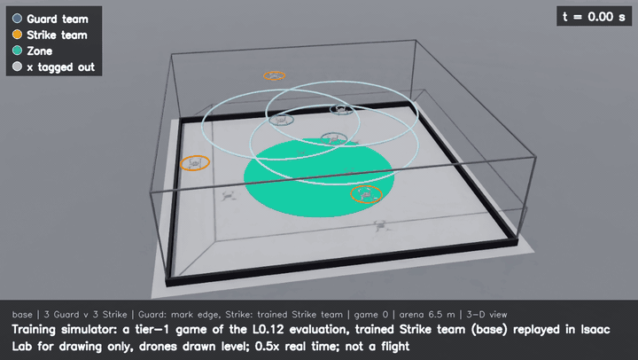 | 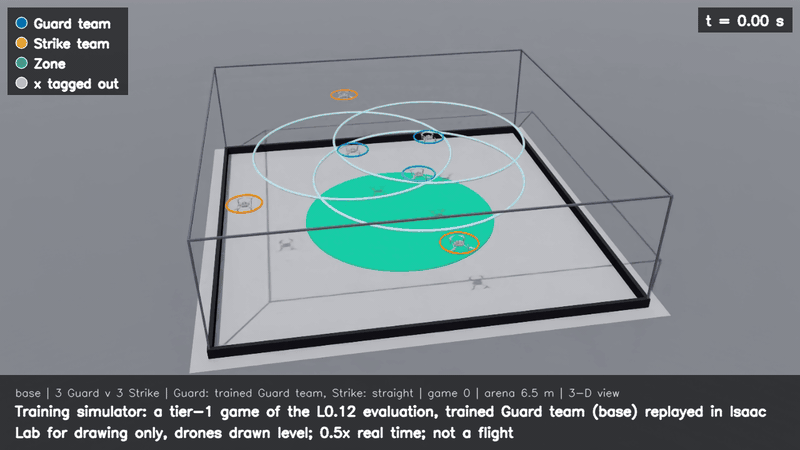 |

The 1.4 m tag games and the top views: [docs/media/ste_l012/3d/](../../docs/media/ste_l012/3d/README.md).

**L0.12 — can a trained team beat the best hand-written one?** Filled dot = trained, hollow = best script, x = untrained:

| Trained Strikes v the best scripted Guard (base): climb, trade two, the last one slips in | Trained Guards v the straight Strike (base) |
|---|---|
|  |  |

**L0.3 — the fast-engine Guard (T41) on the Isaac Lab drone, no retraining** (856 v 831 holds; reaches for the parked control):

**L0.2 — training speed, Isaac Lab v the fast engine:**

**The 3-D videos** (L0.11 games, Isaac Lab, ring = team): [base_reach_3d.gif](../../docs/media/ste_l011/3d/base_reach_3d.gif), [all](../../docs/media/ste_l011/3d/README.md).

Where phase L0 is: green done, light green laptop part done, amber running, grey queued (state file
`ste_learning/status/l0_progress.toml`, figure by `scripts/make_ste_learning_figures.py l0_progress`).

Earlier: L0.11 top-down clips and the factor chart are in the [T44 record](../../records/2026-11-21_ste_l011_screen_record.md).

### Phases

| Phase | Status | Math library | Simulator | What |
|---|---|---|---|---|
| NUS port Phases 1–4 | DONE | JAX (NUS), PyTorch | NUS 2-D game (JAX), Copy of NUS 2-D game (PyTorch), tier 2 Isaac Lab | NUS's code installed, game and policies copied to PyTorch, six tests towards STE drones |
| NUS port Phase 5 | PAUSED (lead call D8) | PyTorch | Copy of NUS 2-D game (PyTorch), tier 1 fast engine | 5.1 Method match FAIL (T43); STE Guard policy 829 of 1,000 (T41) |
| NUS port Phase 6 | DONE | none | none | public documents with videos |
| ▶ L0 Game definition and feasibility | RUNNING (approved 20 Nov, cap 19 GPU-h) | PyTorch | tier 1 fast engine, tier 2 Isaac Lab | which game, worth learning, can tier 2 train, is the Crazyflie route sound |
| L1–L8 | NOT STARTED | PyTorch | as ruled at gate G0 | drone model, rules, learner, evaluation, league, export, AirStack side, real flight |
| L9 Documentation | RUNNING | none | none | status, records, results page |

### Phase L0 Game definition and feasibility, task by task

| ID | Plain name | Status | Simulator | Result / ETA |
|---|---|---|---|---|
| L0.1 | Track set-up: config and test skeleton | DONE | none | settings file, loader, tests; independent QC closed all findings |
| L0.7 | Process tooling and drills | RUNNING (laptop part DONE) | none | merged into `development`; laptop: full suite 1,420 passed / 0 failed, wake-up drill and resume drill both as expected (below); DONE when the 5090 has run the same (L07-5090) |
| L0.8 | Game spec sheet | DONE | none | merged into `development`; QC passed; full suite on `development` 1,461 passed / 0 failed (41 min) |
| L0.9 | Tag rule for the study: 1-for-1, nearest pair first | DONE | tier 1 fast engine | merged; QC + re-check passed; full suite on `development` 1,517 passed / 0 failed (31 min); the 5090 records its own tag-off positions (L09-5090) |
| L0.10 | Scripted players for the study | DONE | tier 1 fast engine | merged; QC + 2 re-checks passed; full suite on `development` 1,600 passed / 0 failed (56 min, CPU shared with the L0.11 GPU jobs) |
| L0.11 | Screening sweep (INFO) | DONE | tier 1 fast engine | record T44 (every control PASS; shortlist base (reference), tag 1.2 m, tag 1.4 m; every hold a one-for-one trade) + follow-up checks; merged into `development`; full suite 1,685 passed / 0 failed (27 min) |
| L0.12 | Best-response test: is the game worth learning? | DONE, merged (T46 INFO, T47 ABORTED; full suite 1,838 passed, its 6 failures fixed before merge) | tier 1 fast engine | pilot PASS; run 0 PASS; **base: worth learning** (Guard 913 v 808, Strike 636 v 192); **tag 1.4 m: worth learning** (Guard 747 v 672, Strike 740 v 328); **tag 1.2 m: incomplete** (Guard 503 v script 645; Strike ABORTED, 87/88 updates, trained Strikes wait out the clock); every control PASS; 3.86 GPU-h of 6; record T46 (verdict) + T47 (aborted run) being written; 3-D clips of the key games need VID-1b (the 3-D tool replays scripted players only) |
| L0.2 | Tier 2 speed in contested play | DONE (T48, merged) | tier 2 Isaac Lab | every control PASS; Isaac Lab 3v3: 10 k → 67 k training game-steps/s (1,024 → 16,384 games, 4.7 GB); the fast engine is 4–10× faster per game-step (5× at 3v3); 0.29 GPU-h (+0.10 smokes) |
| L0.13 | Does tier 2 train at all? | DONE, merged (PASS; T53; full suite 1,963 passed after one fragile test of mine fixed) | tier 2 Isaac Lab | Isaac Lab Guard 832/1000 (Wilson 0.808–0.854) v still Guard 538 on Isaac Lab; fast-engine control 836 at the same 302 M game-steps; networks swap tiers within 22 games; every control PASS; 70.5 k v 360 k game-steps/s; ~1.6 GPU-h |
| L0.3 | STE Guard policy in tier 2 without retraining | DONE (T49, merged) | tier 2 Isaac Lab | every control PASS; T41 holds 856/1000 on Isaac Lab v 831 fast engine (paired: 76 gained, 51 lost, sign test p = 0.033; higher in this set, no general claim); 1.24 GPU-h |
| L0.4 | Side-by-side Starling render | DONE | tier 2 Isaac Lab | found why our clips never looked like the Starling: a grey physics box was drawn over every drone since S2b (the hide call missed it); one-line fix, re-render shows the Starling (before/after in Watch); merged into `development` after independent review; 0.028 of 0.2 GPU-h |
| L0.5 | Starling video look fix | WAITING ON YOU (D9) | tier 2 Isaac Lab | the drone left unpainted, team shown by a ring or a small dot that casts no shadow; stills in Watch; 0.154 of 0.3 GPU-h (with VID-1) |
| L0.14 | Crazyflie route check | DONE | tier 1 fast engine (CPU) | record T45: the T41 Guard policy holds 791–768 of 1,000 in the Crazyflie-like lag band (0.48–0.56 s, every drone slowed) against 831 at the Starling's lag, and drones come closer (games under 1.0 m: 7 → 101–149); planner, like for like: 0 of 100 at 3v3 and 5v3 against 20 Nov's 5 of 100 (not a clear difference; only one rule set run); QC + re-check passed; merged into `development` (targeted tests 76 passed; the full suite runs with the next merge — lead's call, the CPU is shared now); page `ste_learning/CRAZYFLIE_ROUTE.md` |
| L0.6 | Gate G0 | NOT STARTED | none | after every task above; the owner decides |

GPU-h used in L0: about 9.9 of 19 (L0.11 0.43, L0.4 0.03, L0.5 + VID-1 0.15, L0.2 0.39, L0.3 1.28, L0.12 3.86, L0.12b 1.59, L0.13 1.6 + smoke 0.06). All L0 measurement tasks are done; left: 3-D clips (VID-1b), height-panel re-draw (VID-1c), the G0 page.

Laptop full CPU suite (20 Nov, `development` at 5c5d465, after `scripts/nus_install_provisional.sh`): **1,333 passed, 2 failed, 48 skipped** in 24 min. Both failures repeat when run alone:
- **L07-F1** `test_ste_job.py::test_f_d_a_killed_job…resumes`: CONFIRMED by QC: the tool does not over-report (it measures from the same start; ~0.255 s raw, printed rounded to 0.3); the test compares the rounded text with the exact elapsed time. Fix: allow half a display step.
- **TEST-F2** `test_train_standin.py::test_default_path_bit_identical_after_the_nus_hooks`: FIXED (447b317). Measured on the laptop: the hash repeats (75d2a955…), hold rates equal the recorded [0.25, 0.375], and forcing PyTorch's CPU capability down changes the hash; threads (trainer runs one) and local files (not read on this path) ruled out. The fingerprint is now one hash per CPU capability; hold rates are checked on every machine.

### Usage (laptop session, 20 Nov 22:00 to now)

| What | Agent tokens | Wall time | Note |
|---|---|---|---|
| L0.7 fixes: builder, 7 fixes one at a time | ~400 k | ~51 min | the largest: each fix re-reads the tooling and its tests |
| L0.8 Game spec sheet: builder, build + 2 fix rounds | ~320 k | ~50 min | includes its own 25-min full suite |
| L0.7 independent QC + re-check | ~246 k | ~18 min | reproduced C1 and I1 in a scratch folder |
| L0.8 independent QC + re-check | ~209 k | ~12 min | mutation tests on the sheet |
| L0.9 Tag rule: builder (build + fix round) | ~358 k | ~66 min | the first 50 min slowed by sharing the CPU with the L0.7 suite |
| L0.9 independent QC + re-check | ~239 k | ~31 min | ran its own reference matcher, mutants and old-vs-new games |
| L0.10 Scripted players: builder (build + rulings + 2 QC fix rounds) | ~420 k | ~56 min | |
| L0.10 independent QC (+ 2 re-checks) | ~353 k | ~71 min | 84 deliberate breakages over two rounds; its own geometry probes on 30,000+ starts |
| L0.11 sweep build (CPU, build + rulings + rebase + QC fixes + follow-ups) | ~677 k | ~106 min | the largest single task so far; a fresh builder takes L0.12 to avoid re-reading this context |
| L0.12 groundwork builder | ~550 k | ~54 min | |
| L0.12 pre-launch QC | ~322 k | ~48 min | 19 deliberate breakages, 8 not caught before the fixes |
| L0.14 builder | ~368 k | ~118 min | the Crazyflie planner sweep ran on the CPU (2,868 matches) |
| L0.11 pre-launch QC | ~293 k | ~24 min | broke the code five ways through the real driver |
| L0.11 CUDA smoke | | ~5 min | 0.087 GPU-h |
| L0.11 independent QC (pre-launch, re-check, results read) | ~419 k | ~45 min | |
| L0.11 sweep | | 18 min | 0.305 GPU-h (L0.11 total 0.426 of 3.0) |
| L0.4 + L0.5 + VID-1 builder (stills, box bug, replay check, 3-D renderer) | ~410 k | ~3 h incl. the 08:30 limit stop | 0.141 GPU-h; the account hit its 5-hour token limit at about 07:30 (three agents at once); resumed 08:44 |
| L0.12 gate fix + follow-up builder | ~280 k | ~55 min | run 0 design, N-2/N-4, tests |
| L0.12 QC re-checks 1–2 | ~450 k | ~30 min | 8 breakages tried on run 0 |
| L0.2/L0.3 builder | ~410 k | ~30 min | + fix round now |
| L0.2/L0.3 pre-launch QC + 2 re-checks | ~650 k | ~60 min | 39 + 6 breakages tried |
| L0.12b bubble-tag build + 2 fix rounds | ~490 k | ~95 min | |
| L0.12b QC + re-checks | ~210 k | ~40 min | |
| L0.13 build + QC (+ fix round now) | ~650 k + | ~60 min | |
| L0.2/L0.3 fix rounds 1-2 | ~1.1 M | ~41 min | **the costliest task today**: each round re-reads the code; narrow rounds from here |
| L0.12 GPU pilot | | 11 min | 0.178 GPU-h |
| L0.11 GPU pilot | | 2 min | 0.034 GPU-h (first GPU job of the track) |
| Full CPU test suite | none | ~25 min alone; the L0.7 merge run took 61 min (shared the CPU with L0.9's tests) | rule from now: one heavy test run at a time |
| GPU | 0 GPU-h | | nothing has used the GPU |

Sub-agents total about 1.2 M tokens so far; the lead's own context is not measured by the tools here.

Laptop drills (21 Nov, fix branch, shared folder `~/AirStack-starling-max2/svg_training/runs/shared/`, no owner pause open):
- Wake-up: `L0.7 l07_wakeup DONE exit=0 duration=120.4s effective=120.4s`, `waiter exit 0` (the background waiter's end was the wake-up).
- Resume: `alive` → simulated power cut (`kill -KILL` of the process group at step 30) → `dead`; waiter `DIED exit=none duration=31.2s`, `waiter exit 21`; relaunch with `bash cmd.txt` from a shell with a wrong `PYTHONPATH` and `SVG_SHARED_DIR` → `launch=2`, `resumed from step 30 of 120`, `DONE exit=0 duration=90.4s effective=90.4s run_effective=120.3s`, `waiter exit 0`, `{"steps": 120, "total": 7260.0}`; the wrong shared folder was never created.

### Other workstreams

| ID | Plain name | Status |
|---|---|---|
| L012-B | Bubble-tag test (tag 1.15 m; owner approved 21 Nov) | DONE, merged (T50 screen, T51 INFO, T52 ABORTED; full suite 1,906 passed) | screen: best scripts 645 / 355 (same as 1.2 m), filter-pushed tags 0–10 %; run 0 PASS (909 v bar 849); trained Guard 466 v script 645 (weak); trained Strike ABORTED (time rule, 86/88; info: 103 v 355, waits out the clock); verdict incomplete (one side); ~1.95 GPU-h |
| VID-1c | Height panel on the L0.2 / L0.3 2-D clips | DONE for L0.3 (merged); L0.2 cannot be redrawn | that run kept no positions; re-playing its clip games needs Isaac Lab; README says so |
| SYNC-1 | Branch `development` on both machines; laptop worktree `~/AirStack-starling-max2-dev` | DONE |
| SYNC-2 | Status skill `train-status` and the owner's standing rules in CLAUDE.md | DONE |
| SYNC-3 | Root `CLAUDE.md` and every page: training work lands on `development` | DONE |
| SYNC-4 | STE Guard policy (T41 run folder) in the PROVISIONAL bundle | DONE; installed on the laptop (46 files, agent.pt c91bea51…) |
| L07-F1 | Fix: waiter-duration test bound (rounding) (QC I5) | DONE (a4100d0; 30 of 30 runs pass; L0.7 test files 217 passed) |
| L07-C1 | Fix: an open pause takes time off every job, and launch does not check for one: a job launched during a pause runs on the GPU with 0 GPU-h counted and its cap never fires | DONE (79effa0 on branch ste-l0.7-fix; red 48 failed, then L0.7 + NUS pause tests 251 passed). Pauses still always logged; launch refuses while one is open; a pause counts only against the jobs it stopped |
| L07-I1 | Fix: a new run reusing an old job name inherits that job's GPU-hours as credit (task cap can be exceeded) | DONE (05dd547; credit keyed by job name + run folder; red 24 failed, then 256 passed) |
| L07-I2 | Fix: `cmd.txt` relaunch loses the environment (PYTHONPATH, CUDA alloc setting, shared-folder path) | DONE (d0661f4; cmd.txt replays the first launch's environment; a different shared folder is refused; resume drill uses bash cmd.txt; red 3 failed, then 259 passed) |
| L07-I3 | Fix: the launcher's wrapper can die (clock step back, full disk) while the job runs on: GPU time stops being logged | DONE (1ca8a70; every wrapper write survives an error, records a fault and retries; red 8 failed, then 267 passed) |
| L07-I4 | Fix: a job resumed after a reboot is flagged ENDED_EARLY (exit 20) though it finished correctly | DONE (70fc1a3; judged on the trainer's saved progress across launches; red: drill pattern read 20; then 280 passed) |
| L08-F1 | Finding: the hangar's Strike start ring (3.2 m from the zone centre) does not fit the 6.5 m lab arena (drones kept within 3.0 m); a ring for 6.5 m is needed before L0.11's base case | CLOSED (lead's call): Strike start ring 2.75 m for the 6.5 m arena, PROPOSED, ruled at G0 |
| L07-C1b | Fix: our own "pause the siblings, run solo" step (AUTOMATION §2.2) is now refused too; lead's design: pauses the session makes are tagged and do not block launch, your pauses still do | DONE (ef38534; `GPU_PAUSE_BY=lead` tags the session's pauses; a bare `gpu_pause.sh pause` is still yours and still blocks; red 13 failed, then 298 passed) |
| L07-C1c | Fix: a session-tagged resume must refuse while any of your pauses is open (a resume today continues every job and closes your pauses too) | DONE (efa9ec1; a bare resume/stop is unchanged; red 4 failed, then 304 passed) |
| GIT-1 | Fix: my 17 Nov `.gitignore` line `data/` also hid new files in `tests/data/` | DONE (d3572dc: anchored to `/data/`) |
| L011-F1 | Finding: scripted players decide every 0.05 s tick, not at the sheet's 0.6 s decision period; the sweep measures scripted play at 0.05 s; L0.12's trainers must set their decision period explicitly (T41 used 0.6 s) | OPEN: written into the L0.11 gate file and record |
| L07-SUSPEND | Tooling: a laptop sleep during a GPU job is counted as GPU-hours and as time towards the job's cap (wall clock). Rule until fixed: never let the laptop sleep during a GPU job | QUEUED (tooling task); rule in force now |
| L011-G0 | Finding for gate G0 (T44, scripted play): (1) every hold is a one-for-one trade — no tag-on game times out, and at 1v1 and 3v3 a Guard win leaves no Guard — so head-count decides (PLAN F1; bears on what a tag costs, P12); (2) the programme's sizes 2v1 and 5v3, and 1v1, are Guard-trivial with scripted players at the proposed rules; candidate cause: tag radius 1.6 m = zone radius 1.6 m with Guards starting on a circle near the zone centre (not tested). L0.12 measures whether learning changes either | OPEN: reported at G0 |
| L010-G0 | Finding for gate G0 (from L0.10 QC): any safety-filter move near the 1.6 m tag radius can create a tag nobody chose (the filter's 1.10 m keep-out is inside the tag radius). Spaced starts remove it at the start; during play it is part of the game the sweep measures (P1) | OPEN: reported at G0 |
| L09-5090 | On the 5090: record the tag-off golden's positions for its CPU type (AVX512); check the outcome fingerprints there | WAITING: next 5090 session |
| DOC-1 | A phase-L0 flowchart coloured by progress (done / running / queued), regenerated with each status and shown in its Watch section (owner, 21 Nov: "photos or diagram flow charts would be good too") | DONE (progress flowchart; regenerated with each status) |
| VID-1 | Clips: 2-D with a height panel on every run; 3-D Isaac Lab videos of each result's key games | L0.11 DONE; **L0.12 trained players DONE, merged (VID-1b)** | 4 key games (base and 1.4 m, trained Strike and trained Guard), each replayed and checked equal to its run's own evaluation; **tag-distance circle around each Guard and a true-circle zone** (your requests); 0.104 GPU-h (L0.5 now 0.258 of 0.3); the 6 L0.11 clips not yet redrawn with circles (would reach the cap) |
| L08-M | L0.8 minors left: 3 hangar values unchecked on a clone without the NUS bundle; 3 values whose wrong value still passes; loader refuses some honest wording; tests tied to exact lines and the AirStack fence file | PARKED |
| L07-DISK | Follow-up: the planned disk-space check (a disk full through 10 retries at a job's end reads DIED) | PARKED (stated limit) |
| L07-N | Re-check minors N1–N4: a session pause also lands in the old per-worktree log the NUS reader uses; full disk can hold the wrapper 10 min after the end; AUTOMATION §4 still states the old GPU-hour rule; on the 5090 run `scripts/ste_job.py owner-pauses` before the drills | PARKED (N4 goes into the 5090 note) |
| L07-M | QC's 10 minor findings (+3 from the C1 build: pid-only matching, test pause pattern shared across sessions, pid reuse) (runs/ste_l07/qc_report.md) | PARKED until the six fixes land |
| L07-5090 | L0.7 on the 5090: full CPU suite and the two drills there (L0.7 is DONE only after both machines) | WAITING: next 5090 session |
| TEST-F2 | Fix: bit-level training fingerprint is machine-specific | DONE (447b317; trainer test file 43 passed, 1 skipped) |
| TEST-F2b | On the 5090: confirm its CPU capability is AVX512 (the key its 18 Nov hash is now filed under) | WAITING: next 5090 session runs the test (fails or skips loudly if wrong) |

**Machines (owner, 21 Nov):** no task is 5090-only. The RTX 5090 (32 GB) suits memory-heavy runs; the laptop RTX 5070 Ti (12 GB) runs everything sized to fit, and the record says which machine. Only machine checks stay with their machine: TEST-F2b, L07-5090, L09-5090. **Schedule:** weekends the laptop runs the pipeline (the 5090 is free for gaming); weekdays the 5090 does (the laptop goes to work). **This weekend:** the owner packs the laptop **Mon 23 Nov 10:00**: no GPU job starts unless it can end by **Mon 08:00**; by **09:30** everything is committed, HANDOFF §0 and status written, ready to push.

**GPU queue on the laptop (one at a time for speed measurements):** L0.12 pilot → L0.12 trainings → L0.2 → L0.3 → L0.13 (L0.4, L0.5, VID-1 for L0.11 done).

**Next.** (1) Your answer on the longer 1.15 m runs (if yes: build the gate, QC, run tonight/tomorrow). (2) The G0 page draft (tonight/Sunday) with every L0 result, clips, evidence strength per decision and my recommendations; independent numbers check; then I walk you through it. (3) Wrap-up by Mon 09:30. Hard stop: GPU jobs end Mon 08:00.

**Waiting on you.** **Longer 1.15 m runs?** One Guard and one Strike run at 3× the training (~1.65 B game-steps each), caps sized from today's 1.15 m timings so neither is cut short: about 3.5–4 GPU-h (L0 would go from ~10 to ~14 of 19), tonight or tomorrow. It answers whether training beats the scripts at the realistic tag — the key input for your G0 tag decision. **My recommendation: yes.** (The earlier question on re-running the 1.15 m Strike run is folded into this.) At G0: tag rule, varied tag distance, tag cost, zone size, team sizes, where to train, environments, which fleets fly, the real demo, the physical-intercept study, the L1–L9 budget.

**Correction.** The 21 Nov question on NUS values listed "speeds 0.6 / 1.2". The L0.8 review reads those two numbers as the decision period (0.6 s) and the flight height (1.2 m); the speeds are 0.5 and 0.333 m/s. Your Yes covers all of them as written on the sheet.

## 2026-11-21 20:52

**Status, 2026-11-21 20:53 (+08:00), event: G0 page drafted (in revision); GPU-hour figure corrected** · laptop RTX 5070 Ti · GPU idle · 0 jobs

**Plain summary (L0.13 Does Isaac Lab train at all?).** Tested: the same Guard recipe trained on the Isaac Lab drone and in
the fast engine, same game, same 302 M game-steps, same starting networks. Happened (training simulator): **PASS** — the Isaac
Lab Guard holds **832/1000** v 538 for a still Guard; the fast-engine Guard holds 836; each one's networks work on the other
drone too (814–846). Isaac Lab is ~5× slower (1.3 h v 15 min). Why it matters: training can move to the more realistic drone
when it counts, at a known cost — a key input for "where to train" at G0.

**Correction (lead, 20:30).** Earlier today I said training beats the scripts only at tag 1.4 m and wider. The learning
curves say otherwise: at 1.2 m and 1.15 m the trained Guards were still climbing steadily when the budget ran out (47 → 108
and 38 → 105 of 256), unlike 1.6 m (levelling off). So the closer tags were slower to learn, not shown unlearnable — the
realistic 1.15 m tag is still open (DISCUSSION §11).

**Your decisions today (recorded):** D9 ring kept as the team marker; no re-run of the tag 1.2 m Strike run; **test the
"touch the safety bubble" tag at 1.15 m** (about 1.3 GPU-h beyond L0.12's 6, approved); real demo = proximity tag, physical
interdiction shown in simulation (a proposal for G0).

### Watch (latest clips and figures)

**New: the trained players in 3-D** (Isaac Lab, ring = team, faint circle = each Guard's tag distance, round zone).
Each game was replayed and checked equal to its run's own evaluation before drawing. Training simulator; not a flight.

| Trained Strikes reach the zone (base, 1.6 m tag) | Trained Guards hold (base, 1.6 m tag) |
|---|---|
|  |  |

The 1.4 m tag games and the top views: [docs/media/ste_l012/3d/](../../docs/media/ste_l012/3d/README.md).

**L0.12 — can a trained team beat the best hand-written one?** Filled dot = trained, hollow = best script, x = untrained:

| Trained Strikes v the best scripted Guard (base): climb, trade two, the last one slips in | Trained Guards v the straight Strike (base) |
|---|---|
|  |  |

**L0.3 — the fast-engine Guard (T41) on the Isaac Lab drone, no retraining** (856 v 831 holds; reaches for the parked control):

**L0.2 — training speed, Isaac Lab v the fast engine:**

**The 3-D videos** (L0.11 games, Isaac Lab, ring = team): [base_reach_3d.gif](../../docs/media/ste_l011/3d/base_reach_3d.gif), [all](../../docs/media/ste_l011/3d/README.md).

Where phase L0 is: green done, light green laptop part done, amber running, grey queued (state file
`ste_learning/status/l0_progress.toml`, figure by `scripts/make_ste_learning_figures.py l0_progress`).

Earlier: L0.11 top-down clips and the factor chart are in the [T44 record](../../records/2026-11-21_ste_l011_screen_record.md).

### Phases

| Phase | Status | Math library | Simulator | What |
|---|---|---|---|---|
| NUS port Phases 1–4 | DONE | JAX (NUS), PyTorch | NUS 2-D game (JAX), Copy of NUS 2-D game (PyTorch), tier 2 Isaac Lab | NUS's code installed, game and policies copied to PyTorch, six tests towards STE drones |
| NUS port Phase 5 | PAUSED (lead call D8) | PyTorch | Copy of NUS 2-D game (PyTorch), tier 1 fast engine | 5.1 Method match FAIL (T43); STE Guard policy 829 of 1,000 (T41) |
| NUS port Phase 6 | DONE | none | none | public documents with videos |
| ▶ L0 Game definition and feasibility | RUNNING (approved 20 Nov, cap 19 GPU-h) | PyTorch | tier 1 fast engine, tier 2 Isaac Lab | which game, worth learning, can tier 2 train, is the Crazyflie route sound |
| L1–L8 | NOT STARTED | PyTorch | as ruled at gate G0 | drone model, rules, learner, evaluation, league, export, AirStack side, real flight |
| L9 Documentation | RUNNING | none | none | status, records, results page |

### Phase L0 Game definition and feasibility, task by task

| ID | Plain name | Status | Simulator | Result / ETA |
|---|---|---|---|---|
| L0.1 | Track set-up: config and test skeleton | DONE | none | settings file, loader, tests; independent QC closed all findings |
| L0.7 | Process tooling and drills | RUNNING (laptop part DONE) | none | merged into `development`; laptop: full suite 1,420 passed / 0 failed, wake-up drill and resume drill both as expected (below); DONE when the 5090 has run the same (L07-5090) |
| L0.8 | Game spec sheet | DONE | none | merged into `development`; QC passed; full suite on `development` 1,461 passed / 0 failed (41 min) |
| L0.9 | Tag rule for the study: 1-for-1, nearest pair first | DONE | tier 1 fast engine | merged; QC + re-check passed; full suite on `development` 1,517 passed / 0 failed (31 min); the 5090 records its own tag-off positions (L09-5090) |
| L0.10 | Scripted players for the study | DONE | tier 1 fast engine | merged; QC + 2 re-checks passed; full suite on `development` 1,600 passed / 0 failed (56 min, CPU shared with the L0.11 GPU jobs) |
| L0.11 | Screening sweep (INFO) | DONE | tier 1 fast engine | record T44 (every control PASS; shortlist base (reference), tag 1.2 m, tag 1.4 m; every hold a one-for-one trade) + follow-up checks; merged into `development`; full suite 1,685 passed / 0 failed (27 min) |
| L0.12 | Best-response test: is the game worth learning? | DONE, merged (T46 INFO, T47 ABORTED; full suite 1,838 passed, its 6 failures fixed before merge) | tier 1 fast engine | pilot PASS; run 0 PASS; **base: worth learning** (Guard 913 v 808, Strike 636 v 192); **tag 1.4 m: worth learning** (Guard 747 v 672, Strike 740 v 328); **tag 1.2 m: incomplete** (Guard 503 v script 645; Strike ABORTED, 87/88 updates, trained Strikes wait out the clock); every control PASS; 3.86 GPU-h of 6; record T46 (verdict) + T47 (aborted run) being written; 3-D clips of the key games need VID-1b (the 3-D tool replays scripted players only) |
| L0.2 | Tier 2 speed in contested play | DONE (T48, merged) | tier 2 Isaac Lab | every control PASS; Isaac Lab 3v3: 10 k → 67 k training game-steps/s (1,024 → 16,384 games, 4.7 GB); the fast engine is 4–10× faster per game-step (5× at 3v3); 0.29 GPU-h (+0.10 smokes) |
| L0.13 | Does tier 2 train at all? | DONE, merged (PASS; T53; full suite 1,963 passed after one fragile test of mine fixed) | tier 2 Isaac Lab | Isaac Lab Guard 832/1000 (Wilson 0.808–0.854) v still Guard 538 on Isaac Lab; fast-engine control 836 at the same 302 M game-steps; networks swap tiers within 22 games; every control PASS; 70.5 k v 360 k game-steps/s; ~1.6 GPU-h |
| L0.3 | STE Guard policy in tier 2 without retraining | DONE (T49, merged) | tier 2 Isaac Lab | every control PASS; T41 holds 856/1000 on Isaac Lab v 831 fast engine (paired: 76 gained, 51 lost, sign test p = 0.033; higher in this set, no general claim); 1.24 GPU-h |
| L0.4 | Side-by-side Starling render | DONE | tier 2 Isaac Lab | found why our clips never looked like the Starling: a grey physics box was drawn over every drone since S2b (the hide call missed it); one-line fix, re-render shows the Starling (before/after in Watch); merged into `development` after independent review; 0.028 of 0.2 GPU-h |
| L0.5 | Starling video look fix | WAITING ON YOU (D9) | tier 2 Isaac Lab | the drone left unpainted, team shown by a ring or a small dot that casts no shadow; stills in Watch; 0.154 of 0.3 GPU-h (with VID-1) |
| L0.14 | Crazyflie route check | DONE | tier 1 fast engine (CPU) | record T45: the T41 Guard policy holds 791–768 of 1,000 in the Crazyflie-like lag band (0.48–0.56 s, every drone slowed) against 831 at the Starling's lag, and drones come closer (games under 1.0 m: 7 → 101–149); planner, like for like: 0 of 100 at 3v3 and 5v3 against 20 Nov's 5 of 100 (not a clear difference; only one rule set run); QC + re-check passed; merged into `development` (targeted tests 76 passed; the full suite runs with the next merge — lead's call, the CPU is shared now); page `ste_learning/CRAZYFLIE_ROUTE.md` |
| L0.6 | Gate G0 | DRAFTING | none | `ste_learning/G0_DECISION.md` on branch ste-g0: what L0 found, one decision table with evidence strength per row and the lead's recommendations kept apart, the tag rule in depth (incl. learning curves by tag distance), where to train; independent numbers check next; walk-through Sunday |

GPU-h used in L0: **8.93 of 19** from the GPU-hour ledger (L0.11 0.43, L0.12 incl. the bubble-tag test 4.96, L0.13 1.59, L0.3 1.28, L0.2 0.39, L0.5 0.26, L0.4 0.03). **Correction:** earlier statuses said ~9.9; that was my over-estimate of L0.12, the ledger is the source.

Laptop full CPU suite (20 Nov, `development` at 5c5d465, after `scripts/nus_install_provisional.sh`): **1,333 passed, 2 failed, 48 skipped** in 24 min. Both failures repeat when run alone:
- **L07-F1** `test_ste_job.py::test_f_d_a_killed_job…resumes`: CONFIRMED by QC: the tool does not over-report (it measures from the same start; ~0.255 s raw, printed rounded to 0.3); the test compares the rounded text with the exact elapsed time. Fix: allow half a display step.
- **TEST-F2** `test_train_standin.py::test_default_path_bit_identical_after_the_nus_hooks`: FIXED (447b317). Measured on the laptop: the hash repeats (75d2a955…), hold rates equal the recorded [0.25, 0.375], and forcing PyTorch's CPU capability down changes the hash; threads (trainer runs one) and local files (not read on this path) ruled out. The fingerprint is now one hash per CPU capability; hold rates are checked on every machine.

### Usage (laptop session, 20 Nov 22:00 to now)

| What | Agent tokens | Wall time | Note |
|---|---|---|---|
| L0.7 fixes: builder, 7 fixes one at a time | ~400 k | ~51 min | the largest: each fix re-reads the tooling and its tests |
| L0.8 Game spec sheet: builder, build + 2 fix rounds | ~320 k | ~50 min | includes its own 25-min full suite |
| L0.7 independent QC + re-check | ~246 k | ~18 min | reproduced C1 and I1 in a scratch folder |
| L0.8 independent QC + re-check | ~209 k | ~12 min | mutation tests on the sheet |
| L0.9 Tag rule: builder (build + fix round) | ~358 k | ~66 min | the first 50 min slowed by sharing the CPU with the L0.7 suite |
| L0.9 independent QC + re-check | ~239 k | ~31 min | ran its own reference matcher, mutants and old-vs-new games |
| L0.10 Scripted players: builder (build + rulings + 2 QC fix rounds) | ~420 k | ~56 min | |
| L0.10 independent QC (+ 2 re-checks) | ~353 k | ~71 min | 84 deliberate breakages over two rounds; its own geometry probes on 30,000+ starts |
| L0.11 sweep build (CPU, build + rulings + rebase + QC fixes + follow-ups) | ~677 k | ~106 min | the largest single task so far; a fresh builder takes L0.12 to avoid re-reading this context |
| L0.12 groundwork builder | ~550 k | ~54 min | |
| L0.12 pre-launch QC | ~322 k | ~48 min | 19 deliberate breakages, 8 not caught before the fixes |
| L0.14 builder | ~368 k | ~118 min | the Crazyflie planner sweep ran on the CPU (2,868 matches) |
| L0.11 pre-launch QC | ~293 k | ~24 min | broke the code five ways through the real driver |
| L0.11 CUDA smoke | | ~5 min | 0.087 GPU-h |
| L0.11 independent QC (pre-launch, re-check, results read) | ~419 k | ~45 min | |
| L0.11 sweep | | 18 min | 0.305 GPU-h (L0.11 total 0.426 of 3.0) |
| L0.4 + L0.5 + VID-1 builder (stills, box bug, replay check, 3-D renderer) | ~410 k | ~3 h incl. the 08:30 limit stop | 0.141 GPU-h; the account hit its 5-hour token limit at about 07:30 (three agents at once); resumed 08:44 |
| L0.12 gate fix + follow-up builder | ~280 k | ~55 min | run 0 design, N-2/N-4, tests |
| L0.12 QC re-checks 1–2 | ~450 k | ~30 min | 8 breakages tried on run 0 |
| L0.2/L0.3 builder | ~410 k | ~30 min | + fix round now |
| L0.2/L0.3 pre-launch QC + 2 re-checks | ~650 k | ~60 min | 39 + 6 breakages tried |
| L0.12b bubble-tag build + 2 fix rounds | ~490 k | ~95 min | |
| L0.12b QC + re-checks | ~210 k | ~40 min | |
| L0.13 build + QC (+ fix round now) | ~650 k + | ~60 min | |
| L0.2/L0.3 fix rounds 1-2 | ~1.1 M | ~41 min | **the costliest task today**: each round re-reads the code; narrow rounds from here |
| L0.12 GPU pilot | | 11 min | 0.178 GPU-h |
| L0.11 GPU pilot | | 2 min | 0.034 GPU-h (first GPU job of the track) |
| Full CPU test suite | none | ~25 min alone; the L0.7 merge run took 61 min (shared the CPU with L0.9's tests) | rule from now: one heavy test run at a time |
| GPU | 0 GPU-h | | nothing has used the GPU |

Sub-agents total about 1.2 M tokens so far; the lead's own context is not measured by the tools here.

Laptop drills (21 Nov, fix branch, shared folder `~/AirStack-starling-max2/svg_training/runs/shared/`, no owner pause open):
- Wake-up: `L0.7 l07_wakeup DONE exit=0 duration=120.4s effective=120.4s`, `waiter exit 0` (the background waiter's end was the wake-up).
- Resume: `alive` → simulated power cut (`kill -KILL` of the process group at step 30) → `dead`; waiter `DIED exit=none duration=31.2s`, `waiter exit 21`; relaunch with `bash cmd.txt` from a shell with a wrong `PYTHONPATH` and `SVG_SHARED_DIR` → `launch=2`, `resumed from step 30 of 120`, `DONE exit=0 duration=90.4s effective=90.4s run_effective=120.3s`, `waiter exit 0`, `{"steps": 120, "total": 7260.0}`; the wrong shared folder was never created.

### Other workstreams

| ID | Plain name | Status |
|---|---|---|
| L012-B | Bubble-tag test (tag 1.15 m; owner approved 21 Nov) | DONE, merged (T50 screen, T51 INFO, T52 ABORTED; full suite 1,906 passed) | screen: best scripts 645 / 355 (same as 1.2 m), filter-pushed tags 0–10 %; run 0 PASS (909 v bar 849); trained Guard 466 v script 645 (weak); trained Strike ABORTED (time rule, 86/88; info: 103 v 355, waits out the clock); verdict incomplete (one side); ~1.95 GPU-h |
| VID-1c | Height panel on the L0.2 / L0.3 2-D clips | DONE for L0.3 (merged); L0.2 cannot be redrawn | that run kept no positions; re-playing its clip games needs Isaac Lab; README says so |
| SYNC-1 | Branch `development` on both machines; laptop worktree `~/AirStack-starling-max2-dev` | DONE |
| SYNC-2 | Status skill `train-status` and the owner's standing rules in CLAUDE.md | DONE |
| SYNC-3 | Root `CLAUDE.md` and every page: training work lands on `development` | DONE |
| SYNC-4 | STE Guard policy (T41 run folder) in the PROVISIONAL bundle | DONE; installed on the laptop (46 files, agent.pt c91bea51…) |
| L07-F1 | Fix: waiter-duration test bound (rounding) (QC I5) | DONE (a4100d0; 30 of 30 runs pass; L0.7 test files 217 passed) |
| L07-C1 | Fix: an open pause takes time off every job, and launch does not check for one: a job launched during a pause runs on the GPU with 0 GPU-h counted and its cap never fires | DONE (79effa0 on branch ste-l0.7-fix; red 48 failed, then L0.7 + NUS pause tests 251 passed). Pauses still always logged; launch refuses while one is open; a pause counts only against the jobs it stopped |
| L07-I1 | Fix: a new run reusing an old job name inherits that job's GPU-hours as credit (task cap can be exceeded) | DONE (05dd547; credit keyed by job name + run folder; red 24 failed, then 256 passed) |
| L07-I2 | Fix: `cmd.txt` relaunch loses the environment (PYTHONPATH, CUDA alloc setting, shared-folder path) | DONE (d0661f4; cmd.txt replays the first launch's environment; a different shared folder is refused; resume drill uses bash cmd.txt; red 3 failed, then 259 passed) |
| L07-I3 | Fix: the launcher's wrapper can die (clock step back, full disk) while the job runs on: GPU time stops being logged | DONE (1ca8a70; every wrapper write survives an error, records a fault and retries; red 8 failed, then 267 passed) |
| L07-I4 | Fix: a job resumed after a reboot is flagged ENDED_EARLY (exit 20) though it finished correctly | DONE (70fc1a3; judged on the trainer's saved progress across launches; red: drill pattern read 20; then 280 passed) |
| L08-F1 | Finding: the hangar's Strike start ring (3.2 m from the zone centre) does not fit the 6.5 m lab arena (drones kept within 3.0 m); a ring for 6.5 m is needed before L0.11's base case | CLOSED (lead's call): Strike start ring 2.75 m for the 6.5 m arena, PROPOSED, ruled at G0 |
| L07-C1b | Fix: our own "pause the siblings, run solo" step (AUTOMATION §2.2) is now refused too; lead's design: pauses the session makes are tagged and do not block launch, your pauses still do | DONE (ef38534; `GPU_PAUSE_BY=lead` tags the session's pauses; a bare `gpu_pause.sh pause` is still yours and still blocks; red 13 failed, then 298 passed) |
| L07-C1c | Fix: a session-tagged resume must refuse while any of your pauses is open (a resume today continues every job and closes your pauses too) | DONE (efa9ec1; a bare resume/stop is unchanged; red 4 failed, then 304 passed) |
| GIT-1 | Fix: my 17 Nov `.gitignore` line `data/` also hid new files in `tests/data/` | DONE (d3572dc: anchored to `/data/`) |
| L011-F1 | Finding: scripted players decide every 0.05 s tick, not at the sheet's 0.6 s decision period; the sweep measures scripted play at 0.05 s; L0.12's trainers must set their decision period explicitly (T41 used 0.6 s) | OPEN: written into the L0.11 gate file and record |
| L07-SUSPEND | Tooling: a laptop sleep during a GPU job is counted as GPU-hours and as time towards the job's cap (wall clock). Rule until fixed: never let the laptop sleep during a GPU job | QUEUED (tooling task); rule in force now |
| L011-G0 | Finding for gate G0 (T44, scripted play): (1) every hold is a one-for-one trade — no tag-on game times out, and at 1v1 and 3v3 a Guard win leaves no Guard — so head-count decides (PLAN F1; bears on what a tag costs, P12); (2) the programme's sizes 2v1 and 5v3, and 1v1, are Guard-trivial with scripted players at the proposed rules; candidate cause: tag radius 1.6 m = zone radius 1.6 m with Guards starting on a circle near the zone centre (not tested). L0.12 measures whether learning changes either | OPEN: reported at G0 |
| L010-G0 | Finding for gate G0 (from L0.10 QC): any safety-filter move near the 1.6 m tag radius can create a tag nobody chose (the filter's 1.10 m keep-out is inside the tag radius). Spaced starts remove it at the start; during play it is part of the game the sweep measures (P1) | OPEN: reported at G0 |
| L09-5090 | On the 5090: record the tag-off golden's positions for its CPU type (AVX512); check the outcome fingerprints there | WAITING: next 5090 session |
| DOC-1 | A phase-L0 flowchart coloured by progress (done / running / queued), regenerated with each status and shown in its Watch section (owner, 21 Nov: "photos or diagram flow charts would be good too") | DONE (progress flowchart; regenerated with each status) |
| VID-1 | Clips: 2-D with a height panel on every run; 3-D Isaac Lab videos of each result's key games | L0.11 DONE; **L0.12 trained players DONE, merged (VID-1b)** | 4 key games (base and 1.4 m, trained Strike and trained Guard), each replayed and checked equal to its run's own evaluation; **tag-distance circle around each Guard and a true-circle zone** (your requests); 0.104 GPU-h (L0.5 now 0.258 of 0.3); the 6 L0.11 clips not yet redrawn with circles (would reach the cap) |
| L08-M | L0.8 minors left: 3 hangar values unchecked on a clone without the NUS bundle; 3 values whose wrong value still passes; loader refuses some honest wording; tests tied to exact lines and the AirStack fence file | PARKED |
| L07-DISK | Follow-up: the planned disk-space check (a disk full through 10 retries at a job's end reads DIED) | PARKED (stated limit) |
| L07-N | Re-check minors N1–N4: a session pause also lands in the old per-worktree log the NUS reader uses; full disk can hold the wrapper 10 min after the end; AUTOMATION §4 still states the old GPU-hour rule; on the 5090 run `scripts/ste_job.py owner-pauses` before the drills | PARKED (N4 goes into the 5090 note) |
| L07-M | QC's 10 minor findings (+3 from the C1 build: pid-only matching, test pause pattern shared across sessions, pid reuse) (runs/ste_l07/qc_report.md) | PARKED until the six fixes land |
| L07-5090 | L0.7 on the 5090: full CPU suite and the two drills there (L0.7 is DONE only after both machines) | WAITING: next 5090 session |
| TEST-F2 | Fix: bit-level training fingerprint is machine-specific | DONE (447b317; trainer test file 43 passed, 1 skipped) |
| TEST-F2b | On the 5090: confirm its CPU capability is AVX512 (the key its 18 Nov hash is now filed under) | WAITING: next 5090 session runs the test (fails or skips loudly if wrong) |

**Machines (owner, 21 Nov):** no task is 5090-only. The RTX 5090 (32 GB) suits memory-heavy runs; the laptop RTX 5070 Ti (12 GB) runs everything sized to fit, and the record says which machine. Only machine checks stay with their machine: TEST-F2b, L07-5090, L09-5090. **Schedule:** weekends the laptop runs the pipeline (the 5090 is free for gaming); weekdays the 5090 does (the laptop goes to work). **This weekend:** the owner packs the laptop **Mon 23 Nov 10:00**: no GPU job starts unless it can end by **Mon 08:00**; by **09:30** everything is committed, HANDOFF §0 and status written, ready to push.

**GPU queue on the laptop (one at a time for speed measurements):** L0.12 pilot → L0.12 trainings → L0.2 → L0.3 → L0.13 (L0.4, L0.5, VID-1 for L0.11 done).

**Next.** (1) Your answer on the longer 1.15 m runs (if yes: build the gate, QC, run tonight/tomorrow). (2) The G0 page draft (tonight/Sunday) with every L0 result, clips, evidence strength per decision and my recommendations; independent numbers check; then I walk you through it. (3) Wrap-up by Mon 09:30. Hard stop: GPU jobs end Mon 08:00.

**Waiting on you.** **Longer 1.15 m runs?** One Guard and one Strike run at 3× the training (~1.65 B game-steps each), caps sized from today's 1.15 m timings so neither is cut short: about 3.5–4 GPU-h (L0 would go from ~10 to ~14 of 19), tonight or tomorrow. It answers whether training beats the scripts at the realistic tag — the key input for your G0 tag decision. **My recommendation: yes.** (The earlier question on re-running the 1.15 m Strike run is folded into this.) At G0: tag rule, varied tag distance, tag cost, zone size, team sizes, where to train, environments, which fleets fly, the real demo, the physical-intercept study, the L1–L9 budget.

**Correction.** The 21 Nov question on NUS values listed "speeds 0.6 / 1.2". The L0.8 review reads those two numbers as the decision period (0.6 s) and the flight height (1.2 m); the speeds are 0.5 and 0.333 m/s. Your Yes covers all of them as written on the sheet.

## 2026-11-21 20:57

**Status, 2026-11-21 20:57 (+08:00), 30-minute update: G0 page revised; independent numbers check running** · laptop RTX 5070 Ti · GPU idle · 0 jobs

**Plain summary (L0.13 Does Isaac Lab train at all?).** Tested: the same Guard recipe trained on the Isaac Lab drone and in
the fast engine, same game, same 302 M game-steps, same starting networks. Happened (training simulator): **PASS** — the Isaac
Lab Guard holds **832/1000** v 538 for a still Guard; the fast-engine Guard holds 836; each one's networks work on the other
drone too (814–846). Isaac Lab is ~5× slower (1.3 h v 15 min). Why it matters: training can move to the more realistic drone
when it counts, at a known cost — a key input for "where to train" at G0.

**Correction (lead, 20:30).** Earlier today I said training beats the scripts only at tag 1.4 m and wider. The learning
curves say otherwise: at 1.2 m and 1.15 m the trained Guards were still climbing steadily when the budget ran out (47 → 108
and 38 → 105 of 256), unlike 1.6 m (levelling off). So the closer tags were slower to learn, not shown unlearnable — the
realistic 1.15 m tag is still open (DISCUSSION §11).

**Your decisions today (recorded):** D9 ring kept as the team marker; no re-run of the tag 1.2 m Strike run; **test the
"touch the safety bubble" tag at 1.15 m** (about 1.3 GPU-h beyond L0.12's 6, approved); real demo = proximity tag, physical
interdiction shown in simulation (a proposal for G0).

### Watch (latest clips and figures)

**New: the trained players in 3-D** (Isaac Lab, ring = team, faint circle = each Guard's tag distance, round zone).
Each game was replayed and checked equal to its run's own evaluation before drawing. Training simulator; not a flight.

| Trained Strikes reach the zone (base, 1.6 m tag) | Trained Guards hold (base, 1.6 m tag) |
|---|---|
|  |  |

The 1.4 m tag games and the top views: [docs/media/ste_l012/3d/](../../docs/media/ste_l012/3d/README.md).

**L0.12 — can a trained team beat the best hand-written one?** Filled dot = trained, hollow = best script, x = untrained:

| Trained Strikes v the best scripted Guard (base): climb, trade two, the last one slips in | Trained Guards v the straight Strike (base) |
|---|---|
|  |  |

**L0.3 — the fast-engine Guard (T41) on the Isaac Lab drone, no retraining** (856 v 831 holds; reaches for the parked control):

**L0.2 — training speed, Isaac Lab v the fast engine:**

**The 3-D videos** (L0.11 games, Isaac Lab, ring = team): [base_reach_3d.gif](../../docs/media/ste_l011/3d/base_reach_3d.gif), [all](../../docs/media/ste_l011/3d/README.md).

Where phase L0 is: green done, light green laptop part done, amber running, grey queued (state file
`ste_learning/status/l0_progress.toml`, figure by `scripts/make_ste_learning_figures.py l0_progress`).

Earlier: L0.11 top-down clips and the factor chart are in the [T44 record](../../records/2026-11-21_ste_l011_screen_record.md).

### Phases

| Phase | Status | Math library | Simulator | What |
|---|---|---|---|---|
| NUS port Phases 1–4 | DONE | JAX (NUS), PyTorch | NUS 2-D game (JAX), Copy of NUS 2-D game (PyTorch), tier 2 Isaac Lab | NUS's code installed, game and policies copied to PyTorch, six tests towards STE drones |
| NUS port Phase 5 | PAUSED (lead call D8) | PyTorch | Copy of NUS 2-D game (PyTorch), tier 1 fast engine | 5.1 Method match FAIL (T43); STE Guard policy 829 of 1,000 (T41) |
| NUS port Phase 6 | DONE | none | none | public documents with videos |
| ▶ L0 Game definition and feasibility | RUNNING (approved 20 Nov, cap 19 GPU-h) | PyTorch | tier 1 fast engine, tier 2 Isaac Lab | which game, worth learning, can tier 2 train, is the Crazyflie route sound |
| L1–L8 | NOT STARTED | PyTorch | as ruled at gate G0 | drone model, rules, learner, evaluation, league, export, AirStack side, real flight |
| L9 Documentation | RUNNING | none | none | status, records, results page |

### Phase L0 Game definition and feasibility, task by task

| ID | Plain name | Status | Simulator | Result / ETA |
|---|---|---|---|---|
| L0.1 | Track set-up: config and test skeleton | DONE | none | settings file, loader, tests; independent QC closed all findings |
| L0.7 | Process tooling and drills | RUNNING (laptop part DONE) | none | merged into `development`; laptop: full suite 1,420 passed / 0 failed, wake-up drill and resume drill both as expected (below); DONE when the 5090 has run the same (L07-5090) |
| L0.8 | Game spec sheet | DONE | none | merged into `development`; QC passed; full suite on `development` 1,461 passed / 0 failed (41 min) |
| L0.9 | Tag rule for the study: 1-for-1, nearest pair first | DONE | tier 1 fast engine | merged; QC + re-check passed; full suite on `development` 1,517 passed / 0 failed (31 min); the 5090 records its own tag-off positions (L09-5090) |
| L0.10 | Scripted players for the study | DONE | tier 1 fast engine | merged; QC + 2 re-checks passed; full suite on `development` 1,600 passed / 0 failed (56 min, CPU shared with the L0.11 GPU jobs) |
| L0.11 | Screening sweep (INFO) | DONE | tier 1 fast engine | record T44 (every control PASS; shortlist base (reference), tag 1.2 m, tag 1.4 m; every hold a one-for-one trade) + follow-up checks; merged into `development`; full suite 1,685 passed / 0 failed (27 min) |
| L0.12 | Best-response test: is the game worth learning? | DONE, merged (T46 INFO, T47 ABORTED; full suite 1,838 passed, its 6 failures fixed before merge) | tier 1 fast engine | pilot PASS; run 0 PASS; **base: worth learning** (Guard 913 v 808, Strike 636 v 192); **tag 1.4 m: worth learning** (Guard 747 v 672, Strike 740 v 328); **tag 1.2 m: incomplete** (Guard 503 v script 645; Strike ABORTED, 87/88 updates, trained Strikes wait out the clock); every control PASS; 3.86 GPU-h of 6; record T46 (verdict) + T47 (aborted run) being written; 3-D clips of the key games need VID-1b (the 3-D tool replays scripted players only) |
| L0.2 | Tier 2 speed in contested play | DONE (T48, merged) | tier 2 Isaac Lab | every control PASS; Isaac Lab 3v3: 10 k → 67 k training game-steps/s (1,024 → 16,384 games, 4.7 GB); the fast engine is 4–10× faster per game-step (5× at 3v3); 0.29 GPU-h (+0.10 smokes) |
| L0.13 | Does tier 2 train at all? | DONE, merged (PASS; T53; full suite 1,963 passed after one fragile test of mine fixed) | tier 2 Isaac Lab | Isaac Lab Guard 832/1000 (Wilson 0.808–0.854) v still Guard 538 on Isaac Lab; fast-engine control 836 at the same 302 M game-steps; networks swap tiers within 22 games; every control PASS; 70.5 k v 360 k game-steps/s; ~1.6 GPU-h |
| L0.3 | STE Guard policy in tier 2 without retraining | DONE (T49, merged) | tier 2 Isaac Lab | every control PASS; T41 holds 856/1000 on Isaac Lab v 831 fast engine (paired: 76 gained, 51 lost, sign test p = 0.033; higher in this set, no general claim); 1.24 GPU-h |
| L0.4 | Side-by-side Starling render | DONE | tier 2 Isaac Lab | found why our clips never looked like the Starling: a grey physics box was drawn over every drone since S2b (the hide call missed it); one-line fix, re-render shows the Starling (before/after in Watch); merged into `development` after independent review; 0.028 of 0.2 GPU-h |
| L0.5 | Starling video look fix | WAITING ON YOU (D9) | tier 2 Isaac Lab | the drone left unpainted, team shown by a ring or a small dot that casts no shadow; stills in Watch; 0.154 of 0.3 GPU-h (with VID-1) |
| L0.14 | Crazyflie route check | DONE | tier 1 fast engine (CPU) | record T45: the T41 Guard policy holds 791–768 of 1,000 in the Crazyflie-like lag band (0.48–0.56 s, every drone slowed) against 831 at the Starling's lag, and drones come closer (games under 1.0 m: 7 → 101–149); planner, like for like: 0 of 100 at 3v3 and 5v3 against 20 Nov's 5 of 100 (not a clear difference; only one rule set run); QC + re-check passed; merged into `development` (targeted tests 76 passed; the full suite runs with the next merge — lead's call, the CPU is shared now); page `ste_learning/CRAZYFLIE_ROUTE.md` |
| L0.6 | Gate G0 | DRAFTED (numbers check running) | none | `ste_learning/G0_DECISION.md` on branch ste-g0: answer + recommendation box + flowchart + 17-row decision table (evidence strength per row, the lead's recommendations apart), tag rule with learning curves by tag distance, 1v1 row, where to train, budget 8.93 GPU-h; open: the costed L1–L9 plan (Sunday) and your answer on longer 1.15 m runs |

GPU-h used in L0: **8.93 of 19** from the GPU-hour ledger (L0.11 0.43, L0.12 incl. the bubble-tag test 4.96, L0.13 1.59, L0.3 1.28, L0.2 0.39, L0.5 0.26, L0.4 0.03). **Correction:** earlier statuses said ~9.9; that was my over-estimate of L0.12, the ledger is the source.

Laptop full CPU suite (20 Nov, `development` at 5c5d465, after `scripts/nus_install_provisional.sh`): **1,333 passed, 2 failed, 48 skipped** in 24 min. Both failures repeat when run alone:
- **L07-F1** `test_ste_job.py::test_f_d_a_killed_job…resumes`: CONFIRMED by QC: the tool does not over-report (it measures from the same start; ~0.255 s raw, printed rounded to 0.3); the test compares the rounded text with the exact elapsed time. Fix: allow half a display step.
- **TEST-F2** `test_train_standin.py::test_default_path_bit_identical_after_the_nus_hooks`: FIXED (447b317). Measured on the laptop: the hash repeats (75d2a955…), hold rates equal the recorded [0.25, 0.375], and forcing PyTorch's CPU capability down changes the hash; threads (trainer runs one) and local files (not read on this path) ruled out. The fingerprint is now one hash per CPU capability; hold rates are checked on every machine.

### Usage (laptop session, 20 Nov 22:00 to now)

| What | Agent tokens | Wall time | Note |
|---|---|---|---|
| L0.7 fixes: builder, 7 fixes one at a time | ~400 k | ~51 min | the largest: each fix re-reads the tooling and its tests |
| L0.8 Game spec sheet: builder, build + 2 fix rounds | ~320 k | ~50 min | includes its own 25-min full suite |
| L0.7 independent QC + re-check | ~246 k | ~18 min | reproduced C1 and I1 in a scratch folder |
| L0.8 independent QC + re-check | ~209 k | ~12 min | mutation tests on the sheet |
| L0.9 Tag rule: builder (build + fix round) | ~358 k | ~66 min | the first 50 min slowed by sharing the CPU with the L0.7 suite |
| L0.9 independent QC + re-check | ~239 k | ~31 min | ran its own reference matcher, mutants and old-vs-new games |
| L0.10 Scripted players: builder (build + rulings + 2 QC fix rounds) | ~420 k | ~56 min | |
| L0.10 independent QC (+ 2 re-checks) | ~353 k | ~71 min | 84 deliberate breakages over two rounds; its own geometry probes on 30,000+ starts |
| L0.11 sweep build (CPU, build + rulings + rebase + QC fixes + follow-ups) | ~677 k | ~106 min | the largest single task so far; a fresh builder takes L0.12 to avoid re-reading this context |
| L0.12 groundwork builder | ~550 k | ~54 min | |
| L0.12 pre-launch QC | ~322 k | ~48 min | 19 deliberate breakages, 8 not caught before the fixes |
| L0.14 builder | ~368 k | ~118 min | the Crazyflie planner sweep ran on the CPU (2,868 matches) |
| L0.11 pre-launch QC | ~293 k | ~24 min | broke the code five ways through the real driver |
| L0.11 CUDA smoke | | ~5 min | 0.087 GPU-h |
| L0.11 independent QC (pre-launch, re-check, results read) | ~419 k | ~45 min | |
| L0.11 sweep | | 18 min | 0.305 GPU-h (L0.11 total 0.426 of 3.0) |
| L0.4 + L0.5 + VID-1 builder (stills, box bug, replay check, 3-D renderer) | ~410 k | ~3 h incl. the 08:30 limit stop | 0.141 GPU-h; the account hit its 5-hour token limit at about 07:30 (three agents at once); resumed 08:44 |
| L0.12 gate fix + follow-up builder | ~280 k | ~55 min | run 0 design, N-2/N-4, tests |
| L0.12 QC re-checks 1–2 | ~450 k | ~30 min | 8 breakages tried on run 0 |
| L0.2/L0.3 builder | ~410 k | ~30 min | + fix round now |
| L0.2/L0.3 pre-launch QC + 2 re-checks | ~650 k | ~60 min | 39 + 6 breakages tried |
| L0.12b bubble-tag build + 2 fix rounds | ~490 k | ~95 min | |
| L0.12b QC + re-checks | ~210 k | ~40 min | |
| L0.13 build + QC (+ fix round now) | ~650 k + | ~60 min | |
| L0.2/L0.3 fix rounds 1-2 | ~1.1 M | ~41 min | **the costliest task today**: each round re-reads the code; narrow rounds from here |
| L0.12 GPU pilot | | 11 min | 0.178 GPU-h |
| L0.11 GPU pilot | | 2 min | 0.034 GPU-h (first GPU job of the track) |
| Full CPU test suite | none | ~25 min alone; the L0.7 merge run took 61 min (shared the CPU with L0.9's tests) | rule from now: one heavy test run at a time |
| GPU | 0 GPU-h | | nothing has used the GPU |

Sub-agents total about 1.2 M tokens so far; the lead's own context is not measured by the tools here.

Laptop drills (21 Nov, fix branch, shared folder `~/AirStack-starling-max2/svg_training/runs/shared/`, no owner pause open):
- Wake-up: `L0.7 l07_wakeup DONE exit=0 duration=120.4s effective=120.4s`, `waiter exit 0` (the background waiter's end was the wake-up).
- Resume: `alive` → simulated power cut (`kill -KILL` of the process group at step 30) → `dead`; waiter `DIED exit=none duration=31.2s`, `waiter exit 21`; relaunch with `bash cmd.txt` from a shell with a wrong `PYTHONPATH` and `SVG_SHARED_DIR` → `launch=2`, `resumed from step 30 of 120`, `DONE exit=0 duration=90.4s effective=90.4s run_effective=120.3s`, `waiter exit 0`, `{"steps": 120, "total": 7260.0}`; the wrong shared folder was never created.

### Other workstreams

| ID | Plain name | Status |
|---|---|---|
| L012-B | Bubble-tag test (tag 1.15 m; owner approved 21 Nov) | DONE, merged (T50 screen, T51 INFO, T52 ABORTED; full suite 1,906 passed) | screen: best scripts 645 / 355 (same as 1.2 m), filter-pushed tags 0–10 %; run 0 PASS (909 v bar 849); trained Guard 466 v script 645 (weak); trained Strike ABORTED (time rule, 86/88; info: 103 v 355, waits out the clock); verdict incomplete (one side); ~1.95 GPU-h |
| VID-1c | Height panel on the L0.2 / L0.3 2-D clips | DONE for L0.3 (merged); L0.2 cannot be redrawn | that run kept no positions; re-playing its clip games needs Isaac Lab; README says so |
| SYNC-1 | Branch `development` on both machines; laptop worktree `~/AirStack-starling-max2-dev` | DONE |
| SYNC-2 | Status skill `train-status` and the owner's standing rules in CLAUDE.md | DONE |
| SYNC-3 | Root `CLAUDE.md` and every page: training work lands on `development` | DONE |
| SYNC-4 | STE Guard policy (T41 run folder) in the PROVISIONAL bundle | DONE; installed on the laptop (46 files, agent.pt c91bea51…) |
| L07-F1 | Fix: waiter-duration test bound (rounding) (QC I5) | DONE (a4100d0; 30 of 30 runs pass; L0.7 test files 217 passed) |
| L07-C1 | Fix: an open pause takes time off every job, and launch does not check for one: a job launched during a pause runs on the GPU with 0 GPU-h counted and its cap never fires | DONE (79effa0 on branch ste-l0.7-fix; red 48 failed, then L0.7 + NUS pause tests 251 passed). Pauses still always logged; launch refuses while one is open; a pause counts only against the jobs it stopped |
| L07-I1 | Fix: a new run reusing an old job name inherits that job's GPU-hours as credit (task cap can be exceeded) | DONE (05dd547; credit keyed by job name + run folder; red 24 failed, then 256 passed) |
| L07-I2 | Fix: `cmd.txt` relaunch loses the environment (PYTHONPATH, CUDA alloc setting, shared-folder path) | DONE (d0661f4; cmd.txt replays the first launch's environment; a different shared folder is refused; resume drill uses bash cmd.txt; red 3 failed, then 259 passed) |
| L07-I3 | Fix: the launcher's wrapper can die (clock step back, full disk) while the job runs on: GPU time stops being logged | DONE (1ca8a70; every wrapper write survives an error, records a fault and retries; red 8 failed, then 267 passed) |
| L07-I4 | Fix: a job resumed after a reboot is flagged ENDED_EARLY (exit 20) though it finished correctly | DONE (70fc1a3; judged on the trainer's saved progress across launches; red: drill pattern read 20; then 280 passed) |
| L08-F1 | Finding: the hangar's Strike start ring (3.2 m from the zone centre) does not fit the 6.5 m lab arena (drones kept within 3.0 m); a ring for 6.5 m is needed before L0.11's base case | CLOSED (lead's call): Strike start ring 2.75 m for the 6.5 m arena, PROPOSED, ruled at G0 |
| L07-C1b | Fix: our own "pause the siblings, run solo" step (AUTOMATION §2.2) is now refused too; lead's design: pauses the session makes are tagged and do not block launch, your pauses still do | DONE (ef38534; `GPU_PAUSE_BY=lead` tags the session's pauses; a bare `gpu_pause.sh pause` is still yours and still blocks; red 13 failed, then 298 passed) |
| L07-C1c | Fix: a session-tagged resume must refuse while any of your pauses is open (a resume today continues every job and closes your pauses too) | DONE (efa9ec1; a bare resume/stop is unchanged; red 4 failed, then 304 passed) |
| GIT-1 | Fix: my 17 Nov `.gitignore` line `data/` also hid new files in `tests/data/` | DONE (d3572dc: anchored to `/data/`) |
| L011-F1 | Finding: scripted players decide every 0.05 s tick, not at the sheet's 0.6 s decision period; the sweep measures scripted play at 0.05 s; L0.12's trainers must set their decision period explicitly (T41 used 0.6 s) | OPEN: written into the L0.11 gate file and record |
| L07-SUSPEND | Tooling: a laptop sleep during a GPU job is counted as GPU-hours and as time towards the job's cap (wall clock). Rule until fixed: never let the laptop sleep during a GPU job | QUEUED (tooling task); rule in force now |
| L011-G0 | Finding for gate G0 (T44, scripted play): (1) every hold is a one-for-one trade — no tag-on game times out, and at 1v1 and 3v3 a Guard win leaves no Guard — so head-count decides (PLAN F1; bears on what a tag costs, P12); (2) the programme's sizes 2v1 and 5v3, and 1v1, are Guard-trivial with scripted players at the proposed rules; candidate cause: tag radius 1.6 m = zone radius 1.6 m with Guards starting on a circle near the zone centre (not tested). L0.12 measures whether learning changes either | OPEN: reported at G0 |
| L010-G0 | Finding for gate G0 (from L0.10 QC): any safety-filter move near the 1.6 m tag radius can create a tag nobody chose (the filter's 1.10 m keep-out is inside the tag radius). Spaced starts remove it at the start; during play it is part of the game the sweep measures (P1) | OPEN: reported at G0 |
| L09-5090 | On the 5090: record the tag-off golden's positions for its CPU type (AVX512); check the outcome fingerprints there | WAITING: next 5090 session |
| DOC-1 | A phase-L0 flowchart coloured by progress (done / running / queued), regenerated with each status and shown in its Watch section (owner, 21 Nov: "photos or diagram flow charts would be good too") | DONE (progress flowchart; regenerated with each status) |
| VID-1 | Clips: 2-D with a height panel on every run; 3-D Isaac Lab videos of each result's key games | L0.11 DONE; **L0.12 trained players DONE, merged (VID-1b)** | 4 key games (base and 1.4 m, trained Strike and trained Guard), each replayed and checked equal to its run's own evaluation; **tag-distance circle around each Guard and a true-circle zone** (your requests); 0.104 GPU-h (L0.5 now 0.258 of 0.3); the 6 L0.11 clips not yet redrawn with circles (would reach the cap) |
| L08-M | L0.8 minors left: 3 hangar values unchecked on a clone without the NUS bundle; 3 values whose wrong value still passes; loader refuses some honest wording; tests tied to exact lines and the AirStack fence file | PARKED |
| L07-DISK | Follow-up: the planned disk-space check (a disk full through 10 retries at a job's end reads DIED) | PARKED (stated limit) |
| L07-N | Re-check minors N1–N4: a session pause also lands in the old per-worktree log the NUS reader uses; full disk can hold the wrapper 10 min after the end; AUTOMATION §4 still states the old GPU-hour rule; on the 5090 run `scripts/ste_job.py owner-pauses` before the drills | PARKED (N4 goes into the 5090 note) |
| L07-M | QC's 10 minor findings (+3 from the C1 build: pid-only matching, test pause pattern shared across sessions, pid reuse) (runs/ste_l07/qc_report.md) | PARKED until the six fixes land |
| L07-5090 | L0.7 on the 5090: full CPU suite and the two drills there (L0.7 is DONE only after both machines) | WAITING: next 5090 session |
| TEST-F2 | Fix: bit-level training fingerprint is machine-specific | DONE (447b317; trainer test file 43 passed, 1 skipped) |
| TEST-F2b | On the 5090: confirm its CPU capability is AVX512 (the key its 18 Nov hash is now filed under) | WAITING: next 5090 session runs the test (fails or skips loudly if wrong) |

**Machines (owner, 21 Nov):** no task is 5090-only. The RTX 5090 (32 GB) suits memory-heavy runs; the laptop RTX 5070 Ti (12 GB) runs everything sized to fit, and the record says which machine. Only machine checks stay with their machine: TEST-F2b, L07-5090, L09-5090. **Schedule:** weekends the laptop runs the pipeline (the 5090 is free for gaming); weekdays the 5090 does (the laptop goes to work). **This weekend:** the owner packs the laptop **Mon 23 Nov 10:00**: no GPU job starts unless it can end by **Mon 08:00**; by **09:30** everything is committed, HANDOFF §0 and status written, ready to push.

**GPU queue on the laptop (one at a time for speed measurements):** L0.12 pilot → L0.12 trainings → L0.2 → L0.3 → L0.13 (L0.4, L0.5, VID-1 for L0.11 done).

**Next.** (1) Your answer on the longer 1.15 m runs (if yes: build the gate, QC, run tonight/tomorrow). (2) The G0 page draft (tonight/Sunday) with every L0 result, clips, evidence strength per decision and my recommendations; independent numbers check; then I walk you through it. (3) Wrap-up by Mon 09:30. Hard stop: GPU jobs end Mon 08:00.

**Waiting on you.** **Longer 1.15 m runs?** One Guard and one Strike run at 3× the training (~1.65 B game-steps each), caps sized from today's 1.15 m timings so neither is cut short: about 3.5–4 GPU-h (L0 would go from ~10 to ~14 of 19), tonight or tomorrow. It answers whether training beats the scripts at the realistic tag — the key input for your G0 tag decision. **My recommendation: yes.** (The earlier question on re-running the 1.15 m Strike run is folded into this.) At G0: tag rule, varied tag distance, tag cost, zone size, team sizes, where to train, environments, which fleets fly, the real demo, the physical-intercept study, the L1–L9 budget.

**Correction.** The 21 Nov question on NUS values listed "speeds 0.6 / 1.2". The L0.8 review reads those two numbers as the decision period (0.6 s) and the flight height (1.2 m); the speeds are 0.5 and 0.333 m/s. Your Yes covers all of them as written on the sheet.

## 2026-11-21 21:01

**Status, 2026-11-21 20:57 (+08:00), 30-minute update: G0 page revised; independent numbers check running** · laptop RTX 5070 Ti · GPU idle · 0 jobs

**Plain summary (L0.13 Does Isaac Lab train at all?).** Tested: the same Guard recipe trained on the Isaac Lab drone and in
the fast engine, same game, same 302 M game-steps, same starting networks. Happened (training simulator): **PASS** — the Isaac
Lab Guard holds **832/1000** v 538 for a still Guard; the fast-engine Guard holds 836; each one's networks work on the other
drone too (814–846). Isaac Lab is ~5× slower (1.3 h v 15 min). Why it matters: training can move to the more realistic drone
when it counts, at a known cost — a key input for "where to train" at G0.

**Correction (lead, 20:30).** Earlier today I said training beats the scripts only at tag 1.4 m and wider. The learning
curves say otherwise: at 1.2 m and 1.15 m the trained Guards were still climbing steadily when the budget ran out (47 → 108
and 38 → 105 of 256), unlike 1.6 m (levelling off). So the closer tags were slower to learn, not shown unlearnable — the
realistic 1.15 m tag is still open (DISCUSSION §11).

**Your decisions today (recorded):** D9 ring kept as the team marker; no re-run of the tag 1.2 m Strike run; **test the
"touch the safety bubble" tag at 1.15 m** (about 1.3 GPU-h beyond L0.12's 6, approved); real demo = proximity tag, physical
interdiction shown in simulation (a proposal for G0).

### Watch (latest clips and figures)

**New: the trained players in 3-D** (Isaac Lab, ring = team, faint circle = each Guard's tag distance, round zone).
Each game was replayed and checked equal to its run's own evaluation before drawing. Training simulator; not a flight.

| Trained Strikes reach the zone (base, 1.6 m tag) | Trained Guards hold (base, 1.6 m tag) |
|---|---|
|  |  |

The 1.4 m tag games and the top views: [docs/media/ste_l012/3d/](../../docs/media/ste_l012/3d/README.md).

**L0.12 — can a trained team beat the best hand-written one?** Filled dot = trained, hollow = best script, x = untrained:

| Trained Strikes v the best scripted Guard (base): climb, trade two, the last one slips in | Trained Guards v the straight Strike (base) |
|---|---|
|  |  |

**L0.3 — the fast-engine Guard (T41) on the Isaac Lab drone, no retraining** (856 v 831 holds; reaches for the parked control):

**L0.2 — training speed, Isaac Lab v the fast engine:**

**The 3-D videos** (L0.11 games, Isaac Lab, ring = team): [base_reach_3d.gif](../../docs/media/ste_l011/3d/base_reach_3d.gif), [all](../../docs/media/ste_l011/3d/README.md).

Where phase L0 is: green done, light green laptop part done, amber running, grey queued (state file
`ste_learning/status/l0_progress.toml`, figure by `scripts/make_ste_learning_figures.py l0_progress`).

Earlier: L0.11 top-down clips and the factor chart are in the [T44 record](../../records/2026-11-21_ste_l011_screen_record.md).

### Phases

| Phase | Status | Math library | Simulator | What |
|---|---|---|---|---|
| NUS port Phases 1–4 | DONE | JAX (NUS), PyTorch | NUS 2-D game (JAX), Copy of NUS 2-D game (PyTorch), tier 2 Isaac Lab | NUS's code installed, game and policies copied to PyTorch, six tests towards STE drones |
| NUS port Phase 5 | PAUSED (lead call D8) | PyTorch | Copy of NUS 2-D game (PyTorch), tier 1 fast engine | 5.1 Method match FAIL (T43); STE Guard policy 829 of 1,000 (T41) |
| NUS port Phase 6 | DONE | none | none | public documents with videos |
| ▶ L0 Game definition and feasibility | RUNNING (approved 20 Nov, cap 19 GPU-h) | PyTorch | tier 1 fast engine, tier 2 Isaac Lab | which game, worth learning, can tier 2 train, is the Crazyflie route sound |
| L1–L8 | NOT STARTED | PyTorch | as ruled at gate G0 | drone model, rules, learner, evaluation, league, export, AirStack side, real flight |
| L9 Documentation | RUNNING | none | none | status, records, results page |

### Phase L0 Game definition and feasibility, task by task

| ID | Plain name | Status | Simulator | Result / ETA |
|---|---|---|---|---|
| L0.1 | Track set-up: config and test skeleton | DONE | none | settings file, loader, tests; independent QC closed all findings |
| L0.7 | Process tooling and drills | RUNNING (laptop part DONE) | none | merged into `development`; laptop: full suite 1,420 passed / 0 failed, wake-up drill and resume drill both as expected (below); DONE when the 5090 has run the same (L07-5090) |
| L0.8 | Game spec sheet | DONE | none | merged into `development`; QC passed; full suite on `development` 1,461 passed / 0 failed (41 min) |
| L0.9 | Tag rule for the study: 1-for-1, nearest pair first | DONE | tier 1 fast engine | merged; QC + re-check passed; full suite on `development` 1,517 passed / 0 failed (31 min); the 5090 records its own tag-off positions (L09-5090) |
| L0.10 | Scripted players for the study | DONE | tier 1 fast engine | merged; QC + 2 re-checks passed; full suite on `development` 1,600 passed / 0 failed (56 min, CPU shared with the L0.11 GPU jobs) |
| L0.11 | Screening sweep (INFO) | DONE | tier 1 fast engine | record T44 (every control PASS; shortlist base (reference), tag 1.2 m, tag 1.4 m; every hold a one-for-one trade) + follow-up checks; merged into `development`; full suite 1,685 passed / 0 failed (27 min) |
| L0.12 | Best-response test: is the game worth learning? | DONE, merged (T46 INFO, T47 ABORTED; full suite 1,838 passed, its 6 failures fixed before merge) | tier 1 fast engine | pilot PASS; run 0 PASS; **base: worth learning** (Guard 913 v 808, Strike 636 v 192); **tag 1.4 m: worth learning** (Guard 747 v 672, Strike 740 v 328); **tag 1.2 m: incomplete** (Guard 503 v script 645; Strike ABORTED, 87/88 updates, trained Strikes wait out the clock); every control PASS; 3.86 GPU-h of 6; record T46 (verdict) + T47 (aborted run) being written; 3-D clips of the key games need VID-1b (the 3-D tool replays scripted players only) |
| L0.2 | Tier 2 speed in contested play | DONE (T48, merged) | tier 2 Isaac Lab | every control PASS; Isaac Lab 3v3: 10 k → 67 k training game-steps/s (1,024 → 16,384 games, 4.7 GB); the fast engine is 4–10× faster per game-step (5× at 3v3); 0.29 GPU-h (+0.10 smokes) |
| L0.13 | Does tier 2 train at all? | DONE, merged (PASS; T53; full suite 1,963 passed after one fragile test of mine fixed) | tier 2 Isaac Lab | Isaac Lab Guard 832/1000 (Wilson 0.808–0.854) v still Guard 538 on Isaac Lab; fast-engine control 836 at the same 302 M game-steps; networks swap tiers within 22 games; every control PASS; 70.5 k v 360 k game-steps/s; ~1.6 GPU-h |
| L0.3 | STE Guard policy in tier 2 without retraining | DONE (T49, merged) | tier 2 Isaac Lab | every control PASS; T41 holds 856/1000 on Isaac Lab v 831 fast engine (paired: 76 gained, 51 lost, sign test p = 0.033; higher in this set, no general claim); 1.24 GPU-h |
| L0.4 | Side-by-side Starling render | DONE | tier 2 Isaac Lab | found why our clips never looked like the Starling: a grey physics box was drawn over every drone since S2b (the hide call missed it); one-line fix, re-render shows the Starling (before/after in Watch); merged into `development` after independent review; 0.028 of 0.2 GPU-h |
| L0.5 | Starling video look fix | WAITING ON YOU (D9) | tier 2 Isaac Lab | the drone left unpainted, team shown by a ring or a small dot that casts no shadow; stills in Watch; 0.154 of 0.3 GPU-h (with VID-1) |
| L0.14 | Crazyflie route check | DONE | tier 1 fast engine (CPU) | record T45: the T41 Guard policy holds 791–768 of 1,000 in the Crazyflie-like lag band (0.48–0.56 s, every drone slowed) against 831 at the Starling's lag, and drones come closer (games under 1.0 m: 7 → 101–149); planner, like for like: 0 of 100 at 3v3 and 5v3 against 20 Nov's 5 of 100 (not a clear difference; only one rule set run); QC + re-check passed; merged into `development` (targeted tests 76 passed; the full suite runs with the next merge — lead's call, the CPU is shared now); page `ste_learning/CRAZYFLIE_ROUTE.md` |
| L0.6 | Gate G0 | DRAFTED (numbers check running) | none | `ste_learning/G0_DECISION.md` on branch ste-g0: answer + recommendation box + flowchart + 17-row decision table (evidence strength per row, the lead's recommendations apart), tag rule with learning curves by tag distance, 1v1 row, where to train, budget 8.93 GPU-h; open: the costed L1–L9 plan (Sunday) and your answer on longer 1.15 m runs |

GPU-h used in L0: **8.93 of 19** from the GPU-hour ledger (L0.11 0.43, L0.12 incl. the bubble-tag test 4.96, L0.13 1.59, L0.3 1.28, L0.2 0.39, L0.5 0.26, L0.4 0.03). **Correction:** earlier statuses said ~9.9; that was my over-estimate of L0.12, the ledger is the source.

Laptop full CPU suite (20 Nov, `development` at 5c5d465, after `scripts/nus_install_provisional.sh`): **1,333 passed, 2 failed, 48 skipped** in 24 min. Both failures repeat when run alone:
- **L07-F1** `test_ste_job.py::test_f_d_a_killed_job…resumes`: CONFIRMED by QC: the tool does not over-report (it measures from the same start; ~0.255 s raw, printed rounded to 0.3); the test compares the rounded text with the exact elapsed time. Fix: allow half a display step.
- **TEST-F2** `test_train_standin.py::test_default_path_bit_identical_after_the_nus_hooks`: FIXED (447b317). Measured on the laptop: the hash repeats (75d2a955…), hold rates equal the recorded [0.25, 0.375], and forcing PyTorch's CPU capability down changes the hash; threads (trainer runs one) and local files (not read on this path) ruled out. The fingerprint is now one hash per CPU capability; hold rates are checked on every machine.

### Usage (laptop session, 20 Nov 22:00 to now)

| What | Agent tokens | Wall time | Note |
|---|---|---|---|
| L0.7 fixes: builder, 7 fixes one at a time | ~400 k | ~51 min | the largest: each fix re-reads the tooling and its tests |
| L0.8 Game spec sheet: builder, build + 2 fix rounds | ~320 k | ~50 min | includes its own 25-min full suite |
| L0.7 independent QC + re-check | ~246 k | ~18 min | reproduced C1 and I1 in a scratch folder |
| L0.8 independent QC + re-check | ~209 k | ~12 min | mutation tests on the sheet |
| L0.9 Tag rule: builder (build + fix round) | ~358 k | ~66 min | the first 50 min slowed by sharing the CPU with the L0.7 suite |
| L0.9 independent QC + re-check | ~239 k | ~31 min | ran its own reference matcher, mutants and old-vs-new games |
| L0.10 Scripted players: builder (build + rulings + 2 QC fix rounds) | ~420 k | ~56 min | |
| L0.10 independent QC (+ 2 re-checks) | ~353 k | ~71 min | 84 deliberate breakages over two rounds; its own geometry probes on 30,000+ starts |
| L0.11 sweep build (CPU, build + rulings + rebase + QC fixes + follow-ups) | ~677 k | ~106 min | the largest single task so far; a fresh builder takes L0.12 to avoid re-reading this context |
| L0.12 groundwork builder | ~550 k | ~54 min | |
| L0.12 pre-launch QC | ~322 k | ~48 min | 19 deliberate breakages, 8 not caught before the fixes |
| L0.14 builder | ~368 k | ~118 min | the Crazyflie planner sweep ran on the CPU (2,868 matches) |
| L0.11 pre-launch QC | ~293 k | ~24 min | broke the code five ways through the real driver |
| L0.11 CUDA smoke | | ~5 min | 0.087 GPU-h |
| L0.11 independent QC (pre-launch, re-check, results read) | ~419 k | ~45 min | |
| L0.11 sweep | | 18 min | 0.305 GPU-h (L0.11 total 0.426 of 3.0) |
| L0.4 + L0.5 + VID-1 builder (stills, box bug, replay check, 3-D renderer) | ~410 k | ~3 h incl. the 08:30 limit stop | 0.141 GPU-h; the account hit its 5-hour token limit at about 07:30 (three agents at once); resumed 08:44 |
| L0.12 gate fix + follow-up builder | ~280 k | ~55 min | run 0 design, N-2/N-4, tests |
| L0.12 QC re-checks 1–2 | ~450 k | ~30 min | 8 breakages tried on run 0 |
| L0.2/L0.3 builder | ~410 k | ~30 min | + fix round now |
| L0.2/L0.3 pre-launch QC + 2 re-checks | ~650 k | ~60 min | 39 + 6 breakages tried |
| L0.12b bubble-tag build + 2 fix rounds | ~490 k | ~95 min | |
| L0.12b QC + re-checks | ~210 k | ~40 min | |
| L0.13 build + QC (+ fix round now) | ~650 k + | ~60 min | |
| L0.2/L0.3 fix rounds 1-2 | ~1.1 M | ~41 min | **the costliest task today**: each round re-reads the code; narrow rounds from here |
| L0.12 GPU pilot | | 11 min | 0.178 GPU-h |
| L0.11 GPU pilot | | 2 min | 0.034 GPU-h (first GPU job of the track) |
| Full CPU test suite | none | ~25 min alone; the L0.7 merge run took 61 min (shared the CPU with L0.9's tests) | rule from now: one heavy test run at a time |
| GPU | 0 GPU-h | | nothing has used the GPU |

Sub-agents total about 1.2 M tokens so far; the lead's own context is not measured by the tools here.

Laptop drills (21 Nov, fix branch, shared folder `~/AirStack-starling-max2/svg_training/runs/shared/`, no owner pause open):
- Wake-up: `L0.7 l07_wakeup DONE exit=0 duration=120.4s effective=120.4s`, `waiter exit 0` (the background waiter's end was the wake-up).
- Resume: `alive` → simulated power cut (`kill -KILL` of the process group at step 30) → `dead`; waiter `DIED exit=none duration=31.2s`, `waiter exit 21`; relaunch with `bash cmd.txt` from a shell with a wrong `PYTHONPATH` and `SVG_SHARED_DIR` → `launch=2`, `resumed from step 30 of 120`, `DONE exit=0 duration=90.4s effective=90.4s run_effective=120.3s`, `waiter exit 0`, `{"steps": 120, "total": 7260.0}`; the wrong shared folder was never created.

### Other workstreams

| ID | Plain name | Status |
|---|---|---|
| L012-B | Bubble-tag test (tag 1.15 m; owner approved 21 Nov) | DONE, merged (T50 screen, T51 INFO, T52 ABORTED; full suite 1,906 passed) | screen: best scripts 645 / 355 (same as 1.2 m), filter-pushed tags 0–10 %; run 0 PASS (909 v bar 849); trained Guard 466 v script 645 (weak); trained Strike ABORTED (time rule, 86/88; info: 103 v 355, waits out the clock); verdict incomplete (one side); ~1.95 GPU-h |
| VID-1c | Height panel on the L0.2 / L0.3 2-D clips | DONE for L0.3 (merged); L0.2 cannot be redrawn | that run kept no positions; re-playing its clip games needs Isaac Lab; README says so |
| SYNC-1 | Branch `development` on both machines; laptop worktree `~/AirStack-starling-max2-dev` | DONE |
| SYNC-2 | Status skill `train-status` and the owner's standing rules in CLAUDE.md | DONE |
| SYNC-3 | Root `CLAUDE.md` and every page: training work lands on `development` | DONE |
| SYNC-4 | STE Guard policy (T41 run folder) in the PROVISIONAL bundle | DONE; installed on the laptop (46 files, agent.pt c91bea51…) |
| L07-F1 | Fix: waiter-duration test bound (rounding) (QC I5) | DONE (a4100d0; 30 of 30 runs pass; L0.7 test files 217 passed) |
| L07-C1 | Fix: an open pause takes time off every job, and launch does not check for one: a job launched during a pause runs on the GPU with 0 GPU-h counted and its cap never fires | DONE (79effa0 on branch ste-l0.7-fix; red 48 failed, then L0.7 + NUS pause tests 251 passed). Pauses still always logged; launch refuses while one is open; a pause counts only against the jobs it stopped |
| L07-I1 | Fix: a new run reusing an old job name inherits that job's GPU-hours as credit (task cap can be exceeded) | DONE (05dd547; credit keyed by job name + run folder; red 24 failed, then 256 passed) |
| L07-I2 | Fix: `cmd.txt` relaunch loses the environment (PYTHONPATH, CUDA alloc setting, shared-folder path) | DONE (d0661f4; cmd.txt replays the first launch's environment; a different shared folder is refused; resume drill uses bash cmd.txt; red 3 failed, then 259 passed) |
| L07-I3 | Fix: the launcher's wrapper can die (clock step back, full disk) while the job runs on: GPU time stops being logged | DONE (1ca8a70; every wrapper write survives an error, records a fault and retries; red 8 failed, then 267 passed) |
| L07-I4 | Fix: a job resumed after a reboot is flagged ENDED_EARLY (exit 20) though it finished correctly | DONE (70fc1a3; judged on the trainer's saved progress across launches; red: drill pattern read 20; then 280 passed) |
| L08-F1 | Finding: the hangar's Strike start ring (3.2 m from the zone centre) does not fit the 6.5 m lab arena (drones kept within 3.0 m); a ring for 6.5 m is needed before L0.11's base case | CLOSED (lead's call): Strike start ring 2.75 m for the 6.5 m arena, PROPOSED, ruled at G0 |
| L07-C1b | Fix: our own "pause the siblings, run solo" step (AUTOMATION §2.2) is now refused too; lead's design: pauses the session makes are tagged and do not block launch, your pauses still do | DONE (ef38534; `GPU_PAUSE_BY=lead` tags the session's pauses; a bare `gpu_pause.sh pause` is still yours and still blocks; red 13 failed, then 298 passed) |
| L07-C1c | Fix: a session-tagged resume must refuse while any of your pauses is open (a resume today continues every job and closes your pauses too) | DONE (efa9ec1; a bare resume/stop is unchanged; red 4 failed, then 304 passed) |
| GIT-1 | Fix: my 17 Nov `.gitignore` line `data/` also hid new files in `tests/data/` | DONE (d3572dc: anchored to `/data/`) |
| L011-F1 | Finding: scripted players decide every 0.05 s tick, not at the sheet's 0.6 s decision period; the sweep measures scripted play at 0.05 s; L0.12's trainers must set their decision period explicitly (T41 used 0.6 s) | OPEN: written into the L0.11 gate file and record |
| L07-SUSPEND | Tooling: a laptop sleep during a GPU job is counted as GPU-hours and as time towards the job's cap (wall clock). Rule until fixed: never let the laptop sleep during a GPU job | QUEUED (tooling task); rule in force now |
| L011-G0 | Finding for gate G0 (T44, scripted play): (1) every hold is a one-for-one trade — no tag-on game times out, and at 1v1 and 3v3 a Guard win leaves no Guard — so head-count decides (PLAN F1; bears on what a tag costs, P12); (2) the programme's sizes 2v1 and 5v3, and 1v1, are Guard-trivial with scripted players at the proposed rules; candidate cause: tag radius 1.6 m = zone radius 1.6 m with Guards starting on a circle near the zone centre (not tested). L0.12 measures whether learning changes either | OPEN: reported at G0 |
| L010-G0 | Finding for gate G0 (from L0.10 QC): any safety-filter move near the 1.6 m tag radius can create a tag nobody chose (the filter's 1.10 m keep-out is inside the tag radius). Spaced starts remove it at the start; during play it is part of the game the sweep measures (P1) | OPEN: reported at G0 |
| L09-5090 | On the 5090: record the tag-off golden's positions for its CPU type (AVX512); check the outcome fingerprints there | WAITING: next 5090 session |
| DOC-1 | A phase-L0 flowchart coloured by progress (done / running / queued), regenerated with each status and shown in its Watch section (owner, 21 Nov: "photos or diagram flow charts would be good too") | DONE (progress flowchart; regenerated with each status) |
| VID-1 | Clips: 2-D with a height panel on every run; 3-D Isaac Lab videos of each result's key games | L0.11 DONE; **L0.12 trained players DONE, merged (VID-1b)** | 4 key games (base and 1.4 m, trained Strike and trained Guard), each replayed and checked equal to its run's own evaluation; **tag-distance circle around each Guard and a true-circle zone** (your requests); 0.104 GPU-h (L0.5 now 0.258 of 0.3); the 6 L0.11 clips not yet redrawn with circles (would reach the cap) |
| L08-M | L0.8 minors left: 3 hangar values unchecked on a clone without the NUS bundle; 3 values whose wrong value still passes; loader refuses some honest wording; tests tied to exact lines and the AirStack fence file | PARKED |
| L07-DISK | Follow-up: the planned disk-space check (a disk full through 10 retries at a job's end reads DIED) | PARKED (stated limit) |
| L07-N | Re-check minors N1–N4: a session pause also lands in the old per-worktree log the NUS reader uses; full disk can hold the wrapper 10 min after the end; AUTOMATION §4 still states the old GPU-hour rule; on the 5090 run `scripts/ste_job.py owner-pauses` before the drills | PARKED (N4 goes into the 5090 note) |
| L07-M | QC's 10 minor findings (+3 from the C1 build: pid-only matching, test pause pattern shared across sessions, pid reuse) (runs/ste_l07/qc_report.md) | PARKED until the six fixes land |
| L07-5090 | L0.7 on the 5090: full CPU suite and the two drills there (L0.7 is DONE only after both machines) | WAITING: next 5090 session |
| TEST-F2 | Fix: bit-level training fingerprint is machine-specific | DONE (447b317; trainer test file 43 passed, 1 skipped) |
| TEST-F2b | On the 5090: confirm its CPU capability is AVX512 (the key its 18 Nov hash is now filed under) | WAITING: next 5090 session runs the test (fails or skips loudly if wrong) |

**Machines (owner, 21 Nov):** no task is 5090-only. The RTX 5090 (32 GB) suits memory-heavy runs; the laptop RTX 5070 Ti (12 GB) runs everything sized to fit, and the record says which machine. Only machine checks stay with their machine: TEST-F2b, L07-5090, L09-5090. **Schedule:** weekends the laptop runs the pipeline (the 5090 is free for gaming); weekdays the 5090 does (the laptop goes to work). **This weekend:** the owner packs the laptop **Mon 23 Nov 10:00**: no GPU job starts unless it can end by **Mon 08:00**; by **09:30** everything is committed, HANDOFF §0 and status written, ready to push.

**GPU queue on the laptop (one at a time for speed measurements):** L0.12 pilot → L0.12 trainings → L0.2 → L0.3 → L0.13 (L0.4, L0.5, VID-1 for L0.11 done).

**Next.** (1) Your answer on the longer 1.15 m runs (if yes: build the gate, QC, run tonight/tomorrow). (2) The G0 page draft (tonight/Sunday) with every L0 result, clips, evidence strength per decision and my recommendations; independent numbers check; then I walk you through it. (3) Wrap-up by Mon 09:30. Hard stop: GPU jobs end Mon 08:00.

**Waiting on you.** **Longer 1.15 m runs?** One Guard and one Strike run at 3× the training (~1.65 B game-steps each), caps sized from today's 1.15 m timings so neither is cut short: about 3.5–4 GPU-h (L0 would go from 8.93 to about 12.4–12.9 of 19), tonight or tomorrow. It answers whether training beats the scripts at the realistic tag — the key input for your G0 tag decision. **My recommendation: yes.** (The earlier question on re-running the 1.15 m Strike run is folded into this.) At G0: tag rule, varied tag distance, tag cost, zone size, team sizes, where to train, environments, which fleets fly, the real demo, the physical-intercept study, the L1–L9 budget.

**Correction.** The 21 Nov question on NUS values listed "speeds 0.6 / 1.2". The L0.8 review reads those two numbers as the decision period (0.6 s) and the flight height (1.2 m); the speeds are 0.5 and 0.333 m/s. Your Yes covers all of them as written on the sheet.

## 2026-11-21 21:02

**Status, 2026-11-21 21:02 (+08:00), event: G0 page ready for your read — [ste_learning/G0_DECISION.md](../G0_DECISION.md)** · laptop RTX 5070 Ti · GPU idle · 0 jobs

**Plain summary (L0.13 Does Isaac Lab train at all?).** Tested: the same Guard recipe trained on the Isaac Lab drone and in
the fast engine, same game, same 302 M game-steps, same starting networks. Happened (training simulator): **PASS** — the Isaac
Lab Guard holds **832/1000** v 538 for a still Guard; the fast-engine Guard holds 836; each one's networks work on the other
drone too (814–846). Isaac Lab is ~5× slower (1.3 h v 15 min). Why it matters: training can move to the more realistic drone
when it counts, at a known cost — a key input for "where to train" at G0.

**Correction (lead, 20:30).** Earlier today I said training beats the scripts only at tag 1.4 m and wider. The learning
curves say otherwise: at 1.2 m and 1.15 m the trained Guards were still climbing steadily when the budget ran out (47 → 108
and 38 → 105 of 256), unlike 1.6 m (levelling off). So the closer tags were slower to learn, not shown unlearnable — the
realistic 1.15 m tag is still open (DISCUSSION §11).

**Your decisions today (recorded):** D9 ring kept as the team marker; no re-run of the tag 1.2 m Strike run; **test the
"touch the safety bubble" tag at 1.15 m** (about 1.3 GPU-h beyond L0.12's 6, approved); real demo = proximity tag, physical
interdiction shown in simulation (a proposal for G0).

### Watch (latest clips and figures)

**New: the trained players in 3-D** (Isaac Lab, ring = team, faint circle = each Guard's tag distance, round zone).
Each game was replayed and checked equal to its run's own evaluation before drawing. Training simulator; not a flight.

| Trained Strikes reach the zone (base, 1.6 m tag) | Trained Guards hold (base, 1.6 m tag) |
|---|---|
|  |  |

The 1.4 m tag games and the top views: [docs/media/ste_l012/3d/](../../docs/media/ste_l012/3d/README.md).

**L0.12 — can a trained team beat the best hand-written one?** Filled dot = trained, hollow = best script, x = untrained:

| Trained Strikes v the best scripted Guard (base): climb, trade two, the last one slips in | Trained Guards v the straight Strike (base) |
|---|---|
|  |  |

**L0.3 — the fast-engine Guard (T41) on the Isaac Lab drone, no retraining** (856 v 831 holds; reaches for the parked control):

**L0.2 — training speed, Isaac Lab v the fast engine:**

**The 3-D videos** (L0.11 games, Isaac Lab, ring = team): [base_reach_3d.gif](../../docs/media/ste_l011/3d/base_reach_3d.gif), [all](../../docs/media/ste_l011/3d/README.md).

Where phase L0 is: green done, light green laptop part done, amber running, grey queued (state file
`ste_learning/status/l0_progress.toml`, figure by `scripts/make_ste_learning_figures.py l0_progress`).

Earlier: L0.11 top-down clips and the factor chart are in the [T44 record](../../records/2026-11-21_ste_l011_screen_record.md).

### Phases

| Phase | Status | Math library | Simulator | What |
|---|---|---|---|---|
| NUS port Phases 1–4 | DONE | JAX (NUS), PyTorch | NUS 2-D game (JAX), Copy of NUS 2-D game (PyTorch), tier 2 Isaac Lab | NUS's code installed, game and policies copied to PyTorch, six tests towards STE drones |
| NUS port Phase 5 | PAUSED (lead call D8) | PyTorch | Copy of NUS 2-D game (PyTorch), tier 1 fast engine | 5.1 Method match FAIL (T43); STE Guard policy 829 of 1,000 (T41) |
| NUS port Phase 6 | DONE | none | none | public documents with videos |
| ▶ L0 Game definition and feasibility | RUNNING (approved 20 Nov, cap 19 GPU-h) | PyTorch | tier 1 fast engine, tier 2 Isaac Lab | which game, worth learning, can tier 2 train, is the Crazyflie route sound |
| L1–L8 | NOT STARTED | PyTorch | as ruled at gate G0 | drone model, rules, learner, evaluation, league, export, AirStack side, real flight |
| L9 Documentation | RUNNING | none | none | status, records, results page |

### Phase L0 Game definition and feasibility, task by task

| ID | Plain name | Status | Simulator | Result / ETA |
|---|---|---|---|---|
| L0.1 | Track set-up: config and test skeleton | DONE | none | settings file, loader, tests; independent QC closed all findings |
| L0.7 | Process tooling and drills | RUNNING (laptop part DONE) | none | merged into `development`; laptop: full suite 1,420 passed / 0 failed, wake-up drill and resume drill both as expected (below); DONE when the 5090 has run the same (L07-5090) |
| L0.8 | Game spec sheet | DONE | none | merged into `development`; QC passed; full suite on `development` 1,461 passed / 0 failed (41 min) |
| L0.9 | Tag rule for the study: 1-for-1, nearest pair first | DONE | tier 1 fast engine | merged; QC + re-check passed; full suite on `development` 1,517 passed / 0 failed (31 min); the 5090 records its own tag-off positions (L09-5090) |
| L0.10 | Scripted players for the study | DONE | tier 1 fast engine | merged; QC + 2 re-checks passed; full suite on `development` 1,600 passed / 0 failed (56 min, CPU shared with the L0.11 GPU jobs) |
| L0.11 | Screening sweep (INFO) | DONE | tier 1 fast engine | record T44 (every control PASS; shortlist base (reference), tag 1.2 m, tag 1.4 m; every hold a one-for-one trade) + follow-up checks; merged into `development`; full suite 1,685 passed / 0 failed (27 min) |
| L0.12 | Best-response test: is the game worth learning? | DONE, merged (T46 INFO, T47 ABORTED; full suite 1,838 passed, its 6 failures fixed before merge) | tier 1 fast engine | pilot PASS; run 0 PASS; **base: worth learning** (Guard 913 v 808, Strike 636 v 192); **tag 1.4 m: worth learning** (Guard 747 v 672, Strike 740 v 328); **tag 1.2 m: incomplete** (Guard 503 v script 645; Strike ABORTED, 87/88 updates, trained Strikes wait out the clock); every control PASS; 3.86 GPU-h of 6; record T46 (verdict) + T47 (aborted run) being written; 3-D clips of the key games need VID-1b (the 3-D tool replays scripted players only) |
| L0.2 | Tier 2 speed in contested play | DONE (T48, merged) | tier 2 Isaac Lab | every control PASS; Isaac Lab 3v3: 10 k → 67 k training game-steps/s (1,024 → 16,384 games, 4.7 GB); the fast engine is 4–10× faster per game-step (5× at 3v3); 0.29 GPU-h (+0.10 smokes) |
| L0.13 | Does tier 2 train at all? | DONE, merged (PASS; T53; full suite 1,963 passed after one fragile test of mine fixed) | tier 2 Isaac Lab | Isaac Lab Guard 832/1000 (Wilson 0.808–0.854) v still Guard 538 on Isaac Lab; fast-engine control 836 at the same 302 M game-steps; networks swap tiers within 22 games; every control PASS; 70.5 k v 360 k game-steps/s; ~1.6 GPU-h |
| L0.3 | STE Guard policy in tier 2 without retraining | DONE (T49, merged) | tier 2 Isaac Lab | every control PASS; T41 holds 856/1000 on Isaac Lab v 831 fast engine (paired: 76 gained, 51 lost, sign test p = 0.033; higher in this set, no general claim); 1.24 GPU-h |
| L0.4 | Side-by-side Starling render | DONE | tier 2 Isaac Lab | found why our clips never looked like the Starling: a grey physics box was drawn over every drone since S2b (the hide call missed it); one-line fix, re-render shows the Starling (before/after in Watch); merged into `development` after independent review; 0.028 of 0.2 GPU-h |
| L0.5 | Starling video look fix | WAITING ON YOU (D9) | tier 2 Isaac Lab | the drone left unpainted, team shown by a ring or a small dot that casts no shadow; stills in Watch; 0.154 of 0.3 GPU-h (with VID-1) |
| L0.14 | Crazyflie route check | DONE | tier 1 fast engine (CPU) | record T45: the T41 Guard policy holds 791–768 of 1,000 in the Crazyflie-like lag band (0.48–0.56 s, every drone slowed) against 831 at the Starling's lag, and drones come closer (games under 1.0 m: 7 → 101–149); planner, like for like: 0 of 100 at 3v3 and 5v3 against 20 Nov's 5 of 100 (not a clear difference; only one rule set run); QC + re-check passed; merged into `development` (targeted tests 76 passed; the full suite runs with the next merge — lead's call, the CPU is shared now); page `ste_learning/CRAZYFLIE_ROUTE.md` |
| L0.6 | Gate G0 | READY FOR YOUR READ (merged) | none | [G0_DECISION.md](../G0_DECISION.md): what L0 found, 17-row decision table with evidence strength per row, the tag rule with learning curves, 1v1, where to train, budget 8.93 GPU-h; independent numbers check: 10 claims fixed — **the 1.4 m Guard gain may be the decision-period difference (scripts held 0.6 s reach 738 v trained 747), so only 1.6 m has both trained sides clearly beating the scripts**; open: costed L1–L9 plan (Sunday), your answer on longer 1.15 m runs |

GPU-h used in L0: **8.93 of 19** from the GPU-hour ledger (L0.11 0.43, L0.12 incl. the bubble-tag test 4.96, L0.13 1.59, L0.3 1.28, L0.2 0.39, L0.5 0.26, L0.4 0.03). **Correction:** earlier statuses said ~9.9; that was my over-estimate of L0.12, the ledger is the source.

Laptop full CPU suite (20 Nov, `development` at 5c5d465, after `scripts/nus_install_provisional.sh`): **1,333 passed, 2 failed, 48 skipped** in 24 min. Both failures repeat when run alone:
- **L07-F1** `test_ste_job.py::test_f_d_a_killed_job…resumes`: CONFIRMED by QC: the tool does not over-report (it measures from the same start; ~0.255 s raw, printed rounded to 0.3); the test compares the rounded text with the exact elapsed time. Fix: allow half a display step.
- **TEST-F2** `test_train_standin.py::test_default_path_bit_identical_after_the_nus_hooks`: FIXED (447b317). Measured on the laptop: the hash repeats (75d2a955…), hold rates equal the recorded [0.25, 0.375], and forcing PyTorch's CPU capability down changes the hash; threads (trainer runs one) and local files (not read on this path) ruled out. The fingerprint is now one hash per CPU capability; hold rates are checked on every machine.

### Usage (laptop session, 20 Nov 22:00 to now)

| What | Agent tokens | Wall time | Note |
|---|---|---|---|
| L0.7 fixes: builder, 7 fixes one at a time | ~400 k | ~51 min | the largest: each fix re-reads the tooling and its tests |
| L0.8 Game spec sheet: builder, build + 2 fix rounds | ~320 k | ~50 min | includes its own 25-min full suite |
| L0.7 independent QC + re-check | ~246 k | ~18 min | reproduced C1 and I1 in a scratch folder |
| L0.8 independent QC + re-check | ~209 k | ~12 min | mutation tests on the sheet |
| L0.9 Tag rule: builder (build + fix round) | ~358 k | ~66 min | the first 50 min slowed by sharing the CPU with the L0.7 suite |
| L0.9 independent QC + re-check | ~239 k | ~31 min | ran its own reference matcher, mutants and old-vs-new games |
| L0.10 Scripted players: builder (build + rulings + 2 QC fix rounds) | ~420 k | ~56 min | |
| L0.10 independent QC (+ 2 re-checks) | ~353 k | ~71 min | 84 deliberate breakages over two rounds; its own geometry probes on 30,000+ starts |
| L0.11 sweep build (CPU, build + rulings + rebase + QC fixes + follow-ups) | ~677 k | ~106 min | the largest single task so far; a fresh builder takes L0.12 to avoid re-reading this context |
| L0.12 groundwork builder | ~550 k | ~54 min | |
| L0.12 pre-launch QC | ~322 k | ~48 min | 19 deliberate breakages, 8 not caught before the fixes |
| L0.14 builder | ~368 k | ~118 min | the Crazyflie planner sweep ran on the CPU (2,868 matches) |
| L0.11 pre-launch QC | ~293 k | ~24 min | broke the code five ways through the real driver |
| L0.11 CUDA smoke | | ~5 min | 0.087 GPU-h |
| L0.11 independent QC (pre-launch, re-check, results read) | ~419 k | ~45 min | |
| L0.11 sweep | | 18 min | 0.305 GPU-h (L0.11 total 0.426 of 3.0) |
| L0.4 + L0.5 + VID-1 builder (stills, box bug, replay check, 3-D renderer) | ~410 k | ~3 h incl. the 08:30 limit stop | 0.141 GPU-h; the account hit its 5-hour token limit at about 07:30 (three agents at once); resumed 08:44 |
| L0.12 gate fix + follow-up builder | ~280 k | ~55 min | run 0 design, N-2/N-4, tests |
| L0.12 QC re-checks 1–2 | ~450 k | ~30 min | 8 breakages tried on run 0 |
| L0.2/L0.3 builder | ~410 k | ~30 min | + fix round now |
| L0.2/L0.3 pre-launch QC + 2 re-checks | ~650 k | ~60 min | 39 + 6 breakages tried |
| L0.12b bubble-tag build + 2 fix rounds | ~490 k | ~95 min | |
| L0.12b QC + re-checks | ~210 k | ~40 min | |
| L0.13 build + QC (+ fix round now) | ~650 k + | ~60 min | |
| L0.2/L0.3 fix rounds 1-2 | ~1.1 M | ~41 min | **the costliest task today**: each round re-reads the code; narrow rounds from here |
| L0.12 GPU pilot | | 11 min | 0.178 GPU-h |
| L0.11 GPU pilot | | 2 min | 0.034 GPU-h (first GPU job of the track) |
| Full CPU test suite | none | ~25 min alone; the L0.7 merge run took 61 min (shared the CPU with L0.9's tests) | rule from now: one heavy test run at a time |
| GPU | 0 GPU-h | | nothing has used the GPU |

Sub-agents total about 1.2 M tokens so far; the lead's own context is not measured by the tools here.

Laptop drills (21 Nov, fix branch, shared folder `~/AirStack-starling-max2/svg_training/runs/shared/`, no owner pause open):
- Wake-up: `L0.7 l07_wakeup DONE exit=0 duration=120.4s effective=120.4s`, `waiter exit 0` (the background waiter's end was the wake-up).
- Resume: `alive` → simulated power cut (`kill -KILL` of the process group at step 30) → `dead`; waiter `DIED exit=none duration=31.2s`, `waiter exit 21`; relaunch with `bash cmd.txt` from a shell with a wrong `PYTHONPATH` and `SVG_SHARED_DIR` → `launch=2`, `resumed from step 30 of 120`, `DONE exit=0 duration=90.4s effective=90.4s run_effective=120.3s`, `waiter exit 0`, `{"steps": 120, "total": 7260.0}`; the wrong shared folder was never created.

### Other workstreams

| ID | Plain name | Status |
|---|---|---|
| L012-B | Bubble-tag test (tag 1.15 m; owner approved 21 Nov) | DONE, merged (T50 screen, T51 INFO, T52 ABORTED; full suite 1,906 passed) | screen: best scripts 645 / 355 (same as 1.2 m), filter-pushed tags 0–10 %; run 0 PASS (909 v bar 849); trained Guard 466 v script 645 (weak); trained Strike ABORTED (time rule, 86/88; info: 103 v 355, waits out the clock); verdict incomplete (one side); ~1.95 GPU-h |
| VID-1c | Height panel on the L0.2 / L0.3 2-D clips | DONE for L0.3 (merged); L0.2 cannot be redrawn | that run kept no positions; re-playing its clip games needs Isaac Lab; README says so |
| SYNC-1 | Branch `development` on both machines; laptop worktree `~/AirStack-starling-max2-dev` | DONE |
| SYNC-2 | Status skill `train-status` and the owner's standing rules in CLAUDE.md | DONE |
| SYNC-3 | Root `CLAUDE.md` and every page: training work lands on `development` | DONE |
| SYNC-4 | STE Guard policy (T41 run folder) in the PROVISIONAL bundle | DONE; installed on the laptop (46 files, agent.pt c91bea51…) |
| L07-F1 | Fix: waiter-duration test bound (rounding) (QC I5) | DONE (a4100d0; 30 of 30 runs pass; L0.7 test files 217 passed) |
| L07-C1 | Fix: an open pause takes time off every job, and launch does not check for one: a job launched during a pause runs on the GPU with 0 GPU-h counted and its cap never fires | DONE (79effa0 on branch ste-l0.7-fix; red 48 failed, then L0.7 + NUS pause tests 251 passed). Pauses still always logged; launch refuses while one is open; a pause counts only against the jobs it stopped |
| L07-I1 | Fix: a new run reusing an old job name inherits that job's GPU-hours as credit (task cap can be exceeded) | DONE (05dd547; credit keyed by job name + run folder; red 24 failed, then 256 passed) |
| L07-I2 | Fix: `cmd.txt` relaunch loses the environment (PYTHONPATH, CUDA alloc setting, shared-folder path) | DONE (d0661f4; cmd.txt replays the first launch's environment; a different shared folder is refused; resume drill uses bash cmd.txt; red 3 failed, then 259 passed) |
| L07-I3 | Fix: the launcher's wrapper can die (clock step back, full disk) while the job runs on: GPU time stops being logged | DONE (1ca8a70; every wrapper write survives an error, records a fault and retries; red 8 failed, then 267 passed) |
| L07-I4 | Fix: a job resumed after a reboot is flagged ENDED_EARLY (exit 20) though it finished correctly | DONE (70fc1a3; judged on the trainer's saved progress across launches; red: drill pattern read 20; then 280 passed) |
| L08-F1 | Finding: the hangar's Strike start ring (3.2 m from the zone centre) does not fit the 6.5 m lab arena (drones kept within 3.0 m); a ring for 6.5 m is needed before L0.11's base case | CLOSED (lead's call): Strike start ring 2.75 m for the 6.5 m arena, PROPOSED, ruled at G0 |
| L07-C1b | Fix: our own "pause the siblings, run solo" step (AUTOMATION §2.2) is now refused too; lead's design: pauses the session makes are tagged and do not block launch, your pauses still do | DONE (ef38534; `GPU_PAUSE_BY=lead` tags the session's pauses; a bare `gpu_pause.sh pause` is still yours and still blocks; red 13 failed, then 298 passed) |
| L07-C1c | Fix: a session-tagged resume must refuse while any of your pauses is open (a resume today continues every job and closes your pauses too) | DONE (efa9ec1; a bare resume/stop is unchanged; red 4 failed, then 304 passed) |
| GIT-1 | Fix: my 17 Nov `.gitignore` line `data/` also hid new files in `tests/data/` | DONE (d3572dc: anchored to `/data/`) |
| L011-F1 | Finding: scripted players decide every 0.05 s tick, not at the sheet's 0.6 s decision period; the sweep measures scripted play at 0.05 s; L0.12's trainers must set their decision period explicitly (T41 used 0.6 s) | OPEN: written into the L0.11 gate file and record |
| L07-SUSPEND | Tooling: a laptop sleep during a GPU job is counted as GPU-hours and as time towards the job's cap (wall clock). Rule until fixed: never let the laptop sleep during a GPU job | QUEUED (tooling task); rule in force now |
| L011-G0 | Finding for gate G0 (T44, scripted play): (1) every hold is a one-for-one trade — no tag-on game times out, and at 1v1 and 3v3 a Guard win leaves no Guard — so head-count decides (PLAN F1; bears on what a tag costs, P12); (2) the programme's sizes 2v1 and 5v3, and 1v1, are Guard-trivial with scripted players at the proposed rules; candidate cause: tag radius 1.6 m = zone radius 1.6 m with Guards starting on a circle near the zone centre (not tested). L0.12 measures whether learning changes either | OPEN: reported at G0 |
| L010-G0 | Finding for gate G0 (from L0.10 QC): any safety-filter move near the 1.6 m tag radius can create a tag nobody chose (the filter's 1.10 m keep-out is inside the tag radius). Spaced starts remove it at the start; during play it is part of the game the sweep measures (P1) | OPEN: reported at G0 |
| L09-5090 | On the 5090: record the tag-off golden's positions for its CPU type (AVX512); check the outcome fingerprints there | WAITING: next 5090 session |
| DOC-1 | A phase-L0 flowchart coloured by progress (done / running / queued), regenerated with each status and shown in its Watch section (owner, 21 Nov: "photos or diagram flow charts would be good too") | DONE (progress flowchart; regenerated with each status) |
| VID-1 | Clips: 2-D with a height panel on every run; 3-D Isaac Lab videos of each result's key games | L0.11 DONE; **L0.12 trained players DONE, merged (VID-1b)** | 4 key games (base and 1.4 m, trained Strike and trained Guard), each replayed and checked equal to its run's own evaluation; **tag-distance circle around each Guard and a true-circle zone** (your requests); 0.104 GPU-h (L0.5 now 0.258 of 0.3); the 6 L0.11 clips not yet redrawn with circles (would reach the cap) |
| L08-M | L0.8 minors left: 3 hangar values unchecked on a clone without the NUS bundle; 3 values whose wrong value still passes; loader refuses some honest wording; tests tied to exact lines and the AirStack fence file | PARKED |
| L07-DISK | Follow-up: the planned disk-space check (a disk full through 10 retries at a job's end reads DIED) | PARKED (stated limit) |
| L07-N | Re-check minors N1–N4: a session pause also lands in the old per-worktree log the NUS reader uses; full disk can hold the wrapper 10 min after the end; AUTOMATION §4 still states the old GPU-hour rule; on the 5090 run `scripts/ste_job.py owner-pauses` before the drills | PARKED (N4 goes into the 5090 note) |
| L07-M | QC's 10 minor findings (+3 from the C1 build: pid-only matching, test pause pattern shared across sessions, pid reuse) (runs/ste_l07/qc_report.md) | PARKED until the six fixes land |
| L07-5090 | L0.7 on the 5090: full CPU suite and the two drills there (L0.7 is DONE only after both machines) | WAITING: next 5090 session |
| TEST-F2 | Fix: bit-level training fingerprint is machine-specific | DONE (447b317; trainer test file 43 passed, 1 skipped) |
| TEST-F2b | On the 5090: confirm its CPU capability is AVX512 (the key its 18 Nov hash is now filed under) | WAITING: next 5090 session runs the test (fails or skips loudly if wrong) |

**Machines (owner, 21 Nov):** no task is 5090-only. The RTX 5090 (32 GB) suits memory-heavy runs; the laptop RTX 5070 Ti (12 GB) runs everything sized to fit, and the record says which machine. Only machine checks stay with their machine: TEST-F2b, L07-5090, L09-5090. **Schedule:** weekends the laptop runs the pipeline (the 5090 is free for gaming); weekdays the 5090 does (the laptop goes to work). **This weekend:** the owner packs the laptop **Mon 23 Nov 10:00**: no GPU job starts unless it can end by **Mon 08:00**; by **09:30** everything is committed, HANDOFF §0 and status written, ready to push.

**GPU queue on the laptop (one at a time for speed measurements):** L0.12 pilot → L0.12 trainings → L0.2 → L0.3 → L0.13 (L0.4, L0.5, VID-1 for L0.11 done).

**Next.** (1) Your answer on the longer 1.15 m runs (if yes: build the gate, QC, run tonight/tomorrow). (2) The G0 page draft (tonight/Sunday) with every L0 result, clips, evidence strength per decision and my recommendations; independent numbers check; then I walk you through it. (3) Wrap-up by Mon 09:30. Hard stop: GPU jobs end Mon 08:00.

**Waiting on you.** **Longer 1.15 m runs?** One Guard and one Strike run at 3× the training (~1.65 B game-steps each), caps sized from today's 1.15 m timings so neither is cut short: about 3.5–4 GPU-h (L0 would go from 8.93 to about 12.4–12.9 of 19), tonight or tomorrow. It answers whether training beats the scripts at the realistic tag — the key input for your G0 tag decision. **My recommendation: yes.** (The earlier question on re-running the 1.15 m Strike run is folded into this.) At G0: tag rule, varied tag distance, tag cost, zone size, team sizes, where to train, environments, which fleets fly, the real demo, the physical-intercept study, the L1–L9 budget.

**Correction.** The 21 Nov question on NUS values listed "speeds 0.6 / 1.2". The L0.8 review reads those two numbers as the decision period (0.6 s) and the flight height (1.2 m); the speeds are 0.5 and 0.333 m/s. Your Yes covers all of them as written on the sheet.

## 2026-11-22 01:42

**Status, 2026-11-22 01:45 (+08:00), event: L0.12c Guard run finished; Strike run started** · laptop RTX 5070 Ti · GPU busy · 1 job

**Plain summary (L0.12c Longer 1.15 m runs, Guard side).** Tested: the trained Guard team at the 1.15 m tag ("touch the
safety bubble") with 3× the training (1.65 B game-steps), against the best scripted Strike. Happened (training simulator):
the trained Guards hold **572/1000** (was 466 at 1×, T51) against the best script's **645** and an untrained 101: learned,
but still below the script (game for game: trained wins where the script loses 45 times, the reverse 118). The curve rose
fast to ~1 B steps, then slowly (128 → 139 of 256 from update 170 to 250). Why it matters: at 1.15 m, more training helps
the Guard side but 3× does not reach the hand-written Guard — the key input for the G0 tag decision. Record to follow.

| Run (L0.12c) | State | Result / progress |
|---|---|---|
| Guard 1.15 m, 3× (cap 2.7 h) | DONE exit 0, 1.53 h | 572/1000 v script 645: weak (learned, below the script); all controls PASS |
| Run 0, learner check (cap 4.8 h) | DONE: PASS at update 10, 0.07 h | trainer learns the easy Strike task |
| Strike 1.15 m, 5× (cap 4.8 h) | RUNNING since 01:18 | 53 of 438 updates, 19.3 s each (sized 25 s); curve 7 → 32 of 256; ends ~04:30 |

**Owner decisions (21–22 Nov):** longer 1.15 m runs approved (Guard 3×, Strike 5×, ~6.5 GPU-h); a slow Strike run may finish
up to its cap. Row 17 (L0.7's 5090 part) stays on the 5090: it checks that machine. **Lead correction:** row 10's lead
recommendation is "keep D3" = train in Isaac Lab (owner, 20 Nov), not "train on the fast engine" as said in chat.

**Usage:** L0 GPU-h ~10.6 of 19 (L0.12c so far ~1.6). Agents tonight: gate QC ×2 ~220 k tokens, L1–L9 plan draft ~190 k.

**Next:** Strike result ~04:30 → records T54/T55, G0 rows 1d/2 + clips; costed L1–L9 plan reworked (D3 as the main route).
**Waiting on you:** nothing until the G0 walk-through (Sunday).
**Ready to push:** not yet (work on branch `ste-l012c`, merged to `development` after the runs).

### Watch (latest clips and figures)

**New: the trained players in 3-D** (Isaac Lab, ring = team, faint circle = each Guard's tag distance, round zone).
Each game was replayed and checked equal to its run's own evaluation before drawing. Training simulator; not a flight.

| Trained Strikes reach the zone (base, 1.6 m tag) | Trained Guards hold (base, 1.6 m tag) |
|---|---|
|  |  |

The 1.4 m tag games and the top views: [docs/media/ste_l012/3d/](../../docs/media/ste_l012/3d/README.md).

**L0.12 — can a trained team beat the best hand-written one?** Filled dot = trained, hollow = best script, x = untrained:

| Trained Strikes v the best scripted Guard (base): climb, trade two, the last one slips in | Trained Guards v the straight Strike (base) |
|---|---|
|  |  |

**L0.3 — the fast-engine Guard (T41) on the Isaac Lab drone, no retraining** (856 v 831 holds; reaches for the parked control):

**L0.2 — training speed, Isaac Lab v the fast engine:**

**The 3-D videos** (L0.11 games, Isaac Lab, ring = team): [base_reach_3d.gif](../../docs/media/ste_l011/3d/base_reach_3d.gif), [all](../../docs/media/ste_l011/3d/README.md).

Where phase L0 is: green done, light green laptop part done, amber running, grey queued (state file
`ste_learning/status/l0_progress.toml`, figure by `scripts/make_ste_learning_figures.py l0_progress`).

Earlier: L0.11 top-down clips and the factor chart are in the [T44 record](../../records/2026-11-21_ste_l011_screen_record.md).

### Phases

| Phase | Status | Math library | Simulator | What |
|---|---|---|---|---|
| NUS port Phases 1–4 | DONE | JAX (NUS), PyTorch | NUS 2-D game (JAX), Copy of NUS 2-D game (PyTorch), tier 2 Isaac Lab | NUS's code installed, game and policies copied to PyTorch, six tests towards STE drones |
| NUS port Phase 5 | PAUSED (lead call D8) | PyTorch | Copy of NUS 2-D game (PyTorch), tier 1 fast engine | 5.1 Method match FAIL (T43); STE Guard policy 829 of 1,000 (T41) |
| NUS port Phase 6 | DONE | none | none | public documents with videos |
| ▶ L0 Game definition and feasibility | RUNNING (approved 20 Nov, cap 19 GPU-h) | PyTorch | tier 1 fast engine, tier 2 Isaac Lab | which game, worth learning, can tier 2 train, is the Crazyflie route sound |
| L1–L8 | NOT STARTED | PyTorch | as ruled at gate G0 | drone model, rules, learner, evaluation, league, export, AirStack side, real flight |
| L9 Documentation | RUNNING | none | none | status, records, results page |

### Phase L0 Game definition and feasibility, task by task

| ID | Plain name | Status | Simulator | Result / ETA |
|---|---|---|---|---|
| L0.1 | Track set-up: config and test skeleton | DONE | none | settings file, loader, tests; independent QC closed all findings |
| L0.7 | Process tooling and drills | RUNNING (laptop part DONE) | none | merged into `development`; laptop: full suite 1,420 passed / 0 failed, wake-up drill and resume drill both as expected (below); DONE when the 5090 has run the same (L07-5090) |
| L0.8 | Game spec sheet | DONE | none | merged into `development`; QC passed; full suite on `development` 1,461 passed / 0 failed (41 min) |
| L0.9 | Tag rule for the study: 1-for-1, nearest pair first | DONE | tier 1 fast engine | merged; QC + re-check passed; full suite on `development` 1,517 passed / 0 failed (31 min); the 5090 records its own tag-off positions (L09-5090) |
| L0.10 | Scripted players for the study | DONE | tier 1 fast engine | merged; QC + 2 re-checks passed; full suite on `development` 1,600 passed / 0 failed (56 min, CPU shared with the L0.11 GPU jobs) |
| L0.11 | Screening sweep (INFO) | DONE | tier 1 fast engine | record T44 (every control PASS; shortlist base (reference), tag 1.2 m, tag 1.4 m; every hold a one-for-one trade) + follow-up checks; merged into `development`; full suite 1,685 passed / 0 failed (27 min) |
| L0.12 | Best-response test: is the game worth learning? | DONE, merged (T46 INFO, T47 ABORTED; full suite 1,838 passed, its 6 failures fixed before merge) | tier 1 fast engine | pilot PASS; run 0 PASS; **base: worth learning** (Guard 913 v 808, Strike 636 v 192); **tag 1.4 m: worth learning** (Guard 747 v 672, Strike 740 v 328); **tag 1.2 m: incomplete** (Guard 503 v script 645; Strike ABORTED, 87/88 updates, trained Strikes wait out the clock); every control PASS; 3.86 GPU-h of 6; record T46 (verdict) + T47 (aborted run) being written; 3-D clips of the key games need VID-1b (the 3-D tool replays scripted players only) |
| L0.2 | Tier 2 speed in contested play | DONE (T48, merged) | tier 2 Isaac Lab | every control PASS; Isaac Lab 3v3: 10 k → 67 k training game-steps/s (1,024 → 16,384 games, 4.7 GB); the fast engine is 4–10× faster per game-step (5× at 3v3); 0.29 GPU-h (+0.10 smokes) |
| L0.13 | Does tier 2 train at all? | DONE, merged (PASS; T53; full suite 1,963 passed after one fragile test of mine fixed) | tier 2 Isaac Lab | Isaac Lab Guard 832/1000 (Wilson 0.808–0.854) v still Guard 538 on Isaac Lab; fast-engine control 836 at the same 302 M game-steps; networks swap tiers within 22 games; every control PASS; 70.5 k v 360 k game-steps/s; ~1.6 GPU-h |
| L0.3 | STE Guard policy in tier 2 without retraining | DONE (T49, merged) | tier 2 Isaac Lab | every control PASS; T41 holds 856/1000 on Isaac Lab v 831 fast engine (paired: 76 gained, 51 lost, sign test p = 0.033; higher in this set, no general claim); 1.24 GPU-h |
| L0.4 | Side-by-side Starling render | DONE | tier 2 Isaac Lab | found why our clips never looked like the Starling: a grey physics box was drawn over every drone since S2b (the hide call missed it); one-line fix, re-render shows the Starling (before/after in Watch); merged into `development` after independent review; 0.028 of 0.2 GPU-h |
| L0.5 | Starling video look fix | WAITING ON YOU (D9) | tier 2 Isaac Lab | the drone left unpainted, team shown by a ring or a small dot that casts no shadow; stills in Watch; 0.154 of 0.3 GPU-h (with VID-1) |
| L0.14 | Crazyflie route check | DONE | tier 1 fast engine (CPU) | record T45: the T41 Guard policy holds 791–768 of 1,000 in the Crazyflie-like lag band (0.48–0.56 s, every drone slowed) against 831 at the Starling's lag, and drones come closer (games under 1.0 m: 7 → 101–149); planner, like for like: 0 of 100 at 3v3 and 5v3 against 20 Nov's 5 of 100 (not a clear difference; only one rule set run); QC + re-check passed; merged into `development` (targeted tests 76 passed; the full suite runs with the next merge — lead's call, the CPU is shared now); page `ste_learning/CRAZYFLIE_ROUTE.md` |
| L0.6 | Gate G0 | READY FOR YOUR READ (merged) | none | [G0_DECISION.md](../G0_DECISION.md): what L0 found, 17-row decision table with evidence strength per row, the tag rule with learning curves, 1v1, where to train, budget 8.93 GPU-h; independent numbers check: 10 claims fixed — **the 1.4 m Guard gain may be the decision-period difference (scripts held 0.6 s reach 738 v trained 747), so only 1.6 m has both trained sides clearly beating the scripts**; open: costed L1–L9 plan (Sunday), your answer on longer 1.15 m runs |

GPU-h used in L0: **8.93 of 19** from the GPU-hour ledger (L0.11 0.43, L0.12 incl. the bubble-tag test 4.96, L0.13 1.59, L0.3 1.28, L0.2 0.39, L0.5 0.26, L0.4 0.03). **Correction:** earlier statuses said ~9.9; that was my over-estimate of L0.12, the ledger is the source.

Laptop full CPU suite (20 Nov, `development` at 5c5d465, after `scripts/nus_install_provisional.sh`): **1,333 passed, 2 failed, 48 skipped** in 24 min. Both failures repeat when run alone:
- **L07-F1** `test_ste_job.py::test_f_d_a_killed_job…resumes`: CONFIRMED by QC: the tool does not over-report (it measures from the same start; ~0.255 s raw, printed rounded to 0.3); the test compares the rounded text with the exact elapsed time. Fix: allow half a display step.
- **TEST-F2** `test_train_standin.py::test_default_path_bit_identical_after_the_nus_hooks`: FIXED (447b317). Measured on the laptop: the hash repeats (75d2a955…), hold rates equal the recorded [0.25, 0.375], and forcing PyTorch's CPU capability down changes the hash; threads (trainer runs one) and local files (not read on this path) ruled out. The fingerprint is now one hash per CPU capability; hold rates are checked on every machine.

### Usage (laptop session, 20 Nov 22:00 to now)

| What | Agent tokens | Wall time | Note |
|---|---|---|---|
| L0.7 fixes: builder, 7 fixes one at a time | ~400 k | ~51 min | the largest: each fix re-reads the tooling and its tests |
| L0.8 Game spec sheet: builder, build + 2 fix rounds | ~320 k | ~50 min | includes its own 25-min full suite |
| L0.7 independent QC + re-check | ~246 k | ~18 min | reproduced C1 and I1 in a scratch folder |
| L0.8 independent QC + re-check | ~209 k | ~12 min | mutation tests on the sheet |
| L0.9 Tag rule: builder (build + fix round) | ~358 k | ~66 min | the first 50 min slowed by sharing the CPU with the L0.7 suite |
| L0.9 independent QC + re-check | ~239 k | ~31 min | ran its own reference matcher, mutants and old-vs-new games |
| L0.10 Scripted players: builder (build + rulings + 2 QC fix rounds) | ~420 k | ~56 min | |
| L0.10 independent QC (+ 2 re-checks) | ~353 k | ~71 min | 84 deliberate breakages over two rounds; its own geometry probes on 30,000+ starts |
| L0.11 sweep build (CPU, build + rulings + rebase + QC fixes + follow-ups) | ~677 k | ~106 min | the largest single task so far; a fresh builder takes L0.12 to avoid re-reading this context |
| L0.12 groundwork builder | ~550 k | ~54 min | |
| L0.12 pre-launch QC | ~322 k | ~48 min | 19 deliberate breakages, 8 not caught before the fixes |
| L0.14 builder | ~368 k | ~118 min | the Crazyflie planner sweep ran on the CPU (2,868 matches) |
| L0.11 pre-launch QC | ~293 k | ~24 min | broke the code five ways through the real driver |
| L0.11 CUDA smoke | | ~5 min | 0.087 GPU-h |
| L0.11 independent QC (pre-launch, re-check, results read) | ~419 k | ~45 min | |
| L0.11 sweep | | 18 min | 0.305 GPU-h (L0.11 total 0.426 of 3.0) |
| L0.4 + L0.5 + VID-1 builder (stills, box bug, replay check, 3-D renderer) | ~410 k | ~3 h incl. the 08:30 limit stop | 0.141 GPU-h; the account hit its 5-hour token limit at about 07:30 (three agents at once); resumed 08:44 |
| L0.12 gate fix + follow-up builder | ~280 k | ~55 min | run 0 design, N-2/N-4, tests |
| L0.12 QC re-checks 1–2 | ~450 k | ~30 min | 8 breakages tried on run 0 |
| L0.2/L0.3 builder | ~410 k | ~30 min | + fix round now |
| L0.2/L0.3 pre-launch QC + 2 re-checks | ~650 k | ~60 min | 39 + 6 breakages tried |
| L0.12b bubble-tag build + 2 fix rounds | ~490 k | ~95 min | |
| L0.12b QC + re-checks | ~210 k | ~40 min | |
| L0.13 build + QC (+ fix round now) | ~650 k + | ~60 min | |
| L0.2/L0.3 fix rounds 1-2 | ~1.1 M | ~41 min | **the costliest task today**: each round re-reads the code; narrow rounds from here |
| L0.12 GPU pilot | | 11 min | 0.178 GPU-h |
| L0.11 GPU pilot | | 2 min | 0.034 GPU-h (first GPU job of the track) |
| Full CPU test suite | none | ~25 min alone; the L0.7 merge run took 61 min (shared the CPU with L0.9's tests) | rule from now: one heavy test run at a time |
| GPU | 0 GPU-h | | nothing has used the GPU |

Sub-agents total about 1.2 M tokens so far; the lead's own context is not measured by the tools here.

Laptop drills (21 Nov, fix branch, shared folder `~/AirStack-starling-max2/svg_training/runs/shared/`, no owner pause open):
- Wake-up: `L0.7 l07_wakeup DONE exit=0 duration=120.4s effective=120.4s`, `waiter exit 0` (the background waiter's end was the wake-up).
- Resume: `alive` → simulated power cut (`kill -KILL` of the process group at step 30) → `dead`; waiter `DIED exit=none duration=31.2s`, `waiter exit 21`; relaunch with `bash cmd.txt` from a shell with a wrong `PYTHONPATH` and `SVG_SHARED_DIR` → `launch=2`, `resumed from step 30 of 120`, `DONE exit=0 duration=90.4s effective=90.4s run_effective=120.3s`, `waiter exit 0`, `{"steps": 120, "total": 7260.0}`; the wrong shared folder was never created.

### Other workstreams

| ID | Plain name | Status |
|---|---|---|
| L012-B | Bubble-tag test (tag 1.15 m; owner approved 21 Nov) | DONE, merged (T50 screen, T51 INFO, T52 ABORTED; full suite 1,906 passed) | screen: best scripts 645 / 355 (same as 1.2 m), filter-pushed tags 0–10 %; run 0 PASS (909 v bar 849); trained Guard 466 v script 645 (weak); trained Strike ABORTED (time rule, 86/88; info: 103 v 355, waits out the clock); verdict incomplete (one side); ~1.95 GPU-h |
| VID-1c | Height panel on the L0.2 / L0.3 2-D clips | DONE for L0.3 (merged); L0.2 cannot be redrawn | that run kept no positions; re-playing its clip games needs Isaac Lab; README says so |
| SYNC-1 | Branch `development` on both machines; laptop worktree `~/AirStack-starling-max2-dev` | DONE |
| SYNC-2 | Status skill `train-status` and the owner's standing rules in CLAUDE.md | DONE |
| SYNC-3 | Root `CLAUDE.md` and every page: training work lands on `development` | DONE |
| SYNC-4 | STE Guard policy (T41 run folder) in the PROVISIONAL bundle | DONE; installed on the laptop (46 files, agent.pt c91bea51…) |
| L07-F1 | Fix: waiter-duration test bound (rounding) (QC I5) | DONE (a4100d0; 30 of 30 runs pass; L0.7 test files 217 passed) |
| L07-C1 | Fix: an open pause takes time off every job, and launch does not check for one: a job launched during a pause runs on the GPU with 0 GPU-h counted and its cap never fires | DONE (79effa0 on branch ste-l0.7-fix; red 48 failed, then L0.7 + NUS pause tests 251 passed). Pauses still always logged; launch refuses while one is open; a pause counts only against the jobs it stopped |
| L07-I1 | Fix: a new run reusing an old job name inherits that job's GPU-hours as credit (task cap can be exceeded) | DONE (05dd547; credit keyed by job name + run folder; red 24 failed, then 256 passed) |
| L07-I2 | Fix: `cmd.txt` relaunch loses the environment (PYTHONPATH, CUDA alloc setting, shared-folder path) | DONE (d0661f4; cmd.txt replays the first launch's environment; a different shared folder is refused; resume drill uses bash cmd.txt; red 3 failed, then 259 passed) |
| L07-I3 | Fix: the launcher's wrapper can die (clock step back, full disk) while the job runs on: GPU time stops being logged | DONE (1ca8a70; every wrapper write survives an error, records a fault and retries; red 8 failed, then 267 passed) |
| L07-I4 | Fix: a job resumed after a reboot is flagged ENDED_EARLY (exit 20) though it finished correctly | DONE (70fc1a3; judged on the trainer's saved progress across launches; red: drill pattern read 20; then 280 passed) |
| L08-F1 | Finding: the hangar's Strike start ring (3.2 m from the zone centre) does not fit the 6.5 m lab arena (drones kept within 3.0 m); a ring for 6.5 m is needed before L0.11's base case | CLOSED (lead's call): Strike start ring 2.75 m for the 6.5 m arena, PROPOSED, ruled at G0 |
| L07-C1b | Fix: our own "pause the siblings, run solo" step (AUTOMATION §2.2) is now refused too; lead's design: pauses the session makes are tagged and do not block launch, your pauses still do | DONE (ef38534; `GPU_PAUSE_BY=lead` tags the session's pauses; a bare `gpu_pause.sh pause` is still yours and still blocks; red 13 failed, then 298 passed) |
| L07-C1c | Fix: a session-tagged resume must refuse while any of your pauses is open (a resume today continues every job and closes your pauses too) | DONE (efa9ec1; a bare resume/stop is unchanged; red 4 failed, then 304 passed) |
| GIT-1 | Fix: my 17 Nov `.gitignore` line `data/` also hid new files in `tests/data/` | DONE (d3572dc: anchored to `/data/`) |
| L011-F1 | Finding: scripted players decide every 0.05 s tick, not at the sheet's 0.6 s decision period; the sweep measures scripted play at 0.05 s; L0.12's trainers must set their decision period explicitly (T41 used 0.6 s) | OPEN: written into the L0.11 gate file and record |
| L07-SUSPEND | Tooling: a laptop sleep during a GPU job is counted as GPU-hours and as time towards the job's cap (wall clock). Rule until fixed: never let the laptop sleep during a GPU job | QUEUED (tooling task); rule in force now |
| L011-G0 | Finding for gate G0 (T44, scripted play): (1) every hold is a one-for-one trade — no tag-on game times out, and at 1v1 and 3v3 a Guard win leaves no Guard — so head-count decides (PLAN F1; bears on what a tag costs, P12); (2) the programme's sizes 2v1 and 5v3, and 1v1, are Guard-trivial with scripted players at the proposed rules; candidate cause: tag radius 1.6 m = zone radius 1.6 m with Guards starting on a circle near the zone centre (not tested). L0.12 measures whether learning changes either | OPEN: reported at G0 |
| L010-G0 | Finding for gate G0 (from L0.10 QC): any safety-filter move near the 1.6 m tag radius can create a tag nobody chose (the filter's 1.10 m keep-out is inside the tag radius). Spaced starts remove it at the start; during play it is part of the game the sweep measures (P1) | OPEN: reported at G0 |
| L09-5090 | On the 5090: record the tag-off golden's positions for its CPU type (AVX512); check the outcome fingerprints there | WAITING: next 5090 session |
| DOC-1 | A phase-L0 flowchart coloured by progress (done / running / queued), regenerated with each status and shown in its Watch section (owner, 21 Nov: "photos or diagram flow charts would be good too") | DONE (progress flowchart; regenerated with each status) |
| VID-1 | Clips: 2-D with a height panel on every run; 3-D Isaac Lab videos of each result's key games | L0.11 DONE; **L0.12 trained players DONE, merged (VID-1b)** | 4 key games (base and 1.4 m, trained Strike and trained Guard), each replayed and checked equal to its run's own evaluation; **tag-distance circle around each Guard and a true-circle zone** (your requests); 0.104 GPU-h (L0.5 now 0.258 of 0.3); the 6 L0.11 clips not yet redrawn with circles (would reach the cap) |
| L08-M | L0.8 minors left: 3 hangar values unchecked on a clone without the NUS bundle; 3 values whose wrong value still passes; loader refuses some honest wording; tests tied to exact lines and the AirStack fence file | PARKED |
| L07-DISK | Follow-up: the planned disk-space check (a disk full through 10 retries at a job's end reads DIED) | PARKED (stated limit) |
| L07-N | Re-check minors N1–N4: a session pause also lands in the old per-worktree log the NUS reader uses; full disk can hold the wrapper 10 min after the end; AUTOMATION §4 still states the old GPU-hour rule; on the 5090 run `scripts/ste_job.py owner-pauses` before the drills | PARKED (N4 goes into the 5090 note) |
| L07-M | QC's 10 minor findings (+3 from the C1 build: pid-only matching, test pause pattern shared across sessions, pid reuse) (runs/ste_l07/qc_report.md) | PARKED until the six fixes land |
| L07-5090 | L0.7 on the 5090: full CPU suite and the two drills there (L0.7 is DONE only after both machines) | WAITING: next 5090 session |
| TEST-F2 | Fix: bit-level training fingerprint is machine-specific | DONE (447b317; trainer test file 43 passed, 1 skipped) |
| TEST-F2b | On the 5090: confirm its CPU capability is AVX512 (the key its 18 Nov hash is now filed under) | WAITING: next 5090 session runs the test (fails or skips loudly if wrong) |

**Machines (owner, 21 Nov):** no task is 5090-only. The RTX 5090 (32 GB) suits memory-heavy runs; the laptop RTX 5070 Ti (12 GB) runs everything sized to fit, and the record says which machine. Only machine checks stay with their machine: TEST-F2b, L07-5090, L09-5090. **Schedule:** weekends the laptop runs the pipeline (the 5090 is free for gaming); weekdays the 5090 does (the laptop goes to work). **This weekend:** the owner packs the laptop **Mon 23 Nov 10:00**: no GPU job starts unless it can end by **Mon 08:00**; by **09:30** everything is committed, HANDOFF §0 and status written, ready to push.

**GPU queue on the laptop (one at a time for speed measurements):** L0.12 pilot → L0.12 trainings → L0.2 → L0.3 → L0.13 (L0.4, L0.5, VID-1 for L0.11 done).

**Next.** (1) Your answer on the longer 1.15 m runs (if yes: build the gate, QC, run tonight/tomorrow). (2) The G0 page draft (tonight/Sunday) with every L0 result, clips, evidence strength per decision and my recommendations; independent numbers check; then I walk you through it. (3) Wrap-up by Mon 09:30. Hard stop: GPU jobs end Mon 08:00.

**Waiting on you.** **Longer 1.15 m runs?** One Guard and one Strike run at 3× the training (~1.65 B game-steps each), caps sized from today's 1.15 m timings so neither is cut short: about 3.5–4 GPU-h (L0 would go from 8.93 to about 12.4–12.9 of 19), tonight or tomorrow. It answers whether training beats the scripts at the realistic tag — the key input for your G0 tag decision. **My recommendation: yes.** (The earlier question on re-running the 1.15 m Strike run is folded into this.) At G0: tag rule, varied tag distance, tag cost, zone size, team sizes, where to train, environments, which fleets fly, the real demo, the physical-intercept study, the L1–L9 budget.

**Correction.** The 21 Nov question on NUS values listed "speeds 0.6 / 1.2". The L0.8 review reads those two numbers as the decision period (0.6 s) and the flight height (1.2 m); the speeds are 0.5 and 0.333 m/s. Your Yes covers all of them as written on the sheet.

## 2026-11-22 06:29

**Status, 2026-11-22 06:30 (+08:00), event: morning digest** · laptop RTX 5070 Ti · GPU idle · 0 jobs

**Morning digest.** What ran while you slept. Training simulator only, 3v3, one training run per side; nothing flown.

| What was tested | Result |
|---|---|
| **Longer training at the realistic 1.15 m tag**: the same recipe, trained 3 times longer (Guard team) and 5 times longer (Strike team) | Guard team holds **572** of 1,000 games (466 with the original length); the best hand-written Guards hold 645. Strike team reaches the zone in **134** (script 355): it trades two drones for two, then its last drone waits out the clock. Both learned; both stay below the scripts |
| **Do teams trained at 1.6 m still work at 1.15 m?** (the check you approved) | Guard team trained at 1.6 m, played at 1.15 m: **195** (the 1.15 m-trained team: 572). Strike team trained at 1.6 m: **636** (1.6 m) and **931** (1.15 m) against the Guard style it trained against ("mark-edge"), but only **85** (1.6 m) and **121** (1.15 m) against a different Guard style ("field") |

Records T54–T56. "Mark-edge" and "field" are two hand-written Guard play styles.

**Worth a look.**
1. **Guards:** a Guard team trained at 1.6 m fails at 1.15 m (195 v 572). So train the Guards at the tag they will play.
2. **Strikes:** the opponent matters much more than the tag (one training run). The old claim "the Strike team learns at
   1.6 m but not at 1.15 m" is not supported: each team was trained against one opponent only.
3. **My chat explanation of "why" was withdrawn** after reviewers checked it against the data. No cause is known. One
   measured lead, not yet tested: at 1.2 and 1.15 m the Strike training games end about 13–15 times less often.

**Clip to watch:** the figure and the two clips at the top of Watch below.

**Waiting on you (G0 walk-through, Sunday):**
- the 17 decision rows on the [G0 page](../G0_DECISION.md);
- my recommendation 1: tag 1.6 m to set up L1; train each team at the tag it will play; train against several
  opponents and score against several before anything is shown; first demo = the hand-written 1v1 at 1.6 m;
- L1 + L2 budget: **10 GPU-h**, or 11 if you also want the two optional checks below.

**Optional checks (not run; you can approve the budget without them):** (a) train a Strike team against the "field"
Guards at 1.6 m, about 0.6 GPU-h; it tells "field Guards are hard" apart from "1.15 m is hard". (b) Score the 1.6 m
Guard team against every Strike script, minutes, no training.

**Not done:** 3-D clips of tonight's games (the 3-D block below is from the earlier 1.6 m and 1.4 m runs); a shorter-clock
1.15 m Strike run (the "games end less often" lead is untested).

**Reviews (your rule, 22 Nov):** every result had at least two independent reviewers and a two-agent discussion. They
withdrew my "why" and two overclaims, and fixed several stale lines.

**Usage:** GPU-h tonight 4.83; L0 13.77 of 19. About 25 agent runs, about 3.1 M tokens. Full test suite: 1,988 passed,
2 failed while other tests ran at the same time; both pass alone, and their files passed again after the commit (178).

### Watch (latest clips and figures)

**New: tag 1.15 m with longer training** (L0.12c, T54/T55). Lines: 256 curve games; points: 1,000 scoring starts.

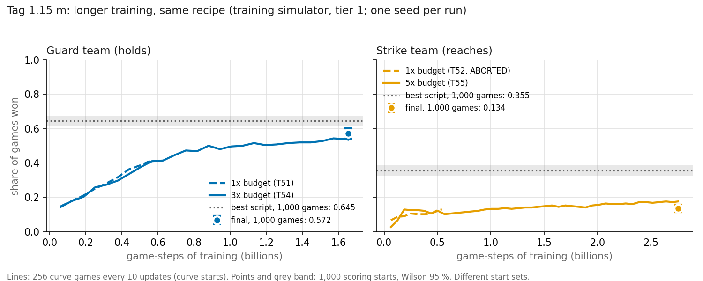

| 1.6 m-trained Guards at 1.15 m: reach (L0.12d X1) | 1.6 m-trained Strikes v field Guards at 1.15 m (X2) |
|---|---|
| 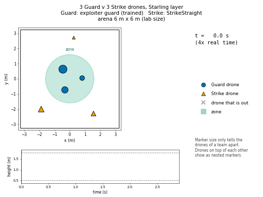 | 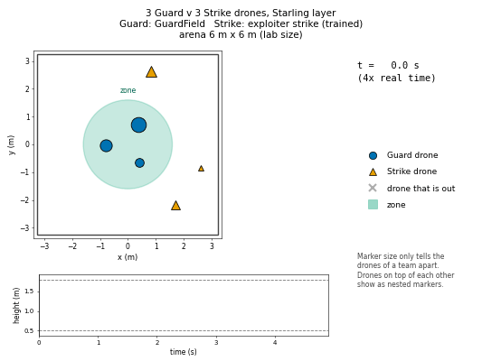 |

All clips: [ste_l012c](../../docs/media/ste_l012c/README.md), [ste_l012d](../../docs/media/ste_l012d/README.md). Training simulator; not a flight.

**Earlier: the trained players in 3-D** (L0.12, tags 1.6 m and 1.4 m; Isaac Lab, ring = team, faint circle = each Guard's tag distance, round zone).
Each game was replayed and checked equal to its run's own evaluation before drawing. Training simulator; not a flight.

| Trained Strikes reach the zone (base, 1.6 m tag) | Trained Guards hold (base, 1.6 m tag) |
|---|---|
|  |  |

The 1.4 m tag games and the top views: [docs/media/ste_l012/3d/](../../docs/media/ste_l012/3d/README.md).

**L0.12 — can a trained team beat the best hand-written one?** Filled dot = trained, hollow = best script, x = untrained:

| Trained Strikes v the best scripted Guard (base): climb, trade two, the last one slips in | Trained Guards v the straight Strike (base) |
|---|---|
|  |  |

**L0.3 — the fast-engine Guard (T41) on the Isaac Lab drone, no retraining** (856 v 831 holds; reaches for the parked control):

**L0.2 — training speed, Isaac Lab v the fast engine:**

**The 3-D videos** (L0.11 games, Isaac Lab, ring = team): [base_reach_3d.gif](../../docs/media/ste_l011/3d/base_reach_3d.gif), [all](../../docs/media/ste_l011/3d/README.md).

Where phase L0 is: green done, light green laptop part done, amber running, grey queued (state file
`ste_learning/status/l0_progress.toml`, figure by `scripts/make_ste_learning_figures.py l0_progress`).

Earlier: L0.11 top-down clips and the factor chart are in the [T44 record](../../records/2026-11-21_ste_l011_screen_record.md).

### Phases

| Phase | Status | Math library | Simulator | What |
|---|---|---|---|---|
| NUS port Phases 1–4 | DONE | JAX (NUS), PyTorch | NUS 2-D game (JAX), Copy of NUS 2-D game (PyTorch), tier 2 Isaac Lab | NUS's code installed, game and policies copied to PyTorch, six tests towards STE drones |
| NUS port Phase 5 | PAUSED (lead call D8) | PyTorch | Copy of NUS 2-D game (PyTorch), tier 1 fast engine | 5.1 Method match FAIL (T43); STE Guard policy 829 of 1,000 (T41) |
| NUS port Phase 6 | DONE | none | none | public documents with videos |
| ▶ L0 Game definition and feasibility | RUNNING (approved 20 Nov, cap 19 GPU-h) | PyTorch | tier 1 fast engine, tier 2 Isaac Lab | which game, worth learning, can tier 2 train, is the Crazyflie route sound |
| L1–L8 | NOT STARTED | PyTorch | as ruled at gate G0 | drone model, rules, learner, evaluation, league, export, AirStack side, real flight |
| L9 Documentation | RUNNING | none | none | status, records, results page |

### Phase L0 Game definition and feasibility, task by task

| ID | Plain name | Status | Simulator | Result / ETA |
|---|---|---|---|---|
| L0.1 | Track set-up: config and test skeleton | DONE | none | settings file, loader, tests; independent QC closed all findings |
| L0.7 | Process tooling and drills | RUNNING (laptop part DONE) | none | merged into `development`; laptop: full suite 1,420 passed / 0 failed, wake-up drill and resume drill both as expected (below); DONE when the 5090 has run the same (L07-5090) |
| L0.8 | Game spec sheet | DONE | none | merged into `development`; QC passed; full suite on `development` 1,461 passed / 0 failed (41 min) |
| L0.9 | Tag rule for the study: 1-for-1, nearest pair first | DONE | tier 1 fast engine | merged; QC + re-check passed; full suite on `development` 1,517 passed / 0 failed (31 min); the 5090 records its own tag-off positions (L09-5090) |
| L0.10 | Scripted players for the study | DONE | tier 1 fast engine | merged; QC + 2 re-checks passed; full suite on `development` 1,600 passed / 0 failed (56 min, CPU shared with the L0.11 GPU jobs) |
| L0.11 | Screening sweep (INFO) | DONE | tier 1 fast engine | record T44 (every control PASS; shortlist base (reference), tag 1.2 m, tag 1.4 m; every hold a one-for-one trade) + follow-up checks; merged into `development`; full suite 1,685 passed / 0 failed (27 min) |
| L0.12 | Best-response test: is the game worth learning? | DONE, merged (T46 INFO, T47 ABORTED; full suite 1,838 passed, its 6 failures fixed before merge) | tier 1 fast engine | pilot PASS; run 0 PASS; **base: worth learning** (Guard 913 v 808, Strike 636 v 192); **tag 1.4 m: worth learning** (Guard 747 v 672, Strike 740 v 328); **tag 1.2 m: incomplete** (Guard 503 v script 645; Strike ABORTED, 87/88 updates, trained Strikes wait out the clock); every control PASS; 3.86 GPU-h of 6; record T46 (verdict) + T47 (aborted run) being written; 3-D clips of the key games need VID-1b (the 3-D tool replays scripted players only) |
| L0.2 | Tier 2 speed in contested play | DONE (T48, merged) | tier 2 Isaac Lab | every control PASS; Isaac Lab 3v3: 10 k → 67 k training game-steps/s (1,024 → 16,384 games, 4.7 GB); the fast engine is 4–10× faster per game-step (5× at 3v3); 0.29 GPU-h (+0.10 smokes) |
| L0.13 | Does tier 2 train at all? | DONE, merged (PASS; T53; full suite 1,963 passed after one fragile test of mine fixed) | tier 2 Isaac Lab | Isaac Lab Guard 832/1000 (Wilson 0.808–0.854) v still Guard 538 on Isaac Lab; fast-engine control 836 at the same 302 M game-steps; networks swap tiers within 22 games; every control PASS; 70.5 k v 360 k game-steps/s; ~1.6 GPU-h |
| L0.3 | STE Guard policy in tier 2 without retraining | DONE (T49, merged) | tier 2 Isaac Lab | every control PASS; T41 holds 856/1000 on Isaac Lab v 831 fast engine (paired: 76 gained, 51 lost, sign test p = 0.033; higher in this set, no general claim); 1.24 GPU-h |
| L0.4 | Side-by-side Starling render | DONE | tier 2 Isaac Lab | found why our clips never looked like the Starling: a grey physics box was drawn over every drone since S2b (the hide call missed it); one-line fix, re-render shows the Starling (before/after in Watch); merged into `development` after independent review; 0.028 of 0.2 GPU-h |
| L0.5 | Starling video look fix | WAITING ON YOU (D9) | tier 2 Isaac Lab | the drone left unpainted, team shown by a ring or a small dot that casts no shadow; stills in Watch; 0.154 of 0.3 GPU-h (with VID-1) |
| L0.14 | Crazyflie route check | DONE | tier 1 fast engine (CPU) | record T45: the T41 Guard policy holds 791–768 of 1,000 in the Crazyflie-like lag band (0.48–0.56 s, every drone slowed) against 831 at the Starling's lag, and drones come closer (games under 1.0 m: 7 → 101–149); planner, like for like: 0 of 100 at 3v3 and 5v3 against 20 Nov's 5 of 100 (not a clear difference; only one rule set run); QC + re-check passed; merged into `development` (targeted tests 76 passed; the full suite runs with the next merge — lead's call, the CPU is shared now); page `ste_learning/CRAZYFLIE_ROUTE.md` |
| L0.6 | Gate G0 | READY FOR YOUR READ (merged) | none | [G0_DECISION.md](../G0_DECISION.md): what L0 found, 17-row decision table with evidence strength per row, the tag rule with learning curves, 1v1, where to train, budget 13.77 GPU-h; independent numbers check: 10 claims fixed — **the 1.4 m Guard gain may be the decision-period difference (scripts held 0.6 s reach 738 v trained 747), so only 1.6 m has both trained sides clearly beating the scripts**; open: costed L1–L9 plan (Sunday), your answer on longer 1.15 m runs |

GPU-h used in L0: **13.77 of 19** from the GPU-hour ledger (L0.11 0.43, L0.12 incl. the bubble-tag test, L0.12c and L0.12d 9.79, L0.13 1.59, L0.3 1.28, L0.2 0.39, L0.5 0.26, L0.4 0.03). **Correction:** earlier statuses said ~9.9; that was my over-estimate of L0.12, the ledger is the source.

Laptop full CPU suite (20 Nov, `development` at 5c5d465, after `scripts/nus_install_provisional.sh`): **1,333 passed, 2 failed, 48 skipped** in 24 min. Both failures repeat when run alone:
- **L07-F1** `test_ste_job.py::test_f_d_a_killed_job…resumes`: CONFIRMED by QC: the tool does not over-report (it measures from the same start; ~0.255 s raw, printed rounded to 0.3); the test compares the rounded text with the exact elapsed time. Fix: allow half a display step.
- **TEST-F2** `test_train_standin.py::test_default_path_bit_identical_after_the_nus_hooks`: FIXED (447b317). Measured on the laptop: the hash repeats (75d2a955…), hold rates equal the recorded [0.25, 0.375], and forcing PyTorch's CPU capability down changes the hash; threads (trainer runs one) and local files (not read on this path) ruled out. The fingerprint is now one hash per CPU capability; hold rates are checked on every machine.

### Usage (laptop session, 20 Nov 22:00 to now)

| What | Agent tokens | Wall time | Note |
|---|---|---|---|
| L0.7 fixes: builder, 7 fixes one at a time | ~400 k | ~51 min | the largest: each fix re-reads the tooling and its tests |
| L0.8 Game spec sheet: builder, build + 2 fix rounds | ~320 k | ~50 min | includes its own 25-min full suite |
| L0.7 independent QC + re-check | ~246 k | ~18 min | reproduced C1 and I1 in a scratch folder |
| L0.8 independent QC + re-check | ~209 k | ~12 min | mutation tests on the sheet |
| L0.9 Tag rule: builder (build + fix round) | ~358 k | ~66 min | the first 50 min slowed by sharing the CPU with the L0.7 suite |
| L0.9 independent QC + re-check | ~239 k | ~31 min | ran its own reference matcher, mutants and old-vs-new games |
| L0.10 Scripted players: builder (build + rulings + 2 QC fix rounds) | ~420 k | ~56 min | |
| L0.10 independent QC (+ 2 re-checks) | ~353 k | ~71 min | 84 deliberate breakages over two rounds; its own geometry probes on 30,000+ starts |
| L0.11 sweep build (CPU, build + rulings + rebase + QC fixes + follow-ups) | ~677 k | ~106 min | the largest single task so far; a fresh builder takes L0.12 to avoid re-reading this context |
| L0.12 groundwork builder | ~550 k | ~54 min | |
| L0.12 pre-launch QC | ~322 k | ~48 min | 19 deliberate breakages, 8 not caught before the fixes |
| L0.14 builder | ~368 k | ~118 min | the Crazyflie planner sweep ran on the CPU (2,868 matches) |
| L0.11 pre-launch QC | ~293 k | ~24 min | broke the code five ways through the real driver |
| L0.11 CUDA smoke | | ~5 min | 0.087 GPU-h |
| L0.11 independent QC (pre-launch, re-check, results read) | ~419 k | ~45 min | |
| L0.11 sweep | | 18 min | 0.305 GPU-h (L0.11 total 0.426 of 3.0) |
| L0.4 + L0.5 + VID-1 builder (stills, box bug, replay check, 3-D renderer) | ~410 k | ~3 h incl. the 08:30 limit stop | 0.141 GPU-h; the account hit its 5-hour token limit at about 07:30 (three agents at once); resumed 08:44 |
| L0.12 gate fix + follow-up builder | ~280 k | ~55 min | run 0 design, N-2/N-4, tests |
| L0.12 QC re-checks 1–2 | ~450 k | ~30 min | 8 breakages tried on run 0 |
| L0.2/L0.3 builder | ~410 k | ~30 min | + fix round now |
| L0.2/L0.3 pre-launch QC + 2 re-checks | ~650 k | ~60 min | 39 + 6 breakages tried |
| L0.12b bubble-tag build + 2 fix rounds | ~490 k | ~95 min | |
| L0.12b QC + re-checks | ~210 k | ~40 min | |
| L0.13 build + QC (+ fix round now) | ~650 k + | ~60 min | |
| L0.2/L0.3 fix rounds 1-2 | ~1.1 M | ~41 min | **the costliest task today**: each round re-reads the code; narrow rounds from here |
| L0.12 GPU pilot | | 11 min | 0.178 GPU-h |
| L0.11 GPU pilot | | 2 min | 0.034 GPU-h (first GPU job of the track) |
| Full CPU test suite | none | ~25 min alone; the L0.7 merge run took 61 min (shared the CPU with L0.9's tests) | rule from now: one heavy test run at a time |
| GPU | 0 GPU-h | | nothing has used the GPU |

Sub-agents total about 1.2 M tokens so far; the lead's own context is not measured by the tools here.

Laptop drills (21 Nov, fix branch, shared folder `~/AirStack-starling-max2/svg_training/runs/shared/`, no owner pause open):
- Wake-up: `L0.7 l07_wakeup DONE exit=0 duration=120.4s effective=120.4s`, `waiter exit 0` (the background waiter's end was the wake-up).
- Resume: `alive` → simulated power cut (`kill -KILL` of the process group at step 30) → `dead`; waiter `DIED exit=none duration=31.2s`, `waiter exit 21`; relaunch with `bash cmd.txt` from a shell with a wrong `PYTHONPATH` and `SVG_SHARED_DIR` → `launch=2`, `resumed from step 30 of 120`, `DONE exit=0 duration=90.4s effective=90.4s run_effective=120.3s`, `waiter exit 0`, `{"steps": 120, "total": 7260.0}`; the wrong shared folder was never created.

### Other workstreams

| ID | Plain name | Status |
|---|---|---|
| L012-B | Bubble-tag test (tag 1.15 m; owner approved 21 Nov) | DONE, merged (T50 screen, T51 INFO, T52 ABORTED; full suite 1,906 passed) | screen: best scripts 645 / 355 (same as 1.2 m), filter-pushed tags 0–10 %; run 0 PASS (909 v bar 849); trained Guard 466 v script 645 (weak); trained Strike ABORTED (time rule, 86/88; info: 103 v 355, waits out the clock); verdict incomplete (one side); ~1.95 GPU-h |
| VID-1c | Height panel on the L0.2 / L0.3 2-D clips | DONE for L0.3 (merged); L0.2 cannot be redrawn | that run kept no positions; re-playing its clip games needs Isaac Lab; README says so |
| SYNC-1 | Branch `development` on both machines; laptop worktree `~/AirStack-starling-max2-dev` | DONE |
| SYNC-2 | Status skill `train-status` and the owner's standing rules in CLAUDE.md | DONE |
| SYNC-3 | Root `CLAUDE.md` and every page: training work lands on `development` | DONE |
| SYNC-4 | STE Guard policy (T41 run folder) in the PROVISIONAL bundle | DONE; installed on the laptop (46 files, agent.pt c91bea51…) |
| L07-F1 | Fix: waiter-duration test bound (rounding) (QC I5) | DONE (a4100d0; 30 of 30 runs pass; L0.7 test files 217 passed) |
| L07-C1 | Fix: an open pause takes time off every job, and launch does not check for one: a job launched during a pause runs on the GPU with 0 GPU-h counted and its cap never fires | DONE (79effa0 on branch ste-l0.7-fix; red 48 failed, then L0.7 + NUS pause tests 251 passed). Pauses still always logged; launch refuses while one is open; a pause counts only against the jobs it stopped |
| L07-I1 | Fix: a new run reusing an old job name inherits that job's GPU-hours as credit (task cap can be exceeded) | DONE (05dd547; credit keyed by job name + run folder; red 24 failed, then 256 passed) |
| L07-I2 | Fix: `cmd.txt` relaunch loses the environment (PYTHONPATH, CUDA alloc setting, shared-folder path) | DONE (d0661f4; cmd.txt replays the first launch's environment; a different shared folder is refused; resume drill uses bash cmd.txt; red 3 failed, then 259 passed) |
| L07-I3 | Fix: the launcher's wrapper can die (clock step back, full disk) while the job runs on: GPU time stops being logged | DONE (1ca8a70; every wrapper write survives an error, records a fault and retries; red 8 failed, then 267 passed) |
| L07-I4 | Fix: a job resumed after a reboot is flagged ENDED_EARLY (exit 20) though it finished correctly | DONE (70fc1a3; judged on the trainer's saved progress across launches; red: drill pattern read 20; then 280 passed) |
| L08-F1 | Finding: the hangar's Strike start ring (3.2 m from the zone centre) does not fit the 6.5 m lab arena (drones kept within 3.0 m); a ring for 6.5 m is needed before L0.11's base case | CLOSED (lead's call): Strike start ring 2.75 m for the 6.5 m arena, PROPOSED, ruled at G0 |
| L07-C1b | Fix: our own "pause the siblings, run solo" step (AUTOMATION §2.2) is now refused too; lead's design: pauses the session makes are tagged and do not block launch, your pauses still do | DONE (ef38534; `GPU_PAUSE_BY=lead` tags the session's pauses; a bare `gpu_pause.sh pause` is still yours and still blocks; red 13 failed, then 298 passed) |
| L07-C1c | Fix: a session-tagged resume must refuse while any of your pauses is open (a resume today continues every job and closes your pauses too) | DONE (efa9ec1; a bare resume/stop is unchanged; red 4 failed, then 304 passed) |
| GIT-1 | Fix: my 17 Nov `.gitignore` line `data/` also hid new files in `tests/data/` | DONE (d3572dc: anchored to `/data/`) |
| L011-F1 | Finding: scripted players decide every 0.05 s tick, not at the sheet's 0.6 s decision period; the sweep measures scripted play at 0.05 s; L0.12's trainers must set their decision period explicitly (T41 used 0.6 s) | OPEN: written into the L0.11 gate file and record |
| L07-SUSPEND | Tooling: a laptop sleep during a GPU job is counted as GPU-hours and as time towards the job's cap (wall clock). Rule until fixed: never let the laptop sleep during a GPU job | QUEUED (tooling task); rule in force now |
| L011-G0 | Finding for gate G0 (T44, scripted play): (1) every hold is a one-for-one trade — no tag-on game times out, and at 1v1 and 3v3 a Guard win leaves no Guard — so head-count decides (PLAN F1; bears on what a tag costs, P12); (2) the programme's sizes 2v1 and 5v3, and 1v1, are Guard-trivial with scripted players at the proposed rules; candidate cause: tag radius 1.6 m = zone radius 1.6 m with Guards starting on a circle near the zone centre (not tested). L0.12 measures whether learning changes either | OPEN: reported at G0 |
| L010-G0 | Finding for gate G0 (from L0.10 QC): any safety-filter move near the 1.6 m tag radius can create a tag nobody chose (the filter's 1.10 m keep-out is inside the tag radius). Spaced starts remove it at the start; during play it is part of the game the sweep measures (P1) | OPEN: reported at G0 |
| L09-5090 | On the 5090: record the tag-off golden's positions for its CPU type (AVX512); check the outcome fingerprints there | WAITING: next 5090 session |
| DOC-1 | A phase-L0 flowchart coloured by progress (done / running / queued), regenerated with each status and shown in its Watch section (owner, 21 Nov: "photos or diagram flow charts would be good too") | DONE (progress flowchart; regenerated with each status) |
| VID-1 | Clips: 2-D with a height panel on every run; 3-D Isaac Lab videos of each result's key games | L0.11 DONE; **L0.12 trained players DONE, merged (VID-1b)** | 4 key games (base and 1.4 m, trained Strike and trained Guard), each replayed and checked equal to its run's own evaluation; **tag-distance circle around each Guard and a true-circle zone** (your requests); 0.104 GPU-h (L0.5 now 0.258 of 0.3); the 6 L0.11 clips not yet redrawn with circles (would reach the cap) |
| L08-M | L0.8 minors left: 3 hangar values unchecked on a clone without the NUS bundle; 3 values whose wrong value still passes; loader refuses some honest wording; tests tied to exact lines and the AirStack fence file | PARKED |
| L07-DISK | Follow-up: the planned disk-space check (a disk full through 10 retries at a job's end reads DIED) | PARKED (stated limit) |
| L07-N | Re-check minors N1–N4: a session pause also lands in the old per-worktree log the NUS reader uses; full disk can hold the wrapper 10 min after the end; AUTOMATION §4 still states the old GPU-hour rule; on the 5090 run `scripts/ste_job.py owner-pauses` before the drills | PARKED (N4 goes into the 5090 note) |
| L07-M | QC's 10 minor findings (+3 from the C1 build: pid-only matching, test pause pattern shared across sessions, pid reuse) (runs/ste_l07/qc_report.md) | PARKED until the six fixes land |
| L07-5090 | L0.7 on the 5090: full CPU suite and the two drills there (L0.7 is DONE only after both machines) | WAITING: next 5090 session |
| TEST-F2 | Fix: bit-level training fingerprint is machine-specific | DONE (447b317; trainer test file 43 passed, 1 skipped) |
| TEST-F2b | On the 5090: confirm its CPU capability is AVX512 (the key its 18 Nov hash is now filed under) | WAITING: next 5090 session runs the test (fails or skips loudly if wrong) |

**Machines (owner, 21 Nov):** no task is 5090-only. The RTX 5090 (32 GB) suits memory-heavy runs; the laptop RTX 5070 Ti (12 GB) runs everything sized to fit, and the record says which machine. Only machine checks stay with their machine: TEST-F2b, L07-5090, L09-5090. **Schedule:** weekends the laptop runs the pipeline (the 5090 is free for gaming); weekdays the 5090 does (the laptop goes to work). **This weekend:** the owner packs the laptop **Mon 23 Nov 10:00**: no GPU job starts unless it can end by **Mon 08:00**; by **09:30** everything is committed, HANDOFF §0 and status written, ready to push.

**GPU queue on the laptop (one at a time for speed measurements):** L0.12 pilot → L0.12 trainings → L0.2 → L0.3 → L0.13 (L0.4, L0.5, VID-1 for L0.11 done).

**Next.** The G0 walk-through (Sunday); then the Monday wrap-up by 09:30 (commit, HANDOFF, status, ready to push).

**Correction.** The 21 Nov question on NUS values listed "speeds 0.6 / 1.2". The L0.8 review reads those two numbers as the decision period (0.6 s) and the flight height (1.2 m); the speeds are 0.5 and 0.333 m/s. Your Yes covers all of them as written on the sheet.

## 2026-11-22 16:43

**Status, 2026-11-22 16:43 (+08:00), event: gate G0 ruled, phase L1 open** · laptop RTX 5070 Ti · GPU idle · 0 jobs

**Plain summary.** You ruled gate G0 today. Phase L0 is closed, phase L1 (the drone model, plus a small 1.15 m side track)
is open with 13 GPU-hours for L1 and L2 together. Nothing has run on the GPU since this morning.

**Your rulings** ([DISCUSSION §14](../DISCUSSION_2026-11-19_20.md#14-gate-g0-rulings-owner-22-nov-2026)):
- the main game has a 1-for-1 tag (your old "no tag" rule is overturned);
- tag 1.6 m to build the pipeline and for the first demo (the hand-written 1v1); 1.15 m trained after L2, with a small
  1.15 m side track in L1;
- the fast simulator for quick experiments and checks, the main training in Isaac Lab;
- 13 GPU-h for L1 + L2; 120 s games (shorter clocks only as experiments); the AirStack-simulator logs approved;
- open arena first, then random blocks, then the construction site;
- train 3v3 (and 1v1), score every trained team at 2v1 and 5v3 too; a training-settings sweep added to the plan;
- a task still running at the Monday switch is handed over to the 5090, never cut short.

**What I did since** (each reviewed by two agents):
- recorded the rulings in the plan, the decision page, the game spec, the standards and the costed plan;
- the budget settings know phase L1 (13 GPU-h shared by the laptop and the 5090: hours are carried across at each
  switch with `ste_job.py carry`); L0 is closed to new runs; full test suite 2,048 passed;
- the trained players L1 needs are now in git (`ste_provisional/`), so the 5090 can load them;
- the side-track spec is written and fixed before any run ([L1_SIDE_TRACK_SPEC](../drafts/L1_SIDE_TRACK_SPEC.md)).

**Next (tonight, laptop, fast simulator):** build the driver additions (an implementer is on it now, then two code
reviewers), then three runs: the 1.6 m Guard team against every Strike script (minutes); a Strike team trained against
the second Guard script at 1.6 m (about 0.6 GPU-h); and two small 1.15 m Strike runs, one with a 30 s training clock and
one weighting a clock loss more (about 0.8 GPU-h together). I will message you when the first GPU run starts.

**Phases**

| Phase | Status | Simulator |
|---|---|---|
| L0 Game definition and feasibility | **done; G0 ruled 22 Nov** (13.77 of 19 GPU-h) | fast engine, Isaac Lab |
| L1 Drone model (+ side track) | **open**: side-track build in progress | Isaac Lab, fast engine for checks |
| L2–L9 | intended | — |

**Waiting on you:** nothing for L1. Later: whether the NUS-facing pages that still say "the main game has no tag" may be
updated (svg_training README, GLOSSARY, RESEARCH, THE_GAME, DESIGN, docs/README, the contact-tag plan); I will show you
the wording first.

**Usage:** today about 45 agent runs since the morning digest (reviews, writers, two implementers), about 5 M tokens;
two full test suites (36 min each); 0 GPU-h. L1 + L2 used 0 of 13.

**Ready to push:** `development` is 1 commit ahead of GitHub in the mirror (the G0 rulings, f914423e) — plus this
status commit.

## 2026-11-22 23:28

**Status, 2026-11-23 (morning digest; work ran 22 Nov 18:00–23:30 +08:00)** · laptop RTX 5070 Ti · GPU idle · 0 jobs

**Main track:** L1 drone model: L1.1/L1.2 (position-estimate delay and noise, drag) built and reviewed; first Isaac Lab
check stopped at its cap (6 tests passed, 1 failed on a label, fixed but not re-run); new task L1.1b (model the
estimate's error, not a delay) · **Side track:** 1.15 m tests T57–T61 done and reviewed (why and cost announced as they
were added).

### Watch

| The 1.15 m Strike runs and the comparison team, both clocks | The time-left test and the delay check |
|---|---|
| 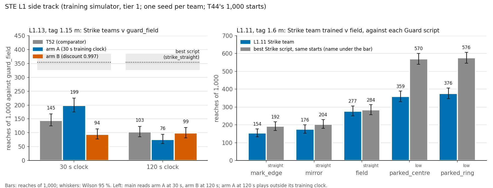 | 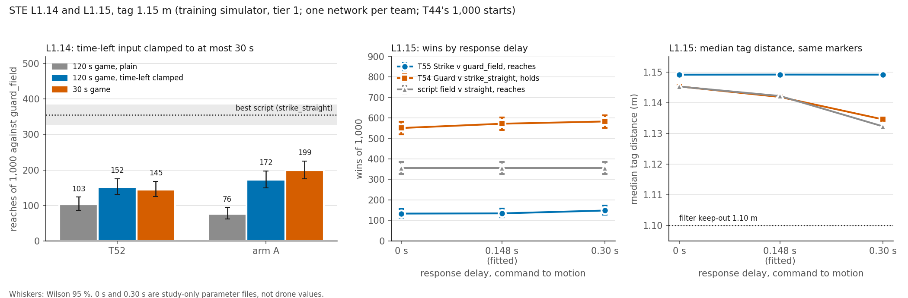 |

| 1.6 m Strike team trained against field Guards: a reach | 1.15 m, 30 s training clock: a hold (the Strike team fails) |
|---|---|
| 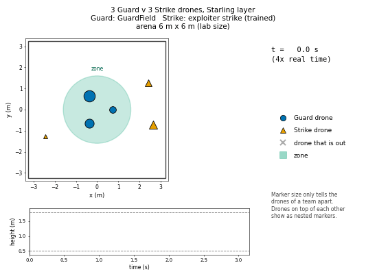 |  |

Clips use their own starting positions, not the 1,000 scoring starts. Training simulator only; nothing flown.

### Morning digest

**What ran** (fast simulator for the side track, Isaac Lab for the main-track check; one run each):

| Test | Result |
|---|---|
| 1.6 m Guard team v all 6 Strike scripts (T57) | holds at least 913 every time; above the best hand-written Guard on 4, below on 2 (converge 913 v 986, sacrifice 922 v 960) |
| 1.6 m Strike team trained v field Guards (T58) | level with the script against them (277 v 284); below the best script against the others (clearly so only against the two parked Guards) |
| 1.15 m Strike: 30 s training clock / a clock loss weighted more (T59) | 199 v the comparison team's 145 at 30 s, a gain, only just; but at the normal 120 s it did worse (76 v 103); weighting a clock loss more did nothing (99 v 103) |
| **1.15 m time-left test (T60)** | **the 1.15 m Strike team (one network) attacks earlier and reaches more when its time-left input says time is short: 152 instead of 103** |
| 1.15 m delay check (T61) | wins stay within the margin set in advance for response delays 0–0.3 s (small game-by-game changes); tags about 1 cm deeper at 0.3 s (closest 1.106 m, 6 mm outside the safety keep-out); re-check at L1.3's values |
| Isaac Lab drone with delay, noise, drag (L1.1/L1.2) | runs in Isaac Lab; 11 % slower with the effects on (target 10 %, missed); the physics checks of one test did not run (label failure, fixed) |

**Worth a look.**
1. **A reading, not yet a conclusion:** the 1.15 m Strike team's "waiting" looks driven by its clock input, and most
   of the 30 s clock's gain seems to come through how the network reads time (clamped, the two teams are close: 172 v 152).
   Both panellists want a second seed before anything is built on it.
2. **No 1.15 m change reached the hand-written Strike (355).** 1.15 m stays "simulator only, margin unproven".
3. **Main-track lesson:** the real drone's position estimator projects late measurements forward to "now", so the
   controller does not see a 0.15 s-old position; modelling it as a pure delay made the height loop unstable. L1.1b models
   the estimate's small error instead, and L1.3 fits that error from flight logs.

**Two panellists' plan (DISCUSSION §15):** main track first; side track at most about 1 GPU-h more, starting with a second
seed, each addition announced with its why.

**On the 5090 today, in order:** (1) start from `development`; before the first L1 launch run
`scripts/ste_job.py carry --gpu-h 2.81 --note "laptop 2026-11-22"` (the laptop's L1 hours, so the 13 GPU-h cap holds);
(2) L1.0, the 5090 checks; (3) L1.1b (CPU build: error model, seed passed through); (4) the Isaac check re-run (the
isaac tests plus the two speed parts not measured; lead's estimate about 0.15 GPU-h); (5) L1.3/L1.4 when the AirStack
simulator is free. **Waiting on you:** nothing to rule; later, your OK on wording for the NUS-facing pages that still say
"no tag".

**Usage:** L1 + L2 used **2.81 of 13 GPU-h** (L1.1 0.20, L1.11 0.46, L1.12 0.02, L1.13 1.83, L1.14 0.15, L1.15 0.15);
about 60 agent runs since the afternoon (builders, writers, two reviewers per item, two panellists), ~12 M tokens; four
full test suites (36–60 min each).

**Ready to push:** `development` is ahead of GitHub in the mirror (see the line in chat).

## 2026-11-23 07:09

**Status, 2026-11-23 07:09 (+08:00) (morning digest; laptop work 22 Nov 18:00 – 23 Nov 07:10 +08:00; RTX 5090 L1.0 overnight)** · laptop RTX 5070 Ti · GPU idle · 0 jobs

**Main track:** phase L1, making the training drone realistic: the 5090 checks, the estimate-error model in both simulators, the first fit from flight logs, and the trained teams re-scored on the physics drone are done and reviewed; the 1v1 and varied-tag training runs are built, GPU runs next on the 5090; the AirStack comparison waits for a simulator session with you · **Side track:** 1.15 m tests T57–T61 (yesterday evening) done; no side-track work overnight.

### Watch

| Trained 1.6 m teams on the Isaac Lab drone (T64) | The 1.15 m runs and the time-left test (T59–T61) |
|---|---|
| see the table in [T64](../../records/2026-11-23_ste_l18_tier2_record.md) (observed in the training simulator) |  |

| Estimate error measured from the 13 Nov flight log (T63) | |
|---|---|
| 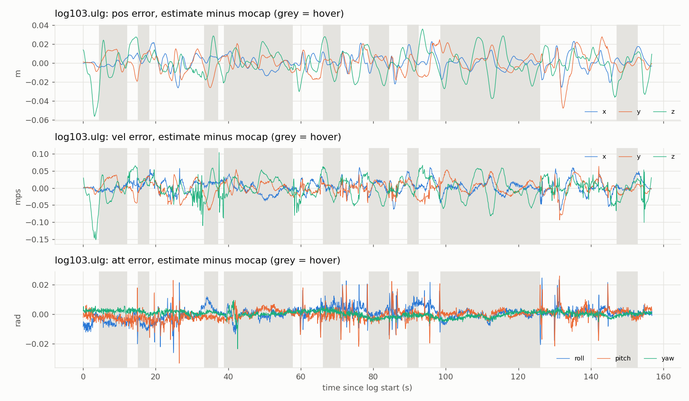 | 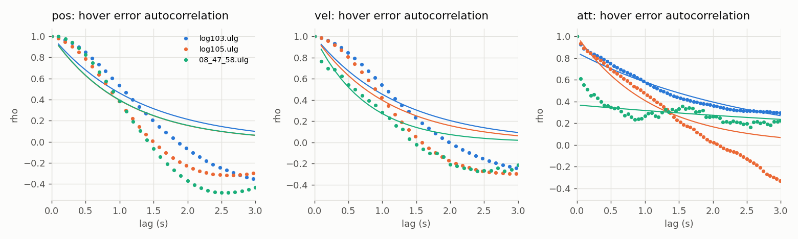 |

Training simulator and flight-log analysis only; nothing flown.

### Morning digest

| What | Result |
|---|---|
| **5090 checks (L1.0)** | the 5090 gives the same game results as the laptop (exact); drills and its suite pass (2,213 passed) |
| **Isaac Lab drone with estimate error (L1.1b, T62)** | all 7 Isaac Lab tests pass; no measurable speed cost (the earlier "11 %" was wrong: a test suite was sharing the CPU) |
| **Estimate error from the real flight log (L1.3, T63, EXPLORATORY)** | while hovering: position about 1 cm, velocity about 2 cm/s, tilt at most about 0.15°, drifting over about 1–2 s; motion-capture samples are only 6–9 ms old. Not the in-flight error (moving: up to 2.5 cm) |
| **Trained 1.6 m teams on the Isaac Lab drone (L1.8, T64)** | results shift per cell between the two simulators (−33 to +47 of 1,000, both directions); with the measured error no change was detected (the test cannot see shifts under about 40–60 games); at 2× the error one matchup clearly changes (Strike v parked Guards 351 → 399; not planned in advance, but too large to be chance) |
| **Estimate error in the fast simulator (L1.7)** | built and reviewed; off by default |
| **L1.9 / L1.10 (1v1 runs; tag drawn 1.5–1.7 m)** | built, reviewed, merged; GPU runs next on the 5090 (trained with the measured error, scored with and without) |

**Worth a look.**
1. **The trained 1.6 m teams still score about the same on the physics drone:** cells shift −33 to +47 of 1,000, both directions; in 2 of 13 cells the ranges separate (a real simulator difference; one network per side).
2. **The real drone's position estimate looks like a slow drift of about 1 cm (hovering, per axis), not a plain delay;** that it leads by ~1.4 cm while moving is a hypothesis. At the 1.15 m tag, 1 cm per axis is a fifth of the 5 cm band (between two drones the errors add); tags decided from the drones' own estimates are not clean at the edge of the band, while tags judged by motion capture (your proposal) avoid that.
3. **New follow-ups:** L1.1c (the error rocks back and forth, a second-order model fits much better), and what the NEAR-962 flight must record (list in T63).

**On the 5090 today, in order:** (1) pull `development`; carry the laptop's new hours so the shared 13 GPU-h cap stays right (`scripts/ste_job.py carry --gpu-h 0.73 --note "laptop 2026-11-23"`: the laptop's L1 total 3.533 minus the 2.808 carried yesterday = 0.725, rounded up; check `ste_job.py status` shows the sum); (2) the L1.7 speed re-measure on an idle GPU; (3) L1.9 then L1.10 runs (about 1.6 + 1.7 GPU-h at most; commands and the step-2b check in `ste_learning/drafts/L1_9_10_SPEC.md`); (4) L1.4/L1.5 when you can give an AirStack-simulator session. **Waiting on you:** a time for the AirStack-simulator session (L1.4) and, later, the NEAR-962 flight.

**Usage:** of the 13 GPU-h for L1 + L2, the laptop has used 3.53 (the 5090's L1.0 checks add their own, shown on the 5090 after the carry); ~40 agent runs overnight (builders, writers, two reviewers per item); five full test suites.

## 2026-11-23 13:45 (+08:00) — documentation clean-up done (5090)

**Status, 2026-11-23 13:45 (+08:00) (home RTX 5090; documentation clean-up, no GPU work)**

**Main track:** phase L1, making the training drone realistic: nothing ran today; L1.7 (speed re-measure), L1.9 and L1.10 stay queued until the owner says what runs first. **Side track:** none. **Documentation (L9):** the clean-up the owner asked for is done on `docs-cleanup` and merged to `development`.

## Watch

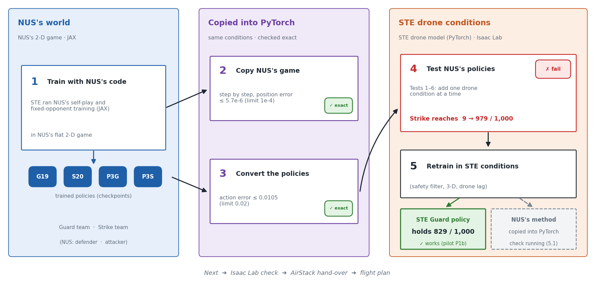

The story figure that opens the front page. Every page now starts with one line saying what it is for and where to go next.

## Plain summary

What was done: every page under `svg_training/` was given a first line with its label and its next step; the three story pages (overview, front page, learning-track page) were rewritten for any reader; the page map became a directory grouped by what a reader wants to do; 16 superseded pages were moved into `archive/` folders with indexes. What happened: 171 pages reachable, 0 orphans, 0 broken links; docs check 13 PASS · 0 FAIL; document tests 228 passed. Why it matters: a reader starting at the repository's README reaches the results in one click and is never left on a page that does not say where to go.

## Phases

| Phase | What | Math library | Simulator | Where it stands |
|---|---|---|---|---|
| NUS port, Phases 0–5 | NUS's code and policies under STE's drone conditions | JAX (NUS's code), PyTorch (STE's copy) | fast engine; Isaac Lab | done to 20 Nov 2026; route paused after stage 5.1 FAIL |
| L0 Pipeline check | the game with a tag, hand-written tactics, first trained teams | PyTorch | fast engine; Isaac Lab | done; gate G0 ruled 22 Nov 2026 |
| L1 Drone model | estimate-error model, drag, fit to flight logs | PyTorch | fast engine; Isaac Lab; AirStack simulator (logs) | in work; 3.54 of 13 GPU-h (L1 + L2) used, all carried from the laptop |
| L2 Game at 1.15 m | the main training set-up | PyTorch | Isaac Lab | approved with L1; not started |
| L3–L9 | training, scoring, flight hand-over, documentation | — | — | open at their own gates; L9 runs alongside |

## Phase L1, task by task

| Task | Where it stands |
|---|---|
| L1.0 5090 checks | done 23 Nov ~02:45 (record in `records/`) |
| L1.1b estimate-error model | built on the laptop 23 Nov; off by default |
| L1.7 Same effects in tier 1 (speed re-measure) | queued; **not started** (owner, 23 Nov: documentation only today) |
| L1.9 1v1 read, L1.10 tag-draw read | queued behind L1.7; spec in `drafts/L1_9_10_SPEC.md` |

## Other workstreams

| Work | Where it stands |
|---|---|
| Documentation clean-up (owner, 23 Nov) | done: 17 commits on `docs-cleanup`, merged to `development`; `main` fast-forwarded (docs-only pushes move both, owner's default 4) |
| Reviews of the clean-up | newcomer walk ran and its fixes are in; **numbers review and flow review owed** (reviewer agents stopped on the 5-hour usage limit, resets 14:10) |
| Training agent | stopped before any launch; 0 GPU-h; nothing committed |

**Next:** when the owner says so, the two owed reviews (cheap: two read-only agents), then L1.7 or whichever task the owner names first.

**Waiting on you:** (1) which L1 task runs first (L1.7 speed re-measure as planned, or L1.9's CPU screen); (2) the push.

**Usage:** this update: three agents for the clean-up (archive ~160k tokens, heads ~230k, training prep ~90k, stopped) plus one newcomer reviewer (~110k); two reviewers lost to the usage limit; tests 2 min 52 s on CPU; 0 GPU-h. Which check ran: the short document check (docs-only merge), not the full suite.

**Ready to push:** `development` and `main` (same commit).

## 2026-11-24 07:30 (+08:00) — morning digest, RTX 5090 night

**Status, 2026-11-24 07:30 (+08:00) (morning digest; RTX 5090 night 24 Nov 04:10–07:30)** · GPU 0 % / 30 W / 1.2 GB of 32.6 GB · 0 training processes

**Main track:** phase L1 done except L1.4/L1.5 (blocked: AirStack not set up on the 5090) and L1.9's 1v1 training (held for you, R20); phase L2 built: L2.1, L2.3, L2.4 behind settings that are off by default, waiting on rulings P2 and P7. **Side track:** none.

## Watch

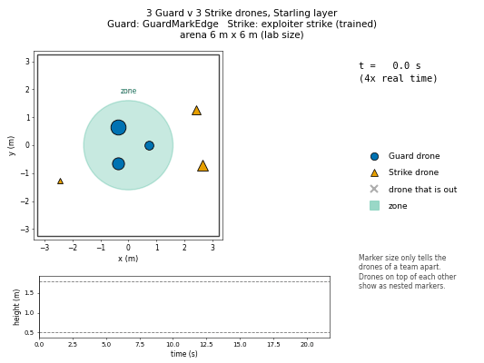

The Strike team trained tonight with the tag distance drawn per game and the estimate error, reaching the zone against the Guard tactic it trained on (681 of 1,000; best script 181). Against field Guards it reaches 39 (best script 280): the narrow best-response pattern again.

## Morning digest

**Done tonight** (records reviewed by two Sonnet reviewers, every fix applied):
1. **L1.7 speed re-measure** (T65): the estimate error costs the fast engine about 1 % at 16,384 games, 2–3.5 % at 4,096; inside the 10 % budget.
2. **L1.9 1v1 screen** (T66, CPU): **one against one is lopsided toward the Guard**: every moving Guard script holds 100 % of games at the 1.6 m tag and 84–90 % at 1.15 m. The 1v1 training stays held (R20); my view: training 1v1 as set would teach nothing; the 1v1 flight game likely needs different rules first (your decision).
3. **L1.10 tag drawn 1.5–1.7 m** (T67, 0.662 GPU-h): run 0 PASS; the Guard team beats the best script against 4 of 6 Strike tactics (928 v 811 against its own), the Strike team against 2 of 5 (681 v 181), below elsewhere; no effect of the estimate error detected; not distinguishable from T46.
4. **L2.3 landing drones** (merged): a tagged or lost drone descends at 0.6 m/s and stays in the safety filter until down. Off by default.
5. **L2.1 filter option B** (merged): in Guard–Strike pairs only the Guard swerves. Off by default; **finding for P2: next to a wall a pinned Guard lets a Strike drone reach 0.39 m** (today's even split: 0.97 m).
6. **L2.4 drone loss and drawn team sizes** (built, reviewed, full suite running, then merged): off by default; study file only.
7. **L3 design note** for the two routes (draft for you, no code): `ste_learning/drafts/L3_TWO_ROUTES_DESIGN.md`.

**Worth a look:** the L1.9 table in [T66](../../records/2026-11-24_ste_l19_screen_record.md) (why 1v1 needs a rules decision) and the wall finding in WORK_BREAKDOWN L2.1.

## Phases

| Phase | What | Math library | Simulator | Where it stands |
|---|---|---|---|---|
| L1 Drone model | estimate error, drag, fits, speed, tag reads | PyTorch | fast engine; Isaac Lab | done except L1.4/L1.5 (blocked) and L1.9 training (held, R20) |
| L2 Game rules in training | option B, landing, drone loss, team sizes | PyTorch | fast engine; Isaac Lab | L2.1, L2.3 merged, L2.4 merging; L2.5, L2.6 (INFO runs) wait for P2/P7 |
| L3 Learner (two routes) | pure RL and the mixed route, one learner | PyTorch | fast engine pilot, Isaac Lab smoke | design note drafted; waits for decision 7 |
| L4–L6 pipeline check | scoring suite, one seed per route, export | PyTorch | both | not started; cap 20 GPU-h (R23) |

## Phase L1, task by task

| Task | Where it stands |
|---|---|
| L1.0 5090 checks | done (23 Nov) |
| L1.1, L1.1b, L1.2, L1.3 drone model and fit | done (T62, T63) |
| L1.4 AirStack-simulator step logs | **blocked**: AirStack has never been set up on the 5090 (no built workspace, no containers); setup is outside the approved "run sim.sh" exception |
| L1.5 training drone v AirStack simulator | waits for L1.4 (approved, R21) |
| L1.7 same effects in tier 1 | done (T65) |
| L1.8 T46 players on tier 2 | done (T64) |
| L1.9 1v1 read | screen done (T66); training held for you (R20) |
| L1.10 tag drawn 1.5–1.7 m | done (T67) |
| L1.11–L1.15 side track | done (T57–T61) |

## Other workstreams

| Work | Where it stands |
|---|---|
| Process | models by role and scaled reviews in CLAUDE.md; job/agent watchdog every 20 min |
| Documentation | WORK_BREAKDOWN L2 build notes; HANDOFF §0 |

**Next.** After your decisions: L2.5 (parked-Guard control under the new rules, INFO, about 0.5 GPU-h) and L2.6 (tier 1 v tier 2 under the new rules, about 1.5 GPU-h); then L3 build.

**Waiting on you.**
1. **L1.9 1v1 training:** run as specified, or first screen changed 1v1 rules (smaller tag, bigger arena, faster Strike)? (T66)
2. **L1.4/L1.5:** set up AirStack on the 5090 (`airstack.sh setup`, outside my folder), or run them on the laptop?
3. **P2 filter option B:** accept with the wall shortfall, or ask for a wall-aware fix first?
4. **P7 drone loss and drawn team sizes:** part of the flown game? Fraction of drop-outs? Weight 3v3?
5. **Landing (L2.3):** touchdown at 0.15 m (`_ours` configs) or 0.1 m; the floor shortfall (0.95–1.05 m).
6. **Decision 7 (L3):** approve the two-route design and the skill list (draft note).

**Usage:** agents tonight (Opus builders ~760k tokens over three builds; Sonnet reviewers ~620k over six reviews); four full suites (~28 min each, CPU); GPU 0.724 GPU-h (L1.7 0.062, L1.10 0.662); ledger budget_l1_l2 4.244 of 13.0. Checks: full suite on every code merge; short document check on docs merges.

**Ready to push.** 17+ commits on `development` (ahead of `origin/development`), mirror updated; push from GitHub Desktop. `main` unchanged (code changed tonight: your word moves it).

**Correction, 24 Nov 2026 ~07:50 (advisor):** L2.5/L2.6 need no ruling and run next; P2 and P7 wait for L2.5's record; the wall (0.39 m) and floor (0.95–1.05 m) figures are builder test scenes, not reviewed measurements; full suites ran on the CPU; T66's T44 cross-check is a summary match only (one cell 307 v 317 unresolved). STATUS_LATEST carries the corrected version.

## 2026-11-24 13:30 (+08:00) — event: L1.4, L1.5, L2.5 finished (RTX 5090)

**Status, 2026-11-24 13:30 (+08:00) (event: three tasks finished, L1.4, L1.5, L2.5)** · GPU 1 % / 32 W / 1.1 GB of 32.6 GB · 0 training processes · RTX 5090

**Main track:** L1 tasks done except L1.6 (waits on L1.3 + NEAR-962) and L1.9 training (held); L2.1–L2.5 done, L2.6 next · **Side track:** none

## Watch

Latest clip (from the L1.10 Strike team, 07:30 digest); L1.4, L1.5 and L2.5 produced numbers and tables, no new clip.

## Plain summary of the three finished tasks

1. **L1.4 AirStack-simulator step logs** (T68, INFO): 36 of 36 velocity steps flown in the AirStack simulator ([record](../../records/2026-11-24_ste_l14_steps_record.md)). Corrected reading: the heights come from the simulator's PX4 clock, which runs about 2.5 times fast; they are not a descent limit.
2. **L1.5 training drone v AirStack simulator** (T69, INFO, 0.012 GPU-h): in tier 2 with the AirStack simulator's SIM-ONLY airframe, the training drone is within the simulator's per-step spread in 187 of 189 readings. The 0.05 s delay and the estimate error cannot be resolved here (about 0.1 s resolution). The L1.6 decision still needs L1.3 and NEAR-962 ([record](../../records/2026-11-24_ste_l15_compare_record.md)). Two reviewers.
3. **L2.5 parked-Guard control and scripted opponents under the new rules** (T70, INFO, 0 GPU-h, 46 min CPU; all 12 controls) ([record](../../records/2026-11-24_ste_l25_screen_record.md)). Two reviewers. Readings:
   - The parked-Guard risk was not seen with scripted Strikes: still Guard 432 v mark_edge about 805 in the worst cell. The tag raises the parked hold in 23 of 24 cells.
   - **Option B could not be tested at the 1.6 m tag with scripted play.** With the tag off it changes 11,429 of 12,000 games and removes most parked-Guard blocking (331 to 171, 752 to 86). Option B is 5.3 times slower on the CPU in long games.
   - Landing changes 2 of 30 cells, both against strike_low; the vertical part is not fitted.

**Also today:** Guard fixes in `scripts/record_steps.sh` (`f7e87089`, `452b260d`), each reviewed once. L3 note v2 (`ste_learning/drafts/L3_TWO_ROUTES_DESIGN.md`) after two design reviewers and the advisor.

## Phases

| Phase | What | Math library | Simulator | Where it stands |
|---|---|---|---|---|
| L1 Drone model | estimate error, drag, fits, speed, tag reads | PyTorch | fast engine; Isaac Lab; AirStack simulator (logs) | done except L1.6 (waits on L1.3 + NEAR-962) and L1.9 training (held) |
| L2 Game rules in training | option B, landing, drone loss, team sizes | PyTorch | fast engine; Isaac Lab | L2.1–L2.5 done; L2.6 next |
| L3 Learner (two routes) | pure RL and the mixed route, one learner | PyTorch | fast engine pilot, Isaac Lab smoke | note v2 written (two design reviewers and the advisor); first slice next |
| L4–L6 pipeline check | scoring suite, one seed per route, export | PyTorch | both | not started; cap 20 GPU-h (R23) |

## Phase L1 and L2, task by task

| Task | Where it stands |
|---|---|
| L1.0 5090 checks | done (23 Nov) |
| L1.1, L1.1b, L1.2, L1.3 drone model and fit | done (T62, T63) |
| L1.4 AirStack-simulator step logs | done (T68, INFO) |
| L1.5 training drone v AirStack simulator | done (T69, INFO) |
| L1.6 SIM-ONLY values decision | waits on L1.3 + NEAR-962 |
| L1.7 same effects in tier 1 | done (T65) |
| L1.8 T46 players on tier 2 | done (T64) |
| L1.9 1v1 read | screen done (T66); training held |
| L1.10 tag drawn 1.5–1.7 m | done (T67) |
| L1.11–L1.15 side track | done (T57–T61) |
| L2.1 filter option B, L2.3 landing drones, L2.4 drone loss and drawn team sizes | built, off by default |
| L2.5 parked-Guard control and scripted opponents | done (T70, INFO) |
| L2.6 tier 1 v tier 2 under the new rules | next |

## Other workstreams

| Work | Where it stands |
|---|---|
| Process | models by role and scaled reviews in CLAUDE.md; job/agent watchdog every 20 min |
| Documentation | HANDOFF §0 and this status updated 13:30; WORK_BREAKDOWN L2 build notes |

**Next** (no ruling needed): L3 first slice build (tier 1: skill dispatch + categorical head + tests); L2.6 spec (tier 1 v tier 2 under the new rules).

**Waiting on you** (one-word answers):
1. **1v1:** skip (lead's choice) / screen variants.
2. **L3 choice:** per team (lead's choice) / per drone.
3. **P2 option B: not ready to rule.** L2.5 could not measure it at 1.6 m; its convergence gate (PLAN L2 row) has no record yet; the drones fly the even split today (option B in flight needs the CMU proposal P6); and the L2.1 wall shortfall (0.39 m v 0.97 m) is not shown by L2.5. Lead proposes keeping the even split as the default and offering a 1.15 m CPU screen (0 GPU-h) when the 1.15 m main training nears.
4. **P7 landing:** lead proposes landing off in the L3–L6 pipeline check (it needs observation v0.3 so live drones can see a landing drone; v0.3 comes to you with the main training). Drawn sizes and drop-outs are not screened and not asked now.

**Usage:** since 07:30: GPU 0.012 GPU-h (L1.5); L2.5 0 GPU-h, 46 min CPU; L1.4 flown in the AirStack simulator (no GPU hours booked); Opus builders and Sonnet reviewers (two each for T69 and T70, one each for the Guard fixes); budget_l1_l2 **4.271 of 13.0 GPU-h** (own rows 0.731, carried 3.540; `scripts/ste_job.py status`). Checks: full suite 2,458 passed on `3103d4d0`; a second run on `d01bf39e` in progress. Advisor: Fable 5.2 on L3 note v2.

**Ready to push.** 49 commits on `development` (ahead of `origin/development`); mirror state not re-checked for this update; push from GitHub Desktop. `main` unchanged.

## 2026-11-24 18:20 (+08:00) — event: rulings R29–R33, L3 slice 2 merged, flight logs read (RTX 5090)

**Status, 2026-11-24 18:20 (+08:00) (event: owner rulings R29–R33, L3 slice 2 merged, flight logs read)** · GPU not re-read for this update · RTX 5090

**Main track:** L2 done; L3 slice 2 merged, run 0 for the skills route next · **Side track:** none open

## Watch

Latest clip kept from the 07:30 digest (L1.10 Strike team); the tasks below produced numbers and tables, no new clip for this page.

## Plain summary of what finished since 13:30

1. **L2.6 tier 1 v tier 2 under the new rules** (T71, INFO, 0.145 GPU-h, two reviewers) ([record](../../records/2026-11-24_ste_l26_tier12_record.md)): tier 1 agrees with tier 2 for scripted play at 1.6 m and at 1.15 m without option B (40 of 42 cell readings). Option B at 1.15 m lowers mark_edge v straight on both tiers. This is the evidence for P2, which the owner deferred (R31).
2. **CLIP-T2 side task:** the tier-2 clip script drew its starts on the GPU (CUDA); fixed (`record_games` takes `starts=`); the L0.13 clip caption is corrected. Run numbers are unaffected.
3. **Flight logs read (owner's 24 Nov logs).** [Survey](../../docs/notes/2026-11-24_flight_logs_survey.md): the figure-eight flight is a held-out check only; the planned-pushes flight (NEAR-962) is still needed.
   - **Figure-eight held-out check** (T72, INFO, two reviewers) ([record](../../records/2026-11-24_fig8_heldout_record.md)): at 2–3 m/s tier 1's exploratory model flies about half to two thirds of the real speed, likely its fitted acceleration limit (1.72 m/s²) against about 2.6 m/s² measured. Game speeds are inside the fitted range, so nothing is re-scored. NEAR-962 should add fast pushes and turns reaching 2–4 m/s².
   - **Crazyflie summary** ([note](../../docs/notes/2026-11-24_crazyflie_reports_summary.md), one reviewer): lag about 0.56 s with the PID controller v 0.08–0.10 s with Mellinger (a co-occurrence, not a proven cause); commanded gaps fall below the show's own 0.80 m separation minimum in 73 of 78 close events.
4. **L3 slice 2 merged** ([design](../drafts/L3_SLICE2_DESIGN.md)): two-level learner (`TwoLevelIPPO`) with per-head ratios, entropy and KL, p(free) = 0.5 start, skill lists in the checkpoint, the driver wired, the skills pilot wired, and the held-command arm script. QC ran once per step. Slice 1 merged earlier.

**Owner rulings R29–R33** (end of [DISCUSSION](../DISCUSSION_2026-11-19_20.md)):
- R29: 1v1 training skipped (the scripted 1v1 stays the demo).
- R30: "Team strategy, with individual drone skills which can adapt to the opponent's strategy": a two-level choice, a team head and a drone head.
- R31: P2 option B deferred; the even split stays the default.
- R32: landing off in the L3–L6 pipeline check.
- R33: no flight with the filter off: the planned-pushes flight flies one drone alone with the filter on.

## Phases

| Phase | What | Math library | Simulator | Where it stands |
|---|---|---|---|---|
| L1 Drone model | estimate error, drag, fits, speed, tag reads | PyTorch | fast engine; Isaac Lab; AirStack simulator (logs) | done except L1.6 (waits on L1.3 + NEAR-962); L1.9 training dropped (R29) |
| L2 Game rules in training | option B, landing, drone loss, team sizes | PyTorch | fast engine; Isaac Lab | done (L2.1–L2.6); P2 deferred (R31), landing off (R32) |
| L3 Learner (two routes) | pure RL and the mixed route, one learner | PyTorch | fast engine pilot, Isaac Lab smoke | slices 1 and 2 merged; step 4b (run 0, skills route) next, then slice 3 |
| L4–L6 pipeline check | scoring suite, one seed per route, export | PyTorch | both | not started; cap 20 GPU-h (R23) |

## Phase L1, L2 and L3, task by task

| Task | Where it stands |
|---|---|
| L1.0 5090 checks | done (23 Nov) |
| L1.1, L1.1b, L1.2, L1.3 drone model and fit | done (T62, T63) |
| L1.4 AirStack-simulator step logs | done (T68, INFO) |
| L1.5 training drone v AirStack simulator | done (T69, INFO) |
| L1.6 SIM-ONLY values decision | waits on L1.3 + NEAR-962 |
| L1.7 same effects in tier 1 | done (T65) |
| L1.8 T46 players on tier 2 | done (T64) |
| L1.9 1v1 read | screen done (T66); training dropped (R29) |
| L1.10 tag drawn 1.5–1.7 m | done (T67) |
| L1.11–L1.15 side track | done (T57–T61) |
| L2.1 filter option B, L2.3 landing drones, L2.4 drone loss and drawn team sizes | built, off by default |
| L2.5 parked-Guard control and scripted opponents | done (T70, INFO) |
| L2.6 tier 1 v tier 2 under the new rules | done (T71, INFO) |
| Figure-eight held-out check of the drone model | done (T72, INFO) |
| L3 slice 1 | merged |
| L3 slice 2 two-level learner, driver, skills pilot, held-command arm | merged |
| L3 step 4b run 0, skills route (skills Strike v guard_parked_centre; PASS at 900 or more of 1,000; lead's call) on branch `l3-run0` | next |
| L3 slice 3 absent-drone mask, opponent pool, tier 2 wiring | after step 4b |

## Other workstreams

| Work | Where it stands |
|---|---|
| Process | models by role and scaled reviews in CLAUDE.md; job/agent watchdog every 20 min |
| Documentation | HANDOFF §0 and this status updated 18:20; flight-log survey and Crazyflie summary notes |

**Next** (no ruling needed): L3 step 4b (run 0 for the skills route) on `l3-run0`; then slice 3 (absent-drone mask, opponent pool, tier 2 wiring); then the pipeline-check pilots.

**Waiting on you:**
1. **The planned-pushes flight (NEAR-962):** one drone alone, filter on, single-axis pushes from rest at 0.25–1.0 m/s plus a few fast pushes and turns; record `/svg/drone_N/teleop_command`; note the config, the PX4 build and `MPC_XY_VEL_MAX`.
2. **A look at the Crazyflie show's commanded gaps** below its own 0.80 m minimum, before the next Crazyflie flight.

No other decision is open.

**Usage:** since 13:30: GPU 0.145 GPU-h (L2.6); the figure-eight check and the flight-log notes ran on the CPU; Opus builders and Sonnet reviewers (two each for T71 and T72, one for the Crazyflie summary, QC once per L3 step); budget_l1_l2 (phases L1 + L2): used 4.439 of 13.0 GPU-h (own rows 0.899, carried 3.540) (`scripts/ste_job.py status`). Checks: full suite on `fa549048` 2,672 passed, 1 failed (a literals rule); fixed in `9a982c69` and re-run. Advisor: Fable 5.2 (advisor tool) at the morning's gate and the L2.5 recommendation; overloaded at the slice 2 fork, so the slice 2 design went to two reviewers instead; the builders called it at their own forks.

**Ready to push.** 18 commits on `development` ahead of `origin/development` (counted against GitHub at 18:25, this status commit included); push from GitHub Desktop. `main` unchanged.

## 2026-11-25 05:55

**Status, 2026-11-25 05:55 (+08:00) (event: morning digest — L3–L6 pipeline check run end to end, both routes PIPELINE WORKS)** · RTX 5090 · GPU 0 % / 75 W / 1.2 of 32 GB · 0 training processes (0 paused)

**Main track:** L3–L6 pipeline check DONE: both routes **PIPELINE WORKS** (T73–T89, INFO, two reviewers) · **Side track:** 3-D clips of every L5 run (owner's ask): rendered for all six runs, automatic post-run hook still owed; L2.6 tier-2 clips (done); test-suite flakes fixed (done)

### Watch

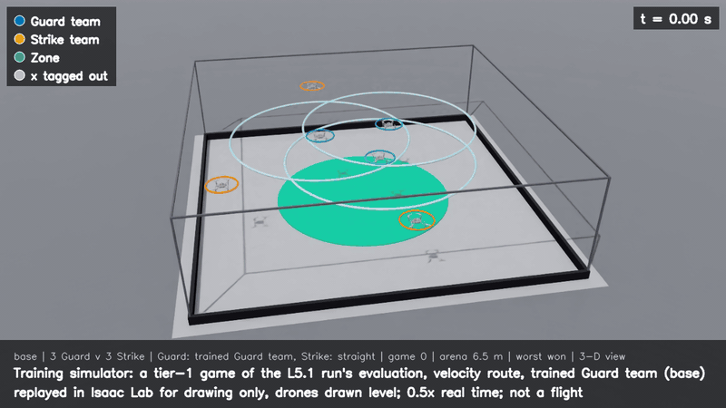

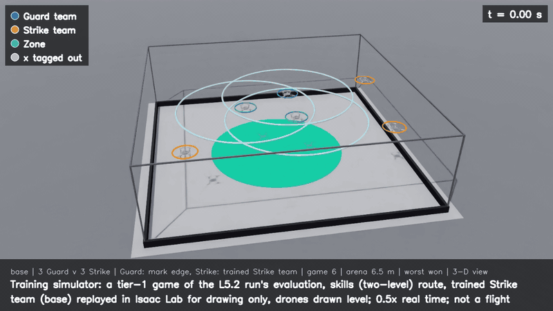

Every L5 run now also has 3-D clips in its run folder (`runs/<run>/videos3d/`, top view and 3-D view, MP4 + GIF; 68 clips, 0 failures), rendered by `scripts/ste_l5_clips3d.py` launched by hand after each run; the automatic post-run hook the owner asked for is still owed. Tier-1 games drawn in Isaac Lab; not a flight.

### Morning digest (work done overnight, 03:15–05:55)

**Plain summary.** Tested: the whole training pipeline for both routes (pure RL "velocity" and the two-level "skills" route), from pilots through training, scoring, export and reload. Happened: every required stage passed its controls; both routes read **PIPELINE WORKS** (INFO, one seed each, 2.29 of 20 GPU-h). Why it matters: the pipeline can now train, score and export a policy on either route; it is a pipeline check, not a training budget of record and not for flight. [Record](../../records/2026-11-25_ste_l3_l6_pipeline_record.md).

Worth a look:
1. **The skills route's run 0 mark was wrong and was re-set before the run.** The old 0.90 came from the 1v1 screen; in 3v3 no fixed choice gets near it (best 604 of 1,000). By the rule written before the ceiling run, the mark became 0.554. Skills run 0 then PASSED at 644 of 1,000 (above the best fixed choice).
2. **The skills Strike run did not beat its own training-cell script:** 176 of 1,000 against guard_mark_edge v 192 for the best script; its driver says "INCONCLUSIVE: did not learn". Every control passed, so it is a real result and was not re-run (R34). Across all five Guard scripts the two Strike policies are level on the pooled row (0.373 v 0.376); the skills Strike team's worst cell is higher (0.176 v 0.079).
3. **Guard side:** the velocity Guard policy is above the skills Guard policy in 5 of 6 cells and on the pooled row (0.963 v 0.895), both above the best single script.

| Task | Result |
|---|---|
| L3.1 Isaac smoke (tier 2) | PASS, 6 of 6 controls (T73) |
| L3.2 / L3.3 pilots | controls PASS (T74, T75); fill step: velocity Strike recipe = shaped |
| L3.4 velocity run 0 | PASS at update 10 (T76) |
| L3.5 skills run 0 mark | ceiling 604 → mark 0.554, oracle check PASS (T79) |
| L3.5 skills run 0 | PASS 644 / 1,000 (T81); reads 665–669 early, a dip to 461 at update 50, then 620–644 |
| L5.1 velocity Guard / Strike | 903 / 230 v best script 808 / 192 (T77, T80) |
| L5.2 skills Guard / Strike | 813 / 176 v 808 / 192 (T82, T84) |
| L5.3 / L5.4 pool-only Guard (attribution control) | 889 / 812; mask effect +0.005 velocity (above), +0.002 skills (not distinguishable) (T78, T83, T85) |
| L4.1 held-command arm | control PASS, per-cell counts (T88) |
| L4.2 scoring suite | PASS (T87) |
| L6.2 export + L6.1 reload and read | 4 exports reload in a fresh process; both routes PIPELINE WORKS (T86, T89) |

**R34 (recorded in DISCUSSION §16):** no GPU stage needed a bug re-run; 0 of the 2 GPU-h used. Two bugs of ours were fixed on the CPU side: the reader refused pilots that ran before the fill step (fixed, reviewed, `8c53fcdc`/`026fc00c`), and four CPU jobs were launched into the wrong folder level (re-launched, results byte-identical).

### Phases

| Phase | Status | Math library | Simulator | What |
|---|---|---|---|---|
| NUS port Phases 1–4 | DONE | JAX (NUS), PyTorch | NUS 2-D game (JAX); copy of NUS 2-D game (PyTorch); tier 1; tier 2 Isaac Lab | port, conversion, ladder rows |
| NUS port Phase 5 | PAUSED (5.1 FAIL T43) | PyTorch | tier 1 fast engine | route (b) stopped; STE Guard policy T41 kept |
| NUS port Phase 6 docs | DONE (passes 1, 2) | none | none | public docs |
| L0 Game definition | DONE (G0 ruled 22 Nov) | PyTorch | tier 1; tier 2 Isaac Lab | |
| L1 Drone model | DONE except L1.6 (waits on L1.3 + NEAR-962) | PyTorch | tier 1; tier 2; AirStack simulator (logs) | |
| L2 Game rules in training | DONE | PyTorch | tier 1; tier 2 Isaac Lab | |
| L3 Learner (two routes) | DONE (slices 1–3, pilots, run 0 both routes) | PyTorch | tier 1; tier 2 Isaac Lab (smoke) | |
| ▶ L4–L6 pipeline check | DONE, both routes PIPELINE WORKS (INFO) | PyTorch | tier 1 fast engine; tier 2 Isaac Lab (smoke); tier-1 games drawn in Isaac Lab (3-D clips) | 2.29 of 20 GPU-h |
| L7–L9 | NOT STARTED | — | AirStack simulator; real flight | owner's gate |

### Phase L3–L6 pipeline check, task by task

| ID | Plain name | Status | Simulator | Result |
|---|---|---|---|---|
| L3.1 | Isaac smoke of the tier-2 skills replay | PASS (T73) | tier 2 Isaac Lab | 6 of 6 controls; 2 clips |
| L3.2 | Velocity pilot | DONE (T74) | tier 1 | controls PASS |
| L3.3 | Skills pilot | DONE (T75) | tier 1 | controls PASS; B1 met |
| L3.4 | Velocity run 0 | PASS (T76) | tier 1 | 490 / 1,000 at update 10 |
| L3.5 | Skills run 0 (mark 0.554) | PASS (T79, T81) | tier 1 | 644 / 1,000 at the final checkpoint |
| L4.1 | Held-command arm | INFO (T88) | tier 1 (CPU) | hold-1 control 60 of 60 cells equal |
| L4.2 | Scoring suite on known players | PASS (T87) | tier 1 (CPU) | |
| L5.1 | Velocity route, pool + mask, Guard then Strike | DONE (T77, T80) | tier 1 | 903 / 230 |
| L5.2 | Skills route, pool + mask, Guard then Strike | DONE (T82, T84) | tier 1 | 813 / 176 |
| L5.3 | Velocity pool only, Guard (attribution) | DONE (T78) | tier 1 | 889 |
| L5.4 | Skills pool only: pilot + Guard (attribution) | DONE (T83, T85) | tier 1 | 812 |
| L6.2 | Export and reload check | PASS (T86) | CPU | 4 exports |
| L6.1 | Per-route reads and route comparison | INFO (T89) | CPU | both routes PIPELINE WORKS |
| side task | 3-D clips of every L5 run (owner's ask) | rendered for all six runs; automatic post-run hook owed | tier-1 games drawn in Isaac Lab | 68 clips, `scripts/ste_l5_clips3d.py` |

GPU-h in L3–L6 so far: 2.291 of 20 (RTX 5090 ledger; includes 0.189 for the 3-D clips, 0.138 renders + 0.051 smokes, charged to the L5 task caps). L1 + L2: 4.447 of 13 (incl. 0.008 for the L2.6 tier-2 clips tonight).

### Other workstreams

| ID | Plain name | Status |
|---|---|---|
| CLIP-T2 | L2.6 tier-2 clips on the fixed path | DONE: both tiers agree game for game (8 of 8, both cells); record T71 updated |
| side task | three tests that failed only in background-launched suites | DONE (SIGINT ignored in background jobs; fixed, reviewed, merged) |
| R34 | bug re-runs allowance (owner ruling) | recorded; not used |
| Suite | full suite on the final code (`026fc00c`) | PASS: 2,890 passed, 59 skipped, 0 failed (38 min). An earlier run tripped on a merge made while it ran (`test_timing` read HEAD twice; not a code fault) |

**Next.** 1) The automatic post-run 3-D clip hook (the owner's ask; today a script launched by hand). 2) The owner's look at the pipeline-check read (record T73–T89). 3) What L7 should be (the owner's gate; nothing launches without it).

**Waiting on you.**
1. **The pipeline-check read** ([record](../../records/2026-11-25_ste_l3_l6_pipeline_record.md)): both routes work; which route(s) to take further, and with what budget.
2. **The planned-pushes flight (NEAR-962)** and **the Crazyflie commanded gaps**: unchanged from 24 Nov.

**Usage:** GPU 2.30 GPU-h overnight (L3–L6 2.291, L2.6 clips 0.008); CPU jobs: ceiling, oracle check, scoring suite, held arm, exports, read, two full test suites; agents: one Opus builder (3-D clips, ~0.29 M tokens), six Sonnet reviewers (~0.47 M tokens), one Sonnet writer (~0.22 M tokens); advisor (Fable 5.2) three times (start, before done, final).

**Ready to push.** 22 commits on `development` ahead of `origin/development` (this status commit included); mirror updated if clean; push from GitHub Desktop. `main` unchanged. They hold the run-0 mark fill, the oracle check, the flake fix, R34, the L2.6 tier-2 clips, the 3-D clip script, the reader fix, the L3–L6 record (T73–T89) and this status.

## 2026-11-25 12:10

**Status, 2026-11-25 12:10 (+08:00), event: automatic 3-D clip hook merged; owner chose learner v2 before the route choice** · RTX 5090 · nothing training

Main track: L3–L6 pipeline check done; next the learner v2 note for the owner · Side track: automatic 3-D clip hook merged (on by default for training runs of record; QC one reviewer, fixes applied); clean-up of 45 worktrees and 52 branches (run data kept, copied by checksum into the dev worktree's `runs/`).

## 2026-11-25 14:28

**Status, 2026-11-25 14:28 (+08:00) (event: route 3 rulings R36–R41; execution workflow v3; its design review done)** · RTX 5090 · GPU 6 % / 49 W / 1.7 of 32 GB · 0 training processes (0 paused)

**Main track:** route 3 (the learned-skills route), stage LS1: design review done, **waiting on the owner's word for the build** · **Side track:** none (the learner v2 note follows LS1, R37)

**Plain summary.** Done: the owner's rulings on route 3 recorded (R36–R41); the execution workflow rewritten against the code and for the rulings (v3); two independent reviewers read it against the code. Happened: no reason found why the scripts could not be imitated (all eleven keep no memory and use only the drone's own view and slot), but one fault that would have stopped every head-training job at its first control, and fourteen further findings, all folded in. Why it matters: the build starts from a plan that has met the code; nothing is built or run yet, 0 GPU-h. [Workflow v3](../drafts/LS_EXECUTION_WORKFLOW.md) (section 0 is one screen; section 9 the review).

### Watch

Every L5 run now also has 3-D clips in its run folder (`runs/<run>/videos3d/`, top view and 3-D view, MP4 + GIF; 68 clips, 0 failures), rendered by `scripts/ste_l5_clips3d.py`. Since 25 Nov ~12:00 the job launcher starts it automatically after every finished training run of record (opt out `--no-post-clips3d`; state in `videos3d/HOOK_STATUS` and `ste_job.py status`); not yet run on the GPU with a real run. Tier-1 games drawn in Isaac Lab; not a flight.

Nothing new to watch: no run since the 12:10 status.

### Phases

| Phase | Status | Math library | Simulator | What |
|---|---|---|---|---|
| NUS port Phases 1–4 | DONE | JAX (NUS), PyTorch | NUS 2-D game (JAX); copy of NUS 2-D game (PyTorch); tier 1; tier 2 Isaac Lab | port, conversion, ladder rows |
| NUS port Phase 5 | PAUSED (5.1 FAIL T43) | PyTorch | tier 1 fast engine | route (b) stopped; STE Guard policy T41 kept |
| NUS port Phase 6 docs | DONE (passes 1, 2) | none | none | public docs |
| L0 Game definition | DONE (G0 ruled 22 Nov) | PyTorch | tier 1; tier 2 Isaac Lab | |
| L1 Drone model | DONE except L1.6 (waits on L1.3 + NEAR-962) | PyTorch | tier 1; tier 2; AirStack simulator (logs) | |
| L2 Game rules in training | DONE | PyTorch | tier 1; tier 2 Isaac Lab | |
| L3 Learner (two routes) | DONE | PyTorch | tier 1; tier 2 Isaac Lab (smoke) | |
| L4–L6 pipeline check | DONE, both routes PIPELINE WORKS (INFO) | PyTorch | tier 1 fast engine; tier 2 Isaac Lab (smoke) | 2.29 of 20 GPU-h |
| ▶ Route 3, LS1 Distil and LS1.4 Head training | NOT STARTED (design review DONE; WAITING on the owner's word) | PyTorch | tier 1 fast engine | the scripts copied into a skill network per team, then the heads trained on it |
| Route 3, LS2, self-play, LS3 | NOT STARTED (outlines; each needs its design note) | PyTorch | tier 1 fast engine | order by R41: LS2 → self-play → LS3 |
| L7–L9 | NOT STARTED | — | AirStack simulator; real flight | owner's gate |

### Route 3, stage LS1 and LS1.4, task by task

Task IDs from [the workflow v3](../drafts/LS_EXECUTION_WORKFLOW.md) sections 5 and 6.

| ID | Plain name | Status | Simulator | Result / ETA |
|---|---|---|---|---|
| — | Design review of the workflow and the plan (two reviewers) | DONE | none | 1 blocker, 14 further findings, folded in |
| — | Task plan rewritten from v3 and the two review reports | WAITING (owner's word) | none | first step of the build |
| M1–M4 | The four merges (skill network and switch; distillation and its read; export and clips; driver control and LS1.4 files) | NOT STARTED | CPU tests | estimate 2 to 4 days of agent work |
| LS1.5 | Calibration read (which errors the gate lets through) | NOT STARTED | tier 1 (CPU) | after M1; then the owner sets the limits (R38) |
| LS1.0 | Smoke of the distillation and the read | NOT STARTED | tier 1 (CPU) | after M2 |
| LS1.1 | Distil the Guard and Strike skills | NOT STARTED | tier 1 | asks 0.8 GPU-h |
| LS1.2 | Equivalence read, both sides | NOT STARTED | tier 1 (CPU) | 150 and 130 cells of 1,000 games |
| LS1.3 | Export and reload of both skill networks | NOT STARTED | CPU | |
| LS1.6 | 3-D clips of key games | NOT STARTED | tier-1 games drawn in Isaac Lab | asks 0.1 GPU-h |
| LS1.4 | Head training on the skill network, both sides, two seeds per arm | NOT STARTED | tier 1 | asks 4.0 GPU-h; needs the owner's confirmation of R39's reading |

GPU-h on route 3 so far: 0. L3–L6: 2.291 of 20 (RTX 5090 ledger). L1 + L2: 4.447 of 13 (`ste_job.py status`: own rows 0.907, carried 3.540).

### Other workstreams

| ID | Plain name | Status |
|---|---|---|
| — | Learner v2 note (observation v0.3, attention encoder, shared actor, team critic, league) | NOT STARTED: after LS1 (R37); its league part is pulled forward as route 3's pool entry for saved teams |
| — | Route page, figures and slides of route 3 redrawn for R39–R41 | WAITING on the owner's yes |
| NEAR-962 | Planned-pushes flight; the Crazyflie commanded gaps | unchanged from 24 Nov |

**Next.** 1) On the owner's word: the task plan rewritten from v3 and the review reports, read by one reviewer; then merge M1. 2) LS1.5 calibration read after M1, then the limits to the owner. 3) Nothing on the GPU before the gate file is hashed.

**Waiting on you.**
1. **The word for the route 3 build** (merges M1 to M4, then the jobs of workflow sections 5 and 6): blocks everything.
2. **The reading of R39** (no cap on all stages; every job states its hours; a job above 5 GPU-h announced; 200 in the settings file): until confirmed, GPU launches stay inside R36's 1.0 GPU-h; blocks LS1.4.
3. **Self-play timing** (the pool entry built early and a pilot after LS1.4; the full stage before LS2 only if the pilot shows room): blocks the self-play note.
4. **Redraw the route page and slides** for R39–R41: yes or no.
5. Later: the LS1 limits and the LS1.4 margin (R38), after LS1.5.

**Usage:** GPU 0. Agents: two Sonnet reviewers (A 0.18 M tokens, 7 min; B 0.31 M tokens, 14 min). Main session: Fable 5.2 (the owner's choice for this planning session); advisor tool four times (before the first draft, before v3, at the review fold-in, before done). Checks: the short document check and the document test set, four times (170 passed, 2 skipped each); no full suite (documents only).

**Ready to push.** 4 commits on `development` (`a133ba25`, `28184629`, `84ac01bf`, `b869520e`, plus this status): rulings R36–R41, workflow v3 with the design review, the two review reports; mirror updated; push from GitHub Desktop. `main` unchanged.

## 2026-11-25 19:48

**Status, 2026-11-25 19:48 (+08:00) (asked: full status)** · RTX 5090 · GPU 3 % / 49 W / 1.8 of 32 GB · 0 training processes (0 paused)

**Main track:** route 3 (the learned-skills route), merge M1: 6 of 7 tasks built and through QC, the last (T7, the calibration read) being built · **Side track:** none

**Plain summary.** Since 14:28: the owner's rulings R42 to R47 (the build's go, no cap confirmed, self-play timing, page redraw, a run 0 per Strike seed, shorter stop rules); the builder's task plan for LS1 and LS1.4 written and checked against the code in two rounds (12 serious findings fixed; round 2's fixes not re-checked); the route page, figures and slides redrawn; merge M1 built task by task, each passing independent QC the first time. The pipeline check's six trained checkpoints, four exports and saved settings load unchanged with M1's code (checked by the lead). Nothing trained, 0 GPU-h on route 3.

### Watch

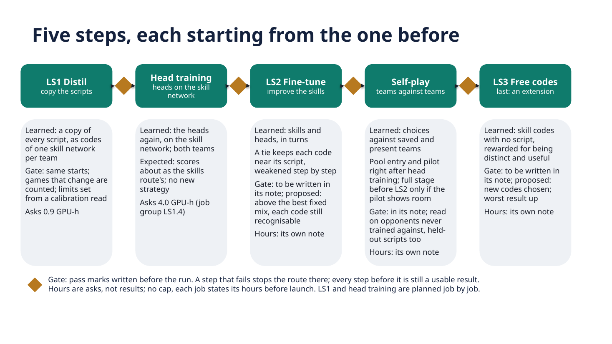

The new order of route 3's steps (R41). Nothing is built or run on the GPU yet.

### Phases

| Phase | Status | Math library | Simulator | What |
|---|---|---|---|---|
| NUS port Phases 1–4 | DONE | JAX (NUS), PyTorch | NUS 2-D game (JAX); copy of NUS 2-D game (PyTorch); tier 1; tier 2 Isaac Lab | port, conversion, ladder rows |
| NUS port Phase 5 | PAUSED (5.1 FAIL T43) | PyTorch | tier 1 fast engine | route (b) stopped; STE Guard policy T41 kept |
| NUS port Phase 6 docs | DONE (passes 1, 2) | none | none | public docs |
| L0 Game definition | DONE (G0 ruled 22 Nov) | PyTorch | tier 1; tier 2 Isaac Lab | |
| L1 Drone model | DONE except L1.6 (waits on L1.3 + NEAR-962) | PyTorch | tier 1; tier 2; AirStack simulator (logs) | |
| L2 Game rules in training | DONE | PyTorch | tier 1; tier 2 Isaac Lab | |
| L3 Learner (two routes) | DONE | PyTorch | tier 1; tier 2 Isaac Lab (smoke) | |
| L4–L6 pipeline check | DONE, both routes PIPELINE WORKS (INFO) | PyTorch | tier 1 fast engine; tier 2 Isaac Lab (smoke) | 2.29 of 20 GPU-h |
| ▶ Route 3, LS1 Distil and LS1.4 Head training | BUILDING (merge M1 of four) | PyTorch | tier 1 fast engine | the scripts copied into a skill network per team, then the heads trained on it |
| Route 3, LS2, self-play, LS3 | NOT STARTED (each needs its design note) | PyTorch | tier 1 fast engine | order by R41 |
| L7–L9 | NOT STARTED | — | AirStack simulator; real flight | owner's gate |

### Route 3, merge M1, task by task

From [the task plan](../drafts/LS1_TASK_PLAN.md) section 2; branch `ls1-m1`, worktree `~/AirStack-starling-max2-ls1m1`.

| ID | Plain name | Status | Simulator | Result / ETA |
|---|---|---|---|---|
| — | Design check of M1 against the code (two parts) | DONE | none | no blocker; corrections passed to the builders |
| LS1-M1-T1 | The route's budget section `[budget_ls]` and task IDs | DONE, QC PASS | none | `604b76fd` |
| LS1-M1-T2 | Job status shows the route's hours; hours carried from the other machine | DONE, QC PASS | none | `e3574028` |
| LS1-M1-T3 | The skill network: two paths, save and load with refusals | DONE, QC PASS | tier 1 (CPU tests) | `254079e4` |
| LS1-M1-T4 | The setting that switches skills to the network; net-backed dispatch | DONE, QC PASS | tier 1 (CPU tests) | `bf86d183` |
| — | The pipeline check's real files with M1's code | PASS | CPU | 6 checkpoints load, 4 exports reload, pilot and run 0 settings equal |
| — | `test_dependencies` broken on `development` since `402a66ab` (deck script imports) | FIXED on the branch | none | `c45a7736` |
| LS1-M1-T5 | Game set-ups of the reads, either team | DONE, QC PASS | tier 1 (CPU tests) | `74c64ca6` |
| LS1-M1-T6 | Deliberately changed scripts for the calibration (own file) | DONE, QC PASS | tier 1 (CPU tests) | `c9b78872` |
| LS1-M1-T7 | Paired statistics and the calibration read (job LS1.5) | RUNNING (builder) | tier 1 (CPU) | then its QC |
| — | Full test suite on the M1 branch | QUEUED | CPU | about 40 min, nothing merged while it runs |
| LS1.5 | Calibration read | QUEUED (after the merge) | tier 1 (CPU) | then the owner sets the limits (R38) |

GPU-h on route 3 so far: 0 (`[budget_ls]`, 200 by R43). L3–L6: 2.291 of 20. L1 + L2: 4.447 of 13 (`ste_job.py status`: own rows 0.907, carried 3.540).

### Other workstreams

| ID | Plain name | Status |
|---|---|---|
| — | Route 3 route page, figures and slides redrawn (R45) | DONE, one reviewer, merged |
| — | Route 3 builder's task plan | DONE, two check rounds, merged; round 2's fixes not re-checked |
| — | Learner v2 note | NOT STARTED: after LS1 (R37) |
| NEAR-962 | Planned-pushes flight; the Crazyflie commanded gaps | unchanged from 24 Nov |

**Next.** 1) LS1-M1-T7 and its QC, then the full suite on the M1 branch, then merge M1 into `development`. 2) LS1.5 calibration read (CPU), then the limit options to the owner. 3) Merge M2 (distillation and the copy check) in parallel with the owner's limits.

**Waiting on you.** Nothing now. Next: the LS1 pass limits and the LS1.4 margin (R38, after LS1.5).

**Usage:** GPU 0 on route 3. Agents since 14:28: the task-plan workflow (33 runs, 5.1 M tokens: Opus scouts, writer, fixer; Sonnet checkers and refuters), M1 part 1 (9 runs, 1.1 M tokens), M1 part 2 (6 runs so far). Advisor (Fable 5.2) twice since 14:28 (before M1, after the plan). Checks: docs check and the document test set at each docs merge; no full suite yet (M1's comes before its merge).

**Ready to push.** 13 commits on `development` (`d70b4e01` to `97e85a31`, plus this status): rulings R42 to R47, the route page redraw, the task plan, HANDOFF; mirror updated; push from GitHub Desktop. `main` unchanged.

## 2026-11-26 14:30

**Status, 2026-11-26 14:30 (+08:00) (event: LS1 copy check NOT DISTILLED, diagnosis reviewed; owner decision needed)** · RTX 5090 · GPU 1 % / 36 W / 1.2 of 32 GB · 0 training processes (0 paused)

**Main track:** route 3 (the learned-skills route), stage LS1: the copy check failed on both teams; waiting on the owner (spend the one fix round, or stop LS1) · **Side track:** none

**Plain summary.** One network per team was trained to copy its hand-written skills (LS1.1, T93, 0.17 GPU-h) and played against the scripts in the copy check (LS1.2, T94, CPU). Every control passed, so the result is real: **NOT DISTILLED on both teams.** Strike's flank, sacrifice and converge are 4 to 7 times over the 0.05 command-error limit. Guard misses mirror narrowly, field by about 2 times, and the parked-at-centre skill (which must output zero) by about 7 times. The diagnosis says the network is under-trained, not misled. Its scratch trials show that even one skill alone in its own network stays 2 to 3 times over the limit with the levers the fix round may use. **The lead recommends stopping LS1 now** and re-scoping the next build. That build would use inputs in each drone's own frame (flank reached 0.045 alone with them), a network or output head per skill, a fit schedule, and an exact zero for the parked skills.

## Watch

| The scripts fly flank | The LS1.1 network on the same start |
|---|---|
| 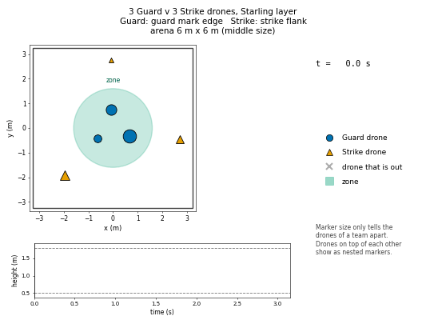 |  |

2-D top-down clips with the height panel, game 0 of LS1.1. Flank is the skill the network copies worst (0.33 command error against 0.05).

## Phases

| Phase | Status | Math library | Simulator | What |
|---|---|---|---|---|
| NUS port Phases 1–4 | DONE | JAX (NUS), PyTorch | NUS 2-D game (JAX); copy of NUS 2-D game (PyTorch); tier 1; tier 2 Isaac Lab | port, conversion, ladder rows |
| NUS port Phase 5 | PAUSED (5.1 FAIL T43) | PyTorch | tier 1 fast engine | route (b) stopped; STE Guard policy T41 kept |
| NUS port Phase 6 docs | DONE (passes 1, 2) | none | none | public docs |
| L0 Game definition | DONE (G0 ruled 22 Nov) | PyTorch | tier 1; tier 2 Isaac Lab | |
| L1 Drone model | DONE except L1.6 (waits on L1.3 + NEAR-962) | PyTorch | tier 1; tier 2; AirStack simulator (logs) | |
| L2 Game rules in training | DONE | PyTorch | tier 1; tier 2 Isaac Lab | |
| L3 Learner (two routes) | DONE | PyTorch | tier 1; tier 2 Isaac Lab (smoke) | |
| L4–L6 pipeline check | DONE, both routes PIPELINE WORKS (INFO) | PyTorch | tier 1 fast engine; tier 2 Isaac Lab (smoke) | 2.29 of 20 GPU-h |
| ▶ Route 3, LS1 Distil | NOT DISTILLED, both teams (T94); owner decision: fix round or stop | PyTorch | tier 1 fast engine | the scripts copied into a skill network per team |
| Route 3, LS1.4 Head training | BUILT (M4 merged), NOT STARTED: needs both teams DISTILLED | PyTorch | tier 1 fast engine | the heads trained on the skill network, both sides |
| Route 3, LS2, self-play, LS3 | NOT STARTED (each needs its design note) | PyTorch | tier 1 fast engine | order by R41 |
| L7–L9 | NOT STARTED | — | AirStack simulator; real flight | owner's gate |

## Route 3, stage LS1, task by task

| ID | Plain name | Status | Simulator | Result |
|---|---|---|---|---|
| M1–M4 | The build: skill network, calibration, distillation, copy check, export, head training | DONE, all four merged (full suite 3,425 passed at M4) | tier 1 (CPU tests) | `79a3e10c` |
| LS1.5 | Calibration read, then the top-up (owner R48) | DONE (T90, T91, INFO) | tier 1 (CPU) | limits set by the owner (R48) |
| LS1.0 | Smokes and the CUDA label probe | DONE (T92, INFO) | tier 1; GPU probe | labels bit-equal on CUDA |
| LS1.1 | Distillation, one skill network per team | DONE (T93, INFO) | tier 1 (GPU) | 0.172 of 0.8 GPU-h |
| LS1.2 | Copy check against the scripts | **NOT DISTILLED** both teams (T94); every control PASS | tier 1 (CPU) | Guard 18 limit failures, Strike 98 |
| — | Diagnosis and the fix-round proposal | DONE, two reviewers (numbers, reasoning) | CPU scratch pilots | [proposal](../drafts/LS1_FIX_ROUND_PROPOSAL.md), section 0b the lead's recommendation |
| LS1.1-fix, LS1.2-fix | The one fix round the stop rules allow (R47) | WAITING ON THE OWNER | tier 1 (GPU, then CPU) | 0.62 GPU-h asked, about 1 h CPU; expected NOT DISTILLED again |

GPU-h on route 3: 0.172 of 200 (`[budget_ls]`, R43).

## Other workstreams

| ID | Plain name | Status |
|---|---|---|
| — | Learner v2 note | NOT STARTED: after LS1 (R37) |
| NEAR-962 | Planned-pushes flight; the Crazyflie commanded gaps | unchanged from 24 Nov |

**Next.** On the owner's word: either the fix round (new gate-file hash, LS1.1-fix on the GPU, LS1.2-fix on the CPU, record with two reviewers), or LS1 closed on T94 and a design note for the re-scoped build.

**Waiting on you.** Spend the one LS1 fix round (0.62 GPU-h, expected to fail again), or stop LS1 now and have the lead draft the re-scoped build (own-frame inputs, a network or head per skill, a fit schedule, an exact zero). The lead recommends stopping.

**Usage:** GPU 0.172 h on route 3 (LS1.1 and the probe). The diagnosis workflow: 5 agents, 859k tokens, 2.6 h (analyst, record writer, two reviewers, reviser). The M4 full suite took about 40 min of CPU. Advisor (Fable 5.2, advisor tool) once after the diagnosis. Checks: the docs check and the document test set for this docs-only commit.

**Ready to push.** 39 commits on `development` (up to this status commit); mirror to update after the commit; push from GitHub Desktop. `main` unchanged.

## 2026-11-26 15:30

**Status, 2026-11-26 15:30 (+08:00) (event: owner ruling R49, LS1 stopped; redesign started)** · RTX 5090 · GPU 1 % / 36 W / 1.2 of 32 GB · 0 training processes (0 paused)

**Main track:** route 3 (the learned-skills route), stage LS1 stopped on T94 (R49); the skill network's redesign is being drafted (design note, then CPU trials of every skill) · **Side track:** none

**Plain summary.** One network per team was trained to copy its hand-written skills (LS1.1, T93, 0.17 GPU-h) and played against the scripts in the copy check (LS1.2, T94, CPU). Every control passed, so the result is real: **NOT DISTILLED on both teams.** Strike's flank, sacrifice and converge are 4 to 7 times over the 0.05 command-error limit. Guard misses mirror narrowly, field by about 2 times, and the parked-at-centre skill (which must output zero) by about 7 times. The diagnosis says the network is under-trained, not misled. Its scratch trials show that even one skill alone in its own network stays 2 to 3 times over the limit with the levers the fix round may use. **The lead recommends stopping LS1 now** and re-scoping the next build. That build would use inputs in each drone's own frame (flank reached 0.045 alone with them), a network or output head per skill, a fit schedule, and an exact zero for the parked skills.

## Watch

| The scripts fly flank | The LS1.1 network on the same start |
|---|---|
|  |  |

2-D top-down clips with the height panel, game 0 of LS1.1. Flank is the skill the network copies worst (0.33 command error against 0.05).

## Phases

| Phase | Status | Math library | Simulator | What |
|---|---|---|---|---|
| NUS port Phases 1–4 | DONE | JAX (NUS), PyTorch | NUS 2-D game (JAX); copy of NUS 2-D game (PyTorch); tier 1; tier 2 Isaac Lab | port, conversion, ladder rows |
| NUS port Phase 5 | PAUSED (5.1 FAIL T43) | PyTorch | tier 1 fast engine | route (b) stopped; STE Guard policy T41 kept |
| NUS port Phase 6 docs | DONE (passes 1, 2) | none | none | public docs |
| L0 Game definition | DONE (G0 ruled 22 Nov) | PyTorch | tier 1; tier 2 Isaac Lab | |
| L1 Drone model | DONE except L1.6 (waits on L1.3 + NEAR-962) | PyTorch | tier 1; tier 2; AirStack simulator (logs) | |
| L2 Game rules in training | DONE | PyTorch | tier 1; tier 2 Isaac Lab | |
| L3 Learner (two routes) | DONE | PyTorch | tier 1; tier 2 Isaac Lab (smoke) | |
| L4–L6 pipeline check | DONE, both routes PIPELINE WORKS (INFO) | PyTorch | tier 1 fast engine; tier 2 Isaac Lab (smoke) | 2.29 of 20 GPU-h |
| ▶ Route 3, LS1 Distil | STOPPED on T94 (NOT DISTILLED, both teams; R49); redesign being drafted | PyTorch | tier 1 fast engine | the scripts copied into a skill network per team |
| Route 3, LS1.4 Head training | BUILT (M4 merged), NOT STARTED: needs both teams DISTILLED | PyTorch | tier 1 fast engine | the heads trained on the skill network, both sides |
| Route 3, LS2, self-play, LS3 | NOT STARTED (each needs its design note) | PyTorch | tier 1 fast engine | order by R41 |
| L7–L9 | NOT STARTED | — | AirStack simulator; real flight | owner's gate |

## Route 3, stage LS1, task by task

| ID | Plain name | Status | Simulator | Result |
|---|---|---|---|---|
| M1–M4 | The build: skill network, calibration, distillation, copy check, export, head training | DONE, all four merged (full suite 3,425 passed at M4) | tier 1 (CPU tests) | `79a3e10c` |
| LS1.5 | Calibration read, then the top-up (owner R48) | DONE (T90, T91, INFO) | tier 1 (CPU) | limits set by the owner (R48) |
| LS1.0 | Smokes and the CUDA label probe | DONE (T92, INFO) | tier 1; GPU probe | labels bit-equal on CUDA |
| LS1.1 | Distillation, one skill network per team | DONE (T93, INFO) | tier 1 (GPU) | 0.172 of 0.8 GPU-h |
| LS1.2 | Copy check against the scripts | **NOT DISTILLED** both teams (T94); every control PASS | tier 1 (CPU) | Guard 18 limit failures, Strike 98 |
| — | Diagnosis and the fix-round proposal | DONE, two reviewers (numbers, reasoning) | CPU scratch pilots | [proposal](../drafts/LS1_FIX_ROUND_PROPOSAL.md), section 0b the lead's recommendation |
| LS1.1-fix, LS1.2-fix | The one fix round the stop rules allow (R47) | NOT SPENT (owner R49) | — | — |
| — | Redesign of the skill network: design note, pilot marks, two reviewers | RUNNING | none (CPU trials after the note) | then CPU trials of every skill, then the owner's approval before any build |

GPU-h on route 3: 0.172 of 200 (`[budget_ls]`, R43).

## Other workstreams

| ID | Plain name | Status |
|---|---|---|
| — | Learner v2 note | NOT STARTED: after LS1 (R37) |
| NEAR-962 | Planned-pushes flight; the Crazyflie commanded gaps | unchanged from 24 Nov |

**Next.** The redesign note (inputs, network shape, fit schedule, the exact zero, and a scripts-plus-correction option), with pilot pass marks written before any trial; two reviewers; then CPU trials of every skill of both teams. One finding shapes it: moves that passed the command check (0.02 to 0.035) still changed up to 44 games in a cell, and the calibration puts the 30-game limit near a random error of 0.01 or a steady bias under 0.01, so the real target is near 0.01, not 0.05.

**Waiting on you.** Nothing now. Next: the redesign note and its trial results, before any build.

**Usage:** GPU 0.172 h on route 3 (LS1.1 and the probe). The diagnosis workflow: 5 agents, 859k tokens, 2.6 h (analyst, record writer, two reviewers, reviser). The M4 full suite took about 40 min of CPU. Advisor (Fable 5.2, advisor tool) once after the diagnosis. Checks: the docs check and the document test set for this docs-only commit.

**Ready to push.** 39 commits on `development` (up to this status commit); mirror to update after the commit; push from GitHub Desktop. `main` unchanged.

## 2026-11-26 18:10

**Status, 2026-11-26 18:10 (+08:00) (event: redesign note written and reviewed; owner go needed for Stage 0)** · RTX 5090 · GPU 1 % / 36 W / 1.2 of 32 GB · 0 training processes (0 paused)

**Main track:** route 3 (the learned-skills route), stage LS1 stopped on T94 (R49); redesign note done ([LS1_REDESIGN.md](../drafts/LS1_REDESIGN.md)); asking the owner for a go on Stage 0 (no training, about 1 to 2 h of CPU) · **Side track:** none

**Plain summary.** One network per team was trained to copy its hand-written skills (LS1.1, T93, 0.17 GPU-h) and played against the scripts in the copy check (LS1.2, T94, CPU). Every control passed, so the result is real: **NOT DISTILLED on both teams.** Strike's flank, sacrifice and converge are 4 to 7 times over the 0.05 command-error limit. Guard misses mirror narrowly, field by about 2 times, and the parked-at-centre skill (which must output zero) by about 7 times. The diagnosis says the network is under-trained, not misled. Its scratch trials show that even one skill alone in its own network stays 2 to 3 times over the limit with the levers the fix round may use. **The lead recommends stopping LS1 now** and re-scoping the next build. That build would use inputs in each drone's own frame (flank reached 0.045 alone with them), a network or output head per skill, a fit schedule, and an exact zero for the parked skills.

## Watch

| The scripts fly flank | The LS1.1 network on the same start |
|---|---|
|  |  |

2-D top-down clips with the height panel, game 0 of LS1.1. Flank is the skill the network copies worst (0.33 command error against 0.05).

## Phases

| Phase | Status | Math library | Simulator | What |
|---|---|---|---|---|
| NUS port Phases 1–4 | DONE | JAX (NUS), PyTorch | NUS 2-D game (JAX); copy of NUS 2-D game (PyTorch); tier 1; tier 2 Isaac Lab | port, conversion, ladder rows |
| NUS port Phase 5 | PAUSED (5.1 FAIL T43) | PyTorch | tier 1 fast engine | route (b) stopped; STE Guard policy T41 kept |
| NUS port Phase 6 docs | DONE (passes 1, 2) | none | none | public docs |
| L0 Game definition | DONE (G0 ruled 22 Nov) | PyTorch | tier 1; tier 2 Isaac Lab | |
| L1 Drone model | DONE except L1.6 (waits on L1.3 + NEAR-962) | PyTorch | tier 1; tier 2; AirStack simulator (logs) | |
| L2 Game rules in training | DONE | PyTorch | tier 1; tier 2 Isaac Lab | |
| L3 Learner (two routes) | DONE | PyTorch | tier 1; tier 2 Isaac Lab (smoke) | |
| L4–L6 pipeline check | DONE, both routes PIPELINE WORKS (INFO) | PyTorch | tier 1 fast engine; tier 2 Isaac Lab (smoke) | 2.29 of 20 GPU-h |
| ▶ Route 3, LS1 Distil | STOPPED on T94 (NOT DISTILLED, both teams; R49); redesign being drafted | PyTorch | tier 1 fast engine | the scripts copied into a skill network per team |
| Route 3, LS1.4 Head training | BUILT (M4 merged), NOT STARTED: needs both teams DISTILLED | PyTorch | tier 1 fast engine | the heads trained on the skill network, both sides |
| Route 3, LS2, self-play, LS3 | NOT STARTED (each needs its design note) | PyTorch | tier 1 fast engine | order by R41 |
| L7–L9 | NOT STARTED | — | AirStack simulator; real flight | owner's gate |

## Route 3, stage LS1, task by task

| ID | Plain name | Status | Simulator | Result |
|---|---|---|---|---|
| M1–M4 | The build: skill network, calibration, distillation, copy check, export, head training | DONE, all four merged (full suite 3,425 passed at M4) | tier 1 (CPU tests) | `79a3e10c` |
| LS1.5 | Calibration read, then the top-up (owner R48) | DONE (T90, T91, INFO) | tier 1 (CPU) | limits set by the owner (R48) |
| LS1.0 | Smokes and the CUDA label probe | DONE (T92, INFO) | tier 1; GPU probe | labels bit-equal on CUDA |
| LS1.1 | Distillation, one skill network per team | DONE (T93, INFO) | tier 1 (GPU) | 0.172 of 0.8 GPU-h |
| LS1.2 | Copy check against the scripts | **NOT DISTILLED** both teams (T94); every control PASS | tier 1 (CPU) | Guard 18 limit failures, Strike 98 |
| — | Diagnosis and the fix-round proposal | DONE, two reviewers (numbers, reasoning) | CPU scratch pilots | [proposal](../drafts/LS1_FIX_ROUND_PROPOSAL.md), section 0b the lead's recommendation |
| LS1.1-fix, LS1.2-fix | The one fix round the stop rules allow (R47) | NOT SPENT (owner R49) | — | — |
| — | Redesign of the skill network: design note, pilot marks, two reviewers | DONE (`c1bebc9a`); rules added after review in focused re-review | none | [LS1_REDESIGN.md](../drafts/LS1_REDESIGN.md) |
| P0 | Stage 0 of the pilots: harness check, de-bias and mask replay, blended-switch replay, ONNX check (no training) | WAITING ON THE OWNER (go) | tier 1 (CPU) | about 1.5 to 2 h one at a time, 0 GPU-h; decides whether a learnable copy can pass at all |

GPU-h on route 3: 0.172 of 200 (`[budget_ls]`, R43).

## Other workstreams

| ID | Plain name | Status |
|---|---|---|
| — | Learner v2 note | NOT STARTED: after LS1 (R37) |
| NEAR-962 | Planned-pushes flight; the Crazyflie commanded gaps | unchanged from 24 Nov |

**Next.** The redesign note (inputs, network shape, fit schedule, the exact zero, and a scripts-plus-correction option), with pilot pass marks written before any trial; two reviewers; then CPU trials of every skill of both teams. One finding shapes it: moves that passed the command check (0.02 to 0.035) still changed up to 44 games in a cell, and the calibration puts the 30-game limit near a random error of 0.01 or a steady bias under 0.01, so the real target is near 0.01, not 0.05.

**Waiting on you.** A go for Stage 0 of the pilots (no training, CPU only, about 1 to 2 h). The later decisions wait for its result.

**Usage:** GPU 0.172 h on route 3 (LS1.1 and the probe). The diagnosis workflow: 5 agents, 859k tokens, 2.6 h (analyst, record writer, two reviewers, reviser). The M4 full suite took about 40 min of CPU. Advisor (Fable 5.2, advisor tool) once after the diagnosis. Checks: the docs check and the document test set for this docs-only commit.

**Ready to push.** 39 commits on `development` (up to this status commit); mirror to update after the commit; push from GitHub Desktop. `main` unchanged.
