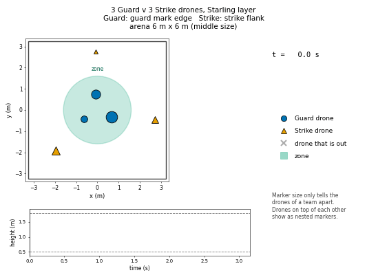

INTERNAL · the latest status of STE's own learning track and the NUS port, overwritten at every update by the `train-status` skill · [../README.md](../README.md); the history: [LOG.md](LOG.md)

**Status, 2026-11-27 01:59 (+08:00) (event: R50 trials started; Stage 0a PASS)** · RTX 5090 · GPU 6 % / 49 W / 1.8 of 32 GB · 0 training processes (0 paused)

**Main track:** route 3 (the learned-skills route), stage LS1 stopped on T94 (R49); redesign note done ([LS1_REDESIGN.md](../drafts/LS1_REDESIGN.md)); R50 pilot trials RUNNING (CPU only, up to 4 jobs): Stage 0a PASS; 0b to 0e and Stage 1 fits queued or running · **Side track:** none

**Plain summary.** One network per team was trained to copy its hand-written skills (LS1.1, T93, 0.17 GPU-h) and played against the scripts in the copy check (LS1.2, T94, CPU). Every control passed, so the result is real: **NOT DISTILLED on both teams.** Strike's flank, sacrifice and converge are 4 to 7 times over the 0.05 command-error limit. Guard misses mirror narrowly, field by about 2 times, and the parked-at-centre skill (which must output zero) by about 7 times. The diagnosis says the network is under-trained, not misled. Its scratch trials show that even one skill alone in its own network stays 2 to 3 times over the limit with the levers the fix round may use. **The lead recommends stopping LS1 now** and re-scoping the next build. That build would use inputs in each drone's own frame (flank reached 0.045 alone with them), a network or output head per skill, a fit schedule, and an exact zero for the parked skills.

## Watch

The route 3 flowchart, redrawn 26 Nov: LS1 stopped, the redesign's CPU trials below it (Stage 0 on hold).

| The scripts fly flank | The LS1.1 network on the same start |
|---|---|
|  |  |

2-D top-down clips with the height panel, game 0 of LS1.1. Flank is the skill the network copies worst (0.33 command error against 0.05).

## Phases

| Phase | Status | Math library | Simulator | What |
|---|---|---|---|---|
| NUS port Phases 1–4 | DONE | JAX (NUS), PyTorch | NUS 2-D game (JAX); copy of NUS 2-D game (PyTorch); tier 1; tier 2 Isaac Lab | port, conversion, ladder rows |
| NUS port Phase 5 | PAUSED (5.1 FAIL T43) | PyTorch | tier 1 fast engine | route (b) stopped; STE Guard policy T41 kept |
| NUS port Phase 6 docs | DONE (passes 1, 2) | none | none | public docs |
| L0 Game definition | DONE (G0 ruled 22 Nov) | PyTorch | tier 1; tier 2 Isaac Lab | |
| L1 Drone model | DONE except L1.6 (waits on L1.3 + NEAR-962) | PyTorch | tier 1; tier 2; AirStack simulator (logs) | |
| L2 Game rules in training | DONE | PyTorch | tier 1; tier 2 Isaac Lab | |
| L3 Learner (two routes) | DONE | PyTorch | tier 1; tier 2 Isaac Lab (smoke) | |
| L4–L6 pipeline check | DONE, both routes PIPELINE WORKS (INFO) | PyTorch | tier 1 fast engine; tier 2 Isaac Lab (smoke) | 2.29 of 20 GPU-h |
| ▶ Route 3, LS1 Distil | STOPPED on T94 (NOT DISTILLED, both teams; R49); redesign being drafted | PyTorch | tier 1 fast engine | the scripts copied into a skill network per team |
| Route 3, LS1.4 Head training | BUILT (M4 merged), NOT STARTED: needs both teams DISTILLED | PyTorch | tier 1 fast engine | the heads trained on the skill network, both sides |
| Route 3, LS2, self-play, LS3 | NOT STARTED (each needs its design note) | PyTorch | tier 1 fast engine | order by R41 |
| L7–L9 | NOT STARTED | — | AirStack simulator; real flight | owner's gate |

## Route 3, stage LS1, task by task

| ID | Plain name | Status | Simulator | Result |
|---|---|---|---|---|
| M1–M4 | The build: skill network, calibration, distillation, copy check, export, head training | DONE, all four merged (full suite 3,425 passed at M4) | tier 1 (CPU tests) | `79a3e10c` |
| LS1.5 | Calibration read, then the top-up (owner R48) | DONE (T90, T91, INFO) | tier 1 (CPU) | limits set by the owner (R48) |
| LS1.0 | Smokes and the CUDA label probe | DONE (T92, INFO) | tier 1; GPU probe | labels bit-equal on CUDA |
| LS1.1 | Distillation, one skill network per team | DONE (T93, INFO) | tier 1 (GPU) | 0.172 of 0.8 GPU-h |
| LS1.2 | Copy check against the scripts | **NOT DISTILLED** both teams (T94); every control PASS | tier 1 (CPU) | Guard 18 limit failures, Strike 98 |
| — | Diagnosis and the fix-round proposal | DONE, two reviewers (numbers, reasoning) | CPU scratch pilots | [proposal](../drafts/LS1_FIX_ROUND_PROPOSAL.md), section 0b the lead's recommendation |
| LS1.1-fix, LS1.2-fix | The one fix round the stop rules allow (R47) | NOT SPENT (owner R49) | — | — |
| — | Redesign of the skill network: design note, pilot marks, two reviewers | DONE (`c1bebc9a`); rules fixed after the focused re-review (`6625cf82`) | none | [LS1_REDESIGN.md](../drafts/LS1_REDESIGN.md) |
| — | Route 3 flowcharts redrawn: LS1 stopped, the redesign trials (owner asked) | DONE, one review round (numbers: no finding; completeness: 1 blocker, 4 minor, all fixed) | none | [route page](../LEARNED_SKILLS_ROUTE.md) |
| P0 | Stage 0 of the pilots: harness check, de-bias and mask replay, blended-switch replay, ONNX check (no training) | RUNNING: 0a PASS (the saved networks reproduce T94 cell for cell: 44, 122, 64; the script oracle 0 changed games); 0c field passes at 1 and 3 cm; 0b, 0c flank/sacrifice/converge, 0d, 0e running or queued | tier 1 (CPU) | about 1.5 to 2 h one at a time, 0 GPU-h; decides whether a learnable copy can pass at all |

GPU-h on route 3: 0.172 of 200 (`[budget_ls]`, R43).

## Other workstreams

| ID | Plain name | Status |
|---|---|---|
| — | Learner v2 note | NOT STARTED: after LS1 (R37) |
| NEAR-962 | Planned-pushes flight; the Crazyflie commanded gaps | unchanged from 24 Nov |

**Next.** The redesign note (inputs, network shape, fit schedule, the exact zero, and a scripts-plus-correction option), with pilot pass marks written before any trial; two reviewers; then CPU trials of every skill of both teams. One finding shapes it: moves that passed the command check (0.02 to 0.035) still changed up to 44 games in a cell, and the calibration puts the 30-game limit near a random error of 0.01 or a steady bias under 0.01, so the real target is near 0.01, not 0.05.

**Waiting on you.** Nothing tonight. The trials run on the CPU; a result that needs decisions 2, 3, 8, 9 or 10 waits for your morning read. Please leave the PC alone overnight (24 of 32 threads in use).

**Usage:** GPU 0.172 h on route 3 (LS1.1 and the probe). The redraw review: 2 Sonnet agents, 171k tokens, under 1 min. The diagnosis workflow: 5 agents, 859k tokens, 2.6 h (analyst, record writer, two reviewers, reviser). The M4 full suite took about 40 min of CPU. Advisor (Fable 5.2, advisor tool) once after the diagnosis. Checks: the docs check (13 PASS, 0 FAIL) and the document test set (151 passed, 2 skipped) for this docs-only commit.

**Ready to push.** 46 commits on `development` (up to this commit); mirror updated after the commit; push from GitHub Desktop. `main` unchanged.
