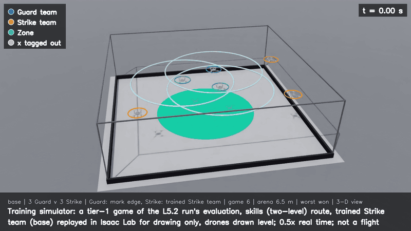

INTERNAL · the latest status of STE's own learning track and the NUS port, overwritten at every update by the `train-status` skill · [../README.md](../README.md); the history: [LOG.md](LOG.md)

**Status, 2026-11-25 05:00 (+08:00) (event: morning digest — L3–L6 pipeline check run end to end, both routes PIPELINE WORKS)** · RTX 5090 · GPU 0 % / 75 W / 1.2 of 32 GB · 0 training processes (0 paused)

**Main track:** L3–L6 pipeline check DONE: both routes **PIPELINE WORKS** (T73–T89, INFO, two reviewers) · **Side track:** 3-D Isaac Lab clips of every L5 run (owner's ask, done); L2.6 tier-2 clips (done); test-suite flakes fixed (done)

## Watch

Every L5 run now also has 3-D clips in its run folder (`runs/<run>/videos3d/`, top view and 3-D view, MP4 + GIF; 68 clips, 0 failures). Tier-1 games drawn in Isaac Lab; not a flight.

## Morning digest (work done overnight, 03:15–05:00)

**Plain summary.** Tested: the whole training pipeline for both routes (pure RL "velocity" and the two-level "skills" route), from pilots through training, scoring, export and reload. Happened: every required stage passed its controls; both routes read **PIPELINE WORKS** (INFO, one seed each, 2.29 of 20 GPU-h). Why it matters: the pipeline can now train, score and export a policy on either route; it is a pipeline check, not a training budget of record and not for flight. [Record](../../records/2026-11-25_ste_l3_l6_pipeline_record.md).

Worth a look:
1. **The skills route's run 0 mark was wrong and was re-set before the run.** The old 0.90 came from the 1v1 screen; in 3v3 no fixed choice gets near it (best 604 of 1,000). By the rule written before the ceiling run, the mark became 0.554. Skills run 0 then PASSED at 644 of 1,000 (above the best fixed choice).
2. **The skills Strike run did not beat its own training-cell script:** 176 of 1,000 against guard_mark_edge v 192 for the best script; its driver says "INCONCLUSIVE: did not learn". Every control passed, so it is a real result and was not re-run (R34). Across all five Guard scripts the two Strike policies are level on the pooled row (0.373 v 0.376); the skills Strike team's worst cell is higher (0.176 v 0.079).
3. **Guard side:** the velocity Guard policy is above the skills Guard policy in 5 of 6 cells and on the pooled row (0.963 v 0.895), both above the best single script.

| Task | Result |
|---|---|
| L3.1 Isaac smoke (tier 2) | PASS, 6 of 6 controls (T73) |
| L3.2 / L3.3 pilots | controls PASS (T74, T75); fill step: velocity Strike recipe = shaped |
| L3.4 velocity run 0 | PASS at update 10 (T76) |
| L3.5 skills run 0 mark | ceiling 604 → mark 0.554, oracle check PASS (T79) |
| L3.5 skills run 0 | PASS 644 / 1,000 (T81) |
| L5.1 velocity Guard / Strike | 903 / 230 v best script 808 / 192 (T77, T80) |
| L5.2 skills Guard / Strike | 813 / 176 v 808 / 192 (T82, T84) |
| L5.3 / L5.4 pool-only Guard (attribution control) | 889 / 812; mask effect +0.005 velocity (above), +0.002 skills (not distinguishable) (T78, T83, T85) |
| L4.1 held-command arm | control PASS, per-cell counts (T88) |
| L4.2 scoring suite | PASS (T87) |
| L6.2 export + L6.1 reload and read | 4 exports reload in a fresh process; both routes PIPELINE WORKS (T86, T89) |

**R34 (recorded in DISCUSSION §16):** no GPU stage needed a bug re-run; 0 of the 2 GPU-h used. Two bugs of ours were fixed on the CPU side: the reader refused pilots that ran before the fill step (fixed, reviewed, `8c53fcdc`/`026fc00c`), and four CPU jobs were launched into the wrong folder level (re-launched, results byte-identical).

## Phases

| Phase | Status | Math library | Simulator | What |
|---|---|---|---|---|
| NUS port Phases 1–4 | DONE | JAX (NUS), PyTorch | NUS 2-D game (JAX); copy of NUS 2-D game (PyTorch); tier 1; tier 2 Isaac Lab | port, conversion, ladder rows |
| NUS port Phase 5 | PAUSED (5.1 FAIL T43) | PyTorch | tier 1 fast engine | route (b) stopped; STE Guard policy T41 kept |
| NUS port Phase 6 docs | DONE (passes 1, 2) | none | none | public docs |
| L0 Game definition | DONE (G0 ruled 22 Nov) | PyTorch | tier 1; tier 2 Isaac Lab | |
| L1 Drone model | DONE except L1.6 (waits on L1.3 + NEAR-962) | PyTorch | tier 1; tier 2; AirStack simulator (logs) | |
| L2 Game rules in training | DONE | PyTorch | tier 1; tier 2 Isaac Lab | |
| L3 Learner (two routes) | DONE (slices 1–3, pilots, run 0 both routes) | PyTorch | tier 1; tier 2 Isaac Lab (smoke) | |
| ▶ L4–L6 pipeline check | DONE, both routes PIPELINE WORKS (INFO) | PyTorch | tier 1 fast engine; tier 2 Isaac Lab (smoke, 3-D clips) | 2.29 of 20 GPU-h |
| L7–L9 | NOT STARTED | — | AirStack simulator; real flight | owner's gate |

## Phase L3–L6 pipeline check, task by task

| ID | Plain name | Status | Simulator | Result |
|---|---|---|---|---|
| L3.1 | Isaac smoke of the tier-2 skills replay | PASS (T73) | tier 2 Isaac Lab | 6 of 6 controls; 2 clips |
| L3.2 | Velocity pilot | DONE (T74) | tier 1 | controls PASS |
| L3.3 | Skills pilot | DONE (T75) | tier 1 | controls PASS; B1 met |
| L3.4 | Velocity run 0 | PASS (T76) | tier 1 | 490 / 1,000 at update 10 |
| L3.5 | Skills run 0 (mark 0.554) | PASS (T79, T81) | tier 1 | 644 / 1,000 at the final checkpoint |
| L4.1 | Held-command arm | INFO (T88) | tier 1 (CPU) | hold-1 control 60 of 60 cells equal |
| L4.2 | Scoring suite on known players | PASS (T87) | tier 1 (CPU) | |
| L5.1 | Velocity route, pool + mask, Guard then Strike | DONE (T77, T80) | tier 1 | 903 / 230 |
| L5.2 | Skills route, pool + mask, Guard then Strike | DONE (T82, T84) | tier 1 | 813 / 176 |
| L5.3 | Velocity pool only, Guard (attribution) | DONE (T78) | tier 1 | 889 |
| L5.4 | Skills pool only: pilot + Guard (attribution) | DONE (T83, T85) | tier 1 | 812 |
| L6.2 | Export and reload check | PASS (T86) | CPU | 4 exports |
| L6.1 | Per-route reads and route comparison | INFO (T89) | CPU | both routes PIPELINE WORKS |
| VID-L5 | 3-D clips of every L5 run (owner's ask) | DONE | tier 2 Isaac Lab (drawing) | 68 clips, `scripts/ste_l5_clips3d.py` |

GPU-h in L3–L6 so far: 2.291 of 20 (RTX 5090 ledger; includes 0.24 for 3-D clips and their two smokes). L1 + L2: 4.447 of 13 (incl. 0.008 for the L2.6 tier-2 clips tonight).

## Other workstreams

| ID | Plain name | Status |
|---|---|---|
| CLIP-T2 | L2.6 tier-2 clips on the fixed path | DONE: both tiers agree game for game (8 of 8, both cells); record T71 updated |
| FLAKES | three tests that failed only in background-launched suites | DONE (SIGINT ignored in background jobs; fixed, reviewed, merged) |
| R34 | bug re-runs allowance | recorded; not used |
| Suite | full suite on the final code (`026fc00c`) | RUNNING (the earlier run tripped on its own merge mid-run: `test_timing` read HEAD twice; not a code fault) |

**Next.** 1) Full-suite result on `026fc00c`. 2) The owner's look at the pipeline-check read (record T73–T89). 3) What L7 should be (the owner's gate; nothing launches without it).

**Waiting on you.**
1. **The pipeline-check read** ([record](../../records/2026-11-25_ste_l3_l6_pipeline_record.md)): both routes work; which route(s) to take further, and with what budget.
2. **The planned-pushes flight (NEAR-962)** and **the Crazyflie commanded gaps**: unchanged from 24 Nov.

**Usage:** GPU 2.30 GPU-h overnight (L3–L6 2.291, L2.6 clips 0.008); CPU jobs: ceiling, oracle check, suite, held arm, exports, read; agents: one Opus builder (3-D clips, ~0.29 M tokens), Sonnet reviewers ×8 and one Sonnet writer (~0.2 M tokens); advisor (Fable 5.2) once at the start.

**Ready to push.** commits on `development` ahead of `origin/development` (count in the chat message); push from GitHub Desktop. `main` unchanged.
