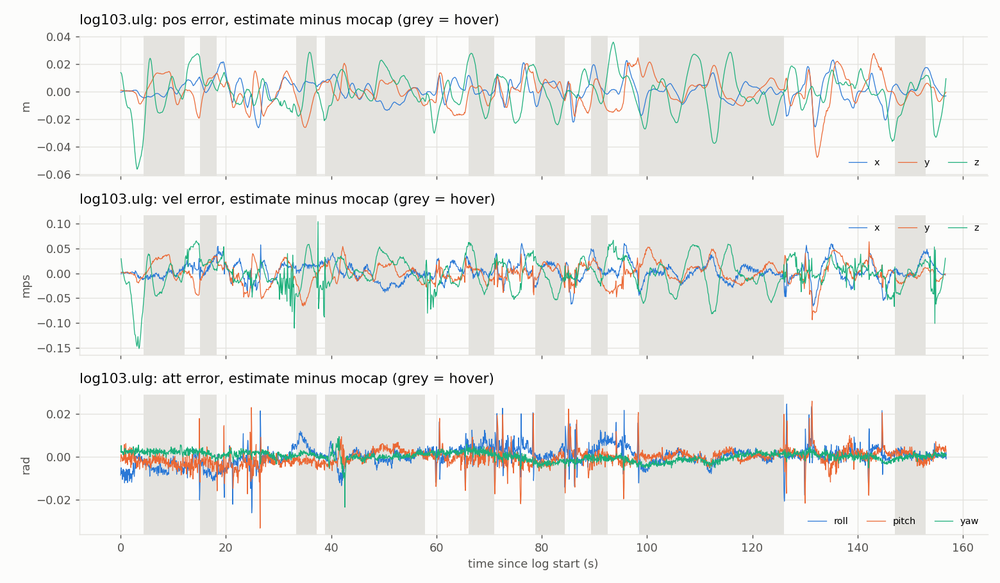

INTERNAL · the latest status of STE's own learning track and the NUS port, overwritten at every update; the history is in [LOG.md](LOG.md). Produced by the `train-status` skill.

**Status, 2026-11-23 07:20 (+08:00) (morning digest; laptop work 22 Nov 18:00 – 23 Nov 07:30 +08:00; RTX 5090 L1.0 overnight)** · laptop RTX 5070 Ti · GPU idle · 0 jobs

**Main track:** phase L1, making the training drone realistic: the 5090 checks, the estimate-error model in both simulators, the first fit from flight logs, and the trained teams re-scored on the physics drone are done and reviewed; the 1v1 and varied-tag training runs are built, GPU runs next on the 5090; the AirStack comparison waits for a simulator session with you · **Side track:** 1.15 m tests T57–T61 (yesterday evening) done; no side-track work overnight.

## Watch

| Trained 1.6 m teams on the Isaac Lab drone (T64) | The 1.15 m runs and the time-left test (T59–T61) |
|---|---|
| see the table in [T64](../../records/2026-11-23_ste_l18_tier2_record.md) (observed in the training simulator) |  |

| Estimate error measured from the 13 Nov flight log (T63) | |
|---|---|
|  |  |

Training simulator and flight-log analysis only; nothing flown.

## Morning digest

| What | Result |
|---|---|
| **5090 checks (L1.0)** | the 5090 gives the same game results as the laptop (exact); drills and its suite pass (2,213 passed) |
| **Isaac Lab drone with estimate error (L1.1b, T62)** | all 7 Isaac Lab tests pass; no measurable speed cost (the earlier "11 %" was wrong: a test suite was sharing the CPU) |
| **Estimate error from the real flight log (L1.3, T63, EXPLORATORY)** | while hovering: position about 1 cm, velocity about 2 cm/s, tilt at most about 0.15°, drifting over about 1–2 s; motion-capture samples are only 6–9 ms old. Not the in-flight error (moving: up to 2.5 cm) |
| **Trained 1.6 m teams on the Isaac Lab drone (L1.8, T64)** | results shift per cell between the two simulators (−33 to +47 of 1,000, both directions); with the measured error no change was detected (the test cannot see shifts under about 40–60 games); at 2× the error one matchup clearly changes (Strike v parked Guards 351 → 399; not planned in advance, but too large to be chance) |
| **Estimate error in the fast simulator (L1.7)** | built and reviewed; off by default |
| **L1.9 / L1.10 (1v1 runs; tag drawn 1.5–1.7 m)** | built, reviewed, merged; GPU runs next on the 5090 (trained with the measured error, scored with and without) |

**Worth a look.**
1. **The trained 1.6 m teams still score about the same on the physics drone:** cells shift −33 to +47 of 1,000, both directions; in 2 of 13 cells the ranges separate (a real simulator difference; one network per side).
2. **The real drone's position estimate looks like a slow drift of about 1 cm (hovering, per axis), not a plain delay;** that it leads by ~1.4 cm while moving is a hypothesis. At the 1.15 m tag, 1 cm per axis is a fifth of the 5 cm band (between two drones the errors add); tags decided from the drones' own estimates are not clean at the edge of the band, while tags judged by motion capture (your proposal) avoid that.
3. **New follow-ups:** L1.1c (the error rocks back and forth, a second-order model fits much better), and what the NEAR-962 flight must record (list in T63).

**On the 5090 today, in order:** (1) pull `development`; carry the laptop's new hours so the shared 13 GPU-h cap stays right (`scripts/ste_job.py carry --gpu-h 0.73 --note "laptop 2026-11-23"`: the laptop's L1 total 3.533 minus the 2.808 carried yesterday = 0.725, rounded up; check `ste_job.py status` shows the sum); (2) the L1.7 speed re-measure on an idle GPU; (3) L1.9 then L1.10 runs (about 1.6 + 1.7 GPU-h at most; commands and the step-2b check in `ste_learning/drafts/L1_9_10_SPEC.md`); (4) L1.4/L1.5 when you can give an AirStack-simulator session. **Waiting on you:** a time for the AirStack-simulator session (L1.4) and, later, the NEAR-962 flight.

**Usage:** of the 13 GPU-h for L1 + L2, the laptop has used 3.53 (the 5090's L1.0 checks add their own, shown on the 5090 after the carry); ~40 agent runs overnight (builders, writers, two reviewers per item); five full test suites.
