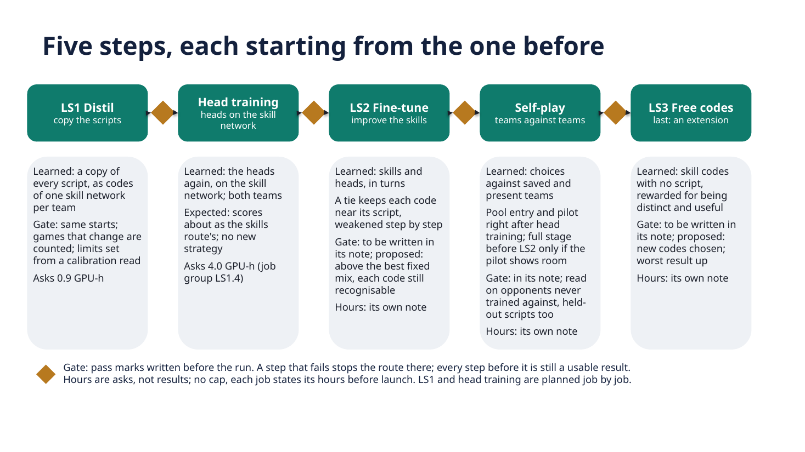

INTERNAL · the latest status of STE's own learning track and the NUS port, overwritten at every update by the `train-status` skill · [../README.md](../README.md); the history: [LOG.md](LOG.md)

**Status, 2026-11-27 09:25 (+08:00) (event: R51, route 3 moves to the 1.15 m tag; steps C0, A, C done; B's first finding; D restarted with a thread cap)** · RTX 5090 · GPU idle · CPU jobs: calibration (2), pilot replays (2), run 0 ceiling, test suite

**Main track:** route 3 (the learned-skills route), LS1 redesign: 1.6 m pilots PASS both teams (R50); **owner R51: route 3 moves to the 1.15 m tag before the build** ([plan](../drafts/LS1_1P15_SWITCH.md), advisor read); CPU steps C0, A, C done, B partly, D and E running · **Side track:** none

**Plain summary.** Route 3 now plays at the 1.15 m tag (the bubble-touch tag). The 1.15 m reference games of T50 replay exactly on the CPU (30 of 30 cells), the 1.15 m gate files are built and tested, and the scripts' games at 1.15 m are stored (every control PASS). First finding: at 1.15 m the game swings hard to the Strike team: **every one of the 150 Guard cells loses wins (median 423 of 1,000) and every one of the 156 Strike cells gains (median 376)**; 22 Guard and 31 Strike cells are within 100 games of all or nothing, where a copy can change few games. Observed in the training simulator. The copy-limit calibration (D) runs on both teams; the replay of last night's networks (E) runs too and stays sealed until you set the 1.15 m limits.

## Watch

The route 3 flowchart, redrawn 26 Nov: LS1 stopped, the redesign's CPU trials below it (Stage 0 on hold).

| The scripts fly flank | The LS1.1 network on the same start |
|---|---|
|  |  |

2-D top-down clips with the height panel, game 0 of LS1.1. Flank is the skill the network copies worst (0.33 command error against 0.05).

## Phases

| Phase | Status | Math library | Simulator | What |
|---|---|---|---|---|
| NUS port Phases 1–4 | DONE | JAX (NUS), PyTorch | NUS 2-D game (JAX); copy of NUS 2-D game (PyTorch); tier 1; tier 2 Isaac Lab | port, conversion, ladder rows |
| NUS port Phase 5 | PAUSED (5.1 FAIL T43) | PyTorch | tier 1 fast engine | route (b) stopped; STE Guard policy T41 kept |
| NUS port Phase 6 docs | DONE (passes 1, 2) | none | none | public docs |
| L0 Game definition | DONE (G0 ruled 22 Nov) | PyTorch | tier 1; tier 2 Isaac Lab | |
| L1 Drone model | DONE except L1.6 (waits on L1.3 + NEAR-962) | PyTorch | tier 1; tier 2; AirStack simulator (logs) | |
| L2 Game rules in training | DONE | PyTorch | tier 1; tier 2 Isaac Lab | |
| L3 Learner (two routes) | DONE | PyTorch | tier 1; tier 2 Isaac Lab (smoke) | |
| L4–L6 pipeline check | DONE, both routes PIPELINE WORKS (INFO) | PyTorch | tier 1 fast engine; tier 2 Isaac Lab (smoke) | 2.29 of 20 GPU-h |
| ▶ Route 3, LS1 Distil | STOPPED on T94 (NOT DISTILLED, both teams; R49); redesign being drafted | PyTorch | tier 1 fast engine | the scripts copied into a skill network per team |
| Route 3, LS1.4 Head training | BUILT (M4 merged), NOT STARTED: needs both teams DISTILLED | PyTorch | tier 1 fast engine | the heads trained on the skill network, both sides |
| Route 3, LS2, self-play, LS3 | NOT STARTED (each needs its design note) | PyTorch | tier 1 fast engine | order by R41 |
| L7–L9 | NOT STARTED | — | AirStack simulator; real flight | owner's gate |

## Route 3, stage LS1, task by task

| ID | Plain name | Status | Simulator | Result |
|---|---|---|---|---|
| M1–M4 | The build: skill network, calibration, distillation, copy check, export, head training | DONE, all four merged (full suite 3,425 passed at M4) | tier 1 (CPU tests) | `79a3e10c` |
| LS1.5 | Calibration read, then the top-up (owner R48) | DONE (T90, T91, INFO) | tier 1 (CPU) | limits set by the owner (R48) |
| LS1.0 | Smokes and the CUDA label probe | DONE (T92, INFO) | tier 1; GPU probe | labels bit-equal on CUDA |
| LS1.1 | Distillation, one skill network per team | DONE (T93, INFO) | tier 1 (GPU) | 0.172 of 0.8 GPU-h |
| LS1.2 | Copy check against the scripts | **NOT DISTILLED** both teams (T94); every control PASS | tier 1 (CPU) | Guard 18 limit failures, Strike 98 |
| — | Diagnosis and the fix-round proposal | DONE, two reviewers (numbers, reasoning) | CPU scratch pilots | [proposal](../drafts/LS1_FIX_ROUND_PROPOSAL.md), section 0b the lead's recommendation |
| LS1.1-fix, LS1.2-fix | The one fix round the stop rules allow (R47) | NOT SPENT (owner R49) | — | — |
| — | Redesign of the skill network: design note, pilot marks, two reviewers | DONE (`c1bebc9a`); rules fixed after the focused re-review (`6625cf82`) | none | [LS1_REDESIGN.md](../drafts/LS1_REDESIGN.md) |
| — | Route 3 flowcharts redrawn: LS1 stopped, the redesign trials (owner asked) | DONE, one review round (numbers: no finding; completeness: 1 blocker, 4 minor, all fixed) | none | [route page](../LEARNED_SKILLS_ROUTE.md) |
| P0 | Stage 0 of the pilots: harness check, de-bias and mask replay, blended-switch replay, ONNX check (no training) | DONE: 0a PASS (T94 reproduced cell for cell); 0c every switch skill passes at 3 cm or wider (flank widest 3 cm), R3 eligible for all four; 0d PASS after three code fixes (closed forms within 5e-5 on 0.8 M rows per team; ONNX parity on every skill and rung); 0b and 0e INFO (0e: Guard under 30, Strike 6 cells over 30) | tier 1 (CPU) | about 1.5 to 2 h one at a time, 0 GPU-h; decides whether a learnable copy can pass at all |

| P1 | Stage 1: row-level fits (B, A3, A4, next rungs, control arms) | DONE for the ladder (all B fits eligible; R3: sacrifice 0.077 to 0.025, converge 0.096 to 0.036); control arms by the 4.3 rule: own frame needed on flank, mirror, field; the slow finish on high and field; C-head and C-one qualify on neither team (C-one misses on all four skills), so S-shared does not play; reported-only fits done | tier 1 (CPU) | scratch |
| P2 | Stage 2: closed-loop replay of every gated cell | **PASS both teams, two seeds**: Guard S1 (25 / 24, median 3 / 4); Strike S1 FAIL (one cell 31, sacrifice and converge command error), S2 PASS (16 / 15, median 3 / 2); C4 analogue PASS both; onnxruntime arm 0 games different (both teams) | tier 1 (CPU) | [results](../drafts/LS1_REDESIGN_PILOT_RESULTS.md) |
| P3 | Route 3 to the 1.15 m tag (R51): C0 reference replay, A files and fix, C script games, B screen, D calibration, E sealed replay | C0 PASS (30/30 exact); A done (`20fbd511`, QC: 1 blocker fixed `fd3bbeca`); C PASS both teams; B: table done, run 0 ceiling running; D running (relaunched 09:20 with 8 threads after thrashing); E running, sealed | tier 1 (CPU) | [plan](../drafts/LS1_1P15_SWITCH.md) |

GPU-h on route 3: 0.172 of 200 (`[budget_ls]`, R43).

## Other workstreams

| ID | Plain name | Status |
|---|---|---|
| — | Learner v2 note | NOT STARTED: after LS1 (R37) |
| NEAR-962 | Planned-pushes flight; the Crazyflie commanded gaps | unchanged from 24 Nov |

**Next.** D finishes (about 3 h); then a 1.15 m limits page for you (from D alone; E stays sealed until you rule); then E is judged once and decisions 2 and 8 come back to you.

**Waiting on you.** Nothing right now. Coming: the 1.15 m copy limits (after D), then decisions 2 and 8 (after E), run 0 at 1.15 m (the parked Guard holds only 101 of 1,000 against strike_straight), and the LS1.4 GPU cap (about 5.3 against 4.0) before the build.

**Usage:** 0 GPU-h (CPU only). The CPU was oversubscribed from about 08:35 (calibration uncapped beside step C, the suite, the run 0 ceiling and two leftover test runs of the QC reviewer: load 98 on 32 threads; one 1-cell batch took 279 s); the reviewer's test runs were stopped and the calibration relaunched at 09:20 with 8 threads each (as T90 was). Agents: advisor (Fable 5.2, plan read), mapping agent (Opus, 301k tokens), QC reviewer of step A (Sonnet). Checks: tests of the touched files; full suite running.

**Ready to push.** 54 commits on `development` (up to this commit); mirror updated after the commit; push from GitHub Desktop. `main` unchanged.
