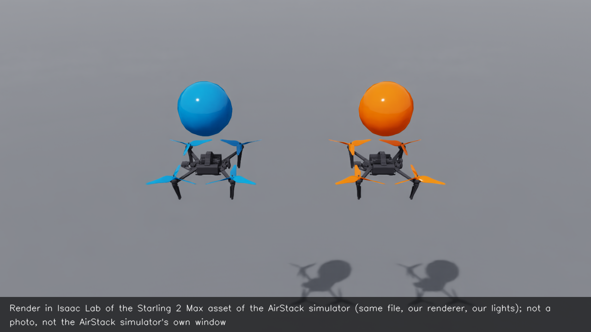
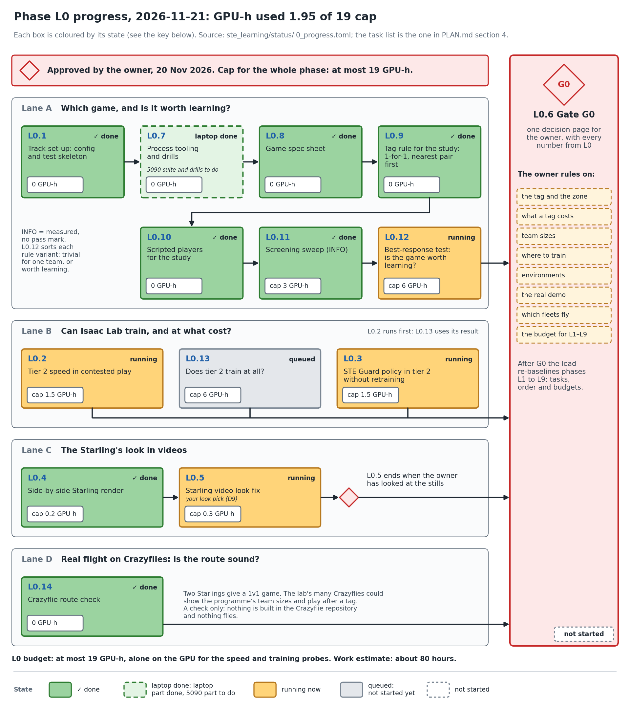

INTERNAL · the latest status of STE's own learning track and the NUS port, overwritten at every update; the history is in [LOG.md](LOG.md). Produced by the `train-status` skill.

**Status, 2026-11-21 11:24 (+08:00), 30-minute update: L0.12 base game done on both sides; tag 1.2 m runs going; L0.2/L0.3 committed** · laptop RTX 5070 Ti · GPU busy · 1 training process (L0.12 tag 1.2 m Guard)

**Plain summary (L0.12, base game, both sides).** Tested: can a trained team beat the best hand-written team, base rules,
3v3? Happened: trained Guard holds **913/1000** v the best script's 808; trained Strike reaches the zone **636/1000** v the best
script's 192 against the best scripted Guard (gains +0.105 and +0.444, both real; every control PASS). The trained Strikes
climb to the height limit (1.8 m, the Guards fly at 1.2 m), trade two drones, and the last one waits at the edge and slips in
(games run 7.5 s instead of 2.4 s). Why it matters: the base game is worth learning on both sides; the scripted Guard is easy
to beat by height and patience. Training simulator only. Four runs to go (~1.5 h).

## Watch (latest clips and figures)

**New: the L0.11 games in 3-D** (VID-1). The same recorded games, replayed and checked equal to record T44 on all
90,000 games, then drawn in Isaac Lab with the AirStack simulator's Starling. Base 3v3, best scripted Guard v best
scripted Strike, half real time. Training simulator tier 1 replayed for drawing only (drones drawn level); not a flight.

| Guard holds (3-D view) | Strike reaches (3-D view) |
|---|---|
|  |  |

Top views and the tag 1.2 m / 1.4 m games: [docs/media/ste_l011/3d/](../../docs/media/ste_l011/3d/README.md).

**Your pick (D9): how should a team show on the drone?** Left: the Starling as the AirStack file draws it. Then a ring
around the drone, or a small dot on top. The 3-D clips above use the ring for now.

**Bug found and fixed (L0.4):** every Isaac clip since S2b drew a grey physics box over the drone (the hide call
missed it). Before / after:

| Before | After |
|---|---|
|  |  |

Where phase L0 is: green done, light green laptop part done, amber running, grey queued (state file
`ste_learning/status/l0_progress.toml`, figure by `scripts/make_ste_learning_figures.py l0_progress`).

Earlier: L0.11 top-down clips and the factor chart are in the [T44 record](../../records/2026-11-21_ste_l011_screen_record.md).

## Phases

| Phase | Status | Math library | Simulator | What |
|---|---|---|---|---|
| NUS port Phases 1–4 | DONE | JAX (NUS), PyTorch | NUS 2-D game (JAX), Copy of NUS 2-D game (PyTorch), tier 2 Isaac Lab | NUS's code installed, game and policies copied to PyTorch, six tests towards STE drones |
| NUS port Phase 5 | PAUSED (lead call D8) | PyTorch | Copy of NUS 2-D game (PyTorch), tier 1 fast engine | 5.1 Method match FAIL (T43); STE Guard policy 829 of 1,000 (T41) |
| NUS port Phase 6 | DONE | none | none | public documents with videos |
| ▶ L0 Game definition and feasibility | RUNNING (approved 20 Nov, cap 19 GPU-h) | PyTorch | tier 1 fast engine, tier 2 Isaac Lab | which game, worth learning, can tier 2 train, is the Crazyflie route sound |
| L1–L8 | NOT STARTED | PyTorch | as ruled at gate G0 | drone model, rules, learner, evaluation, league, export, AirStack side, real flight |
| L9 Documentation | RUNNING | none | none | status, records, results page |

## Phase L0 Game definition and feasibility, task by task

| ID | Plain name | Status | Simulator | Result / ETA |
|---|---|---|---|---|
| L0.1 | Track set-up: config and test skeleton | DONE | none | settings file, loader, tests; independent QC closed all findings |
| L0.7 | Process tooling and drills | RUNNING (laptop part DONE) | none | merged into `development`; laptop: full suite 1,420 passed / 0 failed, wake-up drill and resume drill both as expected (below); DONE when the 5090 has run the same (L07-5090) |
| L0.8 | Game spec sheet | DONE | none | merged into `development`; QC passed; full suite on `development` 1,461 passed / 0 failed (41 min) |
| L0.9 | Tag rule for the study: 1-for-1, nearest pair first | DONE | tier 1 fast engine | merged; QC + re-check passed; full suite on `development` 1,517 passed / 0 failed (31 min); the 5090 records its own tag-off positions (L09-5090) |
| L0.10 | Scripted players for the study | DONE | tier 1 fast engine | merged; QC + 2 re-checks passed; full suite on `development` 1,600 passed / 0 failed (56 min, CPU shared with the L0.11 GPU jobs) |
| L0.11 | Screening sweep (INFO) | DONE | tier 1 fast engine | record T44 (every control PASS; shortlist base (reference), tag 1.2 m, tag 1.4 m; every hold a one-for-one trade) + follow-up checks; merged into `development`; full suite 1,685 passed / 0 failed (27 min) |
| L0.12 | Best-response test: is the game worth learning? | RUNNING (run 3 of 6) | tier 1 fast engine | pilot PASS; run 0 PASS; **base: Guard 913 v script 808 (+0.105), Strike 636 v script 192 (+0.444), both real, every control PASS**; trained Strikes use height (1.8 m v the Guards' 1.2 m) and patience; now tag 1.2 m Guard, then tag 1.2 m Strike, tag 1.4 m Guard and Strike (~1.5 h); then the verdict, the record with clips, and 3-D clips of the key games |
| L0.2 | Tier 2 speed in contested play | RUNNING (committed; Isaac re-smoke next) | tier 2 Isaac Lab | QC re-check 2: GO (its faulty-physics world now fails the check at 0.38 m; 10 of 11 breakages caught); lead's agreement rule written into the gate files before any result; committed on `ste-l0.2` (b4e7bc4); new Isaac smoke when the L0.12 runs end (~12:45), then the run of record (~0.9 GPU-h) |
| L0.13 | Does tier 2 train at all? | NOT STARTED | tier 2 Isaac Lab | laptop allowed (owner, 21 Nov), after L0.2, at the games-at-once L0.2 shows fits; cap 6 GPU-h |
| L0.3 | STE Guard policy in tier 2 without retraining | RUNNING (committed) | tier 2 Isaac Lab | committed (06436e9) with L0.2's fixes; smoke after L0.2's, then the run (~0.6 GPU-h) |
| L0.4 | Side-by-side Starling render | DONE | tier 2 Isaac Lab | found why our clips never looked like the Starling: a grey physics box was drawn over every drone since S2b (the hide call missed it); one-line fix, re-render shows the Starling (before/after in Watch); merged into `development` after independent review; 0.028 of 0.2 GPU-h |
| L0.5 | Starling video look fix | WAITING ON YOU (D9) | tier 2 Isaac Lab | the drone left unpainted, team shown by a ring or a small dot that casts no shadow; stills in Watch; 0.154 of 0.3 GPU-h (with VID-1) |
| L0.14 | Crazyflie route check | DONE | tier 1 fast engine (CPU) | record T45: the T41 Guard policy holds 791–768 of 1,000 in the Crazyflie-like lag band (0.48–0.56 s, every drone slowed) against 831 at the Starling's lag, and drones come closer (games under 1.0 m: 7 → 101–149); planner, like for like: 0 of 100 at 3v3 and 5v3 against 20 Nov's 5 of 100 (not a clear difference; only one rule set run); QC + re-check passed; merged into `development` (targeted tests 76 passed; the full suite runs with the next merge — lead's call, the CPU is shared now); page `ste_learning/CRAZYFLIE_ROUTE.md` |
| L0.6 | Gate G0 | NOT STARTED | none | after every task above; the owner decides |

GPU-h used in L0 so far: about 1.95 of 19 (laptop: L0.11 0.426, L0.4 0.028, L0.5 + VID-1 0.154, L0.2 smoke 0.044, L0.12 pilot 0.178 + run 0 0.061 + base Guard 0.404 + base Strike 0.594).

Laptop full CPU suite (20 Nov, `development` at 5c5d465, after `scripts/nus_install_provisional.sh`): **1,333 passed, 2 failed, 48 skipped** in 24 min. Both failures repeat when run alone:
- **L07-F1** `test_ste_job.py::test_f_d_a_killed_job…resumes`: CONFIRMED by QC: the tool does not over-report (it measures from the same start; ~0.255 s raw, printed rounded to 0.3); the test compares the rounded text with the exact elapsed time. Fix: allow half a display step.
- **TEST-F2** `test_train_standin.py::test_default_path_bit_identical_after_the_nus_hooks`: FIXED (447b317). Measured on the laptop: the hash repeats (75d2a955…), hold rates equal the recorded [0.25, 0.375], and forcing PyTorch's CPU capability down changes the hash; threads (trainer runs one) and local files (not read on this path) ruled out. The fingerprint is now one hash per CPU capability; hold rates are checked on every machine.

## Usage (laptop session, 20 Nov 22:00 to now)

| What | Agent tokens | Wall time | Note |
|---|---|---|---|
| L0.7 fixes: builder, 7 fixes one at a time | ~400 k | ~51 min | the largest: each fix re-reads the tooling and its tests |
| L0.8 Game spec sheet: builder, build + 2 fix rounds | ~320 k | ~50 min | includes its own 25-min full suite |
| L0.7 independent QC + re-check | ~246 k | ~18 min | reproduced C1 and I1 in a scratch folder |
| L0.8 independent QC + re-check | ~209 k | ~12 min | mutation tests on the sheet |
| L0.9 Tag rule: builder (build + fix round) | ~358 k | ~66 min | the first 50 min slowed by sharing the CPU with the L0.7 suite |
| L0.9 independent QC + re-check | ~239 k | ~31 min | ran its own reference matcher, mutants and old-vs-new games |
| L0.10 Scripted players: builder (build + rulings + 2 QC fix rounds) | ~420 k | ~56 min | |
| L0.10 independent QC (+ 2 re-checks) | ~353 k | ~71 min | 84 deliberate breakages over two rounds; its own geometry probes on 30,000+ starts |
| L0.11 sweep build (CPU, build + rulings + rebase + QC fixes + follow-ups) | ~677 k | ~106 min | the largest single task so far; a fresh builder takes L0.12 to avoid re-reading this context |
| L0.12 groundwork builder | ~550 k | ~54 min | |
| L0.12 pre-launch QC | ~322 k | ~48 min | 19 deliberate breakages, 8 not caught before the fixes |
| L0.14 builder | ~368 k | ~118 min | the Crazyflie planner sweep ran on the CPU (2,868 matches) |
| L0.11 pre-launch QC | ~293 k | ~24 min | broke the code five ways through the real driver |
| L0.11 CUDA smoke | | ~5 min | 0.087 GPU-h |
| L0.11 independent QC (pre-launch, re-check, results read) | ~419 k | ~45 min | |
| L0.11 sweep | | 18 min | 0.305 GPU-h (L0.11 total 0.426 of 3.0) |
| L0.4 + L0.5 + VID-1 builder (stills, box bug, replay check, 3-D renderer) | ~410 k | ~3 h incl. the 08:30 limit stop | 0.141 GPU-h; the account hit its 5-hour token limit at about 07:30 (three agents at once); resumed 08:44 |
| L0.12 gate fix + follow-up builder | ~280 k | ~55 min | run 0 design, N-2/N-4, tests |
| L0.12 QC re-checks 1–2 | ~450 k | ~30 min | 8 breakages tried on run 0 |
| L0.2/L0.3 builder | ~410 k | ~30 min | + fix round now |
| L0.2/L0.3 pre-launch QC + 2 re-checks | ~650 k | ~60 min | 39 + 6 breakages tried |
| L0.2/L0.3 fix rounds 1-2 | ~1.1 M | ~41 min | **the costliest task today**: each round re-reads the code; narrow rounds from here |
| L0.12 GPU pilot | | 11 min | 0.178 GPU-h |
| L0.11 GPU pilot | | 2 min | 0.034 GPU-h (first GPU job of the track) |
| Full CPU test suite | none | ~25 min alone; the L0.7 merge run took 61 min (shared the CPU with L0.9's tests) | rule from now: one heavy test run at a time |
| GPU | 0 GPU-h | | nothing has used the GPU |

Sub-agents total about 1.2 M tokens so far; the lead's own context is not measured by the tools here.

Laptop drills (21 Nov, fix branch, shared folder `~/AirStack-starling-max2/svg_training/runs/shared/`, no owner pause open):
- Wake-up: `L0.7 l07_wakeup DONE exit=0 duration=120.4s effective=120.4s`, `waiter exit 0` (the background waiter's end was the wake-up).
- Resume: `alive` → simulated power cut (`kill -KILL` of the process group at step 30) → `dead`; waiter `DIED exit=none duration=31.2s`, `waiter exit 21`; relaunch with `bash cmd.txt` from a shell with a wrong `PYTHONPATH` and `SVG_SHARED_DIR` → `launch=2`, `resumed from step 30 of 120`, `DONE exit=0 duration=90.4s effective=90.4s run_effective=120.3s`, `waiter exit 0`, `{"steps": 120, "total": 7260.0}`; the wrong shared folder was never created.

## Other workstreams

| ID | Plain name | Status |
|---|---|---|
| SYNC-1 | Branch `development` on both machines; laptop worktree `~/AirStack-starling-max2-dev` | DONE |
| SYNC-2 | Status skill `train-status` and the owner's standing rules in CLAUDE.md | DONE |
| SYNC-3 | Root `CLAUDE.md` and every page: training work lands on `development` | DONE |
| SYNC-4 | STE Guard policy (T41 run folder) in the PROVISIONAL bundle | DONE; installed on the laptop (46 files, agent.pt c91bea51…) |
| L07-F1 | Fix: waiter-duration test bound (rounding) (QC I5) | DONE (a4100d0; 30 of 30 runs pass; L0.7 test files 217 passed) |
| L07-C1 | Fix: an open pause takes time off every job, and launch does not check for one: a job launched during a pause runs on the GPU with 0 GPU-h counted and its cap never fires | DONE (79effa0 on branch ste-l0.7-fix; red 48 failed, then L0.7 + NUS pause tests 251 passed). Pauses still always logged; launch refuses while one is open; a pause counts only against the jobs it stopped |
| L07-I1 | Fix: a new run reusing an old job name inherits that job's GPU-hours as credit (task cap can be exceeded) | DONE (05dd547; credit keyed by job name + run folder; red 24 failed, then 256 passed) |
| L07-I2 | Fix: `cmd.txt` relaunch loses the environment (PYTHONPATH, CUDA alloc setting, shared-folder path) | DONE (d0661f4; cmd.txt replays the first launch's environment; a different shared folder is refused; resume drill uses bash cmd.txt; red 3 failed, then 259 passed) |
| L07-I3 | Fix: the launcher's wrapper can die (clock step back, full disk) while the job runs on: GPU time stops being logged | DONE (1ca8a70; every wrapper write survives an error, records a fault and retries; red 8 failed, then 267 passed) |
| L07-I4 | Fix: a job resumed after a reboot is flagged ENDED_EARLY (exit 20) though it finished correctly | DONE (70fc1a3; judged on the trainer's saved progress across launches; red: drill pattern read 20; then 280 passed) |
| L08-F1 | Finding: the hangar's Strike start ring (3.2 m from the zone centre) does not fit the 6.5 m lab arena (drones kept within 3.0 m); a ring for 6.5 m is needed before L0.11's base case | CLOSED (lead's call): Strike start ring 2.75 m for the 6.5 m arena, PROPOSED, ruled at G0 |
| L07-C1b | Fix: our own "pause the siblings, run solo" step (AUTOMATION §2.2) is now refused too; lead's design: pauses the session makes are tagged and do not block launch, your pauses still do | DONE (ef38534; `GPU_PAUSE_BY=lead` tags the session's pauses; a bare `gpu_pause.sh pause` is still yours and still blocks; red 13 failed, then 298 passed) |
| L07-C1c | Fix: a session-tagged resume must refuse while any of your pauses is open (a resume today continues every job and closes your pauses too) | DONE (efa9ec1; a bare resume/stop is unchanged; red 4 failed, then 304 passed) |
| GIT-1 | Fix: my 17 Nov `.gitignore` line `data/` also hid new files in `tests/data/` | DONE (d3572dc: anchored to `/data/`) |
| L011-F1 | Finding: scripted players decide every 0.05 s tick, not at the sheet's 0.6 s decision period; the sweep measures scripted play at 0.05 s; L0.12's trainers must set their decision period explicitly (T41 used 0.6 s) | OPEN: written into the L0.11 gate file and record |
| L07-SUSPEND | Tooling: a laptop sleep during a GPU job is counted as GPU-hours and as time towards the job's cap (wall clock). Rule until fixed: never let the laptop sleep during a GPU job | QUEUED (tooling task); rule in force now |
| L011-G0 | Finding for gate G0 (T44, scripted play): (1) every hold is a one-for-one trade — no tag-on game times out, and at 1v1 and 3v3 a Guard win leaves no Guard — so head-count decides (PLAN F1; bears on what a tag costs, P12); (2) the programme's sizes 2v1 and 5v3, and 1v1, are Guard-trivial with scripted players at the proposed rules; candidate cause: tag radius 1.6 m = zone radius 1.6 m with Guards starting on a circle near the zone centre (not tested). L0.12 measures whether learning changes either | OPEN: reported at G0 |
| L010-G0 | Finding for gate G0 (from L0.10 QC): any safety-filter move near the 1.6 m tag radius can create a tag nobody chose (the filter's 1.10 m keep-out is inside the tag radius). Spaced starts remove it at the start; during play it is part of the game the sweep measures (P1) | OPEN: reported at G0 |
| L09-5090 | On the 5090: record the tag-off golden's positions for its CPU type (AVX512); check the outcome fingerprints there | WAITING: next 5090 session |
| DOC-1 | A phase-L0 flowchart coloured by progress (done / running / queued), regenerated with each status and shown in its Watch section (owner, 21 Nov: "photos or diagram flow charts would be good too") | DONE (progress flowchart; regenerated with each status) |
| VID-1 | Clips: a height panel on the 2-D top-down clips of every run; 3-D Isaac Lab videos (Starling look, top view + 3-D view, MP4 + GIF) of each result's key games | L0.11 DONE, merged: 6 key games (base, tag 1.2 m, tag 1.4 m × hold, reach) × top + 3-D, MP4 + GIF; every replayed game checked equal to T44 (90,000 of 90,000) before drawing; independent review: 1 important bug (old files could be drawn after a failed check; never happened) + minors, fixed and re-reviewed; the published games re-checked with the stricter check: identical; full suite on the merge 1,751 passed (the 2 failures it found are fixed: an unlisted Crazyflie import from L0.14, and my progress-chart test reading the live file); next: L0.12 results |
| L08-M | L0.8 minors left: 3 hangar values unchecked on a clone without the NUS bundle; 3 values whose wrong value still passes; loader refuses some honest wording; tests tied to exact lines and the AirStack fence file | PARKED |
| L07-DISK | Follow-up: the planned disk-space check (a disk full through 10 retries at a job's end reads DIED) | PARKED (stated limit) |
| L07-N | Re-check minors N1–N4: a session pause also lands in the old per-worktree log the NUS reader uses; full disk can hold the wrapper 10 min after the end; AUTOMATION §4 still states the old GPU-hour rule; on the 5090 run `scripts/ste_job.py owner-pauses` before the drills | PARKED (N4 goes into the 5090 note) |
| L07-M | QC's 10 minor findings (+3 from the C1 build: pid-only matching, test pause pattern shared across sessions, pid reuse) (runs/ste_l07/qc_report.md) | PARKED until the six fixes land |
| L07-5090 | L0.7 on the 5090: full CPU suite and the two drills there (L0.7 is DONE only after both machines) | WAITING: next 5090 session |
| TEST-F2 | Fix: bit-level training fingerprint is machine-specific | DONE (447b317; trainer test file 43 passed, 1 skipped) |
| TEST-F2b | On the 5090: confirm its CPU capability is AVX512 (the key its 18 Nov hash is now filed under) | WAITING: next 5090 session runs the test (fails or skips loudly if wrong) |

**Machines (owner, 21 Nov):** no task is 5090-only. The RTX 5090 (32 GB) suits memory-heavy runs; the laptop RTX 5070 Ti (12 GB) runs everything sized to fit, and the record says which machine. Only machine checks stay with their machine: TEST-F2b, L07-5090, L09-5090. **Schedule:** weekends the laptop runs the pipeline (the 5090 is free for gaming); weekdays the 5090 does (the laptop goes to work). **This weekend:** the owner packs the laptop **Mon 23 Nov 10:00**: no GPU job starts unless it can end by **Mon 08:00**; by **09:30** everything is committed, HANDOFF §0 and status written, ready to push.

**GPU queue on the laptop (one at a time for speed measurements):** L0.12 pilot → L0.12 trainings → L0.2 → L0.3 → L0.13 (L0.4, L0.5, VID-1 for L0.11 done).

**Next.** (1) L0.12: QC checks the gate fill (minutes), then run 0 (~0.6 GPU-h, ~40 min), then the six runs (3 Guard, 3 Strike if run 0 passes), one at a time, ~4.5 h. (2) L0.2/L0.3: fix round, then QC re-check, then commit, then a new smoke. (3) L0.13 after L0.2.

**Waiting on you.** (1) D9: ring, dot, or neither (Watch); not urgent. (2) ~~L0.12 GPU-hours~~: no longer needed — the pilot was 4× faster than estimated, so everything fits in the approved 6 GPU-h. (3) Only if run 0 runs out of time before passing or failing: whether the Strike runs go ahead.

**Correction.** The 21 Nov question on NUS values listed "speeds 0.6 / 1.2". The L0.8 review reads those two numbers as the decision period (0.6 s) and the flight height (1.2 m); the speeds are 0.5 and 0.333 m/s. Your Yes covers all of them as written on the sheet.
