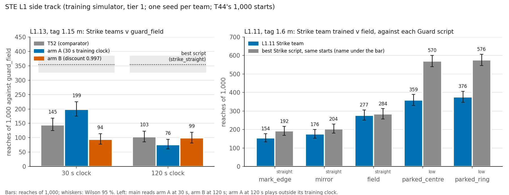
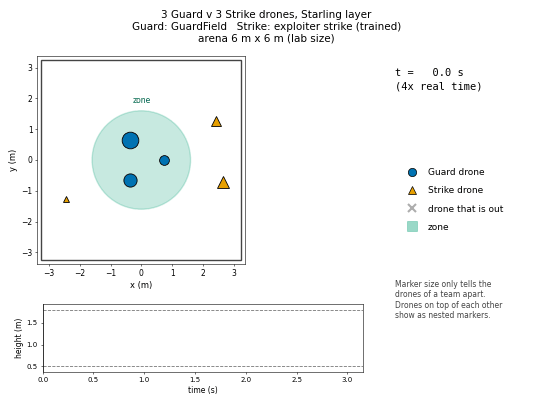

INTERNAL · the latest status of STE's own learning track and the NUS port, overwritten at every update; the history is in [LOG.md](LOG.md). Produced by the `train-status` skill.

**Status, 2026-11-23 (morning digest; work ran 22 Nov 18:00–23:30 +08:00)** · laptop RTX 5070 Ti · GPU idle · 0 jobs

**Main track:** L1 drone model: L1.1/L1.2 (position-estimate delay and noise, drag) built and reviewed; first Isaac Lab
check stopped at its cap (6 tests passed, 1 failed on a label, fixed but not re-run); new task L1.1b (model the
estimate's error, not a delay) · **Side track:** 1.15 m tests T57–T61 done and reviewed (why and cost announced as they
were added).

## Watch

| The 1.15 m Strike runs and the comparison team, both clocks | The time-left test and the delay check |
|---|---|
|  |  |

| 1.6 m Strike team trained against field Guards: a reach | 1.15 m, 30 s training clock: a hold (the Strike team fails) |
|---|---|
|  |  |

Clips use their own starting positions, not the 1,000 scoring starts. Training simulator only; nothing flown.

## Morning digest

**What ran** (fast simulator for the side track, Isaac Lab for the main-track check; one run each):

| Test | Result |
|---|---|
| 1.6 m Guard team v all 6 Strike scripts (T57) | holds at least 913 every time; above the best hand-written Guard on 4, below on 2 (converge 913 v 986, sacrifice 922 v 960) |
| 1.6 m Strike team trained v field Guards (T58) | level with the script against them (277 v 284); below the best script against the others (clearly so only against the two parked Guards) |
| 1.15 m Strike: 30 s training clock / a clock loss weighted more (T59) | 199 v the comparison team's 145 at 30 s, a gain, only just; but at the normal 120 s it did worse (76 v 103); weighting a clock loss more did nothing (99 v 103) |
| **1.15 m time-left test (T60)** | **the 1.15 m Strike team (one network) attacks earlier and reaches more when its time-left input says time is short: 152 instead of 103** |
| 1.15 m delay check (T61) | wins stay within the margin set in advance for response delays 0–0.3 s (small game-by-game changes); tags about 1 cm deeper at 0.3 s (closest 1.106 m, 6 mm outside the safety keep-out); re-check at L1.3's values |
| Isaac Lab drone with delay, noise, drag (L1.1/L1.2) | runs in Isaac Lab; 11 % slower with the effects on (target 10 %, missed); the physics checks of one test did not run (label failure, fixed) |

**Worth a look.**
1. **A reading, not yet a conclusion:** the 1.15 m Strike team's "waiting" looks driven by its clock input, and most
   of the 30 s clock's gain seems to come through how the network reads time (clamped, the two teams are close: 172 v 152).
   Both panellists want a second seed before anything is built on it.
2. **No 1.15 m change reached the hand-written Strike (355).** 1.15 m stays "simulator only, margin unproven".
3. **Main-track lesson:** the real drone's position estimator projects late measurements forward to "now", so the
   controller does not see a 0.15 s-old position; modelling it as a pure delay made the height loop unstable. L1.1b models
   the estimate's small error instead, and L1.3 fits that error from flight logs.

**Two panellists' plan (DISCUSSION §15):** main track first; side track at most about 1 GPU-h more, starting with a second
seed, each addition announced with its why.

**On the 5090 today, in order:** (1) start from `development`; the carry of the laptop's 2.81 GPU-h is DONE (5090, 23 Nov
~02:00, ledger 2.81 of 13): do not run it again;
(2) L1.0, the 5090 checks; (3) L1.1b (CPU build: error model, seed passed through); (4) the Isaac check re-run (the
isaac tests plus the two speed parts not measured; lead's estimate about 0.15 GPU-h); (5) L1.3/L1.4 when the AirStack
simulator is free. **Waiting on you:** nothing to rule; later, your OK on wording for the NUS-facing pages that still say
"no tag".

**Usage:** L1 + L2 used **2.81 of 13 GPU-h** (L1.1 0.20, L1.11 0.46, L1.12 0.02, L1.13 1.83, L1.14 0.15, L1.15 0.15);
about 60 agent runs since the afternoon (builders, writers, two reviewers per item, two panellists), ~12 M tokens; four
full test suites (36–60 min each).

**Ready to push:** `development` is ahead of GitHub in the mirror (see the line in chat).
