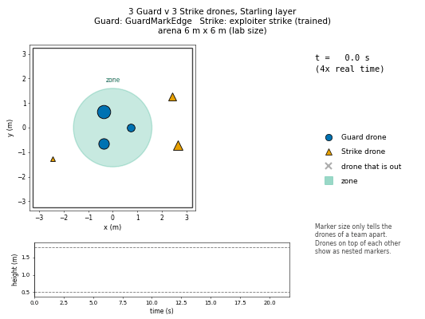

INTERNAL · the latest status of STE's own learning track and the NUS port, overwritten at every update by the `train-status` skill · [../README.md](../README.md); the history: [LOG.md](LOG.md)

**Status, 2026-11-24 07:30 (+08:00) (morning digest; RTX 5090 night 24 Nov 04:10–07:30)** · GPU 0 % / 30 W / 1.2 GB of 32.6 GB · 0 training processes

**Main track:** phase L1 done except L1.4/L1.5 (blocked: AirStack not set up on the 5090) and L1.9's 1v1 training (held for you, R20); phase L2 built: L2.1, L2.3, L2.4 behind settings that are off by default, waiting on rulings P2 and P7. **Side track:** none.

## Watch

The Strike team trained tonight with the tag distance drawn per game and the estimate error, reaching the zone against the Guard tactic it trained on (681 of 1,000; best script 181). Against field Guards it reaches 39 (best script 280): the narrow best-response pattern again.

## Morning digest

**Done tonight** (records reviewed by two Sonnet reviewers, every fix applied):
1. **L1.7 speed re-measure** (T65): the estimate error costs the fast engine about 1 % at 16,384 games, 2–3.5 % at 4,096; inside the 10 % budget.
2. **L1.9 1v1 screen** (T66, CPU): **one against one is lopsided toward the Guard**: every moving Guard script holds 100 % of games at the 1.6 m tag and 84–90 % at 1.15 m. The 1v1 training stays held (R20); my view: training 1v1 as set would teach nothing; the 1v1 flight game likely needs different rules first (your decision).
3. **L1.10 tag drawn 1.5–1.7 m** (T67, 0.662 GPU-h): run 0 PASS; the Guard team beats the best script against 4 of 6 Strike tactics (928 v 811 against its own), the Strike team against 2 of 5 (681 v 181), below elsewhere; no effect of the estimate error detected; not distinguishable from T46.
4. **L2.3 landing drones** (merged): a tagged or lost drone descends at 0.6 m/s and stays in the safety filter until down. Off by default. A builder's test scene shows it closing to 0.95–1.05 m when it lands onto a drone held at the floor (one code review, cause not tested).
5. **L2.1 filter option B** (merged): in Guard–Strike pairs only the Guard swerves. Off by default; **finding for P2 (a builder's test scene, one code review, cause not tested): next to a wall a pinned Guard lets a Strike drone reach 0.39 m** (today's even split: 0.97 m). L2.5 measures it properly before P2 is asked.
6. **L2.4 drone loss and drawn team sizes** (merged after its full suite, 2,425 passed): off by default; study file only.
7. **L3 design note** for the two routes (draft for you, no code): `ste_learning/drafts/L3_TWO_ROUTES_DESIGN.md`.

**Worth a look:** the L1.9 table in [T66](../../records/2026-11-24_ste_l19_screen_record.md) (why 1v1 needs a rules decision) and the wall finding in WORK_BREAKDOWN L2.1.

## Phases

| Phase | What | Math library | Simulator | Where it stands |
|---|---|---|---|---|
| L1 Drone model | estimate error, drag, fits, speed, tag reads | PyTorch | fast engine; Isaac Lab | done except L1.4/L1.5 (blocked) and L1.9 training (held, R20) |
| L2 Game rules in training | option B, landing, drone loss, team sizes | PyTorch | fast engine; Isaac Lab | L2.1, L2.3, L2.4 merged; L2.5, L2.6 (INFO runs) wait for P2/P7 |
| L3 Learner (two routes) | pure RL and the mixed route, one learner | PyTorch | fast engine pilot, Isaac Lab smoke | design note drafted; waits for decision 7 |
| L4–L6 pipeline check | scoring suite, one seed per route, export | PyTorch | both | not started; cap 20 GPU-h (R23) |

## Phase L1, task by task

| Task | Where it stands |
|---|---|
| L1.0 5090 checks | done (23 Nov) |
| L1.1, L1.1b, L1.2, L1.3 drone model and fit | done (T62, T63) |
| L1.4 AirStack-simulator step logs | **blocked**: AirStack has never been set up on the 5090 (no built workspace, no containers); setup is outside the approved "run sim.sh" exception |
| L1.5 training drone v AirStack simulator | waits for L1.4 (approved, R21) |
| L1.7 same effects in tier 1 | done (T65) |
| L1.8 T46 players on tier 2 | done (T64) |
| L1.9 1v1 read | screen done (T66); training held for you (R20) |
| L1.10 tag drawn 1.5–1.7 m | done (T67) |
| L1.11–L1.15 side track | done (T57–T61) |

## Other workstreams

| Work | Where it stands |
|---|---|
| Process | models by role and scaled reviews in CLAUDE.md; job/agent watchdog every 20 min |
| Documentation | WORK_BREAKDOWN L2 build notes; HANDOFF §0 |

**Next** (no ruling needed; gate "none (INFO)", inside the 13 GPU-h): L2.5 parked-Guard control and scripted opponents under the new rules, option B on and off (about 0.5 GPU-h): the measurement P2 is ruled on; then L2.6 tier 1 v tier 2 under the new rules (about 1.5 GPU-h). Then P2 and P7 come to you with L2.5's record. L3 build after decision 7.

**Waiting on you.**
1. **L1.9 1v1 training:** run as specified, or first screen changed 1v1 rules (smaller tag, bigger arena, faster Strike)? (T66)
2. **L1.4/L1.5:** set up AirStack on the 5090 (`airstack.sh setup`, outside my folder), or run them on the laptop?
3. **Decision 7 (L3):** the two-route design and skill list (`ste_learning/drafts/L3_TWO_ROUTES_DESIGN.md`, **unreviewed draft**; it lists its own open items).
4. **PLAN.md:** I propose adding to PLAN the two routes (R19) and the 20 GPU-h pipeline check for L3–L6 (R23); not applied until you say so.
5. **Landing touchdown height:** 0.15 m (the `_ours` configs) or 0.1 m (ARCHITECTURE).
Later, with L2.5's record: P2 (filter option B, with the wall measurement) and P7 (drone loss, drawn team sizes).

**Usage:** agents tonight (Opus builders ~760k tokens over three builds; Sonnet reviewers ~620k over six reviews); four full suites (~28 min each, CPU); GPU 0.724 GPU-h (L1.7 0.062, L1.10 0.662); ledger budget_l1_l2 4.260 of 13.0 (after the 0.016 GPU-h replay check). Checks: full suite on every code merge, run on the CPU (GPU hidden); after the merges, on the GPU: touched tests 230 passed, the L1.10 Guard scoring replayed identically cell for cell, Isaac tests 7 passed (as T62); short document check on docs merges. Advisor: Fable 5.2 (advisor tool) before the night's plan and before closing; its fixes applied.

**Ready to push.** 24 commits on `development` (ahead of `origin/development`), mirror updated; push from GitHub Desktop. `main` unchanged (code changed tonight: your word moves it).
