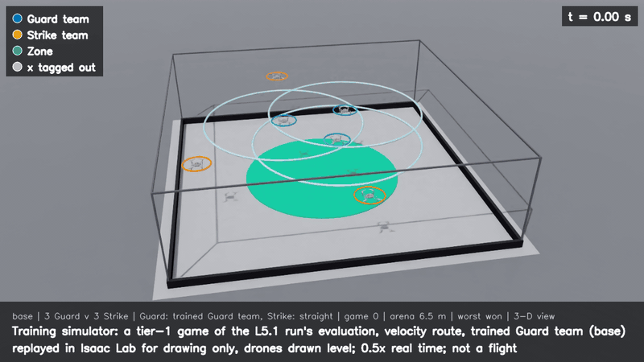

INTERNAL · the latest status of STE's own learning track and the NUS port, overwritten at every update by the `train-status` skill · [../README.md](../README.md); the history: [LOG.md](LOG.md)

**Status, 2026-11-25 14:28 (+08:00) (event: route 3 rulings R36–R41; execution workflow v3; its design review done)** · RTX 5090 · GPU 6 % / 49 W / 1.7 of 32 GB · 0 training processes (0 paused)

**Main track:** route 3 (the learned-skills route), stage LS1: design review done, **waiting on the owner's word for the build** · **Side track:** none (the learner v2 note follows LS1, R37)

**Plain summary.** Done: the owner's rulings on route 3 recorded (R36–R41); the execution workflow rewritten against the code and for the rulings (v3); two independent reviewers read it against the code. Happened: no reason found why the scripts could not be imitated (all eleven keep no memory and use only the drone's own view and slot), but one fault that would have stopped every head-training job at its first control, and fourteen further findings, all folded in. Why it matters: the build starts from a plan that has met the code; nothing is built or run yet, 0 GPU-h. [Workflow v3](../drafts/LS_EXECUTION_WORKFLOW.md) (section 0 is one screen; section 9 the review).

## Watch

Every L5 run now also has 3-D clips in its run folder (`runs/<run>/videos3d/`, top view and 3-D view, MP4 + GIF; 68 clips, 0 failures), rendered by `scripts/ste_l5_clips3d.py`. Since 25 Nov ~12:00 the job launcher starts it automatically after every finished training run of record (opt out `--no-post-clips3d`; state in `videos3d/HOOK_STATUS` and `ste_job.py status`); not yet run on the GPU with a real run. Tier-1 games drawn in Isaac Lab; not a flight.

Nothing new to watch: no run since the 12:10 status.

## Phases

| Phase | Status | Math library | Simulator | What |
|---|---|---|---|---|
| NUS port Phases 1–4 | DONE | JAX (NUS), PyTorch | NUS 2-D game (JAX); copy of NUS 2-D game (PyTorch); tier 1; tier 2 Isaac Lab | port, conversion, ladder rows |
| NUS port Phase 5 | PAUSED (5.1 FAIL T43) | PyTorch | tier 1 fast engine | route (b) stopped; STE Guard policy T41 kept |
| NUS port Phase 6 docs | DONE (passes 1, 2) | none | none | public docs |
| L0 Game definition | DONE (G0 ruled 22 Nov) | PyTorch | tier 1; tier 2 Isaac Lab | |
| L1 Drone model | DONE except L1.6 (waits on L1.3 + NEAR-962) | PyTorch | tier 1; tier 2; AirStack simulator (logs) | |
| L2 Game rules in training | DONE | PyTorch | tier 1; tier 2 Isaac Lab | |
| L3 Learner (two routes) | DONE | PyTorch | tier 1; tier 2 Isaac Lab (smoke) | |
| L4–L6 pipeline check | DONE, both routes PIPELINE WORKS (INFO) | PyTorch | tier 1 fast engine; tier 2 Isaac Lab (smoke) | 2.29 of 20 GPU-h |
| ▶ Route 3, LS1 Distil and LS1.4 Head training | NOT STARTED (design review DONE; WAITING on the owner's word) | PyTorch | tier 1 fast engine | the scripts copied into a skill network per team, then the heads trained on it |
| Route 3, LS2, self-play, LS3 | NOT STARTED (outlines; each needs its design note) | PyTorch | tier 1 fast engine | order by R41: LS2 → self-play → LS3 |
| L7–L9 | NOT STARTED | — | AirStack simulator; real flight | owner's gate |

## Route 3, stage LS1 and LS1.4, task by task

Task IDs from [the workflow v3](../drafts/LS_EXECUTION_WORKFLOW.md) sections 5 and 6.

| ID | Plain name | Status | Simulator | Result / ETA |
|---|---|---|---|---|
| — | Design review of the workflow and the plan (two reviewers) | DONE | none | 1 blocker, 14 further findings, folded in |
| — | Task plan rewritten from v3 and the two review reports | WAITING (owner's word) | none | first step of the build |
| M1–M4 | The four merges (skill network and switch; distillation and its read; export and clips; driver control and LS1.4 files) | NOT STARTED | CPU tests | estimate 2 to 4 days of agent work |
| LS1.5 | Calibration read (which errors the gate lets through) | NOT STARTED | tier 1 (CPU) | after M1; then the owner sets the limits (R38) |
| LS1.0 | Smoke of the distillation and the read | NOT STARTED | tier 1 (CPU) | after M2 |
| LS1.1 | Distil the Guard and Strike skills | NOT STARTED | tier 1 | asks 0.8 GPU-h |
| LS1.2 | Equivalence read, both sides | NOT STARTED | tier 1 (CPU) | 150 and 130 cells of 1,000 games |
| LS1.3 | Export and reload of both skill networks | NOT STARTED | CPU | |
| LS1.6 | 3-D clips of key games | NOT STARTED | tier-1 games drawn in Isaac Lab | asks 0.1 GPU-h |
| LS1.4 | Head training on the skill network, both sides, two seeds per arm | NOT STARTED | tier 1 | asks 4.0 GPU-h; needs the owner's confirmation of R39's reading |

GPU-h on route 3 so far: 0. L3–L6: 2.291 of 20 (RTX 5090 ledger). L1 + L2: 4.447 of 13 (`ste_job.py status`: own rows 0.907, carried 3.540).

## Other workstreams

| ID | Plain name | Status |
|---|---|---|
| — | Learner v2 note (observation v0.3, attention encoder, shared actor, team critic, league) | NOT STARTED: after LS1 (R37); its league part is pulled forward as route 3's pool entry for saved teams |
| — | Route page, figures and slides of route 3 redrawn for R39–R41 | WAITING on the owner's yes |
| NEAR-962 | Planned-pushes flight; the Crazyflie commanded gaps | unchanged from 24 Nov |

**Next.** 1) On the owner's word: the task plan rewritten from v3 and the review reports, read by one reviewer; then merge M1. 2) LS1.5 calibration read after M1, then the limits to the owner. 3) Nothing on the GPU before the gate file is hashed.

**Waiting on you.**
1. **The word for the route 3 build** (merges M1 to M4, then the jobs of workflow sections 5 and 6): blocks everything.
2. **The reading of R39** (no cap on all stages; every job states its hours; a job above 5 GPU-h announced; 200 in the settings file): until confirmed, GPU launches stay inside R36's 1.0 GPU-h; blocks LS1.4.
3. **Self-play timing** (the pool entry built early and a pilot after LS1.4; the full stage before LS2 only if the pilot shows room): blocks the self-play note.
4. **Redraw the route page and slides** for R39–R41: yes or no.
5. Later: the LS1 limits and the LS1.4 margin (R38), after LS1.5.

**Usage:** GPU 0. Agents: two Sonnet reviewers (A 0.18 M tokens, 7 min; B 0.31 M tokens, 14 min). Main session: Fable 5.2 (the owner's choice for this planning session); advisor tool four times (before the first draft, before v3, at the review fold-in, before done). Checks: the short document check and the document test set, four times (170 passed, 2 skipped each); no full suite (documents only).

**Ready to push.** 4 commits on `development` (`a133ba25`, `28184629`, `84ac01bf`, `b869520e`, plus this status): rulings R36–R41, workflow v3 with the design review, the two review reports; mirror updated; push from GitHub Desktop. `main` unchanged.
